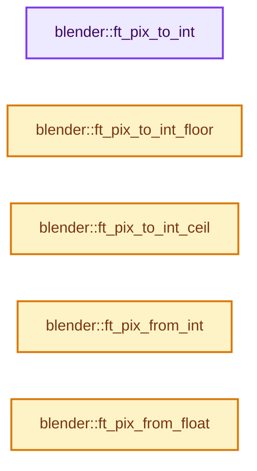

# 实现依赖专题：source/blender/blenfont/intern/blf_internal_types.hh

[方向导航](README.md) · [符号索引](../%E7%AC%A6%E5%8F%B7%E4%BE%9D%E8%B5%96%E4%B8%8E%E5%AE%9E%E7%8E%B0%E7%B4%A2%E5%BC%95.md)

本专题从正文实际调用进入，集中保存共享实现。函数有稳定锚点，可从调用处直接跳到对应完整函数；递归与互相调用通过回链组织。

## 本文件的实现关系




<a id="m-1bb7dca8cfe9"></a>

## 宏 `FT_PIX_ROUND`

<!-- annotated:5c51d70de9cf0e -->

```cpp
#define FT_PIX_ROUND(x) FT_PIX_FLOOR((x) + 32)
#define FT_PIX_CEIL(x) ((x) + 63)
```

<details>
<summary>核对原始源码：source/blender/blenfont/intern/blf_internal_types.hh · L75—L76</summary>

<!-- original:5c51d70de9cf0e:source/blender/blenfont/intern/blf_internal_types.hh:75:76 -->

```cpp
#define FT_PIX_ROUND(x) FT_PIX_FLOOR((x) + 32)
#define FT_PIX_CEIL(x) ((x) + 63)
```

</details>

宏在预处理阶段展开，参数替换、重复求值和条件编译应直接从该定义检查。与普通函数不同，宏不会自动提供参数类型检查；构建配置选择哪个定义需结合外围条件。

<a id="m-4d71510900c1"></a>

## 宏 `FT_PIX_CEIL`

<!-- annotated:67947c5976355a -->

```cpp
#define FT_PIX_CEIL(x) ((x) + 63)

```

<details>
<summary>核对原始源码：source/blender/blenfont/intern/blf_internal_types.hh · L76—L77</summary>

<!-- original:67947c5976355a:source/blender/blenfont/intern/blf_internal_types.hh:76:77 -->

```cpp
#define FT_PIX_CEIL(x) ((x) + 63)

```

</details>

宏在预处理阶段展开，参数替换、重复求值和条件编译应直接从该定义检查。与普通函数不同，宏不会自动提供参数类型检查；构建配置选择哪个定义需结合外围条件。

## 完整成员与函数实现

<a id="f-8513f2178301e2c7"></a>

### `blender::ft_pix_to_int`

实现位置：[source/blender/blenfont/intern/blf_internal_types.hh](../../../../../source/blender/blenfont/intern/blf_internal_types.hh) · L78—L81。

接口参数：

- `ft_pix v`

**教学注释版**

<!-- annotated:aac731ad996a5d -->

```cpp
inline int ft_pix_to_int(ft_pix v)
{
  return int(v >> 6);
}
```

<details>
<summary>核对原始源码：source/blender/blenfont/intern/blf_internal_types.hh · L78—L81</summary>

<!-- original:aac731ad996a5d:source/blender/blenfont/intern/blf_internal_types.hh:78:81 -->

```cpp
inline int ft_pix_to_int(ft_pix v)
{
  return int(v >> 6);
}
```

</details>

**结果出口**

- `return int(v >> 6);`

**继续追踪实现**

本实现没有需要继续展开的显式调用；检查返回表达式、对象转换和调用者前置条件。

<a id="f-d51cc0f44335d003"></a>

### `blender::ft_pix_to_int_floor`

实现位置：[source/blender/blenfont/intern/blf_internal_types.hh](../../../../../source/blender/blenfont/intern/blf_internal_types.hh) · L83—L86。

接口参数：

- `ft_pix v`

**教学注释版**

<!-- annotated:71a49635b4cf44 -->

```cpp
inline int ft_pix_to_int_floor(ft_pix v)
{
  return int(v >> 6); /* No need for explicit floor as the bits are removed when shifting. */
}
```

<details>
<summary>核对原始源码：source/blender/blenfont/intern/blf_internal_types.hh · L83—L86</summary>

<!-- original:71a49635b4cf44:source/blender/blenfont/intern/blf_internal_types.hh:83:86 -->

```cpp
inline int ft_pix_to_int_floor(ft_pix v)
{
  return int(v >> 6); /* No need for explicit floor as the bits are removed when shifting. */
}
```

</details>

**结果出口**

- `return int(v >> 6); /* No need for explicit floor as the bits are removed when shifting. */`

**继续追踪实现**

本实现没有需要继续展开的显式调用；检查返回表达式、对象转换和调用者前置条件。

<a id="f-706f6379e152cd4d"></a>

### `blender::ft_pix_to_int_ceil`

实现位置：[source/blender/blenfont/intern/blf_internal_types.hh](../../../../../source/blender/blenfont/intern/blf_internal_types.hh) · L88—L91。

接口参数：

- `ft_pix v`

**教学注释版**

<!-- annotated:14086719c33d8f -->

```cpp
inline int ft_pix_to_int_ceil(ft_pix v)
{
  return (FT_PIX_CEIL(v) >> 6);
}
```

<details>
<summary>核对原始源码：source/blender/blenfont/intern/blf_internal_types.hh · L88—L91</summary>

<!-- original:14086719c33d8f:source/blender/blenfont/intern/blf_internal_types.hh:88:91 -->

```cpp
inline int ft_pix_to_int_ceil(ft_pix v)
{
  return (FT_PIX_CEIL(v) >> 6);
}
```

</details>

**结果出口**

- `return (FT_PIX_CEIL(v) >> 6);`

**继续追踪实现**

- `FT_PIX_CEIL` → [FT_PIX_CEIL · L76](%E4%BE%9D%E8%B5%96-blf_internal_types-828120.md#m-4d71510900c1)。宏定义由构建条件选择。

<a id="f-42af8957e0cf7e45"></a>

### `blender::ft_pix_from_int`

实现位置：[source/blender/blenfont/intern/blf_internal_types.hh](../../../../../source/blender/blenfont/intern/blf_internal_types.hh) · L93—L96。

接口参数：

- `int v`

**教学注释版**

<!-- annotated:dbc20e23c8a0e2 -->

```cpp
inline ft_pix ft_pix_from_int(int v)
{
  return v * 64;
}
```

<details>
<summary>核对原始源码：source/blender/blenfont/intern/blf_internal_types.hh · L93—L96</summary>

<!-- original:dbc20e23c8a0e2:source/blender/blenfont/intern/blf_internal_types.hh:93:96 -->

```cpp
inline ft_pix ft_pix_from_int(int v)
{
  return v * 64;
}
```

</details>

**结果出口**

- `return v * 64;`

**继续追踪实现**

本实现没有需要继续展开的显式调用；检查返回表达式、对象转换和调用者前置条件。

<a id="f-22b763516a00ff40"></a>

### `blender::ft_pix_from_float`

实现位置：[source/blender/blenfont/intern/blf_internal_types.hh](../../../../../source/blender/blenfont/intern/blf_internal_types.hh) · L98—L101。

接口参数：

- `float v`

**教学注释版**

<!-- annotated:8ba07ece0fae59 -->

```cpp
inline ft_pix ft_pix_from_float(float v)
{
  return lroundf(v * 64.0f);
}
```

<details>
<summary>核对原始源码：source/blender/blenfont/intern/blf_internal_types.hh · L98—L101</summary>

<!-- original:8ba07ece0fae59:source/blender/blenfont/intern/blf_internal_types.hh:98:101 -->

```cpp
inline ft_pix ft_pix_from_float(float v)
{
  return lroundf(v * 64.0f);
}
```

</details>

**结果出口**

- `return lroundf(v * 64.0f);`

**继续追踪实现**

- `lroundf` → [调用协议](../%E6%A8%A1%E6%9D%BF%E5%AE%8F%E4%B8%8E%E5%8A%A8%E6%80%81%E5%88%86%E6%B4%BE%E5%8D%8F%E8%AE%AE.md)：函数指针、局部可调用对象或未展开的宏；必须结合调用者环境。调用位置L100。
