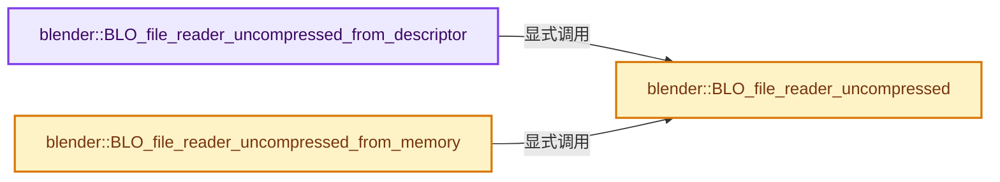

# 实现依赖专题：source/blender/blenloader_core/intern/blo_core_file_reader.cc

[方向导航](README.md) · [符号索引](../%E7%AC%A6%E5%8F%B7%E4%BE%9D%E8%B5%96%E4%B8%8E%E5%AE%9E%E7%8E%B0%E7%B4%A2%E5%BC%95.md)

本专题从正文实际调用进入，集中保存共享实现。函数有稳定锚点，可从调用处直接跳到对应完整函数；递归与互相调用通过回链组织。

## 本文件的实现关系




## 完整成员与函数实现

<a id="f-7d26f58455fb679a"></a>

### `blender::BLO_file_reader_uncompressed_from_descriptor`

实现位置：[source/blender/blenloader_core/intern/blo_core_file_reader.cc](../../../../../source/blender/blenloader_core/intern/blo_core_file_reader.cc) · L21—L29。

接口参数：

- `int filedes`

**教学注释版**

<!-- annotated:15b02eb616980b -->

```cpp
FileReader *BLO_file_reader_uncompressed_from_descriptor(int filedes)
{
  if (FileReader *mmap_reader = BLI_filereader_new_mmap(filedes)) {
    /* The mapped memory is still valid even when the file is closed. */
    close(filedes);
    return BLO_file_reader_uncompressed(mmap_reader);
  }
  return BLO_file_reader_uncompressed(BLI_filereader_new_file(filedes));
}
```

<details>
<summary>核对原始源码：source/blender/blenloader_core/intern/blo_core_file_reader.cc · L21—L29</summary>

<!-- original:15b02eb616980b:source/blender/blenloader_core/intern/blo_core_file_reader.cc:21:29 -->

```cpp
FileReader *BLO_file_reader_uncompressed_from_descriptor(int filedes)
{
  if (FileReader *mmap_reader = BLI_filereader_new_mmap(filedes)) {
    /* The mapped memory is still valid even when the file is closed. */
    close(filedes);
    return BLO_file_reader_uncompressed(mmap_reader);
  }
  return BLO_file_reader_uncompressed(BLI_filereader_new_file(filedes));
}
```

</details>

**结果出口**

- `return BLO_file_reader_uncompressed(mmap_reader);`
- `return BLO_file_reader_uncompressed(BLI_filereader_new_file(filedes));`

**继续追踪实现**

- `BLI_filereader_new_mmap` → [blender::BLI_filereader_new_mmap · L116](../03-%E5%86%85%E5%AD%98%E5%88%86%E9%85%8D%E4%B8%8E%E8%BF%90%E8%A1%8C%E6%97%B6%E7%B1%BB%E5%9E%8B/%E4%BE%9D%E8%B5%96-filereader_memory-b2e0dc.md#f-8227ddabcb0cb27a)。
- `close` → [blender::RawWriteWrap::close · L214](%E4%BE%9D%E8%B5%96-writefile-3eb36f.md#f-919e29e563ebcf8c)；[blender::ZstdWriteWrap::close · L404](%E4%BE%9D%E8%B5%96-writefile-3eb36f.md#f-78aad228a13e69b9)。同名重载需按实参类型选择。
- `BLO_file_reader_uncompressed` → [blender::BLO_file_reader_uncompressed · L36](%E4%BE%9D%E8%B5%96-blo_core_file_reader-6ad76d.md#f-fd559c596e05337e)。
- `BLI_filereader_new_file` → [blender::BLI_filereader_new_file · L56](../01-%E5%9F%BA%E7%A1%80%E5%AE%B9%E5%99%A8%E4%B8%8E%E7%8E%B0%E4%BB%A3CPP/%E4%BE%9D%E8%B5%96-filereader_file-dd6b97.md#f-2f1415144f29527a)。

<a id="f-ab47219c1c1ab4a6"></a>

### `blender::BLO_file_reader_uncompressed_from_memory`

实现位置：[source/blender/blenloader_core/intern/blo_core_file_reader.cc](../../../../../source/blender/blenloader_core/intern/blo_core_file_reader.cc) · L31—L34。

接口参数：

- `const void *mem`
- `const int memsize`

**教学注释版**

<!-- annotated:9778680174f9a2 -->

```cpp
FileReader *BLO_file_reader_uncompressed_from_memory(const void *mem, const int memsize)
{
  return BLO_file_reader_uncompressed(BLI_filereader_new_memory(mem, memsize));
}
```

<details>
<summary>核对原始源码：source/blender/blenloader_core/intern/blo_core_file_reader.cc · L31—L34</summary>

<!-- original:9778680174f9a2:source/blender/blenloader_core/intern/blo_core_file_reader.cc:31:34 -->

```cpp
FileReader *BLO_file_reader_uncompressed_from_memory(const void *mem, const int memsize)
{
  return BLO_file_reader_uncompressed(BLI_filereader_new_memory(mem, memsize));
}
```

</details>

**结果出口**

- `return BLO_file_reader_uncompressed(BLI_filereader_new_memory(mem, memsize));`

**继续追踪实现**

- `BLO_file_reader_uncompressed` → [blender::BLO_file_reader_uncompressed · L36](%E4%BE%9D%E8%B5%96-blo_core_file_reader-6ad76d.md#f-fd559c596e05337e)。
- `BLI_filereader_new_memory` → [blender::BLI_filereader_new_memory · L73](../03-%E5%86%85%E5%AD%98%E5%88%86%E9%85%8D%E4%B8%8E%E8%BF%90%E8%A1%8C%E6%97%B6%E7%B1%BB%E5%9E%8B/%E4%BE%9D%E8%B5%96-filereader_memory-b2e0dc.md#f-4b87a7fee9b758dd)。

<a id="f-fd559c596e05337e"></a>

### `blender::BLO_file_reader_uncompressed`

实现位置：[source/blender/blenloader_core/intern/blo_core_file_reader.cc](../../../../../source/blender/blenloader_core/intern/blo_core_file_reader.cc) · L36—L63。

接口参数：

- `FileReader *rawfile`

**教学注释版**

<!-- annotated:976a6272797abb -->

```cpp
FileReader *BLO_file_reader_uncompressed(FileReader *rawfile)
{
  if (!rawfile) {
    return nullptr;
  }
  char first_bytes[7];
  if (rawfile->read(rawfile, first_bytes, sizeof(first_bytes)) != sizeof(first_bytes)) {
    /* The file is too small to possibly be a valid blend file. */
    rawfile->close(rawfile);
    return nullptr;
  }
  /* Rewind to the start of the file. */
  rawfile->seek(rawfile, 0, SEEK_SET);
  if (memcmp(first_bytes, "BLENDER", sizeof(first_bytes)) == 0) {
    /* The file is uncompressed. */
    return rawfile;
  }
  if (BLI_file_magic_is_gzip(first_bytes)) {
    /* The new reader takes ownership of the rawfile. */
    return BLI_filereader_new_gzip(rawfile);
  }
  if (BLI_file_magic_is_zstd(first_bytes)) {
    /* The new reader takes ownership of the rawfile. */
    return BLI_filereader_new_zstd(rawfile);
  }
  rawfile->close(rawfile);
  return nullptr;
}
```

<details>
<summary>核对原始源码：source/blender/blenloader_core/intern/blo_core_file_reader.cc · L36—L63</summary>

<!-- original:976a6272797abb:source/blender/blenloader_core/intern/blo_core_file_reader.cc:36:63 -->

```cpp
FileReader *BLO_file_reader_uncompressed(FileReader *rawfile)
{
  if (!rawfile) {
    return nullptr;
  }
  char first_bytes[7];
  if (rawfile->read(rawfile, first_bytes, sizeof(first_bytes)) != sizeof(first_bytes)) {
    /* The file is too small to possibly be a valid blend file. */
    rawfile->close(rawfile);
    return nullptr;
  }
  /* Rewind to the start of the file. */
  rawfile->seek(rawfile, 0, SEEK_SET);
  if (memcmp(first_bytes, "BLENDER", sizeof(first_bytes)) == 0) {
    /* The file is uncompressed. */
    return rawfile;
  }
  if (BLI_file_magic_is_gzip(first_bytes)) {
    /* The new reader takes ownership of the rawfile. */
    return BLI_filereader_new_gzip(rawfile);
  }
  if (BLI_file_magic_is_zstd(first_bytes)) {
    /* The new reader takes ownership of the rawfile. */
    return BLI_filereader_new_zstd(rawfile);
  }
  rawfile->close(rawfile);
  return nullptr;
}
```

</details>

**结果出口**

- `return nullptr;`
- `return rawfile;`
- `return BLI_filereader_new_gzip(rawfile);`
- `return BLI_filereader_new_zstd(rawfile);`

**继续追踪实现**

- `rawfile->read` → [调用协议](../%E6%A8%A1%E6%9D%BF%E5%AE%8F%E4%B8%8E%E5%8A%A8%E6%80%81%E5%88%86%E6%B4%BE%E5%8D%8F%E8%AE%AE.md)：由接收对象具体类型或运行时策略提供实现。调用位置L42。
- `rawfile->close` → [blender::RawWriteWrap::close · L214](%E4%BE%9D%E8%B5%96-writefile-3eb36f.md#f-919e29e563ebcf8c)；[blender::ZstdWriteWrap::close · L404](%E4%BE%9D%E8%B5%96-writefile-3eb36f.md#f-78aad228a13e69b9)。同名重载需按实参类型选择。
- `rawfile->seek` → [调用协议](../%E6%A8%A1%E6%9D%BF%E5%AE%8F%E4%B8%8E%E5%8A%A8%E6%80%81%E5%88%86%E6%B4%BE%E5%8D%8F%E8%AE%AE.md)：由接收对象具体类型或运行时策略提供实现。调用位置L48。
- `memcmp` → [外部契约](https://eel.is/c++draft/)：这个边界按实际表达式及所属类型核对参数、返回值、寿命与失败行为。这里提供接口入口，不声称已解释该第三方版本的内部实现。
- `BLI_file_magic_is_gzip` → [blender::BLI_file_magic_is_gzip · L259](../01-%E5%9F%BA%E7%A1%80%E5%AE%B9%E5%99%A8%E4%B8%8E%E7%8E%B0%E4%BB%A3CPP/%E4%BE%9D%E8%B5%96-fileops_c-add581.md#f-b599299ecf75f7ee)。
- `BLI_filereader_new_gzip` → [blender::BLI_filereader_new_gzip · L77](../01-%E5%9F%BA%E7%A1%80%E5%AE%B9%E5%99%A8%E4%B8%8E%E7%8E%B0%E4%BB%A3CPP/%E4%BE%9D%E8%B5%96-filereader_gzip-481c35.md#f-442cd4abbcd382f5)。
- `BLI_file_magic_is_zstd` → [blender::BLI_file_magic_is_zstd · L266](../01-%E5%9F%BA%E7%A1%80%E5%AE%B9%E5%99%A8%E4%B8%8E%E7%8E%B0%E4%BB%A3CPP/%E4%BE%9D%E8%B5%96-fileops_c-add581.md#f-3aab416cabcae88e)。
- `BLI_filereader_new_zstd` → [blender::BLI_filereader_new_zstd · L299](../01-%E5%9F%BA%E7%A1%80%E5%AE%B9%E5%99%A8%E4%B8%8E%E7%8E%B0%E4%BB%A3CPP/%E4%BE%9D%E8%B5%96-filereader_zstd-93d7da.md#f-a6c6696faacade56)。
