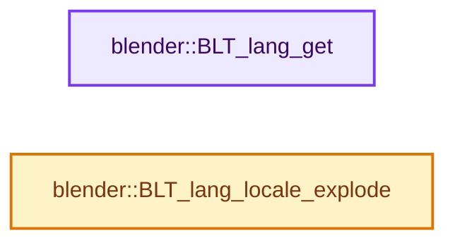
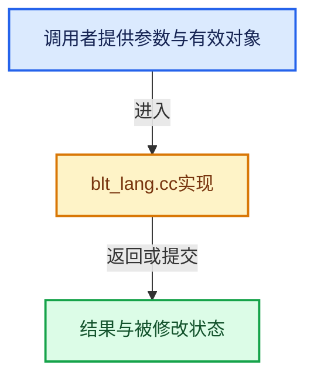

# 实现依赖专题：source/blender/blentranslation/intern/blt_lang.cc

[方向导航](README.md) · [符号索引](../%E7%AC%A6%E5%8F%B7%E4%BE%9D%E8%B5%96%E4%B8%8E%E5%AE%9E%E7%8E%B0%E7%B4%A2%E5%BC%95.md)

本专题从正文实际调用进入，集中保存共享实现。函数有稳定锚点，可从调用处直接跳到对应完整函数；递归与互相调用通过回链组织。

## 本文件的实现关系






<a id="m-d70655fbcf5d"></a>

## 宏 `LOCALE`

<!-- annotated:8c0e5695c96509 -->

```cpp
#  define LOCALE(_id) (locales ? locales[(_id)] : "")
#endif
```

<details>
<summary>核对原始源码：source/blender/blentranslation/intern/blt_lang.cc · L250—L251</summary>

<!-- original:8c0e5695c96509:source/blender/blentranslation/intern/blt_lang.cc:250:251 -->

```cpp
#  define LOCALE(_id) (locales ? locales[(_id)] : "")
#endif
```

</details>

宏在预处理阶段展开，参数替换、重复求值和条件编译应直接从该定义检查。与普通函数不同，宏不会自动提供参数类型检查；构建配置选择哪个定义需结合外围条件。

## 完整成员与函数实现

<a id="f-c6d2921bf6a5ccff"></a>

### `blender::BLT_lang_get`

实现位置：[source/blender/blentranslation/intern/blt_lang.cc](../../../../../source/blender/blentranslation/intern/blt_lang.cc) · L268—L283。

**教学注释版**

<!-- annotated:acffafbfe8acd3 -->

```cpp
const char *BLT_lang_get()
{
#ifdef WITH_INTERNATIONAL
  if (BLT_translate()) {
    const char *locale = LOCALE(ULANGUAGE);
    if (locale[0] == '\0') {
      /* Default locale, we have to find which one we are actually using! */
      locale = locale::full_name();
    }
    return locale;
  }
  return "en_US"; /* Kind of default locale in Blender when no translation enabled. */
#else
  return "";
#endif
}
```

<details>
<summary>核对原始源码：source/blender/blentranslation/intern/blt_lang.cc · L268—L283</summary>

<!-- original:acffafbfe8acd3:source/blender/blentranslation/intern/blt_lang.cc:268:283 -->

```cpp
const char *BLT_lang_get()
{
#ifdef WITH_INTERNATIONAL
  if (BLT_translate()) {
    const char *locale = LOCALE(ULANGUAGE);
    if (locale[0] == '\0') {
      /* Default locale, we have to find which one we are actually using! */
      locale = locale::full_name();
    }
    return locale;
  }
  return "en_US"; /* Kind of default locale in Blender when no translation enabled. */
#else
  return "";
#endif
}
```

</details>

**沿实际写入检查状态**

- `locale = locale::full_name();`

**结果出口**

- `return locale;`
- `return "en_US"; /* Kind of default locale in Blender when no translation enabled. */`
- `return "";`

**继续追踪实现**

- `BLT_translate` → [blender::BLT_translate · L81](%E4%BE%9D%E8%B5%96-blt_translation-6aa72a.md#f-9cc1d72f3f348689)。
- `LOCALE` → [LOCALE · L250](%E4%BE%9D%E8%B5%96-blt_lang-97bb72.md#m-d70655fbcf5d)。宏定义由构建条件选择。
- `locale::full_name` → [blender::locale::full_name · L638](%E4%BE%9D%E8%B5%96-messages-2a0df5.md#f-9b5a3b3e85a62a8e)。

<a id="f-86c4d52104024086"></a>

### `blender::BLT_lang_locale_explode`

实现位置：[source/blender/blentranslation/intern/blt_lang.cc](../../../../../source/blender/blentranslation/intern/blt_lang.cc) · L288—L347。

接口参数：

- `const char *locale`
- `char **language`
- `char **country`
- `char **variant`
- `char **language_country`
- `char **language_variant`

**教学注释版**

<!-- annotated:f2e3f29cc39c2b -->

```cpp
void BLT_lang_locale_explode(const char *locale,
                             char **language,
                             char **country,
                             char **variant,
                             char **language_country,
                             char **language_variant)
{
  const char *m1, *m2;
  char *_t = nullptr;

  m1 = strchr(locale, '_');
  m2 = strchr(locale, '@');

  if (language || language_variant) {
    if (m1 || m2) {
      _t = m1 ? BLI_strdupn(locale, m1 - locale) : BLI_strdupn(locale, m2 - locale);
      if (language) {
        *language = _t;
      }
    }
    else if (language) {
      *language = BLI_strdup(locale);
    }
  }
  if (country) {
    if (m1) {
      *country = m2 ? BLI_strdupn(m1 + 1, m2 - (m1 + 1)) : BLI_strdup(m1 + 1);
    }
    else {
      *country = nullptr;
    }
  }
  if (variant) {
    if (m2) {
      *variant = BLI_strdup(m2 + 1);
    }
    else {
      *variant = nullptr;
    }
  }
  if (language_country) {
    if (m1) {
      *language_country = m2 ? BLI_strdupn(locale, m2 - locale) : BLI_strdup(locale);
    }
    else {
      *language_country = nullptr;
    }
  }
  if (language_variant) {
    if (m2) {
      *language_variant = m1 ? BLI_strdupcat(_t, m2) : BLI_strdup(locale);
    }
    else {
      *language_variant = nullptr;
    }
  }
  if (_t && !language) {
    MEM_delete(_t);
  }
}
```

<details>
<summary>核对原始源码：source/blender/blentranslation/intern/blt_lang.cc · L288—L347</summary>

<!-- original:f2e3f29cc39c2b:source/blender/blentranslation/intern/blt_lang.cc:288:347 -->

```cpp
void BLT_lang_locale_explode(const char *locale,
                             char **language,
                             char **country,
                             char **variant,
                             char **language_country,
                             char **language_variant)
{
  const char *m1, *m2;
  char *_t = nullptr;

  m1 = strchr(locale, '_');
  m2 = strchr(locale, '@');

  if (language || language_variant) {
    if (m1 || m2) {
      _t = m1 ? BLI_strdupn(locale, m1 - locale) : BLI_strdupn(locale, m2 - locale);
      if (language) {
        *language = _t;
      }
    }
    else if (language) {
      *language = BLI_strdup(locale);
    }
  }
  if (country) {
    if (m1) {
      *country = m2 ? BLI_strdupn(m1 + 1, m2 - (m1 + 1)) : BLI_strdup(m1 + 1);
    }
    else {
      *country = nullptr;
    }
  }
  if (variant) {
    if (m2) {
      *variant = BLI_strdup(m2 + 1);
    }
    else {
      *variant = nullptr;
    }
  }
  if (language_country) {
    if (m1) {
      *language_country = m2 ? BLI_strdupn(locale, m2 - locale) : BLI_strdup(locale);
    }
    else {
      *language_country = nullptr;
    }
  }
  if (language_variant) {
    if (m2) {
      *language_variant = m1 ? BLI_strdupcat(_t, m2) : BLI_strdup(locale);
    }
    else {
      *language_variant = nullptr;
    }
  }
  if (_t && !language) {
    MEM_delete(_t);
  }
}
```

</details>

**沿实际写入检查状态**

- `m1 = strchr(locale, '_');`
- `m2 = strchr(locale, '@');`
- `_t = m1 ? BLI_strdupn(locale, m1 - locale) : BLI_strdupn(locale, m2 - locale);`

**继续追踪实现**

- `strchr` → [调用协议](../%E6%A8%A1%E6%9D%BF%E5%AE%8F%E4%B8%8E%E5%8A%A8%E6%80%81%E5%88%86%E6%B4%BE%E5%8D%8F%E8%AE%AE.md)：函数指针、局部可调用对象或未展开的宏；必须结合调用者环境。调用位置L298。
- `BLI_strdupn` → [blender::BLI_strdupn · L32](../01-%E5%9F%BA%E7%A1%80%E5%AE%B9%E5%99%A8%E4%B8%8E%E7%8E%B0%E4%BB%A3CPP/%E4%BE%9D%E8%B5%96-string-1d986f.md#f-65dc033cf6e67cff)。
- `BLI_strdup` → [blender::BLI_strdup · L43](../01-%E5%9F%BA%E7%A1%80%E5%AE%B9%E5%99%A8%E4%B8%8E%E7%8E%B0%E4%BB%A3CPP/%E4%BE%9D%E8%B5%96-string-1d986f.md#f-7e6d5c696c20c0e1)。
- `BLI_strdupcat` → [blender::BLI_strdupcat · L53](../01-%E5%9F%BA%E7%A1%80%E5%AE%B9%E5%99%A8%E4%B8%8E%E7%8E%B0%E4%BB%A3CPP/%E4%BE%9D%E8%B5%96-string-1d986f.md#f-900012b477ce45da)。
- `MEM_delete` → [MEM_delete · L400](../03-%E5%86%85%E5%AD%98%E5%88%86%E9%85%8D%E4%B8%8E%E8%BF%90%E8%A1%8C%E6%97%B6%E7%B1%BB%E5%9E%8B/%E4%BE%9D%E8%B5%96-MEM_guardedalloc-b54eca.md#f-9049ffdd1682887c)。
