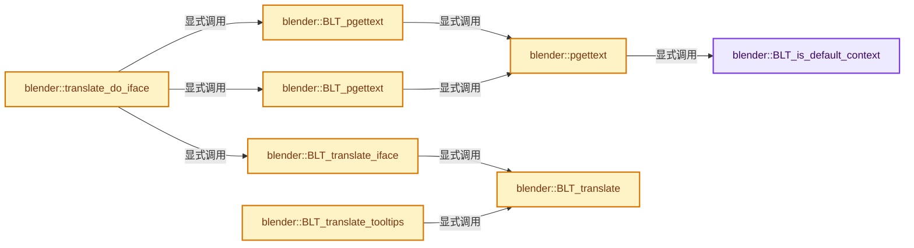
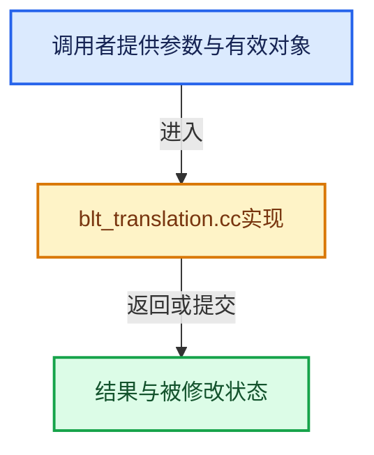

# 实现依赖专题：source/blender/blentranslation/intern/blt_translation.cc

[方向导航](README.md) · [符号索引](../%E7%AC%A6%E5%8F%B7%E4%BE%9D%E8%B5%96%E4%B8%8E%E5%AE%9E%E7%8E%B0%E7%B4%A2%E5%BC%95.md)

本专题从正文实际调用进入，集中保存共享实现。函数有稳定锚点，可从调用处直接跳到对应完整函数；递归与互相调用通过回链组织。

## 本文件的实现关系






## 完整成员与函数实现

<a id="f-0933e0b106b3f0b4"></a>

### `blender::BLT_is_default_context`

实现位置：[source/blender/blentranslation/intern/blt_translation.cc](../../../../../source/blender/blentranslation/intern/blt_translation.cc) · L31—L38。

接口参数：

- `const StringRef msgctxt`

**教学注释版**

<!-- annotated:f41e759c2c4727 -->

```cpp
bool BLT_is_default_context(const StringRef msgctxt)
{
  /* We use the "short" test, a more complete one could be:
   * return (!msgctxt || !msgctxt[0] || STREQ(msgctxt, BLT_I18NCONTEXT_DEFAULT_BPYRNA))
   */
  /* NOTE: trying without the void string check for now, it *should* not be necessary... */
  return (msgctxt.is_empty() || msgctxt[0] == BLT_I18NCONTEXT_DEFAULT_BPYRNA[0]);
}
```

<details>
<summary>核对原始源码：source/blender/blentranslation/intern/blt_translation.cc · L31—L38</summary>

<!-- original:f41e759c2c4727:source/blender/blentranslation/intern/blt_translation.cc:31:38 -->

```cpp
bool BLT_is_default_context(const StringRef msgctxt)
{
  /* We use the "short" test, a more complete one could be:
   * return (!msgctxt || !msgctxt[0] || STREQ(msgctxt, BLT_I18NCONTEXT_DEFAULT_BPYRNA))
   */
  /* NOTE: trying without the void string check for now, it *should* not be necessary... */
  return (msgctxt.is_empty() || msgctxt[0] == BLT_I18NCONTEXT_DEFAULT_BPYRNA[0]);
}
```

</details>

**结果出口**

- `return (msgctxt.is_empty() || msgctxt[0] == BLT_I18NCONTEXT_DEFAULT_BPYRNA[0]);`

**继续追踪实现**

- `msgctxt.is_empty` → [blender::Bounds<T>::is_empty · L533](../12-%E7%A9%BA%E9%97%B4%E6%95%B0%E6%8D%AE%E7%BB%93%E6%9E%84%E4%B8%8E%E5%87%A0%E4%BD%95%E7%AE%97%E6%B3%95/07-Bounds%E4%B8%8EBVH%E5%AF%B9%E6%AF%94.md#f-55ac376b3d0a0944)；[blender::GVArrayCommon::is_empty · L767](../04-%E8%99%9A%E6%8B%9F%E6%95%B0%E7%BB%84%E4%B8%8E%E7%B4%A2%E5%BC%95%E9%80%89%E6%8B%A9/05-GVArray%E8%BF%90%E8%A1%8C%E6%97%B6%E7%B1%BB%E5%9E%8B.md#f-c1da602ffc5555f9)；[blender::StringRefBase::is_empty · L201](../01-%E5%9F%BA%E7%A1%80%E5%AE%B9%E5%99%A8%E4%B8%8E%E7%8E%B0%E4%BB%A3CPP/15-StringRef%E5%AD%97%E7%AC%A6%E4%B8%B2%E8%A7%86%E5%9B%BE.md#f-9f6c3d2da1cb1796)；[blender::KDTreeNew<T>::is_empty · L498](../12-%E7%A9%BA%E9%97%B4%E6%95%B0%E6%8D%AE%E7%BB%93%E6%9E%84%E4%B8%8E%E5%87%A0%E4%BD%95%E7%AE%97%E6%B3%95/05-K%E8%BF%91%E9%82%BB%E4%B8%8E%E8%8C%83%E5%9B%B4%E6%9F%A5%E8%AF%A2.md#f-67f0ff91cf00b00b)。同名重载需按实参类型选择。

<a id="f-df4f9fd3bb7c9352"></a>

### `blender::pgettext`

实现位置：[source/blender/blentranslation/intern/blt_translation.cc](../../../../../source/blender/blentranslation/intern/blt_translation.cc) · L40—L61。

接口参数：

- `StringRef msgctxt`
- `const StringRef msgid`

**教学注释版**

<!-- annotated:52259289781833 -->

```cpp
static std::optional<StringRefNull> pgettext(StringRef msgctxt, const StringRef msgid)
{
#ifdef WITH_INTERNATIONAL
  if (msgid.is_empty()) {
    return std::nullopt;
  }
  if (BLT_is_default_context(msgctxt)) {
    msgctxt = BLT_I18NCONTEXT_DEFAULT;
  }
  if (const std::optional<StringRefNull> translation = locale::translate(0, msgctxt, msgid)) {
    return translation;
  }
#  ifdef WITH_PYTHON
  return BPY_app_translations_py_pgettext(msgctxt, msgid);
#  else
  return std::nullopt;
#  endif
#else
  UNUSED_VARS(msgctxt, msgid);
  return std::nullopt;
#endif
}
```

<details>
<summary>核对原始源码：source/blender/blentranslation/intern/blt_translation.cc · L40—L61</summary>

<!-- original:52259289781833:source/blender/blentranslation/intern/blt_translation.cc:40:61 -->

```cpp
static std::optional<StringRefNull> pgettext(StringRef msgctxt, const StringRef msgid)
{
#ifdef WITH_INTERNATIONAL
  if (msgid.is_empty()) {
    return std::nullopt;
  }
  if (BLT_is_default_context(msgctxt)) {
    msgctxt = BLT_I18NCONTEXT_DEFAULT;
  }
  if (const std::optional<StringRefNull> translation = locale::translate(0, msgctxt, msgid)) {
    return translation;
  }
#  ifdef WITH_PYTHON
  return BPY_app_translations_py_pgettext(msgctxt, msgid);
#  else
  return std::nullopt;
#  endif
#else
  UNUSED_VARS(msgctxt, msgid);
  return std::nullopt;
#endif
}
```

</details>

**沿实际写入检查状态**

- `msgctxt = BLT_I18NCONTEXT_DEFAULT;`

**结果出口**

- `return std::nullopt;`
- `return translation;`
- `return BPY_app_translations_py_pgettext(msgctxt, msgid);`

**继续追踪实现**

- `msgid.is_empty` → [blender::Bounds<T>::is_empty · L533](../12-%E7%A9%BA%E9%97%B4%E6%95%B0%E6%8D%AE%E7%BB%93%E6%9E%84%E4%B8%8E%E5%87%A0%E4%BD%95%E7%AE%97%E6%B3%95/07-Bounds%E4%B8%8EBVH%E5%AF%B9%E6%AF%94.md#f-55ac376b3d0a0944)；[blender::GVArrayCommon::is_empty · L767](../04-%E8%99%9A%E6%8B%9F%E6%95%B0%E7%BB%84%E4%B8%8E%E7%B4%A2%E5%BC%95%E9%80%89%E6%8B%A9/05-GVArray%E8%BF%90%E8%A1%8C%E6%97%B6%E7%B1%BB%E5%9E%8B.md#f-c1da602ffc5555f9)；[blender::StringRefBase::is_empty · L201](../01-%E5%9F%BA%E7%A1%80%E5%AE%B9%E5%99%A8%E4%B8%8E%E7%8E%B0%E4%BB%A3CPP/15-StringRef%E5%AD%97%E7%AC%A6%E4%B8%B2%E8%A7%86%E5%9B%BE.md#f-9f6c3d2da1cb1796)；[blender::KDTreeNew<T>::is_empty · L498](../12-%E7%A9%BA%E9%97%B4%E6%95%B0%E6%8D%AE%E7%BB%93%E6%9E%84%E4%B8%8E%E5%87%A0%E4%BD%95%E7%AE%97%E6%B3%95/05-K%E8%BF%91%E9%82%BB%E4%B8%8E%E8%8C%83%E5%9B%B4%E6%9F%A5%E8%AF%A2.md#f-67f0ff91cf00b00b)。同名重载需按实参类型选择。
- `BLT_is_default_context` → [blender::BLT_is_default_context · L31](%E4%BE%9D%E8%B5%96-blt_translation-6aa72a.md#f-0933e0b106b3f0b4)。
- `locale::translate` → [blender::locale::translate · L627](%E4%BE%9D%E8%B5%96-messages-2a0df5.md#f-457561e50cf5eddc)。
- `BPY_app_translations_py_pgettext` → [blender::BPY_app_translations_py_pgettext · L257](%E4%BE%9D%E8%B5%96-bpy_app_translations-0c44e6.md#f-22b0db23474823d2)。
- `UNUSED_VARS` → [UNUSED_VARS · L522](../01-%E5%9F%BA%E7%A1%80%E5%AE%B9%E5%99%A8%E4%B8%8E%E7%8E%B0%E4%BB%A3CPP/%E4%BE%9D%E8%B5%96-BLI_utildefines-293a0a.md#m-013582537634)；[UNUSED_VARS · L41](%E4%BE%9D%E8%B5%96-GPU_shader_shared_utils-0adda3.md#m-05d9d7a33da0)；[UNUSED_VARS · L62](%E4%BE%9D%E8%B5%96-GPU_shader_shared_utils-0adda3.md#m-e12c683a4aca)。宏定义由构建条件选择。

<a id="f-f6d25c17f2e72da1"></a>

### `blender::BLT_pgettext`

实现位置：[source/blender/blentranslation/intern/blt_translation.cc](../../../../../source/blender/blentranslation/intern/blt_translation.cc) · L63—L70。

接口参数：

- `const char *msgctxt`
- `const char *msgid`

**教学注释版**

<!-- annotated:819ca94afdb453 -->

```cpp
const char *BLT_pgettext(const char *msgctxt, const char *msgid)
{
  const std::optional<StringRefNull> translation = pgettext(msgctxt, msgid);
  if (!translation) {
    return msgid;
  }
  return translation->c_str();
}
```

<details>
<summary>核对原始源码：source/blender/blentranslation/intern/blt_translation.cc · L63—L70</summary>

<!-- original:819ca94afdb453:source/blender/blentranslation/intern/blt_translation.cc:63:70 -->

```cpp
const char *BLT_pgettext(const char *msgctxt, const char *msgid)
{
  const std::optional<StringRefNull> translation = pgettext(msgctxt, msgid);
  if (!translation) {
    return msgid;
  }
  return translation->c_str();
}
```

</details>

**结果出口**

- `return msgid;`
- `return translation->c_str();`

**继续追踪实现**

- `pgettext` → [blender::pgettext · L40](%E4%BE%9D%E8%B5%96-blt_translation-6aa72a.md#f-df4f9fd3bb7c9352)。
- `translation->c_str` → [外部契约](https://eel.is/c++draft/)：这个边界按实际表达式及所属类型核对参数、返回值、寿命与失败行为。这里提供接口入口，不声称已解释该第三方版本的内部实现。

<a id="f-1301124b4fd4302a"></a>

### `blender::BLT_pgettext`

实现位置：[source/blender/blentranslation/intern/blt_translation.cc](../../../../../source/blender/blentranslation/intern/blt_translation.cc) · L72—L79。

接口参数：

- `StringRef msgctxt`
- `StringRef msgid`

**教学注释版**

<!-- annotated:be2fb7059e2101 -->

```cpp
StringRef BLT_pgettext(StringRef msgctxt, StringRef msgid)
{
  const std::optional<StringRefNull> translation = pgettext(msgctxt, msgid);
  if (!translation) {
    return msgid;
  }
  return *translation;
}
```

<details>
<summary>核对原始源码：source/blender/blentranslation/intern/blt_translation.cc · L72—L79</summary>

<!-- original:be2fb7059e2101:source/blender/blentranslation/intern/blt_translation.cc:72:79 -->

```cpp
StringRef BLT_pgettext(StringRef msgctxt, StringRef msgid)
{
  const std::optional<StringRefNull> translation = pgettext(msgctxt, msgid);
  if (!translation) {
    return msgid;
  }
  return *translation;
}
```

</details>

**结果出口**

- `return msgid;`
- `return *translation;`

**继续追踪实现**

- `pgettext` → [blender::pgettext · L40](%E4%BE%9D%E8%B5%96-blt_translation-6aa72a.md#f-df4f9fd3bb7c9352)。

<a id="f-9cc1d72f3f348689"></a>

### `blender::BLT_translate`

实现位置：[source/blender/blentranslation/intern/blt_translation.cc](../../../../../source/blender/blentranslation/intern/blt_translation.cc) · L81—L88。

**教学注释版**

<!-- annotated:d6b593da4db7c9 -->

```cpp
bool BLT_translate()
{
#ifdef WITH_INTERNATIONAL
  return BLI_thread_is_main();
#else
  return false;
#endif
}
```

<details>
<summary>核对原始源码：source/blender/blentranslation/intern/blt_translation.cc · L81—L88</summary>

<!-- original:d6b593da4db7c9:source/blender/blentranslation/intern/blt_translation.cc:81:88 -->

```cpp
bool BLT_translate()
{
#ifdef WITH_INTERNATIONAL
  return BLI_thread_is_main();
#else
  return false;
#endif
}
```

</details>

**结果出口**

- `return BLI_thread_is_main();`
- `return false;`

**继续追踪实现**

- `BLI_thread_is_main` → [BLI_thread_is_main · L184](../01-%E5%9F%BA%E7%A1%80%E5%AE%B9%E5%99%A8%E4%B8%8E%E7%8E%B0%E4%BB%A3CPP/%E4%BE%9D%E8%B5%96-threads-a036bf.md#f-da304af4327defdc)。

<a id="f-afa796b8d60dca97"></a>

### `blender::BLT_translate_iface`

实现位置：[source/blender/blentranslation/intern/blt_translation.cc](../../../../../source/blender/blentranslation/intern/blt_translation.cc) · L90—L97。

**教学注释版**

<!-- annotated:40670d31bb4a71 -->

```cpp
bool BLT_translate_iface()
{
#ifdef WITH_INTERNATIONAL
  return BLT_translate() && (U.transopts & USER_TR_IFACE);
#else
  return false;
#endif
}
```

<details>
<summary>核对原始源码：source/blender/blentranslation/intern/blt_translation.cc · L90—L97</summary>

<!-- original:40670d31bb4a71:source/blender/blentranslation/intern/blt_translation.cc:90:97 -->

```cpp
bool BLT_translate_iface()
{
#ifdef WITH_INTERNATIONAL
  return BLT_translate() && (U.transopts & USER_TR_IFACE);
#else
  return false;
#endif
}
```

</details>

**结果出口**

- `return BLT_translate() && (U.transopts & USER_TR_IFACE);`
- `return false;`

**继续追踪实现**

- `BLT_translate` → [blender::BLT_translate · L81](%E4%BE%9D%E8%B5%96-blt_translation-6aa72a.md#f-9cc1d72f3f348689)。

<a id="f-02618410aaf64e20"></a>

### `blender::BLT_translate_tooltips`

实现位置：[source/blender/blentranslation/intern/blt_translation.cc](../../../../../source/blender/blentranslation/intern/blt_translation.cc) · L99—L106。

**教学注释版**

<!-- annotated:7e3718f74a2402 -->

```cpp
bool BLT_translate_tooltips()
{
#ifdef WITH_INTERNATIONAL
  return BLT_translate() && (U.transopts & USER_TR_TOOLTIPS);
#else
  return false;
#endif
}
```

<details>
<summary>核对原始源码：source/blender/blentranslation/intern/blt_translation.cc · L99—L106</summary>

<!-- original:7e3718f74a2402:source/blender/blentranslation/intern/blt_translation.cc:99:106 -->

```cpp
bool BLT_translate_tooltips()
{
#ifdef WITH_INTERNATIONAL
  return BLT_translate() && (U.transopts & USER_TR_TOOLTIPS);
#else
  return false;
#endif
}
```

</details>

**结果出口**

- `return BLT_translate() && (U.transopts & USER_TR_TOOLTIPS);`
- `return false;`

**继续追踪实现**

- `BLT_translate` → [blender::BLT_translate · L81](%E4%BE%9D%E8%B5%96-blt_translation-6aa72a.md#f-9cc1d72f3f348689)。

<a id="f-b15c9976f113b393"></a>

### `blender::translate_do_iface`

实现位置：[source/blender/blentranslation/intern/blt_translation.cc](../../../../../source/blender/blentranslation/intern/blt_translation.cc) · L151—L164。

接口参数：

- `StringT msgctxt`
- `StringT msgid`

**教学注释版**

<!-- annotated:9ae51fc22bf7c7 -->

```cpp
template<typename StringT> StringT translate_do_iface(StringT msgctxt, StringT msgid)
{
#ifdef WITH_INTERNATIONAL
  if (BLT_translate_iface()) {
    return BLT_pgettext(msgctxt, msgid);
  }

  return msgid;

#else
  (void)msgctxt;
  return msgid;
#endif
}
```

<details>
<summary>核对原始源码：source/blender/blentranslation/intern/blt_translation.cc · L151—L164</summary>

<!-- original:9ae51fc22bf7c7:source/blender/blentranslation/intern/blt_translation.cc:151:164 -->

```cpp
template<typename StringT> StringT translate_do_iface(StringT msgctxt, StringT msgid)
{
#ifdef WITH_INTERNATIONAL
  if (BLT_translate_iface()) {
    return BLT_pgettext(msgctxt, msgid);
  }

  return msgid;

#else
  (void)msgctxt;
  return msgid;
#endif
}
```

</details>

**结果出口**

- `return BLT_pgettext(msgctxt, msgid);`
- `return msgid;`

**继续追踪实现**

- `BLT_translate_iface` → [blender::BLT_translate_iface · L90](%E4%BE%9D%E8%B5%96-blt_translation-6aa72a.md#f-afa796b8d60dca97)。
- `BLT_pgettext` → [blender::BLT_pgettext · L63](%E4%BE%9D%E8%B5%96-blt_translation-6aa72a.md#f-f6d25c17f2e72da1)；[blender::BLT_pgettext · L72](%E4%BE%9D%E8%B5%96-blt_translation-6aa72a.md#f-1301124b4fd4302a)。同名重载需按实参类型选择。

<a id="f-5ea50b7c111223bd"></a>

### `blender::BLT_translate_do_iface`

实现位置：[source/blender/blentranslation/intern/blt_translation.cc](../../../../../source/blender/blentranslation/intern/blt_translation.cc) · L166—L169。

接口参数：

- `const char *msgctxt`
- `const char *msgid`

**教学注释版**

<!-- annotated:0592690ad78013 -->

```cpp
const char *BLT_translate_do_iface(const char *msgctxt, const char *msgid)
{
  return translate_do_iface(msgctxt, msgid);
}
```

<details>
<summary>核对原始源码：source/blender/blentranslation/intern/blt_translation.cc · L166—L169</summary>

<!-- original:0592690ad78013:source/blender/blentranslation/intern/blt_translation.cc:166:169 -->

```cpp
const char *BLT_translate_do_iface(const char *msgctxt, const char *msgid)
{
  return translate_do_iface(msgctxt, msgid);
}
```

</details>

**结果出口**

- `return translate_do_iface(msgctxt, msgid);`

**继续追踪实现**

- `translate_do_iface` → [blender::translate_do_iface · L151](%E4%BE%9D%E8%B5%96-blt_translation-6aa72a.md#f-b15c9976f113b393)。

<a id="f-73cd0944b96d4986"></a>

### `blender::BLT_translate_do_iface`

实现位置：[source/blender/blentranslation/intern/blt_translation.cc](../../../../../source/blender/blentranslation/intern/blt_translation.cc) · L171—L174。

接口参数：

- `StringRef msgctxt`
- `StringRef msgid`

**教学注释版**

<!-- annotated:d6ca2d1d2fa249 -->

```cpp
StringRef BLT_translate_do_iface(StringRef msgctxt, StringRef msgid)
{
  return translate_do_iface(msgctxt, msgid);
}
```

<details>
<summary>核对原始源码：source/blender/blentranslation/intern/blt_translation.cc · L171—L174</summary>

<!-- original:d6ca2d1d2fa249:source/blender/blentranslation/intern/blt_translation.cc:171:174 -->

```cpp
StringRef BLT_translate_do_iface(StringRef msgctxt, StringRef msgid)
{
  return translate_do_iface(msgctxt, msgid);
}
```

</details>

**结果出口**

- `return translate_do_iface(msgctxt, msgid);`

**继续追踪实现**

- `translate_do_iface` → [blender::translate_do_iface · L151](%E4%BE%9D%E8%B5%96-blt_translation-6aa72a.md#f-b15c9976f113b393)。

<a id="f-117b3bd4bf906899"></a>

### `blender::translate_do_tooltip`

实现位置：[source/blender/blentranslation/intern/blt_translation.cc](../../../../../source/blender/blentranslation/intern/blt_translation.cc) · L176—L189。

接口参数：

- `StringT msgctxt`
- `StringT msgid`

**教学注释版**

<!-- annotated:5a754c15b2c47b -->

```cpp
template<typename StringT> StringT translate_do_tooltip(StringT msgctxt, StringT msgid)
{
#ifdef WITH_INTERNATIONAL
  if (BLT_translate_tooltips()) {
    return BLT_pgettext(msgctxt, msgid);
  }

  return msgid;

#else
  (void)msgctxt;
  return msgid;
#endif
}
```

<details>
<summary>核对原始源码：source/blender/blentranslation/intern/blt_translation.cc · L176—L189</summary>

<!-- original:5a754c15b2c47b:source/blender/blentranslation/intern/blt_translation.cc:176:189 -->

```cpp
template<typename StringT> StringT translate_do_tooltip(StringT msgctxt, StringT msgid)
{
#ifdef WITH_INTERNATIONAL
  if (BLT_translate_tooltips()) {
    return BLT_pgettext(msgctxt, msgid);
  }

  return msgid;

#else
  (void)msgctxt;
  return msgid;
#endif
}
```

</details>

**结果出口**

- `return BLT_pgettext(msgctxt, msgid);`
- `return msgid;`

**继续追踪实现**

- `BLT_translate_tooltips` → [blender::BLT_translate_tooltips · L99](%E4%BE%9D%E8%B5%96-blt_translation-6aa72a.md#f-02618410aaf64e20)。
- `BLT_pgettext` → [blender::BLT_pgettext · L63](%E4%BE%9D%E8%B5%96-blt_translation-6aa72a.md#f-f6d25c17f2e72da1)；[blender::BLT_pgettext · L72](%E4%BE%9D%E8%B5%96-blt_translation-6aa72a.md#f-1301124b4fd4302a)。同名重载需按实参类型选择。

<a id="f-5ea272df2bea369c"></a>

### `blender::BLT_translate_do_tooltip`

实现位置：[source/blender/blentranslation/intern/blt_translation.cc](../../../../../source/blender/blentranslation/intern/blt_translation.cc) · L191—L194。

接口参数：

- `const char *msgctxt`
- `const char *msgid`

**教学注释版**

<!-- annotated:0ceecd33257798 -->

```cpp
const char *BLT_translate_do_tooltip(const char *msgctxt, const char *msgid)
{
  return translate_do_tooltip(msgctxt, msgid);
}
```

<details>
<summary>核对原始源码：source/blender/blentranslation/intern/blt_translation.cc · L191—L194</summary>

<!-- original:0ceecd33257798:source/blender/blentranslation/intern/blt_translation.cc:191:194 -->

```cpp
const char *BLT_translate_do_tooltip(const char *msgctxt, const char *msgid)
{
  return translate_do_tooltip(msgctxt, msgid);
}
```

</details>

**结果出口**

- `return translate_do_tooltip(msgctxt, msgid);`

**继续追踪实现**

- `translate_do_tooltip` → [blender::translate_do_tooltip · L176](%E4%BE%9D%E8%B5%96-blt_translation-6aa72a.md#f-117b3bd4bf906899)。

<a id="f-8cf4806bbb4c28ea"></a>

### `blender::BLT_translate_do_tooltip`

实现位置：[source/blender/blentranslation/intern/blt_translation.cc](../../../../../source/blender/blentranslation/intern/blt_translation.cc) · L196—L199。

接口参数：

- `StringRef msgctxt`
- `StringRef msgid`

**教学注释版**

<!-- annotated:3116d777de4864 -->

```cpp
StringRef BLT_translate_do_tooltip(StringRef msgctxt, StringRef msgid)
{
  return translate_do_tooltip(msgctxt, msgid);
}
```

<details>
<summary>核对原始源码：source/blender/blentranslation/intern/blt_translation.cc · L196—L199</summary>

<!-- original:3116d777de4864:source/blender/blentranslation/intern/blt_translation.cc:196:199 -->

```cpp
StringRef BLT_translate_do_tooltip(StringRef msgctxt, StringRef msgid)
{
  return translate_do_tooltip(msgctxt, msgid);
}
```

</details>

**结果出口**

- `return translate_do_tooltip(msgctxt, msgid);`

**继续追踪实现**

- `translate_do_tooltip` → [blender::translate_do_tooltip · L176](%E4%BE%9D%E8%B5%96-blt_translation-6aa72a.md#f-117b3bd4bf906899)。
