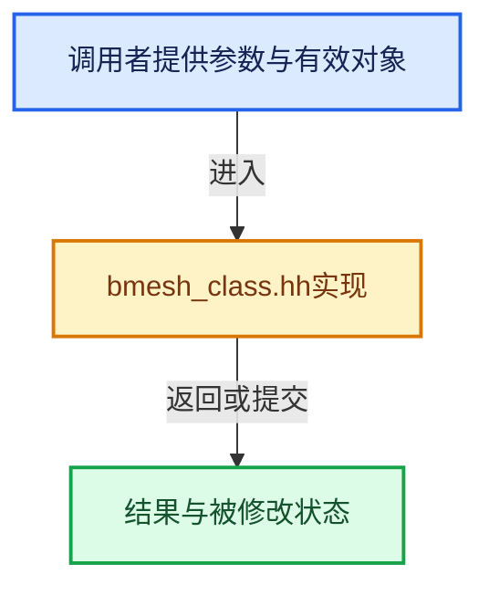

# 实现依赖专题：source/blender/bmesh/bmesh_class.hh

[方向导航](README.md) · [符号索引](../%E7%AC%A6%E5%8F%B7%E4%BE%9D%E8%B5%96%E4%B8%8E%E5%AE%9E%E7%8E%B0%E7%B4%A2%E5%BC%95.md)

本专题从正文实际调用进入，集中保存共享实现。函数有稳定锚点，可从调用处直接跳到对应完整函数；递归与互相调用通过回链组织。

## 本文件的实现关系





<a id="m-c0f0ab052376"></a>

## 宏 `BM_ELEM_CD_SET_INT`

<!-- annotated:89fa42c5ee1856 -->

```cpp
#define BM_ELEM_CD_SET_INT(ele, offset, f) \
  { \
    CHECK_TYPE_NONCONST(ele); \
    BLI_assert(offset != -1); \
    *((int *)((char *)(ele)->head.data + (offset))) = (f); \
  } \
  (void)0

```

<details>
<summary>核对原始源码：source/blender/bmesh/bmesh_class.hh · L574—L581</summary>

<!-- original:89fa42c5ee1856:source/blender/bmesh/bmesh_class.hh:574:581 -->

```cpp
#define BM_ELEM_CD_SET_INT(ele, offset, f) \
  { \
    CHECK_TYPE_NONCONST(ele); \
    BLI_assert(offset != -1); \
    *((int *)((char *)(ele)->head.data + (offset))) = (f); \
  } \
  (void)0

```

</details>

宏在预处理阶段展开，参数替换、重复求值和条件编译应直接从该定义检查。与普通函数不同，宏不会自动提供参数类型检查；构建配置选择哪个定义需结合外围条件。

<a id="m-d722975f4396"></a>

## 宏 `BM_ELEM_CD_GET_INT`

<!-- annotated:24e3976cf148bd -->

```cpp
#define BM_ELEM_CD_GET_INT(ele, offset) \
  (BLI_assert(offset != -1), *((int *)((char *)(ele)->head.data + (offset))))

```

<details>
<summary>核对原始源码：source/blender/bmesh/bmesh_class.hh · L582—L584</summary>

<!-- original:24e3976cf148bd:source/blender/bmesh/bmesh_class.hh:582:584 -->

```cpp
#define BM_ELEM_CD_GET_INT(ele, offset) \
  (BLI_assert(offset != -1), *((int *)((char *)(ele)->head.data + (offset))))

```

</details>

宏在预处理阶段展开，参数替换、重复求值和条件编译应直接从该定义检查。与普通函数不同，宏不会自动提供参数类型检查；构建配置选择哪个定义需结合外围条件。

<a id="m-3ead25bdabee"></a>

## 宏 `BM_ELEM_CD_SET_BOOL`

<!-- annotated:8ad50164b5e29c -->

```cpp
#define BM_ELEM_CD_SET_BOOL(ele, offset, f) \
  { \
    CHECK_TYPE_NONCONST(ele); \
    BLI_assert(offset != -1); \
    *((bool *)((char *)(ele)->head.data + (offset))) = (f); \
  } \
  (void)0

```

<details>
<summary>核对原始源码：source/blender/bmesh/bmesh_class.hh · L585—L592</summary>

<!-- original:8ad50164b5e29c:source/blender/bmesh/bmesh_class.hh:585:592 -->

```cpp
#define BM_ELEM_CD_SET_BOOL(ele, offset, f) \
  { \
    CHECK_TYPE_NONCONST(ele); \
    BLI_assert(offset != -1); \
    *((bool *)((char *)(ele)->head.data + (offset))) = (f); \
  } \
  (void)0

```

</details>

宏在预处理阶段展开，参数替换、重复求值和条件编译应直接从该定义检查。与普通函数不同，宏不会自动提供参数类型检查；构建配置选择哪个定义需结合外围条件。

<a id="m-6cba9d53d692"></a>

## 宏 `BM_ELEM_CD_GET_BOOL`

<!-- annotated:f94ea6eec281e2 -->

```cpp
#define BM_ELEM_CD_GET_BOOL(ele, offset) \
  (BLI_assert(offset != -1), *((bool *)((char *)(ele)->head.data + (offset))))

```

<details>
<summary>核对原始源码：source/blender/bmesh/bmesh_class.hh · L593—L595</summary>

<!-- original:f94ea6eec281e2:source/blender/bmesh/bmesh_class.hh:593:595 -->

```cpp
#define BM_ELEM_CD_GET_BOOL(ele, offset) \
  (BLI_assert(offset != -1), *((bool *)((char *)(ele)->head.data + (offset))))

```

</details>

宏在预处理阶段展开，参数替换、重复求值和条件编译应直接从该定义检查。与普通函数不同，宏不会自动提供参数类型检查；构建配置选择哪个定义需结合外围条件。

<a id="m-cdfe9f3023fa"></a>

## 宏 `BM_ELEM_CD_GET_VOID_P`

<!-- annotated:7cf6f73679500b -->

```cpp
#  define BM_ELEM_CD_GET_VOID_P(ele, offset) \
    (BLI_assert(offset != -1), \
     _Generic(ele, \
         GENERIC_TYPE_ANY(POINTER_OFFSET((ele)->head.data, offset), \
                          _BM_GENERIC_TYPE_ELEM_NONCONST), \
         GENERIC_TYPE_ANY((const void *)POINTER_OFFSET((ele)->head.data, offset), \
                          _BM_GENERIC_TYPE_ELEM_CONST)))
#else
```

<details>
<summary>核对原始源码：source/blender/bmesh/bmesh_class.hh · L610—L617</summary>

<!-- original:7cf6f73679500b:source/blender/bmesh/bmesh_class.hh:610:617 -->

```cpp
#  define BM_ELEM_CD_GET_VOID_P(ele, offset) \
    (BLI_assert(offset != -1), \
     _Generic(ele, \
         GENERIC_TYPE_ANY(POINTER_OFFSET((ele)->head.data, offset), \
                          _BM_GENERIC_TYPE_ELEM_NONCONST), \
         GENERIC_TYPE_ANY((const void *)POINTER_OFFSET((ele)->head.data, offset), \
                          _BM_GENERIC_TYPE_ELEM_CONST)))
#else
```

</details>

宏在预处理阶段展开，参数替换、重复求值和条件编译应直接从该定义检查。与普通函数不同，宏不会自动提供参数类型检查；构建配置选择哪个定义需结合外围条件。

<a id="m-126b1260772d"></a>

## 宏 `BM_ELEM_CD_GET_VOID_P`

<!-- annotated:07e1160511826b -->

```cpp
#  define BM_ELEM_CD_GET_VOID_P(ele, offset) \
    (BLI_assert(offset != -1), (void *)((char *)(ele)->head.data + (offset)))
#endif
```

<details>
<summary>核对原始源码：source/blender/bmesh/bmesh_class.hh · L618—L620</summary>

<!-- original:07e1160511826b:source/blender/bmesh/bmesh_class.hh:618:620 -->

```cpp
#  define BM_ELEM_CD_GET_VOID_P(ele, offset) \
    (BLI_assert(offset != -1), (void *)((char *)(ele)->head.data + (offset)))
#endif
```

</details>

宏在预处理阶段展开，参数替换、重复求值和条件编译应直接从该定义检查。与普通函数不同，宏不会自动提供参数类型检查；构建配置选择哪个定义需结合外围条件。

<a id="m-a59b1072d675"></a>

## 宏 `BM_ELEM_CD_SET_FLOAT`

<!-- annotated:e2ff42ee40692c -->

```cpp
#define BM_ELEM_CD_SET_FLOAT(ele, offset, f) \
  { \
    CHECK_TYPE_NONCONST(ele); \
    BLI_assert(offset != -1); \
    *((float *)((char *)(ele)->head.data + (offset))) = (f); \
  } \
  (void)0

```

<details>
<summary>核对原始源码：source/blender/bmesh/bmesh_class.hh · L622—L629</summary>

<!-- original:e2ff42ee40692c:source/blender/bmesh/bmesh_class.hh:622:629 -->

```cpp
#define BM_ELEM_CD_SET_FLOAT(ele, offset, f) \
  { \
    CHECK_TYPE_NONCONST(ele); \
    BLI_assert(offset != -1); \
    *((float *)((char *)(ele)->head.data + (offset))) = (f); \
  } \
  (void)0

```

</details>

宏在预处理阶段展开，参数替换、重复求值和条件编译应直接从该定义检查。与普通函数不同，宏不会自动提供参数类型检查；构建配置选择哪个定义需结合外围条件。

<a id="m-f02a9920f7a0"></a>

## 宏 `BM_ELEM_CD_GET_FLOAT`

<!-- annotated:851bff19cbca91 -->

```cpp
#define BM_ELEM_CD_GET_FLOAT(ele, offset) \
  (BLI_assert(offset != -1), *((float *)((char *)(ele)->head.data + (offset))))

```

<details>
<summary>核对原始源码：source/blender/bmesh/bmesh_class.hh · L630—L632</summary>

<!-- original:851bff19cbca91:source/blender/bmesh/bmesh_class.hh:630:632 -->

```cpp
#define BM_ELEM_CD_GET_FLOAT(ele, offset) \
  (BLI_assert(offset != -1), *((float *)((char *)(ele)->head.data + (offset))))

```

</details>

宏在预处理阶段展开，参数替换、重复求值和条件编译应直接从该定义检查。与普通函数不同，宏不会自动提供参数类型检查；构建配置选择哪个定义需结合外围条件。

<a id="m-544f72c45c1b"></a>

## 宏 `BM_ELEM_CD_GET_FLOAT_P`

<!-- annotated:abcc4acae92f82 -->

```cpp
#  define BM_ELEM_CD_GET_FLOAT_P(ele, offset) \
    (BLI_assert(offset != -1), \
     _Generic(ele, \
         GENERIC_TYPE_ANY((float *)POINTER_OFFSET((ele)->head.data, offset), \
                          _BM_GENERIC_TYPE_ELEM_NONCONST), \
         GENERIC_TYPE_ANY((const float *)POINTER_OFFSET((ele)->head.data, offset), \
                          _BM_GENERIC_TYPE_ELEM_CONST)))

```

<details>
<summary>核对原始源码：source/blender/bmesh/bmesh_class.hh · L635—L642</summary>

<!-- original:abcc4acae92f82:source/blender/bmesh/bmesh_class.hh:635:642 -->

```cpp
#  define BM_ELEM_CD_GET_FLOAT_P(ele, offset) \
    (BLI_assert(offset != -1), \
     _Generic(ele, \
         GENERIC_TYPE_ANY((float *)POINTER_OFFSET((ele)->head.data, offset), \
                          _BM_GENERIC_TYPE_ELEM_NONCONST), \
         GENERIC_TYPE_ANY((const float *)POINTER_OFFSET((ele)->head.data, offset), \
                          _BM_GENERIC_TYPE_ELEM_CONST)))

```

</details>

宏在预处理阶段展开，参数替换、重复求值和条件编译应直接从该定义检查。与普通函数不同，宏不会自动提供参数类型检查；构建配置选择哪个定义需结合外围条件。

<a id="m-10ef07da11b4"></a>

## 宏 `BM_ELEM_CD_GET_FLOAT2_P`

<!-- annotated:3ae9a7df4ccadd -->

```cpp
#  define BM_ELEM_CD_GET_FLOAT2_P(ele, offset) \
    (BLI_assert(offset != -1), \
     _Generic(ele, \
         GENERIC_TYPE_ANY((float (*)[2])POINTER_OFFSET((ele)->head.data, offset), \
                          _BM_GENERIC_TYPE_ELEM_NONCONST), \
         GENERIC_TYPE_ANY((const float (*)[2])POINTER_OFFSET((ele)->head.data, offset), \
                          _BM_GENERIC_TYPE_ELEM_CONST)))

```

<details>
<summary>核对原始源码：source/blender/bmesh/bmesh_class.hh · L643—L650</summary>

<!-- original:3ae9a7df4ccadd:source/blender/bmesh/bmesh_class.hh:643:650 -->

```cpp
#  define BM_ELEM_CD_GET_FLOAT2_P(ele, offset) \
    (BLI_assert(offset != -1), \
     _Generic(ele, \
         GENERIC_TYPE_ANY((float (*)[2])POINTER_OFFSET((ele)->head.data, offset), \
                          _BM_GENERIC_TYPE_ELEM_NONCONST), \
         GENERIC_TYPE_ANY((const float (*)[2])POINTER_OFFSET((ele)->head.data, offset), \
                          _BM_GENERIC_TYPE_ELEM_CONST)))

```

</details>

宏在预处理阶段展开，参数替换、重复求值和条件编译应直接从该定义检查。与普通函数不同，宏不会自动提供参数类型检查；构建配置选择哪个定义需结合外围条件。

<a id="m-c11efbe96e86"></a>

## 宏 `BM_ELEM_CD_GET_FLOAT_P`

<!-- annotated:f87ecd510c2a82 -->

```cpp
#  define BM_ELEM_CD_GET_FLOAT_P(ele, offset) \
    (BLI_assert(offset != -1), (float *)((char *)(ele)->head.data + (offset)))

```

<details>
<summary>核对原始源码：source/blender/bmesh/bmesh_class.hh · L661—L663</summary>

<!-- original:f87ecd510c2a82:source/blender/bmesh/bmesh_class.hh:661:663 -->

```cpp
#  define BM_ELEM_CD_GET_FLOAT_P(ele, offset) \
    (BLI_assert(offset != -1), (float *)((char *)(ele)->head.data + (offset)))

```

</details>

宏在预处理阶段展开，参数替换、重复求值和条件编译应直接从该定义检查。与普通函数不同，宏不会自动提供参数类型检查；构建配置选择哪个定义需结合外围条件。

<a id="m-153e8251a2c9"></a>

## 宏 `BM_ELEM_CD_GET_FLOAT2_P`

<!-- annotated:10e72994defed2 -->

```cpp
#  define BM_ELEM_CD_GET_FLOAT2_P(ele, offset) \
    (BLI_assert(offset != -1), (float (*)[2])((char *)(ele)->head.data + (offset)))

```

<details>
<summary>核对原始源码：source/blender/bmesh/bmesh_class.hh · L664—L666</summary>

<!-- original:10e72994defed2:source/blender/bmesh/bmesh_class.hh:664:666 -->

```cpp
#  define BM_ELEM_CD_GET_FLOAT2_P(ele, offset) \
    (BLI_assert(offset != -1), (float (*)[2])((char *)(ele)->head.data + (offset)))

```

</details>

宏在预处理阶段展开，参数替换、重复求值和条件编译应直接从该定义检查。与普通函数不同，宏不会自动提供参数类型检查；构建配置选择哪个定义需结合外围条件。

<a id="m-c7e10ffb38e6"></a>

## 宏 `BM_FACE_FIRST_LOOP`

<!-- annotated:1b45989397c5ce -->

```cpp
#  define BM_FACE_FIRST_LOOP(p) (((BMLoopList *)((p)->loops.first))->first)
#else
```

<details>
<summary>核对原始源码：source/blender/bmesh/bmesh_class.hh · L697—L698</summary>

<!-- original:1b45989397c5ce:source/blender/bmesh/bmesh_class.hh:697:698 -->

```cpp
#  define BM_FACE_FIRST_LOOP(p) (((BMLoopList *)((p)->loops.first))->first)
#else
```

</details>

宏在预处理阶段展开，参数替换、重复求值和条件编译应直接从该定义检查。与普通函数不同，宏不会自动提供参数类型检查；构建配置选择哪个定义需结合外围条件。

<a id="m-76a054cc4770"></a>

## 宏 `BM_FACE_FIRST_LOOP`

<!-- annotated:b7f65a1d71c164 -->

```cpp
#  define BM_FACE_FIRST_LOOP(p) ((p)->l_first)
#endif
```

<details>
<summary>核对原始源码：source/blender/bmesh/bmesh_class.hh · L699—L700</summary>

<!-- original:b7f65a1d71c164:source/blender/bmesh/bmesh_class.hh:699:700 -->

```cpp
#  define BM_FACE_FIRST_LOOP(p) ((p)->l_first)
#endif
```

</details>

宏在预处理阶段展开，参数替换、重复求值和条件编译应直接从该定义检查。与普通函数不同，宏不会自动提供参数类型检查；构建配置选择哪个定义需结合外围条件。

<a id="m-5b55b3533de2"></a>

## 宏 `BM_DISK_EDGE_NEXT`

<!-- annotated:6fb00047ad44ff -->

```cpp
#define BM_DISK_EDGE_NEXT(e, v) \
  (CHECK_TYPE_INLINE(e, BMEdge *), \
   CHECK_TYPE_INLINE(v, BMVert *), \
   BLI_assert(BM_vert_in_edge(e, v)), \
   (((&e->v1_disk_link)[v == e->v2]).next))
#define BM_DISK_EDGE_PREV(e, v) \
```

<details>
<summary>核对原始源码：source/blender/bmesh/bmesh_class.hh · L702—L707</summary>

<!-- original:6fb00047ad44ff:source/blender/bmesh/bmesh_class.hh:702:707 -->

```cpp
#define BM_DISK_EDGE_NEXT(e, v) \
  (CHECK_TYPE_INLINE(e, BMEdge *), \
   CHECK_TYPE_INLINE(v, BMVert *), \
   BLI_assert(BM_vert_in_edge(e, v)), \
   (((&e->v1_disk_link)[v == e->v2]).next))
#define BM_DISK_EDGE_PREV(e, v) \
```

</details>

宏在预处理阶段展开，参数替换、重复求值和条件编译应直接从该定义检查。与普通函数不同，宏不会自动提供参数类型检查；构建配置选择哪个定义需结合外围条件。

<a id="m-3c21db8f22cc"></a>

## 宏 `BM_DISK_EDGE_PREV`

<!-- annotated:2784909bcf7695 -->

```cpp
#define BM_DISK_EDGE_PREV(e, v) \
  (CHECK_TYPE_INLINE(e, BMEdge *), \
   CHECK_TYPE_INLINE(v, BMVert *), \
   BLI_assert(BM_vert_in_edge(e, v)), \
   (((&e->v1_disk_link)[v == e->v2]).prev))

```

<details>
<summary>核对原始源码：source/blender/bmesh/bmesh_class.hh · L707—L712</summary>

<!-- original:2784909bcf7695:source/blender/bmesh/bmesh_class.hh:707:712 -->

```cpp
#define BM_DISK_EDGE_PREV(e, v) \
  (CHECK_TYPE_INLINE(e, BMEdge *), \
   CHECK_TYPE_INLINE(v, BMVert *), \
   BLI_assert(BM_vert_in_edge(e, v)), \
   (((&e->v1_disk_link)[v == e->v2]).prev))

```

</details>

宏在预处理阶段展开，参数替换、重复求值和条件编译应直接从该定义检查。与普通函数不同，宏不会自动提供参数类型检查；构建配置选择哪个定义需结合外围条件。

## 完整成员与函数实现
