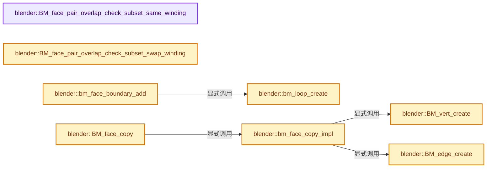
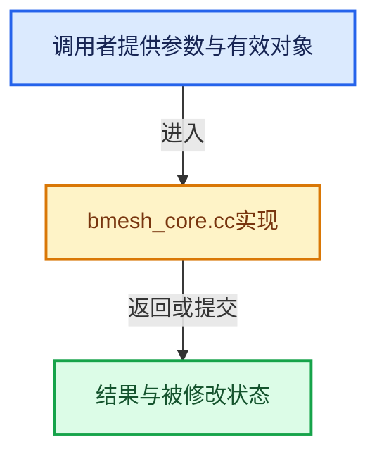

# 实现依赖专题：source/blender/bmesh/intern/bmesh_core.cc

[方向导航](README.md) · [符号索引](../%E7%AC%A6%E5%8F%B7%E4%BE%9D%E8%B5%96%E4%B8%8E%E5%AE%9E%E7%8E%B0%E7%B4%A2%E5%BC%95.md)

本专题从正文实际调用进入，集中保存共享实现。函数有稳定锚点，可从调用处直接跳到对应完整函数；递归与互相调用通过回链组织。

## 本文件的实现关系






## 完整成员与函数实现

<a id="f-757275778740c120"></a>

### `blender::BM_face_pair_overlap_check_subset_same_winding`

实现位置：[source/blender/bmesh/intern/bmesh_core.cc](../../../../../source/blender/bmesh/intern/bmesh_core.cc) · L45—L85。

接口参数：

- `const BMLoop *l_a`
- `const BMLoop *l_a_end`
- `const BMLoop *l_b`
- `const BMLoop *l_b_end`

**教学注释版**

<!-- annotated:624955aad2441d -->

```cpp
bool BM_face_pair_overlap_check_subset_same_winding(const BMLoop *l_a,
                                                    const BMLoop *l_a_end,
                                                    const BMLoop *l_b,
                                                    const BMLoop *l_b_end)
{
  BLI_assert(l_a->f == l_a_end->f);
  BLI_assert(l_b->f == l_b_end->f);
  BLI_assert(l_a->f != l_b->f);
  UNUSED_VARS_NDEBUG(l_b_end);
#ifndef NDEBUG
  /* Ensure the loops have the same topological distance. */
  {
    const BMLoop *l_a_iter = l_a;
    const BMLoop *l_b_iter = l_b;
    while (true) {
      if (l_a_iter == l_a_end || l_b_iter == l_b_end) {
        break;
      }
      l_a_iter = l_a_iter->next;
      l_b_iter = l_b_iter->next;
    }
    BLI_assert(l_a_iter == l_a_end);
    BLI_assert(l_b_iter == l_b_end);
  }
#endif
  const BMLoop *l_a_iter = l_a;
  const BMLoop *l_b_iter = l_b;
  BLI_assert(l_a->f != l_b->f);
  while (true) {
    if (l_b_iter->v != l_a_iter->v) {
      return false;
    }
    if (l_a_iter == l_a_end) {
      BLI_assert(l_b_iter == l_b_end);
      break;
    }
    l_a_iter = l_a_iter->next;
    l_b_iter = l_b_iter->next;
  }
  return true;
}
```

<details>
<summary>核对原始源码：source/blender/bmesh/intern/bmesh_core.cc · L45—L85</summary>

<!-- original:624955aad2441d:source/blender/bmesh/intern/bmesh_core.cc:45:85 -->

```cpp
bool BM_face_pair_overlap_check_subset_same_winding(const BMLoop *l_a,
                                                    const BMLoop *l_a_end,
                                                    const BMLoop *l_b,
                                                    const BMLoop *l_b_end)
{
  BLI_assert(l_a->f == l_a_end->f);
  BLI_assert(l_b->f == l_b_end->f);
  BLI_assert(l_a->f != l_b->f);
  UNUSED_VARS_NDEBUG(l_b_end);
#ifndef NDEBUG
  /* Ensure the loops have the same topological distance. */
  {
    const BMLoop *l_a_iter = l_a;
    const BMLoop *l_b_iter = l_b;
    while (true) {
      if (l_a_iter == l_a_end || l_b_iter == l_b_end) {
        break;
      }
      l_a_iter = l_a_iter->next;
      l_b_iter = l_b_iter->next;
    }
    BLI_assert(l_a_iter == l_a_end);
    BLI_assert(l_b_iter == l_b_end);
  }
#endif
  const BMLoop *l_a_iter = l_a;
  const BMLoop *l_b_iter = l_b;
  BLI_assert(l_a->f != l_b->f);
  while (true) {
    if (l_b_iter->v != l_a_iter->v) {
      return false;
    }
    if (l_a_iter == l_a_end) {
      BLI_assert(l_b_iter == l_b_end);
      break;
    }
    l_a_iter = l_a_iter->next;
    l_b_iter = l_b_iter->next;
  }
  return true;
}
```

</details>

**沿实际写入检查状态**

- `l_a_iter = l_a_iter->next;`
- `l_b_iter = l_b_iter->next;`

**结果出口**

- `return false;`
- `return true;`

**继续追踪实现**

- `BLI_assert` → [BLI_assert · L48](../01-%E5%9F%BA%E7%A1%80%E5%AE%B9%E5%99%A8%E4%B8%8E%E7%8E%B0%E4%BB%A3CPP/%E4%BE%9D%E8%B5%96-BLI_assert-cc98e8.md#m-57a88495704d)；[BLI_assert · L63](../01-%E5%9F%BA%E7%A1%80%E5%AE%B9%E5%99%A8%E4%B8%8E%E7%8E%B0%E4%BB%A3CPP/%E4%BE%9D%E8%B5%96-BLI_assert-cc98e8.md#m-d07050020cb5)。宏定义由构建条件选择。
- `UNUSED_VARS_NDEBUG` → [UNUSED_VARS_NDEBUG · L526](../01-%E5%9F%BA%E7%A1%80%E5%AE%B9%E5%99%A8%E4%B8%8E%E7%8E%B0%E4%BB%A3CPP/%E4%BE%9D%E8%B5%96-BLI_utildefines-293a0a.md#m-fea439f7d366)；[UNUSED_VARS_NDEBUG · L528](../01-%E5%9F%BA%E7%A1%80%E5%AE%B9%E5%99%A8%E4%B8%8E%E7%8E%B0%E4%BB%A3CPP/%E4%BE%9D%E8%B5%96-BLI_utildefines-293a0a.md#m-a8f8cfac06c0)。宏定义由构建条件选择。

<a id="f-27b412ad19719530"></a>

### `blender::BM_face_pair_overlap_check_subset_swap_winding`

实现位置：[source/blender/bmesh/intern/bmesh_core.cc](../../../../../source/blender/bmesh/intern/bmesh_core.cc) · L87—L126。

接口参数：

- `const BMLoop *l_a`
- `const BMLoop *l_a_end`
- `const BMLoop *l_b`
- `const BMLoop *l_b_end`

**教学注释版**

<!-- annotated:57dab5de54b007 -->

```cpp
bool BM_face_pair_overlap_check_subset_swap_winding(const BMLoop *l_a,
                                                    const BMLoop *l_a_end,
                                                    const BMLoop *l_b,
                                                    const BMLoop *l_b_end)
{
  BLI_assert(l_a->f == l_a_end->f);
  BLI_assert(l_b->f == l_b_end->f);
  BLI_assert(l_a->f != l_b->f);
  UNUSED_VARS_NDEBUG(l_b_end);
#ifndef NDEBUG
  /* Ensure the loops have the same topological distance. */
  {
    const BMLoop *l_a_iter = l_a;
    const BMLoop *l_b_iter = l_b;
    while (true) {
      if (l_a_iter == l_a_end || l_b_iter == l_b_end) {
        break;
      }
      l_a_iter = l_a_iter->next;
      l_b_iter = l_b_iter->prev;
    }
    BLI_assert(l_a_iter == l_a_end);
    BLI_assert(l_b_iter == l_b_end);
  }
#endif
  const BMLoop *l_a_iter = l_a;
  const BMLoop *l_b_iter = l_b;
  while (true) {
    if (l_b_iter->v != l_a_iter->v) {
      return false;
    }
    if (l_a_iter == l_a_end) {
      BLI_assert(l_b_iter == l_b_end);
      break;
    }
    l_a_iter = l_a_iter->next;
    l_b_iter = l_b_iter->prev;
  }
  return true;
}
```

<details>
<summary>核对原始源码：source/blender/bmesh/intern/bmesh_core.cc · L87—L126</summary>

<!-- original:57dab5de54b007:source/blender/bmesh/intern/bmesh_core.cc:87:126 -->

```cpp
bool BM_face_pair_overlap_check_subset_swap_winding(const BMLoop *l_a,
                                                    const BMLoop *l_a_end,
                                                    const BMLoop *l_b,
                                                    const BMLoop *l_b_end)
{
  BLI_assert(l_a->f == l_a_end->f);
  BLI_assert(l_b->f == l_b_end->f);
  BLI_assert(l_a->f != l_b->f);
  UNUSED_VARS_NDEBUG(l_b_end);
#ifndef NDEBUG
  /* Ensure the loops have the same topological distance. */
  {
    const BMLoop *l_a_iter = l_a;
    const BMLoop *l_b_iter = l_b;
    while (true) {
      if (l_a_iter == l_a_end || l_b_iter == l_b_end) {
        break;
      }
      l_a_iter = l_a_iter->next;
      l_b_iter = l_b_iter->prev;
    }
    BLI_assert(l_a_iter == l_a_end);
    BLI_assert(l_b_iter == l_b_end);
  }
#endif
  const BMLoop *l_a_iter = l_a;
  const BMLoop *l_b_iter = l_b;
  while (true) {
    if (l_b_iter->v != l_a_iter->v) {
      return false;
    }
    if (l_a_iter == l_a_end) {
      BLI_assert(l_b_iter == l_b_end);
      break;
    }
    l_a_iter = l_a_iter->next;
    l_b_iter = l_b_iter->prev;
  }
  return true;
}
```

</details>

**沿实际写入检查状态**

- `l_a_iter = l_a_iter->next;`
- `l_b_iter = l_b_iter->prev;`

**结果出口**

- `return false;`
- `return true;`

**继续追踪实现**

- `BLI_assert` → [BLI_assert · L48](../01-%E5%9F%BA%E7%A1%80%E5%AE%B9%E5%99%A8%E4%B8%8E%E7%8E%B0%E4%BB%A3CPP/%E4%BE%9D%E8%B5%96-BLI_assert-cc98e8.md#m-57a88495704d)；[BLI_assert · L63](../01-%E5%9F%BA%E7%A1%80%E5%AE%B9%E5%99%A8%E4%B8%8E%E7%8E%B0%E4%BB%A3CPP/%E4%BE%9D%E8%B5%96-BLI_assert-cc98e8.md#m-d07050020cb5)。宏定义由构建条件选择。
- `UNUSED_VARS_NDEBUG` → [UNUSED_VARS_NDEBUG · L526](../01-%E5%9F%BA%E7%A1%80%E5%AE%B9%E5%99%A8%E4%B8%8E%E7%8E%B0%E4%BB%A3CPP/%E4%BE%9D%E8%B5%96-BLI_utildefines-293a0a.md#m-fea439f7d366)；[UNUSED_VARS_NDEBUG · L528](../01-%E5%9F%BA%E7%A1%80%E5%AE%B9%E5%99%A8%E4%B8%8E%E7%8E%B0%E4%BB%A3CPP/%E4%BE%9D%E8%B5%96-BLI_utildefines-293a0a.md#m-a8f8cfac06c0)。宏定义由构建条件选择。

<a id="f-dfad50d18825b328"></a>

### `blender::BM_vert_create`

实现位置：[source/blender/bmesh/intern/bmesh_core.cc](../../../../../source/blender/bmesh/intern/bmesh_core.cc) · L130—L211。

接口参数：

- `BMesh *bm`
- `const float co[3]`
- `const BMVert *v_example`
- `const eBMCreateFlag create_flag`

**教学注释版**

<!-- annotated:0120f052bb2cc1 -->

```cpp
BMVert *BM_vert_create(BMesh *bm,
                       const float co[3],
                       const BMVert *v_example,
                       const eBMCreateFlag create_flag)
{
  BMVert *v = static_cast<BMVert *>(BLI_mempool_alloc(bm->vpool));

  BLI_assert((v_example == nullptr) || (v_example->head.htype == BM_VERT));
  BLI_assert(!(create_flag & 1));

  /* --- assign all members --- */
  v->head.data = nullptr;

#ifdef USE_DEBUG_INDEX_MEMCHECK
  DEBUG_MEMCHECK_INDEX_INVALIDATE(v);
#else
  BM_elem_index_set(v, -1); /* set_ok_invalid */
#endif

  v->head.htype = BM_VERT;
  v->head.hflag = 0;
  v->head.api_flag = 0;

  /* allocate flags */
  if (bm->use_toolflags) {
    (reinterpret_cast<BMVert_OFlag *>(v))->oflags = static_cast<BMFlagLayer *>(
        bm->vtoolflagpool ? BLI_mempool_calloc(bm->vtoolflagpool) : nullptr);
  }

  /* 'v->no' is handled by BM_elem_attrs_copy */
  if (co) {
    copy_v3_v3(v->co, co);
  }
  else {
    zero_v3(v->co);
  }
  /* 'v->no' set below */

  v->e = nullptr;
  /* --- done --- */

  /* disallow this flag for verts - its meaningless */
  BLI_assert((create_flag & BM_CREATE_NO_DOUBLE) == 0);

  /* may add to middle of the pool */
  bm->elem_index_dirty |= BM_VERT;
  bm->elem_table_dirty |= BM_VERT;
  bm->spacearr_dirty |= BM_SPACEARR_DIRTY_ALL;

  bm->totvert++;

  if (!(create_flag & BM_CREATE_SKIP_CD)) {
    if (v_example) {
      int *keyi;

      /* handles 'v->no' too */
      BM_elem_attrs_copy(bm, v_example, v);

      /* Exception: don't copy the original shape-key index. */
      keyi = static_cast<int *>(CustomData_bmesh_get(&bm->vdata, v->head.data, CD_SHAPE_KEYINDEX));
      if (keyi) {
        *keyi = ORIGINDEX_NONE;
      }
    }
    else {
      CustomData_bmesh_set_default(&bm->vdata, &v->head.data);
      zero_v3(v->no);
    }
  }
  else {
    if (v_example) {
      copy_v3_v3(v->no, v_example->no);
    }
    else {
      zero_v3(v->no);
    }
  }

  BM_CHECK_ELEMENT(v);

  return v;
}
```

<details>
<summary>核对原始源码：source/blender/bmesh/intern/bmesh_core.cc · L130—L211</summary>

<!-- original:0120f052bb2cc1:source/blender/bmesh/intern/bmesh_core.cc:130:211 -->

```cpp
BMVert *BM_vert_create(BMesh *bm,
                       const float co[3],
                       const BMVert *v_example,
                       const eBMCreateFlag create_flag)
{
  BMVert *v = static_cast<BMVert *>(BLI_mempool_alloc(bm->vpool));

  BLI_assert((v_example == nullptr) || (v_example->head.htype == BM_VERT));
  BLI_assert(!(create_flag & 1));

  /* --- assign all members --- */
  v->head.data = nullptr;

#ifdef USE_DEBUG_INDEX_MEMCHECK
  DEBUG_MEMCHECK_INDEX_INVALIDATE(v);
#else
  BM_elem_index_set(v, -1); /* set_ok_invalid */
#endif

  v->head.htype = BM_VERT;
  v->head.hflag = 0;
  v->head.api_flag = 0;

  /* allocate flags */
  if (bm->use_toolflags) {
    (reinterpret_cast<BMVert_OFlag *>(v))->oflags = static_cast<BMFlagLayer *>(
        bm->vtoolflagpool ? BLI_mempool_calloc(bm->vtoolflagpool) : nullptr);
  }

  /* 'v->no' is handled by BM_elem_attrs_copy */
  if (co) {
    copy_v3_v3(v->co, co);
  }
  else {
    zero_v3(v->co);
  }
  /* 'v->no' set below */

  v->e = nullptr;
  /* --- done --- */

  /* disallow this flag for verts - its meaningless */
  BLI_assert((create_flag & BM_CREATE_NO_DOUBLE) == 0);

  /* may add to middle of the pool */
  bm->elem_index_dirty |= BM_VERT;
  bm->elem_table_dirty |= BM_VERT;
  bm->spacearr_dirty |= BM_SPACEARR_DIRTY_ALL;

  bm->totvert++;

  if (!(create_flag & BM_CREATE_SKIP_CD)) {
    if (v_example) {
      int *keyi;

      /* handles 'v->no' too */
      BM_elem_attrs_copy(bm, v_example, v);

      /* Exception: don't copy the original shape-key index. */
      keyi = static_cast<int *>(CustomData_bmesh_get(&bm->vdata, v->head.data, CD_SHAPE_KEYINDEX));
      if (keyi) {
        *keyi = ORIGINDEX_NONE;
      }
    }
    else {
      CustomData_bmesh_set_default(&bm->vdata, &v->head.data);
      zero_v3(v->no);
    }
  }
  else {
    if (v_example) {
      copy_v3_v3(v->no, v_example->no);
    }
    else {
      zero_v3(v->no);
    }
  }

  BM_CHECK_ELEMENT(v);

  return v;
}
```

</details>

**沿实际写入检查状态**

- `v->head.data = nullptr;`
- `v->head.htype = BM_VERT;`
- `v->head.hflag = 0;`
- `v->head.api_flag = 0;`
- `v->e = nullptr;`
- `bm->elem_index_dirty |= BM_VERT;`
- `bm->elem_table_dirty |= BM_VERT;`
- `bm->spacearr_dirty |= BM_SPACEARR_DIRTY_ALL;`
- `keyi = static_cast<int *>(CustomData_bmesh_get(&bm->vdata, v->head.data, CD_SHAPE_KEYINDEX));`

**结果出口**

- `return v;`

**继续追踪实现**

- `BLI_mempool_alloc` → [blender::BLI_mempool_alloc · L387](../01-%E5%9F%BA%E7%A1%80%E5%AE%B9%E5%99%A8%E4%B8%8E%E7%8E%B0%E4%BB%A3CPP/%E4%BE%9D%E8%B5%96-BLI_mempool-991442.md#f-2e4ccb76db23671b)；[blender::BLI_mempool_alloc · L33](../01-%E5%9F%BA%E7%A1%80%E5%AE%B9%E5%99%A8%E4%B8%8E%E7%8E%B0%E4%BB%A3CPP/%E4%BE%9D%E8%B5%96-BLI_mempool-4b5fa7.md#f-3a0a9f741b9d9972)。同名重载需按实参类型选择。
- `BLI_assert` → [BLI_assert · L48](../01-%E5%9F%BA%E7%A1%80%E5%AE%B9%E5%99%A8%E4%B8%8E%E7%8E%B0%E4%BB%A3CPP/%E4%BE%9D%E8%B5%96-BLI_assert-cc98e8.md#m-57a88495704d)；[BLI_assert · L63](../01-%E5%9F%BA%E7%A1%80%E5%AE%B9%E5%99%A8%E4%B8%8E%E7%8E%B0%E4%BB%A3CPP/%E4%BE%9D%E8%B5%96-BLI_assert-cc98e8.md#m-d07050020cb5)。宏定义由构建条件选择。
- `DEBUG_MEMCHECK_INDEX_INVALIDATE` → [调用协议](../%E6%A8%A1%E6%9D%BF%E5%AE%8F%E4%B8%8E%E5%8A%A8%E6%80%81%E5%88%86%E6%B4%BE%E5%8D%8F%E8%AE%AE.md)：函数指针、局部可调用对象或未展开的宏；必须结合调用者环境。调用位置L144。
- `BM_elem_index_set` → [BM_elem_index_set · L121](%E4%BE%9D%E8%B5%96-bmesh_inline-74f1be.md#m-7bd559c53007)。宏定义由构建条件选择。
- `BLI_mempool_calloc` → [blender::BLI_mempool_calloc · L428](../01-%E5%9F%BA%E7%A1%80%E5%AE%B9%E5%99%A8%E4%B8%8E%E7%8E%B0%E4%BB%A3CPP/%E4%BE%9D%E8%B5%96-BLI_mempool-991442.md#f-d69998b8a4465dc5)；[blender::BLI_mempool_calloc · L41](../01-%E5%9F%BA%E7%A1%80%E5%AE%B9%E5%99%A8%E4%B8%8E%E7%8E%B0%E4%BB%A3CPP/%E4%BE%9D%E8%B5%96-BLI_mempool-4b5fa7.md#f-202f5a34c11990d3)。同名重载需按实参类型选择。
- `copy_v3_v3` → [blender::copy_v3_v3 · L47](../12-%E7%A9%BA%E9%97%B4%E6%95%B0%E6%8D%AE%E7%BB%93%E6%9E%84%E4%B8%8E%E5%87%A0%E4%BD%95%E7%AE%97%E6%B3%95/%E4%BE%9D%E8%B5%96-math_vector_inline-0c8541.md#f-037a0d5fa5060bd6)。
- `zero_v3` → [blender::zero_v3 · L26](../12-%E7%A9%BA%E9%97%B4%E6%95%B0%E6%8D%AE%E7%BB%93%E6%9E%84%E4%B8%8E%E5%87%A0%E4%BD%95%E7%AE%97%E6%B3%95/%E4%BE%9D%E8%B5%96-math_vector_inline-0c8541.md#f-13235b08fdecb098)。
- `BM_elem_attrs_copy` → [blender::BM_elem_attrs_copy · L333](%E4%BE%9D%E8%B5%96-bmesh_construct-9cb32e.md#f-ec0c0d58a048ea96)；[blender::BM_elem_attrs_copy · L341](%E4%BE%9D%E8%B5%96-bmesh_construct-9cb32e.md#f-80ae04d80fdc35ae)；[blender::BM_elem_attrs_copy · L348](%E4%BE%9D%E8%B5%96-bmesh_construct-9cb32e.md#f-dbcbb231c158b98b)；[blender::BM_elem_attrs_copy · L357](%E4%BE%9D%E8%B5%96-bmesh_construct-9cb32e.md#f-eafdea205e3abf45)；[blender::BM_elem_attrs_copy · L365](%E4%BE%9D%E8%B5%96-bmesh_construct-9cb32e.md#f-a1b7dd83514bd4e2)；[blender::BM_elem_attrs_copy · L373](%E4%BE%9D%E8%B5%96-bmesh_construct-9cb32e.md#f-e5833bc564364b26)；[blender::BM_elem_attrs_copy · L380](%E4%BE%9D%E8%B5%96-bmesh_construct-9cb32e.md#f-297cf479a7b72bc0)；[blender::BM_elem_attrs_copy · L389](%E4%BE%9D%E8%B5%96-bmesh_construct-9cb32e.md#f-9014de1117364c14)。同名重载需按实参类型选择。
- `CustomData_bmesh_get` → [blender::CustomData_bmesh_get · L3745](%E4%BE%9D%E8%B5%96-customdata-2eef81.md#f-35f239034780edea)。
- `CustomData_bmesh_set_default` → [blender::CustomData_bmesh_set_default · L3633](%E4%BE%9D%E8%B5%96-customdata-2eef81.md#f-82166db810769532)。
- `BM_CHECK_ELEMENT` → [BM_CHECK_ELEMENT · L24](%E4%BE%9D%E8%B5%96-bmesh_private-781987.md#m-d1ddfe79080d)；[BM_CHECK_ELEMENT · L33](%E4%BE%9D%E8%B5%96-bmesh_private-781987.md#m-9470aeab54f2)。宏定义由构建条件选择。

<a id="f-fc71228706cebaf6"></a>

### `blender::BM_edge_create`

实现位置：[source/blender/bmesh/intern/bmesh_core.cc](../../../../../source/blender/bmesh/intern/bmesh_core.cc) · L213—L279。

接口参数：

- `BMesh *bm`
- `BMVert *v1`
- `BMVert *v2`
- `const BMEdge *e_example`
- `const eBMCreateFlag create_flag`

**教学注释版**

<!-- annotated:afadf7c653b763 -->

```cpp
BMEdge *BM_edge_create(
    BMesh *bm, BMVert *v1, BMVert *v2, const BMEdge *e_example, const eBMCreateFlag create_flag)
{
  BMEdge *e;

  BLI_assert(v1 != v2);
  BLI_assert(v1->head.htype == BM_VERT && v2->head.htype == BM_VERT);
  BLI_assert((e_example == nullptr) || (e_example->head.htype == BM_EDGE));
  BLI_assert(!(create_flag & 1));

  if ((create_flag & BM_CREATE_NO_DOUBLE) && (e = BM_edge_exists(v1, v2))) {
    return e;
  }

  e = static_cast<BMEdge *>(BLI_mempool_alloc(bm->epool));

  /* --- assign all members --- */
  e->head.data = nullptr;

#ifdef USE_DEBUG_INDEX_MEMCHECK
  DEBUG_MEMCHECK_INDEX_INVALIDATE(e);
#else
  BM_elem_index_set(e, -1); /* set_ok_invalid */
#endif

  e->head.htype = BM_EDGE;
  e->head.hflag = BM_ELEM_SMOOTH;
  e->head.api_flag = 0;

  /* allocate flags */
  if (bm->use_toolflags) {
    (reinterpret_cast<BMEdge_OFlag *>(e))->oflags = static_cast<BMFlagLayer *>(
        bm->etoolflagpool ? BLI_mempool_calloc(bm->etoolflagpool) : nullptr);
  }

  e->v1 = v1;
  e->v2 = v2;
  e->l = nullptr;

  // [讲解] memset：填充字节，不调用T构造函数，也不保证任意类型的全零表示是合法或期望值。
  memset(&e->v1_disk_link, 0, sizeof(BMDiskLink));
  memset(&e->v2_disk_link, 0, sizeof(BMDiskLink));

  /* --- done --- */

  bmesh_disk_edge_append(e, e->v1);
  bmesh_disk_edge_append(e, e->v2);

  /* may add to middle of the pool */
  bm->elem_index_dirty |= BM_EDGE;
  bm->elem_table_dirty |= BM_EDGE;
  bm->spacearr_dirty |= BM_SPACEARR_DIRTY_ALL;

  bm->totedge++;

  if (!(create_flag & BM_CREATE_SKIP_CD)) {
    if (e_example) {
      BM_elem_attrs_copy(bm, e_example, e);
    }
    else {
      CustomData_bmesh_set_default(&bm->edata, &e->head.data);
    }
  }

  BM_CHECK_ELEMENT(e);

  return e;
}
```

<details>
<summary>核对原始源码：source/blender/bmesh/intern/bmesh_core.cc · L213—L279</summary>

<!-- original:afadf7c653b763:source/blender/bmesh/intern/bmesh_core.cc:213:279 -->

```cpp
BMEdge *BM_edge_create(
    BMesh *bm, BMVert *v1, BMVert *v2, const BMEdge *e_example, const eBMCreateFlag create_flag)
{
  BMEdge *e;

  BLI_assert(v1 != v2);
  BLI_assert(v1->head.htype == BM_VERT && v2->head.htype == BM_VERT);
  BLI_assert((e_example == nullptr) || (e_example->head.htype == BM_EDGE));
  BLI_assert(!(create_flag & 1));

  if ((create_flag & BM_CREATE_NO_DOUBLE) && (e = BM_edge_exists(v1, v2))) {
    return e;
  }

  e = static_cast<BMEdge *>(BLI_mempool_alloc(bm->epool));

  /* --- assign all members --- */
  e->head.data = nullptr;

#ifdef USE_DEBUG_INDEX_MEMCHECK
  DEBUG_MEMCHECK_INDEX_INVALIDATE(e);
#else
  BM_elem_index_set(e, -1); /* set_ok_invalid */
#endif

  e->head.htype = BM_EDGE;
  e->head.hflag = BM_ELEM_SMOOTH;
  e->head.api_flag = 0;

  /* allocate flags */
  if (bm->use_toolflags) {
    (reinterpret_cast<BMEdge_OFlag *>(e))->oflags = static_cast<BMFlagLayer *>(
        bm->etoolflagpool ? BLI_mempool_calloc(bm->etoolflagpool) : nullptr);
  }

  e->v1 = v1;
  e->v2 = v2;
  e->l = nullptr;

  memset(&e->v1_disk_link, 0, sizeof(BMDiskLink));
  memset(&e->v2_disk_link, 0, sizeof(BMDiskLink));

  /* --- done --- */

  bmesh_disk_edge_append(e, e->v1);
  bmesh_disk_edge_append(e, e->v2);

  /* may add to middle of the pool */
  bm->elem_index_dirty |= BM_EDGE;
  bm->elem_table_dirty |= BM_EDGE;
  bm->spacearr_dirty |= BM_SPACEARR_DIRTY_ALL;

  bm->totedge++;

  if (!(create_flag & BM_CREATE_SKIP_CD)) {
    if (e_example) {
      BM_elem_attrs_copy(bm, e_example, e);
    }
    else {
      CustomData_bmesh_set_default(&bm->edata, &e->head.data);
    }
  }

  BM_CHECK_ELEMENT(e);

  return e;
}
```

</details>

**沿实际写入检查状态**

- `e = static_cast<BMEdge *>(BLI_mempool_alloc(bm->epool));`
- `e->head.data = nullptr;`
- `e->head.htype = BM_EDGE;`
- `e->head.hflag = BM_ELEM_SMOOTH;`
- `e->head.api_flag = 0;`
- `e->v1 = v1;`
- `e->v2 = v2;`
- `e->l = nullptr;`
- `bm->elem_index_dirty |= BM_EDGE;`
- `bm->elem_table_dirty |= BM_EDGE;`
- `bm->spacearr_dirty |= BM_SPACEARR_DIRTY_ALL;`

**结果出口**

- `return e;`

**继续追踪实现**

- `BLI_assert` → [BLI_assert · L48](../01-%E5%9F%BA%E7%A1%80%E5%AE%B9%E5%99%A8%E4%B8%8E%E7%8E%B0%E4%BB%A3CPP/%E4%BE%9D%E8%B5%96-BLI_assert-cc98e8.md#m-57a88495704d)；[BLI_assert · L63](../01-%E5%9F%BA%E7%A1%80%E5%AE%B9%E5%99%A8%E4%B8%8E%E7%8E%B0%E4%BB%A3CPP/%E4%BE%9D%E8%B5%96-BLI_assert-cc98e8.md#m-d07050020cb5)。宏定义由构建条件选择。
- `BM_edge_exists` → [blender::BM_edge_exists · L1551](%E4%BE%9D%E8%B5%96-bmesh_query-b0f8d6.md#f-f9a007e7659d480b)；[blender::BM_edge_exists · L1568](%E4%BE%9D%E8%B5%96-bmesh_query-b0f8d6.md#f-e774a553f01590ed)。同名重载需按实参类型选择。
- `BLI_mempool_alloc` → [blender::BLI_mempool_alloc · L387](../01-%E5%9F%BA%E7%A1%80%E5%AE%B9%E5%99%A8%E4%B8%8E%E7%8E%B0%E4%BB%A3CPP/%E4%BE%9D%E8%B5%96-BLI_mempool-991442.md#f-2e4ccb76db23671b)；[blender::BLI_mempool_alloc · L33](../01-%E5%9F%BA%E7%A1%80%E5%AE%B9%E5%99%A8%E4%B8%8E%E7%8E%B0%E4%BB%A3CPP/%E4%BE%9D%E8%B5%96-BLI_mempool-4b5fa7.md#f-3a0a9f741b9d9972)。同名重载需按实参类型选择。
- `DEBUG_MEMCHECK_INDEX_INVALIDATE` → [调用协议](../%E6%A8%A1%E6%9D%BF%E5%AE%8F%E4%B8%8E%E5%8A%A8%E6%80%81%E5%88%86%E6%B4%BE%E5%8D%8F%E8%AE%AE.md)：函数指针、局部可调用对象或未展开的宏；必须结合调用者环境。调用位置L233。
- `BM_elem_index_set` → [BM_elem_index_set · L121](%E4%BE%9D%E8%B5%96-bmesh_inline-74f1be.md#m-7bd559c53007)。宏定义由构建条件选择。
- `BLI_mempool_calloc` → [blender::BLI_mempool_calloc · L428](../01-%E5%9F%BA%E7%A1%80%E5%AE%B9%E5%99%A8%E4%B8%8E%E7%8E%B0%E4%BB%A3CPP/%E4%BE%9D%E8%B5%96-BLI_mempool-991442.md#f-d69998b8a4465dc5)；[blender::BLI_mempool_calloc · L41](../01-%E5%9F%BA%E7%A1%80%E5%AE%B9%E5%99%A8%E4%B8%8E%E7%8E%B0%E4%BB%A3CPP/%E4%BE%9D%E8%B5%96-BLI_mempool-4b5fa7.md#f-202f5a34c11990d3)。同名重载需按实参类型选择。
- `memset` → [外部契约](https://eel.is/c++draft/cstring.syn)：填充字节，不调用T构造函数，也不保证任意类型的全零表示是合法或期望值。
- `bmesh_disk_edge_append` → [blender::bmesh_disk_edge_append · L139](%E4%BE%9D%E8%B5%96-bmesh_structure-8ade17.md#f-96e6ddb6b5274a71)。
- `BM_elem_attrs_copy` → [blender::BM_elem_attrs_copy · L333](%E4%BE%9D%E8%B5%96-bmesh_construct-9cb32e.md#f-ec0c0d58a048ea96)；[blender::BM_elem_attrs_copy · L341](%E4%BE%9D%E8%B5%96-bmesh_construct-9cb32e.md#f-80ae04d80fdc35ae)；[blender::BM_elem_attrs_copy · L348](%E4%BE%9D%E8%B5%96-bmesh_construct-9cb32e.md#f-dbcbb231c158b98b)；[blender::BM_elem_attrs_copy · L357](%E4%BE%9D%E8%B5%96-bmesh_construct-9cb32e.md#f-eafdea205e3abf45)；[blender::BM_elem_attrs_copy · L365](%E4%BE%9D%E8%B5%96-bmesh_construct-9cb32e.md#f-a1b7dd83514bd4e2)；[blender::BM_elem_attrs_copy · L373](%E4%BE%9D%E8%B5%96-bmesh_construct-9cb32e.md#f-e5833bc564364b26)；[blender::BM_elem_attrs_copy · L380](%E4%BE%9D%E8%B5%96-bmesh_construct-9cb32e.md#f-297cf479a7b72bc0)；[blender::BM_elem_attrs_copy · L389](%E4%BE%9D%E8%B5%96-bmesh_construct-9cb32e.md#f-9014de1117364c14)。同名重载需按实参类型选择。
- `CustomData_bmesh_set_default` → [blender::CustomData_bmesh_set_default · L3633](%E4%BE%9D%E8%B5%96-customdata-2eef81.md#f-82166db810769532)。
- `BM_CHECK_ELEMENT` → [BM_CHECK_ELEMENT · L24](%E4%BE%9D%E8%B5%96-bmesh_private-781987.md#m-d1ddfe79080d)；[BM_CHECK_ELEMENT · L33](%E4%BE%9D%E8%B5%96-bmesh_private-781987.md#m-9470aeab54f2)。宏定义由构建条件选择。

<a id="f-8d699a6a6ae133d0"></a>

### `blender::bm_loop_create`

实现位置：[source/blender/bmesh/intern/bmesh_core.cc](../../../../../source/blender/bmesh/intern/bmesh_core.cc) · L286—L348。

接口参数：

- `BMesh *bm`
- `BMVert *v`
- `BMEdge *e`
- `BMFace *f`
- `const BMLoop *l_example`
- `const eBMCreateFlag create_flag`

**教学注释版**

<!-- annotated:b07c7edcd90d9b -->

```cpp
static BMLoop *bm_loop_create(BMesh *bm,
                              BMVert *v,
                              BMEdge *e,
                              BMFace *f,
                              const BMLoop *l_example,
                              const eBMCreateFlag create_flag)
{
  BMLoop *l = nullptr;

  l = static_cast<BMLoop *>(BLI_mempool_alloc(bm->lpool));

  BLI_assert((l_example == nullptr) || (l_example->head.htype == BM_LOOP));
  BLI_assert(!(create_flag & 1));

#ifndef NDEBUG
  if (l_example) {
    /* ensure passing a loop is either sharing the same vertex, or entirely disconnected
     * use to catch mistake passing in loop offset-by-one. */
    BLI_assert((v == l_example->v) || !ELEM(v, l_example->prev->v, l_example->next->v));
  }
#endif

  /* --- assign all members --- */
  l->head.data = nullptr;

#ifdef USE_DEBUG_INDEX_MEMCHECK
  DEBUG_MEMCHECK_INDEX_INVALIDATE(l);
#else
  BM_elem_index_set(l, -1); /* set_ok_invalid */
#endif

  l->head.htype = BM_LOOP;
  l->head.hflag = 0;
  l->head.api_flag = 0;

  l->v = v;
  l->e = e;
  l->f = f;

  l->radial_next = nullptr;
  l->radial_prev = nullptr;
  l->next = nullptr;
  l->prev = nullptr;
  /* --- done --- */

  /* may add to middle of the pool */
  bm->elem_index_dirty |= BM_LOOP;
  bm->spacearr_dirty |= BM_SPACEARR_DIRTY_ALL;

  bm->totloop++;

  if (!(create_flag & BM_CREATE_SKIP_CD)) {
    if (l_example) {
      /* no need to copy attrs, just handle customdata */
      CustomData_bmesh_copy_block(bm->ldata, l_example->head.data, &l->head.data);
    }
    else {
      CustomData_bmesh_set_default(&bm->ldata, &l->head.data);
    }
  }

  return l;
}
```

<details>
<summary>核对原始源码：source/blender/bmesh/intern/bmesh_core.cc · L286—L348</summary>

<!-- original:b07c7edcd90d9b:source/blender/bmesh/intern/bmesh_core.cc:286:348 -->

```cpp
static BMLoop *bm_loop_create(BMesh *bm,
                              BMVert *v,
                              BMEdge *e,
                              BMFace *f,
                              const BMLoop *l_example,
                              const eBMCreateFlag create_flag)
{
  BMLoop *l = nullptr;

  l = static_cast<BMLoop *>(BLI_mempool_alloc(bm->lpool));

  BLI_assert((l_example == nullptr) || (l_example->head.htype == BM_LOOP));
  BLI_assert(!(create_flag & 1));

#ifndef NDEBUG
  if (l_example) {
    /* ensure passing a loop is either sharing the same vertex, or entirely disconnected
     * use to catch mistake passing in loop offset-by-one. */
    BLI_assert((v == l_example->v) || !ELEM(v, l_example->prev->v, l_example->next->v));
  }
#endif

  /* --- assign all members --- */
  l->head.data = nullptr;

#ifdef USE_DEBUG_INDEX_MEMCHECK
  DEBUG_MEMCHECK_INDEX_INVALIDATE(l);
#else
  BM_elem_index_set(l, -1); /* set_ok_invalid */
#endif

  l->head.htype = BM_LOOP;
  l->head.hflag = 0;
  l->head.api_flag = 0;

  l->v = v;
  l->e = e;
  l->f = f;

  l->radial_next = nullptr;
  l->radial_prev = nullptr;
  l->next = nullptr;
  l->prev = nullptr;
  /* --- done --- */

  /* may add to middle of the pool */
  bm->elem_index_dirty |= BM_LOOP;
  bm->spacearr_dirty |= BM_SPACEARR_DIRTY_ALL;

  bm->totloop++;

  if (!(create_flag & BM_CREATE_SKIP_CD)) {
    if (l_example) {
      /* no need to copy attrs, just handle customdata */
      CustomData_bmesh_copy_block(bm->ldata, l_example->head.data, &l->head.data);
    }
    else {
      CustomData_bmesh_set_default(&bm->ldata, &l->head.data);
    }
  }

  return l;
}
```

</details>

**沿实际写入检查状态**

- `l = static_cast<BMLoop *>(BLI_mempool_alloc(bm->lpool));`
- `l->head.data = nullptr;`
- `l->head.htype = BM_LOOP;`
- `l->head.hflag = 0;`
- `l->head.api_flag = 0;`
- `l->v = v;`
- `l->e = e;`
- `l->f = f;`
- `l->radial_next = nullptr;`
- `l->radial_prev = nullptr;`
- `l->next = nullptr;`
- `l->prev = nullptr;`
- `bm->elem_index_dirty |= BM_LOOP;`
- `bm->spacearr_dirty |= BM_SPACEARR_DIRTY_ALL;`

**结果出口**

- `return l;`

**继续追踪实现**

- `BLI_mempool_alloc` → [blender::BLI_mempool_alloc · L387](../01-%E5%9F%BA%E7%A1%80%E5%AE%B9%E5%99%A8%E4%B8%8E%E7%8E%B0%E4%BB%A3CPP/%E4%BE%9D%E8%B5%96-BLI_mempool-991442.md#f-2e4ccb76db23671b)；[blender::BLI_mempool_alloc · L33](../01-%E5%9F%BA%E7%A1%80%E5%AE%B9%E5%99%A8%E4%B8%8E%E7%8E%B0%E4%BB%A3CPP/%E4%BE%9D%E8%B5%96-BLI_mempool-4b5fa7.md#f-3a0a9f741b9d9972)。同名重载需按实参类型选择。
- `BLI_assert` → [BLI_assert · L48](../01-%E5%9F%BA%E7%A1%80%E5%AE%B9%E5%99%A8%E4%B8%8E%E7%8E%B0%E4%BB%A3CPP/%E4%BE%9D%E8%B5%96-BLI_assert-cc98e8.md#m-57a88495704d)；[BLI_assert · L63](../01-%E5%9F%BA%E7%A1%80%E5%AE%B9%E5%99%A8%E4%B8%8E%E7%8E%B0%E4%BB%A3CPP/%E4%BE%9D%E8%B5%96-BLI_assert-cc98e8.md#m-d07050020cb5)。宏定义由构建条件选择。
- `ELEM` → [ELEM · L88](%E4%BE%9D%E8%B5%96-GHOST_utildefines-34b996.md#m-d28724a15928)；[ELEM · L135](../01-%E5%9F%BA%E7%A1%80%E5%AE%B9%E5%99%A8%E4%B8%8E%E7%8E%B0%E4%BB%A3CPP/%E4%BE%9D%E8%B5%96-BLI_utildefines-293a0a.md#m-d6572de7cae0)。宏定义由构建条件选择。
- `DEBUG_MEMCHECK_INDEX_INVALIDATE` → [调用协议](../%E6%A8%A1%E6%9D%BF%E5%AE%8F%E4%B8%8E%E5%8A%A8%E6%80%81%E5%88%86%E6%B4%BE%E5%8D%8F%E8%AE%AE.md)：函数指针、局部可调用对象或未展开的宏；必须结合调用者环境。调用位置L312。
- `BM_elem_index_set` → [BM_elem_index_set · L121](%E4%BE%9D%E8%B5%96-bmesh_inline-74f1be.md#m-7bd559c53007)。宏定义由构建条件选择。
- `CustomData_bmesh_copy_block` → [blender::CustomData_bmesh_copy_block · L3681](%E4%BE%9D%E8%B5%96-customdata-2eef81.md#f-d681531939b43aec)；[blender::CustomData_bmesh_copy_block · L3716](%E4%BE%9D%E8%B5%96-customdata-2eef81.md#f-37799c7d006e0906)。同名重载需按实参类型选择。
- `CustomData_bmesh_set_default` → [blender::CustomData_bmesh_set_default · L3633](%E4%BE%9D%E8%B5%96-customdata-2eef81.md#f-82166db810769532)。

<a id="f-8d8d22c5ed1c7fb1"></a>

### `blender::bm_face_boundary_add`

实现位置：[source/blender/bmesh/intern/bmesh_core.cc](../../../../../source/blender/bmesh/intern/bmesh_core.cc) · L350—L368。

接口参数：

- `BMesh *bm`
- `BMFace *f`
- `BMVert *startv`
- `BMEdge *starte`
- `const eBMCreateFlag create_flag`

**教学注释版**

<!-- annotated:cb89246a03422f -->

```cpp
static BMLoop *bm_face_boundary_add(
    BMesh *bm, BMFace *f, BMVert *startv, BMEdge *starte, const eBMCreateFlag create_flag)
{
#ifdef USE_BMESH_HOLES
  BMLoopList *lst = BLI_mempool_calloc(bm->looplistpool);
#endif
  BMLoop *l = bm_loop_create(bm, startv, starte, f, nullptr /* starte->l */, create_flag);

  bmesh_radial_loop_append(starte, l);

#ifdef USE_BMESH_HOLES
  lst->first = lst->last = l;
  BLI_addtail(&f->loops, lst);
#else
  f->l_first = l;
#endif

  return l;
}
```

<details>
<summary>核对原始源码：source/blender/bmesh/intern/bmesh_core.cc · L350—L368</summary>

<!-- original:cb89246a03422f:source/blender/bmesh/intern/bmesh_core.cc:350:368 -->

```cpp
static BMLoop *bm_face_boundary_add(
    BMesh *bm, BMFace *f, BMVert *startv, BMEdge *starte, const eBMCreateFlag create_flag)
{
#ifdef USE_BMESH_HOLES
  BMLoopList *lst = BLI_mempool_calloc(bm->looplistpool);
#endif
  BMLoop *l = bm_loop_create(bm, startv, starte, f, nullptr /* starte->l */, create_flag);

  bmesh_radial_loop_append(starte, l);

#ifdef USE_BMESH_HOLES
  lst->first = lst->last = l;
  BLI_addtail(&f->loops, lst);
#else
  f->l_first = l;
#endif

  return l;
}
```

</details>

**沿实际写入检查状态**

- `lst->first = lst->last = l;`
- `f->l_first = l;`

**结果出口**

- `return l;`

**继续追踪实现**

- `BLI_mempool_calloc` → [blender::BLI_mempool_calloc · L428](../01-%E5%9F%BA%E7%A1%80%E5%AE%B9%E5%99%A8%E4%B8%8E%E7%8E%B0%E4%BB%A3CPP/%E4%BE%9D%E8%B5%96-BLI_mempool-991442.md#f-d69998b8a4465dc5)；[blender::BLI_mempool_calloc · L41](../01-%E5%9F%BA%E7%A1%80%E5%AE%B9%E5%99%A8%E4%B8%8E%E7%8E%B0%E4%BB%A3CPP/%E4%BE%9D%E8%B5%96-BLI_mempool-4b5fa7.md#f-202f5a34c11990d3)。同名重载需按实参类型选择。
- `bm_loop_create` → [blender::bm_loop_create · L286](%E4%BE%9D%E8%B5%96-bmesh_core-9fd9f8.md#f-8d699a6a6ae133d0)。
- `bmesh_radial_loop_append` → [blender::bmesh_radial_loop_append · L377](%E4%BE%9D%E8%B5%96-bmesh_structure-8ade17.md#f-34ebfdf5d6f96bc4)。
- `BLI_addtail` → [blender::BLI_addtail · L118](../01-%E5%9F%BA%E7%A1%80%E5%AE%B9%E5%99%A8%E4%B8%8E%E7%8E%B0%E4%BB%A3CPP/%E4%BE%9D%E8%B5%96-listbase-2816d9.md#f-4fb027713fa3115b)。

<a id="f-e1cd8ed5c7319323"></a>

### `blender::bm_face_copy_impl`

实现位置：[source/blender/bmesh/intern/bmesh_core.cc](../../../../../source/blender/bmesh/intern/bmesh_core.cc) · L370—L420。

接口参数：

- `BMesh *bm_dst`
- `BMFace *f`
- `const bool copy_verts`
- `const bool copy_edges`

**教学注释版**

<!-- annotated:1bbed23d1577d3 -->

```cpp
static BMFace *bm_face_copy_impl(BMesh *bm_dst,
                                 BMFace *f,
                                 const bool copy_verts,
                                 const bool copy_edges)
{
  Array<BMVert *, BM_DEFAULT_NGON_STACK_SIZE> verts(f->len);
  Array<BMEdge *, BM_DEFAULT_NGON_STACK_SIZE> edges(f->len);
  BMLoop *l_iter;
  BMLoop *l_first;
  BMFace *f_copy;
  int i;

  l_iter = l_first = BM_FACE_FIRST_LOOP(f);
  i = 0;
  do {
    if (copy_verts) {
      verts[i] = BM_vert_create(bm_dst, l_iter->v->co, l_iter->v, BM_CREATE_NOP);
    }
    else {
      verts[i] = l_iter->v;
    }
    i++;
  } while ((l_iter = l_iter->next) != l_first);

  l_iter = l_first = BM_FACE_FIRST_LOOP(f);
  i = 0;
  do {
    if (copy_edges) {
      BMVert *v1, *v2;

      if (l_iter->e->v1 == verts[i]) {
        v1 = verts[i];
        v2 = verts[(i + 1) % f->len];
      }
      else {
        v2 = verts[i];
        v1 = verts[(i + 1) % f->len];
      }

      edges[i] = BM_edge_create(bm_dst, v1, v2, l_iter->e, BM_CREATE_NOP);
    }
    else {
      edges[i] = l_iter->e;
    }
    i++;
  } while ((l_iter = l_iter->next) != l_first);

  // [讲解] verts.data：提供数组的借用访问入口。
  f_copy = BM_face_create(bm_dst, verts.data(), edges.data(), f->len, nullptr, BM_CREATE_SKIP_CD);

  return f_copy;
}
```

<details>
<summary>核对原始源码：source/blender/bmesh/intern/bmesh_core.cc · L370—L420</summary>

<!-- original:1bbed23d1577d3:source/blender/bmesh/intern/bmesh_core.cc:370:420 -->

```cpp
static BMFace *bm_face_copy_impl(BMesh *bm_dst,
                                 BMFace *f,
                                 const bool copy_verts,
                                 const bool copy_edges)
{
  Array<BMVert *, BM_DEFAULT_NGON_STACK_SIZE> verts(f->len);
  Array<BMEdge *, BM_DEFAULT_NGON_STACK_SIZE> edges(f->len);
  BMLoop *l_iter;
  BMLoop *l_first;
  BMFace *f_copy;
  int i;

  l_iter = l_first = BM_FACE_FIRST_LOOP(f);
  i = 0;
  do {
    if (copy_verts) {
      verts[i] = BM_vert_create(bm_dst, l_iter->v->co, l_iter->v, BM_CREATE_NOP);
    }
    else {
      verts[i] = l_iter->v;
    }
    i++;
  } while ((l_iter = l_iter->next) != l_first);

  l_iter = l_first = BM_FACE_FIRST_LOOP(f);
  i = 0;
  do {
    if (copy_edges) {
      BMVert *v1, *v2;

      if (l_iter->e->v1 == verts[i]) {
        v1 = verts[i];
        v2 = verts[(i + 1) % f->len];
      }
      else {
        v2 = verts[i];
        v1 = verts[(i + 1) % f->len];
      }

      edges[i] = BM_edge_create(bm_dst, v1, v2, l_iter->e, BM_CREATE_NOP);
    }
    else {
      edges[i] = l_iter->e;
    }
    i++;
  } while ((l_iter = l_iter->next) != l_first);

  f_copy = BM_face_create(bm_dst, verts.data(), edges.data(), f->len, nullptr, BM_CREATE_SKIP_CD);

  return f_copy;
}
```

</details>

**沿实际写入检查状态**

- `l_iter = l_first = BM_FACE_FIRST_LOOP(f);`
- `i = 0;`
- `verts[i] = BM_vert_create(bm_dst, l_iter->v->co, l_iter->v, BM_CREATE_NOP);`
- `verts[i] = l_iter->v;`
- `v1 = verts[i];`
- `v2 = verts[(i + 1) % f->len];`
- `v2 = verts[i];`
- `v1 = verts[(i + 1) % f->len];`
- `edges[i] = BM_edge_create(bm_dst, v1, v2, l_iter->e, BM_CREATE_NOP);`
- `edges[i] = l_iter->e;`
- `f_copy = BM_face_create(bm_dst, verts.data(), edges.data(), f->len, nullptr, BM_CREATE_SKIP_CD);`

**结果出口**

- `return f_copy;`

**继续追踪实现**

- `BM_FACE_FIRST_LOOP` → [BM_FACE_FIRST_LOOP · L697](%E4%BE%9D%E8%B5%96-bmesh_class-4cf146.md#m-c7e10ffb38e6)；[BM_FACE_FIRST_LOOP · L699](%E4%BE%9D%E8%B5%96-bmesh_class-4cf146.md#m-76a054cc4770)。宏定义由构建条件选择。
- `BM_vert_create` → [blender::BM_vert_create · L130](%E4%BE%9D%E8%B5%96-bmesh_core-9fd9f8.md#f-dfad50d18825b328)。
- `BM_edge_create` → [blender::BM_edge_create · L213](%E4%BE%9D%E8%B5%96-bmesh_core-9fd9f8.md#f-fc71228706cebaf6)。
- `BM_face_create` → [blender::BM_face_create · L516](%E4%BE%9D%E8%B5%96-bmesh_core-9fd9f8.md#f-bff201f281bcc55d)。
- `verts.data` → [blender::Array::data · L323](../01-%E5%9F%BA%E7%A1%80%E5%AE%B9%E5%99%A8%E4%B8%8E%E7%8E%B0%E4%BB%A3CPP/08-Array%E5%A4%8D%E5%88%B6%E7%A7%BB%E5%8A%A8%E4%B8%8E%E9%94%80%E6%AF%81.md#f-95648c799002f4ba)；[blender::Array::data · L327](../01-%E5%9F%BA%E7%A1%80%E5%AE%B9%E5%99%A8%E4%B8%8E%E7%8E%B0%E4%BB%A3CPP/08-Array%E5%A4%8D%E5%88%B6%E7%A7%BB%E5%8A%A8%E4%B8%8E%E9%94%80%E6%AF%81.md#f-50c18301f8c40f9e)。同名重载需按实参类型选择。
- `edges.data` → [blender::Array::data · L323](../01-%E5%9F%BA%E7%A1%80%E5%AE%B9%E5%99%A8%E4%B8%8E%E7%8E%B0%E4%BB%A3CPP/08-Array%E5%A4%8D%E5%88%B6%E7%A7%BB%E5%8A%A8%E4%B8%8E%E9%94%80%E6%AF%81.md#f-95648c799002f4ba)；[blender::Array::data · L327](../01-%E5%9F%BA%E7%A1%80%E5%AE%B9%E5%99%A8%E4%B8%8E%E7%8E%B0%E4%BB%A3CPP/08-Array%E5%A4%8D%E5%88%B6%E7%A7%BB%E5%8A%A8%E4%B8%8E%E9%94%80%E6%AF%81.md#f-50c18301f8c40f9e)。同名重载需按实参类型选择。

<a id="f-452af8995b5462cd"></a>

### `blender::BM_face_copy`

实现位置：[source/blender/bmesh/intern/bmesh_core.cc](../../../../../source/blender/bmesh/intern/bmesh_core.cc) · L422—L442。

接口参数：

- `BMesh *bm_dst`
- `const BMCustomDataCopyMap &cd_face_map`
- `const BMCustomDataCopyMap &cd_loop_map`
- `BMFace *f`
- `const bool copy_verts`
- `const bool copy_edges`

**教学注释版**

<!-- annotated:bfe732bd5e9e99 -->

```cpp
BMFace *BM_face_copy(BMesh *bm_dst,
                     const BMCustomDataCopyMap &cd_face_map,
                     const BMCustomDataCopyMap &cd_loop_map,
                     BMFace *f,
                     const bool copy_verts,
                     const bool copy_edges)
{
  BMFace *f_copy = bm_face_copy_impl(bm_dst, f, copy_verts, copy_edges);

  /* Copy custom-data. */
  BM_elem_attrs_copy(bm_dst, cd_face_map, f, f_copy);

  BMLoop *l_first = BM_FACE_FIRST_LOOP(f);
  BMLoop *l_copy = BM_FACE_FIRST_LOOP(f_copy);
  BMLoop *l_iter = l_first;
  do {
    BM_elem_attrs_copy(bm_dst, cd_loop_map, l_iter, l_copy);
    l_copy = l_copy->next;
  } while ((l_iter = l_iter->next) != l_first);
  return f_copy;
}
```

<details>
<summary>核对原始源码：source/blender/bmesh/intern/bmesh_core.cc · L422—L442</summary>

<!-- original:bfe732bd5e9e99:source/blender/bmesh/intern/bmesh_core.cc:422:442 -->

```cpp
BMFace *BM_face_copy(BMesh *bm_dst,
                     const BMCustomDataCopyMap &cd_face_map,
                     const BMCustomDataCopyMap &cd_loop_map,
                     BMFace *f,
                     const bool copy_verts,
                     const bool copy_edges)
{
  BMFace *f_copy = bm_face_copy_impl(bm_dst, f, copy_verts, copy_edges);

  /* Copy custom-data. */
  BM_elem_attrs_copy(bm_dst, cd_face_map, f, f_copy);

  BMLoop *l_first = BM_FACE_FIRST_LOOP(f);
  BMLoop *l_copy = BM_FACE_FIRST_LOOP(f_copy);
  BMLoop *l_iter = l_first;
  do {
    BM_elem_attrs_copy(bm_dst, cd_loop_map, l_iter, l_copy);
    l_copy = l_copy->next;
  } while ((l_iter = l_iter->next) != l_first);
  return f_copy;
}
```

</details>

**沿实际写入检查状态**

- `l_copy = l_copy->next;`

**结果出口**

- `return f_copy;`

**继续追踪实现**

- `bm_face_copy_impl` → [blender::bm_face_copy_impl · L370](%E4%BE%9D%E8%B5%96-bmesh_core-9fd9f8.md#f-e1cd8ed5c7319323)。
- `BM_elem_attrs_copy` → [blender::BM_elem_attrs_copy · L333](%E4%BE%9D%E8%B5%96-bmesh_construct-9cb32e.md#f-ec0c0d58a048ea96)；[blender::BM_elem_attrs_copy · L341](%E4%BE%9D%E8%B5%96-bmesh_construct-9cb32e.md#f-80ae04d80fdc35ae)；[blender::BM_elem_attrs_copy · L348](%E4%BE%9D%E8%B5%96-bmesh_construct-9cb32e.md#f-dbcbb231c158b98b)；[blender::BM_elem_attrs_copy · L357](%E4%BE%9D%E8%B5%96-bmesh_construct-9cb32e.md#f-eafdea205e3abf45)；[blender::BM_elem_attrs_copy · L365](%E4%BE%9D%E8%B5%96-bmesh_construct-9cb32e.md#f-a1b7dd83514bd4e2)；[blender::BM_elem_attrs_copy · L373](%E4%BE%9D%E8%B5%96-bmesh_construct-9cb32e.md#f-e5833bc564364b26)；[blender::BM_elem_attrs_copy · L380](%E4%BE%9D%E8%B5%96-bmesh_construct-9cb32e.md#f-297cf479a7b72bc0)；[blender::BM_elem_attrs_copy · L389](%E4%BE%9D%E8%B5%96-bmesh_construct-9cb32e.md#f-9014de1117364c14)。同名重载需按实参类型选择。
- `BM_FACE_FIRST_LOOP` → [BM_FACE_FIRST_LOOP · L697](%E4%BE%9D%E8%B5%96-bmesh_class-4cf146.md#m-c7e10ffb38e6)；[BM_FACE_FIRST_LOOP · L699](%E4%BE%9D%E8%B5%96-bmesh_class-4cf146.md#m-76a054cc4770)。宏定义由构建条件选择。

<a id="f-47051662504b8f00"></a>

### `blender::BM_face_copy`

实现位置：[source/blender/bmesh/intern/bmesh_core.cc](../../../../../source/blender/bmesh/intern/bmesh_core.cc) · L444—L459。

接口参数：

- `BMesh *bm_dst`
- `BMFace *f`
- `const bool copy_verts`
- `const bool copy_edges`

**教学注释版**

<!-- annotated:1d418b654ccc36 -->

```cpp
BMFace *BM_face_copy(BMesh *bm_dst, BMFace *f, const bool copy_verts, const bool copy_edges)
{
  BMFace *f_copy = bm_face_copy_impl(bm_dst, f, copy_verts, copy_edges);

  /* Copy custom-data. */
  BM_elem_attrs_copy(bm_dst, f, f_copy);

  BMLoop *l_first = BM_FACE_FIRST_LOOP(f);
  BMLoop *l_copy = BM_FACE_FIRST_LOOP(f_copy);
  BMLoop *l_iter = l_first;
  do {
    BM_elem_attrs_copy(bm_dst, l_iter, l_copy);
    l_copy = l_copy->next;
  } while ((l_iter = l_iter->next) != l_first);
  return f_copy;
}
```

<details>
<summary>核对原始源码：source/blender/bmesh/intern/bmesh_core.cc · L444—L459</summary>

<!-- original:1d418b654ccc36:source/blender/bmesh/intern/bmesh_core.cc:444:459 -->

```cpp
BMFace *BM_face_copy(BMesh *bm_dst, BMFace *f, const bool copy_verts, const bool copy_edges)
{
  BMFace *f_copy = bm_face_copy_impl(bm_dst, f, copy_verts, copy_edges);

  /* Copy custom-data. */
  BM_elem_attrs_copy(bm_dst, f, f_copy);

  BMLoop *l_first = BM_FACE_FIRST_LOOP(f);
  BMLoop *l_copy = BM_FACE_FIRST_LOOP(f_copy);
  BMLoop *l_iter = l_first;
  do {
    BM_elem_attrs_copy(bm_dst, l_iter, l_copy);
    l_copy = l_copy->next;
  } while ((l_iter = l_iter->next) != l_first);
  return f_copy;
}
```

</details>

**沿实际写入检查状态**

- `l_copy = l_copy->next;`

**结果出口**

- `return f_copy;`

**继续追踪实现**

- `bm_face_copy_impl` → [blender::bm_face_copy_impl · L370](%E4%BE%9D%E8%B5%96-bmesh_core-9fd9f8.md#f-e1cd8ed5c7319323)。
- `BM_elem_attrs_copy` → [blender::BM_elem_attrs_copy · L333](%E4%BE%9D%E8%B5%96-bmesh_construct-9cb32e.md#f-ec0c0d58a048ea96)；[blender::BM_elem_attrs_copy · L341](%E4%BE%9D%E8%B5%96-bmesh_construct-9cb32e.md#f-80ae04d80fdc35ae)；[blender::BM_elem_attrs_copy · L348](%E4%BE%9D%E8%B5%96-bmesh_construct-9cb32e.md#f-dbcbb231c158b98b)；[blender::BM_elem_attrs_copy · L357](%E4%BE%9D%E8%B5%96-bmesh_construct-9cb32e.md#f-eafdea205e3abf45)；[blender::BM_elem_attrs_copy · L365](%E4%BE%9D%E8%B5%96-bmesh_construct-9cb32e.md#f-a1b7dd83514bd4e2)；[blender::BM_elem_attrs_copy · L373](%E4%BE%9D%E8%B5%96-bmesh_construct-9cb32e.md#f-e5833bc564364b26)；[blender::BM_elem_attrs_copy · L380](%E4%BE%9D%E8%B5%96-bmesh_construct-9cb32e.md#f-297cf479a7b72bc0)；[blender::BM_elem_attrs_copy · L389](%E4%BE%9D%E8%B5%96-bmesh_construct-9cb32e.md#f-9014de1117364c14)。同名重载需按实参类型选择。
- `BM_FACE_FIRST_LOOP` → [BM_FACE_FIRST_LOOP · L697](%E4%BE%9D%E8%B5%96-bmesh_class-4cf146.md#m-c7e10ffb38e6)；[BM_FACE_FIRST_LOOP · L699](%E4%BE%9D%E8%B5%96-bmesh_class-4cf146.md#m-76a054cc4770)。宏定义由构建条件选择。

<a id="f-e005fd3eecdf8d77"></a>

### `blender::bm_face_create__internal`

实现位置：[source/blender/bmesh/intern/bmesh_core.cc](../../../../../source/blender/bmesh/intern/bmesh_core.cc) · L467—L514。

接口参数：

- `BMesh *bm`

**教学注释版**

<!-- annotated:6e4fc220b189cb -->

```cpp
BLI_INLINE BMFace *bm_face_create__internal(BMesh *bm)
{
  BMFace *f;

  f = static_cast<BMFace *>(BLI_mempool_alloc(bm->fpool));

  /* --- assign all members --- */
  f->head.data = nullptr;
#ifdef USE_DEBUG_INDEX_MEMCHECK
  DEBUG_MEMCHECK_INDEX_INVALIDATE(f);
#else
  BM_elem_index_set(f, -1); /* set_ok_invalid */
#endif

  f->head.htype = BM_FACE;
  f->head.hflag = 0;
  f->head.api_flag = 0;

  /* allocate flags */
  if (bm->use_toolflags) {
    (reinterpret_cast<BMFace_OFlag *>(f))->oflags = static_cast<BMFlagLayer *>(
        bm->ftoolflagpool ? BLI_mempool_calloc(bm->ftoolflagpool) : nullptr);
  }

#ifdef USE_BMESH_HOLES
  f->loops.clear_no_delete();
#else
  f->l_first = nullptr;
#endif
  f->len = 0;
  /* caller must initialize */
  // zero_v3(f->no);
  f->mat_nr = 0;
  /* --- done --- */

  /* may add to middle of the pool */
  bm->elem_index_dirty |= BM_FACE;
  bm->elem_table_dirty |= BM_FACE;
  bm->spacearr_dirty |= BM_SPACEARR_DIRTY_ALL;

  bm->totface++;

#ifdef USE_BMESH_HOLES
  f->totbounds = 0;
#endif

  return f;
}
```

<details>
<summary>核对原始源码：source/blender/bmesh/intern/bmesh_core.cc · L467—L514</summary>

<!-- original:6e4fc220b189cb:source/blender/bmesh/intern/bmesh_core.cc:467:514 -->

```cpp
BLI_INLINE BMFace *bm_face_create__internal(BMesh *bm)
{
  BMFace *f;

  f = static_cast<BMFace *>(BLI_mempool_alloc(bm->fpool));

  /* --- assign all members --- */
  f->head.data = nullptr;
#ifdef USE_DEBUG_INDEX_MEMCHECK
  DEBUG_MEMCHECK_INDEX_INVALIDATE(f);
#else
  BM_elem_index_set(f, -1); /* set_ok_invalid */
#endif

  f->head.htype = BM_FACE;
  f->head.hflag = 0;
  f->head.api_flag = 0;

  /* allocate flags */
  if (bm->use_toolflags) {
    (reinterpret_cast<BMFace_OFlag *>(f))->oflags = static_cast<BMFlagLayer *>(
        bm->ftoolflagpool ? BLI_mempool_calloc(bm->ftoolflagpool) : nullptr);
  }

#ifdef USE_BMESH_HOLES
  f->loops.clear_no_delete();
#else
  f->l_first = nullptr;
#endif
  f->len = 0;
  /* caller must initialize */
  // zero_v3(f->no);
  f->mat_nr = 0;
  /* --- done --- */

  /* may add to middle of the pool */
  bm->elem_index_dirty |= BM_FACE;
  bm->elem_table_dirty |= BM_FACE;
  bm->spacearr_dirty |= BM_SPACEARR_DIRTY_ALL;

  bm->totface++;

#ifdef USE_BMESH_HOLES
  f->totbounds = 0;
#endif

  return f;
}
```

</details>

**沿实际写入检查状态**

- `f = static_cast<BMFace *>(BLI_mempool_alloc(bm->fpool));`
- `f->head.data = nullptr;`
- `f->head.htype = BM_FACE;`
- `f->head.hflag = 0;`
- `f->head.api_flag = 0;`
- `f->l_first = nullptr;`
- `f->len = 0;`
- `f->mat_nr = 0;`
- `bm->elem_index_dirty |= BM_FACE;`
- `bm->elem_table_dirty |= BM_FACE;`
- `bm->spacearr_dirty |= BM_SPACEARR_DIRTY_ALL;`
- `f->totbounds = 0;`

**结果出口**

- `return f;`

**继续追踪实现**

- `BLI_mempool_alloc` → [blender::BLI_mempool_alloc · L387](../01-%E5%9F%BA%E7%A1%80%E5%AE%B9%E5%99%A8%E4%B8%8E%E7%8E%B0%E4%BB%A3CPP/%E4%BE%9D%E8%B5%96-BLI_mempool-991442.md#f-2e4ccb76db23671b)；[blender::BLI_mempool_alloc · L33](../01-%E5%9F%BA%E7%A1%80%E5%AE%B9%E5%99%A8%E4%B8%8E%E7%8E%B0%E4%BB%A3CPP/%E4%BE%9D%E8%B5%96-BLI_mempool-4b5fa7.md#f-3a0a9f741b9d9972)。同名重载需按实参类型选择。
- `DEBUG_MEMCHECK_INDEX_INVALIDATE` → [调用协议](../%E6%A8%A1%E6%9D%BF%E5%AE%8F%E4%B8%8E%E5%8A%A8%E6%80%81%E5%88%86%E6%B4%BE%E5%8D%8F%E8%AE%AE.md)：函数指针、局部可调用对象或未展开的宏；必须结合调用者环境。调用位置L476。
- `BM_elem_index_set` → [BM_elem_index_set · L121](%E4%BE%9D%E8%B5%96-bmesh_inline-74f1be.md#m-7bd559c53007)。宏定义由构建条件选择。
- `BLI_mempool_calloc` → [blender::BLI_mempool_calloc · L428](../01-%E5%9F%BA%E7%A1%80%E5%AE%B9%E5%99%A8%E4%B8%8E%E7%8E%B0%E4%BB%A3CPP/%E4%BE%9D%E8%B5%96-BLI_mempool-991442.md#f-d69998b8a4465dc5)；[blender::BLI_mempool_calloc · L41](../01-%E5%9F%BA%E7%A1%80%E5%AE%B9%E5%99%A8%E4%B8%8E%E7%8E%B0%E4%BB%A3CPP/%E4%BE%9D%E8%B5%96-BLI_mempool-4b5fa7.md#f-202f5a34c11990d3)。同名重载需按实参类型选择。
- `f->loops.clear_no_delete` → [调用协议](../%E6%A8%A1%E6%9D%BF%E5%AE%8F%E4%B8%8E%E5%8A%A8%E6%80%81%E5%88%86%E6%B4%BE%E5%8D%8F%E8%AE%AE.md)：接收对象类型依赖auto、返回值或模板实例；不按同名猜测目标。调用位置L492。

<a id="f-bff201f281bcc55d"></a>

### `blender::BM_face_create`

实现位置：[source/blender/bmesh/intern/bmesh_core.cc](../../../../../source/blender/bmesh/intern/bmesh_core.cc) · L516—L583。

接口参数：

- `BMesh *bm`
- `BMVert *const *verts`
- `BMEdge *const *edges`
- `const int len`
- `const BMFace *f_example`
- `const eBMCreateFlag create_flag`

**教学注释版**

<!-- annotated:20376af3f7248f -->

```cpp
BMFace *BM_face_create(BMesh *bm,
                       BMVert *const *verts,
                       BMEdge *const *edges,
                       const int len,
                       const BMFace *f_example,
                       const eBMCreateFlag create_flag)
{
  BMFace *f = nullptr;
  BMLoop *l, *startl, *lastl;
  int i;

  BLI_assert((f_example == nullptr) || (f_example->head.htype == BM_FACE));
  BLI_assert(!(create_flag & 1));

  if (len == 0) {
    /* just return nullptr for now */
    return nullptr;
  }

  if (create_flag & BM_CREATE_NO_DOUBLE) {
    /* Check if face already exists */
    f = BM_face_exists(verts, len);
    if (f != nullptr) {
      return f;
    }
  }

  f = bm_face_create__internal(bm);

  startl = lastl = bm_face_boundary_add(bm, f, verts[0], edges[0], create_flag);

  for (i = 1; i < len; i++) {
    l = bm_loop_create(bm, verts[i], edges[i], f, nullptr /* edges[i]->l */, create_flag);

    bmesh_radial_loop_append(edges[i], l);

    l->prev = lastl;
    lastl->next = l;
    lastl = l;
  }

  startl->prev = lastl;
  lastl->next = startl;

  f->len = len;

  if (!(create_flag & BM_CREATE_SKIP_CD)) {
    if (f_example) {
      BM_elem_attrs_copy(bm, f_example, f);
    }
    else {
      CustomData_bmesh_set_default(&bm->pdata, &f->head.data);
      zero_v3(f->no);
    }
  }
  else {
    if (f_example) {
      copy_v3_v3(f->no, f_example->no);
    }
    else {
      zero_v3(f->no);
    }
  }

  BM_CHECK_ELEMENT(f);

  return f;
}
```

<details>
<summary>核对原始源码：source/blender/bmesh/intern/bmesh_core.cc · L516—L583</summary>

<!-- original:20376af3f7248f:source/blender/bmesh/intern/bmesh_core.cc:516:583 -->

```cpp
BMFace *BM_face_create(BMesh *bm,
                       BMVert *const *verts,
                       BMEdge *const *edges,
                       const int len,
                       const BMFace *f_example,
                       const eBMCreateFlag create_flag)
{
  BMFace *f = nullptr;
  BMLoop *l, *startl, *lastl;
  int i;

  BLI_assert((f_example == nullptr) || (f_example->head.htype == BM_FACE));
  BLI_assert(!(create_flag & 1));

  if (len == 0) {
    /* just return nullptr for now */
    return nullptr;
  }

  if (create_flag & BM_CREATE_NO_DOUBLE) {
    /* Check if face already exists */
    f = BM_face_exists(verts, len);
    if (f != nullptr) {
      return f;
    }
  }

  f = bm_face_create__internal(bm);

  startl = lastl = bm_face_boundary_add(bm, f, verts[0], edges[0], create_flag);

  for (i = 1; i < len; i++) {
    l = bm_loop_create(bm, verts[i], edges[i], f, nullptr /* edges[i]->l */, create_flag);

    bmesh_radial_loop_append(edges[i], l);

    l->prev = lastl;
    lastl->next = l;
    lastl = l;
  }

  startl->prev = lastl;
  lastl->next = startl;

  f->len = len;

  if (!(create_flag & BM_CREATE_SKIP_CD)) {
    if (f_example) {
      BM_elem_attrs_copy(bm, f_example, f);
    }
    else {
      CustomData_bmesh_set_default(&bm->pdata, &f->head.data);
      zero_v3(f->no);
    }
  }
  else {
    if (f_example) {
      copy_v3_v3(f->no, f_example->no);
    }
    else {
      zero_v3(f->no);
    }
  }

  BM_CHECK_ELEMENT(f);

  return f;
}
```

</details>

**沿实际写入检查状态**

- `f = BM_face_exists(verts, len);`
- `f = bm_face_create__internal(bm);`
- `startl = lastl = bm_face_boundary_add(bm, f, verts[0], edges[0], create_flag);`
- `l = bm_loop_create(bm, verts[i], edges[i], f, nullptr /* edges[i]->l */, create_flag);`
- `l->prev = lastl;`
- `lastl->next = l;`
- `lastl = l;`
- `startl->prev = lastl;`
- `lastl->next = startl;`
- `f->len = len;`

**结果出口**

- `return nullptr;`
- `return f;`

**继续追踪实现**

- `BLI_assert` → [BLI_assert · L48](../01-%E5%9F%BA%E7%A1%80%E5%AE%B9%E5%99%A8%E4%B8%8E%E7%8E%B0%E4%BB%A3CPP/%E4%BE%9D%E8%B5%96-BLI_assert-cc98e8.md#m-57a88495704d)；[BLI_assert · L63](../01-%E5%9F%BA%E7%A1%80%E5%AE%B9%E5%99%A8%E4%B8%8E%E7%8E%B0%E4%BB%A3CPP/%E4%BE%9D%E8%B5%96-BLI_assert-cc98e8.md#m-d07050020cb5)。宏定义由构建条件选择。
- `BM_face_exists` → [blender::BM_face_exists · L1627](%E4%BE%9D%E8%B5%96-bmesh_query-b0f8d6.md#f-ebe5a4117c0d751d)。
- `bm_face_create__internal` → [blender::bm_face_create__internal · L467](%E4%BE%9D%E8%B5%96-bmesh_core-9fd9f8.md#f-e005fd3eecdf8d77)。
- `bm_face_boundary_add` → [blender::bm_face_boundary_add · L350](%E4%BE%9D%E8%B5%96-bmesh_core-9fd9f8.md#f-8d8d22c5ed1c7fb1)。
- `bm_loop_create` → [blender::bm_loop_create · L286](%E4%BE%9D%E8%B5%96-bmesh_core-9fd9f8.md#f-8d699a6a6ae133d0)。
- `bmesh_radial_loop_append` → [blender::bmesh_radial_loop_append · L377](%E4%BE%9D%E8%B5%96-bmesh_structure-8ade17.md#f-34ebfdf5d6f96bc4)。
- `BM_elem_attrs_copy` → [blender::BM_elem_attrs_copy · L333](%E4%BE%9D%E8%B5%96-bmesh_construct-9cb32e.md#f-ec0c0d58a048ea96)；[blender::BM_elem_attrs_copy · L341](%E4%BE%9D%E8%B5%96-bmesh_construct-9cb32e.md#f-80ae04d80fdc35ae)；[blender::BM_elem_attrs_copy · L348](%E4%BE%9D%E8%B5%96-bmesh_construct-9cb32e.md#f-dbcbb231c158b98b)；[blender::BM_elem_attrs_copy · L357](%E4%BE%9D%E8%B5%96-bmesh_construct-9cb32e.md#f-eafdea205e3abf45)；[blender::BM_elem_attrs_copy · L365](%E4%BE%9D%E8%B5%96-bmesh_construct-9cb32e.md#f-a1b7dd83514bd4e2)；[blender::BM_elem_attrs_copy · L373](%E4%BE%9D%E8%B5%96-bmesh_construct-9cb32e.md#f-e5833bc564364b26)；[blender::BM_elem_attrs_copy · L380](%E4%BE%9D%E8%B5%96-bmesh_construct-9cb32e.md#f-297cf479a7b72bc0)；[blender::BM_elem_attrs_copy · L389](%E4%BE%9D%E8%B5%96-bmesh_construct-9cb32e.md#f-9014de1117364c14)。同名重载需按实参类型选择。
- `CustomData_bmesh_set_default` → [blender::CustomData_bmesh_set_default · L3633](%E4%BE%9D%E8%B5%96-customdata-2eef81.md#f-82166db810769532)。
- `zero_v3` → [blender::zero_v3 · L26](../12-%E7%A9%BA%E9%97%B4%E6%95%B0%E6%8D%AE%E7%BB%93%E6%9E%84%E4%B8%8E%E5%87%A0%E4%BD%95%E7%AE%97%E6%B3%95/%E4%BE%9D%E8%B5%96-math_vector_inline-0c8541.md#f-13235b08fdecb098)。
- `copy_v3_v3` → [blender::copy_v3_v3 · L47](../12-%E7%A9%BA%E9%97%B4%E6%95%B0%E6%8D%AE%E7%BB%93%E6%9E%84%E4%B8%8E%E5%87%A0%E4%BD%95%E7%AE%97%E6%B3%95/%E4%BE%9D%E8%B5%96-math_vector_inline-0c8541.md#f-037a0d5fa5060bd6)。
- `BM_CHECK_ELEMENT` → [BM_CHECK_ELEMENT · L24](%E4%BE%9D%E8%B5%96-bmesh_private-781987.md#m-d1ddfe79080d)；[BM_CHECK_ELEMENT · L33](%E4%BE%9D%E8%B5%96-bmesh_private-781987.md#m-9470aeab54f2)。宏定义由构建条件选择。

<a id="f-fd835ce429740b50"></a>

### `blender::BM_face_create_verts`

实现位置：[source/blender/bmesh/intern/bmesh_core.cc](../../../../../source/blender/bmesh/intern/bmesh_core.cc) · L585—L604。

接口参数：

- `BMesh *bm`
- `BMVert **vert_arr`
- `const int len`
- `const BMFace *f_example`
- `const eBMCreateFlag create_flag`
- `const bool create_edges`

**教学注释版**

<!-- annotated:3d80f2eff88795 -->

```cpp
BMFace *BM_face_create_verts(BMesh *bm,
                             BMVert **vert_arr,
                             const int len,
                             const BMFace *f_example,
                             const eBMCreateFlag create_flag,
                             const bool create_edges)
{
  Array<BMEdge *, BM_DEFAULT_NGON_STACK_SIZE> edge_arr(len);

  if (create_edges) {
    // [讲解] edge_arr.data：提供数组的借用访问入口。
    BM_edges_from_verts_ensure(bm, edge_arr.data(), vert_arr, len);
  }
  else {
    if (BM_edges_from_verts(edge_arr.data(), vert_arr, len) == false) {
      return nullptr;
    }
  }

  return BM_face_create(bm, vert_arr, edge_arr.data(), len, f_example, create_flag);
}
```

<details>
<summary>核对原始源码：source/blender/bmesh/intern/bmesh_core.cc · L585—L604</summary>

<!-- original:3d80f2eff88795:source/blender/bmesh/intern/bmesh_core.cc:585:604 -->

```cpp
BMFace *BM_face_create_verts(BMesh *bm,
                             BMVert **vert_arr,
                             const int len,
                             const BMFace *f_example,
                             const eBMCreateFlag create_flag,
                             const bool create_edges)
{
  Array<BMEdge *, BM_DEFAULT_NGON_STACK_SIZE> edge_arr(len);

  if (create_edges) {
    BM_edges_from_verts_ensure(bm, edge_arr.data(), vert_arr, len);
  }
  else {
    if (BM_edges_from_verts(edge_arr.data(), vert_arr, len) == false) {
      return nullptr;
    }
  }

  return BM_face_create(bm, vert_arr, edge_arr.data(), len, f_example, create_flag);
}
```

</details>

**结果出口**

- `return nullptr;`
- `return BM_face_create(bm, vert_arr, edge_arr.data(), len, f_example, create_flag);`

**继续追踪实现**

- `BM_edges_from_verts_ensure` → [blender::BM_edges_from_verts_ensure · L57](%E4%BE%9D%E8%B5%96-bmesh_construct-9cb32e.md#f-6c80095793119036)。
- `edge_arr.data` → [blender::Array::data · L323](../01-%E5%9F%BA%E7%A1%80%E5%AE%B9%E5%99%A8%E4%B8%8E%E7%8E%B0%E4%BB%A3CPP/08-Array%E5%A4%8D%E5%88%B6%E7%A7%BB%E5%8A%A8%E4%B8%8E%E9%94%80%E6%AF%81.md#f-95648c799002f4ba)；[blender::Array::data · L327](../01-%E5%9F%BA%E7%A1%80%E5%AE%B9%E5%99%A8%E4%B8%8E%E7%8E%B0%E4%BB%A3CPP/08-Array%E5%A4%8D%E5%88%B6%E7%A7%BB%E5%8A%A8%E4%B8%8E%E9%94%80%E6%AF%81.md#f-50c18301f8c40f9e)。同名重载需按实参类型选择。
- `BM_edges_from_verts` → [blender::BM_edges_from_verts · L44](%E4%BE%9D%E8%B5%96-bmesh_construct-9cb32e.md#f-3895da1ffbc89e9a)。
- `BM_face_create` → [blender::BM_face_create · L516](%E4%BE%9D%E8%B5%96-bmesh_core-9fd9f8.md#f-bff201f281bcc55d)。

<a id="f-6dde2e9a9dfcca1c"></a>

### `blender::bm_kill_only_vert`

实现位置：[source/blender/bmesh/intern/bmesh_core.cc](../../../../../source/blender/bmesh/intern/bmesh_core.cc) · L835—L852。

接口参数：

- `BMesh *bm`
- `BMVert *v`

**教学注释版**

<!-- annotated:63788bd1a97324 -->

```cpp
static void bm_kill_only_vert(BMesh *bm, BMVert *v)
{
  bm->totvert--;
  bm->elem_index_dirty |= BM_VERT;
  bm->elem_table_dirty |= BM_VERT;
  bm->spacearr_dirty |= BM_SPACEARR_DIRTY_ALL;

  BM_select_history_remove(bm, v);

  if (v->head.data) {
    CustomData_bmesh_free_block(&bm->vdata, &v->head.data);
  }

  if (bm->vtoolflagpool) {
    BLI_mempool_free(bm->vtoolflagpool, (reinterpret_cast<BMVert_OFlag *>(v))->oflags);
  }
  BLI_mempool_free(bm->vpool, v);
}
```

<details>
<summary>核对原始源码：source/blender/bmesh/intern/bmesh_core.cc · L835—L852</summary>

<!-- original:63788bd1a97324:source/blender/bmesh/intern/bmesh_core.cc:835:852 -->

```cpp
static void bm_kill_only_vert(BMesh *bm, BMVert *v)
{
  bm->totvert--;
  bm->elem_index_dirty |= BM_VERT;
  bm->elem_table_dirty |= BM_VERT;
  bm->spacearr_dirty |= BM_SPACEARR_DIRTY_ALL;

  BM_select_history_remove(bm, v);

  if (v->head.data) {
    CustomData_bmesh_free_block(&bm->vdata, &v->head.data);
  }

  if (bm->vtoolflagpool) {
    BLI_mempool_free(bm->vtoolflagpool, (reinterpret_cast<BMVert_OFlag *>(v))->oflags);
  }
  BLI_mempool_free(bm->vpool, v);
}
```

</details>

**沿实际写入检查状态**

- `bm->elem_index_dirty |= BM_VERT;`
- `bm->elem_table_dirty |= BM_VERT;`
- `bm->spacearr_dirty |= BM_SPACEARR_DIRTY_ALL;`

**继续追踪实现**

- `BM_select_history_remove` → [BM_select_history_remove · L178](%E4%BE%9D%E8%B5%96-bmesh_marking-abf002.md#m-a2f5e4b7b380)。宏定义由构建条件选择。
- `CustomData_bmesh_free_block` → [blender::CustomData_bmesh_free_block · L3562](%E4%BE%9D%E8%B5%96-customdata-2eef81.md#f-58fcd46fa669559a)。
- `BLI_mempool_free` → [blender::BLI_mempool_free · L437](../01-%E5%9F%BA%E7%A1%80%E5%AE%B9%E5%99%A8%E4%B8%8E%E7%8E%B0%E4%BB%A3CPP/%E4%BE%9D%E8%B5%96-BLI_mempool-991442.md#f-b7800fad621bf306)。

<a id="f-07742ff2e6a45790"></a>

### `blender::bm_kill_only_edge`

实现位置：[source/blender/bmesh/intern/bmesh_core.cc](../../../../../source/blender/bmesh/intern/bmesh_core.cc) · L858—L875。

接口参数：

- `BMesh *bm`
- `BMEdge *e`

**教学注释版**

<!-- annotated:20aba398b6a07c -->

```cpp
static void bm_kill_only_edge(BMesh *bm, BMEdge *e)
{
  bm->totedge--;
  bm->elem_index_dirty |= BM_EDGE;
  bm->elem_table_dirty |= BM_EDGE;
  bm->spacearr_dirty |= BM_SPACEARR_DIRTY_ALL;

  BM_select_history_remove(bm, (BMElem *)e);

  if (e->head.data) {
    CustomData_bmesh_free_block(&bm->edata, &e->head.data);
  }

  if (bm->etoolflagpool) {
    BLI_mempool_free(bm->etoolflagpool, (reinterpret_cast<BMEdge_OFlag *>(e))->oflags);
  }
  BLI_mempool_free(bm->epool, e);
}
```

<details>
<summary>核对原始源码：source/blender/bmesh/intern/bmesh_core.cc · L858—L875</summary>

<!-- original:20aba398b6a07c:source/blender/bmesh/intern/bmesh_core.cc:858:875 -->

```cpp
static void bm_kill_only_edge(BMesh *bm, BMEdge *e)
{
  bm->totedge--;
  bm->elem_index_dirty |= BM_EDGE;
  bm->elem_table_dirty |= BM_EDGE;
  bm->spacearr_dirty |= BM_SPACEARR_DIRTY_ALL;

  BM_select_history_remove(bm, (BMElem *)e);

  if (e->head.data) {
    CustomData_bmesh_free_block(&bm->edata, &e->head.data);
  }

  if (bm->etoolflagpool) {
    BLI_mempool_free(bm->etoolflagpool, (reinterpret_cast<BMEdge_OFlag *>(e))->oflags);
  }
  BLI_mempool_free(bm->epool, e);
}
```

</details>

**沿实际写入检查状态**

- `bm->elem_index_dirty |= BM_EDGE;`
- `bm->elem_table_dirty |= BM_EDGE;`
- `bm->spacearr_dirty |= BM_SPACEARR_DIRTY_ALL;`

**继续追踪实现**

- `BM_select_history_remove` → [BM_select_history_remove · L178](%E4%BE%9D%E8%B5%96-bmesh_marking-abf002.md#m-a2f5e4b7b380)。宏定义由构建条件选择。
- `CustomData_bmesh_free_block` → [blender::CustomData_bmesh_free_block · L3562](%E4%BE%9D%E8%B5%96-customdata-2eef81.md#f-58fcd46fa669559a)。
- `BLI_mempool_free` → [blender::BLI_mempool_free · L437](../01-%E5%9F%BA%E7%A1%80%E5%AE%B9%E5%99%A8%E4%B8%8E%E7%8E%B0%E4%BB%A3CPP/%E4%BE%9D%E8%B5%96-BLI_mempool-991442.md#f-b7800fad621bf306)。

<a id="f-61271eaf20c89f9c"></a>

### `blender::bm_kill_only_face`

实现位置：[source/blender/bmesh/intern/bmesh_core.cc](../../../../../source/blender/bmesh/intern/bmesh_core.cc) · L881—L902。

接口参数：

- `BMesh *bm`
- `BMFace *f`

**教学注释版**

<!-- annotated:537ac099dd5753 -->

```cpp
static void bm_kill_only_face(BMesh *bm, BMFace *f)
{
  if (bm->act_face == f) {
    bm->act_face = nullptr;
  }

  bm->totface--;
  bm->elem_index_dirty |= BM_FACE;
  bm->elem_table_dirty |= BM_FACE;
  bm->spacearr_dirty |= BM_SPACEARR_DIRTY_ALL;

  BM_select_history_remove(bm, (BMElem *)f);

  if (f->head.data) {
    CustomData_bmesh_free_block(&bm->pdata, &f->head.data);
  }

  if (bm->ftoolflagpool) {
    BLI_mempool_free(bm->ftoolflagpool, (reinterpret_cast<BMFace_OFlag *>(f))->oflags);
  }
  BLI_mempool_free(bm->fpool, f);
}
```

<details>
<summary>核对原始源码：source/blender/bmesh/intern/bmesh_core.cc · L881—L902</summary>

<!-- original:537ac099dd5753:source/blender/bmesh/intern/bmesh_core.cc:881:902 -->

```cpp
static void bm_kill_only_face(BMesh *bm, BMFace *f)
{
  if (bm->act_face == f) {
    bm->act_face = nullptr;
  }

  bm->totface--;
  bm->elem_index_dirty |= BM_FACE;
  bm->elem_table_dirty |= BM_FACE;
  bm->spacearr_dirty |= BM_SPACEARR_DIRTY_ALL;

  BM_select_history_remove(bm, (BMElem *)f);

  if (f->head.data) {
    CustomData_bmesh_free_block(&bm->pdata, &f->head.data);
  }

  if (bm->ftoolflagpool) {
    BLI_mempool_free(bm->ftoolflagpool, (reinterpret_cast<BMFace_OFlag *>(f))->oflags);
  }
  BLI_mempool_free(bm->fpool, f);
}
```

</details>

**沿实际写入检查状态**

- `bm->act_face = nullptr;`
- `bm->elem_index_dirty |= BM_FACE;`
- `bm->elem_table_dirty |= BM_FACE;`
- `bm->spacearr_dirty |= BM_SPACEARR_DIRTY_ALL;`

**继续追踪实现**

- `BM_select_history_remove` → [BM_select_history_remove · L178](%E4%BE%9D%E8%B5%96-bmesh_marking-abf002.md#m-a2f5e4b7b380)。宏定义由构建条件选择。
- `CustomData_bmesh_free_block` → [blender::CustomData_bmesh_free_block · L3562](%E4%BE%9D%E8%B5%96-customdata-2eef81.md#f-58fcd46fa669559a)。
- `BLI_mempool_free` → [blender::BLI_mempool_free · L437](../01-%E5%9F%BA%E7%A1%80%E5%AE%B9%E5%99%A8%E4%B8%8E%E7%8E%B0%E4%BB%A3CPP/%E4%BE%9D%E8%B5%96-BLI_mempool-991442.md#f-b7800fad621bf306)。

<a id="f-7118ee66544e77af"></a>

### `blender::bm_kill_only_loop`

实现位置：[source/blender/bmesh/intern/bmesh_core.cc](../../../../../source/blender/bmesh/intern/bmesh_core.cc) · L908—L919。

接口参数：

- `BMesh *bm`
- `BMLoop *l`

**教学注释版**

<!-- annotated:4e351b61c680f8 -->

```cpp
static void bm_kill_only_loop(BMesh *bm, BMLoop *l)
{
  bm->totloop--;
  bm->elem_index_dirty |= BM_LOOP;
  bm->spacearr_dirty |= BM_SPACEARR_DIRTY_ALL;

  if (l->head.data) {
    CustomData_bmesh_free_block(&bm->ldata, &l->head.data);
  }

  BLI_mempool_free(bm->lpool, l);
}
```

<details>
<summary>核对原始源码：source/blender/bmesh/intern/bmesh_core.cc · L908—L919</summary>

<!-- original:4e351b61c680f8:source/blender/bmesh/intern/bmesh_core.cc:908:919 -->

```cpp
static void bm_kill_only_loop(BMesh *bm, BMLoop *l)
{
  bm->totloop--;
  bm->elem_index_dirty |= BM_LOOP;
  bm->spacearr_dirty |= BM_SPACEARR_DIRTY_ALL;

  if (l->head.data) {
    CustomData_bmesh_free_block(&bm->ldata, &l->head.data);
  }

  BLI_mempool_free(bm->lpool, l);
}
```

</details>

**沿实际写入检查状态**

- `bm->elem_index_dirty |= BM_LOOP;`
- `bm->spacearr_dirty |= BM_SPACEARR_DIRTY_ALL;`

**继续追踪实现**

- `CustomData_bmesh_free_block` → [blender::CustomData_bmesh_free_block · L3562](%E4%BE%9D%E8%B5%96-customdata-2eef81.md#f-58fcd46fa669559a)。
- `BLI_mempool_free` → [blender::BLI_mempool_free · L437](../01-%E5%9F%BA%E7%A1%80%E5%AE%B9%E5%99%A8%E4%B8%8E%E7%8E%B0%E4%BB%A3CPP/%E4%BE%9D%E8%B5%96-BLI_mempool-991442.md#f-b7800fad621bf306)。

<a id="f-f376cc7f6d38f9c0"></a>

### `blender::BM_face_verts_kill`

实现位置：[source/blender/bmesh/intern/bmesh_core.cc](../../../../../source/blender/bmesh/intern/bmesh_core.cc) · L939—L955。

接口参数：

- `BMesh *bm`
- `BMFace *f`

**教学注释版**

<!-- annotated:ad9216f6d03c41 -->

```cpp
void BM_face_verts_kill(BMesh *bm, BMFace *f)
{
  Array<BMVert *, BM_DEFAULT_NGON_STACK_SIZE> verts(f->len);
  BMLoop *l_iter;
  BMLoop *l_first;
  int i = 0;

  l_iter = l_first = BM_FACE_FIRST_LOOP(f);
  do {
    verts[i++] = l_iter->v;
  } while ((l_iter = l_iter->next) != l_first);

  /* Take care, the first iteration kills `f`. */
  for (BMVert *v : verts) {
    BM_vert_kill(bm, v);
  }
}
```

<details>
<summary>核对原始源码：source/blender/bmesh/intern/bmesh_core.cc · L939—L955</summary>

<!-- original:ad9216f6d03c41:source/blender/bmesh/intern/bmesh_core.cc:939:955 -->

```cpp
void BM_face_verts_kill(BMesh *bm, BMFace *f)
{
  Array<BMVert *, BM_DEFAULT_NGON_STACK_SIZE> verts(f->len);
  BMLoop *l_iter;
  BMLoop *l_first;
  int i = 0;

  l_iter = l_first = BM_FACE_FIRST_LOOP(f);
  do {
    verts[i++] = l_iter->v;
  } while ((l_iter = l_iter->next) != l_first);

  /* Take care, the first iteration kills `f`. */
  for (BMVert *v : verts) {
    BM_vert_kill(bm, v);
  }
}
```

</details>

**沿实际写入检查状态**

- `l_iter = l_first = BM_FACE_FIRST_LOOP(f);`

**继续追踪实现**

- `BM_FACE_FIRST_LOOP` → [BM_FACE_FIRST_LOOP · L697](%E4%BE%9D%E8%B5%96-bmesh_class-4cf146.md#m-c7e10ffb38e6)；[BM_FACE_FIRST_LOOP · L699](%E4%BE%9D%E8%B5%96-bmesh_class-4cf146.md#m-76a054cc4770)。宏定义由构建条件选择。
- `BM_vert_kill` → [blender::BM_vert_kill · L1068](%E4%BE%9D%E8%B5%96-bmesh_core-9fd9f8.md#f-0895632efe77ce45)。

<a id="f-fbdcd02b85e7db02"></a>

### `blender::BM_face_kill`

实现位置：[source/blender/bmesh/intern/bmesh_core.cc](../../../../../source/blender/bmesh/intern/bmesh_core.cc) · L957—L999。

接口参数：

- `BMesh *bm`
- `BMFace *f`

**教学注释版**

<!-- annotated:e2a2bf49de4b3b -->

```cpp
void BM_face_kill(BMesh *bm, BMFace *f)
{
#ifdef USE_BMESH_HOLES
  BMLoopList *ls, *ls_next;
#endif

#ifdef NDEBUG
  /* check length since we may be removing degenerate faces */
  if (f->len >= 3) {
    BM_CHECK_ELEMENT(f);
  }
#endif

#ifdef USE_BMESH_HOLES
  for (ls = f->loops.first; ls; ls = ls_next)
#else
  if (f->l_first)
#endif
  {
    BMLoop *l_iter, *l_next, *l_first;

#ifdef USE_BMESH_HOLES
    ls_next = ls->next;
    l_iter = l_first = ls->first;
#else
    l_iter = l_first = f->l_first;
#endif

    do {
      l_next = l_iter->next;

      bmesh_radial_loop_remove(l_iter->e, l_iter);
      bm_kill_only_loop(bm, l_iter);

    } while ((l_iter = l_next) != l_first);

#ifdef USE_BMESH_HOLES
    BLI_mempool_free(bm->looplistpool, ls);
#endif
  }

  bm_kill_only_face(bm, f);
}
```

<details>
<summary>核对原始源码：source/blender/bmesh/intern/bmesh_core.cc · L957—L999</summary>

<!-- original:e2a2bf49de4b3b:source/blender/bmesh/intern/bmesh_core.cc:957:999 -->

```cpp
void BM_face_kill(BMesh *bm, BMFace *f)
{
#ifdef USE_BMESH_HOLES
  BMLoopList *ls, *ls_next;
#endif

#ifdef NDEBUG
  /* check length since we may be removing degenerate faces */
  if (f->len >= 3) {
    BM_CHECK_ELEMENT(f);
  }
#endif

#ifdef USE_BMESH_HOLES
  for (ls = f->loops.first; ls; ls = ls_next)
#else
  if (f->l_first)
#endif
  {
    BMLoop *l_iter, *l_next, *l_first;

#ifdef USE_BMESH_HOLES
    ls_next = ls->next;
    l_iter = l_first = ls->first;
#else
    l_iter = l_first = f->l_first;
#endif

    do {
      l_next = l_iter->next;

      bmesh_radial_loop_remove(l_iter->e, l_iter);
      bm_kill_only_loop(bm, l_iter);

    } while ((l_iter = l_next) != l_first);

#ifdef USE_BMESH_HOLES
    BLI_mempool_free(bm->looplistpool, ls);
#endif
  }

  bm_kill_only_face(bm, f);
}
```

</details>

**沿实际写入检查状态**

- `ls_next = ls->next;`
- `l_iter = l_first = ls->first;`
- `l_iter = l_first = f->l_first;`
- `l_next = l_iter->next;`

**继续追踪实现**

- `BM_CHECK_ELEMENT` → [BM_CHECK_ELEMENT · L24](%E4%BE%9D%E8%B5%96-bmesh_private-781987.md#m-d1ddfe79080d)；[BM_CHECK_ELEMENT · L33](%E4%BE%9D%E8%B5%96-bmesh_private-781987.md#m-9470aeab54f2)。宏定义由构建条件选择。
- `bmesh_radial_loop_remove` → [blender::bmesh_radial_loop_remove · L401](%E4%BE%9D%E8%B5%96-bmesh_structure-8ade17.md#f-ab35ad05468f6a4c)。
- `bm_kill_only_loop` → [blender::bm_kill_only_loop · L908](%E4%BE%9D%E8%B5%96-bmesh_core-9fd9f8.md#f-7118ee66544e77af)。
- `BLI_mempool_free` → [blender::BLI_mempool_free · L437](../01-%E5%9F%BA%E7%A1%80%E5%AE%B9%E5%99%A8%E4%B8%8E%E7%8E%B0%E4%BB%A3CPP/%E4%BE%9D%E8%B5%96-BLI_mempool-991442.md#f-b7800fad621bf306)。
- `bm_kill_only_face` → [blender::bm_kill_only_face · L881](%E4%BE%9D%E8%B5%96-bmesh_core-9fd9f8.md#f-61271eaf20c89f9c)。

<a id="f-0be26686d6edb8e3"></a>

### `blender::BM_face_kill_loose`

实现位置：[source/blender/bmesh/intern/bmesh_core.cc](../../../../../source/blender/bmesh/intern/bmesh_core.cc) · L1001—L1054。

接口参数：

- `BMesh *bm`
- `BMFace *f`

**教学注释版**

<!-- annotated:891da1735566b2 -->

```cpp
void BM_face_kill_loose(BMesh *bm, BMFace *f)
{
#ifdef USE_BMESH_HOLES
  BMLoopList *ls, *ls_next;
#endif

  BM_CHECK_ELEMENT(f);

#ifdef USE_BMESH_HOLES
  for (ls = f->loops.first; ls; ls = ls_next)
#else
  if (f->l_first)
#endif
  {
    BMLoop *l_iter, *l_next, *l_first;

#ifdef USE_BMESH_HOLES
    ls_next = ls->next;
    l_iter = l_first = ls->first;
#else
    l_iter = l_first = f->l_first;
#endif

    do {
      BMEdge *e;
      l_next = l_iter->next;

      e = l_iter->e;
      bmesh_radial_loop_remove(e, l_iter);
      bm_kill_only_loop(bm, l_iter);

      if (e->l == nullptr) {
        BMVert *v1 = e->v1, *v2 = e->v2;

        bmesh_disk_edge_remove(e, e->v1);
        bmesh_disk_edge_remove(e, e->v2);
        bm_kill_only_edge(bm, e);

        if (v1->e == nullptr) {
          bm_kill_only_vert(bm, v1);
        }
        if (v2->e == nullptr) {
          bm_kill_only_vert(bm, v2);
        }
      }
    } while ((l_iter = l_next) != l_first);

#ifdef USE_BMESH_HOLES
    BLI_mempool_free(bm->looplistpool, ls);
#endif
  }

  bm_kill_only_face(bm, f);
}
```

<details>
<summary>核对原始源码：source/blender/bmesh/intern/bmesh_core.cc · L1001—L1054</summary>

<!-- original:891da1735566b2:source/blender/bmesh/intern/bmesh_core.cc:1001:1054 -->

```cpp
void BM_face_kill_loose(BMesh *bm, BMFace *f)
{
#ifdef USE_BMESH_HOLES
  BMLoopList *ls, *ls_next;
#endif

  BM_CHECK_ELEMENT(f);

#ifdef USE_BMESH_HOLES
  for (ls = f->loops.first; ls; ls = ls_next)
#else
  if (f->l_first)
#endif
  {
    BMLoop *l_iter, *l_next, *l_first;

#ifdef USE_BMESH_HOLES
    ls_next = ls->next;
    l_iter = l_first = ls->first;
#else
    l_iter = l_first = f->l_first;
#endif

    do {
      BMEdge *e;
      l_next = l_iter->next;

      e = l_iter->e;
      bmesh_radial_loop_remove(e, l_iter);
      bm_kill_only_loop(bm, l_iter);

      if (e->l == nullptr) {
        BMVert *v1 = e->v1, *v2 = e->v2;

        bmesh_disk_edge_remove(e, e->v1);
        bmesh_disk_edge_remove(e, e->v2);
        bm_kill_only_edge(bm, e);

        if (v1->e == nullptr) {
          bm_kill_only_vert(bm, v1);
        }
        if (v2->e == nullptr) {
          bm_kill_only_vert(bm, v2);
        }
      }
    } while ((l_iter = l_next) != l_first);

#ifdef USE_BMESH_HOLES
    BLI_mempool_free(bm->looplistpool, ls);
#endif
  }

  bm_kill_only_face(bm, f);
}
```

</details>

**沿实际写入检查状态**

- `ls_next = ls->next;`
- `l_iter = l_first = ls->first;`
- `l_iter = l_first = f->l_first;`
- `l_next = l_iter->next;`
- `e = l_iter->e;`

**继续追踪实现**

- `BM_CHECK_ELEMENT` → [BM_CHECK_ELEMENT · L24](%E4%BE%9D%E8%B5%96-bmesh_private-781987.md#m-d1ddfe79080d)；[BM_CHECK_ELEMENT · L33](%E4%BE%9D%E8%B5%96-bmesh_private-781987.md#m-9470aeab54f2)。宏定义由构建条件选择。
- `bmesh_radial_loop_remove` → [blender::bmesh_radial_loop_remove · L401](%E4%BE%9D%E8%B5%96-bmesh_structure-8ade17.md#f-ab35ad05468f6a4c)。
- `bm_kill_only_loop` → [blender::bm_kill_only_loop · L908](%E4%BE%9D%E8%B5%96-bmesh_core-9fd9f8.md#f-7118ee66544e77af)。
- `bmesh_disk_edge_remove` → [blender::bmesh_disk_edge_remove · L164](%E4%BE%9D%E8%B5%96-bmesh_structure-8ade17.md#f-6fa586215b636ffb)。
- `bm_kill_only_edge` → [blender::bm_kill_only_edge · L858](%E4%BE%9D%E8%B5%96-bmesh_core-9fd9f8.md#f-07742ff2e6a45790)。
- `bm_kill_only_vert` → [blender::bm_kill_only_vert · L835](%E4%BE%9D%E8%B5%96-bmesh_core-9fd9f8.md#f-6dde2e9a9dfcca1c)。
- `BLI_mempool_free` → [blender::BLI_mempool_free · L437](../01-%E5%9F%BA%E7%A1%80%E5%AE%B9%E5%99%A8%E4%B8%8E%E7%8E%B0%E4%BB%A3CPP/%E4%BE%9D%E8%B5%96-BLI_mempool-991442.md#f-b7800fad621bf306)。
- `bm_kill_only_face` → [blender::bm_kill_only_face · L881](%E4%BE%9D%E8%B5%96-bmesh_core-9fd9f8.md#f-61271eaf20c89f9c)。

<a id="f-e0ef5c4dacb541b2"></a>

### `blender::BM_edge_kill`

实现位置：[source/blender/bmesh/intern/bmesh_core.cc](../../../../../source/blender/bmesh/intern/bmesh_core.cc) · L1056—L1066。

接口参数：

- `BMesh *bm`
- `BMEdge *e`

**教学注释版**

<!-- annotated:8c10f936768337 -->

```cpp
void BM_edge_kill(BMesh *bm, BMEdge *e)
{
  while (e->l) {
    BM_face_kill(bm, e->l->f);
  }

  bmesh_disk_edge_remove(e, e->v1);
  bmesh_disk_edge_remove(e, e->v2);

  bm_kill_only_edge(bm, e);
}
```

<details>
<summary>核对原始源码：source/blender/bmesh/intern/bmesh_core.cc · L1056—L1066</summary>

<!-- original:8c10f936768337:source/blender/bmesh/intern/bmesh_core.cc:1056:1066 -->

```cpp
void BM_edge_kill(BMesh *bm, BMEdge *e)
{
  while (e->l) {
    BM_face_kill(bm, e->l->f);
  }

  bmesh_disk_edge_remove(e, e->v1);
  bmesh_disk_edge_remove(e, e->v2);

  bm_kill_only_edge(bm, e);
}
```

</details>

**继续追踪实现**

- `BM_face_kill` → [blender::BM_face_kill · L957](%E4%BE%9D%E8%B5%96-bmesh_core-9fd9f8.md#f-fbdcd02b85e7db02)。
- `bmesh_disk_edge_remove` → [blender::bmesh_disk_edge_remove · L164](%E4%BE%9D%E8%B5%96-bmesh_structure-8ade17.md#f-6fa586215b636ffb)。
- `bm_kill_only_edge` → [blender::bm_kill_only_edge · L858](%E4%BE%9D%E8%B5%96-bmesh_core-9fd9f8.md#f-07742ff2e6a45790)。

<a id="f-0895632efe77ce45"></a>

### `blender::BM_vert_kill`

实现位置：[source/blender/bmesh/intern/bmesh_core.cc](../../../../../source/blender/bmesh/intern/bmesh_core.cc) · L1068—L1075。

接口参数：

- `BMesh *bm`
- `BMVert *v`

**教学注释版**

<!-- annotated:a413beee2c39d1 -->

```cpp
void BM_vert_kill(BMesh *bm, BMVert *v)
{
  while (v->e) {
    BM_edge_kill(bm, v->e);
  }

  bm_kill_only_vert(bm, v);
}
```

<details>
<summary>核对原始源码：source/blender/bmesh/intern/bmesh_core.cc · L1068—L1075</summary>

<!-- original:a413beee2c39d1:source/blender/bmesh/intern/bmesh_core.cc:1068:1075 -->

```cpp
void BM_vert_kill(BMesh *bm, BMVert *v)
{
  while (v->e) {
    BM_edge_kill(bm, v->e);
  }

  bm_kill_only_vert(bm, v);
}
```

</details>

**继续追踪实现**

- `BM_edge_kill` → [blender::BM_edge_kill · L1056](%E4%BE%9D%E8%B5%96-bmesh_core-9fd9f8.md#f-e0ef5c4dacb541b2)。
- `bm_kill_only_vert` → [blender::bm_kill_only_vert · L835](%E4%BE%9D%E8%B5%96-bmesh_core-9fd9f8.md#f-6dde2e9a9dfcca1c)。

<a id="f-ac8d2fac841417cf"></a>

### `blender::bmesh_kernel_loop_reverse`

实现位置：[source/blender/bmesh/intern/bmesh_core.cc](../../../../../source/blender/bmesh/intern/bmesh_core.cc) · L1094—L1168。

接口参数：

- `BMesh *bm`
- `BMFace *f`
- `const int cd_loop_mdisp_offset`
- `const bool use_loop_mdisp_flip`

**教学注释版**

<!-- annotated:6ce7cb19d34363 -->

```cpp
void bmesh_kernel_loop_reverse(BMesh *bm,
                               BMFace *f,
                               const int cd_loop_mdisp_offset,
                               const bool use_loop_mdisp_flip)
{
  BMLoop *l_first = f->l_first;

  /* track previous cycles radial state */
  BMEdge *e_prev = l_first->prev->e;
  BMLoop *l_prev_radial_next = l_first->prev->radial_next;
  BMLoop *l_prev_radial_prev = l_first->prev->radial_prev;
  bool is_prev_boundary = l_prev_radial_next == l_prev_radial_next->radial_next;

  BMLoop *l_iter = l_first;
  do {
    BMEdge *e_iter = l_iter->e;
    BMLoop *l_iter_radial_next = l_iter->radial_next;
    BMLoop *l_iter_radial_prev = l_iter->radial_prev;
    bool is_iter_boundary = l_iter_radial_next == l_iter_radial_next->radial_next;

#if 0
    bmesh_radial_loop_remove(e_iter, l_iter);
    bmesh_radial_loop_append(e_prev, l_iter);
#else
    /* inline loop reversal */
    if (is_prev_boundary) {
      /* boundary */
      l_iter->radial_next = l_iter;
      l_iter->radial_prev = l_iter;
    }
    else {
      /* non-boundary, replace radial links */
      l_iter->radial_next = l_prev_radial_next;
      l_iter->radial_prev = l_prev_radial_prev;
      l_prev_radial_next->radial_prev = l_iter;
      l_prev_radial_prev->radial_next = l_iter;
    }

    if (e_iter->l == l_iter) {
      e_iter->l = l_iter->next;
    }
    l_iter->e = e_prev;
#endif

    std::swap(l_iter->next, l_iter->prev);

    if (cd_loop_mdisp_offset != -1) {
      MDisps *md = static_cast<MDisps *>(BM_ELEM_CD_GET_VOID_P(l_iter, cd_loop_mdisp_offset));
      BKE_mesh_mdisp_flip(md, use_loop_mdisp_flip);
    }

    e_prev = e_iter;
    l_prev_radial_next = l_iter_radial_next;
    l_prev_radial_prev = l_iter_radial_prev;
    is_prev_boundary = is_iter_boundary;

    /* step to next (now swapped) */
  } while ((l_iter = l_iter->prev) != l_first);

#ifndef NDEBUG
  /* validate radial */
  int i;
  for (i = 0, l_iter = l_first; i < f->len; i++, l_iter = l_iter->next) {
    BM_CHECK_ELEMENT(l_iter);
    BM_CHECK_ELEMENT(l_iter->e);
    BM_CHECK_ELEMENT(l_iter->v);
    BM_CHECK_ELEMENT(l_iter->f);
  }

  BM_CHECK_ELEMENT(f);
#endif

  /* Loop indices are no more valid! */
  bm->elem_index_dirty |= BM_LOOP;
}
```

<details>
<summary>核对原始源码：source/blender/bmesh/intern/bmesh_core.cc · L1094—L1168</summary>

<!-- original:6ce7cb19d34363:source/blender/bmesh/intern/bmesh_core.cc:1094:1168 -->

```cpp
void bmesh_kernel_loop_reverse(BMesh *bm,
                               BMFace *f,
                               const int cd_loop_mdisp_offset,
                               const bool use_loop_mdisp_flip)
{
  BMLoop *l_first = f->l_first;

  /* track previous cycles radial state */
  BMEdge *e_prev = l_first->prev->e;
  BMLoop *l_prev_radial_next = l_first->prev->radial_next;
  BMLoop *l_prev_radial_prev = l_first->prev->radial_prev;
  bool is_prev_boundary = l_prev_radial_next == l_prev_radial_next->radial_next;

  BMLoop *l_iter = l_first;
  do {
    BMEdge *e_iter = l_iter->e;
    BMLoop *l_iter_radial_next = l_iter->radial_next;
    BMLoop *l_iter_radial_prev = l_iter->radial_prev;
    bool is_iter_boundary = l_iter_radial_next == l_iter_radial_next->radial_next;

#if 0
    bmesh_radial_loop_remove(e_iter, l_iter);
    bmesh_radial_loop_append(e_prev, l_iter);
#else
    /* inline loop reversal */
    if (is_prev_boundary) {
      /* boundary */
      l_iter->radial_next = l_iter;
      l_iter->radial_prev = l_iter;
    }
    else {
      /* non-boundary, replace radial links */
      l_iter->radial_next = l_prev_radial_next;
      l_iter->radial_prev = l_prev_radial_prev;
      l_prev_radial_next->radial_prev = l_iter;
      l_prev_radial_prev->radial_next = l_iter;
    }

    if (e_iter->l == l_iter) {
      e_iter->l = l_iter->next;
    }
    l_iter->e = e_prev;
#endif

    std::swap(l_iter->next, l_iter->prev);

    if (cd_loop_mdisp_offset != -1) {
      MDisps *md = static_cast<MDisps *>(BM_ELEM_CD_GET_VOID_P(l_iter, cd_loop_mdisp_offset));
      BKE_mesh_mdisp_flip(md, use_loop_mdisp_flip);
    }

    e_prev = e_iter;
    l_prev_radial_next = l_iter_radial_next;
    l_prev_radial_prev = l_iter_radial_prev;
    is_prev_boundary = is_iter_boundary;

    /* step to next (now swapped) */
  } while ((l_iter = l_iter->prev) != l_first);

#ifndef NDEBUG
  /* validate radial */
  int i;
  for (i = 0, l_iter = l_first; i < f->len; i++, l_iter = l_iter->next) {
    BM_CHECK_ELEMENT(l_iter);
    BM_CHECK_ELEMENT(l_iter->e);
    BM_CHECK_ELEMENT(l_iter->v);
    BM_CHECK_ELEMENT(l_iter->f);
  }

  BM_CHECK_ELEMENT(f);
#endif

  /* Loop indices are no more valid! */
  bm->elem_index_dirty |= BM_LOOP;
}
```

</details>

**沿实际写入检查状态**

- `l_iter->radial_next = l_iter;`
- `l_iter->radial_prev = l_iter;`
- `l_iter->radial_next = l_prev_radial_next;`
- `l_iter->radial_prev = l_prev_radial_prev;`
- `l_prev_radial_next->radial_prev = l_iter;`
- `l_prev_radial_prev->radial_next = l_iter;`
- `e_iter->l = l_iter->next;`
- `l_iter->e = e_prev;`
- `e_prev = e_iter;`
- `l_prev_radial_next = l_iter_radial_next;`
- `l_prev_radial_prev = l_iter_radial_prev;`
- `is_prev_boundary = is_iter_boundary;`
- `bm->elem_index_dirty |= BM_LOOP;`

**继续追踪实现**

- `bmesh_radial_loop_remove` → [blender::bmesh_radial_loop_remove · L401](%E4%BE%9D%E8%B5%96-bmesh_structure-8ade17.md#f-ab35ad05468f6a4c)。
- `bmesh_radial_loop_append` → [blender::bmesh_radial_loop_append · L377](%E4%BE%9D%E8%B5%96-bmesh_structure-8ade17.md#f-34ebfdf5d6f96bc4)。
- `std::swap` → [外部契约](https://eel.is/c++draft/)：这个边界按实际表达式及所属类型核对参数、返回值、寿命与失败行为。这里提供接口入口，不声称已解释该第三方版本的内部实现。
- `BM_ELEM_CD_GET_VOID_P` → [BM_ELEM_CD_GET_VOID_P · L610](%E4%BE%9D%E8%B5%96-bmesh_class-4cf146.md#m-cdfe9f3023fa)；[BM_ELEM_CD_GET_VOID_P · L618](%E4%BE%9D%E8%B5%96-bmesh_class-4cf146.md#m-126b1260772d)。宏定义由构建条件选择。
- `BKE_mesh_mdisp_flip` → [blender::BKE_mesh_mdisp_flip · L457](%E4%BE%9D%E8%B5%96-mesh_evaluate-427cfd.md#f-fc2149ab9411e3be)。
- `BM_CHECK_ELEMENT` → [BM_CHECK_ELEMENT · L24](%E4%BE%9D%E8%B5%96-bmesh_private-781987.md#m-d1ddfe79080d)；[BM_CHECK_ELEMENT · L33](%E4%BE%9D%E8%B5%96-bmesh_private-781987.md#m-9470aeab54f2)。宏定义由构建条件选择。

<a id="f-681840969b87a6e4"></a>

### `blender::bm_elements_systag_enable`

实现位置：[source/blender/bmesh/intern/bmesh_core.cc](../../../../../source/blender/bmesh/intern/bmesh_core.cc) · L1170—L1178。

接口参数：

- `void *veles`
- `int tot`
- `const char api_flag`

**教学注释版**

<!-- annotated:a44475e8e5bca8 -->

```cpp
static void bm_elements_systag_enable(void *veles, int tot, const char api_flag)
{
  BMHeader **eles = static_cast<BMHeader **>(veles);
  int i;

  for (i = 0; i < tot; i++) {
    BM_ELEM_API_FLAG_ENABLE((BMElemF *)eles[i], api_flag);
  }
}
```

<details>
<summary>核对原始源码：source/blender/bmesh/intern/bmesh_core.cc · L1170—L1178</summary>

<!-- original:a44475e8e5bca8:source/blender/bmesh/intern/bmesh_core.cc:1170:1178 -->

```cpp
static void bm_elements_systag_enable(void *veles, int tot, const char api_flag)
{
  BMHeader **eles = static_cast<BMHeader **>(veles);
  int i;

  for (i = 0; i < tot; i++) {
    BM_ELEM_API_FLAG_ENABLE((BMElemF *)eles[i], api_flag);
  }
}
```

</details>

**继续追踪实现**

- `BM_ELEM_API_FLAG_ENABLE` → [BM_ELEM_API_FLAG_ENABLE · L67](%E4%BE%9D%E8%B5%96-bmesh_private-781987.md#m-f71d74e3af7b)。宏定义由构建条件选择。

<a id="f-5952654be5f01a6a"></a>

### `blender::bm_elements_systag_disable`

实现位置：[source/blender/bmesh/intern/bmesh_core.cc](../../../../../source/blender/bmesh/intern/bmesh_core.cc) · L1180—L1188。

接口参数：

- `void *veles`
- `int tot`
- `const char api_flag`

**教学注释版**

<!-- annotated:bee3a7a8ed79b4 -->

```cpp
static void bm_elements_systag_disable(void *veles, int tot, const char api_flag)
{
  BMHeader **eles = static_cast<BMHeader **>(veles);
  int i;

  for (i = 0; i < tot; i++) {
    BM_ELEM_API_FLAG_DISABLE((BMElemF *)eles[i], api_flag);
  }
}
```

<details>
<summary>核对原始源码：source/blender/bmesh/intern/bmesh_core.cc · L1180—L1188</summary>

<!-- original:bee3a7a8ed79b4:source/blender/bmesh/intern/bmesh_core.cc:1180:1188 -->

```cpp
static void bm_elements_systag_disable(void *veles, int tot, const char api_flag)
{
  BMHeader **eles = static_cast<BMHeader **>(veles);
  int i;

  for (i = 0; i < tot; i++) {
    BM_ELEM_API_FLAG_DISABLE((BMElemF *)eles[i], api_flag);
  }
}
```

</details>

**继续追踪实现**

- `BM_ELEM_API_FLAG_DISABLE` → [BM_ELEM_API_FLAG_DISABLE · L72](%E4%BE%9D%E8%B5%96-bmesh_private-781987.md#m-2d2cdca90e2f)。宏定义由构建条件选择。

<a id="f-a8a70fa1cf687c40"></a>

### `blender::bm_loop_systag_count_radial`

实现位置：[source/blender/bmesh/intern/bmesh_core.cc](../../../../../source/blender/bmesh/intern/bmesh_core.cc) · L1190—L1199。

接口参数：

- `BMLoop *l`
- `const char api_flag`

**教学注释版**

<!-- annotated:87f1286f4f9cbe -->

```cpp
static int bm_loop_systag_count_radial(BMLoop *l, const char api_flag)
{
  BMLoop *l_iter = l;
  int i = 0;
  do {
    i += BM_ELEM_API_FLAG_TEST(l_iter->f, api_flag) ? 1 : 0;
  } while ((l_iter = l_iter->radial_next) != l);

  return i;
}
```

<details>
<summary>核对原始源码：source/blender/bmesh/intern/bmesh_core.cc · L1190—L1199</summary>

<!-- original:87f1286f4f9cbe:source/blender/bmesh/intern/bmesh_core.cc:1190:1199 -->

```cpp
static int bm_loop_systag_count_radial(BMLoop *l, const char api_flag)
{
  BMLoop *l_iter = l;
  int i = 0;
  do {
    i += BM_ELEM_API_FLAG_TEST(l_iter->f, api_flag) ? 1 : 0;
  } while ((l_iter = l_iter->radial_next) != l);

  return i;
}
```

</details>

**沿实际写入检查状态**

- `i += BM_ELEM_API_FLAG_TEST(l_iter->f, api_flag) ? 1 : 0;`

**结果出口**

- `return i;`

**继续追踪实现**

- `BM_ELEM_API_FLAG_TEST` → [BM_ELEM_API_FLAG_TEST · L77](%E4%BE%9D%E8%B5%96-bmesh_private-781987.md#m-633a16510ffa)。宏定义由构建条件选择。

<a id="f-bfba9905fbc55e49"></a>

### `blender::bm_vert_is_manifold_flagged`

实现位置：[source/blender/bmesh/intern/bmesh_core.cc](../../../../../source/blender/bmesh/intern/bmesh_core.cc) · L1221—L1248。

接口参数：

- `BMVert *v`
- `const char api_flag`

**教学注释版**

<!-- annotated:2aa452146b930a -->

```cpp
static bool bm_vert_is_manifold_flagged(BMVert *v, const char api_flag)
{
  BMEdge *e = v->e;

  if (!e) {
    return false;
  }

  do {
    BMLoop *l = e->l;

    if (!l) {
      return false;
    }

    if (BM_edge_is_boundary(l->e)) {
      return false;
    }

    do {
      if (!BM_ELEM_API_FLAG_TEST(l->f, api_flag)) {
        return false;
      }
    } while ((l = l->radial_next) != e->l);
  } while ((e = bmesh_disk_edge_next(e, v)) != v->e);

  return true;
}
```

<details>
<summary>核对原始源码：source/blender/bmesh/intern/bmesh_core.cc · L1221—L1248</summary>

<!-- original:2aa452146b930a:source/blender/bmesh/intern/bmesh_core.cc:1221:1248 -->

```cpp
static bool bm_vert_is_manifold_flagged(BMVert *v, const char api_flag)
{
  BMEdge *e = v->e;

  if (!e) {
    return false;
  }

  do {
    BMLoop *l = e->l;

    if (!l) {
      return false;
    }

    if (BM_edge_is_boundary(l->e)) {
      return false;
    }

    do {
      if (!BM_ELEM_API_FLAG_TEST(l->f, api_flag)) {
        return false;
      }
    } while ((l = l->radial_next) != e->l);
  } while ((e = bmesh_disk_edge_next(e, v)) != v->e);

  return true;
}
```

</details>

**结果出口**

- `return false;`
- `return true;`

**继续追踪实现**

- `BM_edge_is_boundary` → [blender::BM_edge_is_boundary · L111](%E4%BE%9D%E8%B5%96-bmesh_query_inline-c93392.md#f-9626087cfab8be44)；[blender::BM_edge_is_boundary · L117](%E4%BE%9D%E8%B5%96-bmesh_query_inline-c93392.md#f-2fee18c217b38784)。同名重载需按实参类型选择。
- `BM_ELEM_API_FLAG_TEST` → [BM_ELEM_API_FLAG_TEST · L77](%E4%BE%9D%E8%B5%96-bmesh_private-781987.md#m-633a16510ffa)。宏定义由构建条件选择。
- `bmesh_disk_edge_next` → [blender::bmesh_disk_edge_next · L59](%E4%BE%9D%E8%B5%96-bmesh_structure_inline-3e4d59.md#f-bde0a66632cf5785)。

<a id="f-09db837c1b24f3d0"></a>

### `blender::BM_faces_join`

实现位置：[source/blender/bmesh/intern/bmesh_core.cc](../../../../../source/blender/bmesh/intern/bmesh_core.cc) · L1252—L1471。

接口参数：

- `BMesh *bm`
- `BMFace **faces`
- `int totface`
- `const bool do_del`
- `BMFace **r_double`

**教学注释版**

<!-- annotated:09017931df021a -->

```cpp
BMFace *BM_faces_join(BMesh *bm, BMFace **faces, int totface, const bool do_del, BMFace **r_double)
{
  BMFace *f, *f_new;
#ifdef USE_BMESH_HOLES
  BMLoopList *lst;
  ListBaseT<BMLoopList> holes = {nullptr, nullptr};
#endif
  BMLoop *l_iter;
  BMLoop *l_first;
  BMVert *v1 = nullptr, *v2 = nullptr;
  int i;
  const int cd_loop_mdisp_offset = CustomData_get_offset(&bm->ldata, CD_MDISPS);
  BMFace *f_existing;
  const bool had_active_face = (bm->act_face != nullptr);

  /* Initialize the return value if provided. This ensures it will be nullptr if the join fails. */
  if (r_double) {
    *r_double = nullptr;
  }

  if (!totface) [[unlikely]] {
    BMESH_ASSERT(0);
    return nullptr;
  }

  if (totface == 1) {
    return faces[0];
  }

  bm_elements_systag_enable(faces, totface, _FLAG_JF);

  Vector<BMEdge *, BM_DEFAULT_NGON_STACK_SIZE> edges;
  Vector<BMEdge *, BM_DEFAULT_NGON_STACK_SIZE> deledges;
  Vector<BMVert *, BM_DEFAULT_NGON_STACK_SIZE> delverts;

  for (i = 0; i < totface; i++) {
    f = faces[i];
    l_iter = l_first = BM_FACE_FIRST_LOOP(f);
    do {
      int rlen = bm_loop_systag_count_radial(l_iter, _FLAG_JF);

      if (rlen > 2) {
        /* Input faces do not form a contiguous manifold region.
         * Clean up flags and fail. */
        bm_elements_systag_disable(faces, totface, _FLAG_JF);
        return nullptr;
      }
      if (rlen == 1) {
        // [讲解] edges.append：在尾部建立新元素，必要时先扩大存储。
        edges.append(l_iter->e);

        if (!v1) {
          v1 = l_iter->v;
          v2 = BM_edge_other_vert(l_iter->e, l_iter->v);
        }
      }
      else if (rlen == 2) {
        const bool d1 = bm_vert_is_manifold_flagged(l_iter->e->v1, _FLAG_JF);
        const bool d2 = bm_vert_is_manifold_flagged(l_iter->e->v2, _FLAG_JF);

        if (!d1 && !d2 && !BM_ELEM_API_FLAG_TEST(l_iter->e, _FLAG_JF)) {
          /* don't remove an edge it makes up the side of another face
           * else this will remove the face as well - campbell */
          if (!BM_edge_face_count_is_over(l_iter->e, 2)) {
            if (do_del) {
              deledges.append(l_iter->e);
            }
            BM_ELEM_API_FLAG_ENABLE(l_iter->e, _FLAG_JF);
          }
        }
        else {
          if (d1 && !BM_ELEM_API_FLAG_TEST(l_iter->e->v1, _FLAG_JF)) {
            if (do_del) {
              delverts.append(l_iter->e->v1);
            }
            BM_ELEM_API_FLAG_ENABLE(l_iter->e->v1, _FLAG_JF);
          }

          if (d2 && !BM_ELEM_API_FLAG_TEST(l_iter->e->v2, _FLAG_JF)) {
            if (do_del) {
              delverts.append(l_iter->e->v2);
            }
            BM_ELEM_API_FLAG_ENABLE(l_iter->e->v2, _FLAG_JF);
          }
        }
      }
    } while ((l_iter = l_iter->next) != l_first);

#ifdef USE_BMESH_HOLES
    for (lst = f->loops.first; lst; lst = lst->next) {
      if (lst == f->loops.first) {
        continue;
      }

      BLI_remlink(&f->loops, lst);
      BLI_addtail(&holes, lst);
    }
#endif
  }

  /* create region face */
  f_new = !edges.is_empty() ?
              BM_face_create_ngon(
                  // [讲解] edges.data：提供当前存储或有效范围的地址。
                  bm, v1, v2, edges.data(), edges.size(), faces[0], BM_CREATE_NOP) :
              nullptr;
  if (f_new == nullptr) [[unlikely]] {
    /* Invalid boundary region to join faces
     * Clean up flags and fail */
    bm_elements_systag_disable(faces, totface, _FLAG_JF);
    return nullptr;
  }

  /* If a new face was created, check whether it is a double of an existing face. */
  f_existing = BM_face_find_double(f_new);
  if (f_existing) {

    /* Return the double to the calling function if that was requested. */
    if (r_double) {
      *r_double = f_existing;
    }

    /* Otherwise, automatically reuse the existing face. */
    else {
      BM_face_kill(bm, f_new);
      f_new = f_existing;
    }
  }

  bool reusing_face = (f_existing && r_double == nullptr);

  /* If we are *not* reusing an existing face, we need to transfer data from the faces being joined
   * to the newly created joined face. */
  if (reusing_face == false) [[likely]] {

    /* copy over loop data */
    l_iter = l_first = BM_FACE_FIRST_LOOP(f_new);
    do {
      BMLoop *l2 = l_iter->radial_next;

      do {
        if (BM_ELEM_API_FLAG_TEST(l2->f, _FLAG_JF)) {
          break;
        }
        l2 = l2->radial_next;
      } while (l2 != l_iter);

      if (l2 != l_iter) {
        /* loops share an edge, shared vert depends on winding */
        if (l2->v != l_iter->v) {
          l2 = l2->next;
        }
        BLI_assert(l_iter->v == l2->v);

        BM_elem_attrs_copy(bm, l2, l_iter);
      }
    } while ((l_iter = l_iter->next) != l_first);

#ifdef USE_BMESH_HOLES
    /* add holes */
    BLI_movelisttolist(&f_new->loops, &holes);

    /* update loop face pointer */
    for (lst = f_new->loops.first; lst; lst = lst->next) {
      l_iter = l_first = lst->first;
      do {
        l_iter->f = f_new;
      } while ((l_iter = l_iter->next) != l_first);
    }
#endif

    /* handle multi-res data */
    if (cd_loop_mdisp_offset != -1) {
      float f_center[3];
      Array<float3, BM_DEFAULT_TOPOLOGY_STACK_SIZE> faces_center(totface);

      BM_face_calc_center_median(f_new, f_center);
      for (i = 0; i < totface; i++) {
        BM_face_calc_center_median(faces[i], faces_center[i]);
      }

      l_iter = l_first = BM_FACE_FIRST_LOOP(f_new);
      do {
        for (i = 0; i < totface; i++) {
          BM_loop_interp_multires_ex(
              bm, l_iter, faces[i], f_center, faces_center[i], cd_loop_mdisp_offset);
        }
      } while ((l_iter = l_iter->next) != l_first);
    }
  }

  /* Clean up the internal flags. */
  bm_elements_systag_disable(faces, totface, _FLAG_JF);
  BM_ELEM_API_FLAG_DISABLE(f_new, _FLAG_JF);

  if (do_del) {
    /* If `do_del`, delete all the edges and verts that were identified while walking the mesh. */
    for (BMEdge *edge : deledges) {
      BM_edge_kill(bm, edge);
    }

    for (BMVert *vert : delverts) {
      BM_vert_kill(bm, vert);
    }
  }
  else {
    /* Otherwise, delete only the faces that were merged
     * (do not leave the mesh with both the old and new faces). */
    for (i = 0; i < totface; i++) {
      BM_face_kill(bm, faces[i]);
    }
  }

  /* If the mesh started with an active face, but no longer has one, then the active face was one
   * of the faces that was joined then deleted. Set the active face to preserve it. */
  if (had_active_face && bm->act_face == nullptr) {
    bm->act_face = f_new;
  }

  BM_CHECK_ELEMENT(f_new);
  return f_new;
}
```

<details>
<summary>核对原始源码：source/blender/bmesh/intern/bmesh_core.cc · L1252—L1471</summary>

<!-- original:09017931df021a:source/blender/bmesh/intern/bmesh_core.cc:1252:1471 -->

```cpp
BMFace *BM_faces_join(BMesh *bm, BMFace **faces, int totface, const bool do_del, BMFace **r_double)
{
  BMFace *f, *f_new;
#ifdef USE_BMESH_HOLES
  BMLoopList *lst;
  ListBaseT<BMLoopList> holes = {nullptr, nullptr};
#endif
  BMLoop *l_iter;
  BMLoop *l_first;
  BMVert *v1 = nullptr, *v2 = nullptr;
  int i;
  const int cd_loop_mdisp_offset = CustomData_get_offset(&bm->ldata, CD_MDISPS);
  BMFace *f_existing;
  const bool had_active_face = (bm->act_face != nullptr);

  /* Initialize the return value if provided. This ensures it will be nullptr if the join fails. */
  if (r_double) {
    *r_double = nullptr;
  }

  if (!totface) [[unlikely]] {
    BMESH_ASSERT(0);
    return nullptr;
  }

  if (totface == 1) {
    return faces[0];
  }

  bm_elements_systag_enable(faces, totface, _FLAG_JF);

  Vector<BMEdge *, BM_DEFAULT_NGON_STACK_SIZE> edges;
  Vector<BMEdge *, BM_DEFAULT_NGON_STACK_SIZE> deledges;
  Vector<BMVert *, BM_DEFAULT_NGON_STACK_SIZE> delverts;

  for (i = 0; i < totface; i++) {
    f = faces[i];
    l_iter = l_first = BM_FACE_FIRST_LOOP(f);
    do {
      int rlen = bm_loop_systag_count_radial(l_iter, _FLAG_JF);

      if (rlen > 2) {
        /* Input faces do not form a contiguous manifold region.
         * Clean up flags and fail. */
        bm_elements_systag_disable(faces, totface, _FLAG_JF);
        return nullptr;
      }
      if (rlen == 1) {
        edges.append(l_iter->e);

        if (!v1) {
          v1 = l_iter->v;
          v2 = BM_edge_other_vert(l_iter->e, l_iter->v);
        }
      }
      else if (rlen == 2) {
        const bool d1 = bm_vert_is_manifold_flagged(l_iter->e->v1, _FLAG_JF);
        const bool d2 = bm_vert_is_manifold_flagged(l_iter->e->v2, _FLAG_JF);

        if (!d1 && !d2 && !BM_ELEM_API_FLAG_TEST(l_iter->e, _FLAG_JF)) {
          /* don't remove an edge it makes up the side of another face
           * else this will remove the face as well - campbell */
          if (!BM_edge_face_count_is_over(l_iter->e, 2)) {
            if (do_del) {
              deledges.append(l_iter->e);
            }
            BM_ELEM_API_FLAG_ENABLE(l_iter->e, _FLAG_JF);
          }
        }
        else {
          if (d1 && !BM_ELEM_API_FLAG_TEST(l_iter->e->v1, _FLAG_JF)) {
            if (do_del) {
              delverts.append(l_iter->e->v1);
            }
            BM_ELEM_API_FLAG_ENABLE(l_iter->e->v1, _FLAG_JF);
          }

          if (d2 && !BM_ELEM_API_FLAG_TEST(l_iter->e->v2, _FLAG_JF)) {
            if (do_del) {
              delverts.append(l_iter->e->v2);
            }
            BM_ELEM_API_FLAG_ENABLE(l_iter->e->v2, _FLAG_JF);
          }
        }
      }
    } while ((l_iter = l_iter->next) != l_first);

#ifdef USE_BMESH_HOLES
    for (lst = f->loops.first; lst; lst = lst->next) {
      if (lst == f->loops.first) {
        continue;
      }

      BLI_remlink(&f->loops, lst);
      BLI_addtail(&holes, lst);
    }
#endif
  }

  /* create region face */
  f_new = !edges.is_empty() ?
              BM_face_create_ngon(
                  bm, v1, v2, edges.data(), edges.size(), faces[0], BM_CREATE_NOP) :
              nullptr;
  if (f_new == nullptr) [[unlikely]] {
    /* Invalid boundary region to join faces
     * Clean up flags and fail */
    bm_elements_systag_disable(faces, totface, _FLAG_JF);
    return nullptr;
  }

  /* If a new face was created, check whether it is a double of an existing face. */
  f_existing = BM_face_find_double(f_new);
  if (f_existing) {

    /* Return the double to the calling function if that was requested. */
    if (r_double) {
      *r_double = f_existing;
    }

    /* Otherwise, automatically reuse the existing face. */
    else {
      BM_face_kill(bm, f_new);
      f_new = f_existing;
    }
  }

  bool reusing_face = (f_existing && r_double == nullptr);

  /* If we are *not* reusing an existing face, we need to transfer data from the faces being joined
   * to the newly created joined face. */
  if (reusing_face == false) [[likely]] {

    /* copy over loop data */
    l_iter = l_first = BM_FACE_FIRST_LOOP(f_new);
    do {
      BMLoop *l2 = l_iter->radial_next;

      do {
        if (BM_ELEM_API_FLAG_TEST(l2->f, _FLAG_JF)) {
          break;
        }
        l2 = l2->radial_next;
      } while (l2 != l_iter);

      if (l2 != l_iter) {
        /* loops share an edge, shared vert depends on winding */
        if (l2->v != l_iter->v) {
          l2 = l2->next;
        }
        BLI_assert(l_iter->v == l2->v);

        BM_elem_attrs_copy(bm, l2, l_iter);
      }
    } while ((l_iter = l_iter->next) != l_first);

#ifdef USE_BMESH_HOLES
    /* add holes */
    BLI_movelisttolist(&f_new->loops, &holes);

    /* update loop face pointer */
    for (lst = f_new->loops.first; lst; lst = lst->next) {
      l_iter = l_first = lst->first;
      do {
        l_iter->f = f_new;
      } while ((l_iter = l_iter->next) != l_first);
    }
#endif

    /* handle multi-res data */
    if (cd_loop_mdisp_offset != -1) {
      float f_center[3];
      Array<float3, BM_DEFAULT_TOPOLOGY_STACK_SIZE> faces_center(totface);

      BM_face_calc_center_median(f_new, f_center);
      for (i = 0; i < totface; i++) {
        BM_face_calc_center_median(faces[i], faces_center[i]);
      }

      l_iter = l_first = BM_FACE_FIRST_LOOP(f_new);
      do {
        for (i = 0; i < totface; i++) {
          BM_loop_interp_multires_ex(
              bm, l_iter, faces[i], f_center, faces_center[i], cd_loop_mdisp_offset);
        }
      } while ((l_iter = l_iter->next) != l_first);
    }
  }

  /* Clean up the internal flags. */
  bm_elements_systag_disable(faces, totface, _FLAG_JF);
  BM_ELEM_API_FLAG_DISABLE(f_new, _FLAG_JF);

  if (do_del) {
    /* If `do_del`, delete all the edges and verts that were identified while walking the mesh. */
    for (BMEdge *edge : deledges) {
      BM_edge_kill(bm, edge);
    }

    for (BMVert *vert : delverts) {
      BM_vert_kill(bm, vert);
    }
  }
  else {
    /* Otherwise, delete only the faces that were merged
     * (do not leave the mesh with both the old and new faces). */
    for (i = 0; i < totface; i++) {
      BM_face_kill(bm, faces[i]);
    }
  }

  /* If the mesh started with an active face, but no longer has one, then the active face was one
   * of the faces that was joined then deleted. Set the active face to preserve it. */
  if (had_active_face && bm->act_face == nullptr) {
    bm->act_face = f_new;
  }

  BM_CHECK_ELEMENT(f_new);
  return f_new;
}
```

</details>

**沿实际写入检查状态**

- `f = faces[i];`
- `l_iter = l_first = BM_FACE_FIRST_LOOP(f);`
- `v1 = l_iter->v;`
- `v2 = BM_edge_other_vert(l_iter->e, l_iter->v);`
- `f_new = !edges.is_empty() ?`
- `f_existing = BM_face_find_double(f_new);`
- `f_new = f_existing;`
- `l_iter = l_first = BM_FACE_FIRST_LOOP(f_new);`
- `l2 = l2->radial_next;`
- `l2 = l2->next;`
- `l_iter = l_first = lst->first;`
- `l_iter->f = f_new;`
- `bm->act_face = f_new;`

**结果出口**

- `return nullptr;`
- `return faces[0];`
- `return f_new;`

**继续追踪实现**

- `CustomData_get_offset` → [blender::CustomData_get_offset · L3379](%E4%BE%9D%E8%B5%96-customdata-2eef81.md#f-e0e230c6120acc9a)。
- `BMESH_ASSERT` → [BMESH_ASSERT · L86](%E4%BE%9D%E8%B5%96-bmesh_error-8056e3.md#m-00685b9e20fb)。宏定义由构建条件选择。
- `bm_elements_systag_enable` → [blender::bm_elements_systag_enable · L1170](%E4%BE%9D%E8%B5%96-bmesh_core-9fd9f8.md#f-681840969b87a6e4)。
- `BM_FACE_FIRST_LOOP` → [BM_FACE_FIRST_LOOP · L697](%E4%BE%9D%E8%B5%96-bmesh_class-4cf146.md#m-c7e10ffb38e6)；[BM_FACE_FIRST_LOOP · L699](%E4%BE%9D%E8%B5%96-bmesh_class-4cf146.md#m-76a054cc4770)。宏定义由构建条件选择。
- `bm_loop_systag_count_radial` → [blender::bm_loop_systag_count_radial · L1190](%E4%BE%9D%E8%B5%96-bmesh_core-9fd9f8.md#f-a8a70fa1cf687c40)。
- `bm_elements_systag_disable` → [blender::bm_elements_systag_disable · L1180](%E4%BE%9D%E8%B5%96-bmesh_core-9fd9f8.md#f-5952654be5f01a6a)。
- `edges.append` → [blender::Vector::append · L498](../01-%E5%9F%BA%E7%A1%80%E5%AE%B9%E5%99%A8%E4%B8%8E%E7%8E%B0%E4%BB%A3CPP/11-Vector%E6%8F%92%E5%85%A5%E5%88%A0%E9%99%A4%E4%B8%8E%E9%87%8D%E6%8E%92.md#f-5bde268a69e443ec)；[blender::Vector::append · L502](../01-%E5%9F%BA%E7%A1%80%E5%AE%B9%E5%99%A8%E4%B8%8E%E7%8E%B0%E4%BB%A3CPP/11-Vector%E6%8F%92%E5%85%A5%E5%88%A0%E9%99%A4%E4%B8%8E%E9%87%8D%E6%8E%92.md#f-591e0b15e6308532)。同名重载需按实参类型选择。
- `BM_edge_other_vert` → [blender::BM_edge_other_vert · L52](%E4%BE%9D%E8%B5%96-bmesh_query_inline-c93392.md#f-464fb9614b23d180)。
- `bm_vert_is_manifold_flagged` → [blender::bm_vert_is_manifold_flagged · L1221](%E4%BE%9D%E8%B5%96-bmesh_core-9fd9f8.md#f-bfba9905fbc55e49)。
- `BM_ELEM_API_FLAG_TEST` → [BM_ELEM_API_FLAG_TEST · L77](%E4%BE%9D%E8%B5%96-bmesh_private-781987.md#m-633a16510ffa)。宏定义由构建条件选择。
- `BM_edge_face_count_is_over` → [BM_edge_face_count_is_over · L257](%E4%BE%9D%E8%B5%96-bmesh_query-cc0fec.md#m-f22a60d3ef12)。宏定义由构建条件选择。
- `deledges.append` → [blender::Vector::append · L498](../01-%E5%9F%BA%E7%A1%80%E5%AE%B9%E5%99%A8%E4%B8%8E%E7%8E%B0%E4%BB%A3CPP/11-Vector%E6%8F%92%E5%85%A5%E5%88%A0%E9%99%A4%E4%B8%8E%E9%87%8D%E6%8E%92.md#f-5bde268a69e443ec)；[blender::Vector::append · L502](../01-%E5%9F%BA%E7%A1%80%E5%AE%B9%E5%99%A8%E4%B8%8E%E7%8E%B0%E4%BB%A3CPP/11-Vector%E6%8F%92%E5%85%A5%E5%88%A0%E9%99%A4%E4%B8%8E%E9%87%8D%E6%8E%92.md#f-591e0b15e6308532)。同名重载需按实参类型选择。
- `BM_ELEM_API_FLAG_ENABLE` → [BM_ELEM_API_FLAG_ENABLE · L67](%E4%BE%9D%E8%B5%96-bmesh_private-781987.md#m-f71d74e3af7b)。宏定义由构建条件选择。
- `delverts.append` → [blender::Vector::append · L498](../01-%E5%9F%BA%E7%A1%80%E5%AE%B9%E5%99%A8%E4%B8%8E%E7%8E%B0%E4%BB%A3CPP/11-Vector%E6%8F%92%E5%85%A5%E5%88%A0%E9%99%A4%E4%B8%8E%E9%87%8D%E6%8E%92.md#f-5bde268a69e443ec)；[blender::Vector::append · L502](../01-%E5%9F%BA%E7%A1%80%E5%AE%B9%E5%99%A8%E4%B8%8E%E7%8E%B0%E4%BB%A3CPP/11-Vector%E6%8F%92%E5%85%A5%E5%88%A0%E9%99%A4%E4%B8%8E%E9%87%8D%E6%8E%92.md#f-591e0b15e6308532)。同名重载需按实参类型选择。
- `BLI_remlink` → [blender::BLI_remlink · L138](../01-%E5%9F%BA%E7%A1%80%E5%AE%B9%E5%99%A8%E4%B8%8E%E7%8E%B0%E4%BB%A3CPP/%E4%BE%9D%E8%B5%96-listbase-2816d9.md#f-120d80f281ca4cb7)。
- `BLI_addtail` → [blender::BLI_addtail · L118](../01-%E5%9F%BA%E7%A1%80%E5%AE%B9%E5%99%A8%E4%B8%8E%E7%8E%B0%E4%BB%A3CPP/%E4%BE%9D%E8%B5%96-listbase-2816d9.md#f-4fb027713fa3115b)。
- `edges.is_empty` → [blender::Vector::is_empty · L792](../01-%E5%9F%BA%E7%A1%80%E5%AE%B9%E5%99%A8%E4%B8%8E%E7%8E%B0%E4%BB%A3CPP/11-Vector%E6%8F%92%E5%85%A5%E5%88%A0%E9%99%A4%E4%B8%8E%E9%87%8D%E6%8E%92.md#f-937bbd9cb80bdcc8)。
- `BM_face_create_ngon` → [blender::BM_face_create_ngon · L210](%E4%BE%9D%E8%B5%96-bmesh_construct-9cb32e.md#f-27f4404b702216b1)。
- `edges.data` → [blender::Vector::data · L954](../01-%E5%9F%BA%E7%A1%80%E5%AE%B9%E5%99%A8%E4%B8%8E%E7%8E%B0%E4%BB%A3CPP/12-Vector%E5%BC%82%E5%B8%B8%E5%AE%89%E5%85%A8%E4%B8%8E%E8%BE%B9%E7%95%8C.md#f-6e441591404715bc)；[blender::Vector::data · L962](../01-%E5%9F%BA%E7%A1%80%E5%AE%B9%E5%99%A8%E4%B8%8E%E7%8E%B0%E4%BB%A3CPP/12-Vector%E5%BC%82%E5%B8%B8%E5%AE%89%E5%85%A8%E4%B8%8E%E8%BE%B9%E7%95%8C.md#f-4bc78d4954c1021a)。同名重载需按实参类型选择。
- `edges.size` → [blender::Vector::size · L780](../01-%E5%9F%BA%E7%A1%80%E5%AE%B9%E5%99%A8%E4%B8%8E%E7%8E%B0%E4%BB%A3CPP/11-Vector%E6%8F%92%E5%85%A5%E5%88%A0%E9%99%A4%E4%B8%8E%E9%87%8D%E6%8E%92.md#f-714773731767349c)。
- `BM_face_find_double` → [blender::BM_face_find_double · L1732](%E4%BE%9D%E8%B5%96-bmesh_query-b0f8d6.md#f-ac71e9620bb946ef)。
- `BM_face_kill` → [blender::BM_face_kill · L957](%E4%BE%9D%E8%B5%96-bmesh_core-9fd9f8.md#f-fbdcd02b85e7db02)。
- `BLI_assert` → [BLI_assert · L48](../01-%E5%9F%BA%E7%A1%80%E5%AE%B9%E5%99%A8%E4%B8%8E%E7%8E%B0%E4%BB%A3CPP/%E4%BE%9D%E8%B5%96-BLI_assert-cc98e8.md#m-57a88495704d)；[BLI_assert · L63](../01-%E5%9F%BA%E7%A1%80%E5%AE%B9%E5%99%A8%E4%B8%8E%E7%8E%B0%E4%BB%A3CPP/%E4%BE%9D%E8%B5%96-BLI_assert-cc98e8.md#m-d07050020cb5)。宏定义由构建条件选择。
- `BM_elem_attrs_copy` → [blender::BM_elem_attrs_copy · L333](%E4%BE%9D%E8%B5%96-bmesh_construct-9cb32e.md#f-ec0c0d58a048ea96)；[blender::BM_elem_attrs_copy · L341](%E4%BE%9D%E8%B5%96-bmesh_construct-9cb32e.md#f-80ae04d80fdc35ae)；[blender::BM_elem_attrs_copy · L348](%E4%BE%9D%E8%B5%96-bmesh_construct-9cb32e.md#f-dbcbb231c158b98b)；[blender::BM_elem_attrs_copy · L357](%E4%BE%9D%E8%B5%96-bmesh_construct-9cb32e.md#f-eafdea205e3abf45)；[blender::BM_elem_attrs_copy · L365](%E4%BE%9D%E8%B5%96-bmesh_construct-9cb32e.md#f-a1b7dd83514bd4e2)；[blender::BM_elem_attrs_copy · L373](%E4%BE%9D%E8%B5%96-bmesh_construct-9cb32e.md#f-e5833bc564364b26)；[blender::BM_elem_attrs_copy · L380](%E4%BE%9D%E8%B5%96-bmesh_construct-9cb32e.md#f-297cf479a7b72bc0)；[blender::BM_elem_attrs_copy · L389](%E4%BE%9D%E8%B5%96-bmesh_construct-9cb32e.md#f-9014de1117364c14)。同名重载需按实参类型选择。
- `BLI_movelisttolist` → [blender::BLI_movelisttolist · L32](../01-%E5%9F%BA%E7%A1%80%E5%AE%B9%E5%99%A8%E4%B8%8E%E7%8E%B0%E4%BB%A3CPP/%E4%BE%9D%E8%B5%96-listbase-2816d9.md#f-c7a706073038a4be)。
- `BM_face_calc_center_median` → [blender::BM_face_calc_center_median · L655](%E4%BE%9D%E8%B5%96-bmesh_polygon-a8ec8c.md#f-ca9310cae0d0c57b)。
- `BM_loop_interp_multires_ex` → [blender::BM_loop_interp_multires_ex · L482](%E4%BE%9D%E8%B5%96-bmesh_interp-cac3db.md#f-ad1dce9ff2d775cd)。
- `BM_ELEM_API_FLAG_DISABLE` → [BM_ELEM_API_FLAG_DISABLE · L72](%E4%BE%9D%E8%B5%96-bmesh_private-781987.md#m-2d2cdca90e2f)。宏定义由构建条件选择。
- `BM_edge_kill` → [blender::BM_edge_kill · L1056](%E4%BE%9D%E8%B5%96-bmesh_core-9fd9f8.md#f-e0ef5c4dacb541b2)。
- `BM_vert_kill` → [blender::BM_vert_kill · L1068](%E4%BE%9D%E8%B5%96-bmesh_core-9fd9f8.md#f-0895632efe77ce45)。
- `BM_CHECK_ELEMENT` → [BM_CHECK_ELEMENT · L24](%E4%BE%9D%E8%B5%96-bmesh_private-781987.md#m-d1ddfe79080d)；[BM_CHECK_ELEMENT · L33](%E4%BE%9D%E8%B5%96-bmesh_private-781987.md#m-9470aeab54f2)。宏定义由构建条件选择。

<a id="f-dd6f58ccf237082d"></a>

### `blender::bm_face_create__sfme`

实现位置：[source/blender/bmesh/intern/bmesh_core.cc](../../../../../source/blender/bmesh/intern/bmesh_core.cc) · L1473—L1494。

接口参数：

- `BMesh *bm`
- `BMFace *f_example`

**教学注释版**

<!-- annotated:f46b8e9389ef53 -->

```cpp
static BMFace *bm_face_create__sfme(BMesh *bm, BMFace *f_example)
{
  BMFace *f;
#ifdef USE_BMESH_HOLES
  BMLoopList *lst;
#endif

  f = bm_face_create__internal(bm);

#ifdef USE_BMESH_HOLES
  lst = BLI_mempool_calloc(bm->looplistpool);
  BLI_addtail(&f->loops, lst);
#endif

#ifdef USE_BMESH_HOLES
  f->totbounds = 1;
#endif

  BM_elem_attrs_copy(bm, f_example, f);

  return f;
}
```

<details>
<summary>核对原始源码：source/blender/bmesh/intern/bmesh_core.cc · L1473—L1494</summary>

<!-- original:f46b8e9389ef53:source/blender/bmesh/intern/bmesh_core.cc:1473:1494 -->

```cpp
static BMFace *bm_face_create__sfme(BMesh *bm, BMFace *f_example)
{
  BMFace *f;
#ifdef USE_BMESH_HOLES
  BMLoopList *lst;
#endif

  f = bm_face_create__internal(bm);

#ifdef USE_BMESH_HOLES
  lst = BLI_mempool_calloc(bm->looplistpool);
  BLI_addtail(&f->loops, lst);
#endif

#ifdef USE_BMESH_HOLES
  f->totbounds = 1;
#endif

  BM_elem_attrs_copy(bm, f_example, f);

  return f;
}
```

</details>

**沿实际写入检查状态**

- `f = bm_face_create__internal(bm);`
- `lst = BLI_mempool_calloc(bm->looplistpool);`
- `f->totbounds = 1;`

**结果出口**

- `return f;`

**继续追踪实现**

- `bm_face_create__internal` → [blender::bm_face_create__internal · L467](%E4%BE%9D%E8%B5%96-bmesh_core-9fd9f8.md#f-e005fd3eecdf8d77)。
- `BLI_mempool_calloc` → [blender::BLI_mempool_calloc · L428](../01-%E5%9F%BA%E7%A1%80%E5%AE%B9%E5%99%A8%E4%B8%8E%E7%8E%B0%E4%BB%A3CPP/%E4%BE%9D%E8%B5%96-BLI_mempool-991442.md#f-d69998b8a4465dc5)；[blender::BLI_mempool_calloc · L41](../01-%E5%9F%BA%E7%A1%80%E5%AE%B9%E5%99%A8%E4%B8%8E%E7%8E%B0%E4%BB%A3CPP/%E4%BE%9D%E8%B5%96-BLI_mempool-4b5fa7.md#f-202f5a34c11990d3)。同名重载需按实参类型选择。
- `BLI_addtail` → [blender::BLI_addtail · L118](../01-%E5%9F%BA%E7%A1%80%E5%AE%B9%E5%99%A8%E4%B8%8E%E7%8E%B0%E4%BB%A3CPP/%E4%BE%9D%E8%B5%96-listbase-2816d9.md#f-4fb027713fa3115b)。
- `BM_elem_attrs_copy` → [blender::BM_elem_attrs_copy · L333](%E4%BE%9D%E8%B5%96-bmesh_construct-9cb32e.md#f-ec0c0d58a048ea96)；[blender::BM_elem_attrs_copy · L341](%E4%BE%9D%E8%B5%96-bmesh_construct-9cb32e.md#f-80ae04d80fdc35ae)；[blender::BM_elem_attrs_copy · L348](%E4%BE%9D%E8%B5%96-bmesh_construct-9cb32e.md#f-dbcbb231c158b98b)；[blender::BM_elem_attrs_copy · L357](%E4%BE%9D%E8%B5%96-bmesh_construct-9cb32e.md#f-eafdea205e3abf45)；[blender::BM_elem_attrs_copy · L365](%E4%BE%9D%E8%B5%96-bmesh_construct-9cb32e.md#f-a1b7dd83514bd4e2)；[blender::BM_elem_attrs_copy · L373](%E4%BE%9D%E8%B5%96-bmesh_construct-9cb32e.md#f-e5833bc564364b26)；[blender::BM_elem_attrs_copy · L380](%E4%BE%9D%E8%B5%96-bmesh_construct-9cb32e.md#f-297cf479a7b72bc0)；[blender::BM_elem_attrs_copy · L389](%E4%BE%9D%E8%B5%96-bmesh_construct-9cb32e.md#f-9014de1117364c14)。同名重载需按实参类型选择。

<a id="f-a53f95a8c5ca66d8"></a>

### `blender::bmesh_kernel_split_face_make_edge`

实现位置：[source/blender/bmesh/intern/bmesh_core.cc](../../../../../source/blender/bmesh/intern/bmesh_core.cc) · L1496—L1633。

接口参数：

- `BMesh *bm`
- `BMFace *f`
- `BMLoop *l_v1`
- `BMLoop *l_v2`
- `BMLoop **r_l`
- `USE_BMESH_HOLES
                                           ListBaseT<BMLoopList> *holes`
- `BMEdge *e_example`
- `const bool no_double`

**教学注释版**

<!-- annotated:b6e288dcf87664 -->

```cpp
BMFace *bmesh_kernel_split_face_make_edge(BMesh *bm,
                                          BMFace *f,
                                          BMLoop *l_v1,
                                          BMLoop *l_v2,
                                          BMLoop **r_l,
#ifdef USE_BMESH_HOLES
                                          ListBaseT<BMLoopList> *holes,
#endif
                                          BMEdge *e_example,
                                          const bool no_double)
{
#ifdef USE_BMESH_HOLES
  BMLoopList *lst, *lst2;
#else
  int first_loop_f1;
#endif

  BMFace *f2;
  BMLoop *l_iter, *l_first;
  BMLoop *l_f1 = nullptr, *l_f2 = nullptr;
  BMEdge *e;
  BMVert *v1 = l_v1->v, *v2 = l_v2->v;
  int f1len, f2len;

  BLI_assert(f == l_v1->f && f == l_v2->f);

  /* allocate new edge between v1 and v2 */
  e = BM_edge_create(bm, v1, v2, e_example, no_double ? BM_CREATE_NO_DOUBLE : BM_CREATE_NOP);

  f2 = bm_face_create__sfme(bm, f);
  l_f1 = bm_loop_create(bm, v2, e, f, l_v2, eBMCreateFlag(0));
  l_f2 = bm_loop_create(bm, v1, e, f2, l_v1, eBMCreateFlag(0));

  l_f1->prev = l_v2->prev;
  l_f2->prev = l_v1->prev;
  l_v2->prev->next = l_f1;
  l_v1->prev->next = l_f2;

  l_f1->next = l_v1;
  l_f2->next = l_v2;
  l_v1->prev = l_f1;
  l_v2->prev = l_f2;

#ifdef USE_BMESH_HOLES
  lst = f->loops.first;
  lst2 = f2->loops.first;

  lst2->first = lst2->last = l_f2;
  lst->first = lst->last = l_f1;
#else
  /* find which of the faces the original first loop is in */
  l_iter = l_first = l_f1;
  first_loop_f1 = 0;
  do {
    if (l_iter == f->l_first) {
      first_loop_f1 = 1;
    }
  } while ((l_iter = l_iter->next) != l_first);

  if (first_loop_f1) {
    /* Original first loop was in f1, find a suitable first loop for f2
     * which is as similar as possible to f1. the order matters for tools
     * such as dupli-faces. */
    if (f->l_first->prev == l_f1) {
      f2->l_first = l_f2->prev;
    }
    else if (f->l_first->next == l_f1) {
      f2->l_first = l_f2->next;
    }
    else {
      f2->l_first = l_f2;
    }
  }
  else {
    /* original first loop was in f2, further do same as above */
    f2->l_first = f->l_first;

    if (f->l_first->prev == l_f2) {
      f->l_first = l_f1->prev;
    }
    else if (f->l_first->next == l_f2) {
      f->l_first = l_f1->next;
    }
    else {
      f->l_first = l_f1;
    }
  }
#endif

  /* validate both loop */
  /* I don't know how many loops are supposed to be in each face at this point! FIXME */

  /* go through all of f2's loops and make sure they point to it properly */
  l_iter = l_first = BM_FACE_FIRST_LOOP(f2);
  f2len = 0;
  do {
    l_iter->f = f2;
    f2len++;
  } while ((l_iter = l_iter->next) != l_first);

  /* link up the new loops into the new edges radial */
  bmesh_radial_loop_append(e, l_f1);
  bmesh_radial_loop_append(e, l_f2);

  f2->len = f2len;

  f1len = 0;
  l_iter = l_first = BM_FACE_FIRST_LOOP(f);
  do {
    f1len++;
  } while ((l_iter = l_iter->next) != l_first);

  f->len = f1len;

  if (r_l) {
    *r_l = l_f2;
  }

#ifdef USE_BMESH_HOLES
  if (holes) {
    BLI_movelisttolist(&f2->loops, holes);
  }
  else {
    /* this code is not significant until holes actually work */
    // printf("WARNING: call to split face euler without holes argument; holes will be tossed.\n");
    for (lst = f->loops.last; lst != f->loops.first; lst = lst2) {
      lst2 = lst->prev;
      BLI_mempool_free(bm->looplistpool, lst);
    }
  }
#endif

  BM_CHECK_ELEMENT(e);
  BM_CHECK_ELEMENT(f);
  BM_CHECK_ELEMENT(f2);

  return f2;
}
```

<details>
<summary>核对原始源码：source/blender/bmesh/intern/bmesh_core.cc · L1496—L1633</summary>

<!-- original:b6e288dcf87664:source/blender/bmesh/intern/bmesh_core.cc:1496:1633 -->

```cpp
BMFace *bmesh_kernel_split_face_make_edge(BMesh *bm,
                                          BMFace *f,
                                          BMLoop *l_v1,
                                          BMLoop *l_v2,
                                          BMLoop **r_l,
#ifdef USE_BMESH_HOLES
                                          ListBaseT<BMLoopList> *holes,
#endif
                                          BMEdge *e_example,
                                          const bool no_double)
{
#ifdef USE_BMESH_HOLES
  BMLoopList *lst, *lst2;
#else
  int first_loop_f1;
#endif

  BMFace *f2;
  BMLoop *l_iter, *l_first;
  BMLoop *l_f1 = nullptr, *l_f2 = nullptr;
  BMEdge *e;
  BMVert *v1 = l_v1->v, *v2 = l_v2->v;
  int f1len, f2len;

  BLI_assert(f == l_v1->f && f == l_v2->f);

  /* allocate new edge between v1 and v2 */
  e = BM_edge_create(bm, v1, v2, e_example, no_double ? BM_CREATE_NO_DOUBLE : BM_CREATE_NOP);

  f2 = bm_face_create__sfme(bm, f);
  l_f1 = bm_loop_create(bm, v2, e, f, l_v2, eBMCreateFlag(0));
  l_f2 = bm_loop_create(bm, v1, e, f2, l_v1, eBMCreateFlag(0));

  l_f1->prev = l_v2->prev;
  l_f2->prev = l_v1->prev;
  l_v2->prev->next = l_f1;
  l_v1->prev->next = l_f2;

  l_f1->next = l_v1;
  l_f2->next = l_v2;
  l_v1->prev = l_f1;
  l_v2->prev = l_f2;

#ifdef USE_BMESH_HOLES
  lst = f->loops.first;
  lst2 = f2->loops.first;

  lst2->first = lst2->last = l_f2;
  lst->first = lst->last = l_f1;
#else
  /* find which of the faces the original first loop is in */
  l_iter = l_first = l_f1;
  first_loop_f1 = 0;
  do {
    if (l_iter == f->l_first) {
      first_loop_f1 = 1;
    }
  } while ((l_iter = l_iter->next) != l_first);

  if (first_loop_f1) {
    /* Original first loop was in f1, find a suitable first loop for f2
     * which is as similar as possible to f1. the order matters for tools
     * such as dupli-faces. */
    if (f->l_first->prev == l_f1) {
      f2->l_first = l_f2->prev;
    }
    else if (f->l_first->next == l_f1) {
      f2->l_first = l_f2->next;
    }
    else {
      f2->l_first = l_f2;
    }
  }
  else {
    /* original first loop was in f2, further do same as above */
    f2->l_first = f->l_first;

    if (f->l_first->prev == l_f2) {
      f->l_first = l_f1->prev;
    }
    else if (f->l_first->next == l_f2) {
      f->l_first = l_f1->next;
    }
    else {
      f->l_first = l_f1;
    }
  }
#endif

  /* validate both loop */
  /* I don't know how many loops are supposed to be in each face at this point! FIXME */

  /* go through all of f2's loops and make sure they point to it properly */
  l_iter = l_first = BM_FACE_FIRST_LOOP(f2);
  f2len = 0;
  do {
    l_iter->f = f2;
    f2len++;
  } while ((l_iter = l_iter->next) != l_first);

  /* link up the new loops into the new edges radial */
  bmesh_radial_loop_append(e, l_f1);
  bmesh_radial_loop_append(e, l_f2);

  f2->len = f2len;

  f1len = 0;
  l_iter = l_first = BM_FACE_FIRST_LOOP(f);
  do {
    f1len++;
  } while ((l_iter = l_iter->next) != l_first);

  f->len = f1len;

  if (r_l) {
    *r_l = l_f2;
  }

#ifdef USE_BMESH_HOLES
  if (holes) {
    BLI_movelisttolist(&f2->loops, holes);
  }
  else {
    /* this code is not significant until holes actually work */
    // printf("WARNING: call to split face euler without holes argument; holes will be tossed.\n");
    for (lst = f->loops.last; lst != f->loops.first; lst = lst2) {
      lst2 = lst->prev;
      BLI_mempool_free(bm->looplistpool, lst);
    }
  }
#endif

  BM_CHECK_ELEMENT(e);
  BM_CHECK_ELEMENT(f);
  BM_CHECK_ELEMENT(f2);

  return f2;
}
```

</details>

**沿实际写入检查状态**

- `e = BM_edge_create(bm, v1, v2, e_example, no_double ? BM_CREATE_NO_DOUBLE : BM_CREATE_NOP);`
- `f2 = bm_face_create__sfme(bm, f);`
- `l_f1 = bm_loop_create(bm, v2, e, f, l_v2, eBMCreateFlag(0));`
- `l_f2 = bm_loop_create(bm, v1, e, f2, l_v1, eBMCreateFlag(0));`
- `l_f1->prev = l_v2->prev;`
- `l_f2->prev = l_v1->prev;`
- `l_v2->prev->next = l_f1;`
- `l_v1->prev->next = l_f2;`
- `l_f1->next = l_v1;`
- `l_f2->next = l_v2;`
- `l_v1->prev = l_f1;`
- `l_v2->prev = l_f2;`
- `lst = f->loops.first;`
- `lst2 = f2->loops.first;`
- `lst2->first = lst2->last = l_f2;`
- `lst->first = lst->last = l_f1;`
- `l_iter = l_first = l_f1;`
- `first_loop_f1 = 0;`
- `first_loop_f1 = 1;`
- `f2->l_first = l_f2->prev;`
- `f2->l_first = l_f2->next;`
- `f2->l_first = l_f2;`
- `f2->l_first = f->l_first;`
- `f->l_first = l_f1->prev;`
- `f->l_first = l_f1->next;`
- `f->l_first = l_f1;`
- `l_iter = l_first = BM_FACE_FIRST_LOOP(f2);`
- `f2len = 0;`
- `l_iter->f = f2;`
- `f2->len = f2len;`
- `f1len = 0;`
- `l_iter = l_first = BM_FACE_FIRST_LOOP(f);`
- `f->len = f1len;`
- `lst2 = lst->prev;`

**结果出口**

- `return f2;`

**继续追踪实现**

- `BLI_assert` → [BLI_assert · L48](../01-%E5%9F%BA%E7%A1%80%E5%AE%B9%E5%99%A8%E4%B8%8E%E7%8E%B0%E4%BB%A3CPP/%E4%BE%9D%E8%B5%96-BLI_assert-cc98e8.md#m-57a88495704d)；[BLI_assert · L63](../01-%E5%9F%BA%E7%A1%80%E5%AE%B9%E5%99%A8%E4%B8%8E%E7%8E%B0%E4%BB%A3CPP/%E4%BE%9D%E8%B5%96-BLI_assert-cc98e8.md#m-d07050020cb5)。宏定义由构建条件选择。
- `BM_edge_create` → [blender::BM_edge_create · L213](%E4%BE%9D%E8%B5%96-bmesh_core-9fd9f8.md#f-fc71228706cebaf6)。
- `bm_face_create__sfme` → [blender::bm_face_create__sfme · L1473](%E4%BE%9D%E8%B5%96-bmesh_core-9fd9f8.md#f-dd6f58ccf237082d)。
- `bm_loop_create` → [blender::bm_loop_create · L286](%E4%BE%9D%E8%B5%96-bmesh_core-9fd9f8.md#f-8d699a6a6ae133d0)。
- `eBMCreateFlag` → [blender::eBMCreateFlag](%E4%BE%9D%E8%B5%96-bmesh_core-767c26.md#t-e556bb14cda2)。
- `BM_FACE_FIRST_LOOP` → [BM_FACE_FIRST_LOOP · L697](%E4%BE%9D%E8%B5%96-bmesh_class-4cf146.md#m-c7e10ffb38e6)；[BM_FACE_FIRST_LOOP · L699](%E4%BE%9D%E8%B5%96-bmesh_class-4cf146.md#m-76a054cc4770)。宏定义由构建条件选择。
- `bmesh_radial_loop_append` → [blender::bmesh_radial_loop_append · L377](%E4%BE%9D%E8%B5%96-bmesh_structure-8ade17.md#f-34ebfdf5d6f96bc4)。
- `BLI_movelisttolist` → [blender::BLI_movelisttolist · L32](../01-%E5%9F%BA%E7%A1%80%E5%AE%B9%E5%99%A8%E4%B8%8E%E7%8E%B0%E4%BB%A3CPP/%E4%BE%9D%E8%B5%96-listbase-2816d9.md#f-c7a706073038a4be)。
- `BLI_mempool_free` → [blender::BLI_mempool_free · L437](../01-%E5%9F%BA%E7%A1%80%E5%AE%B9%E5%99%A8%E4%B8%8E%E7%8E%B0%E4%BB%A3CPP/%E4%BE%9D%E8%B5%96-BLI_mempool-991442.md#f-b7800fad621bf306)。
- `BM_CHECK_ELEMENT` → [BM_CHECK_ELEMENT · L24](%E4%BE%9D%E8%B5%96-bmesh_private-781987.md#m-d1ddfe79080d)；[BM_CHECK_ELEMENT · L33](%E4%BE%9D%E8%B5%96-bmesh_private-781987.md#m-9470aeab54f2)。宏定义由构建条件选择。

<a id="f-51827d7672a77dd9"></a>

### `blender::bmesh_kernel_split_edge_make_vert`

实现位置：[source/blender/bmesh/intern/bmesh_core.cc](../../../../../source/blender/bmesh/intern/bmesh_core.cc) · L1635—L1786。

接口参数：

- `BMesh *bm`
- `BMVert *tv`
- `BMEdge *e`
- `BMEdge **r_e`

**教学注释版**

<!-- annotated:057fb4ac516ac7 -->

```cpp
BMVert *bmesh_kernel_split_edge_make_vert(BMesh *bm, BMVert *tv, BMEdge *e, BMEdge **r_e)
{
  BMLoop *l_next;
  BMEdge *e_new;
  BMVert *v_new, *v_old;
#ifndef NDEBUG
  int valence1, valence2;
  bool edok;
  int i;
#endif

  BLI_assert(BM_vert_in_edge(e, tv) != false);

  v_old = BM_edge_other_vert(e, tv);

#ifndef NDEBUG
  valence1 = bmesh_disk_count(v_old);
  valence2 = bmesh_disk_count(tv);
#endif

  /* order of 'e_new' verts should match 'e'
   * (so extruded faces don't flip) */
  v_new = BM_vert_create(bm, tv->co, tv, BM_CREATE_NOP);
  e_new = BM_edge_create(bm, tv, v_new, e, BM_CREATE_NOP);

  bmesh_disk_edge_remove(e_new, tv);
  bmesh_disk_edge_remove(e_new, v_new);

  bmesh_disk_vert_replace(e, v_new, tv);

  /* add e_new to v_new's disk cycle */
  bmesh_disk_edge_append(e_new, v_new);

  /* add e_new to tv's disk cycle */
  bmesh_disk_edge_append(e_new, tv);

#ifndef NDEBUG
  /* verify disk cycles */
  edok = bmesh_disk_validate(valence1, v_old->e, v_old);
  BMESH_ASSERT(edok != false);
  edok = bmesh_disk_validate(valence2, tv->e, tv);
  BMESH_ASSERT(edok != false);
  edok = bmesh_disk_validate(2, v_new->e, v_new);
  BMESH_ASSERT(edok != false);
#endif

  /* Split the radial cycle if present */
  l_next = e->l;
  e->l = nullptr;
  if (l_next) {
    BMLoop *l_new, *l;
#ifndef NDEBUG
    int radlen = bmesh_radial_length(l_next);
#endif
    bool is_first = true;

    /* Take the next loop. Remove it from radial. Split it. Append to appropriate radials */
    while (l_next) {
      l = l_next;
      l->f->len++;
      l_next = l_next != l_next->radial_next ? l_next->radial_next : nullptr;
      bmesh_radial_loop_unlink(l);

      l_new = bm_loop_create(bm, nullptr, nullptr, l->f, l, eBMCreateFlag(0));
      l_new->prev = l;
      l_new->next = l->next;
      l_new->prev->next = l_new;
      l_new->next->prev = l_new;
      l_new->v = v_new;

      /* assign the correct edge to the correct loop */
      if (BM_verts_in_edge(l_new->v, l_new->next->v, e)) {
        l_new->e = e;
        l->e = e_new;

        /* append l into e_new's rad cycle */
        if (is_first) {
          is_first = false;
          l->radial_next = l->radial_prev = nullptr;
        }

        bmesh_radial_loop_append(l_new->e, l_new);
        bmesh_radial_loop_append(l->e, l);
      }
      else if (BM_verts_in_edge(l_new->v, l_new->next->v, e_new)) {
        l_new->e = e_new;
        l->e = e;

        /* append l into e_new's rad cycle */
        if (is_first) {
          is_first = false;
          l->radial_next = l->radial_prev = nullptr;
        }

        bmesh_radial_loop_append(l_new->e, l_new);
        bmesh_radial_loop_append(l->e, l);
      }
    }

#ifndef NDEBUG
    /* verify length of radial cycle */
    edok = bmesh_radial_validate(radlen, e->l);
    BMESH_ASSERT(edok != false);
    edok = bmesh_radial_validate(radlen, e_new->l);
    BMESH_ASSERT(edok != false);

    /* verify loop->v and loop->next->v pointers for e */
    for (i = 0, l = e->l; i < radlen; i++, l = l->radial_next) {
      BMESH_ASSERT(l->e == e);
      // BMESH_ASSERT(l->radial_next == l);
      BMESH_ASSERT(!(l->prev->e != e_new && l->next->e != e_new));

      edok = BM_verts_in_edge(l->v, l->next->v, e);
      BMESH_ASSERT(edok != false);
      BMESH_ASSERT(l->v != l->next->v);
      BMESH_ASSERT(l->e != l->next->e);

      /* verify loop cycle for kloop->f */
      BM_CHECK_ELEMENT(l);
      BM_CHECK_ELEMENT(l->v);
      BM_CHECK_ELEMENT(l->e);
      BM_CHECK_ELEMENT(l->f);
    }
    /* verify loop->v and loop->next->v pointers for e_new */
    for (i = 0, l = e_new->l; i < radlen; i++, l = l->radial_next) {
      BMESH_ASSERT(l->e == e_new);
      // BMESH_ASSERT(l->radial_next == l);
      BMESH_ASSERT(!(l->prev->e != e && l->next->e != e));
      edok = BM_verts_in_edge(l->v, l->next->v, e_new);
      BMESH_ASSERT(edok != false);
      BMESH_ASSERT(l->v != l->next->v);
      BMESH_ASSERT(l->e != l->next->e);

      BM_CHECK_ELEMENT(l);
      BM_CHECK_ELEMENT(l->v);
      BM_CHECK_ELEMENT(l->e);
      BM_CHECK_ELEMENT(l->f);
    }
#endif
  }

  BM_CHECK_ELEMENT(e_new);
  BM_CHECK_ELEMENT(v_new);
  BM_CHECK_ELEMENT(v_old);
  BM_CHECK_ELEMENT(e);
  BM_CHECK_ELEMENT(tv);

  if (r_e) {
    *r_e = e_new;
  }
  return v_new;
}
```

<details>
<summary>核对原始源码：source/blender/bmesh/intern/bmesh_core.cc · L1635—L1786</summary>

<!-- original:057fb4ac516ac7:source/blender/bmesh/intern/bmesh_core.cc:1635:1786 -->

```cpp
BMVert *bmesh_kernel_split_edge_make_vert(BMesh *bm, BMVert *tv, BMEdge *e, BMEdge **r_e)
{
  BMLoop *l_next;
  BMEdge *e_new;
  BMVert *v_new, *v_old;
#ifndef NDEBUG
  int valence1, valence2;
  bool edok;
  int i;
#endif

  BLI_assert(BM_vert_in_edge(e, tv) != false);

  v_old = BM_edge_other_vert(e, tv);

#ifndef NDEBUG
  valence1 = bmesh_disk_count(v_old);
  valence2 = bmesh_disk_count(tv);
#endif

  /* order of 'e_new' verts should match 'e'
   * (so extruded faces don't flip) */
  v_new = BM_vert_create(bm, tv->co, tv, BM_CREATE_NOP);
  e_new = BM_edge_create(bm, tv, v_new, e, BM_CREATE_NOP);

  bmesh_disk_edge_remove(e_new, tv);
  bmesh_disk_edge_remove(e_new, v_new);

  bmesh_disk_vert_replace(e, v_new, tv);

  /* add e_new to v_new's disk cycle */
  bmesh_disk_edge_append(e_new, v_new);

  /* add e_new to tv's disk cycle */
  bmesh_disk_edge_append(e_new, tv);

#ifndef NDEBUG
  /* verify disk cycles */
  edok = bmesh_disk_validate(valence1, v_old->e, v_old);
  BMESH_ASSERT(edok != false);
  edok = bmesh_disk_validate(valence2, tv->e, tv);
  BMESH_ASSERT(edok != false);
  edok = bmesh_disk_validate(2, v_new->e, v_new);
  BMESH_ASSERT(edok != false);
#endif

  /* Split the radial cycle if present */
  l_next = e->l;
  e->l = nullptr;
  if (l_next) {
    BMLoop *l_new, *l;
#ifndef NDEBUG
    int radlen = bmesh_radial_length(l_next);
#endif
    bool is_first = true;

    /* Take the next loop. Remove it from radial. Split it. Append to appropriate radials */
    while (l_next) {
      l = l_next;
      l->f->len++;
      l_next = l_next != l_next->radial_next ? l_next->radial_next : nullptr;
      bmesh_radial_loop_unlink(l);

      l_new = bm_loop_create(bm, nullptr, nullptr, l->f, l, eBMCreateFlag(0));
      l_new->prev = l;
      l_new->next = l->next;
      l_new->prev->next = l_new;
      l_new->next->prev = l_new;
      l_new->v = v_new;

      /* assign the correct edge to the correct loop */
      if (BM_verts_in_edge(l_new->v, l_new->next->v, e)) {
        l_new->e = e;
        l->e = e_new;

        /* append l into e_new's rad cycle */
        if (is_first) {
          is_first = false;
          l->radial_next = l->radial_prev = nullptr;
        }

        bmesh_radial_loop_append(l_new->e, l_new);
        bmesh_radial_loop_append(l->e, l);
      }
      else if (BM_verts_in_edge(l_new->v, l_new->next->v, e_new)) {
        l_new->e = e_new;
        l->e = e;

        /* append l into e_new's rad cycle */
        if (is_first) {
          is_first = false;
          l->radial_next = l->radial_prev = nullptr;
        }

        bmesh_radial_loop_append(l_new->e, l_new);
        bmesh_radial_loop_append(l->e, l);
      }
    }

#ifndef NDEBUG
    /* verify length of radial cycle */
    edok = bmesh_radial_validate(radlen, e->l);
    BMESH_ASSERT(edok != false);
    edok = bmesh_radial_validate(radlen, e_new->l);
    BMESH_ASSERT(edok != false);

    /* verify loop->v and loop->next->v pointers for e */
    for (i = 0, l = e->l; i < radlen; i++, l = l->radial_next) {
      BMESH_ASSERT(l->e == e);
      // BMESH_ASSERT(l->radial_next == l);
      BMESH_ASSERT(!(l->prev->e != e_new && l->next->e != e_new));

      edok = BM_verts_in_edge(l->v, l->next->v, e);
      BMESH_ASSERT(edok != false);
      BMESH_ASSERT(l->v != l->next->v);
      BMESH_ASSERT(l->e != l->next->e);

      /* verify loop cycle for kloop->f */
      BM_CHECK_ELEMENT(l);
      BM_CHECK_ELEMENT(l->v);
      BM_CHECK_ELEMENT(l->e);
      BM_CHECK_ELEMENT(l->f);
    }
    /* verify loop->v and loop->next->v pointers for e_new */
    for (i = 0, l = e_new->l; i < radlen; i++, l = l->radial_next) {
      BMESH_ASSERT(l->e == e_new);
      // BMESH_ASSERT(l->radial_next == l);
      BMESH_ASSERT(!(l->prev->e != e && l->next->e != e));
      edok = BM_verts_in_edge(l->v, l->next->v, e_new);
      BMESH_ASSERT(edok != false);
      BMESH_ASSERT(l->v != l->next->v);
      BMESH_ASSERT(l->e != l->next->e);

      BM_CHECK_ELEMENT(l);
      BM_CHECK_ELEMENT(l->v);
      BM_CHECK_ELEMENT(l->e);
      BM_CHECK_ELEMENT(l->f);
    }
#endif
  }

  BM_CHECK_ELEMENT(e_new);
  BM_CHECK_ELEMENT(v_new);
  BM_CHECK_ELEMENT(v_old);
  BM_CHECK_ELEMENT(e);
  BM_CHECK_ELEMENT(tv);

  if (r_e) {
    *r_e = e_new;
  }
  return v_new;
}
```

</details>

**沿实际写入检查状态**

- `v_old = BM_edge_other_vert(e, tv);`
- `valence1 = bmesh_disk_count(v_old);`
- `valence2 = bmesh_disk_count(tv);`
- `v_new = BM_vert_create(bm, tv->co, tv, BM_CREATE_NOP);`
- `e_new = BM_edge_create(bm, tv, v_new, e, BM_CREATE_NOP);`
- `edok = bmesh_disk_validate(valence1, v_old->e, v_old);`
- `edok = bmesh_disk_validate(valence2, tv->e, tv);`
- `edok = bmesh_disk_validate(2, v_new->e, v_new);`
- `l_next = e->l;`
- `e->l = nullptr;`
- `l = l_next;`
- `l_next = l_next != l_next->radial_next ? l_next->radial_next : nullptr;`
- `l_new = bm_loop_create(bm, nullptr, nullptr, l->f, l, eBMCreateFlag(0));`
- `l_new->prev = l;`
- `l_new->next = l->next;`
- `l_new->prev->next = l_new;`
- `l_new->next->prev = l_new;`
- `l_new->v = v_new;`
- `l_new->e = e;`
- `l->e = e_new;`
- `is_first = false;`
- `l->radial_next = l->radial_prev = nullptr;`
- `l_new->e = e_new;`
- `l->e = e;`
- `edok = bmesh_radial_validate(radlen, e->l);`
- `edok = bmesh_radial_validate(radlen, e_new->l);`
- `edok = BM_verts_in_edge(l->v, l->next->v, e);`
- `edok = BM_verts_in_edge(l->v, l->next->v, e_new);`

**结果出口**

- `return v_new;`

**继续追踪实现**

- `BLI_assert` → [BLI_assert · L48](../01-%E5%9F%BA%E7%A1%80%E5%AE%B9%E5%99%A8%E4%B8%8E%E7%8E%B0%E4%BB%A3CPP/%E4%BE%9D%E8%B5%96-BLI_assert-cc98e8.md#m-57a88495704d)；[BLI_assert · L63](../01-%E5%9F%BA%E7%A1%80%E5%AE%B9%E5%99%A8%E4%B8%8E%E7%8E%B0%E4%BB%A3CPP/%E4%BE%9D%E8%B5%96-BLI_assert-cc98e8.md#m-d07050020cb5)。宏定义由构建条件选择。
- `BM_vert_in_edge` → [blender::BM_vert_in_edge · L24](%E4%BE%9D%E8%B5%96-bmesh_query_inline-c93392.md#f-bca1d91adf4264fd)。
- `BM_edge_other_vert` → [blender::BM_edge_other_vert · L52](%E4%BE%9D%E8%B5%96-bmesh_query_inline-c93392.md#f-464fb9614b23d180)。
- `bmesh_disk_count` → [blender::bmesh_disk_count · L202](%E4%BE%9D%E8%B5%96-bmesh_structure-8ade17.md#f-a9996c5c854d54c2)。
- `BM_vert_create` → [blender::BM_vert_create · L130](%E4%BE%9D%E8%B5%96-bmesh_core-9fd9f8.md#f-dfad50d18825b328)。
- `BM_edge_create` → [blender::BM_edge_create · L213](%E4%BE%9D%E8%B5%96-bmesh_core-9fd9f8.md#f-fc71228706cebaf6)。
- `bmesh_disk_edge_remove` → [blender::bmesh_disk_edge_remove · L164](%E4%BE%9D%E8%B5%96-bmesh_structure-8ade17.md#f-6fa586215b636ffb)。
- `bmesh_disk_vert_replace` → [blender::bmesh_disk_vert_replace · L60](%E4%BE%9D%E8%B5%96-bmesh_structure-8ade17.md#f-08b21b7ee223d22f)。
- `bmesh_disk_edge_append` → [blender::bmesh_disk_edge_append · L139](%E4%BE%9D%E8%B5%96-bmesh_structure-8ade17.md#f-96e6ddb6b5274a71)。
- `bmesh_disk_validate` → [blender::bmesh_disk_validate · L231](%E4%BE%9D%E8%B5%96-bmesh_structure-8ade17.md#f-1abc0f5ad98b5e04)。
- `BMESH_ASSERT` → [BMESH_ASSERT · L86](%E4%BE%9D%E8%B5%96-bmesh_error-8056e3.md#m-00685b9e20fb)。宏定义由构建条件选择。
- `bmesh_radial_length` → [blender::bmesh_radial_length · L468](%E4%BE%9D%E8%B5%96-bmesh_structure-8ade17.md#f-d31f9774509d1374)。
- `bmesh_radial_loop_unlink` → [blender::bmesh_radial_loop_unlink · L431](%E4%BE%9D%E8%B5%96-bmesh_structure-8ade17.md#f-d19c3746a4c8a8a4)。
- `bm_loop_create` → [blender::bm_loop_create · L286](%E4%BE%9D%E8%B5%96-bmesh_core-9fd9f8.md#f-8d699a6a6ae133d0)。
- `eBMCreateFlag` → [blender::eBMCreateFlag](%E4%BE%9D%E8%B5%96-bmesh_core-767c26.md#t-e556bb14cda2)。
- `BM_verts_in_edge` → [blender::BM_verts_in_edge · L43](%E4%BE%9D%E8%B5%96-bmesh_query_inline-c93392.md#f-e6ce763f14e1e526)。
- `bmesh_radial_loop_append` → [blender::bmesh_radial_loop_append · L377](%E4%BE%9D%E8%B5%96-bmesh_structure-8ade17.md#f-34ebfdf5d6f96bc4)。
- `bmesh_radial_validate` → [blender::bmesh_radial_validate · L344](%E4%BE%9D%E8%B5%96-bmesh_structure-8ade17.md#f-3de9e962ecf94a22)。
- `BM_CHECK_ELEMENT` → [BM_CHECK_ELEMENT · L24](%E4%BE%9D%E8%B5%96-bmesh_private-781987.md#m-d1ddfe79080d)；[BM_CHECK_ELEMENT · L33](%E4%BE%9D%E8%B5%96-bmesh_private-781987.md#m-9470aeab54f2)。宏定义由构建条件选择。

<a id="f-f66cc8c942bcfd95"></a>

### `blender::bmesh_kernel_join_edge_kill_vert`

实现位置：[source/blender/bmesh/intern/bmesh_core.cc](../../../../../source/blender/bmesh/intern/bmesh_core.cc) · L1788—L1953。

接口参数：

- `BMesh *bm`
- `BMEdge *e_kill`
- `BMVert *v_kill`
- `const bool do_del`
- `const bool check_edge_exists`
- `const bool kill_degenerate_faces`
- `const bool kill_duplicate_faces`

**教学注释版**

<!-- annotated:60a0e6c9d66983 -->

```cpp
BMEdge *bmesh_kernel_join_edge_kill_vert(BMesh *bm,
                                         BMEdge *e_kill,
                                         BMVert *v_kill,
                                         const bool do_del,
                                         const bool check_edge_exists,
                                         const bool kill_degenerate_faces,
                                         const bool kill_duplicate_faces)
{
  BMEdge *e_old;
  BMVert *v_old, *v_target;
  BMLoop *l_kill;
#ifndef NDEBUG
  int radlen, i;
  bool edok;
#endif

  BLI_assert(BM_vert_in_edge(e_kill, v_kill));

  if (BM_vert_in_edge(e_kill, v_kill) == 0) {
    return nullptr;
  }

  if (bmesh_disk_count_at_most(v_kill, 3) == 2) {
#ifndef NDEBUG
    int valence1, valence2;
    BMLoop *l;
#endif

    e_old = bmesh_disk_edge_next(e_kill, v_kill);
    v_target = BM_edge_other_vert(e_kill, v_kill);
    v_old = BM_edge_other_vert(e_old, v_kill);

    /* check for double edges */
    if (BM_verts_in_edge(v_kill, v_target, e_old)) {
      return nullptr;
    }

    BMEdge *e_splice;
    BLI_SMALLSTACK_DECLARE(faces_degenerate, BMFace *);
    BMLoop *l_kill_next;

    /* Candidates for being duplicate. */
    BLI_SMALLSTACK_DECLARE(faces_duplicate_candidate, BMFace *);

#ifndef NDEBUG
    /* For verification later, count valence of 'v_old' and 'v_target' */
    valence1 = bmesh_disk_count(v_old);
    valence2 = bmesh_disk_count(v_target);
#endif

    if (check_edge_exists) {
      e_splice = BM_edge_exists(v_target, v_old);
    }

    bmesh_disk_vert_replace(e_old, v_target, v_kill);

    /* remove e_kill from 'v_target's disk cycle */
    bmesh_disk_edge_remove(e_kill, v_target);

#ifndef NDEBUG
    /* deal with radial cycle of e_kill */
    radlen = bmesh_radial_length(e_kill->l);
#endif
    if (e_kill->l) {

      /* fix the neighboring loops of all loops in e_kill's radial cycle */
      l_kill = e_kill->l;
      do {
        /* relink loops and fix vertex pointer */
        if (l_kill->next->v == v_kill) {
          l_kill->next->v = v_target;
        }

        l_kill->next->prev = l_kill->prev;
        l_kill->prev->next = l_kill->next;
        if (BM_FACE_FIRST_LOOP(l_kill->f) == l_kill) {
          BM_FACE_FIRST_LOOP(l_kill->f) = l_kill->next;
        }

        /* fix len attribute of face */
        l_kill->f->len--;
        if (kill_degenerate_faces && (l_kill->f->len < 3)) {
          BLI_SMALLSTACK_PUSH(faces_degenerate, l_kill->f);
        }
        else {
          /* The duplicate test isn't reliable at this point as `e_splice` might be set,
           * so the duplicate test needs to run once the edge has been spliced. */
          if (kill_duplicate_faces) {
            BLI_SMALLSTACK_PUSH(faces_duplicate_candidate, l_kill->f);
          }
        }
        l_kill_next = l_kill->radial_next;

        bm_kill_only_loop(bm, l_kill);

      } while ((l_kill = l_kill_next) != e_kill->l);
/* `e_kill->l` is invalid but the edge is freed next. */
#ifndef NDEBUG
      /* Validate radial cycle of e_old */
      edok = bmesh_radial_validate(radlen, e_old->l);
      BMESH_ASSERT(edok != false);
#endif
    }
    /* deallocate edge */
    bm_kill_only_edge(bm, e_kill);

    /* deallocate vertex */
    if (do_del) {
      bm_kill_only_vert(bm, v_kill);
    }
    else {
      v_kill->e = nullptr;
    }

#ifndef NDEBUG
    /* Validate disk cycle lengths of 'v_old', 'v_target' are unchanged */
    edok = bmesh_disk_validate(valence1, v_old->e, v_old);
    BMESH_ASSERT(edok != false);
    edok = bmesh_disk_validate(valence2, v_target->e, v_target);
    BMESH_ASSERT(edok != false);

    /* Validate loop cycle of all faces attached to 'e_old' */
    for (i = 0, l = e_old->l; i < radlen; i++, l = l->radial_next) {
      BMESH_ASSERT(l->e == e_old);
      edok = BM_verts_in_edge(l->v, l->next->v, e_old);
      BMESH_ASSERT(edok != false);
      edok = bmesh_loop_validate(l->f);
      BMESH_ASSERT(edok != false);

      BM_CHECK_ELEMENT(l);
      BM_CHECK_ELEMENT(l->v);
      BM_CHECK_ELEMENT(l->e);
      BM_CHECK_ELEMENT(l->f);
    }
#endif
    if (check_edge_exists) {
      if (e_splice) {
        /* removes e_splice */
        BM_edge_splice(bm, e_old, e_splice);
      }
    }

    if (kill_degenerate_faces) {
      BMFace *f_kill;
      while ((f_kill = static_cast<BMFace *>(BLI_SMALLSTACK_POP(faces_degenerate)))) {
        BM_face_kill(bm, f_kill);
      }
    }

    if (kill_duplicate_faces) {
      BMFace *f_kill;
      while ((f_kill = static_cast<BMFace *>(BLI_SMALLSTACK_POP(faces_duplicate_candidate)))) {
        if (BM_face_find_double(f_kill)) {
          BM_face_kill(bm, f_kill);
        }
      }
    }

    BM_CHECK_ELEMENT(v_old);
    BM_CHECK_ELEMENT(v_target);
    BM_CHECK_ELEMENT(e_old);

    return e_old;
  }
  return nullptr;
}
```

<details>
<summary>核对原始源码：source/blender/bmesh/intern/bmesh_core.cc · L1788—L1953</summary>

<!-- original:60a0e6c9d66983:source/blender/bmesh/intern/bmesh_core.cc:1788:1953 -->

```cpp
BMEdge *bmesh_kernel_join_edge_kill_vert(BMesh *bm,
                                         BMEdge *e_kill,
                                         BMVert *v_kill,
                                         const bool do_del,
                                         const bool check_edge_exists,
                                         const bool kill_degenerate_faces,
                                         const bool kill_duplicate_faces)
{
  BMEdge *e_old;
  BMVert *v_old, *v_target;
  BMLoop *l_kill;
#ifndef NDEBUG
  int radlen, i;
  bool edok;
#endif

  BLI_assert(BM_vert_in_edge(e_kill, v_kill));

  if (BM_vert_in_edge(e_kill, v_kill) == 0) {
    return nullptr;
  }

  if (bmesh_disk_count_at_most(v_kill, 3) == 2) {
#ifndef NDEBUG
    int valence1, valence2;
    BMLoop *l;
#endif

    e_old = bmesh_disk_edge_next(e_kill, v_kill);
    v_target = BM_edge_other_vert(e_kill, v_kill);
    v_old = BM_edge_other_vert(e_old, v_kill);

    /* check for double edges */
    if (BM_verts_in_edge(v_kill, v_target, e_old)) {
      return nullptr;
    }

    BMEdge *e_splice;
    BLI_SMALLSTACK_DECLARE(faces_degenerate, BMFace *);
    BMLoop *l_kill_next;

    /* Candidates for being duplicate. */
    BLI_SMALLSTACK_DECLARE(faces_duplicate_candidate, BMFace *);

#ifndef NDEBUG
    /* For verification later, count valence of 'v_old' and 'v_target' */
    valence1 = bmesh_disk_count(v_old);
    valence2 = bmesh_disk_count(v_target);
#endif

    if (check_edge_exists) {
      e_splice = BM_edge_exists(v_target, v_old);
    }

    bmesh_disk_vert_replace(e_old, v_target, v_kill);

    /* remove e_kill from 'v_target's disk cycle */
    bmesh_disk_edge_remove(e_kill, v_target);

#ifndef NDEBUG
    /* deal with radial cycle of e_kill */
    radlen = bmesh_radial_length(e_kill->l);
#endif
    if (e_kill->l) {

      /* fix the neighboring loops of all loops in e_kill's radial cycle */
      l_kill = e_kill->l;
      do {
        /* relink loops and fix vertex pointer */
        if (l_kill->next->v == v_kill) {
          l_kill->next->v = v_target;
        }

        l_kill->next->prev = l_kill->prev;
        l_kill->prev->next = l_kill->next;
        if (BM_FACE_FIRST_LOOP(l_kill->f) == l_kill) {
          BM_FACE_FIRST_LOOP(l_kill->f) = l_kill->next;
        }

        /* fix len attribute of face */
        l_kill->f->len--;
        if (kill_degenerate_faces && (l_kill->f->len < 3)) {
          BLI_SMALLSTACK_PUSH(faces_degenerate, l_kill->f);
        }
        else {
          /* The duplicate test isn't reliable at this point as `e_splice` might be set,
           * so the duplicate test needs to run once the edge has been spliced. */
          if (kill_duplicate_faces) {
            BLI_SMALLSTACK_PUSH(faces_duplicate_candidate, l_kill->f);
          }
        }
        l_kill_next = l_kill->radial_next;

        bm_kill_only_loop(bm, l_kill);

      } while ((l_kill = l_kill_next) != e_kill->l);
/* `e_kill->l` is invalid but the edge is freed next. */
#ifndef NDEBUG
      /* Validate radial cycle of e_old */
      edok = bmesh_radial_validate(radlen, e_old->l);
      BMESH_ASSERT(edok != false);
#endif
    }
    /* deallocate edge */
    bm_kill_only_edge(bm, e_kill);

    /* deallocate vertex */
    if (do_del) {
      bm_kill_only_vert(bm, v_kill);
    }
    else {
      v_kill->e = nullptr;
    }

#ifndef NDEBUG
    /* Validate disk cycle lengths of 'v_old', 'v_target' are unchanged */
    edok = bmesh_disk_validate(valence1, v_old->e, v_old);
    BMESH_ASSERT(edok != false);
    edok = bmesh_disk_validate(valence2, v_target->e, v_target);
    BMESH_ASSERT(edok != false);

    /* Validate loop cycle of all faces attached to 'e_old' */
    for (i = 0, l = e_old->l; i < radlen; i++, l = l->radial_next) {
      BMESH_ASSERT(l->e == e_old);
      edok = BM_verts_in_edge(l->v, l->next->v, e_old);
      BMESH_ASSERT(edok != false);
      edok = bmesh_loop_validate(l->f);
      BMESH_ASSERT(edok != false);

      BM_CHECK_ELEMENT(l);
      BM_CHECK_ELEMENT(l->v);
      BM_CHECK_ELEMENT(l->e);
      BM_CHECK_ELEMENT(l->f);
    }
#endif
    if (check_edge_exists) {
      if (e_splice) {
        /* removes e_splice */
        BM_edge_splice(bm, e_old, e_splice);
      }
    }

    if (kill_degenerate_faces) {
      BMFace *f_kill;
      while ((f_kill = static_cast<BMFace *>(BLI_SMALLSTACK_POP(faces_degenerate)))) {
        BM_face_kill(bm, f_kill);
      }
    }

    if (kill_duplicate_faces) {
      BMFace *f_kill;
      while ((f_kill = static_cast<BMFace *>(BLI_SMALLSTACK_POP(faces_duplicate_candidate)))) {
        if (BM_face_find_double(f_kill)) {
          BM_face_kill(bm, f_kill);
        }
      }
    }

    BM_CHECK_ELEMENT(v_old);
    BM_CHECK_ELEMENT(v_target);
    BM_CHECK_ELEMENT(e_old);

    return e_old;
  }
  return nullptr;
}
```

</details>

**沿实际写入检查状态**

- `e_old = bmesh_disk_edge_next(e_kill, v_kill);`
- `v_target = BM_edge_other_vert(e_kill, v_kill);`
- `v_old = BM_edge_other_vert(e_old, v_kill);`
- `valence1 = bmesh_disk_count(v_old);`
- `valence2 = bmesh_disk_count(v_target);`
- `e_splice = BM_edge_exists(v_target, v_old);`
- `radlen = bmesh_radial_length(e_kill->l);`
- `l_kill = e_kill->l;`
- `l_kill->next->v = v_target;`
- `l_kill->next->prev = l_kill->prev;`
- `l_kill->prev->next = l_kill->next;`
- `l_kill_next = l_kill->radial_next;`
- `edok = bmesh_radial_validate(radlen, e_old->l);`
- `v_kill->e = nullptr;`
- `edok = bmesh_disk_validate(valence1, v_old->e, v_old);`
- `edok = bmesh_disk_validate(valence2, v_target->e, v_target);`
- `edok = BM_verts_in_edge(l->v, l->next->v, e_old);`
- `edok = bmesh_loop_validate(l->f);`

**结果出口**

- `return nullptr;`
- `return e_old;`

**继续追踪实现**

- `BLI_assert` → [BLI_assert · L48](../01-%E5%9F%BA%E7%A1%80%E5%AE%B9%E5%99%A8%E4%B8%8E%E7%8E%B0%E4%BB%A3CPP/%E4%BE%9D%E8%B5%96-BLI_assert-cc98e8.md#m-57a88495704d)；[BLI_assert · L63](../01-%E5%9F%BA%E7%A1%80%E5%AE%B9%E5%99%A8%E4%B8%8E%E7%8E%B0%E4%BB%A3CPP/%E4%BE%9D%E8%B5%96-BLI_assert-cc98e8.md#m-d07050020cb5)。宏定义由构建条件选择。
- `BM_vert_in_edge` → [blender::BM_vert_in_edge · L24](%E4%BE%9D%E8%B5%96-bmesh_query_inline-c93392.md#f-bca1d91adf4264fd)。
- `bmesh_disk_count_at_most` → [blender::bmesh_disk_count_at_most · L215](%E4%BE%9D%E8%B5%96-bmesh_structure-8ade17.md#f-6b353d00b07957a2)。
- `bmesh_disk_edge_next` → [blender::bmesh_disk_edge_next · L59](%E4%BE%9D%E8%B5%96-bmesh_structure_inline-3e4d59.md#f-bde0a66632cf5785)。
- `BM_edge_other_vert` → [blender::BM_edge_other_vert · L52](%E4%BE%9D%E8%B5%96-bmesh_query_inline-c93392.md#f-464fb9614b23d180)。
- `BM_verts_in_edge` → [blender::BM_verts_in_edge · L43](%E4%BE%9D%E8%B5%96-bmesh_query_inline-c93392.md#f-e6ce763f14e1e526)。
- `bmesh_disk_count` → [blender::bmesh_disk_count · L202](%E4%BE%9D%E8%B5%96-bmesh_structure-8ade17.md#f-a9996c5c854d54c2)。
- `BM_edge_exists` → [blender::BM_edge_exists · L1551](%E4%BE%9D%E8%B5%96-bmesh_query-b0f8d6.md#f-f9a007e7659d480b)；[blender::BM_edge_exists · L1568](%E4%BE%9D%E8%B5%96-bmesh_query-b0f8d6.md#f-e774a553f01590ed)。同名重载需按实参类型选择。
- `bmesh_disk_vert_replace` → [blender::bmesh_disk_vert_replace · L60](%E4%BE%9D%E8%B5%96-bmesh_structure-8ade17.md#f-08b21b7ee223d22f)。
- `bmesh_disk_edge_remove` → [blender::bmesh_disk_edge_remove · L164](%E4%BE%9D%E8%B5%96-bmesh_structure-8ade17.md#f-6fa586215b636ffb)。
- `bmesh_radial_length` → [blender::bmesh_radial_length · L468](%E4%BE%9D%E8%B5%96-bmesh_structure-8ade17.md#f-d31f9774509d1374)。
- `BM_FACE_FIRST_LOOP` → [BM_FACE_FIRST_LOOP · L697](%E4%BE%9D%E8%B5%96-bmesh_class-4cf146.md#m-c7e10ffb38e6)；[BM_FACE_FIRST_LOOP · L699](%E4%BE%9D%E8%B5%96-bmesh_class-4cf146.md#m-76a054cc4770)。宏定义由构建条件选择。
- `BLI_SMALLSTACK_PUSH` → [BLI_SMALLSTACK_PUSH · L93](../01-%E5%9F%BA%E7%A1%80%E5%AE%B9%E5%99%A8%E4%B8%8E%E7%8E%B0%E4%BB%A3CPP/%E4%BE%9D%E8%B5%96-BLI_linklist_stack-95930a.md#m-f6feea21b839)。宏定义由构建条件选择。
- `bm_kill_only_loop` → [blender::bm_kill_only_loop · L908](%E4%BE%9D%E8%B5%96-bmesh_core-9fd9f8.md#f-7118ee66544e77af)。
- `bmesh_radial_validate` → [blender::bmesh_radial_validate · L344](%E4%BE%9D%E8%B5%96-bmesh_structure-8ade17.md#f-3de9e962ecf94a22)。
- `BMESH_ASSERT` → [BMESH_ASSERT · L86](%E4%BE%9D%E8%B5%96-bmesh_error-8056e3.md#m-00685b9e20fb)。宏定义由构建条件选择。
- `bm_kill_only_edge` → [blender::bm_kill_only_edge · L858](%E4%BE%9D%E8%B5%96-bmesh_core-9fd9f8.md#f-07742ff2e6a45790)。
- `bm_kill_only_vert` → [blender::bm_kill_only_vert · L835](%E4%BE%9D%E8%B5%96-bmesh_core-9fd9f8.md#f-6dde2e9a9dfcca1c)。
- `bmesh_disk_validate` → [blender::bmesh_disk_validate · L231](%E4%BE%9D%E8%B5%96-bmesh_structure-8ade17.md#f-1abc0f5ad98b5e04)。
- `bmesh_loop_validate` → [blender::bmesh_loop_validate · L538](%E4%BE%9D%E8%B5%96-bmesh_structure-8ade17.md#f-30500669740e8748)。
- `BM_CHECK_ELEMENT` → [BM_CHECK_ELEMENT · L24](%E4%BE%9D%E8%B5%96-bmesh_private-781987.md#m-d1ddfe79080d)；[BM_CHECK_ELEMENT · L33](%E4%BE%9D%E8%B5%96-bmesh_private-781987.md#m-9470aeab54f2)。宏定义由构建条件选择。
- `BM_edge_splice` → [blender::BM_edge_splice · L2679](%E4%BE%9D%E8%B5%96-bmesh_core-9fd9f8.md#f-63acb7c4916e84ad)。
- `BLI_SMALLSTACK_POP` → [BLI_SMALLSTACK_POP · L122](../01-%E5%9F%BA%E7%A1%80%E5%AE%B9%E5%99%A8%E4%B8%8E%E7%8E%B0%E4%BB%A3CPP/%E4%BE%9D%E8%B5%96-BLI_linklist_stack-95930a.md#m-de9dbbe51aef)。宏定义由构建条件选择。
- `BM_face_kill` → [blender::BM_face_kill · L957](%E4%BE%9D%E8%B5%96-bmesh_core-9fd9f8.md#f-fbdcd02b85e7db02)。
- `BM_face_find_double` → [blender::BM_face_find_double · L1732](%E4%BE%9D%E8%B5%96-bmesh_query-b0f8d6.md#f-ac71e9620bb946ef)。

<a id="f-f3cfd9981db3ac74"></a>

### `blender::BM_vert_splice_check_double_edge`

实现位置：[source/blender/bmesh/intern/bmesh_core.cc](../../../../../source/blender/bmesh/intern/bmesh_core.cc) · L2161—L2202。

接口参数：

- `BMVert *v_a`
- `BMVert *v_b`

**教学注释版**

<!-- annotated:ee737c51ac9cfc -->

```cpp
bool BM_vert_splice_check_double_edge(BMVert *v_a, BMVert *v_b)
{
  bool is_double = false;

  BLI_assert(BM_edge_exists(v_a, v_b) == nullptr);

  if (v_a->e && v_b->e) {
    BMEdge *e, *e_first;

#define VERT_VISIT _FLAG_WALK

    /* tag 'v_a' */
    e = e_first = v_a->e;
    do {
      BMVert *v_other = BM_edge_other_vert(e, v_a);
      BLI_assert(!BM_ELEM_API_FLAG_TEST(v_other, VERT_VISIT));
      BM_ELEM_API_FLAG_ENABLE(v_other, VERT_VISIT);
    } while ((e = BM_DISK_EDGE_NEXT(e, v_a)) != e_first);

    /* check 'v_b' connects to 'v_a' edges */
    e = e_first = v_b->e;
    do {
      BMVert *v_other = BM_edge_other_vert(e, v_b);
      if (BM_ELEM_API_FLAG_TEST(v_other, VERT_VISIT)) {
        is_double = true;
        break;
      }
    } while ((e = BM_DISK_EDGE_NEXT(e, v_b)) != e_first);

    /* cleanup */
    e = e_first = v_a->e;
    do {
      BMVert *v_other = BM_edge_other_vert(e, v_a);
      BLI_assert(BM_ELEM_API_FLAG_TEST(v_other, VERT_VISIT));
      BM_ELEM_API_FLAG_DISABLE(v_other, VERT_VISIT);
    } while ((e = BM_DISK_EDGE_NEXT(e, v_a)) != e_first);

#undef VERT_VISIT
  }

  return is_double;
}
```

<details>
<summary>核对原始源码：source/blender/bmesh/intern/bmesh_core.cc · L2161—L2202</summary>

<!-- original:ee737c51ac9cfc:source/blender/bmesh/intern/bmesh_core.cc:2161:2202 -->

```cpp
bool BM_vert_splice_check_double_edge(BMVert *v_a, BMVert *v_b)
{
  bool is_double = false;

  BLI_assert(BM_edge_exists(v_a, v_b) == nullptr);

  if (v_a->e && v_b->e) {
    BMEdge *e, *e_first;

#define VERT_VISIT _FLAG_WALK

    /* tag 'v_a' */
    e = e_first = v_a->e;
    do {
      BMVert *v_other = BM_edge_other_vert(e, v_a);
      BLI_assert(!BM_ELEM_API_FLAG_TEST(v_other, VERT_VISIT));
      BM_ELEM_API_FLAG_ENABLE(v_other, VERT_VISIT);
    } while ((e = BM_DISK_EDGE_NEXT(e, v_a)) != e_first);

    /* check 'v_b' connects to 'v_a' edges */
    e = e_first = v_b->e;
    do {
      BMVert *v_other = BM_edge_other_vert(e, v_b);
      if (BM_ELEM_API_FLAG_TEST(v_other, VERT_VISIT)) {
        is_double = true;
        break;
      }
    } while ((e = BM_DISK_EDGE_NEXT(e, v_b)) != e_first);

    /* cleanup */
    e = e_first = v_a->e;
    do {
      BMVert *v_other = BM_edge_other_vert(e, v_a);
      BLI_assert(BM_ELEM_API_FLAG_TEST(v_other, VERT_VISIT));
      BM_ELEM_API_FLAG_DISABLE(v_other, VERT_VISIT);
    } while ((e = BM_DISK_EDGE_NEXT(e, v_a)) != e_first);

#undef VERT_VISIT
  }

  return is_double;
}
```

</details>

**沿实际写入检查状态**

- `e = e_first = v_a->e;`
- `e = e_first = v_b->e;`
- `is_double = true;`

**结果出口**

- `return is_double;`

**继续追踪实现**

- `BLI_assert` → [BLI_assert · L48](../01-%E5%9F%BA%E7%A1%80%E5%AE%B9%E5%99%A8%E4%B8%8E%E7%8E%B0%E4%BB%A3CPP/%E4%BE%9D%E8%B5%96-BLI_assert-cc98e8.md#m-57a88495704d)；[BLI_assert · L63](../01-%E5%9F%BA%E7%A1%80%E5%AE%B9%E5%99%A8%E4%B8%8E%E7%8E%B0%E4%BB%A3CPP/%E4%BE%9D%E8%B5%96-BLI_assert-cc98e8.md#m-d07050020cb5)。宏定义由构建条件选择。
- `BM_edge_exists` → [blender::BM_edge_exists · L1551](%E4%BE%9D%E8%B5%96-bmesh_query-b0f8d6.md#f-f9a007e7659d480b)；[blender::BM_edge_exists · L1568](%E4%BE%9D%E8%B5%96-bmesh_query-b0f8d6.md#f-e774a553f01590ed)。同名重载需按实参类型选择。
- `BM_edge_other_vert` → [blender::BM_edge_other_vert · L52](%E4%BE%9D%E8%B5%96-bmesh_query_inline-c93392.md#f-464fb9614b23d180)。
- `BM_ELEM_API_FLAG_TEST` → [BM_ELEM_API_FLAG_TEST · L77](%E4%BE%9D%E8%B5%96-bmesh_private-781987.md#m-633a16510ffa)。宏定义由构建条件选择。
- `BM_ELEM_API_FLAG_ENABLE` → [BM_ELEM_API_FLAG_ENABLE · L67](%E4%BE%9D%E8%B5%96-bmesh_private-781987.md#m-f71d74e3af7b)。宏定义由构建条件选择。
- `BM_DISK_EDGE_NEXT` → [BM_DISK_EDGE_NEXT · L702](%E4%BE%9D%E8%B5%96-bmesh_class-4cf146.md#m-5b55b3533de2)。宏定义由构建条件选择。
- `BM_ELEM_API_FLAG_DISABLE` → [BM_ELEM_API_FLAG_DISABLE · L72](%E4%BE%9D%E8%B5%96-bmesh_private-781987.md#m-2d2cdca90e2f)。宏定义由构建条件选择。

<a id="f-8bb113a9a2abc29d"></a>

### `blender::BM_vert_splice_check_double_face`

实现位置：[source/blender/bmesh/intern/bmesh_core.cc](../../../../../source/blender/bmesh/intern/bmesh_core.cc) · L2204—L2288。

接口参数：

- `BMVert *v_a`
- `BMVert *v_b`

**教学注释版**

<!-- annotated:0b213a13e48e63 -->

```cpp
bool BM_vert_splice_check_double_face(BMVert *v_a, BMVert *v_b)
{
  if (ELEM(nullptr, v_a->e, v_b->e)) {
    return false;
  }

  BMVert *v_pair[2] = {v_a, v_b};
  Vector<BMLoop *, BM_DEFAULT_ITER_STACK_SIZE> loops_pair[2];

  for (const int side : IndexRange(2)) {
    BMEdge *e_iter = v_pair[side]->e;
    do {
      if (BMLoop *l = e_iter->l) {
        do {
          if (l->v == v_pair[side]) {
            loops_pair[side].append(l);
          }
        } while ((l = l->radial_next) != e_iter->l);
      }
    } while ((e_iter = BM_DISK_EDGE_NEXT(e_iter, v_pair[side])) != v_pair[side]->e);
    if (loops_pair[side].is_empty()) {
      return false;
    }
  }

  for (const int side : IndexRange(2)) {
    if (loops_pair[side].size() > 1) {
      std::ranges::sort(loops_pair[side],
                        [](BMLoop *a, BMLoop *b) { return a->f->len < b->f->len; });
    }
  }

  int a_beg = 0;
  int b_beg = 0;
  while (a_beg < loops_pair[0].size() && b_beg < loops_pair[1].size()) {
    const int a_len = loops_pair[0][a_beg]->f->len;
    const int b_len = loops_pair[1][b_beg]->f->len;

    if (a_len < b_len) {
      a_beg++;
      continue;
    }
    if (a_len > b_len) {
      b_beg++;
      continue;
    }

    /* `a_len == b_len`: find the range of elements with this length in both lists. */
    const int f_len = a_len;
    int a_end = a_beg + 1;
    int b_end = b_beg + 1;
    while (a_end < loops_pair[0].size() && loops_pair[0][a_end]->f->len == f_len) {
      a_end++;
    }
    while (b_end < loops_pair[1].size() && loops_pair[1][b_end]->f->len == f_len) {
      b_end++;
    }

    /* Compare all pairs within this matching length range. */
    for (int a_index = a_beg; a_index < a_end; a_index++) {
      BMLoop *l_a = loops_pair[0][a_index];
      for (int b_index = b_beg; b_index < b_end; b_index++) {
        BMLoop *l_b = loops_pair[1][b_index];
        if ((l_a->next->v == l_b->next->v) && (l_a->prev->v == l_b->prev->v)) {
          if (BM_face_pair_overlap_check_subset_same_winding(
                  l_a->next->next, l_a->prev->prev, l_b->next->next, l_b->prev->prev))
          {
            return true;
          }
        }
        else if ((l_a->next->v == l_b->prev->v) && (l_a->prev->v == l_b->next->v)) {
          if (BM_face_pair_overlap_check_subset_swap_winding(
                  l_a->next->next, l_a->prev->prev, l_b->prev->prev, l_b->next->next))
          {
            return true;
          }
        }
      }
    }

    a_beg = a_end;
    b_beg = b_end;
  }
  return false;
}
```

<details>
<summary>核对原始源码：source/blender/bmesh/intern/bmesh_core.cc · L2204—L2288</summary>

<!-- original:0b213a13e48e63:source/blender/bmesh/intern/bmesh_core.cc:2204:2288 -->

```cpp
bool BM_vert_splice_check_double_face(BMVert *v_a, BMVert *v_b)
{
  if (ELEM(nullptr, v_a->e, v_b->e)) {
    return false;
  }

  BMVert *v_pair[2] = {v_a, v_b};
  Vector<BMLoop *, BM_DEFAULT_ITER_STACK_SIZE> loops_pair[2];

  for (const int side : IndexRange(2)) {
    BMEdge *e_iter = v_pair[side]->e;
    do {
      if (BMLoop *l = e_iter->l) {
        do {
          if (l->v == v_pair[side]) {
            loops_pair[side].append(l);
          }
        } while ((l = l->radial_next) != e_iter->l);
      }
    } while ((e_iter = BM_DISK_EDGE_NEXT(e_iter, v_pair[side])) != v_pair[side]->e);
    if (loops_pair[side].is_empty()) {
      return false;
    }
  }

  for (const int side : IndexRange(2)) {
    if (loops_pair[side].size() > 1) {
      std::ranges::sort(loops_pair[side],
                        [](BMLoop *a, BMLoop *b) { return a->f->len < b->f->len; });
    }
  }

  int a_beg = 0;
  int b_beg = 0;
  while (a_beg < loops_pair[0].size() && b_beg < loops_pair[1].size()) {
    const int a_len = loops_pair[0][a_beg]->f->len;
    const int b_len = loops_pair[1][b_beg]->f->len;

    if (a_len < b_len) {
      a_beg++;
      continue;
    }
    if (a_len > b_len) {
      b_beg++;
      continue;
    }

    /* `a_len == b_len`: find the range of elements with this length in both lists. */
    const int f_len = a_len;
    int a_end = a_beg + 1;
    int b_end = b_beg + 1;
    while (a_end < loops_pair[0].size() && loops_pair[0][a_end]->f->len == f_len) {
      a_end++;
    }
    while (b_end < loops_pair[1].size() && loops_pair[1][b_end]->f->len == f_len) {
      b_end++;
    }

    /* Compare all pairs within this matching length range. */
    for (int a_index = a_beg; a_index < a_end; a_index++) {
      BMLoop *l_a = loops_pair[0][a_index];
      for (int b_index = b_beg; b_index < b_end; b_index++) {
        BMLoop *l_b = loops_pair[1][b_index];
        if ((l_a->next->v == l_b->next->v) && (l_a->prev->v == l_b->prev->v)) {
          if (BM_face_pair_overlap_check_subset_same_winding(
                  l_a->next->next, l_a->prev->prev, l_b->next->next, l_b->prev->prev))
          {
            return true;
          }
        }
        else if ((l_a->next->v == l_b->prev->v) && (l_a->prev->v == l_b->next->v)) {
          if (BM_face_pair_overlap_check_subset_swap_winding(
                  l_a->next->next, l_a->prev->prev, l_b->prev->prev, l_b->next->next))
          {
            return true;
          }
        }
      }
    }

    a_beg = a_end;
    b_beg = b_end;
  }
  return false;
}
```

</details>

**沿实际写入检查状态**

- `a_beg = a_end;`
- `b_beg = b_end;`

**结果出口**

- `return false;`
- `return true;`

**继续追踪实现**

- `ELEM` → [ELEM · L88](%E4%BE%9D%E8%B5%96-GHOST_utildefines-34b996.md#m-d28724a15928)；[ELEM · L135](../01-%E5%9F%BA%E7%A1%80%E5%AE%B9%E5%99%A8%E4%B8%8E%E7%8E%B0%E4%BB%A3CPP/%E4%BE%9D%E8%B5%96-BLI_utildefines-293a0a.md#m-d6572de7cae0)。宏定义由构建条件选择。
- `IndexRange` → [blender::IndexRange](../01-%E5%9F%BA%E7%A1%80%E5%AE%B9%E5%99%A8%E4%B8%8E%E7%8E%B0%E4%BB%A3CPP/%E4%BE%9D%E8%B5%96-BLI_index_range-7d7cc5.md#t-caa3466d6776)；[blender::gpu::shader::parser::IndexRange](%E4%BE%9D%E8%B5%96-utils-06433d.md#t-82d2bd4ea71c)；[blender::IndexRange](%E4%BE%9D%E8%B5%96-DNA_node_types-6708b9.md#t-0448cc889d39)。
- `loops_pair[side].append` → [调用协议](../%E6%A8%A1%E6%9D%BF%E5%AE%8F%E4%B8%8E%E5%8A%A8%E6%80%81%E5%88%86%E6%B4%BE%E5%8D%8F%E8%AE%AE.md)：接收对象类型依赖auto、返回值或模板实例；不按同名猜测目标。调用位置L2219。
- `BM_DISK_EDGE_NEXT` → [BM_DISK_EDGE_NEXT · L702](%E4%BE%9D%E8%B5%96-bmesh_class-4cf146.md#m-5b55b3533de2)。宏定义由构建条件选择。
- `loops_pair[side].is_empty` → [调用协议](../%E6%A8%A1%E6%9D%BF%E5%AE%8F%E4%B8%8E%E5%8A%A8%E6%80%81%E5%88%86%E6%B4%BE%E5%8D%8F%E8%AE%AE.md)：接收对象类型依赖auto、返回值或模板实例；不按同名猜测目标。调用位置L2224。
- `loops_pair[side].size` → [调用协议](../%E6%A8%A1%E6%9D%BF%E5%AE%8F%E4%B8%8E%E5%8A%A8%E6%80%81%E5%88%86%E6%B4%BE%E5%8D%8F%E8%AE%AE.md)：接收对象类型依赖auto、返回值或模板实例；不按同名猜测目标。调用位置L2230。
- `std::ranges::sort` → [外部契约](https://eel.is/c++draft/)：这个边界按实际表达式及所属类型核对参数、返回值、寿命与失败行为。这里提供接口入口，不声称已解释该第三方版本的内部实现。
- `loops_pair[0].size` → [调用协议](../%E6%A8%A1%E6%9D%BF%E5%AE%8F%E4%B8%8E%E5%8A%A8%E6%80%81%E5%88%86%E6%B4%BE%E5%8D%8F%E8%AE%AE.md)：接收对象类型依赖auto、返回值或模板实例；不按同名猜测目标。调用位置L2238。
- `loops_pair[1].size` → [调用协议](../%E6%A8%A1%E6%9D%BF%E5%AE%8F%E4%B8%8E%E5%8A%A8%E6%80%81%E5%88%86%E6%B4%BE%E5%8D%8F%E8%AE%AE.md)：接收对象类型依赖auto、返回值或模板实例；不按同名猜测目标。调用位置L2238。
- `BM_face_pair_overlap_check_subset_same_winding` → [blender::BM_face_pair_overlap_check_subset_same_winding · L45](%E4%BE%9D%E8%B5%96-bmesh_core-9fd9f8.md#f-757275778740c120)。
- `BM_face_pair_overlap_check_subset_swap_winding` → [blender::BM_face_pair_overlap_check_subset_swap_winding · L87](%E4%BE%9D%E8%B5%96-bmesh_core-9fd9f8.md#f-27b412ad19719530)。

<a id="f-9973d8b80b3dc727"></a>

### `blender::BM_vert_collapse_check_double_face`

实现位置：[source/blender/bmesh/intern/bmesh_core.cc](../../../../../source/blender/bmesh/intern/bmesh_core.cc) · L2290—L2382。

接口参数：

- `BMVert *v_collapse`

**教学注释版**

<!-- annotated:75d082f2c3c516 -->

```cpp
bool BM_vert_collapse_check_double_face(BMVert *v_collapse)
{
  /* Caller must ensure. */
  BLI_assert(BM_vert_is_edge_pair(v_collapse));

  BMLoop *l_collapse_a_first = v_collapse->e->l;
  if (l_collapse_a_first == nullptr) {
    return false;
  }

  BMEdge *e_a = v_collapse->e;
  BMEdge *e_b = (l_collapse_a_first->v == v_collapse) ? l_collapse_a_first->prev->e :
                                                        l_collapse_a_first->next->e;
  BLI_assert(e_a != e_b && BM_vert_in_edge(e_b, v_collapse));
  UNUSED_VARS_NDEBUG(e_a);
  BMVert *v_a = BM_edge_other_vert(v_collapse->e, v_collapse);
  BMVert *v_b = BM_edge_other_vert(e_b, v_collapse);

  BMEdge *e_exists = BM_edge_exists(v_a, v_b);
  if (e_exists == nullptr || e_exists->l == nullptr) {
    return false;
  }

  BMLoop *l_collapse_a_iter = l_collapse_a_first;
  do {
    if (l_collapse_a_iter->f->len <= 3) {
      continue;
    }
    BMLoop *l_collapse = nullptr;
    if (l_collapse_a_iter->v == v_collapse) {
      l_collapse = l_collapse_a_iter;
    }
    else if (l_collapse_a_iter->next->v == v_collapse) {
      l_collapse = l_collapse_a_iter->next;
    }
    else if (l_collapse_a_iter->prev->v == v_collapse) {
      l_collapse = l_collapse_a_iter->prev;
    }
    BLI_assert(l_collapse && l_collapse->v == v_collapse);

    /* Check if `l_collapse_a_iter->f` could collapse into an existing face
     *  attached to `e_exists`. */
    BMLoop *l_exists_iter = e_exists->l;
    do {
      if (l_collapse_a_iter->f->len - 1 != l_exists_iter->f->len) {
        continue;
      }
      /* Detect if these could be duplicates. */
      BMLoop *l_collapse_beg = l_collapse->next;
      BMLoop *l_collapse_end = l_collapse->prev;

      const bool swap_winding = l_collapse_beg->v == l_exists_iter->v;
      BMLoop *l_exists_beg;
      BMLoop *l_exists_end;
      if (swap_winding) {
        l_exists_beg = l_exists_iter;
        l_exists_end = l_exists_iter->next;
      }
      else {
        l_exists_beg = l_exists_iter->next;
        l_exists_end = l_exists_iter;
      }

      /* Walk around loops of both faces checking the vertices match. */
      BLI_assert(l_collapse_beg->v == l_exists_beg->v);
      BLI_assert(l_collapse_end->v == l_exists_end->v);
      if (swap_winding) {
        BLI_assert(l_collapse_beg->v == l_exists_end->prev->v);
        BLI_assert(l_collapse_end->v == l_exists_beg->next->v);
        if (BM_face_pair_overlap_check_subset_swap_winding(l_collapse_beg->next,
                                                           l_collapse_end->prev,
                                                           l_exists_beg->prev,
                                                           l_exists_end->next))
        {
          return true;
        }
      }
      else {
        BLI_assert(l_collapse_beg->v == l_exists_end->next->v);
        BLI_assert(l_collapse_end->v == l_exists_beg->prev->v);
        if (BM_face_pair_overlap_check_subset_same_winding(l_collapse_beg->next,
                                                           l_collapse_end->prev,
                                                           l_exists_beg->next,
                                                           l_exists_end->prev))
        {
          return true;
        }
      }
    } while ((l_exists_iter = l_exists_iter->radial_next) != e_exists->l);
  } while ((l_collapse_a_iter = l_collapse_a_iter->radial_next) != l_collapse_a_first);

  return false;
}
```

<details>
<summary>核对原始源码：source/blender/bmesh/intern/bmesh_core.cc · L2290—L2382</summary>

<!-- original:75d082f2c3c516:source/blender/bmesh/intern/bmesh_core.cc:2290:2382 -->

```cpp
bool BM_vert_collapse_check_double_face(BMVert *v_collapse)
{
  /* Caller must ensure. */
  BLI_assert(BM_vert_is_edge_pair(v_collapse));

  BMLoop *l_collapse_a_first = v_collapse->e->l;
  if (l_collapse_a_first == nullptr) {
    return false;
  }

  BMEdge *e_a = v_collapse->e;
  BMEdge *e_b = (l_collapse_a_first->v == v_collapse) ? l_collapse_a_first->prev->e :
                                                        l_collapse_a_first->next->e;
  BLI_assert(e_a != e_b && BM_vert_in_edge(e_b, v_collapse));
  UNUSED_VARS_NDEBUG(e_a);
  BMVert *v_a = BM_edge_other_vert(v_collapse->e, v_collapse);
  BMVert *v_b = BM_edge_other_vert(e_b, v_collapse);

  BMEdge *e_exists = BM_edge_exists(v_a, v_b);
  if (e_exists == nullptr || e_exists->l == nullptr) {
    return false;
  }

  BMLoop *l_collapse_a_iter = l_collapse_a_first;
  do {
    if (l_collapse_a_iter->f->len <= 3) {
      continue;
    }
    BMLoop *l_collapse = nullptr;
    if (l_collapse_a_iter->v == v_collapse) {
      l_collapse = l_collapse_a_iter;
    }
    else if (l_collapse_a_iter->next->v == v_collapse) {
      l_collapse = l_collapse_a_iter->next;
    }
    else if (l_collapse_a_iter->prev->v == v_collapse) {
      l_collapse = l_collapse_a_iter->prev;
    }
    BLI_assert(l_collapse && l_collapse->v == v_collapse);

    /* Check if `l_collapse_a_iter->f` could collapse into an existing face
     *  attached to `e_exists`. */
    BMLoop *l_exists_iter = e_exists->l;
    do {
      if (l_collapse_a_iter->f->len - 1 != l_exists_iter->f->len) {
        continue;
      }
      /* Detect if these could be duplicates. */
      BMLoop *l_collapse_beg = l_collapse->next;
      BMLoop *l_collapse_end = l_collapse->prev;

      const bool swap_winding = l_collapse_beg->v == l_exists_iter->v;
      BMLoop *l_exists_beg;
      BMLoop *l_exists_end;
      if (swap_winding) {
        l_exists_beg = l_exists_iter;
        l_exists_end = l_exists_iter->next;
      }
      else {
        l_exists_beg = l_exists_iter->next;
        l_exists_end = l_exists_iter;
      }

      /* Walk around loops of both faces checking the vertices match. */
      BLI_assert(l_collapse_beg->v == l_exists_beg->v);
      BLI_assert(l_collapse_end->v == l_exists_end->v);
      if (swap_winding) {
        BLI_assert(l_collapse_beg->v == l_exists_end->prev->v);
        BLI_assert(l_collapse_end->v == l_exists_beg->next->v);
        if (BM_face_pair_overlap_check_subset_swap_winding(l_collapse_beg->next,
                                                           l_collapse_end->prev,
                                                           l_exists_beg->prev,
                                                           l_exists_end->next))
        {
          return true;
        }
      }
      else {
        BLI_assert(l_collapse_beg->v == l_exists_end->next->v);
        BLI_assert(l_collapse_end->v == l_exists_beg->prev->v);
        if (BM_face_pair_overlap_check_subset_same_winding(l_collapse_beg->next,
                                                           l_collapse_end->prev,
                                                           l_exists_beg->next,
                                                           l_exists_end->prev))
        {
          return true;
        }
      }
    } while ((l_exists_iter = l_exists_iter->radial_next) != e_exists->l);
  } while ((l_collapse_a_iter = l_collapse_a_iter->radial_next) != l_collapse_a_first);

  return false;
}
```

</details>

**沿实际写入检查状态**

- `l_collapse = l_collapse_a_iter;`
- `l_collapse = l_collapse_a_iter->next;`
- `l_collapse = l_collapse_a_iter->prev;`
- `l_exists_beg = l_exists_iter;`
- `l_exists_end = l_exists_iter->next;`
- `l_exists_beg = l_exists_iter->next;`
- `l_exists_end = l_exists_iter;`

**结果出口**

- `return false;`
- `return true;`

**继续追踪实现**

- `BLI_assert` → [BLI_assert · L48](../01-%E5%9F%BA%E7%A1%80%E5%AE%B9%E5%99%A8%E4%B8%8E%E7%8E%B0%E4%BB%A3CPP/%E4%BE%9D%E8%B5%96-BLI_assert-cc98e8.md#m-57a88495704d)；[BLI_assert · L63](../01-%E5%9F%BA%E7%A1%80%E5%AE%B9%E5%99%A8%E4%B8%8E%E7%8E%B0%E4%BB%A3CPP/%E4%BE%9D%E8%B5%96-BLI_assert-cc98e8.md#m-d07050020cb5)。宏定义由构建条件选择。
- `BM_vert_is_edge_pair` → [blender::BM_vert_is_edge_pair · L580](%E4%BE%9D%E8%B5%96-bmesh_query-b0f8d6.md#f-8d6c36b5c1589dd2)。
- `BM_vert_in_edge` → [blender::BM_vert_in_edge · L24](%E4%BE%9D%E8%B5%96-bmesh_query_inline-c93392.md#f-bca1d91adf4264fd)。
- `UNUSED_VARS_NDEBUG` → [UNUSED_VARS_NDEBUG · L526](../01-%E5%9F%BA%E7%A1%80%E5%AE%B9%E5%99%A8%E4%B8%8E%E7%8E%B0%E4%BB%A3CPP/%E4%BE%9D%E8%B5%96-BLI_utildefines-293a0a.md#m-fea439f7d366)；[UNUSED_VARS_NDEBUG · L528](../01-%E5%9F%BA%E7%A1%80%E5%AE%B9%E5%99%A8%E4%B8%8E%E7%8E%B0%E4%BB%A3CPP/%E4%BE%9D%E8%B5%96-BLI_utildefines-293a0a.md#m-a8f8cfac06c0)。宏定义由构建条件选择。
- `BM_edge_other_vert` → [blender::BM_edge_other_vert · L52](%E4%BE%9D%E8%B5%96-bmesh_query_inline-c93392.md#f-464fb9614b23d180)。
- `BM_edge_exists` → [blender::BM_edge_exists · L1551](%E4%BE%9D%E8%B5%96-bmesh_query-b0f8d6.md#f-f9a007e7659d480b)；[blender::BM_edge_exists · L1568](%E4%BE%9D%E8%B5%96-bmesh_query-b0f8d6.md#f-e774a553f01590ed)。同名重载需按实参类型选择。
- `BM_face_pair_overlap_check_subset_swap_winding` → [blender::BM_face_pair_overlap_check_subset_swap_winding · L87](%E4%BE%9D%E8%B5%96-bmesh_core-9fd9f8.md#f-27b412ad19719530)。
- `BM_face_pair_overlap_check_subset_same_winding` → [blender::BM_face_pair_overlap_check_subset_same_winding · L45](%E4%BE%9D%E8%B5%96-bmesh_core-9fd9f8.md#f-757275778740c120)。

<a id="f-8f229b7055073a31"></a>

### `blender::BM_face_split_check_double_face`

实现位置：[source/blender/bmesh/intern/bmesh_core.cc](../../../../../source/blender/bmesh/intern/bmesh_core.cc) · L2384—L2394。

接口参数：

- `BMLoop *l_a`
- `BMLoop *l_b`
- `const int f_len`

**教学注释版**

<!-- annotated:043967eb41be1c -->

```cpp
bool BM_face_split_check_double_face(BMLoop *l_a, BMLoop *l_b, const int f_len)
{
  BLI_assert(l_a->f == l_b->f);
  BLI_assert(l_a != l_b);

  /* Check if a face exists on either side. */
  const int side_b_len = (l_a->f->len - f_len) + 2;

  return (BM_face_exists_subset_from_face(l_a, l_b, f_len) != nullptr) ||
         (BM_face_exists_subset_from_face(l_b, l_a, side_b_len) != nullptr);
}
```

<details>
<summary>核对原始源码：source/blender/bmesh/intern/bmesh_core.cc · L2384—L2394</summary>

<!-- original:043967eb41be1c:source/blender/bmesh/intern/bmesh_core.cc:2384:2394 -->

```cpp
bool BM_face_split_check_double_face(BMLoop *l_a, BMLoop *l_b, const int f_len)
{
  BLI_assert(l_a->f == l_b->f);
  BLI_assert(l_a != l_b);

  /* Check if a face exists on either side. */
  const int side_b_len = (l_a->f->len - f_len) + 2;

  return (BM_face_exists_subset_from_face(l_a, l_b, f_len) != nullptr) ||
         (BM_face_exists_subset_from_face(l_b, l_a, side_b_len) != nullptr);
}
```

</details>

**结果出口**

- `return (BM_face_exists_subset_from_face(l_a, l_b, f_len) != nullptr) ||`

**继续追踪实现**

- `BLI_assert` → [BLI_assert · L48](../01-%E5%9F%BA%E7%A1%80%E5%AE%B9%E5%99%A8%E4%B8%8E%E7%8E%B0%E4%BB%A3CPP/%E4%BE%9D%E8%B5%96-BLI_assert-cc98e8.md#m-57a88495704d)；[BLI_assert · L63](../01-%E5%9F%BA%E7%A1%80%E5%AE%B9%E5%99%A8%E4%B8%8E%E7%8E%B0%E4%BB%A3CPP/%E4%BE%9D%E8%B5%96-BLI_assert-cc98e8.md#m-d07050020cb5)。宏定义由构建条件选择。
- `BM_face_exists_subset_from_face` → [blender::BM_face_exists_subset_from_face · L1675](%E4%BE%9D%E8%B5%96-bmesh_query-b0f8d6.md#f-326ed71d2355f2d6)。

<a id="f-344e9a87a73bd09a"></a>

### `blender::BM_vert_splice`

实现位置：[source/blender/bmesh/intern/bmesh_core.cc](../../../../../source/blender/bmesh/intern/bmesh_core.cc) · L2396—L2420。

接口参数：

- `BMesh *bm`
- `BMVert *v_dst`
- `BMVert *v_src`

**教学注释版**

<!-- annotated:98012ff24336f5 -->

```cpp
bool BM_vert_splice(BMesh *bm, BMVert *v_dst, BMVert *v_src)
{
  BMEdge *e;

  /* verts already spliced */
  if (v_src == v_dst) {
    return false;
  }

  BLI_assert(BM_vert_pair_share_face_check(v_src, v_dst) == false);

  /* move all the edges from 'v_src' disk to 'v_dst' */
  while ((e = v_src->e)) {
    bmesh_edge_vert_swap(e, v_dst, v_src);
    BLI_assert(e->v1 != e->v2);
  }

  BM_CHECK_ELEMENT(v_src);
  BM_CHECK_ELEMENT(v_dst);

  /* 'v_src' is unused now, and can be killed */
  BM_vert_kill(bm, v_src);

  return true;
}
```

<details>
<summary>核对原始源码：source/blender/bmesh/intern/bmesh_core.cc · L2396—L2420</summary>

<!-- original:98012ff24336f5:source/blender/bmesh/intern/bmesh_core.cc:2396:2420 -->

```cpp
bool BM_vert_splice(BMesh *bm, BMVert *v_dst, BMVert *v_src)
{
  BMEdge *e;

  /* verts already spliced */
  if (v_src == v_dst) {
    return false;
  }

  BLI_assert(BM_vert_pair_share_face_check(v_src, v_dst) == false);

  /* move all the edges from 'v_src' disk to 'v_dst' */
  while ((e = v_src->e)) {
    bmesh_edge_vert_swap(e, v_dst, v_src);
    BLI_assert(e->v1 != e->v2);
  }

  BM_CHECK_ELEMENT(v_src);
  BM_CHECK_ELEMENT(v_dst);

  /* 'v_src' is unused now, and can be killed */
  BM_vert_kill(bm, v_src);

  return true;
}
```

</details>

**结果出口**

- `return false;`
- `return true;`

**继续追踪实现**

- `BLI_assert` → [BLI_assert · L48](../01-%E5%9F%BA%E7%A1%80%E5%AE%B9%E5%99%A8%E4%B8%8E%E7%8E%B0%E4%BB%A3CPP/%E4%BE%9D%E8%B5%96-BLI_assert-cc98e8.md#m-57a88495704d)；[BLI_assert · L63](../01-%E5%9F%BA%E7%A1%80%E5%AE%B9%E5%99%A8%E4%B8%8E%E7%8E%B0%E4%BB%A3CPP/%E4%BE%9D%E8%B5%96-BLI_assert-cc98e8.md#m-d07050020cb5)。宏定义由构建条件选择。
- `BM_vert_pair_share_face_check` → [blender::BM_vert_pair_share_face_check · L110](%E4%BE%9D%E8%B5%96-bmesh_query-b0f8d6.md#f-5245cd1f20da6979)。
- `bmesh_edge_vert_swap` → [blender::bmesh_edge_vert_swap · L37](%E4%BE%9D%E8%B5%96-bmesh_structure-8ade17.md#f-21640c6bb6f08395)。
- `BM_CHECK_ELEMENT` → [BM_CHECK_ELEMENT · L24](%E4%BE%9D%E8%B5%96-bmesh_private-781987.md#m-d1ddfe79080d)；[BM_CHECK_ELEMENT · L33](%E4%BE%9D%E8%B5%96-bmesh_private-781987.md#m-9470aeab54f2)。宏定义由构建条件选择。
- `BM_vert_kill` → [blender::BM_vert_kill · L1068](%E4%BE%9D%E8%B5%96-bmesh_core-9fd9f8.md#f-0895632efe77ce45)。

<a id="f-7204a0a21a0019fb"></a>

### `blender::bm_edge_supports_separate`

实现位置：[source/blender/bmesh/intern/bmesh_core.cc](../../../../../source/blender/bmesh/intern/bmesh_core.cc) · L2427—L2430。

接口参数：

- `const BMEdge *e`

**教学注释版**

<!-- annotated:ed99658de3ba31 -->

```cpp
BLI_INLINE bool bm_edge_supports_separate(const BMEdge *e)
{
  return (e->l && e->l->radial_next != e->l);
}
```

<details>
<summary>核对原始源码：source/blender/bmesh/intern/bmesh_core.cc · L2427—L2430</summary>

<!-- original:ed99658de3ba31:source/blender/bmesh/intern/bmesh_core.cc:2427:2430 -->

```cpp
BLI_INLINE bool bm_edge_supports_separate(const BMEdge *e)
{
  return (e->l && e->l->radial_next != e->l);
}
```

</details>

**结果出口**

- `return (e->l && e->l->radial_next != e->l);`

**继续追踪实现**

本实现没有需要继续展开的显式调用；检查返回表达式、对象转换和调用者前置条件。

<a id="f-d7a2e339c7a3452f"></a>

### `blender::bmesh_kernel_vert_separate`

实现位置：[source/blender/bmesh/intern/bmesh_core.cc](../../../../../source/blender/bmesh/intern/bmesh_core.cc) · L2432—L2539。

接口参数：

- `BMesh *bm`
- `BMVert *v`
- `BMVert ***r_vout`
- `int *r_vout_len`
- `const bool copy_select`

**教学注释版**

<!-- annotated:d6a330f3e8987c -->

```cpp
void bmesh_kernel_vert_separate(
    BMesh *bm, BMVert *v, BMVert ***r_vout, int *r_vout_len, const bool copy_select)
{
  int v_edges_num = 0;

  /* Detailed notes on array use since this is stack memory, we have to be careful */

  /* newly created vertices, only use when 'r_vout' is set
   * (total size will be number of fans) */
  BLI_SMALLSTACK_DECLARE(verts_new, BMVert *);
  /* fill with edges from the face-fan, clearing on completion
   * (total size will be max fan edge count) */
  BLI_SMALLSTACK_DECLARE(edges, BMEdge *);
  /* temp store edges to walk over when filling 'edges',
   * (total size will be max radial edges of any edge) */
  BLI_SMALLSTACK_DECLARE(edges_search, BMEdge *);

  /* number of resulting verts, include self */
  int verts_num = 1;
  /* track the total number of edges handled, so we know when we've found the last fan */
  int edges_found = 0;

#define EDGE_VISIT _FLAG_WALK

  /* count and flag at once */
  if (v->e) {
    BMEdge *e_first, *e_iter;
    e_iter = e_first = v->e;
    do {
      v_edges_num += 1;

      BLI_assert(!BM_ELEM_API_FLAG_TEST(e_iter, EDGE_VISIT));
      BM_ELEM_API_FLAG_ENABLE(e_iter, EDGE_VISIT);
    } while ((e_iter = bmesh_disk_edge_next(e_iter, v)) != e_first);

    while (true) {
      /* Considering only edges and faces incident on vertex v, walk
       * the edges & collect in the 'edges' list for splitting */

      BMEdge *e = v->e;
      BM_ELEM_API_FLAG_DISABLE(e, EDGE_VISIT);

      do {
        BLI_assert(!BM_ELEM_API_FLAG_TEST(e, EDGE_VISIT));
        BLI_SMALLSTACK_PUSH(edges, e);
        edges_found += 1;

        if (e->l) {
          BMLoop *l_iter, *l_first;
          l_iter = l_first = e->l;
          do {
            BMLoop *l_adjacent = (l_iter->v == v) ? l_iter->prev : l_iter->next;
            BLI_assert(BM_vert_in_edge(l_adjacent->e, v));
            if (BM_ELEM_API_FLAG_TEST(l_adjacent->e, EDGE_VISIT)) {
              BM_ELEM_API_FLAG_DISABLE(l_adjacent->e, EDGE_VISIT);
              BLI_SMALLSTACK_PUSH(edges_search, l_adjacent->e);
            }
          } while ((l_iter = l_iter->radial_next) != l_first);
        }
      } while ((e = static_cast<BMEdge *>(BLI_SMALLSTACK_POP(edges_search))));

      /* now we have all edges connected to 'v->e' */

      BLI_assert(edges_found <= v_edges_num);

      if (edges_found == v_edges_num) {
        /* We're done! The remaining edges in 'edges' form the last fan,
         * which can be left as is.
         * if 'edges' were allocated it'd be freed here. */
        break;
      }

      BMVert *v_new;

      v_new = BM_vert_create(bm, v->co, v, BM_CREATE_NOP);
      if (copy_select) {
        BM_elem_select_copy(bm, v_new, v);
      }

      while ((e = static_cast<BMEdge *>(BLI_SMALLSTACK_POP(edges)))) {
        bmesh_edge_vert_swap(e, v_new, v);
      }

      if (r_vout) {
        BLI_SMALLSTACK_PUSH(verts_new, v_new);
      }
      verts_num += 1;
    }
  }

#undef EDGE_VISIT

  /* flags are clean now, handle return values */

  if (r_vout_len != nullptr) {
    *r_vout_len = verts_num;
  }

  if (r_vout != nullptr) {
    BMVert **verts;

    verts = MEM_new_array_uninitialized<BMVert *>(verts_num, __func__);
    *r_vout = verts;

    verts[0] = v;
    BLI_SMALLSTACK_AS_TABLE(verts_new, &verts[1]);
  }
}
```

<details>
<summary>核对原始源码：source/blender/bmesh/intern/bmesh_core.cc · L2432—L2539</summary>

<!-- original:d6a330f3e8987c:source/blender/bmesh/intern/bmesh_core.cc:2432:2539 -->

```cpp
void bmesh_kernel_vert_separate(
    BMesh *bm, BMVert *v, BMVert ***r_vout, int *r_vout_len, const bool copy_select)
{
  int v_edges_num = 0;

  /* Detailed notes on array use since this is stack memory, we have to be careful */

  /* newly created vertices, only use when 'r_vout' is set
   * (total size will be number of fans) */
  BLI_SMALLSTACK_DECLARE(verts_new, BMVert *);
  /* fill with edges from the face-fan, clearing on completion
   * (total size will be max fan edge count) */
  BLI_SMALLSTACK_DECLARE(edges, BMEdge *);
  /* temp store edges to walk over when filling 'edges',
   * (total size will be max radial edges of any edge) */
  BLI_SMALLSTACK_DECLARE(edges_search, BMEdge *);

  /* number of resulting verts, include self */
  int verts_num = 1;
  /* track the total number of edges handled, so we know when we've found the last fan */
  int edges_found = 0;

#define EDGE_VISIT _FLAG_WALK

  /* count and flag at once */
  if (v->e) {
    BMEdge *e_first, *e_iter;
    e_iter = e_first = v->e;
    do {
      v_edges_num += 1;

      BLI_assert(!BM_ELEM_API_FLAG_TEST(e_iter, EDGE_VISIT));
      BM_ELEM_API_FLAG_ENABLE(e_iter, EDGE_VISIT);
    } while ((e_iter = bmesh_disk_edge_next(e_iter, v)) != e_first);

    while (true) {
      /* Considering only edges and faces incident on vertex v, walk
       * the edges & collect in the 'edges' list for splitting */

      BMEdge *e = v->e;
      BM_ELEM_API_FLAG_DISABLE(e, EDGE_VISIT);

      do {
        BLI_assert(!BM_ELEM_API_FLAG_TEST(e, EDGE_VISIT));
        BLI_SMALLSTACK_PUSH(edges, e);
        edges_found += 1;

        if (e->l) {
          BMLoop *l_iter, *l_first;
          l_iter = l_first = e->l;
          do {
            BMLoop *l_adjacent = (l_iter->v == v) ? l_iter->prev : l_iter->next;
            BLI_assert(BM_vert_in_edge(l_adjacent->e, v));
            if (BM_ELEM_API_FLAG_TEST(l_adjacent->e, EDGE_VISIT)) {
              BM_ELEM_API_FLAG_DISABLE(l_adjacent->e, EDGE_VISIT);
              BLI_SMALLSTACK_PUSH(edges_search, l_adjacent->e);
            }
          } while ((l_iter = l_iter->radial_next) != l_first);
        }
      } while ((e = static_cast<BMEdge *>(BLI_SMALLSTACK_POP(edges_search))));

      /* now we have all edges connected to 'v->e' */

      BLI_assert(edges_found <= v_edges_num);

      if (edges_found == v_edges_num) {
        /* We're done! The remaining edges in 'edges' form the last fan,
         * which can be left as is.
         * if 'edges' were allocated it'd be freed here. */
        break;
      }

      BMVert *v_new;

      v_new = BM_vert_create(bm, v->co, v, BM_CREATE_NOP);
      if (copy_select) {
        BM_elem_select_copy(bm, v_new, v);
      }

      while ((e = static_cast<BMEdge *>(BLI_SMALLSTACK_POP(edges)))) {
        bmesh_edge_vert_swap(e, v_new, v);
      }

      if (r_vout) {
        BLI_SMALLSTACK_PUSH(verts_new, v_new);
      }
      verts_num += 1;
    }
  }

#undef EDGE_VISIT

  /* flags are clean now, handle return values */

  if (r_vout_len != nullptr) {
    *r_vout_len = verts_num;
  }

  if (r_vout != nullptr) {
    BMVert **verts;

    verts = MEM_new_array_uninitialized<BMVert *>(verts_num, __func__);
    *r_vout = verts;

    verts[0] = v;
    BLI_SMALLSTACK_AS_TABLE(verts_new, &verts[1]);
  }
}
```

</details>

**沿实际写入检查状态**

- `e_iter = e_first = v->e;`
- `v_edges_num += 1;`
- `edges_found += 1;`
- `l_iter = l_first = e->l;`
- `v_new = BM_vert_create(bm, v->co, v, BM_CREATE_NOP);`
- `verts_num += 1;`
- `verts = MEM_new_array_uninitialized<BMVert *>(verts_num, __func__);`
- `verts[0] = v;`

**继续追踪实现**

- `BLI_assert` → [BLI_assert · L48](../01-%E5%9F%BA%E7%A1%80%E5%AE%B9%E5%99%A8%E4%B8%8E%E7%8E%B0%E4%BB%A3CPP/%E4%BE%9D%E8%B5%96-BLI_assert-cc98e8.md#m-57a88495704d)；[BLI_assert · L63](../01-%E5%9F%BA%E7%A1%80%E5%AE%B9%E5%99%A8%E4%B8%8E%E7%8E%B0%E4%BB%A3CPP/%E4%BE%9D%E8%B5%96-BLI_assert-cc98e8.md#m-d07050020cb5)。宏定义由构建条件选择。
- `BM_ELEM_API_FLAG_TEST` → [BM_ELEM_API_FLAG_TEST · L77](%E4%BE%9D%E8%B5%96-bmesh_private-781987.md#m-633a16510ffa)。宏定义由构建条件选择。
- `BM_ELEM_API_FLAG_ENABLE` → [BM_ELEM_API_FLAG_ENABLE · L67](%E4%BE%9D%E8%B5%96-bmesh_private-781987.md#m-f71d74e3af7b)。宏定义由构建条件选择。
- `bmesh_disk_edge_next` → [blender::bmesh_disk_edge_next · L59](%E4%BE%9D%E8%B5%96-bmesh_structure_inline-3e4d59.md#f-bde0a66632cf5785)。
- `BM_ELEM_API_FLAG_DISABLE` → [BM_ELEM_API_FLAG_DISABLE · L72](%E4%BE%9D%E8%B5%96-bmesh_private-781987.md#m-2d2cdca90e2f)。宏定义由构建条件选择。
- `BLI_SMALLSTACK_PUSH` → [BLI_SMALLSTACK_PUSH · L93](../01-%E5%9F%BA%E7%A1%80%E5%AE%B9%E5%99%A8%E4%B8%8E%E7%8E%B0%E4%BB%A3CPP/%E4%BE%9D%E8%B5%96-BLI_linklist_stack-95930a.md#m-f6feea21b839)。宏定义由构建条件选择。
- `BM_vert_in_edge` → [blender::BM_vert_in_edge · L24](%E4%BE%9D%E8%B5%96-bmesh_query_inline-c93392.md#f-bca1d91adf4264fd)。
- `BLI_SMALLSTACK_POP` → [BLI_SMALLSTACK_POP · L122](../01-%E5%9F%BA%E7%A1%80%E5%AE%B9%E5%99%A8%E4%B8%8E%E7%8E%B0%E4%BB%A3CPP/%E4%BE%9D%E8%B5%96-BLI_linklist_stack-95930a.md#m-de9dbbe51aef)。宏定义由构建条件选择。
- `BM_vert_create` → [blender::BM_vert_create · L130](%E4%BE%9D%E8%B5%96-bmesh_core-9fd9f8.md#f-dfad50d18825b328)。
- `BM_elem_select_copy` → [blender::BM_elem_select_copy · L397](%E4%BE%9D%E8%B5%96-bmesh_construct-9cb32e.md#f-796dfdc4479870f6)。
- `bmesh_edge_vert_swap` → [blender::bmesh_edge_vert_swap · L37](%E4%BE%9D%E8%B5%96-bmesh_structure-8ade17.md#f-21640c6bb6f08395)。
- `MEM_new_array_uninitialized<BMVert *>` → [MEM_new_array_uninitialized · L608](../03-%E5%86%85%E5%AD%98%E5%88%86%E9%85%8D%E4%B8%8E%E8%BF%90%E8%A1%8C%E6%97%B6%E7%B1%BB%E5%9E%8B/%E4%BE%9D%E8%B5%96-MEM_guardedalloc-b54eca.md#f-b7103eae8eb57b05)；[MEM_new_array_uninitialized · L129](../03-%E5%86%85%E5%AD%98%E5%88%86%E9%85%8D%E4%B8%8E%E8%BF%90%E8%A1%8C%E6%97%B6%E7%B1%BB%E5%9E%8B/%E4%BE%9D%E8%B5%96-mallocn-afdcd4.md#f-bf6ef4ddcfb6e5df)。同名重载需按实参类型选择。
- `BLI_SMALLSTACK_AS_TABLE` → [BLI_SMALLSTACK_AS_TABLE · L139](../01-%E5%9F%BA%E7%A1%80%E5%AE%B9%E5%99%A8%E4%B8%8E%E7%8E%B0%E4%BB%A3CPP/%E4%BE%9D%E8%B5%96-BLI_linklist_stack-95930a.md#m-618917001ef5)。宏定义由构建条件选择。

<a id="f-f0ba0f39863e2d48"></a>

### `blender::bmesh_kernel_vert_separate__cleanup`

实现位置：[source/blender/bmesh/intern/bmesh_core.cc](../../../../../source/blender/bmesh/intern/bmesh_core.cc) · L2560—L2582。

接口参数：

- `BMesh *bm`
- `LinkNode *edges_separate`

**教学注释版**

<!-- annotated:60ae49229c0fa6 -->

```cpp
static void bmesh_kernel_vert_separate__cleanup(BMesh *bm, LinkNode *edges_separate)
{
  do {
    LinkNode *n_orig = static_cast<LinkNode *>(edges_separate->link);
    do {
      LinkNode *n_prev = n_orig;
      LinkNode *n_step = n_orig->next;
      BMEdge *e_orig = static_cast<BMEdge *>(n_orig->link);
      do {
        BMEdge *e = static_cast<BMEdge *>(n_step->link);
        BLI_assert(e != e_orig);
        if ((e->v1 == e_orig->v1) && (e->v2 == e_orig->v2) && BM_edge_splice(bm, e_orig, e)) {
          /* don't visit again */
          n_prev->next = n_step->next;
        }
        else {
          n_prev = n_step;
        }
      } while ((n_step = n_step->next));

    } while ((n_orig = n_orig->next) && n_orig->next);
  } while ((edges_separate = edges_separate->next));
}
```

<details>
<summary>核对原始源码：source/blender/bmesh/intern/bmesh_core.cc · L2560—L2582</summary>

<!-- original:60ae49229c0fa6:source/blender/bmesh/intern/bmesh_core.cc:2560:2582 -->

```cpp
static void bmesh_kernel_vert_separate__cleanup(BMesh *bm, LinkNode *edges_separate)
{
  do {
    LinkNode *n_orig = static_cast<LinkNode *>(edges_separate->link);
    do {
      LinkNode *n_prev = n_orig;
      LinkNode *n_step = n_orig->next;
      BMEdge *e_orig = static_cast<BMEdge *>(n_orig->link);
      do {
        BMEdge *e = static_cast<BMEdge *>(n_step->link);
        BLI_assert(e != e_orig);
        if ((e->v1 == e_orig->v1) && (e->v2 == e_orig->v2) && BM_edge_splice(bm, e_orig, e)) {
          /* don't visit again */
          n_prev->next = n_step->next;
        }
        else {
          n_prev = n_step;
        }
      } while ((n_step = n_step->next));

    } while ((n_orig = n_orig->next) && n_orig->next);
  } while ((edges_separate = edges_separate->next));
}
```

</details>

**沿实际写入检查状态**

- `n_prev->next = n_step->next;`
- `n_prev = n_step;`

**继续追踪实现**

- `BLI_assert` → [BLI_assert · L48](../01-%E5%9F%BA%E7%A1%80%E5%AE%B9%E5%99%A8%E4%B8%8E%E7%8E%B0%E4%BB%A3CPP/%E4%BE%9D%E8%B5%96-BLI_assert-cc98e8.md#m-57a88495704d)；[BLI_assert · L63](../01-%E5%9F%BA%E7%A1%80%E5%AE%B9%E5%99%A8%E4%B8%8E%E7%8E%B0%E4%BB%A3CPP/%E4%BE%9D%E8%B5%96-BLI_assert-cc98e8.md#m-d07050020cb5)。宏定义由构建条件选择。
- `BM_edge_splice` → [blender::BM_edge_splice · L2679](%E4%BE%9D%E8%B5%96-bmesh_core-9fd9f8.md#f-63acb7c4916e84ad)。

<a id="f-46e27171ed6c03a5"></a>

### `blender::BM_vert_separate_hflag`

实现位置：[source/blender/bmesh/intern/bmesh_core.cc](../../../../../source/blender/bmesh/intern/bmesh_core.cc) · L2617—L2654。

接口参数：

- `BMesh *bm`
- `BMVert *v`
- `const char hflag`
- `const bool copy_select`
- `BMVert ***r_vout`
- `int *r_vout_len`

**教学注释版**

<!-- annotated:b9aad6263344f6 -->

```cpp
void BM_vert_separate_hflag(BMesh *bm,
                            BMVert *v,
                            const char hflag,
                            const bool copy_select,
                            BMVert ***r_vout,
                            int *r_vout_len)
{
  LinkNode *edges_separate = nullptr;
  BMEdge *e_iter, *e_first;

  e_iter = e_first = v->e;
  do {
    if (BM_elem_flag_test(e_iter, hflag)) {
      BMEdge *e = e_iter;
      if (bm_edge_supports_separate(e)) {
        LinkNode *edges_orig = nullptr;
        do {
          BMLoop *l_sep = e->l;
          bmesh_kernel_edge_separate(bm, e, l_sep, copy_select);
          /* trick to avoid looping over separated edges */
          if (edges_separate == nullptr && edges_orig == nullptr) {
            e_first = l_sep->e;
          }
          BLI_linklist_prepend_alloca(&edges_orig, l_sep->e);
          BLI_assert(e != l_sep->e);
        } while (bm_edge_supports_separate(e));
        BLI_linklist_prepend_alloca(&edges_orig, e);
        BLI_linklist_prepend_alloca(&edges_separate, edges_orig);
      }
    }
  } while ((e_iter = BM_DISK_EDGE_NEXT(e_iter, v)) != e_first);

  bmesh_kernel_vert_separate(bm, v, r_vout, r_vout_len, copy_select);

  if (edges_separate) {
    bmesh_kernel_vert_separate__cleanup(bm, edges_separate);
  }
}
```

<details>
<summary>核对原始源码：source/blender/bmesh/intern/bmesh_core.cc · L2617—L2654</summary>

<!-- original:b9aad6263344f6:source/blender/bmesh/intern/bmesh_core.cc:2617:2654 -->

```cpp
void BM_vert_separate_hflag(BMesh *bm,
                            BMVert *v,
                            const char hflag,
                            const bool copy_select,
                            BMVert ***r_vout,
                            int *r_vout_len)
{
  LinkNode *edges_separate = nullptr;
  BMEdge *e_iter, *e_first;

  e_iter = e_first = v->e;
  do {
    if (BM_elem_flag_test(e_iter, hflag)) {
      BMEdge *e = e_iter;
      if (bm_edge_supports_separate(e)) {
        LinkNode *edges_orig = nullptr;
        do {
          BMLoop *l_sep = e->l;
          bmesh_kernel_edge_separate(bm, e, l_sep, copy_select);
          /* trick to avoid looping over separated edges */
          if (edges_separate == nullptr && edges_orig == nullptr) {
            e_first = l_sep->e;
          }
          BLI_linklist_prepend_alloca(&edges_orig, l_sep->e);
          BLI_assert(e != l_sep->e);
        } while (bm_edge_supports_separate(e));
        BLI_linklist_prepend_alloca(&edges_orig, e);
        BLI_linklist_prepend_alloca(&edges_separate, edges_orig);
      }
    }
  } while ((e_iter = BM_DISK_EDGE_NEXT(e_iter, v)) != e_first);

  bmesh_kernel_vert_separate(bm, v, r_vout, r_vout_len, copy_select);

  if (edges_separate) {
    bmesh_kernel_vert_separate__cleanup(bm, edges_separate);
  }
}
```

</details>

**沿实际写入检查状态**

- `e_iter = e_first = v->e;`
- `e_first = l_sep->e;`

**继续追踪实现**

- `BM_elem_flag_test` → [BM_elem_flag_test · L21](%E4%BE%9D%E8%B5%96-bmesh_inline-74f1be.md#m-2431d1179b41)。宏定义由构建条件选择。
- `bm_edge_supports_separate` → [blender::bm_edge_supports_separate · L2427](%E4%BE%9D%E8%B5%96-bmesh_core-9fd9f8.md#f-7204a0a21a0019fb)。
- `bmesh_kernel_edge_separate` → [blender::bmesh_kernel_edge_separate · L2712](%E4%BE%9D%E8%B5%96-bmesh_core-9fd9f8.md#f-8a0cc27a500eb0f6)。
- `BLI_linklist_prepend_alloca` → [BLI_linklist_prepend_alloca · L89](../01-%E5%9F%BA%E7%A1%80%E5%AE%B9%E5%99%A8%E4%B8%8E%E7%8E%B0%E4%BB%A3CPP/%E4%BE%9D%E8%B5%96-BLI_linklist-c817f6.md#m-0467394cde28)。宏定义由构建条件选择。
- `BLI_assert` → [BLI_assert · L48](../01-%E5%9F%BA%E7%A1%80%E5%AE%B9%E5%99%A8%E4%B8%8E%E7%8E%B0%E4%BB%A3CPP/%E4%BE%9D%E8%B5%96-BLI_assert-cc98e8.md#m-57a88495704d)；[BLI_assert · L63](../01-%E5%9F%BA%E7%A1%80%E5%AE%B9%E5%99%A8%E4%B8%8E%E7%8E%B0%E4%BB%A3CPP/%E4%BE%9D%E8%B5%96-BLI_assert-cc98e8.md#m-d07050020cb5)。宏定义由构建条件选择。
- `BM_DISK_EDGE_NEXT` → [BM_DISK_EDGE_NEXT · L702](%E4%BE%9D%E8%B5%96-bmesh_class-4cf146.md#m-5b55b3533de2)。宏定义由构建条件选择。
- `bmesh_kernel_vert_separate` → [blender::bmesh_kernel_vert_separate · L2432](%E4%BE%9D%E8%B5%96-bmesh_core-9fd9f8.md#f-d7a2e339c7a3452f)。
- `bmesh_kernel_vert_separate__cleanup` → [blender::bmesh_kernel_vert_separate__cleanup · L2560](%E4%BE%9D%E8%B5%96-bmesh_core-9fd9f8.md#f-f0ba0f39863e2d48)。

<a id="f-ed65d16e604890d1"></a>

### `blender::BM_vert_separate_tested_edges`

实现位置：[source/blender/bmesh/intern/bmesh_core.cc](../../../../../source/blender/bmesh/intern/bmesh_core.cc) · L2656—L2675。

接口参数：

- `BMesh *`
- `BMVert *v_dst`
- `BMVert *v_src`
- `bool (*testfn)(BMEdge *, void *arg)`
- `BMEdge *`
- `void *arg`
- `void *arg`

**教学注释版**

<!-- annotated:673660920d5325 -->

```cpp
void BM_vert_separate_tested_edges(
    BMesh * /*bm*/, BMVert *v_dst, BMVert *v_src, bool (*testfn)(BMEdge *, void *arg), void *arg)
{
  LinkNode *edges_hflag = nullptr;
  BMEdge *e_iter, *e_first;

  e_iter = e_first = v_src->e;
  do {
    if (testfn(e_iter, arg)) {
      BLI_linklist_prepend_alloca(&edges_hflag, e_iter);
    }
  } while ((e_iter = BM_DISK_EDGE_NEXT(e_iter, v_src)) != e_first);

  if (edges_hflag) {
    do {
      e_iter = static_cast<BMEdge *>(edges_hflag->link);
      bmesh_disk_vert_replace(e_iter, v_dst, v_src);
    } while ((edges_hflag = edges_hflag->next));
  }
}
```

<details>
<summary>核对原始源码：source/blender/bmesh/intern/bmesh_core.cc · L2656—L2675</summary>

<!-- original:673660920d5325:source/blender/bmesh/intern/bmesh_core.cc:2656:2675 -->

```cpp
void BM_vert_separate_tested_edges(
    BMesh * /*bm*/, BMVert *v_dst, BMVert *v_src, bool (*testfn)(BMEdge *, void *arg), void *arg)
{
  LinkNode *edges_hflag = nullptr;
  BMEdge *e_iter, *e_first;

  e_iter = e_first = v_src->e;
  do {
    if (testfn(e_iter, arg)) {
      BLI_linklist_prepend_alloca(&edges_hflag, e_iter);
    }
  } while ((e_iter = BM_DISK_EDGE_NEXT(e_iter, v_src)) != e_first);

  if (edges_hflag) {
    do {
      e_iter = static_cast<BMEdge *>(edges_hflag->link);
      bmesh_disk_vert_replace(e_iter, v_dst, v_src);
    } while ((edges_hflag = edges_hflag->next));
  }
}
```

</details>

**沿实际写入检查状态**

- `e_iter = e_first = v_src->e;`
- `e_iter = static_cast<BMEdge *>(edges_hflag->link);`

**继续追踪实现**

- `testfn` → [调用协议](../%E6%A8%A1%E6%9D%BF%E5%AE%8F%E4%B8%8E%E5%8A%A8%E6%80%81%E5%88%86%E6%B4%BE%E5%8D%8F%E8%AE%AE.md)：局部可调用对象，须结合其初始化与捕获环境。调用位置L2664。
- `BLI_linklist_prepend_alloca` → [BLI_linklist_prepend_alloca · L89](../01-%E5%9F%BA%E7%A1%80%E5%AE%B9%E5%99%A8%E4%B8%8E%E7%8E%B0%E4%BB%A3CPP/%E4%BE%9D%E8%B5%96-BLI_linklist-c817f6.md#m-0467394cde28)。宏定义由构建条件选择。
- `BM_DISK_EDGE_NEXT` → [BM_DISK_EDGE_NEXT · L702](%E4%BE%9D%E8%B5%96-bmesh_class-4cf146.md#m-5b55b3533de2)。宏定义由构建条件选择。
- `bmesh_disk_vert_replace` → [blender::bmesh_disk_vert_replace · L60](%E4%BE%9D%E8%B5%96-bmesh_structure-8ade17.md#f-08b21b7ee223d22f)。

<a id="f-63acb7c4916e84ad"></a>

### `blender::BM_edge_splice`

实现位置：[source/blender/bmesh/intern/bmesh_core.cc](../../../../../source/blender/bmesh/intern/bmesh_core.cc) · L2679—L2710。

接口参数：

- `BMesh *bm`
- `BMEdge *e_dst`
- `BMEdge *e_src`

**教学注释版**

<!-- annotated:a9caae740298b9 -->

```cpp
bool BM_edge_splice(BMesh *bm, BMEdge *e_dst, BMEdge *e_src)
{
  BMLoop *l;

  if (!BM_vert_in_edge(e_src, e_dst->v1) || !BM_vert_in_edge(e_src, e_dst->v2)) {
    /* not the same vertices can't splice */

    /* the caller should really make sure this doesn't happen ever
     * so assert on release builds */
    BLI_assert(0);

    return false;
  }

  while (e_src->l) {
    l = e_src->l;
    BLI_assert(BM_vert_in_edge(e_dst, l->v));
    BLI_assert(BM_vert_in_edge(e_dst, l->next->v));
    bmesh_radial_loop_remove(e_src, l);
    bmesh_radial_loop_append(e_dst, l);
  }

  BLI_assert(bmesh_radial_length(e_src->l) == 0);

  BM_CHECK_ELEMENT(e_src);
  BM_CHECK_ELEMENT(e_dst);

  /* removes from disks too */
  BM_edge_kill(bm, e_src);

  return true;
}
```

<details>
<summary>核对原始源码：source/blender/bmesh/intern/bmesh_core.cc · L2679—L2710</summary>

<!-- original:a9caae740298b9:source/blender/bmesh/intern/bmesh_core.cc:2679:2710 -->

```cpp
bool BM_edge_splice(BMesh *bm, BMEdge *e_dst, BMEdge *e_src)
{
  BMLoop *l;

  if (!BM_vert_in_edge(e_src, e_dst->v1) || !BM_vert_in_edge(e_src, e_dst->v2)) {
    /* not the same vertices can't splice */

    /* the caller should really make sure this doesn't happen ever
     * so assert on release builds */
    BLI_assert(0);

    return false;
  }

  while (e_src->l) {
    l = e_src->l;
    BLI_assert(BM_vert_in_edge(e_dst, l->v));
    BLI_assert(BM_vert_in_edge(e_dst, l->next->v));
    bmesh_radial_loop_remove(e_src, l);
    bmesh_radial_loop_append(e_dst, l);
  }

  BLI_assert(bmesh_radial_length(e_src->l) == 0);

  BM_CHECK_ELEMENT(e_src);
  BM_CHECK_ELEMENT(e_dst);

  /* removes from disks too */
  BM_edge_kill(bm, e_src);

  return true;
}
```

</details>

**沿实际写入检查状态**

- `l = e_src->l;`

**结果出口**

- `return false;`
- `return true;`

**继续追踪实现**

- `BM_vert_in_edge` → [blender::BM_vert_in_edge · L24](%E4%BE%9D%E8%B5%96-bmesh_query_inline-c93392.md#f-bca1d91adf4264fd)。
- `BLI_assert` → [BLI_assert · L48](../01-%E5%9F%BA%E7%A1%80%E5%AE%B9%E5%99%A8%E4%B8%8E%E7%8E%B0%E4%BB%A3CPP/%E4%BE%9D%E8%B5%96-BLI_assert-cc98e8.md#m-57a88495704d)；[BLI_assert · L63](../01-%E5%9F%BA%E7%A1%80%E5%AE%B9%E5%99%A8%E4%B8%8E%E7%8E%B0%E4%BB%A3CPP/%E4%BE%9D%E8%B5%96-BLI_assert-cc98e8.md#m-d07050020cb5)。宏定义由构建条件选择。
- `bmesh_radial_loop_remove` → [blender::bmesh_radial_loop_remove · L401](%E4%BE%9D%E8%B5%96-bmesh_structure-8ade17.md#f-ab35ad05468f6a4c)。
- `bmesh_radial_loop_append` → [blender::bmesh_radial_loop_append · L377](%E4%BE%9D%E8%B5%96-bmesh_structure-8ade17.md#f-34ebfdf5d6f96bc4)。
- `bmesh_radial_length` → [blender::bmesh_radial_length · L468](%E4%BE%9D%E8%B5%96-bmesh_structure-8ade17.md#f-d31f9774509d1374)。
- `BM_CHECK_ELEMENT` → [BM_CHECK_ELEMENT · L24](%E4%BE%9D%E8%B5%96-bmesh_private-781987.md#m-d1ddfe79080d)；[BM_CHECK_ELEMENT · L33](%E4%BE%9D%E8%B5%96-bmesh_private-781987.md#m-9470aeab54f2)。宏定义由构建条件选择。
- `BM_edge_kill` → [blender::BM_edge_kill · L1056](%E4%BE%9D%E8%B5%96-bmesh_core-9fd9f8.md#f-e0ef5c4dacb541b2)。

<a id="f-8a0cc27a500eb0f6"></a>

### `blender::bmesh_kernel_edge_separate`

实现位置：[source/blender/bmesh/intern/bmesh_core.cc](../../../../../source/blender/bmesh/intern/bmesh_core.cc) · L2712—L2745。

接口参数：

- `BMesh *bm`
- `BMEdge *e`
- `BMLoop *l_sep`
- `const bool copy_select`

**教学注释版**

<!-- annotated:e32541e0743955 -->

```cpp
void bmesh_kernel_edge_separate(BMesh *bm, BMEdge *e, BMLoop *l_sep, const bool copy_select)
{
  BMEdge *e_new;
#ifndef NDEBUG
  const int radlen = bmesh_radial_length(e->l);
#endif

  BLI_assert(l_sep->e == e);
  BLI_assert(e->l);

  if (BM_edge_is_boundary(e)) {
    BLI_assert(0); /* no cut required */
    return;
  }

  if (l_sep == e->l) {
    e->l = l_sep->radial_next;
  }

  e_new = BM_edge_create(bm, e->v1, e->v2, e, BM_CREATE_NOP);
  bmesh_radial_loop_remove(e, l_sep);
  bmesh_radial_loop_append(e_new, l_sep);
  l_sep->e = e_new;

  if (copy_select) {
    BM_elem_select_copy(bm, e_new, e);
  }

  BLI_assert(bmesh_radial_length(e->l) == radlen - 1);
  BLI_assert(bmesh_radial_length(e_new->l) == 1);

  BM_CHECK_ELEMENT(e_new);
  BM_CHECK_ELEMENT(e);
}
```

<details>
<summary>核对原始源码：source/blender/bmesh/intern/bmesh_core.cc · L2712—L2745</summary>

<!-- original:e32541e0743955:source/blender/bmesh/intern/bmesh_core.cc:2712:2745 -->

```cpp
void bmesh_kernel_edge_separate(BMesh *bm, BMEdge *e, BMLoop *l_sep, const bool copy_select)
{
  BMEdge *e_new;
#ifndef NDEBUG
  const int radlen = bmesh_radial_length(e->l);
#endif

  BLI_assert(l_sep->e == e);
  BLI_assert(e->l);

  if (BM_edge_is_boundary(e)) {
    BLI_assert(0); /* no cut required */
    return;
  }

  if (l_sep == e->l) {
    e->l = l_sep->radial_next;
  }

  e_new = BM_edge_create(bm, e->v1, e->v2, e, BM_CREATE_NOP);
  bmesh_radial_loop_remove(e, l_sep);
  bmesh_radial_loop_append(e_new, l_sep);
  l_sep->e = e_new;

  if (copy_select) {
    BM_elem_select_copy(bm, e_new, e);
  }

  BLI_assert(bmesh_radial_length(e->l) == radlen - 1);
  BLI_assert(bmesh_radial_length(e_new->l) == 1);

  BM_CHECK_ELEMENT(e_new);
  BM_CHECK_ELEMENT(e);
}
```

</details>

**沿实际写入检查状态**

- `e->l = l_sep->radial_next;`
- `e_new = BM_edge_create(bm, e->v1, e->v2, e, BM_CREATE_NOP);`
- `l_sep->e = e_new;`

**继续追踪实现**

- `bmesh_radial_length` → [blender::bmesh_radial_length · L468](%E4%BE%9D%E8%B5%96-bmesh_structure-8ade17.md#f-d31f9774509d1374)。
- `BLI_assert` → [BLI_assert · L48](../01-%E5%9F%BA%E7%A1%80%E5%AE%B9%E5%99%A8%E4%B8%8E%E7%8E%B0%E4%BB%A3CPP/%E4%BE%9D%E8%B5%96-BLI_assert-cc98e8.md#m-57a88495704d)；[BLI_assert · L63](../01-%E5%9F%BA%E7%A1%80%E5%AE%B9%E5%99%A8%E4%B8%8E%E7%8E%B0%E4%BB%A3CPP/%E4%BE%9D%E8%B5%96-BLI_assert-cc98e8.md#m-d07050020cb5)。宏定义由构建条件选择。
- `BM_edge_is_boundary` → [blender::BM_edge_is_boundary · L111](%E4%BE%9D%E8%B5%96-bmesh_query_inline-c93392.md#f-9626087cfab8be44)；[blender::BM_edge_is_boundary · L117](%E4%BE%9D%E8%B5%96-bmesh_query_inline-c93392.md#f-2fee18c217b38784)。同名重载需按实参类型选择。
- `BM_edge_create` → [blender::BM_edge_create · L213](%E4%BE%9D%E8%B5%96-bmesh_core-9fd9f8.md#f-fc71228706cebaf6)。
- `bmesh_radial_loop_remove` → [blender::bmesh_radial_loop_remove · L401](%E4%BE%9D%E8%B5%96-bmesh_structure-8ade17.md#f-ab35ad05468f6a4c)。
- `bmesh_radial_loop_append` → [blender::bmesh_radial_loop_append · L377](%E4%BE%9D%E8%B5%96-bmesh_structure-8ade17.md#f-34ebfdf5d6f96bc4)。
- `BM_elem_select_copy` → [blender::BM_elem_select_copy · L397](%E4%BE%9D%E8%B5%96-bmesh_construct-9cb32e.md#f-796dfdc4479870f6)。
- `BM_CHECK_ELEMENT` → [BM_CHECK_ELEMENT · L24](%E4%BE%9D%E8%B5%96-bmesh_private-781987.md#m-d1ddfe79080d)；[BM_CHECK_ELEMENT · L33](%E4%BE%9D%E8%B5%96-bmesh_private-781987.md#m-9470aeab54f2)。宏定义由构建条件选择。

<a id="f-08c28f5fc73847e9"></a>

### `blender::bmesh_face_swap_data`

实现位置：[source/blender/bmesh/intern/bmesh_core.cc](../../../../../source/blender/bmesh/intern/bmesh_core.cc) · L2999—L3020。

接口参数：

- `BMFace *f_a`
- `BMFace *f_b`

**教学注释版**

<!-- annotated:eaeb37435608eb -->

```cpp
void bmesh_face_swap_data(BMFace *f_a, BMFace *f_b)
{
  BMLoop *l_iter, *l_first;

  BLI_assert(f_a != f_b);

  l_iter = l_first = BM_FACE_FIRST_LOOP(f_a);
  do {
    l_iter->f = f_b;
  } while ((l_iter = l_iter->next) != l_first);

  l_iter = l_first = BM_FACE_FIRST_LOOP(f_b);
  do {
    l_iter->f = f_a;
  } while ((l_iter = l_iter->next) != l_first);

  std::swap((*f_a), (*f_b));

  /* swap back */
  std::swap(f_a->head.data, f_b->head.data);
  std::swap(f_a->head.index, f_b->head.index);
}
```

<details>
<summary>核对原始源码：source/blender/bmesh/intern/bmesh_core.cc · L2999—L3020</summary>

<!-- original:eaeb37435608eb:source/blender/bmesh/intern/bmesh_core.cc:2999:3020 -->

```cpp
void bmesh_face_swap_data(BMFace *f_a, BMFace *f_b)
{
  BMLoop *l_iter, *l_first;

  BLI_assert(f_a != f_b);

  l_iter = l_first = BM_FACE_FIRST_LOOP(f_a);
  do {
    l_iter->f = f_b;
  } while ((l_iter = l_iter->next) != l_first);

  l_iter = l_first = BM_FACE_FIRST_LOOP(f_b);
  do {
    l_iter->f = f_a;
  } while ((l_iter = l_iter->next) != l_first);

  std::swap((*f_a), (*f_b));

  /* swap back */
  std::swap(f_a->head.data, f_b->head.data);
  std::swap(f_a->head.index, f_b->head.index);
}
```

</details>

**沿实际写入检查状态**

- `l_iter = l_first = BM_FACE_FIRST_LOOP(f_a);`
- `l_iter->f = f_b;`
- `l_iter = l_first = BM_FACE_FIRST_LOOP(f_b);`
- `l_iter->f = f_a;`

**继续追踪实现**

- `BLI_assert` → [BLI_assert · L48](../01-%E5%9F%BA%E7%A1%80%E5%AE%B9%E5%99%A8%E4%B8%8E%E7%8E%B0%E4%BB%A3CPP/%E4%BE%9D%E8%B5%96-BLI_assert-cc98e8.md#m-57a88495704d)；[BLI_assert · L63](../01-%E5%9F%BA%E7%A1%80%E5%AE%B9%E5%99%A8%E4%B8%8E%E7%8E%B0%E4%BB%A3CPP/%E4%BE%9D%E8%B5%96-BLI_assert-cc98e8.md#m-d07050020cb5)。宏定义由构建条件选择。
- `BM_FACE_FIRST_LOOP` → [BM_FACE_FIRST_LOOP · L697](%E4%BE%9D%E8%B5%96-bmesh_class-4cf146.md#m-c7e10ffb38e6)；[BM_FACE_FIRST_LOOP · L699](%E4%BE%9D%E8%B5%96-bmesh_class-4cf146.md#m-76a054cc4770)。宏定义由构建条件选择。
- `std::swap` → [外部契约](https://eel.is/c++draft/)：这个边界按实际表达式及所属类型核对参数、返回值、寿命与失败行为。这里提供接口入口，不声称已解释该第三方版本的内部实现。
