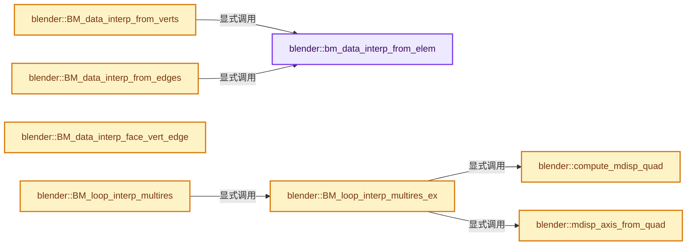
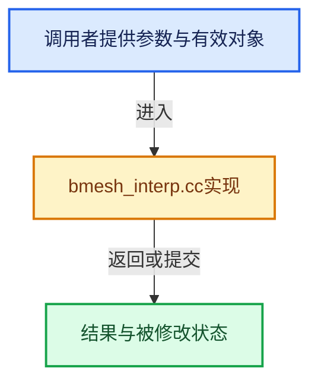

# 实现依赖专题：source/blender/bmesh/intern/bmesh_interp.cc

[方向导航](README.md) · [符号索引](../%E7%AC%A6%E5%8F%B7%E4%BE%9D%E8%B5%96%E4%B8%8E%E5%AE%9E%E7%8E%B0%E7%B4%A2%E5%BC%95.md)

本专题从正文实际调用进入，集中保存共享实现。函数有稳定锚点，可从调用处直接跳到对应完整函数；递归与互相调用通过回链组织。

## 本文件的实现关系






## 完整成员与函数实现

<a id="f-49f760d2e96fabf5"></a>

### `blender::bm_data_interp_from_elem`

实现位置：[source/blender/bmesh/intern/bmesh_interp.cc](../../../../../source/blender/bmesh/intern/bmesh_interp.cc) · L38—L73。

接口参数：

- `CustomData *data_layer`
- `const BMElem *ele_src_1`
- `const BMElem *ele_src_2`
- `BMElem *ele_dst`
- `const float fac`

**教学注释版**

<!-- annotated:4b4450fc3006b0 -->

```cpp
static void bm_data_interp_from_elem(CustomData *data_layer,
                                     const BMElem *ele_src_1,
                                     const BMElem *ele_src_2,
                                     BMElem *ele_dst,
                                     const float fac)
{
  if (ele_src_1->head.data && ele_src_2->head.data) {
    /* first see if we can avoid interpolation */
    if (fac <= 0.0f) {
      if (ele_src_1 == ele_dst) {
        /* do nothing */
      }
      else {
        CustomData_bmesh_copy_block(*data_layer, ele_src_1->head.data, &ele_dst->head.data);
      }
    }
    else if (fac >= 1.0f) {
      if (ele_src_2 == ele_dst) {
        /* do nothing */
      }
      else {
        CustomData_bmesh_copy_block(*data_layer, ele_src_2->head.data, &ele_dst->head.data);
      }
    }
    else {
      const void *src[2];
      float w[2];

      src[0] = ele_src_1->head.data;
      src[1] = ele_src_2->head.data;
      w[0] = 1.0f - fac;
      w[1] = fac;
      CustomData_bmesh_interp(data_layer, src, w, 2, ele_dst->head.data);
    }
  }
}
```

<details>
<summary>核对原始源码：source/blender/bmesh/intern/bmesh_interp.cc · L38—L73</summary>

<!-- original:4b4450fc3006b0:source/blender/bmesh/intern/bmesh_interp.cc:38:73 -->

```cpp
static void bm_data_interp_from_elem(CustomData *data_layer,
                                     const BMElem *ele_src_1,
                                     const BMElem *ele_src_2,
                                     BMElem *ele_dst,
                                     const float fac)
{
  if (ele_src_1->head.data && ele_src_2->head.data) {
    /* first see if we can avoid interpolation */
    if (fac <= 0.0f) {
      if (ele_src_1 == ele_dst) {
        /* do nothing */
      }
      else {
        CustomData_bmesh_copy_block(*data_layer, ele_src_1->head.data, &ele_dst->head.data);
      }
    }
    else if (fac >= 1.0f) {
      if (ele_src_2 == ele_dst) {
        /* do nothing */
      }
      else {
        CustomData_bmesh_copy_block(*data_layer, ele_src_2->head.data, &ele_dst->head.data);
      }
    }
    else {
      const void *src[2];
      float w[2];

      src[0] = ele_src_1->head.data;
      src[1] = ele_src_2->head.data;
      w[0] = 1.0f - fac;
      w[1] = fac;
      CustomData_bmesh_interp(data_layer, src, w, 2, ele_dst->head.data);
    }
  }
}
```

</details>

**沿实际写入检查状态**

- `src[0] = ele_src_1->head.data;`
- `src[1] = ele_src_2->head.data;`
- `w[0] = 1.0f - fac;`
- `w[1] = fac;`

**继续追踪实现**

- `CustomData_bmesh_copy_block` → [blender::CustomData_bmesh_copy_block · L3681](%E4%BE%9D%E8%B5%96-customdata-2eef81.md#f-d681531939b43aec)；[blender::CustomData_bmesh_copy_block · L3716](%E4%BE%9D%E8%B5%96-customdata-2eef81.md#f-37799c7d006e0906)。同名重载需按实参类型选择。
- `CustomData_bmesh_interp` → [blender::CustomData_bmesh_interp · L3954](%E4%BE%9D%E8%B5%96-customdata-2eef81.md#f-098f274d067755f3)。

<a id="f-45595550baec6862"></a>

### `blender::BM_data_interp_from_verts`

实现位置：[source/blender/bmesh/intern/bmesh_interp.cc](../../../../../source/blender/bmesh/intern/bmesh_interp.cc) · L75—L83。

接口参数：

- `BMesh *bm`
- `const BMVert *v_src_1`
- `const BMVert *v_src_2`
- `BMVert *v_dst`
- `const float fac`

**教学注释版**

<!-- annotated:25773dae923f9a -->

```cpp
void BM_data_interp_from_verts(
    BMesh *bm, const BMVert *v_src_1, const BMVert *v_src_2, BMVert *v_dst, const float fac)
{
  bm_data_interp_from_elem(&bm->vdata,
                           reinterpret_cast<const BMElem *>(v_src_1),
                           reinterpret_cast<const BMElem *>(v_src_2),
                           reinterpret_cast<BMElem *>(v_dst),
                           fac);
}
```

<details>
<summary>核对原始源码：source/blender/bmesh/intern/bmesh_interp.cc · L75—L83</summary>

<!-- original:25773dae923f9a:source/blender/bmesh/intern/bmesh_interp.cc:75:83 -->

```cpp
void BM_data_interp_from_verts(
    BMesh *bm, const BMVert *v_src_1, const BMVert *v_src_2, BMVert *v_dst, const float fac)
{
  bm_data_interp_from_elem(&bm->vdata,
                           reinterpret_cast<const BMElem *>(v_src_1),
                           reinterpret_cast<const BMElem *>(v_src_2),
                           reinterpret_cast<BMElem *>(v_dst),
                           fac);
}
```

</details>

**继续追踪实现**

- `bm_data_interp_from_elem` → [blender::bm_data_interp_from_elem · L38](%E4%BE%9D%E8%B5%96-bmesh_interp-cac3db.md#f-49f760d2e96fabf5)。

<a id="f-0175d59c404ee1db"></a>

### `blender::BM_data_interp_from_edges`

实现位置：[source/blender/bmesh/intern/bmesh_interp.cc](../../../../../source/blender/bmesh/intern/bmesh_interp.cc) · L85—L93。

接口参数：

- `BMesh *bm`
- `const BMEdge *e_src_1`
- `const BMEdge *e_src_2`
- `BMEdge *e_dst`
- `const float fac`

**教学注释版**

<!-- annotated:37e56af65cd63d -->

```cpp
void BM_data_interp_from_edges(
    BMesh *bm, const BMEdge *e_src_1, const BMEdge *e_src_2, BMEdge *e_dst, const float fac)
{
  bm_data_interp_from_elem(&bm->edata,
                           reinterpret_cast<const BMElem *>(e_src_1),
                           reinterpret_cast<const BMElem *>(e_src_2),
                           reinterpret_cast<BMElem *>(e_dst),
                           fac);
}
```

<details>
<summary>核对原始源码：source/blender/bmesh/intern/bmesh_interp.cc · L85—L93</summary>

<!-- original:37e56af65cd63d:source/blender/bmesh/intern/bmesh_interp.cc:85:93 -->

```cpp
void BM_data_interp_from_edges(
    BMesh *bm, const BMEdge *e_src_1, const BMEdge *e_src_2, BMEdge *e_dst, const float fac)
{
  bm_data_interp_from_elem(&bm->edata,
                           reinterpret_cast<const BMElem *>(e_src_1),
                           reinterpret_cast<const BMElem *>(e_src_2),
                           reinterpret_cast<BMElem *>(e_dst),
                           fac);
}
```

</details>

**继续追踪实现**

- `bm_data_interp_from_elem` → [blender::bm_data_interp_from_elem · L38](%E4%BE%9D%E8%B5%96-bmesh_interp-cac3db.md#f-49f760d2e96fabf5)。

<a id="f-6b1d62fa6476a5fc"></a>

### `blender::BM_data_interp_face_vert_edge`

实现位置：[source/blender/bmesh/intern/bmesh_interp.cc](../../../../../source/blender/bmesh/intern/bmesh_interp.cc) · L106—L147。

接口参数：

- `BMesh *bm`
- `const BMVert *v_src_1`
- `const BMVert *`
- `BMVert *v`
- `BMEdge *e`
- `const float fac`

**教学注释版**

<!-- annotated:c49f26855d0558 -->

```cpp
void BM_data_interp_face_vert_edge(BMesh *bm,
                                   const BMVert *v_src_1,
                                   const BMVert * /*v_src_2*/,
                                   BMVert *v,
                                   BMEdge *e,
                                   const float fac)
{
  float w[2];
  BMLoop *l_v1 = nullptr, *l_v = nullptr, *l_v2 = nullptr;
  BMLoop *l_iter = nullptr;

  if (!e->l) {
    return;
  }

  w[1] = 1.0f - fac;
  w[0] = fac;

  l_iter = e->l;
  do {
    if (l_iter->v == v_src_1) {
      l_v1 = l_iter;
      l_v = l_v1->next;
      l_v2 = l_v->next;
    }
    else if (l_iter->v == v) {
      l_v1 = l_iter->next;
      l_v = l_iter;
      l_v2 = l_iter->prev;
    }

    if (!l_v1 || !l_v2) {
      return;
    }

    const void *src[2];
    src[0] = l_v1->head.data;
    src[1] = l_v2->head.data;

    CustomData_bmesh_interp(&bm->ldata, src, w, 2, l_v->head.data);
  } while ((l_iter = l_iter->radial_next) != e->l);
}
```

<details>
<summary>核对原始源码：source/blender/bmesh/intern/bmesh_interp.cc · L106—L147</summary>

<!-- original:c49f26855d0558:source/blender/bmesh/intern/bmesh_interp.cc:106:147 -->

```cpp
void BM_data_interp_face_vert_edge(BMesh *bm,
                                   const BMVert *v_src_1,
                                   const BMVert * /*v_src_2*/,
                                   BMVert *v,
                                   BMEdge *e,
                                   const float fac)
{
  float w[2];
  BMLoop *l_v1 = nullptr, *l_v = nullptr, *l_v2 = nullptr;
  BMLoop *l_iter = nullptr;

  if (!e->l) {
    return;
  }

  w[1] = 1.0f - fac;
  w[0] = fac;

  l_iter = e->l;
  do {
    if (l_iter->v == v_src_1) {
      l_v1 = l_iter;
      l_v = l_v1->next;
      l_v2 = l_v->next;
    }
    else if (l_iter->v == v) {
      l_v1 = l_iter->next;
      l_v = l_iter;
      l_v2 = l_iter->prev;
    }

    if (!l_v1 || !l_v2) {
      return;
    }

    const void *src[2];
    src[0] = l_v1->head.data;
    src[1] = l_v2->head.data;

    CustomData_bmesh_interp(&bm->ldata, src, w, 2, l_v->head.data);
  } while ((l_iter = l_iter->radial_next) != e->l);
}
```

</details>

**沿实际写入检查状态**

- `w[1] = 1.0f - fac;`
- `w[0] = fac;`
- `l_iter = e->l;`
- `l_v1 = l_iter;`
- `l_v = l_v1->next;`
- `l_v2 = l_v->next;`
- `l_v1 = l_iter->next;`
- `l_v = l_iter;`
- `l_v2 = l_iter->prev;`
- `src[0] = l_v1->head.data;`
- `src[1] = l_v2->head.data;`

**继续追踪实现**

- `CustomData_bmesh_interp` → [blender::CustomData_bmesh_interp · L3954](%E4%BE%9D%E8%B5%96-customdata-2eef81.md#f-098f274d067755f3)。

<a id="f-c785db65b7ec267a"></a>

### `blender::compute_mdisp_quad`

实现位置：[source/blender/bmesh/intern/bmesh_interp.cc](../../../../../source/blender/bmesh/intern/bmesh_interp.cc) · L221—L253。

接口参数：

- `const BMLoop *l`
- `const float l_f_center[3]`
- `float v1[3]`
- `float v2[3]`
- `float v3[3]`
- `float v4[3]`
- `float e1[3]`
- `float e2[3]`

**教学注释版**

<!-- annotated:e41d51c0104e8f -->

```cpp
static int compute_mdisp_quad(const BMLoop *l,
                              const float l_f_center[3],
                              float v1[3],
                              float v2[3],
                              float v3[3],
                              float v4[3],
                              float e1[3],
                              float e2[3])
{
  float n[3], p[3];

#ifndef NDEBUG
  {
    float cent[3];
    /* computer center */
    BM_face_calc_center_median(l->f, cent);
    BLI_assert(equals_v3v3(cent, l_f_center));
  }
#endif

  mid_v3_v3v3(p, l->prev->v->co, l->v->co);
  mid_v3_v3v3(n, l->next->v->co, l->v->co);

  copy_v3_v3(v1, l_f_center);
  copy_v3_v3(v2, p);
  copy_v3_v3(v3, l->v->co);
  copy_v3_v3(v4, n);

  sub_v3_v3v3(e1, v2, v1);
  sub_v3_v3v3(e2, v3, v4);

  return 1;
}
```

<details>
<summary>核对原始源码：source/blender/bmesh/intern/bmesh_interp.cc · L221—L253</summary>

<!-- original:e41d51c0104e8f:source/blender/bmesh/intern/bmesh_interp.cc:221:253 -->

```cpp
static int compute_mdisp_quad(const BMLoop *l,
                              const float l_f_center[3],
                              float v1[3],
                              float v2[3],
                              float v3[3],
                              float v4[3],
                              float e1[3],
                              float e2[3])
{
  float n[3], p[3];

#ifndef NDEBUG
  {
    float cent[3];
    /* computer center */
    BM_face_calc_center_median(l->f, cent);
    BLI_assert(equals_v3v3(cent, l_f_center));
  }
#endif

  mid_v3_v3v3(p, l->prev->v->co, l->v->co);
  mid_v3_v3v3(n, l->next->v->co, l->v->co);

  copy_v3_v3(v1, l_f_center);
  copy_v3_v3(v2, p);
  copy_v3_v3(v3, l->v->co);
  copy_v3_v3(v4, n);

  sub_v3_v3v3(e1, v2, v1);
  sub_v3_v3v3(e2, v3, v4);

  return 1;
}
```

</details>

**结果出口**

- `return 1;`

**继续追踪实现**

- `BM_face_calc_center_median` → [blender::BM_face_calc_center_median · L655](%E4%BE%9D%E8%B5%96-bmesh_polygon-a8ec8c.md#f-ca9310cae0d0c57b)。
- `BLI_assert` → [BLI_assert · L48](../01-%E5%9F%BA%E7%A1%80%E5%AE%B9%E5%99%A8%E4%B8%8E%E7%8E%B0%E4%BB%A3CPP/%E4%BE%9D%E8%B5%96-BLI_assert-cc98e8.md#m-57a88495704d)；[BLI_assert · L63](../01-%E5%9F%BA%E7%A1%80%E5%AE%B9%E5%99%A8%E4%B8%8E%E7%8E%B0%E4%BB%A3CPP/%E4%BE%9D%E8%B5%96-BLI_assert-cc98e8.md#m-d07050020cb5)。宏定义由构建条件选择。
- `equals_v3v3` → [blender::equals_v3v3 · L1006](../12-%E7%A9%BA%E9%97%B4%E6%95%B0%E6%8D%AE%E7%BB%93%E6%9E%84%E4%B8%8E%E5%87%A0%E4%BD%95%E7%AE%97%E6%B3%95/%E4%BE%9D%E8%B5%96-math_vector_inline-0c8541.md#f-f49aac9436333b4a)。
- `mid_v3_v3v3` → [blender::mid_v3_v3v3 · L183](../12-%E7%A9%BA%E9%97%B4%E6%95%B0%E6%8D%AE%E7%BB%93%E6%9E%84%E4%B8%8E%E5%87%A0%E4%BD%95%E7%AE%97%E6%B3%95/%E4%BE%9D%E8%B5%96-math_vector-5f35fa.md#f-b748c1b0b472ad9b)。
- `copy_v3_v3` → [blender::copy_v3_v3 · L47](../12-%E7%A9%BA%E9%97%B4%E6%95%B0%E6%8D%AE%E7%BB%93%E6%9E%84%E4%B8%8E%E5%87%A0%E4%BD%95%E7%AE%97%E6%B3%95/%E4%BE%9D%E8%B5%96-math_vector_inline-0c8541.md#f-037a0d5fa5060bd6)。
- `sub_v3_v3v3` → [blender::sub_v3_v3v3 · L360](../12-%E7%A9%BA%E9%97%B4%E6%95%B0%E6%8D%AE%E7%BB%93%E6%9E%84%E4%B8%8E%E5%87%A0%E4%BD%95%E7%AE%97%E6%B3%95/%E4%BE%9D%E8%B5%96-math_vector_inline-0c8541.md#f-23781c252db8b30c)。

<a id="f-340efa6f74300b22"></a>

### `blender::mdisp_axis_from_quad`

实现位置：[source/blender/bmesh/intern/bmesh_interp.cc](../../../../../source/blender/bmesh/intern/bmesh_interp.cc) · L297—L309。

接口参数：

- `const float v1[3]`
- `const float v2[3]`
- `float /*v3*/[3]`
- `const float v4[3]`
- `float r_axis_x[3]`
- `float r_axis_y[3]`

**教学注释版**

<!-- annotated:068f86d8f4b9ba -->

```cpp
static void mdisp_axis_from_quad(const float v1[3],
                                 const float v2[3],
                                 float /*v3*/[3],
                                 const float v4[3],
                                 float r_axis_x[3],
                                 float r_axis_y[3])
{
  sub_v3_v3v3(r_axis_x, v4, v1);
  sub_v3_v3v3(r_axis_y, v2, v1);

  normalize_v3(r_axis_x);
  normalize_v3(r_axis_y);
}
```

<details>
<summary>核对原始源码：source/blender/bmesh/intern/bmesh_interp.cc · L297—L309</summary>

<!-- original:068f86d8f4b9ba:source/blender/bmesh/intern/bmesh_interp.cc:297:309 -->

```cpp
static void mdisp_axis_from_quad(const float v1[3],
                                 const float v2[3],
                                 float /*v3*/[3],
                                 const float v4[3],
                                 float r_axis_x[3],
                                 float r_axis_y[3])
{
  sub_v3_v3v3(r_axis_x, v4, v1);
  sub_v3_v3v3(r_axis_y, v2, v1);

  normalize_v3(r_axis_x);
  normalize_v3(r_axis_y);
}
```

</details>

**继续追踪实现**

- `sub_v3_v3v3` → [blender::sub_v3_v3v3 · L360](../12-%E7%A9%BA%E9%97%B4%E6%95%B0%E6%8D%AE%E7%BB%93%E6%9E%84%E4%B8%8E%E5%87%A0%E4%BD%95%E7%AE%97%E6%B3%95/%E4%BE%9D%E8%B5%96-math_vector_inline-0c8541.md#f-23781c252db8b30c)。
- `normalize_v3` → [blender::normalize_v3 · L933](../12-%E7%A9%BA%E9%97%B4%E6%95%B0%E6%8D%AE%E7%BB%93%E6%9E%84%E4%B8%8E%E5%87%A0%E4%BD%95%E7%AE%97%E6%B3%95/%E4%BE%9D%E8%B5%96-math_vector_inline-0c8541.md#f-5f3257e657ef732c)。

<a id="f-ad1dce9ff2d775cd"></a>

### `blender::BM_loop_interp_multires_ex`

实现位置：[source/blender/bmesh/intern/bmesh_interp.cc](../../../../../source/blender/bmesh/intern/bmesh_interp.cc) · L482—L537。

接口参数：

- `BMesh *`
- `BMLoop *l_dst`
- `const BMFace *f_src`
- `const float f_dst_center[3]`
- `const float f_src_center[3]`
- `const int cd_loop_mdisp_offset`

**教学注释版**

<!-- annotated:ce74f05a1e9673 -->

```cpp
void BM_loop_interp_multires_ex(BMesh * /*bm*/,
                                BMLoop *l_dst,
                                const BMFace *f_src,
                                const float f_dst_center[3],
                                const float f_src_center[3],
                                const int cd_loop_mdisp_offset)
{
  MDisps *md_dst;
  float v1[3], v2[3], v3[3], v4[3] = {0.0f, 0.0f, 0.0f}, e1[3], e2[3];
  float axis_x[3], axis_y[3];

  /* ignore 2-edged faces */
  if (l_dst->f->len < 3) [[unlikely]] {
    return;
  }

  md_dst = static_cast<MDisps *>(BM_ELEM_CD_GET_VOID_P(l_dst, cd_loop_mdisp_offset));
  compute_mdisp_quad(l_dst, f_dst_center, v1, v2, v3, v4, e1, e2);

  /* if no disps data allocate a new grid, the size of the first grid in f_src. */
  if (!md_dst->totdisp) {
    const MDisps *md_src = static_cast<const MDisps *>(
        BM_ELEM_CD_GET_VOID_P(BM_FACE_FIRST_LOOP(f_src), cd_loop_mdisp_offset));

    md_dst->totdisp = md_src->totdisp;
    if (md_dst->totdisp) {
      md_dst->disps = MEM_new_array_zeroed<float[3]>(md_dst->totdisp, __func__);
    }
    else {
      return;
    }
  }

  mdisp_axis_from_quad(v1, v2, v3, v4, axis_x, axis_y);

  const int res = int(sqrt(md_dst->totdisp));
  BMLoopInterpMultiresData data = {};
  data.l_dst = l_dst;
  data.l_src_first = BM_FACE_FIRST_LOOP(f_src);
  data.cd_loop_mdisp_offset = cd_loop_mdisp_offset;
  data.md_dst = md_dst;
  data.f_src_center = f_src_center;
  data.axis_x = axis_x;
  data.axis_y = axis_y;
  data.v1 = v1;
  data.v4 = v4;
  data.e1 = e1;
  data.e2 = e2;
  data.res = res;
  data.d = 1.0f / float(res - 1);

  TaskParallelSettings settings;
  BLI_parallel_range_settings_defaults(&settings);
  settings.use_threading = (res > 5);
  BLI_task_parallel_range(0, res, &data, loop_interp_multires_cb, &settings);
}
```

<details>
<summary>核对原始源码：source/blender/bmesh/intern/bmesh_interp.cc · L482—L537</summary>

<!-- original:ce74f05a1e9673:source/blender/bmesh/intern/bmesh_interp.cc:482:537 -->

```cpp
void BM_loop_interp_multires_ex(BMesh * /*bm*/,
                                BMLoop *l_dst,
                                const BMFace *f_src,
                                const float f_dst_center[3],
                                const float f_src_center[3],
                                const int cd_loop_mdisp_offset)
{
  MDisps *md_dst;
  float v1[3], v2[3], v3[3], v4[3] = {0.0f, 0.0f, 0.0f}, e1[3], e2[3];
  float axis_x[3], axis_y[3];

  /* ignore 2-edged faces */
  if (l_dst->f->len < 3) [[unlikely]] {
    return;
  }

  md_dst = static_cast<MDisps *>(BM_ELEM_CD_GET_VOID_P(l_dst, cd_loop_mdisp_offset));
  compute_mdisp_quad(l_dst, f_dst_center, v1, v2, v3, v4, e1, e2);

  /* if no disps data allocate a new grid, the size of the first grid in f_src. */
  if (!md_dst->totdisp) {
    const MDisps *md_src = static_cast<const MDisps *>(
        BM_ELEM_CD_GET_VOID_P(BM_FACE_FIRST_LOOP(f_src), cd_loop_mdisp_offset));

    md_dst->totdisp = md_src->totdisp;
    if (md_dst->totdisp) {
      md_dst->disps = MEM_new_array_zeroed<float[3]>(md_dst->totdisp, __func__);
    }
    else {
      return;
    }
  }

  mdisp_axis_from_quad(v1, v2, v3, v4, axis_x, axis_y);

  const int res = int(sqrt(md_dst->totdisp));
  BMLoopInterpMultiresData data = {};
  data.l_dst = l_dst;
  data.l_src_first = BM_FACE_FIRST_LOOP(f_src);
  data.cd_loop_mdisp_offset = cd_loop_mdisp_offset;
  data.md_dst = md_dst;
  data.f_src_center = f_src_center;
  data.axis_x = axis_x;
  data.axis_y = axis_y;
  data.v1 = v1;
  data.v4 = v4;
  data.e1 = e1;
  data.e2 = e2;
  data.res = res;
  data.d = 1.0f / float(res - 1);

  TaskParallelSettings settings;
  BLI_parallel_range_settings_defaults(&settings);
  settings.use_threading = (res > 5);
  BLI_task_parallel_range(0, res, &data, loop_interp_multires_cb, &settings);
}
```

</details>

**沿实际写入检查状态**

- `md_dst = static_cast<MDisps *>(BM_ELEM_CD_GET_VOID_P(l_dst, cd_loop_mdisp_offset));`
- `md_dst->totdisp = md_src->totdisp;`
- `md_dst->disps = MEM_new_array_zeroed<float[3]>(md_dst->totdisp, __func__);`
- `data.l_dst = l_dst;`
- `data.l_src_first = BM_FACE_FIRST_LOOP(f_src);`
- `data.cd_loop_mdisp_offset = cd_loop_mdisp_offset;`
- `data.md_dst = md_dst;`
- `data.f_src_center = f_src_center;`
- `data.axis_x = axis_x;`
- `data.axis_y = axis_y;`
- `data.v1 = v1;`
- `data.v4 = v4;`
- `data.e1 = e1;`
- `data.e2 = e2;`
- `data.res = res;`
- `data.d = 1.0f / float(res - 1);`
- `settings.use_threading = (res > 5);`

**继续追踪实现**

- `BM_ELEM_CD_GET_VOID_P` → [BM_ELEM_CD_GET_VOID_P · L610](%E4%BE%9D%E8%B5%96-bmesh_class-4cf146.md#m-cdfe9f3023fa)；[BM_ELEM_CD_GET_VOID_P · L618](%E4%BE%9D%E8%B5%96-bmesh_class-4cf146.md#m-126b1260772d)。宏定义由构建条件选择。
- `compute_mdisp_quad` → [blender::compute_mdisp_quad · L221](%E4%BE%9D%E8%B5%96-bmesh_interp-cac3db.md#f-c785db65b7ec267a)。
- `BM_FACE_FIRST_LOOP` → [BM_FACE_FIRST_LOOP · L697](%E4%BE%9D%E8%B5%96-bmesh_class-4cf146.md#m-c7e10ffb38e6)；[BM_FACE_FIRST_LOOP · L699](%E4%BE%9D%E8%B5%96-bmesh_class-4cf146.md#m-76a054cc4770)。宏定义由构建条件选择。
- `MEM_new_array_zeroed<float[3]>` → [MEM_new_array_zeroed · L566](../03-%E5%86%85%E5%AD%98%E5%88%86%E9%85%8D%E4%B8%8E%E8%BF%90%E8%A1%8C%E6%97%B6%E7%B1%BB%E5%9E%8B/%E4%BE%9D%E8%B5%96-MEM_guardedalloc-b54eca.md#f-3a0cf63fb5216500)；[MEM_new_array_zeroed · L119](../03-%E5%86%85%E5%AD%98%E5%88%86%E9%85%8D%E4%B8%8E%E8%BF%90%E8%A1%8C%E6%97%B6%E7%B1%BB%E5%9E%8B/%E4%BE%9D%E8%B5%96-mallocn-afdcd4.md#f-6825557da566fdbe)。同名重载需按实参类型选择。
- `mdisp_axis_from_quad` → [blender::mdisp_axis_from_quad · L297](%E4%BE%9D%E8%B5%96-bmesh_interp-cac3db.md#f-340efa6f74300b22)。
- `sqrt` → [外部契约](https://eel.is/c++draft/)：这个边界按实际表达式及所属类型核对参数、返回值、寿命与失败行为。这里提供接口入口，不声称已解释该第三方版本的内部实现。
- `BLI_parallel_range_settings_defaults` → [blender::BLI_parallel_range_settings_defaults · L218](../01-%E5%9F%BA%E7%A1%80%E5%AE%B9%E5%99%A8%E4%B8%8E%E7%8E%B0%E4%BB%A3CPP/%E4%BE%9D%E8%B5%96-BLI_task_c-917a71.md#f-3858ad801a98e123)。
- `BLI_task_parallel_range` → [blender::BLI_task_parallel_range · L101](../11-Depsgraph%E4%B8%8E%E5%B9%B6%E8%A1%8C%E4%BB%BB%E5%8A%A1%E7%B3%BB%E7%BB%9F/08-%E4%BB%BB%E5%8A%A1%E9%9A%94%E7%A6%BB%E6%AD%BB%E9%94%81%E4%B8%8E%E5%AE%9E%E6%88%98.md#f-9d237d7e4e78d7e2)。

<a id="f-b7b2cb79fa3da01a"></a>

### `blender::BM_loop_interp_multires`

实现位置：[source/blender/bmesh/intern/bmesh_interp.cc](../../../../../source/blender/bmesh/intern/bmesh_interp.cc) · L539—L552。

接口参数：

- `BMesh *bm`
- `BMLoop *l_dst`
- `const BMFace *f_src`

**教学注释版**

<!-- annotated:495aa84fea23d1 -->

```cpp
void BM_loop_interp_multires(BMesh *bm, BMLoop *l_dst, const BMFace *f_src)
{
  const int cd_loop_mdisp_offset = CustomData_get_offset(&bm->ldata, CD_MDISPS);

  if (cd_loop_mdisp_offset != -1) {
    float f_dst_center[3];
    float f_src_center[3];

    BM_face_calc_center_median(l_dst->f, f_dst_center);
    BM_face_calc_center_median(f_src, f_src_center);

    BM_loop_interp_multires_ex(bm, l_dst, f_src, f_dst_center, f_src_center, cd_loop_mdisp_offset);
  }
}
```

<details>
<summary>核对原始源码：source/blender/bmesh/intern/bmesh_interp.cc · L539—L552</summary>

<!-- original:495aa84fea23d1:source/blender/bmesh/intern/bmesh_interp.cc:539:552 -->

```cpp
void BM_loop_interp_multires(BMesh *bm, BMLoop *l_dst, const BMFace *f_src)
{
  const int cd_loop_mdisp_offset = CustomData_get_offset(&bm->ldata, CD_MDISPS);

  if (cd_loop_mdisp_offset != -1) {
    float f_dst_center[3];
    float f_src_center[3];

    BM_face_calc_center_median(l_dst->f, f_dst_center);
    BM_face_calc_center_median(f_src, f_src_center);

    BM_loop_interp_multires_ex(bm, l_dst, f_src, f_dst_center, f_src_center, cd_loop_mdisp_offset);
  }
}
```

</details>

**继续追踪实现**

- `CustomData_get_offset` → [blender::CustomData_get_offset · L3379](%E4%BE%9D%E8%B5%96-customdata-2eef81.md#f-e0e230c6120acc9a)。
- `BM_face_calc_center_median` → [blender::BM_face_calc_center_median · L655](%E4%BE%9D%E8%B5%96-bmesh_polygon-a8ec8c.md#f-ca9310cae0d0c57b)。
- `BM_loop_interp_multires_ex` → [blender::BM_loop_interp_multires_ex · L482](%E4%BE%9D%E8%B5%96-bmesh_interp-cac3db.md#f-ad1dce9ff2d775cd)。

<a id="f-bc2b5bc199fc541d"></a>

### `blender::BM_face_interp_multires_ex`

实现位置：[source/blender/bmesh/intern/bmesh_interp.cc](../../../../../source/blender/bmesh/intern/bmesh_interp.cc) · L554—L567。

接口参数：

- `BMesh *bm`
- `BMFace *f_dst`
- `const BMFace *f_src`
- `const float f_dst_center[3]`
- `const float f_src_center[3]`
- `const int cd_loop_mdisp_offset`

**教学注释版**

<!-- annotated:70a2c9ebac784a -->

```cpp
void BM_face_interp_multires_ex(BMesh *bm,
                                BMFace *f_dst,
                                const BMFace *f_src,
                                const float f_dst_center[3],
                                const float f_src_center[3],
                                const int cd_loop_mdisp_offset)
{
  BMLoop *l_iter, *l_first;
  l_iter = l_first = BM_FACE_FIRST_LOOP(f_dst);
  do {
    BM_loop_interp_multires_ex(
        bm, l_iter, f_src, f_dst_center, f_src_center, cd_loop_mdisp_offset);
  } while ((l_iter = l_iter->next) != l_first);
}
```

<details>
<summary>核对原始源码：source/blender/bmesh/intern/bmesh_interp.cc · L554—L567</summary>

<!-- original:70a2c9ebac784a:source/blender/bmesh/intern/bmesh_interp.cc:554:567 -->

```cpp
void BM_face_interp_multires_ex(BMesh *bm,
                                BMFace *f_dst,
                                const BMFace *f_src,
                                const float f_dst_center[3],
                                const float f_src_center[3],
                                const int cd_loop_mdisp_offset)
{
  BMLoop *l_iter, *l_first;
  l_iter = l_first = BM_FACE_FIRST_LOOP(f_dst);
  do {
    BM_loop_interp_multires_ex(
        bm, l_iter, f_src, f_dst_center, f_src_center, cd_loop_mdisp_offset);
  } while ((l_iter = l_iter->next) != l_first);
}
```

</details>

**沿实际写入检查状态**

- `l_iter = l_first = BM_FACE_FIRST_LOOP(f_dst);`

**继续追踪实现**

- `BM_FACE_FIRST_LOOP` → [BM_FACE_FIRST_LOOP · L697](%E4%BE%9D%E8%B5%96-bmesh_class-4cf146.md#m-c7e10ffb38e6)；[BM_FACE_FIRST_LOOP · L699](%E4%BE%9D%E8%B5%96-bmesh_class-4cf146.md#m-76a054cc4770)。宏定义由构建条件选择。
- `BM_loop_interp_multires_ex` → [blender::BM_loop_interp_multires_ex · L482](%E4%BE%9D%E8%B5%96-bmesh_interp-cac3db.md#f-ad1dce9ff2d775cd)。

<a id="f-f0b330be4846e2b3"></a>

### `blender::BM_face_multires_bounds_smooth`

实现位置：[source/blender/bmesh/intern/bmesh_interp.cc](../../../../../source/blender/bmesh/intern/bmesh_interp.cc) · L584—L691。

接口参数：

- `BMesh *bm`
- `BMFace *f`

**教学注释版**

<!-- annotated:93d84bb5699025 -->

```cpp
void BM_face_multires_bounds_smooth(BMesh *bm, BMFace *f)
{
  const int cd_loop_mdisp_offset = CustomData_get_offset(&bm->ldata, CD_MDISPS);
  BMLoop *l;
  BMIter liter;

  if (cd_loop_mdisp_offset == -1) {
    return;
  }

  BM_ITER_ELEM (l, &liter, f, BM_LOOPS_OF_FACE) {
    MDisps *mdp = static_cast<MDisps *>(BM_ELEM_CD_GET_VOID_P(l->prev, cd_loop_mdisp_offset));
    MDisps *mdl = static_cast<MDisps *>(BM_ELEM_CD_GET_VOID_P(l, cd_loop_mdisp_offset));
    MDisps *mdn = static_cast<MDisps *>(BM_ELEM_CD_GET_VOID_P(l->next, cd_loop_mdisp_offset));
    float co1[3];
    int sides;
    int y;

    /**
     * mdisps is a grid of displacements, ordered thus:
     * <pre>
     *                    v4/next
     *                      |
     *  |      v1/cent-----mid2 ---> x
     *  |         |         |
     *  |         |         |
     * v2/prev---mid1-----v3/cur
     *            |
     *            V
     *            y
     * </pre>
     */

    sides = int(sqrt(mdp->totdisp));
    for (y = 0; y < sides; y++) {
      mid_v3_v3v3(co1, mdn->disps[y * sides], mdl->disps[y]);

      copy_v3_v3(mdn->disps[y * sides], co1);
      copy_v3_v3(mdl->disps[y], co1);
    }
  }

  BM_ITER_ELEM (l, &liter, f, BM_LOOPS_OF_FACE) {
    MDisps *mdl1 = static_cast<MDisps *>(BM_ELEM_CD_GET_VOID_P(l, cd_loop_mdisp_offset));
    MDisps *mdl2;
    float co1[3], co2[3], co[3];
    int sides;
    int y;

    /**
     * mdisps is a grid of displacements, ordered thus:
     * <pre>
     *                    v4/next
     *                      |
     *  |      v1/cent-----mid2 ---> x
     *  |         |         |
     *  |         |         |
     * v2/prev---mid1-----v3/cur
     *            |
     *            V
     *            y
     * </pre>
     */

    if (l->radial_next == l) {
      continue;
    }

    if (l->radial_next->v == l->v) {
      mdl2 = static_cast<MDisps *>(BM_ELEM_CD_GET_VOID_P(l->radial_next, cd_loop_mdisp_offset));
    }
    else {
      mdl2 = static_cast<MDisps *>(
          BM_ELEM_CD_GET_VOID_P(l->radial_next->next, cd_loop_mdisp_offset));
    }

    sides = int(sqrt(mdl1->totdisp));
    for (y = 0; y < sides; y++) {
      int a1, a2, o1, o2;

      if (l->v != l->radial_next->v) {
        a1 = sides * y + sides - 2;
        a2 = (sides - 2) * sides + y;

        o1 = sides * y + sides - 1;
        o2 = (sides - 1) * sides + y;
      }
      else {
        a1 = sides * y + sides - 2;
        a2 = sides * y + sides - 2;
        o1 = sides * y + sides - 1;
        o2 = sides * y + sides - 1;
      }

      /* magic blending numbers, hardcoded! */
      add_v3_v3v3(co1, mdl1->disps[a1], mdl2->disps[a2]);
      mul_v3_fl(co1, 0.18);

      add_v3_v3v3(co2, mdl1->disps[o1], mdl2->disps[o2]);
      mul_v3_fl(co2, 0.32);

      add_v3_v3v3(co, co1, co2);

      copy_v3_v3(mdl1->disps[o1], co);
      copy_v3_v3(mdl2->disps[o2], co);
    }
  }
}
```

<details>
<summary>核对原始源码：source/blender/bmesh/intern/bmesh_interp.cc · L584—L691</summary>

<!-- original:93d84bb5699025:source/blender/bmesh/intern/bmesh_interp.cc:584:691 -->

```cpp
void BM_face_multires_bounds_smooth(BMesh *bm, BMFace *f)
{
  const int cd_loop_mdisp_offset = CustomData_get_offset(&bm->ldata, CD_MDISPS);
  BMLoop *l;
  BMIter liter;

  if (cd_loop_mdisp_offset == -1) {
    return;
  }

  BM_ITER_ELEM (l, &liter, f, BM_LOOPS_OF_FACE) {
    MDisps *mdp = static_cast<MDisps *>(BM_ELEM_CD_GET_VOID_P(l->prev, cd_loop_mdisp_offset));
    MDisps *mdl = static_cast<MDisps *>(BM_ELEM_CD_GET_VOID_P(l, cd_loop_mdisp_offset));
    MDisps *mdn = static_cast<MDisps *>(BM_ELEM_CD_GET_VOID_P(l->next, cd_loop_mdisp_offset));
    float co1[3];
    int sides;
    int y;

    /**
     * mdisps is a grid of displacements, ordered thus:
     * <pre>
     *                    v4/next
     *                      |
     *  |      v1/cent-----mid2 ---> x
     *  |         |         |
     *  |         |         |
     * v2/prev---mid1-----v3/cur
     *            |
     *            V
     *            y
     * </pre>
     */

    sides = int(sqrt(mdp->totdisp));
    for (y = 0; y < sides; y++) {
      mid_v3_v3v3(co1, mdn->disps[y * sides], mdl->disps[y]);

      copy_v3_v3(mdn->disps[y * sides], co1);
      copy_v3_v3(mdl->disps[y], co1);
    }
  }

  BM_ITER_ELEM (l, &liter, f, BM_LOOPS_OF_FACE) {
    MDisps *mdl1 = static_cast<MDisps *>(BM_ELEM_CD_GET_VOID_P(l, cd_loop_mdisp_offset));
    MDisps *mdl2;
    float co1[3], co2[3], co[3];
    int sides;
    int y;

    /**
     * mdisps is a grid of displacements, ordered thus:
     * <pre>
     *                    v4/next
     *                      |
     *  |      v1/cent-----mid2 ---> x
     *  |         |         |
     *  |         |         |
     * v2/prev---mid1-----v3/cur
     *            |
     *            V
     *            y
     * </pre>
     */

    if (l->radial_next == l) {
      continue;
    }

    if (l->radial_next->v == l->v) {
      mdl2 = static_cast<MDisps *>(BM_ELEM_CD_GET_VOID_P(l->radial_next, cd_loop_mdisp_offset));
    }
    else {
      mdl2 = static_cast<MDisps *>(
          BM_ELEM_CD_GET_VOID_P(l->radial_next->next, cd_loop_mdisp_offset));
    }

    sides = int(sqrt(mdl1->totdisp));
    for (y = 0; y < sides; y++) {
      int a1, a2, o1, o2;

      if (l->v != l->radial_next->v) {
        a1 = sides * y + sides - 2;
        a2 = (sides - 2) * sides + y;

        o1 = sides * y + sides - 1;
        o2 = (sides - 1) * sides + y;
      }
      else {
        a1 = sides * y + sides - 2;
        a2 = sides * y + sides - 2;
        o1 = sides * y + sides - 1;
        o2 = sides * y + sides - 1;
      }

      /* magic blending numbers, hardcoded! */
      add_v3_v3v3(co1, mdl1->disps[a1], mdl2->disps[a2]);
      mul_v3_fl(co1, 0.18);

      add_v3_v3v3(co2, mdl1->disps[o1], mdl2->disps[o2]);
      mul_v3_fl(co2, 0.32);

      add_v3_v3v3(co, co1, co2);

      copy_v3_v3(mdl1->disps[o1], co);
      copy_v3_v3(mdl2->disps[o2], co);
    }
  }
}
```

</details>

**沿实际写入检查状态**

- `sides = int(sqrt(mdp->totdisp));`
- `mdl2 = static_cast<MDisps *>(BM_ELEM_CD_GET_VOID_P(l->radial_next, cd_loop_mdisp_offset));`
- `mdl2 = static_cast<MDisps *>(`
- `sides = int(sqrt(mdl1->totdisp));`
- `a1 = sides * y + sides - 2;`
- `a2 = (sides - 2) * sides + y;`
- `o1 = sides * y + sides - 1;`
- `o2 = (sides - 1) * sides + y;`
- `a2 = sides * y + sides - 2;`
- `o2 = sides * y + sides - 1;`

**继续追踪实现**

- `CustomData_get_offset` → [blender::CustomData_get_offset · L3379](%E4%BE%9D%E8%B5%96-customdata-2eef81.md#f-e0e230c6120acc9a)。
- `BM_ITER_ELEM` → [BM_ITER_ELEM · L97](%E4%BE%9D%E8%B5%96-bmesh_iterators-13971c.md#m-751d15be7ee4)。宏定义由构建条件选择。
- `BM_ELEM_CD_GET_VOID_P` → [BM_ELEM_CD_GET_VOID_P · L610](%E4%BE%9D%E8%B5%96-bmesh_class-4cf146.md#m-cdfe9f3023fa)；[BM_ELEM_CD_GET_VOID_P · L618](%E4%BE%9D%E8%B5%96-bmesh_class-4cf146.md#m-126b1260772d)。宏定义由构建条件选择。
- `sqrt` → [外部契约](https://eel.is/c++draft/)：这个边界按实际表达式及所属类型核对参数、返回值、寿命与失败行为。这里提供接口入口，不声称已解释该第三方版本的内部实现。
- `mid_v3_v3v3` → [blender::mid_v3_v3v3 · L183](../12-%E7%A9%BA%E9%97%B4%E6%95%B0%E6%8D%AE%E7%BB%93%E6%9E%84%E4%B8%8E%E5%87%A0%E4%BD%95%E7%AE%97%E6%B3%95/%E4%BE%9D%E8%B5%96-math_vector-5f35fa.md#f-b748c1b0b472ad9b)。
- `copy_v3_v3` → [blender::copy_v3_v3 · L47](../12-%E7%A9%BA%E9%97%B4%E6%95%B0%E6%8D%AE%E7%BB%93%E6%9E%84%E4%B8%8E%E5%87%A0%E4%BD%95%E7%AE%97%E6%B3%95/%E4%BE%9D%E8%B5%96-math_vector_inline-0c8541.md#f-037a0d5fa5060bd6)。
- `add_v3_v3v3` → [blender::add_v3_v3v3 · L300](../12-%E7%A9%BA%E9%97%B4%E6%95%B0%E6%8D%AE%E7%BB%93%E6%9E%84%E4%B8%8E%E5%87%A0%E4%BD%95%E7%AE%97%E6%B3%95/%E4%BE%9D%E8%B5%96-math_vector_inline-0c8541.md#f-7343b459d0d3db69)。
- `mul_v3_fl` → [blender::mul_v3_fl · L414](../12-%E7%A9%BA%E9%97%B4%E6%95%B0%E6%8D%AE%E7%BB%93%E6%9E%84%E4%B8%8E%E5%87%A0%E4%BD%95%E7%AE%97%E6%B3%95/%E4%BE%9D%E8%B5%96-math_vector_inline-0c8541.md#f-00165156a06d1224)。

<a id="f-0e80079bd756e6ad"></a>

### `blender::BM_loop_interp_from_face`

实现位置：[source/blender/bmesh/intern/bmesh_interp.cc](../../../../../source/blender/bmesh/intern/bmesh_interp.cc) · L693—L747。

接口参数：

- `BMesh *bm`
- `BMLoop *l_dst`
- `const BMFace *f_src`
- `const bool do_vertex`
- `const bool do_multires`

**教学注释版**

<!-- annotated:baa01616969f3a -->

```cpp
void BM_loop_interp_from_face(
    BMesh *bm, BMLoop *l_dst, const BMFace *f_src, const bool do_vertex, const bool do_multires)
{
  BMLoop *l_iter;
  BMLoop *l_first;
  Array<const void *, BM_DEFAULT_NGON_STACK_SIZE> vblocks_buf(do_vertex ? f_src->len : 0);
  Array<const void *, BM_DEFAULT_NGON_STACK_SIZE> blocks_buf(f_src->len);
  Array<float2, BM_DEFAULT_NGON_STACK_SIZE> cos_2d_buf(f_src->len);
  Array<float, BM_DEFAULT_NGON_STACK_SIZE> w(f_src->len);
  // [讲解] vblocks_buf.data：提供数组的借用访问入口。
  const void **vblocks = do_vertex ? vblocks_buf.data() : nullptr;
  const void **blocks = blocks_buf.data();
  float (*cos_2d)[2] = reinterpret_cast<float (*)[2]>(cos_2d_buf.data());
  float axis_mat[3][3]; /* use normal to transform into 2d xy coords */
  float co[2];

  /* Convert the 3d coords into 2d for projection. */
  float axis_dominant[3];
  if (!is_zero_v3(f_src->no)) {
    BLI_assert(BM_face_is_normal_valid(f_src));
    copy_v3_v3(axis_dominant, f_src->no);
  }
  else {
    /* Rare case in which all the vertices of the face are aligned.
     * Get a random axis that is orthogonal to the tangent. */
    float vec[3];
    BM_face_calc_tangent_auto(f_src, vec);
    ortho_v3_v3(axis_dominant, vec);
    normalize_v3(axis_dominant);
  }
  axis_dominant_v3_to_m3(axis_mat, axis_dominant);

  int i = 0;
  l_iter = l_first = BM_FACE_FIRST_LOOP(f_src);
  do {
    mul_v2_m3v3(cos_2d[i], axis_mat, l_iter->v->co);
    blocks[i] = l_iter->head.data;

    if (do_vertex) {
      vblocks[i] = l_iter->v->head.data;
    }
  } while ((void)i++, (l_iter = l_iter->next) != l_first);

  mul_v2_m3v3(co, axis_mat, l_dst->v->co);

  /* interpolate */
  interp_weights_poly_v2(w.data(), cos_2d, f_src->len, co);
  CustomData_bmesh_interp(&bm->ldata, blocks, w.data(), f_src->len, l_dst->head.data);
  if (do_vertex) {
    CustomData_bmesh_interp(&bm->vdata, vblocks, w.data(), f_src->len, l_dst->v->head.data);
  }

  if (do_multires) {
    BM_loop_interp_multires(bm, l_dst, f_src);
  }
}
```

<details>
<summary>核对原始源码：source/blender/bmesh/intern/bmesh_interp.cc · L693—L747</summary>

<!-- original:baa01616969f3a:source/blender/bmesh/intern/bmesh_interp.cc:693:747 -->

```cpp
void BM_loop_interp_from_face(
    BMesh *bm, BMLoop *l_dst, const BMFace *f_src, const bool do_vertex, const bool do_multires)
{
  BMLoop *l_iter;
  BMLoop *l_first;
  Array<const void *, BM_DEFAULT_NGON_STACK_SIZE> vblocks_buf(do_vertex ? f_src->len : 0);
  Array<const void *, BM_DEFAULT_NGON_STACK_SIZE> blocks_buf(f_src->len);
  Array<float2, BM_DEFAULT_NGON_STACK_SIZE> cos_2d_buf(f_src->len);
  Array<float, BM_DEFAULT_NGON_STACK_SIZE> w(f_src->len);
  const void **vblocks = do_vertex ? vblocks_buf.data() : nullptr;
  const void **blocks = blocks_buf.data();
  float (*cos_2d)[2] = reinterpret_cast<float (*)[2]>(cos_2d_buf.data());
  float axis_mat[3][3]; /* use normal to transform into 2d xy coords */
  float co[2];

  /* Convert the 3d coords into 2d for projection. */
  float axis_dominant[3];
  if (!is_zero_v3(f_src->no)) {
    BLI_assert(BM_face_is_normal_valid(f_src));
    copy_v3_v3(axis_dominant, f_src->no);
  }
  else {
    /* Rare case in which all the vertices of the face are aligned.
     * Get a random axis that is orthogonal to the tangent. */
    float vec[3];
    BM_face_calc_tangent_auto(f_src, vec);
    ortho_v3_v3(axis_dominant, vec);
    normalize_v3(axis_dominant);
  }
  axis_dominant_v3_to_m3(axis_mat, axis_dominant);

  int i = 0;
  l_iter = l_first = BM_FACE_FIRST_LOOP(f_src);
  do {
    mul_v2_m3v3(cos_2d[i], axis_mat, l_iter->v->co);
    blocks[i] = l_iter->head.data;

    if (do_vertex) {
      vblocks[i] = l_iter->v->head.data;
    }
  } while ((void)i++, (l_iter = l_iter->next) != l_first);

  mul_v2_m3v3(co, axis_mat, l_dst->v->co);

  /* interpolate */
  interp_weights_poly_v2(w.data(), cos_2d, f_src->len, co);
  CustomData_bmesh_interp(&bm->ldata, blocks, w.data(), f_src->len, l_dst->head.data);
  if (do_vertex) {
    CustomData_bmesh_interp(&bm->vdata, vblocks, w.data(), f_src->len, l_dst->v->head.data);
  }

  if (do_multires) {
    BM_loop_interp_multires(bm, l_dst, f_src);
  }
}
```

</details>

**沿实际写入检查状态**

- `l_iter = l_first = BM_FACE_FIRST_LOOP(f_src);`
- `blocks[i] = l_iter->head.data;`
- `vblocks[i] = l_iter->v->head.data;`

**继续追踪实现**

- `vblocks_buf.data` → [blender::Array::data · L323](../01-%E5%9F%BA%E7%A1%80%E5%AE%B9%E5%99%A8%E4%B8%8E%E7%8E%B0%E4%BB%A3CPP/08-Array%E5%A4%8D%E5%88%B6%E7%A7%BB%E5%8A%A8%E4%B8%8E%E9%94%80%E6%AF%81.md#f-95648c799002f4ba)；[blender::Array::data · L327](../01-%E5%9F%BA%E7%A1%80%E5%AE%B9%E5%99%A8%E4%B8%8E%E7%8E%B0%E4%BB%A3CPP/08-Array%E5%A4%8D%E5%88%B6%E7%A7%BB%E5%8A%A8%E4%B8%8E%E9%94%80%E6%AF%81.md#f-50c18301f8c40f9e)。同名重载需按实参类型选择。
- `blocks_buf.data` → [blender::Array::data · L323](../01-%E5%9F%BA%E7%A1%80%E5%AE%B9%E5%99%A8%E4%B8%8E%E7%8E%B0%E4%BB%A3CPP/08-Array%E5%A4%8D%E5%88%B6%E7%A7%BB%E5%8A%A8%E4%B8%8E%E9%94%80%E6%AF%81.md#f-95648c799002f4ba)；[blender::Array::data · L327](../01-%E5%9F%BA%E7%A1%80%E5%AE%B9%E5%99%A8%E4%B8%8E%E7%8E%B0%E4%BB%A3CPP/08-Array%E5%A4%8D%E5%88%B6%E7%A7%BB%E5%8A%A8%E4%B8%8E%E9%94%80%E6%AF%81.md#f-50c18301f8c40f9e)。同名重载需按实参类型选择。
- `cos_2d_buf.data` → [blender::Array::data · L323](../01-%E5%9F%BA%E7%A1%80%E5%AE%B9%E5%99%A8%E4%B8%8E%E7%8E%B0%E4%BB%A3CPP/08-Array%E5%A4%8D%E5%88%B6%E7%A7%BB%E5%8A%A8%E4%B8%8E%E9%94%80%E6%AF%81.md#f-95648c799002f4ba)；[blender::Array::data · L327](../01-%E5%9F%BA%E7%A1%80%E5%AE%B9%E5%99%A8%E4%B8%8E%E7%8E%B0%E4%BB%A3CPP/08-Array%E5%A4%8D%E5%88%B6%E7%A7%BB%E5%8A%A8%E4%B8%8E%E9%94%80%E6%AF%81.md#f-50c18301f8c40f9e)。同名重载需按实参类型选择。
- `is_zero_v3` → [blender::is_zero_v3 · L963](../12-%E7%A9%BA%E9%97%B4%E6%95%B0%E6%8D%AE%E7%BB%93%E6%9E%84%E4%B8%8E%E5%87%A0%E4%BD%95%E7%AE%97%E6%B3%95/%E4%BE%9D%E8%B5%96-math_vector_inline-0c8541.md#f-80d0c8ecffdfad5b)。
- `BLI_assert` → [BLI_assert · L48](../01-%E5%9F%BA%E7%A1%80%E5%AE%B9%E5%99%A8%E4%B8%8E%E7%8E%B0%E4%BB%A3CPP/%E4%BE%9D%E8%B5%96-BLI_assert-cc98e8.md#m-57a88495704d)；[BLI_assert · L63](../01-%E5%9F%BA%E7%A1%80%E5%AE%B9%E5%99%A8%E4%B8%8E%E7%8E%B0%E4%BB%A3CPP/%E4%BE%9D%E8%B5%96-BLI_assert-cc98e8.md#m-d07050020cb5)。宏定义由构建条件选择。
- `BM_face_is_normal_valid` → [blender::BM_face_is_normal_valid · L2129](%E4%BE%9D%E8%B5%96-bmesh_query-b0f8d6.md#f-6eb906a3b14c0fa3)。
- `copy_v3_v3` → [blender::copy_v3_v3 · L47](../12-%E7%A9%BA%E9%97%B4%E6%95%B0%E6%8D%AE%E7%BB%93%E6%9E%84%E4%B8%8E%E5%87%A0%E4%BD%95%E7%AE%97%E6%B3%95/%E4%BE%9D%E8%B5%96-math_vector_inline-0c8541.md#f-037a0d5fa5060bd6)。
- `BM_face_calc_tangent_auto` → [blender::BM_face_calc_tangent_auto · L573](%E4%BE%9D%E8%B5%96-bmesh_polygon-a8ec8c.md#f-b6c4450f4ffcf28f)。
- `ortho_v3_v3` → [blender::ortho_v3_v3 · L593](../12-%E7%A9%BA%E9%97%B4%E6%95%B0%E6%8D%AE%E7%BB%93%E6%9E%84%E4%B8%8E%E5%87%A0%E4%BD%95%E7%AE%97%E6%B3%95/%E4%BE%9D%E8%B5%96-math_vector-5f35fa.md#f-9d97c1f8835dda73)。
- `normalize_v3` → [blender::normalize_v3 · L933](../12-%E7%A9%BA%E9%97%B4%E6%95%B0%E6%8D%AE%E7%BB%93%E6%9E%84%E4%B8%8E%E5%87%A0%E4%BD%95%E7%AE%97%E6%B3%95/%E4%BE%9D%E8%B5%96-math_vector_inline-0c8541.md#f-5f3257e657ef732c)。
- `axis_dominant_v3_to_m3` → [blender::axis_dominant_v3_to_m3 · L3702](../12-%E7%A9%BA%E9%97%B4%E6%95%B0%E6%8D%AE%E7%BB%93%E6%9E%84%E4%B8%8E%E5%87%A0%E4%BD%95%E7%AE%97%E6%B3%95/%E4%BE%9D%E8%B5%96-math_geom-8d91a3.md#f-3e28943552d479d7)。
- `BM_FACE_FIRST_LOOP` → [BM_FACE_FIRST_LOOP · L697](%E4%BE%9D%E8%B5%96-bmesh_class-4cf146.md#m-c7e10ffb38e6)；[BM_FACE_FIRST_LOOP · L699](%E4%BE%9D%E8%B5%96-bmesh_class-4cf146.md#m-76a054cc4770)。宏定义由构建条件选择。
- `mul_v2_m3v3` → [blender::mul_v2_m3v3 · L844](../12-%E7%A9%BA%E9%97%B4%E6%95%B0%E6%8D%AE%E7%BB%93%E6%9E%84%E4%B8%8E%E5%87%A0%E4%BD%95%E7%AE%97%E6%B3%95/%E4%BE%9D%E8%B5%96-math_matrix_c-004123.md#f-2550a487d003ca6b)。
- `interp_weights_poly_v2` → [blender::interp_weights_poly_v2 · L4350](../12-%E7%A9%BA%E9%97%B4%E6%95%B0%E6%8D%AE%E7%BB%93%E6%9E%84%E4%B8%8E%E5%87%A0%E4%BD%95%E7%AE%97%E6%B3%95/%E4%BE%9D%E8%B5%96-math_geom-8d91a3.md#f-73ffea639341cdd5)。
- `w.data` → [blender::Array::data · L323](../01-%E5%9F%BA%E7%A1%80%E5%AE%B9%E5%99%A8%E4%B8%8E%E7%8E%B0%E4%BB%A3CPP/08-Array%E5%A4%8D%E5%88%B6%E7%A7%BB%E5%8A%A8%E4%B8%8E%E9%94%80%E6%AF%81.md#f-95648c799002f4ba)；[blender::Array::data · L327](../01-%E5%9F%BA%E7%A1%80%E5%AE%B9%E5%99%A8%E4%B8%8E%E7%8E%B0%E4%BB%A3CPP/08-Array%E5%A4%8D%E5%88%B6%E7%A7%BB%E5%8A%A8%E4%B8%8E%E9%94%80%E6%AF%81.md#f-50c18301f8c40f9e)。同名重载需按实参类型选择。
- `CustomData_bmesh_interp` → [blender::CustomData_bmesh_interp · L3954](%E4%BE%9D%E8%B5%96-customdata-2eef81.md#f-098f274d067755f3)。
- `BM_loop_interp_multires` → [blender::BM_loop_interp_multires · L539](%E4%BE%9D%E8%B5%96-bmesh_interp-cac3db.md#f-b7b2cb79fa3da01a)。

<a id="f-a5c0a33217b04cad"></a>

### `blender::update_data_blocks`

实现位置：[source/blender/bmesh/intern/bmesh_interp.cc](../../../../../source/blender/bmesh/intern/bmesh_interp.cc) · L779—L849。

接口参数：

- `BMesh *bm`
- `CustomData *olddata`
- `CustomData *data`

**教学注释版**

<!-- annotated:ebd77ceaa82e6d -->

```cpp
static void update_data_blocks(BMesh *bm, CustomData *olddata, CustomData *data)
{
  const BMCustomDataCopyMap cd_map = CustomData_bmesh_copy_map_calc(*olddata, *data);

  BMIter iter;
  BLI_mempool *oldpool = olddata->pool;
  void *block;

  if (data == &bm->vdata) {
    BMVert *eve;

    CustomData_bmesh_init_pool(data, bm->totvert, BM_VERT);

    BM_ITER_MESH (eve, &iter, bm, BM_VERTS_OF_MESH) {
      block = nullptr;
      CustomData_bmesh_copy_block(*data, cd_map, eve->head.data, &block);
      CustomData_bmesh_free_block(olddata, &eve->head.data);
      eve->head.data = block;
    }
  }
  else if (data == &bm->edata) {
    BMEdge *eed;

    CustomData_bmesh_init_pool(data, bm->totedge, BM_EDGE);

    BM_ITER_MESH (eed, &iter, bm, BM_EDGES_OF_MESH) {
      block = nullptr;
      CustomData_bmesh_copy_block(*data, cd_map, eed->head.data, &block);
      CustomData_bmesh_free_block(olddata, &eed->head.data);
      eed->head.data = block;
    }
  }
  else if (data == &bm->ldata) {
    BMIter liter;
    BMFace *efa;
    BMLoop *l;

    CustomData_bmesh_init_pool(data, bm->totloop, BM_LOOP);
    BM_ITER_MESH (efa, &iter, bm, BM_FACES_OF_MESH) {
      BM_ITER_ELEM (l, &liter, efa, BM_LOOPS_OF_FACE) {
        block = nullptr;
        CustomData_bmesh_copy_block(*data, cd_map, l->head.data, &block);
        CustomData_bmesh_free_block(olddata, &l->head.data);
        l->head.data = block;
      }
    }
  }
  else if (data == &bm->pdata) {
    BMFace *efa;

    CustomData_bmesh_init_pool(data, bm->totface, BM_FACE);

    BM_ITER_MESH (efa, &iter, bm, BM_FACES_OF_MESH) {
      block = nullptr;
      CustomData_bmesh_copy_block(*data, cd_map, efa->head.data, &block);
      CustomData_bmesh_free_block(olddata, &efa->head.data);
      efa->head.data = block;
    }
  }
  else {
    /* should never reach this! */
    BLI_assert(0);
  }

  if (oldpool) {
    /* this should never happen but can when dissolve fails - #28960. */
    BLI_assert(data->pool != oldpool);

    BLI_mempool_destroy(oldpool);
  }
}
```

<details>
<summary>核对原始源码：source/blender/bmesh/intern/bmesh_interp.cc · L779—L849</summary>

<!-- original:ebd77ceaa82e6d:source/blender/bmesh/intern/bmesh_interp.cc:779:849 -->

```cpp
static void update_data_blocks(BMesh *bm, CustomData *olddata, CustomData *data)
{
  const BMCustomDataCopyMap cd_map = CustomData_bmesh_copy_map_calc(*olddata, *data);

  BMIter iter;
  BLI_mempool *oldpool = olddata->pool;
  void *block;

  if (data == &bm->vdata) {
    BMVert *eve;

    CustomData_bmesh_init_pool(data, bm->totvert, BM_VERT);

    BM_ITER_MESH (eve, &iter, bm, BM_VERTS_OF_MESH) {
      block = nullptr;
      CustomData_bmesh_copy_block(*data, cd_map, eve->head.data, &block);
      CustomData_bmesh_free_block(olddata, &eve->head.data);
      eve->head.data = block;
    }
  }
  else if (data == &bm->edata) {
    BMEdge *eed;

    CustomData_bmesh_init_pool(data, bm->totedge, BM_EDGE);

    BM_ITER_MESH (eed, &iter, bm, BM_EDGES_OF_MESH) {
      block = nullptr;
      CustomData_bmesh_copy_block(*data, cd_map, eed->head.data, &block);
      CustomData_bmesh_free_block(olddata, &eed->head.data);
      eed->head.data = block;
    }
  }
  else if (data == &bm->ldata) {
    BMIter liter;
    BMFace *efa;
    BMLoop *l;

    CustomData_bmesh_init_pool(data, bm->totloop, BM_LOOP);
    BM_ITER_MESH (efa, &iter, bm, BM_FACES_OF_MESH) {
      BM_ITER_ELEM (l, &liter, efa, BM_LOOPS_OF_FACE) {
        block = nullptr;
        CustomData_bmesh_copy_block(*data, cd_map, l->head.data, &block);
        CustomData_bmesh_free_block(olddata, &l->head.data);
        l->head.data = block;
      }
    }
  }
  else if (data == &bm->pdata) {
    BMFace *efa;

    CustomData_bmesh_init_pool(data, bm->totface, BM_FACE);

    BM_ITER_MESH (efa, &iter, bm, BM_FACES_OF_MESH) {
      block = nullptr;
      CustomData_bmesh_copy_block(*data, cd_map, efa->head.data, &block);
      CustomData_bmesh_free_block(olddata, &efa->head.data);
      efa->head.data = block;
    }
  }
  else {
    /* should never reach this! */
    BLI_assert(0);
  }

  if (oldpool) {
    /* this should never happen but can when dissolve fails - #28960. */
    BLI_assert(data->pool != oldpool);

    BLI_mempool_destroy(oldpool);
  }
}
```

</details>

**沿实际写入检查状态**

- `block = nullptr;`
- `eve->head.data = block;`
- `eed->head.data = block;`
- `l->head.data = block;`
- `efa->head.data = block;`

**继续追踪实现**

- `CustomData_bmesh_copy_map_calc` → [blender::CustomData_bmesh_copy_map_calc · L3644](%E4%BE%9D%E8%B5%96-customdata-2eef81.md#f-82f64dd33aeecd93)。
- `CustomData_bmesh_init_pool` → [blender::CustomData_bmesh_init_pool · L3436](%E4%BE%9D%E8%B5%96-customdata-2eef81.md#f-c036b3a7e4f11622)。
- `BM_ITER_MESH` → [BM_ITER_MESH · L72](%E4%BE%9D%E8%B5%96-bmesh_iterators-13971c.md#m-cfc837c73218)。宏定义由构建条件选择。
- `CustomData_bmesh_copy_block` → [blender::CustomData_bmesh_copy_block · L3681](%E4%BE%9D%E8%B5%96-customdata-2eef81.md#f-d681531939b43aec)；[blender::CustomData_bmesh_copy_block · L3716](%E4%BE%9D%E8%B5%96-customdata-2eef81.md#f-37799c7d006e0906)。同名重载需按实参类型选择。
- `CustomData_bmesh_free_block` → [blender::CustomData_bmesh_free_block · L3562](%E4%BE%9D%E8%B5%96-customdata-2eef81.md#f-58fcd46fa669559a)。
- `BM_ITER_ELEM` → [BM_ITER_ELEM · L97](%E4%BE%9D%E8%B5%96-bmesh_iterators-13971c.md#m-751d15be7ee4)。宏定义由构建条件选择。
- `BLI_assert` → [BLI_assert · L48](../01-%E5%9F%BA%E7%A1%80%E5%AE%B9%E5%99%A8%E4%B8%8E%E7%8E%B0%E4%BB%A3CPP/%E4%BE%9D%E8%B5%96-BLI_assert-cc98e8.md#m-57a88495704d)；[BLI_assert · L63](../01-%E5%9F%BA%E7%A1%80%E5%AE%B9%E5%99%A8%E4%B8%8E%E7%8E%B0%E4%BB%A3CPP/%E4%BE%9D%E8%B5%96-BLI_assert-cc98e8.md#m-d07050020cb5)。宏定义由构建条件选择。
- `BLI_mempool_destroy` → [blender::BLI_mempool_destroy · L844](../01-%E5%9F%BA%E7%A1%80%E5%AE%B9%E5%99%A8%E4%B8%8E%E7%8E%B0%E4%BB%A3CPP/%E4%BE%9D%E8%B5%96-BLI_mempool-991442.md#f-6f09741326791f2d)。

<a id="f-23c500bf5f39ed6a"></a>

### `blender::BM_data_layer_add`

实现位置：[source/blender/bmesh/intern/bmesh_interp.cc](../../../../../source/blender/bmesh/intern/bmesh_interp.cc) · L851—L864。

接口参数：

- `BMesh *bm`
- `CustomData *data`
- `int type`

**教学注释版**

<!-- annotated:146d72ee83b800 -->

```cpp
void BM_data_layer_add(BMesh *bm, CustomData *data, int type)
{
  CustomData olddata = *data;
  olddata.layers = (olddata.layers) ? MEM_dupalloc(olddata.layers) : nullptr;
  /* The pool is now owned by `olddata` and must not be shared. */
  data->pool = nullptr;

  CustomData_add_layer(data, eCustomDataType(type), CD_SET_DEFAULT, 0);

  update_data_blocks(bm, &olddata, data);
  if (olddata.layers) {
    MEM_delete(olddata.layers);
  }
}
```

<details>
<summary>核对原始源码：source/blender/bmesh/intern/bmesh_interp.cc · L851—L864</summary>

<!-- original:146d72ee83b800:source/blender/bmesh/intern/bmesh_interp.cc:851:864 -->

```cpp
void BM_data_layer_add(BMesh *bm, CustomData *data, int type)
{
  CustomData olddata = *data;
  olddata.layers = (olddata.layers) ? MEM_dupalloc(olddata.layers) : nullptr;
  /* The pool is now owned by `olddata` and must not be shared. */
  data->pool = nullptr;

  CustomData_add_layer(data, eCustomDataType(type), CD_SET_DEFAULT, 0);

  update_data_blocks(bm, &olddata, data);
  if (olddata.layers) {
    MEM_delete(olddata.layers);
  }
}
```

</details>

**沿实际写入检查状态**

- `olddata.layers = (olddata.layers) ? MEM_dupalloc(olddata.layers) : nullptr;`
- `data->pool = nullptr;`

**继续追踪实现**

- `MEM_dupalloc` → [MEM_dupalloc · L627](../03-%E5%86%85%E5%AD%98%E5%88%86%E9%85%8D%E4%B8%8E%E8%BF%90%E8%A1%8C%E6%97%B6%E7%B1%BB%E5%9E%8B/%E4%BE%9D%E8%B5%96-MEM_guardedalloc-b54eca.md#f-78a72b71e3c57010)。
- `CustomData_add_layer` → [blender::CustomData_add_layer · L2851](%E4%BE%9D%E8%B5%96-customdata-2eef81.md#f-4c7988e825541059)。
- `eCustomDataType` → [blender::eCustomDataType](%E4%BE%9D%E8%B5%96-DNA_customdata_types-f584e8.md#t-dfbf4a4ce0e1)。
- `update_data_blocks` → [blender::update_data_blocks · L779](%E4%BE%9D%E8%B5%96-bmesh_interp-cac3db.md#f-a5c0a33217b04cad)。
- `MEM_delete` → [MEM_delete · L400](../03-%E5%86%85%E5%AD%98%E5%88%86%E9%85%8D%E4%B8%8E%E8%BF%90%E8%A1%8C%E6%97%B6%E7%B1%BB%E5%9E%8B/%E4%BE%9D%E8%B5%96-MEM_guardedalloc-b54eca.md#f-9049ffdd1682887c)。

<a id="f-4683d35b7673494f"></a>

### `blender::BM_data_layer_add_named`

实现位置：[source/blender/bmesh/intern/bmesh_interp.cc](../../../../../source/blender/bmesh/intern/bmesh_interp.cc) · L866—L879。

接口参数：

- `BMesh *bm`
- `CustomData *data`
- `int type`
- `const StringRef name`

**教学注释版**

<!-- annotated:fdad90eec6926e -->

```cpp
void BM_data_layer_add_named(BMesh *bm, CustomData *data, int type, const StringRef name)
{
  CustomData olddata = *data;
  olddata.layers = (olddata.layers) ? MEM_dupalloc(olddata.layers) : nullptr;
  /* The pool is now owned by `olddata` and must not be shared. */
  data->pool = nullptr;

  CustomData_add_layer_named(data, eCustomDataType(type), CD_SET_DEFAULT, 0, name);

  update_data_blocks(bm, &olddata, data);
  if (olddata.layers) {
    MEM_delete(olddata.layers);
  }
}
```

<details>
<summary>核对原始源码：source/blender/bmesh/intern/bmesh_interp.cc · L866—L879</summary>

<!-- original:fdad90eec6926e:source/blender/bmesh/intern/bmesh_interp.cc:866:879 -->

```cpp
void BM_data_layer_add_named(BMesh *bm, CustomData *data, int type, const StringRef name)
{
  CustomData olddata = *data;
  olddata.layers = (olddata.layers) ? MEM_dupalloc(olddata.layers) : nullptr;
  /* The pool is now owned by `olddata` and must not be shared. */
  data->pool = nullptr;

  CustomData_add_layer_named(data, eCustomDataType(type), CD_SET_DEFAULT, 0, name);

  update_data_blocks(bm, &olddata, data);
  if (olddata.layers) {
    MEM_delete(olddata.layers);
  }
}
```

</details>

**沿实际写入检查状态**

- `olddata.layers = (olddata.layers) ? MEM_dupalloc(olddata.layers) : nullptr;`
- `data->pool = nullptr;`

**继续追踪实现**

- `MEM_dupalloc` → [MEM_dupalloc · L627](../03-%E5%86%85%E5%AD%98%E5%88%86%E9%85%8D%E4%B8%8E%E8%BF%90%E8%A1%8C%E6%97%B6%E7%B1%BB%E5%9E%8B/%E4%BE%9D%E8%B5%96-MEM_guardedalloc-b54eca.md#f-78a72b71e3c57010)。
- `CustomData_add_layer_named` → [blender::CustomData_add_layer_named · L2888](%E4%BE%9D%E8%B5%96-customdata-2eef81.md#f-6cd4a60e28dc200e)。
- `eCustomDataType` → [blender::eCustomDataType](%E4%BE%9D%E8%B5%96-DNA_customdata_types-f584e8.md#t-dfbf4a4ce0e1)。
- `update_data_blocks` → [blender::update_data_blocks · L779](%E4%BE%9D%E8%B5%96-bmesh_interp-cac3db.md#f-a5c0a33217b04cad)。
- `MEM_delete` → [MEM_delete · L400](../03-%E5%86%85%E5%AD%98%E5%88%86%E9%85%8D%E4%B8%8E%E8%BF%90%E8%A1%8C%E6%97%B6%E7%B1%BB%E5%9E%8B/%E4%BE%9D%E8%B5%96-MEM_guardedalloc-b54eca.md#f-9049ffdd1682887c)。

<a id="f-360417ac0fc76876"></a>

### `blender::BM_data_layer_ensure_named`

实现位置：[source/blender/bmesh/intern/bmesh_interp.cc](../../../../../source/blender/bmesh/intern/bmesh_interp.cc) · L881—L886。

接口参数：

- `BMesh *bm`
- `CustomData *data`
- `int type`
- `const StringRef name`

**教学注释版**

<!-- annotated:7a93b3b77520de -->

```cpp
void BM_data_layer_ensure_named(BMesh *bm, CustomData *data, int type, const StringRef name)
{
  if (CustomData_get_named_layer_index(data, eCustomDataType(type), name) == -1) {
    BM_data_layer_add_named(bm, data, type, name);
  }
}
```

<details>
<summary>核对原始源码：source/blender/bmesh/intern/bmesh_interp.cc · L881—L886</summary>

<!-- original:7a93b3b77520de:source/blender/bmesh/intern/bmesh_interp.cc:881:886 -->

```cpp
void BM_data_layer_ensure_named(BMesh *bm, CustomData *data, int type, const StringRef name)
{
  if (CustomData_get_named_layer_index(data, eCustomDataType(type), name) == -1) {
    BM_data_layer_add_named(bm, data, type, name);
  }
}
```

</details>

**继续追踪实现**

- `CustomData_get_named_layer_index` → [blender::CustomData_get_named_layer_index · L2575](%E4%BE%9D%E8%B5%96-customdata-2eef81.md#f-73565438765aba60)。
- `eCustomDataType` → [blender::eCustomDataType](%E4%BE%9D%E8%B5%96-DNA_customdata_types-f584e8.md#t-dfbf4a4ce0e1)。
- `BM_data_layer_add_named` → [blender::BM_data_layer_add_named · L866](%E4%BE%9D%E8%B5%96-bmesh_interp-cac3db.md#f-4683d35b7673494f)。

<a id="f-d74468cb2444734f"></a>

### `blender::BM_data_layer_free_named`

实现位置：[source/blender/bmesh/intern/bmesh_interp.cc](../../../../../source/blender/bmesh/intern/bmesh_interp.cc) · L935—L957。

接口参数：

- `BMesh *bm`
- `CustomData *data`
- `StringRef name`

**教学注释版**

<!-- annotated:1b78ad782f6060 -->

```cpp
bool BM_data_layer_free_named(BMesh *bm, CustomData *data, StringRef name)
{
  CustomData olddata = *data;
  olddata.layers = (olddata.layers) ? MEM_dupalloc(olddata.layers) : nullptr;
  /* The pool is now owned by `olddata` and must not be shared. */
  data->pool = nullptr;

  const bool had_layer = CustomData_free_layer_named(data, name);

  if (had_layer) {
    update_data_blocks(bm, &olddata, data);
  }
  else {
    /* Move pool ownership back to BMesh CustomData, no block reallocation. */
    data->pool = olddata.pool;
  }

  if (olddata.layers) {
    MEM_delete(olddata.layers);
  }

  return had_layer;
}
```

<details>
<summary>核对原始源码：source/blender/bmesh/intern/bmesh_interp.cc · L935—L957</summary>

<!-- original:1b78ad782f6060:source/blender/bmesh/intern/bmesh_interp.cc:935:957 -->

```cpp
bool BM_data_layer_free_named(BMesh *bm, CustomData *data, StringRef name)
{
  CustomData olddata = *data;
  olddata.layers = (olddata.layers) ? MEM_dupalloc(olddata.layers) : nullptr;
  /* The pool is now owned by `olddata` and must not be shared. */
  data->pool = nullptr;

  const bool had_layer = CustomData_free_layer_named(data, name);

  if (had_layer) {
    update_data_blocks(bm, &olddata, data);
  }
  else {
    /* Move pool ownership back to BMesh CustomData, no block reallocation. */
    data->pool = olddata.pool;
  }

  if (olddata.layers) {
    MEM_delete(olddata.layers);
  }

  return had_layer;
}
```

</details>

**沿实际写入检查状态**

- `olddata.layers = (olddata.layers) ? MEM_dupalloc(olddata.layers) : nullptr;`
- `data->pool = nullptr;`
- `data->pool = olddata.pool;`

**结果出口**

- `return had_layer;`

**继续追踪实现**

- `MEM_dupalloc` → [MEM_dupalloc · L627](../03-%E5%86%85%E5%AD%98%E5%88%86%E9%85%8D%E4%B8%8E%E8%BF%90%E8%A1%8C%E6%97%B6%E7%B1%BB%E5%9E%8B/%E4%BE%9D%E8%B5%96-MEM_guardedalloc-b54eca.md#f-78a72b71e3c57010)。
- `CustomData_free_layer_named` → [blender::CustomData_free_layer_named · L2967](%E4%BE%9D%E8%B5%96-customdata-2eef81.md#f-640da6a9fadc5bf4)。
- `update_data_blocks` → [blender::update_data_blocks · L779](%E4%BE%9D%E8%B5%96-bmesh_interp-cac3db.md#f-a5c0a33217b04cad)。
- `MEM_delete` → [MEM_delete · L400](../03-%E5%86%85%E5%AD%98%E5%88%86%E9%85%8D%E4%B8%8E%E8%BF%90%E8%A1%8C%E6%97%B6%E7%B1%BB%E5%9E%8B/%E4%BE%9D%E8%B5%96-MEM_guardedalloc-b54eca.md#f-9049ffdd1682887c)。

<a id="f-a912b60165e0bf58"></a>

### `blender::BM_data_layer_free_n`

实现位置：[source/blender/bmesh/intern/bmesh_interp.cc](../../../../../source/blender/bmesh/intern/bmesh_interp.cc) · L959—L976。

接口参数：

- `BMesh *bm`
- `CustomData *data`
- `int type`
- `int n`

**教学注释版**

<!-- annotated:fcfd4d17219d1e -->

```cpp
void BM_data_layer_free_n(BMesh *bm, CustomData *data, int type, int n)
{
  CustomData olddata = *data;
  olddata.layers = (olddata.layers) ? MEM_dupalloc(olddata.layers) : nullptr;
  /* The pool is now owned by `olddata` and must not be shared. */
  data->pool = nullptr;

  const bool had_layer = CustomData_free_layer(
      data, eCustomDataType(type), CustomData_get_layer_index_n(data, eCustomDataType(type), n));
  /* Assert because its expensive to realloc - better not do if layer isn't present. */
  BLI_assert(had_layer != false);
  UNUSED_VARS_NDEBUG(had_layer);

  update_data_blocks(bm, &olddata, data);
  if (olddata.layers) {
    MEM_delete(olddata.layers);
  }
}
```

<details>
<summary>核对原始源码：source/blender/bmesh/intern/bmesh_interp.cc · L959—L976</summary>

<!-- original:fcfd4d17219d1e:source/blender/bmesh/intern/bmesh_interp.cc:959:976 -->

```cpp
void BM_data_layer_free_n(BMesh *bm, CustomData *data, int type, int n)
{
  CustomData olddata = *data;
  olddata.layers = (olddata.layers) ? MEM_dupalloc(olddata.layers) : nullptr;
  /* The pool is now owned by `olddata` and must not be shared. */
  data->pool = nullptr;

  const bool had_layer = CustomData_free_layer(
      data, eCustomDataType(type), CustomData_get_layer_index_n(data, eCustomDataType(type), n));
  /* Assert because its expensive to realloc - better not do if layer isn't present. */
  BLI_assert(had_layer != false);
  UNUSED_VARS_NDEBUG(had_layer);

  update_data_blocks(bm, &olddata, data);
  if (olddata.layers) {
    MEM_delete(olddata.layers);
  }
}
```

</details>

**沿实际写入检查状态**

- `olddata.layers = (olddata.layers) ? MEM_dupalloc(olddata.layers) : nullptr;`
- `data->pool = nullptr;`

**继续追踪实现**

- `MEM_dupalloc` → [MEM_dupalloc · L627](../03-%E5%86%85%E5%AD%98%E5%88%86%E9%85%8D%E4%B8%8E%E8%BF%90%E8%A1%8C%E6%97%B6%E7%B1%BB%E5%9E%8B/%E4%BE%9D%E8%B5%96-MEM_guardedalloc-b54eca.md#f-78a72b71e3c57010)。
- `CustomData_free_layer` → [blender::CustomData_free_layer · L2921](%E4%BE%9D%E8%B5%96-customdata-2eef81.md#f-77b56960fe480952)。
- `eCustomDataType` → [blender::eCustomDataType](%E4%BE%9D%E8%B5%96-DNA_customdata_types-f584e8.md#t-dfbf4a4ce0e1)。
- `CustomData_get_layer_index_n` → [blender::CustomData_get_layer_index_n · L2562](%E4%BE%9D%E8%B5%96-customdata-2eef81.md#f-a5c18b99111c4b5f)。
- `BLI_assert` → [BLI_assert · L48](../01-%E5%9F%BA%E7%A1%80%E5%AE%B9%E5%99%A8%E4%B8%8E%E7%8E%B0%E4%BB%A3CPP/%E4%BE%9D%E8%B5%96-BLI_assert-cc98e8.md#m-57a88495704d)；[BLI_assert · L63](../01-%E5%9F%BA%E7%A1%80%E5%AE%B9%E5%99%A8%E4%B8%8E%E7%8E%B0%E4%BB%A3CPP/%E4%BE%9D%E8%B5%96-BLI_assert-cc98e8.md#m-d07050020cb5)。宏定义由构建条件选择。
- `UNUSED_VARS_NDEBUG` → [UNUSED_VARS_NDEBUG · L526](../01-%E5%9F%BA%E7%A1%80%E5%AE%B9%E5%99%A8%E4%B8%8E%E7%8E%B0%E4%BB%A3CPP/%E4%BE%9D%E8%B5%96-BLI_utildefines-293a0a.md#m-fea439f7d366)；[UNUSED_VARS_NDEBUG · L528](../01-%E5%9F%BA%E7%A1%80%E5%AE%B9%E5%99%A8%E4%B8%8E%E7%8E%B0%E4%BB%A3CPP/%E4%BE%9D%E8%B5%96-BLI_utildefines-293a0a.md#m-a8f8cfac06c0)。宏定义由构建条件选择。
- `update_data_blocks` → [blender::update_data_blocks · L779](%E4%BE%9D%E8%B5%96-bmesh_interp-cac3db.md#f-a5c0a33217b04cad)。
- `MEM_delete` → [MEM_delete · L400](../03-%E5%86%85%E5%AD%98%E5%88%86%E9%85%8D%E4%B8%8E%E8%BF%90%E8%A1%8C%E6%97%B6%E7%B1%BB%E5%9E%8B/%E4%BE%9D%E8%B5%96-MEM_guardedalloc-b54eca.md#f-9049ffdd1682887c)。

<a id="f-93b89f2eabbb100b"></a>

### `blender::BM_data_layer_lookup`

实现位置：[source/blender/bmesh/intern/bmesh_interp.cc](../../../../../source/blender/bmesh/intern/bmesh_interp.cc) · L1040—L1079。

接口参数：

- `const BMesh &bm`
- `const StringRef name`

**教学注释版**

<!-- annotated:cf31e8d2a8ae47 -->

```cpp
BMDataLayerLookup BM_data_layer_lookup(const BMesh &bm, const StringRef name)
{
  for (const CustomDataLayer &layer : Span(bm.vdata.layers, bm.vdata.totlayer)) {
    if (const std::optional<bke::AttrType> type = bke::custom_data_type_to_attr_type(
            eCustomDataType(layer.type)))
    {
      if (layer.name == name) {
        return {layer.offset, bke::AttrDomain::Point, *type, &layer};
      }
    }
  }
  for (const CustomDataLayer &layer : Span(bm.edata.layers, bm.edata.totlayer)) {
    if (const std::optional<bke::AttrType> type = bke::custom_data_type_to_attr_type(
            eCustomDataType(layer.type)))
    {
      if (layer.name == name) {
        return {layer.offset, bke::AttrDomain::Edge, *type, &layer};
      }
    }
  }
  for (const CustomDataLayer &layer : Span(bm.pdata.layers, bm.pdata.totlayer)) {
    if (const std::optional<bke::AttrType> type = bke::custom_data_type_to_attr_type(
            eCustomDataType(layer.type)))
    {
      if (layer.name == name) {
        return {layer.offset, bke::AttrDomain::Face, *type, &layer};
      }
    }
  }
  for (const CustomDataLayer &layer : Span(bm.ldata.layers, bm.ldata.totlayer)) {
    if (const std::optional<bke::AttrType> type = bke::custom_data_type_to_attr_type(
            eCustomDataType(layer.type)))
    {
      if (layer.name == name) {
        return {layer.offset, bke::AttrDomain::Corner, *type, &layer};
      }
    }
  }
  return {};
}
```

<details>
<summary>核对原始源码：source/blender/bmesh/intern/bmesh_interp.cc · L1040—L1079</summary>

<!-- original:cf31e8d2a8ae47:source/blender/bmesh/intern/bmesh_interp.cc:1040:1079 -->

```cpp
BMDataLayerLookup BM_data_layer_lookup(const BMesh &bm, const StringRef name)
{
  for (const CustomDataLayer &layer : Span(bm.vdata.layers, bm.vdata.totlayer)) {
    if (const std::optional<bke::AttrType> type = bke::custom_data_type_to_attr_type(
            eCustomDataType(layer.type)))
    {
      if (layer.name == name) {
        return {layer.offset, bke::AttrDomain::Point, *type, &layer};
      }
    }
  }
  for (const CustomDataLayer &layer : Span(bm.edata.layers, bm.edata.totlayer)) {
    if (const std::optional<bke::AttrType> type = bke::custom_data_type_to_attr_type(
            eCustomDataType(layer.type)))
    {
      if (layer.name == name) {
        return {layer.offset, bke::AttrDomain::Edge, *type, &layer};
      }
    }
  }
  for (const CustomDataLayer &layer : Span(bm.pdata.layers, bm.pdata.totlayer)) {
    if (const std::optional<bke::AttrType> type = bke::custom_data_type_to_attr_type(
            eCustomDataType(layer.type)))
    {
      if (layer.name == name) {
        return {layer.offset, bke::AttrDomain::Face, *type, &layer};
      }
    }
  }
  for (const CustomDataLayer &layer : Span(bm.ldata.layers, bm.ldata.totlayer)) {
    if (const std::optional<bke::AttrType> type = bke::custom_data_type_to_attr_type(
            eCustomDataType(layer.type)))
    {
      if (layer.name == name) {
        return {layer.offset, bke::AttrDomain::Corner, *type, &layer};
      }
    }
  }
  return {};
}
```

</details>

**结果出口**

- `return {layer.offset, bke::AttrDomain::Point, *type, &layer};`
- `return {layer.offset, bke::AttrDomain::Edge, *type, &layer};`
- `return {layer.offset, bke::AttrDomain::Face, *type, &layer};`
- `return {layer.offset, bke::AttrDomain::Corner, *type, &layer};`
- `return {};`

**继续追踪实现**

- `Span` → [blender::Span · L214](../01-%E5%9F%BA%E7%A1%80%E5%AE%B9%E5%99%A8%E4%B8%8E%E7%8E%B0%E4%BB%A3CPP/15-StringRef%E5%AD%97%E7%AC%A6%E4%B8%B2%E8%A7%86%E5%9B%BE.md#f-eea723436ab634ed)。
- `bke::custom_data_type_to_attr_type` → [blender::bke::custom_data_type_to_attr_type · L25](%E4%BE%9D%E8%B5%96-attribute_legacy_convert-5c03a1.md#f-765b795490374bcf)。
- `eCustomDataType` → [blender::eCustomDataType](%E4%BE%9D%E8%B5%96-DNA_customdata_types-f584e8.md#t-dfbf4a4ce0e1)。
