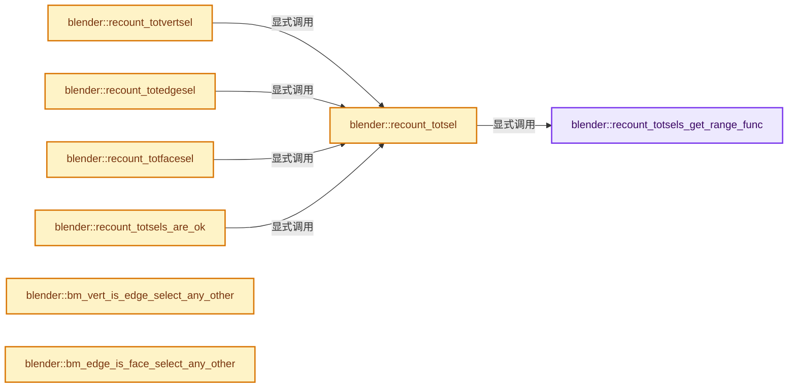

# 实现依赖专题：source/blender/bmesh/intern/bmesh_marking.cc

[方向导航](README.md) · [符号索引](../%E7%AC%A6%E5%8F%B7%E4%BE%9D%E8%B5%96%E4%B8%8E%E5%AE%9E%E7%8E%B0%E7%B4%A2%E5%BC%95.md)

本专题从正文实际调用进入，集中保存共享实现。函数有稳定锚点，可从调用处直接跳到对应完整函数；递归与互相调用通过回链组织。

## 本文件的实现关系




## 完整成员与函数实现

<a id="f-fe7056268561f99e"></a>

### `blender::recount_totsels_get_range_func`

实现位置：[source/blender/bmesh/intern/bmesh_marking.cc](../../../../../source/blender/bmesh/intern/bmesh_marking.cc) · L86—L101。

接口参数：

- `BMIterType iter_type`

**教学注释版**

<!-- annotated:d4bf48f3afc482 -->

```cpp
static TaskParallelMempoolFunc recount_totsels_get_range_func(BMIterType iter_type)
{
  BLI_assert(ELEM(iter_type, BM_VERTS_OF_MESH, BM_EDGES_OF_MESH, BM_FACES_OF_MESH));

  TaskParallelMempoolFunc range_func = nullptr;
  if (iter_type == BM_VERTS_OF_MESH) {
    range_func = recount_totsels_range_vert_func;
  }
  else if (iter_type == BM_EDGES_OF_MESH) {
    range_func = recount_totsels_range_edge_func;
  }
  else if (iter_type == BM_FACES_OF_MESH) {
    range_func = recount_totsels_range_face_func;
  }
  return range_func;
}
```

<details>
<summary>核对原始源码：source/blender/bmesh/intern/bmesh_marking.cc · L86—L101</summary>

<!-- original:d4bf48f3afc482:source/blender/bmesh/intern/bmesh_marking.cc:86:101 -->

```cpp
static TaskParallelMempoolFunc recount_totsels_get_range_func(BMIterType iter_type)
{
  BLI_assert(ELEM(iter_type, BM_VERTS_OF_MESH, BM_EDGES_OF_MESH, BM_FACES_OF_MESH));

  TaskParallelMempoolFunc range_func = nullptr;
  if (iter_type == BM_VERTS_OF_MESH) {
    range_func = recount_totsels_range_vert_func;
  }
  else if (iter_type == BM_EDGES_OF_MESH) {
    range_func = recount_totsels_range_edge_func;
  }
  else if (iter_type == BM_FACES_OF_MESH) {
    range_func = recount_totsels_range_face_func;
  }
  return range_func;
}
```

</details>

**沿实际写入检查状态**

- `range_func = recount_totsels_range_vert_func;`
- `range_func = recount_totsels_range_edge_func;`
- `range_func = recount_totsels_range_face_func;`

**结果出口**

- `return range_func;`

**继续追踪实现**

- `BLI_assert` → [BLI_assert · L48](../01-%E5%9F%BA%E7%A1%80%E5%AE%B9%E5%99%A8%E4%B8%8E%E7%8E%B0%E4%BB%A3CPP/%E4%BE%9D%E8%B5%96-BLI_assert-cc98e8.md#m-57a88495704d)；[BLI_assert · L63](../01-%E5%9F%BA%E7%A1%80%E5%AE%B9%E5%99%A8%E4%B8%8E%E7%8E%B0%E4%BB%A3CPP/%E4%BE%9D%E8%B5%96-BLI_assert-cc98e8.md#m-d07050020cb5)。宏定义由构建条件选择。
- `ELEM` → [ELEM · L88](%E4%BE%9D%E8%B5%96-GHOST_utildefines-34b996.md#m-d28724a15928)；[ELEM · L135](../01-%E5%9F%BA%E7%A1%80%E5%AE%B9%E5%99%A8%E4%B8%8E%E7%8E%B0%E4%BB%A3CPP/%E4%BE%9D%E8%B5%96-BLI_utildefines-293a0a.md#m-d6572de7cae0)。宏定义由构建条件选择。

<a id="f-96ce2b00e9dbc427"></a>

### `blender::recount_totsel`

实现位置：[source/blender/bmesh/intern/bmesh_marking.cc](../../../../../source/blender/bmesh/intern/bmesh_marking.cc) · L103—L119。

接口参数：

- `BMesh *bm`
- `BMIterType iter_type`

**教学注释版**

<!-- annotated:d6c0b28a0cb0e4 -->

```cpp
static int recount_totsel(BMesh *bm, BMIterType iter_type)
{
  const int MIN_ITER_SIZE = 1024;

  TaskParallelSettings settings;
  BLI_parallel_range_settings_defaults(&settings);
  settings.func_reduce = recount_totsels_reduce;
  settings.min_iter_per_thread = MIN_ITER_SIZE;

  SelectionCountChunkData count = {0};
  settings.userdata_chunk = &count;
  settings.userdata_chunk_size = sizeof(count);

  TaskParallelMempoolFunc range_func = recount_totsels_get_range_func(iter_type);
  BM_iter_parallel(bm, iter_type, range_func, nullptr, &settings);
  return count.selection_len;
}
```

<details>
<summary>核对原始源码：source/blender/bmesh/intern/bmesh_marking.cc · L103—L119</summary>

<!-- original:d6c0b28a0cb0e4:source/blender/bmesh/intern/bmesh_marking.cc:103:119 -->

```cpp
static int recount_totsel(BMesh *bm, BMIterType iter_type)
{
  const int MIN_ITER_SIZE = 1024;

  TaskParallelSettings settings;
  BLI_parallel_range_settings_defaults(&settings);
  settings.func_reduce = recount_totsels_reduce;
  settings.min_iter_per_thread = MIN_ITER_SIZE;

  SelectionCountChunkData count = {0};
  settings.userdata_chunk = &count;
  settings.userdata_chunk_size = sizeof(count);

  TaskParallelMempoolFunc range_func = recount_totsels_get_range_func(iter_type);
  BM_iter_parallel(bm, iter_type, range_func, nullptr, &settings);
  return count.selection_len;
}
```

</details>

**沿实际写入检查状态**

- `settings.func_reduce = recount_totsels_reduce;`
- `settings.min_iter_per_thread = MIN_ITER_SIZE;`
- `settings.userdata_chunk = &count;`
- `settings.userdata_chunk_size = sizeof(count);`

**结果出口**

- `return count.selection_len;`

**继续追踪实现**

- `BLI_parallel_range_settings_defaults` → [blender::BLI_parallel_range_settings_defaults · L218](../01-%E5%9F%BA%E7%A1%80%E5%AE%B9%E5%99%A8%E4%B8%8E%E7%8E%B0%E4%BB%A3CPP/%E4%BE%9D%E8%B5%96-BLI_task_c-917a71.md#f-3858ad801a98e123)。
- `recount_totsels_get_range_func` → [blender::recount_totsels_get_range_func · L86](%E4%BE%9D%E8%B5%96-bmesh_marking-fbaba1.md#f-fe7056268561f99e)。
- `BM_iter_parallel` → [blender::BM_iter_parallel · L662](%E4%BE%9D%E8%B5%96-bmesh_iterators-733ac7.md#f-41193fa0ee749051)。

<a id="f-0b131a628e4023aa"></a>

### `blender::recount_totvertsel`

实现位置：[source/blender/bmesh/intern/bmesh_marking.cc](../../../../../source/blender/bmesh/intern/bmesh_marking.cc) · L121—L124。

接口参数：

- `BMesh *bm`

**教学注释版**

<!-- annotated:65e96692e9ad92 -->

```cpp
static void recount_totvertsel(BMesh *bm)
{
  bm->totvertsel = recount_totsel(bm, BM_VERTS_OF_MESH);
}
```

<details>
<summary>核对原始源码：source/blender/bmesh/intern/bmesh_marking.cc · L121—L124</summary>

<!-- original:65e96692e9ad92:source/blender/bmesh/intern/bmesh_marking.cc:121:124 -->

```cpp
static void recount_totvertsel(BMesh *bm)
{
  bm->totvertsel = recount_totsel(bm, BM_VERTS_OF_MESH);
}
```

</details>

**沿实际写入检查状态**

- `bm->totvertsel = recount_totsel(bm, BM_VERTS_OF_MESH);`

**继续追踪实现**

- `recount_totsel` → [blender::recount_totsel · L103](%E4%BE%9D%E8%B5%96-bmesh_marking-fbaba1.md#f-96ce2b00e9dbc427)。

<a id="f-8ca2dbd8562f0e65"></a>

### `blender::recount_totedgesel`

实现位置：[source/blender/bmesh/intern/bmesh_marking.cc](../../../../../source/blender/bmesh/intern/bmesh_marking.cc) · L126—L129。

接口参数：

- `BMesh *bm`

**教学注释版**

<!-- annotated:02ab42ca68ba25 -->

```cpp
static void recount_totedgesel(BMesh *bm)
{
  bm->totedgesel = recount_totsel(bm, BM_EDGES_OF_MESH);
}
```

<details>
<summary>核对原始源码：source/blender/bmesh/intern/bmesh_marking.cc · L126—L129</summary>

<!-- original:02ab42ca68ba25:source/blender/bmesh/intern/bmesh_marking.cc:126:129 -->

```cpp
static void recount_totedgesel(BMesh *bm)
{
  bm->totedgesel = recount_totsel(bm, BM_EDGES_OF_MESH);
}
```

</details>

**沿实际写入检查状态**

- `bm->totedgesel = recount_totsel(bm, BM_EDGES_OF_MESH);`

**继续追踪实现**

- `recount_totsel` → [blender::recount_totsel · L103](%E4%BE%9D%E8%B5%96-bmesh_marking-fbaba1.md#f-96ce2b00e9dbc427)。

<a id="f-762159491ae39a12"></a>

### `blender::recount_totfacesel`

实现位置：[source/blender/bmesh/intern/bmesh_marking.cc](../../../../../source/blender/bmesh/intern/bmesh_marking.cc) · L131—L134。

接口参数：

- `BMesh *bm`

**教学注释版**

<!-- annotated:d9429f1b52e503 -->

```cpp
static void recount_totfacesel(BMesh *bm)
{
  bm->totfacesel = recount_totsel(bm, BM_FACES_OF_MESH);
}
```

<details>
<summary>核对原始源码：source/blender/bmesh/intern/bmesh_marking.cc · L131—L134</summary>

<!-- original:d9429f1b52e503:source/blender/bmesh/intern/bmesh_marking.cc:131:134 -->

```cpp
static void recount_totfacesel(BMesh *bm)
{
  bm->totfacesel = recount_totsel(bm, BM_FACES_OF_MESH);
}
```

</details>

**沿实际写入检查状态**

- `bm->totfacesel = recount_totsel(bm, BM_FACES_OF_MESH);`

**继续追踪实现**

- `recount_totsel` → [blender::recount_totsel · L103](%E4%BE%9D%E8%B5%96-bmesh_marking-fbaba1.md#f-96ce2b00e9dbc427)。

<a id="f-b1ee57201a8a7a4d"></a>

### `blender::recount_totsels_are_ok`

实现位置：[source/blender/bmesh/intern/bmesh_marking.cc](../../../../../source/blender/bmesh/intern/bmesh_marking.cc) · L144—L149。

接口参数：

- `BMesh *bm`

**教学注释版**

<!-- annotated:d9232e5f8a4aa8 -->

```cpp
static bool recount_totsels_are_ok(BMesh *bm)
{
  return bm->totvertsel == recount_totsel(bm, BM_VERTS_OF_MESH) &&
         bm->totedgesel == recount_totsel(bm, BM_EDGES_OF_MESH) &&
         bm->totfacesel == recount_totsel(bm, BM_FACES_OF_MESH);
}
```

<details>
<summary>核对原始源码：source/blender/bmesh/intern/bmesh_marking.cc · L144—L149</summary>

<!-- original:d9232e5f8a4aa8:source/blender/bmesh/intern/bmesh_marking.cc:144:149 -->

```cpp
static bool recount_totsels_are_ok(BMesh *bm)
{
  return bm->totvertsel == recount_totsel(bm, BM_VERTS_OF_MESH) &&
         bm->totedgesel == recount_totsel(bm, BM_EDGES_OF_MESH) &&
         bm->totfacesel == recount_totsel(bm, BM_FACES_OF_MESH);
}
```

</details>

**结果出口**

- `return bm->totvertsel == recount_totsel(bm, BM_VERTS_OF_MESH) &&`

**继续追踪实现**

- `recount_totsel` → [blender::recount_totsel · L103](%E4%BE%9D%E8%B5%96-bmesh_marking-fbaba1.md#f-96ce2b00e9dbc427)。

<a id="f-dff8940e2362d7ec"></a>

### `blender::bm_vert_is_edge_select_any_other`

实现位置：[source/blender/bmesh/intern/bmesh_marking.cc](../../../../../source/blender/bmesh/intern/bmesh_marking.cc) · L158—L169。

接口参数：

- `const BMVert *v`
- `const BMEdge *e_first`

**教学注释版**

<!-- annotated:c78ac703e1f043 -->

```cpp
static bool bm_vert_is_edge_select_any_other(const BMVert *v, const BMEdge *e_first)
{
  const BMEdge *e_iter = e_first;

  /* start by stepping over the current edge */
  while ((e_iter = bmesh_disk_edge_next(e_iter, v)) != e_first) {
    if (BM_elem_flag_test(e_iter, BM_ELEM_SELECT)) {
      return true;
    }
  }
  return false;
}
```

<details>
<summary>核对原始源码：source/blender/bmesh/intern/bmesh_marking.cc · L158—L169</summary>

<!-- original:c78ac703e1f043:source/blender/bmesh/intern/bmesh_marking.cc:158:169 -->

```cpp
static bool bm_vert_is_edge_select_any_other(const BMVert *v, const BMEdge *e_first)
{
  const BMEdge *e_iter = e_first;

  /* start by stepping over the current edge */
  while ((e_iter = bmesh_disk_edge_next(e_iter, v)) != e_first) {
    if (BM_elem_flag_test(e_iter, BM_ELEM_SELECT)) {
      return true;
    }
  }
  return false;
}
```

</details>

**结果出口**

- `return true;`
- `return false;`

**继续追踪实现**

- `bmesh_disk_edge_next` → [blender::bmesh_disk_edge_next · L59](%E4%BE%9D%E8%B5%96-bmesh_structure_inline-3e4d59.md#f-bde0a66632cf5785)。
- `BM_elem_flag_test` → [BM_elem_flag_test · L21](%E4%BE%9D%E8%B5%96-bmesh_inline-74f1be.md#m-2431d1179b41)。宏定义由构建条件选择。

<a id="f-cf35ff7005139540"></a>

### `blender::bm_edge_is_face_select_any_other`

实现位置：[source/blender/bmesh/intern/bmesh_marking.cc](../../../../../source/blender/bmesh/intern/bmesh_marking.cc) · L201—L212。

接口参数：

- `BMLoop *l_first`

**教学注释版**

<!-- annotated:bd048306023867 -->

```cpp
static bool bm_edge_is_face_select_any_other(BMLoop *l_first)
{
  const BMLoop *l_iter = l_first;

  /* start by stepping over the current face */
  while ((l_iter = l_iter->radial_next) != l_first) {
    if (BM_elem_flag_test(l_iter->f, BM_ELEM_SELECT)) {
      return true;
    }
  }
  return false;
}
```

<details>
<summary>核对原始源码：source/blender/bmesh/intern/bmesh_marking.cc · L201—L212</summary>

<!-- original:bd048306023867:source/blender/bmesh/intern/bmesh_marking.cc:201:212 -->

```cpp
static bool bm_edge_is_face_select_any_other(BMLoop *l_first)
{
  const BMLoop *l_iter = l_first;

  /* start by stepping over the current face */
  while ((l_iter = l_iter->radial_next) != l_first) {
    if (BM_elem_flag_test(l_iter->f, BM_ELEM_SELECT)) {
      return true;
    }
  }
  return false;
}
```

</details>

**结果出口**

- `return true;`
- `return false;`

**继续追踪实现**

- `BM_elem_flag_test` → [BM_elem_flag_test · L21](%E4%BE%9D%E8%B5%96-bmesh_inline-74f1be.md#m-2431d1179b41)。宏定义由构建条件选择。

<a id="f-d70706e0c30c796c"></a>

### `blender::bm_mesh_select_mode_flush_vert_to_edge`

实现位置：[source/blender/bmesh/intern/bmesh_marking.cc](../../../../../source/blender/bmesh/intern/bmesh_marking.cc) · L393—L407。

接口参数：

- `BMesh *bm`

**教学注释版**

<!-- annotated:ae2a006920db90 -->

```cpp
static void bm_mesh_select_mode_flush_vert_to_edge(BMesh *bm)
{
  SelectionFlushChunkData chunk_data = {0};

  TaskParallelSettings settings;
  BLI_parallel_range_settings_defaults(&settings);
  settings.use_threading = bm->totedge >= BM_THREAD_LIMIT;
  settings.userdata_chunk = &chunk_data;
  settings.userdata_chunk_size = sizeof(chunk_data);
  settings.func_reduce = bm_mesh_select_mode_flush_reduce_fn;

  BM_iter_parallel(
      bm, BM_EDGES_OF_MESH, bm_mesh_select_mode_flush_vert_to_edge_iter_fn, nullptr, &settings);
  bm->totedgesel += chunk_data.delta_selection_len;
}
```

<details>
<summary>核对原始源码：source/blender/bmesh/intern/bmesh_marking.cc · L393—L407</summary>

<!-- original:ae2a006920db90:source/blender/bmesh/intern/bmesh_marking.cc:393:407 -->

```cpp
static void bm_mesh_select_mode_flush_vert_to_edge(BMesh *bm)
{
  SelectionFlushChunkData chunk_data = {0};

  TaskParallelSettings settings;
  BLI_parallel_range_settings_defaults(&settings);
  settings.use_threading = bm->totedge >= BM_THREAD_LIMIT;
  settings.userdata_chunk = &chunk_data;
  settings.userdata_chunk_size = sizeof(chunk_data);
  settings.func_reduce = bm_mesh_select_mode_flush_reduce_fn;

  BM_iter_parallel(
      bm, BM_EDGES_OF_MESH, bm_mesh_select_mode_flush_vert_to_edge_iter_fn, nullptr, &settings);
  bm->totedgesel += chunk_data.delta_selection_len;
}
```

</details>

**沿实际写入检查状态**

- `settings.use_threading = bm->totedge >= BM_THREAD_LIMIT;`
- `settings.userdata_chunk = &chunk_data;`
- `settings.userdata_chunk_size = sizeof(chunk_data);`
- `settings.func_reduce = bm_mesh_select_mode_flush_reduce_fn;`
- `bm->totedgesel += chunk_data.delta_selection_len;`

**继续追踪实现**

- `BLI_parallel_range_settings_defaults` → [blender::BLI_parallel_range_settings_defaults · L218](../01-%E5%9F%BA%E7%A1%80%E5%AE%B9%E5%99%A8%E4%B8%8E%E7%8E%B0%E4%BB%A3CPP/%E4%BE%9D%E8%B5%96-BLI_task_c-917a71.md#f-3858ad801a98e123)。
- `BM_iter_parallel` → [blender::BM_iter_parallel · L662](%E4%BE%9D%E8%B5%96-bmesh_iterators-733ac7.md#f-41193fa0ee749051)。

<a id="f-c700bc6b2f79d060"></a>

### `blender::bm_mesh_select_mode_flush_edge_to_face`

实现位置：[source/blender/bmesh/intern/bmesh_marking.cc](../../../../../source/blender/bmesh/intern/bmesh_marking.cc) · L409—L423。

接口参数：

- `BMesh *bm`

**教学注释版**

<!-- annotated:cef7821167f8d6 -->

```cpp
static void bm_mesh_select_mode_flush_edge_to_face(BMesh *bm)
{
  SelectionFlushChunkData chunk_data = {0};

  TaskParallelSettings settings;
  BLI_parallel_range_settings_defaults(&settings);
  settings.use_threading = bm->totface >= BM_THREAD_LIMIT;
  settings.userdata_chunk = &chunk_data;
  settings.userdata_chunk_size = sizeof(chunk_data);
  settings.func_reduce = bm_mesh_select_mode_flush_reduce_fn;

  BM_iter_parallel(
      bm, BM_FACES_OF_MESH, bm_mesh_select_mode_flush_edge_to_face_iter_fn, nullptr, &settings);
  bm->totfacesel += chunk_data.delta_selection_len;
}
```

<details>
<summary>核对原始源码：source/blender/bmesh/intern/bmesh_marking.cc · L409—L423</summary>

<!-- original:cef7821167f8d6:source/blender/bmesh/intern/bmesh_marking.cc:409:423 -->

```cpp
static void bm_mesh_select_mode_flush_edge_to_face(BMesh *bm)
{
  SelectionFlushChunkData chunk_data = {0};

  TaskParallelSettings settings;
  BLI_parallel_range_settings_defaults(&settings);
  settings.use_threading = bm->totface >= BM_THREAD_LIMIT;
  settings.userdata_chunk = &chunk_data;
  settings.userdata_chunk_size = sizeof(chunk_data);
  settings.func_reduce = bm_mesh_select_mode_flush_reduce_fn;

  BM_iter_parallel(
      bm, BM_FACES_OF_MESH, bm_mesh_select_mode_flush_edge_to_face_iter_fn, nullptr, &settings);
  bm->totfacesel += chunk_data.delta_selection_len;
}
```

</details>

**沿实际写入检查状态**

- `settings.use_threading = bm->totface >= BM_THREAD_LIMIT;`
- `settings.userdata_chunk = &chunk_data;`
- `settings.userdata_chunk_size = sizeof(chunk_data);`
- `settings.func_reduce = bm_mesh_select_mode_flush_reduce_fn;`
- `bm->totfacesel += chunk_data.delta_selection_len;`

**继续追踪实现**

- `BLI_parallel_range_settings_defaults` → [blender::BLI_parallel_range_settings_defaults · L218](../01-%E5%9F%BA%E7%A1%80%E5%AE%B9%E5%99%A8%E4%B8%8E%E7%8E%B0%E4%BB%A3CPP/%E4%BE%9D%E8%B5%96-BLI_task_c-917a71.md#f-3858ad801a98e123)。
- `BM_iter_parallel` → [blender::BM_iter_parallel · L662](%E4%BE%9D%E8%B5%96-bmesh_iterators-733ac7.md#f-41193fa0ee749051)。

<a id="f-b2a3f78198a58009"></a>

### `blender::bm_mesh_select_mode_flush_edge_to_vert`

实现位置：[source/blender/bmesh/intern/bmesh_marking.cc](../../../../../source/blender/bmesh/intern/bmesh_marking.cc) · L430—L458。

接口参数：

- `BMesh *bm`

**教学注释版**

<!-- annotated:3524f8043d0359 -->

```cpp
static void bm_mesh_select_mode_flush_edge_to_vert(BMesh *bm)
{
  BMIter iter;
  BMEdge *e;
  bool any_select = false;
  BM_ITER_MESH (e, &iter, bm, BM_EDGES_OF_MESH) {
    if (BM_elem_flag_test(e, BM_ELEM_HIDDEN)) {
      continue;
    }
    if (BM_elem_flag_test(e, BM_ELEM_SELECT)) {
      any_select = true;
    }
    else {
      BM_vert_select_set(bm, e->v1, false);
      BM_vert_select_set(bm, e->v2, false);
    }
  }
  if (any_select) {
    BM_ITER_MESH (e, &iter, bm, BM_EDGES_OF_MESH) {
      if (BM_elem_flag_test(e, BM_ELEM_HIDDEN)) {
        continue;
      }
      if (BM_elem_flag_test(e, BM_ELEM_SELECT)) {
        BM_vert_select_set(bm, e->v1, true);
        BM_vert_select_set(bm, e->v2, true);
      }
    }
  }
}
```

<details>
<summary>核对原始源码：source/blender/bmesh/intern/bmesh_marking.cc · L430—L458</summary>

<!-- original:3524f8043d0359:source/blender/bmesh/intern/bmesh_marking.cc:430:458 -->

```cpp
static void bm_mesh_select_mode_flush_edge_to_vert(BMesh *bm)
{
  BMIter iter;
  BMEdge *e;
  bool any_select = false;
  BM_ITER_MESH (e, &iter, bm, BM_EDGES_OF_MESH) {
    if (BM_elem_flag_test(e, BM_ELEM_HIDDEN)) {
      continue;
    }
    if (BM_elem_flag_test(e, BM_ELEM_SELECT)) {
      any_select = true;
    }
    else {
      BM_vert_select_set(bm, e->v1, false);
      BM_vert_select_set(bm, e->v2, false);
    }
  }
  if (any_select) {
    BM_ITER_MESH (e, &iter, bm, BM_EDGES_OF_MESH) {
      if (BM_elem_flag_test(e, BM_ELEM_HIDDEN)) {
        continue;
      }
      if (BM_elem_flag_test(e, BM_ELEM_SELECT)) {
        BM_vert_select_set(bm, e->v1, true);
        BM_vert_select_set(bm, e->v2, true);
      }
    }
  }
}
```

</details>

**沿实际写入检查状态**

- `any_select = true;`

**继续追踪实现**

- `BM_ITER_MESH` → [BM_ITER_MESH · L72](%E4%BE%9D%E8%B5%96-bmesh_iterators-13971c.md#m-cfc837c73218)。宏定义由构建条件选择。
- `BM_elem_flag_test` → [BM_elem_flag_test · L21](%E4%BE%9D%E8%B5%96-bmesh_inline-74f1be.md#m-2431d1179b41)。宏定义由构建条件选择。
- `BM_vert_select_set` → [blender::BM_vert_select_set · L623](%E4%BE%9D%E8%B5%96-bmesh_marking-fbaba1.md#f-b45fee356185a30b)。

<a id="f-170fc86f72a66347"></a>

### `blender::bm_mesh_select_mode_flush_face_to_vert_and_edge`

实现位置：[source/blender/bmesh/intern/bmesh_marking.cc](../../../../../source/blender/bmesh/intern/bmesh_marking.cc) · L465—L501。

接口参数：

- `BMesh *bm`

**教学注释版**

<!-- annotated:91bcd625fdfee0 -->

```cpp
static void bm_mesh_select_mode_flush_face_to_vert_and_edge(BMesh *bm)
{
  BMIter iter;
  BMFace *f;
  bool any_select = false;
  BM_ITER_MESH (f, &iter, bm, BM_FACES_OF_MESH) {
    if (BM_elem_flag_test(f, BM_ELEM_HIDDEN)) {
      continue;
    }
    if (BM_elem_flag_test(f, BM_ELEM_SELECT)) {
      any_select = true;
    }
    else {
      BMLoop *l_first = BM_FACE_FIRST_LOOP(f);
      BMLoop *l_iter = l_first;
      do {
        BM_vert_select_set(bm, l_iter->v, false);
        BM_edge_select_set_noflush(bm, l_iter->e, false);
      } while ((l_iter = l_iter->next) != l_first);
    }
  }
  if (any_select) {
    BM_ITER_MESH (f, &iter, bm, BM_FACES_OF_MESH) {
      if (BM_elem_flag_test(f, BM_ELEM_HIDDEN)) {
        continue;
      }
      if (BM_elem_flag_test(f, BM_ELEM_SELECT)) {
        BMLoop *l_first = BM_FACE_FIRST_LOOP(f);
        BMLoop *l_iter = l_first;
        do {
          BM_vert_select_set(bm, l_iter->v, true);
          BM_edge_select_set_noflush(bm, l_iter->e, true);
        } while ((l_iter = l_iter->next) != l_first);
      }
    }
  }
}
```

<details>
<summary>核对原始源码：source/blender/bmesh/intern/bmesh_marking.cc · L465—L501</summary>

<!-- original:91bcd625fdfee0:source/blender/bmesh/intern/bmesh_marking.cc:465:501 -->

```cpp
static void bm_mesh_select_mode_flush_face_to_vert_and_edge(BMesh *bm)
{
  BMIter iter;
  BMFace *f;
  bool any_select = false;
  BM_ITER_MESH (f, &iter, bm, BM_FACES_OF_MESH) {
    if (BM_elem_flag_test(f, BM_ELEM_HIDDEN)) {
      continue;
    }
    if (BM_elem_flag_test(f, BM_ELEM_SELECT)) {
      any_select = true;
    }
    else {
      BMLoop *l_first = BM_FACE_FIRST_LOOP(f);
      BMLoop *l_iter = l_first;
      do {
        BM_vert_select_set(bm, l_iter->v, false);
        BM_edge_select_set_noflush(bm, l_iter->e, false);
      } while ((l_iter = l_iter->next) != l_first);
    }
  }
  if (any_select) {
    BM_ITER_MESH (f, &iter, bm, BM_FACES_OF_MESH) {
      if (BM_elem_flag_test(f, BM_ELEM_HIDDEN)) {
        continue;
      }
      if (BM_elem_flag_test(f, BM_ELEM_SELECT)) {
        BMLoop *l_first = BM_FACE_FIRST_LOOP(f);
        BMLoop *l_iter = l_first;
        do {
          BM_vert_select_set(bm, l_iter->v, true);
          BM_edge_select_set_noflush(bm, l_iter->e, true);
        } while ((l_iter = l_iter->next) != l_first);
      }
    }
  }
}
```

</details>

**沿实际写入检查状态**

- `any_select = true;`

**继续追踪实现**

- `BM_ITER_MESH` → [BM_ITER_MESH · L72](%E4%BE%9D%E8%B5%96-bmesh_iterators-13971c.md#m-cfc837c73218)。宏定义由构建条件选择。
- `BM_elem_flag_test` → [BM_elem_flag_test · L21](%E4%BE%9D%E8%B5%96-bmesh_inline-74f1be.md#m-2431d1179b41)。宏定义由构建条件选择。
- `BM_FACE_FIRST_LOOP` → [BM_FACE_FIRST_LOOP · L697](%E4%BE%9D%E8%B5%96-bmesh_class-4cf146.md#m-c7e10ffb38e6)；[BM_FACE_FIRST_LOOP · L699](%E4%BE%9D%E8%B5%96-bmesh_class-4cf146.md#m-76a054cc4770)。宏定义由构建条件选择。
- `BM_vert_select_set` → [blender::BM_vert_select_set · L623](%E4%BE%9D%E8%B5%96-bmesh_marking-fbaba1.md#f-b45fee356185a30b)。
- `BM_edge_select_set_noflush` → [blender::BM_edge_select_set_noflush · L764](%E4%BE%9D%E8%B5%96-bmesh_marking-fbaba1.md#f-7961fa9da6a38f7d)。

<a id="f-e4076b0e504dd80a"></a>

### `blender::BM_mesh_select_mode_flush_ex`

实现位置：[source/blender/bmesh/intern/bmesh_marking.cc](../../../../../source/blender/bmesh/intern/bmesh_marking.cc) · L503—L542。

接口参数：

- `BMesh *bm`
- `const short selectmode`
- `BMSelectFlushFlag flag`

**教学注释版**

<!-- annotated:199b2130ed5fcb -->

```cpp
void BM_mesh_select_mode_flush_ex(BMesh *bm, const short selectmode, BMSelectFlushFlag flag)
{
  const bool flush_down = flag_is_set(flag, BMSelectFlushFlag::Down);
  if (flush_down) {
    if (selectmode & SCE_SELECT_VERTEX) {
      /* Pass. */
    }
    else if (selectmode & SCE_SELECT_EDGE) {
      bm_mesh_select_mode_flush_edge_to_vert(bm);
    }
    else if (selectmode & SCE_SELECT_FACE) {
      bm_mesh_select_mode_flush_face_to_vert_and_edge(bm);
    }
  }

  /* Always flush up. */
  {
    if (selectmode & SCE_SELECT_VERTEX) {
      bm_mesh_select_mode_flush_vert_to_edge(bm);
    }

    if (selectmode & (SCE_SELECT_VERTEX | SCE_SELECT_EDGE)) {
      bm_mesh_select_mode_flush_edge_to_face(bm);
    }
  }

  /* Remove any deselected elements from the BMEditSelection */
  BM_select_history_validate(bm);

  if (flag_is_set(flag, BMSelectFlushFlag::RecalcLenVert)) {
    recount_totvertsel(bm);
  }
  if (flag_is_set(flag, BMSelectFlushFlag::RecalcLenEdge)) {
    recount_totedgesel(bm);
  }
  if (flag_is_set(flag, BMSelectFlushFlag::RecalcLenFace)) {
    recount_totfacesel(bm);
  }
  BLI_assert(recount_totsels_are_ok(bm));
}
```

<details>
<summary>核对原始源码：source/blender/bmesh/intern/bmesh_marking.cc · L503—L542</summary>

<!-- original:199b2130ed5fcb:source/blender/bmesh/intern/bmesh_marking.cc:503:542 -->

```cpp
void BM_mesh_select_mode_flush_ex(BMesh *bm, const short selectmode, BMSelectFlushFlag flag)
{
  const bool flush_down = flag_is_set(flag, BMSelectFlushFlag::Down);
  if (flush_down) {
    if (selectmode & SCE_SELECT_VERTEX) {
      /* Pass. */
    }
    else if (selectmode & SCE_SELECT_EDGE) {
      bm_mesh_select_mode_flush_edge_to_vert(bm);
    }
    else if (selectmode & SCE_SELECT_FACE) {
      bm_mesh_select_mode_flush_face_to_vert_and_edge(bm);
    }
  }

  /* Always flush up. */
  {
    if (selectmode & SCE_SELECT_VERTEX) {
      bm_mesh_select_mode_flush_vert_to_edge(bm);
    }

    if (selectmode & (SCE_SELECT_VERTEX | SCE_SELECT_EDGE)) {
      bm_mesh_select_mode_flush_edge_to_face(bm);
    }
  }

  /* Remove any deselected elements from the BMEditSelection */
  BM_select_history_validate(bm);

  if (flag_is_set(flag, BMSelectFlushFlag::RecalcLenVert)) {
    recount_totvertsel(bm);
  }
  if (flag_is_set(flag, BMSelectFlushFlag::RecalcLenEdge)) {
    recount_totedgesel(bm);
  }
  if (flag_is_set(flag, BMSelectFlushFlag::RecalcLenFace)) {
    recount_totfacesel(bm);
  }
  BLI_assert(recount_totsels_are_ok(bm));
}
```

</details>

**继续追踪实现**

- `flag_is_set` → [调用协议](../%E6%A8%A1%E6%9D%BF%E5%AE%8F%E4%B8%8E%E5%8A%A8%E6%80%81%E5%88%86%E6%B4%BE%E5%8D%8F%E8%AE%AE.md)：函数指针、局部可调用对象或未展开的宏；必须结合调用者环境。调用位置L505。
- `bm_mesh_select_mode_flush_edge_to_vert` → [blender::bm_mesh_select_mode_flush_edge_to_vert · L430](%E4%BE%9D%E8%B5%96-bmesh_marking-fbaba1.md#f-b2a3f78198a58009)。
- `bm_mesh_select_mode_flush_face_to_vert_and_edge` → [blender::bm_mesh_select_mode_flush_face_to_vert_and_edge · L465](%E4%BE%9D%E8%B5%96-bmesh_marking-fbaba1.md#f-170fc86f72a66347)。
- `bm_mesh_select_mode_flush_vert_to_edge` → [blender::bm_mesh_select_mode_flush_vert_to_edge · L393](%E4%BE%9D%E8%B5%96-bmesh_marking-fbaba1.md#f-d70706e0c30c796c)。
- `bm_mesh_select_mode_flush_edge_to_face` → [blender::bm_mesh_select_mode_flush_edge_to_face · L409](%E4%BE%9D%E8%B5%96-bmesh_marking-fbaba1.md#f-c700bc6b2f79d060)。
- `BM_select_history_validate` → [blender::BM_select_history_validate · L1216](%E4%BE%9D%E8%B5%96-bmesh_marking-fbaba1.md#f-c8fc72a84a5d5c40)。
- `recount_totvertsel` → [blender::recount_totvertsel · L121](%E4%BE%9D%E8%B5%96-bmesh_marking-fbaba1.md#f-0b131a628e4023aa)。
- `recount_totedgesel` → [blender::recount_totedgesel · L126](%E4%BE%9D%E8%B5%96-bmesh_marking-fbaba1.md#f-8ca2dbd8562f0e65)。
- `recount_totfacesel` → [blender::recount_totfacesel · L131](%E4%BE%9D%E8%B5%96-bmesh_marking-fbaba1.md#f-762159491ae39a12)。
- `BLI_assert` → [BLI_assert · L48](../01-%E5%9F%BA%E7%A1%80%E5%AE%B9%E5%99%A8%E4%B8%8E%E7%8E%B0%E4%BB%A3CPP/%E4%BE%9D%E8%B5%96-BLI_assert-cc98e8.md#m-57a88495704d)；[BLI_assert · L63](../01-%E5%9F%BA%E7%A1%80%E5%AE%B9%E5%99%A8%E4%B8%8E%E7%8E%B0%E4%BB%A3CPP/%E4%BE%9D%E8%B5%96-BLI_assert-cc98e8.md#m-d07050020cb5)。宏定义由构建条件选择。
- `recount_totsels_are_ok` → [blender::recount_totsels_are_ok · L144](%E4%BE%9D%E8%B5%96-bmesh_marking-fbaba1.md#f-b1ee57201a8a7a4d)。

<a id="f-f380b9046d9454a0"></a>

### `blender::BM_mesh_select_mode_flush`

实现位置：[source/blender/bmesh/intern/bmesh_marking.cc](../../../../../source/blender/bmesh/intern/bmesh_marking.cc) · L544—L547。

接口参数：

- `BMesh *bm`

**教学注释版**

<!-- annotated:7e30fcc3f14d37 -->

```cpp
void BM_mesh_select_mode_flush(BMesh *bm)
{
  BM_mesh_select_mode_flush_ex(bm, bm->selectmode, BMSelectFlushFlag_Default);
}
```

<details>
<summary>核对原始源码：source/blender/bmesh/intern/bmesh_marking.cc · L544—L547</summary>

<!-- original:7e30fcc3f14d37:source/blender/bmesh/intern/bmesh_marking.cc:544:547 -->

```cpp
void BM_mesh_select_mode_flush(BMesh *bm)
{
  BM_mesh_select_mode_flush_ex(bm, bm->selectmode, BMSelectFlushFlag_Default);
}
```

</details>

**继续追踪实现**

- `BM_mesh_select_mode_flush_ex` → [blender::BM_mesh_select_mode_flush_ex · L503](%E4%BE%9D%E8%B5%96-bmesh_marking-fbaba1.md#f-e4076b0e504dd80a)。

<a id="f-b45fee356185a30b"></a>

### `blender::BM_vert_select_set`

实现位置：[source/blender/bmesh/intern/bmesh_marking.cc](../../../../../source/blender/bmesh/intern/bmesh_marking.cc) · L623—L643。

接口参数：

- `BMesh *bm`
- `BMVert *v`
- `const bool select`

**教学注释版**

<!-- annotated:7908f9aa44c1a6 -->

```cpp
void BM_vert_select_set(BMesh *bm, BMVert *v, const bool select)
{
  BLI_assert(v->head.htype == BM_VERT);

  if (BM_elem_flag_test(v, BM_ELEM_HIDDEN)) {
    return;
  }

  if (select) {
    if (!BM_elem_flag_test(v, BM_ELEM_SELECT)) {
      BM_elem_flag_enable(v, BM_ELEM_SELECT);
      bm->totvertsel += 1;
    }
  }
  else {
    if (BM_elem_flag_test(v, BM_ELEM_SELECT)) {
      bm->totvertsel -= 1;
      BM_elem_flag_disable(v, BM_ELEM_SELECT);
    }
  }
}
```

<details>
<summary>核对原始源码：source/blender/bmesh/intern/bmesh_marking.cc · L623—L643</summary>

<!-- original:7908f9aa44c1a6:source/blender/bmesh/intern/bmesh_marking.cc:623:643 -->

```cpp
void BM_vert_select_set(BMesh *bm, BMVert *v, const bool select)
{
  BLI_assert(v->head.htype == BM_VERT);

  if (BM_elem_flag_test(v, BM_ELEM_HIDDEN)) {
    return;
  }

  if (select) {
    if (!BM_elem_flag_test(v, BM_ELEM_SELECT)) {
      BM_elem_flag_enable(v, BM_ELEM_SELECT);
      bm->totvertsel += 1;
    }
  }
  else {
    if (BM_elem_flag_test(v, BM_ELEM_SELECT)) {
      bm->totvertsel -= 1;
      BM_elem_flag_disable(v, BM_ELEM_SELECT);
    }
  }
}
```

</details>

**沿实际写入检查状态**

- `bm->totvertsel += 1;`
- `bm->totvertsel -= 1;`

**继续追踪实现**

- `BLI_assert` → [BLI_assert · L48](../01-%E5%9F%BA%E7%A1%80%E5%AE%B9%E5%99%A8%E4%B8%8E%E7%8E%B0%E4%BB%A3CPP/%E4%BE%9D%E8%B5%96-BLI_assert-cc98e8.md#m-57a88495704d)；[BLI_assert · L63](../01-%E5%9F%BA%E7%A1%80%E5%AE%B9%E5%99%A8%E4%B8%8E%E7%8E%B0%E4%BB%A3CPP/%E4%BE%9D%E8%B5%96-BLI_assert-cc98e8.md#m-d07050020cb5)。宏定义由构建条件选择。
- `BM_elem_flag_test` → [BM_elem_flag_test · L21](%E4%BE%9D%E8%B5%96-bmesh_inline-74f1be.md#m-2431d1179b41)。宏定义由构建条件选择。
- `BM_elem_flag_enable` → [BM_elem_flag_enable · L23](%E4%BE%9D%E8%B5%96-bmesh_inline-74f1be.md#m-4400242f1540)。宏定义由构建条件选择。
- `BM_elem_flag_disable` → [BM_elem_flag_disable · L24](%E4%BE%9D%E8%B5%96-bmesh_inline-74f1be.md#m-e129d62b6353)。宏定义由构建条件选择。

<a id="f-984e704cd946cd33"></a>

### `blender::BM_edge_select_set`

实现位置：[source/blender/bmesh/intern/bmesh_marking.cc](../../../../../source/blender/bmesh/intern/bmesh_marking.cc) · L645—L683。

接口参数：

- `BMesh *bm`
- `BMEdge *e`
- `const bool select`

**教学注释版**

<!-- annotated:27946ae0cfdc34 -->

```cpp
void BM_edge_select_set(BMesh *bm, BMEdge *e, const bool select)
{
  BLI_assert(e->head.htype == BM_EDGE);

  if (BM_elem_flag_test(e, BM_ELEM_HIDDEN)) {
    return;
  }

  if (select) {
    if (!BM_elem_flag_test(e, BM_ELEM_SELECT)) {
      BM_elem_flag_enable(e, BM_ELEM_SELECT);
      bm->totedgesel += 1;
    }
    BM_vert_select_set(bm, e->v1, true);
    BM_vert_select_set(bm, e->v2, true);
  }
  else {
    if (BM_elem_flag_test(e, BM_ELEM_SELECT)) {
      BM_elem_flag_disable(e, BM_ELEM_SELECT);
      bm->totedgesel -= 1;
    }

    if ((bm->selectmode & SCE_SELECT_VERTEX) == 0) {
      int i;

      /* check if the vert is used by a selected edge */
      for (i = 0; i < 2; i++) {
        BMVert *v = *((&e->v1) + i);
        if (bm_vert_is_edge_select_any_other(v, e) == false) {
          BM_vert_select_set(bm, v, false);
        }
      }
    }
    else {
      BM_vert_select_set(bm, e->v1, false);
      BM_vert_select_set(bm, e->v2, false);
    }
  }
}
```

<details>
<summary>核对原始源码：source/blender/bmesh/intern/bmesh_marking.cc · L645—L683</summary>

<!-- original:27946ae0cfdc34:source/blender/bmesh/intern/bmesh_marking.cc:645:683 -->

```cpp
void BM_edge_select_set(BMesh *bm, BMEdge *e, const bool select)
{
  BLI_assert(e->head.htype == BM_EDGE);

  if (BM_elem_flag_test(e, BM_ELEM_HIDDEN)) {
    return;
  }

  if (select) {
    if (!BM_elem_flag_test(e, BM_ELEM_SELECT)) {
      BM_elem_flag_enable(e, BM_ELEM_SELECT);
      bm->totedgesel += 1;
    }
    BM_vert_select_set(bm, e->v1, true);
    BM_vert_select_set(bm, e->v2, true);
  }
  else {
    if (BM_elem_flag_test(e, BM_ELEM_SELECT)) {
      BM_elem_flag_disable(e, BM_ELEM_SELECT);
      bm->totedgesel -= 1;
    }

    if ((bm->selectmode & SCE_SELECT_VERTEX) == 0) {
      int i;

      /* check if the vert is used by a selected edge */
      for (i = 0; i < 2; i++) {
        BMVert *v = *((&e->v1) + i);
        if (bm_vert_is_edge_select_any_other(v, e) == false) {
          BM_vert_select_set(bm, v, false);
        }
      }
    }
    else {
      BM_vert_select_set(bm, e->v1, false);
      BM_vert_select_set(bm, e->v2, false);
    }
  }
}
```

</details>

**沿实际写入检查状态**

- `bm->totedgesel += 1;`
- `bm->totedgesel -= 1;`

**继续追踪实现**

- `BLI_assert` → [BLI_assert · L48](../01-%E5%9F%BA%E7%A1%80%E5%AE%B9%E5%99%A8%E4%B8%8E%E7%8E%B0%E4%BB%A3CPP/%E4%BE%9D%E8%B5%96-BLI_assert-cc98e8.md#m-57a88495704d)；[BLI_assert · L63](../01-%E5%9F%BA%E7%A1%80%E5%AE%B9%E5%99%A8%E4%B8%8E%E7%8E%B0%E4%BB%A3CPP/%E4%BE%9D%E8%B5%96-BLI_assert-cc98e8.md#m-d07050020cb5)。宏定义由构建条件选择。
- `BM_elem_flag_test` → [BM_elem_flag_test · L21](%E4%BE%9D%E8%B5%96-bmesh_inline-74f1be.md#m-2431d1179b41)。宏定义由构建条件选择。
- `BM_elem_flag_enable` → [BM_elem_flag_enable · L23](%E4%BE%9D%E8%B5%96-bmesh_inline-74f1be.md#m-4400242f1540)。宏定义由构建条件选择。
- `BM_vert_select_set` → [blender::BM_vert_select_set · L623](%E4%BE%9D%E8%B5%96-bmesh_marking-fbaba1.md#f-b45fee356185a30b)。
- `BM_elem_flag_disable` → [BM_elem_flag_disable · L24](%E4%BE%9D%E8%B5%96-bmesh_inline-74f1be.md#m-e129d62b6353)。宏定义由构建条件选择。
- `bm_vert_is_edge_select_any_other` → [blender::bm_vert_is_edge_select_any_other · L158](%E4%BE%9D%E8%B5%96-bmesh_marking-fbaba1.md#f-dff8940e2362d7ec)。

<a id="f-c2007a9ca2044e0c"></a>

### `blender::BM_face_select_set`

实现位置：[source/blender/bmesh/intern/bmesh_marking.cc](../../../../../source/blender/bmesh/intern/bmesh_marking.cc) · L685—L758。

接口参数：

- `BMesh *bm`
- `BMFace *f`
- `const bool select`

**教学注释版**

<!-- annotated:34af4d5bed6486 -->

```cpp
void BM_face_select_set(BMesh *bm, BMFace *f, const bool select)
{
  BMLoop *l_iter;
  BMLoop *l_first;

  BLI_assert(f->head.htype == BM_FACE);

  if (BM_elem_flag_test(f, BM_ELEM_HIDDEN)) {
    return;
  }

  if (select) {
    if (!BM_elem_flag_test(f, BM_ELEM_SELECT)) {
      BM_elem_flag_enable(f, BM_ELEM_SELECT);
      bm->totfacesel += 1;
    }

    l_iter = l_first = BM_FACE_FIRST_LOOP(f);
    do {
      BM_vert_select_set(bm, l_iter->v, true);
      BM_edge_select_set(bm, l_iter->e, true);
    } while ((l_iter = l_iter->next) != l_first);
  }
  else {

    if (BM_elem_flag_test(f, BM_ELEM_SELECT)) {
      BM_elem_flag_disable(f, BM_ELEM_SELECT);
      bm->totfacesel -= 1;
    }
    /**
     * \note This allows a temporarily invalid state - where for eg
     * an edge bay be de-selected, but an adjacent face remains selected.
     *
     * Rely on #BM_mesh_select_mode_flush to correct these cases.
     *
     * \note flushing based on mode, see #46494
     */
    if (bm->selectmode & SCE_SELECT_VERTEX) {
      l_iter = l_first = BM_FACE_FIRST_LOOP(f);
      do {
        BM_vert_select_set(bm, l_iter->v, false);
        BM_edge_select_set_noflush(bm, l_iter->e, false);
      } while ((l_iter = l_iter->next) != l_first);
    }
    else {
      /**
       * \note use #BM_edge_select_set_noflush,
       * vertex flushing is handled last.
       */
      if (bm->selectmode & SCE_SELECT_EDGE) {
        l_iter = l_first = BM_FACE_FIRST_LOOP(f);
        do {
          BM_edge_select_set_noflush(bm, l_iter->e, false);
        } while ((l_iter = l_iter->next) != l_first);
      }
      else {
        l_iter = l_first = BM_FACE_FIRST_LOOP(f);
        do {
          if (bm_edge_is_face_select_any_other(l_iter) == false) {
            BM_edge_select_set_noflush(bm, l_iter->e, false);
          }
        } while ((l_iter = l_iter->next) != l_first);
      }

      /* flush down to verts */
      l_iter = l_first = BM_FACE_FIRST_LOOP(f);
      do {
        if (bm_vert_is_edge_select_any_other(l_iter->v, l_iter->e) == false) {
          BM_vert_select_set(bm, l_iter->v, false);
        }
      } while ((l_iter = l_iter->next) != l_first);
    }
  }
}
```

<details>
<summary>核对原始源码：source/blender/bmesh/intern/bmesh_marking.cc · L685—L758</summary>

<!-- original:34af4d5bed6486:source/blender/bmesh/intern/bmesh_marking.cc:685:758 -->

```cpp
void BM_face_select_set(BMesh *bm, BMFace *f, const bool select)
{
  BMLoop *l_iter;
  BMLoop *l_first;

  BLI_assert(f->head.htype == BM_FACE);

  if (BM_elem_flag_test(f, BM_ELEM_HIDDEN)) {
    return;
  }

  if (select) {
    if (!BM_elem_flag_test(f, BM_ELEM_SELECT)) {
      BM_elem_flag_enable(f, BM_ELEM_SELECT);
      bm->totfacesel += 1;
    }

    l_iter = l_first = BM_FACE_FIRST_LOOP(f);
    do {
      BM_vert_select_set(bm, l_iter->v, true);
      BM_edge_select_set(bm, l_iter->e, true);
    } while ((l_iter = l_iter->next) != l_first);
  }
  else {

    if (BM_elem_flag_test(f, BM_ELEM_SELECT)) {
      BM_elem_flag_disable(f, BM_ELEM_SELECT);
      bm->totfacesel -= 1;
    }
    /**
     * \note This allows a temporarily invalid state - where for eg
     * an edge bay be de-selected, but an adjacent face remains selected.
     *
     * Rely on #BM_mesh_select_mode_flush to correct these cases.
     *
     * \note flushing based on mode, see #46494
     */
    if (bm->selectmode & SCE_SELECT_VERTEX) {
      l_iter = l_first = BM_FACE_FIRST_LOOP(f);
      do {
        BM_vert_select_set(bm, l_iter->v, false);
        BM_edge_select_set_noflush(bm, l_iter->e, false);
      } while ((l_iter = l_iter->next) != l_first);
    }
    else {
      /**
       * \note use #BM_edge_select_set_noflush,
       * vertex flushing is handled last.
       */
      if (bm->selectmode & SCE_SELECT_EDGE) {
        l_iter = l_first = BM_FACE_FIRST_LOOP(f);
        do {
          BM_edge_select_set_noflush(bm, l_iter->e, false);
        } while ((l_iter = l_iter->next) != l_first);
      }
      else {
        l_iter = l_first = BM_FACE_FIRST_LOOP(f);
        do {
          if (bm_edge_is_face_select_any_other(l_iter) == false) {
            BM_edge_select_set_noflush(bm, l_iter->e, false);
          }
        } while ((l_iter = l_iter->next) != l_first);
      }

      /* flush down to verts */
      l_iter = l_first = BM_FACE_FIRST_LOOP(f);
      do {
        if (bm_vert_is_edge_select_any_other(l_iter->v, l_iter->e) == false) {
          BM_vert_select_set(bm, l_iter->v, false);
        }
      } while ((l_iter = l_iter->next) != l_first);
    }
  }
}
```

</details>

**沿实际写入检查状态**

- `bm->totfacesel += 1;`
- `l_iter = l_first = BM_FACE_FIRST_LOOP(f);`
- `bm->totfacesel -= 1;`

**继续追踪实现**

- `BLI_assert` → [BLI_assert · L48](../01-%E5%9F%BA%E7%A1%80%E5%AE%B9%E5%99%A8%E4%B8%8E%E7%8E%B0%E4%BB%A3CPP/%E4%BE%9D%E8%B5%96-BLI_assert-cc98e8.md#m-57a88495704d)；[BLI_assert · L63](../01-%E5%9F%BA%E7%A1%80%E5%AE%B9%E5%99%A8%E4%B8%8E%E7%8E%B0%E4%BB%A3CPP/%E4%BE%9D%E8%B5%96-BLI_assert-cc98e8.md#m-d07050020cb5)。宏定义由构建条件选择。
- `BM_elem_flag_test` → [BM_elem_flag_test · L21](%E4%BE%9D%E8%B5%96-bmesh_inline-74f1be.md#m-2431d1179b41)。宏定义由构建条件选择。
- `BM_elem_flag_enable` → [BM_elem_flag_enable · L23](%E4%BE%9D%E8%B5%96-bmesh_inline-74f1be.md#m-4400242f1540)。宏定义由构建条件选择。
- `BM_FACE_FIRST_LOOP` → [BM_FACE_FIRST_LOOP · L697](%E4%BE%9D%E8%B5%96-bmesh_class-4cf146.md#m-c7e10ffb38e6)；[BM_FACE_FIRST_LOOP · L699](%E4%BE%9D%E8%B5%96-bmesh_class-4cf146.md#m-76a054cc4770)。宏定义由构建条件选择。
- `BM_vert_select_set` → [blender::BM_vert_select_set · L623](%E4%BE%9D%E8%B5%96-bmesh_marking-fbaba1.md#f-b45fee356185a30b)。
- `BM_edge_select_set` → [blender::BM_edge_select_set · L645](%E4%BE%9D%E8%B5%96-bmesh_marking-fbaba1.md#f-984e704cd946cd33)。
- `BM_elem_flag_disable` → [BM_elem_flag_disable · L24](%E4%BE%9D%E8%B5%96-bmesh_inline-74f1be.md#m-e129d62b6353)。宏定义由构建条件选择。
- `BM_edge_select_set_noflush` → [blender::BM_edge_select_set_noflush · L764](%E4%BE%9D%E8%B5%96-bmesh_marking-fbaba1.md#f-7961fa9da6a38f7d)。
- `bm_edge_is_face_select_any_other` → [blender::bm_edge_is_face_select_any_other · L201](%E4%BE%9D%E8%B5%96-bmesh_marking-fbaba1.md#f-cf35ff7005139540)。
- `bm_vert_is_edge_select_any_other` → [blender::bm_vert_is_edge_select_any_other · L158](%E4%BE%9D%E8%B5%96-bmesh_marking-fbaba1.md#f-dff8940e2362d7ec)。

<a id="f-7961fa9da6a38f7d"></a>

### `blender::BM_edge_select_set_noflush`

实现位置：[source/blender/bmesh/intern/bmesh_marking.cc](../../../../../source/blender/bmesh/intern/bmesh_marking.cc) · L764—L784。

接口参数：

- `BMesh *bm`
- `BMEdge *e`
- `const bool select`

**教学注释版**

<!-- annotated:7e48c29c65f597 -->

```cpp
void BM_edge_select_set_noflush(BMesh *bm, BMEdge *e, const bool select)
{
  BLI_assert(e->head.htype == BM_EDGE);

  if (BM_elem_flag_test(e, BM_ELEM_HIDDEN)) {
    return;
  }

  if (select) {
    if (!BM_elem_flag_test(e, BM_ELEM_SELECT)) {
      BM_elem_flag_enable(e, BM_ELEM_SELECT);
      bm->totedgesel += 1;
    }
  }
  else {
    if (BM_elem_flag_test(e, BM_ELEM_SELECT)) {
      BM_elem_flag_disable(e, BM_ELEM_SELECT);
      bm->totedgesel -= 1;
    }
  }
}
```

<details>
<summary>核对原始源码：source/blender/bmesh/intern/bmesh_marking.cc · L764—L784</summary>

<!-- original:7e48c29c65f597:source/blender/bmesh/intern/bmesh_marking.cc:764:784 -->

```cpp
void BM_edge_select_set_noflush(BMesh *bm, BMEdge *e, const bool select)
{
  BLI_assert(e->head.htype == BM_EDGE);

  if (BM_elem_flag_test(e, BM_ELEM_HIDDEN)) {
    return;
  }

  if (select) {
    if (!BM_elem_flag_test(e, BM_ELEM_SELECT)) {
      BM_elem_flag_enable(e, BM_ELEM_SELECT);
      bm->totedgesel += 1;
    }
  }
  else {
    if (BM_elem_flag_test(e, BM_ELEM_SELECT)) {
      BM_elem_flag_disable(e, BM_ELEM_SELECT);
      bm->totedgesel -= 1;
    }
  }
}
```

</details>

**沿实际写入检查状态**

- `bm->totedgesel += 1;`
- `bm->totedgesel -= 1;`

**继续追踪实现**

- `BLI_assert` → [BLI_assert · L48](../01-%E5%9F%BA%E7%A1%80%E5%AE%B9%E5%99%A8%E4%B8%8E%E7%8E%B0%E4%BB%A3CPP/%E4%BE%9D%E8%B5%96-BLI_assert-cc98e8.md#m-57a88495704d)；[BLI_assert · L63](../01-%E5%9F%BA%E7%A1%80%E5%AE%B9%E5%99%A8%E4%B8%8E%E7%8E%B0%E4%BB%A3CPP/%E4%BE%9D%E8%B5%96-BLI_assert-cc98e8.md#m-d07050020cb5)。宏定义由构建条件选择。
- `BM_elem_flag_test` → [BM_elem_flag_test · L21](%E4%BE%9D%E8%B5%96-bmesh_inline-74f1be.md#m-2431d1179b41)。宏定义由构建条件选择。
- `BM_elem_flag_enable` → [BM_elem_flag_enable · L23](%E4%BE%9D%E8%B5%96-bmesh_inline-74f1be.md#m-4400242f1540)。宏定义由构建条件选择。
- `BM_elem_flag_disable` → [BM_elem_flag_disable · L24](%E4%BE%9D%E8%B5%96-bmesh_inline-74f1be.md#m-e129d62b6353)。宏定义由构建条件选择。

<a id="f-fd548d682071bd9e"></a>

### `blender::bm_mesh_flag_count`

实现位置：[source/blender/bmesh/intern/bmesh_marking.cc](../../../../../source/blender/bmesh/intern/bmesh_marking.cc) · L863—L907。

接口参数：

- `BMesh *bm`
- `const char htype`
- `const char hflag`
- `const bool respecthide`
- `const bool test_for_enabled`

**教学注释版**

<!-- annotated:4b6eb015a66245 -->

```cpp
static int bm_mesh_flag_count(BMesh *bm,
                              const char htype,
                              const char hflag,
                              const bool respecthide,
                              const bool test_for_enabled)
{
  BMElem *ele;
  BMIter iter;
  int tot = 0;

  BLI_assert((htype & ~BM_ALL_NOLOOP) == 0);

  if (htype & BM_VERT) {
    BM_ITER_MESH (ele, &iter, bm, BM_VERTS_OF_MESH) {
      if (respecthide && BM_elem_flag_test(ele, BM_ELEM_HIDDEN)) {
        continue;
      }
      if (BM_elem_flag_test_bool(ele, hflag) == test_for_enabled) {
        tot++;
      }
    }
  }
  if (htype & BM_EDGE) {
    BM_ITER_MESH (ele, &iter, bm, BM_EDGES_OF_MESH) {
      if (respecthide && BM_elem_flag_test(ele, BM_ELEM_HIDDEN)) {
        continue;
      }
      if (BM_elem_flag_test_bool(ele, hflag) == test_for_enabled) {
        tot++;
      }
    }
  }
  if (htype & BM_FACE) {
    BM_ITER_MESH (ele, &iter, bm, BM_FACES_OF_MESH) {
      if (respecthide && BM_elem_flag_test(ele, BM_ELEM_HIDDEN)) {
        continue;
      }
      if (BM_elem_flag_test_bool(ele, hflag) == test_for_enabled) {
        tot++;
      }
    }
  }

  return tot;
}
```

<details>
<summary>核对原始源码：source/blender/bmesh/intern/bmesh_marking.cc · L863—L907</summary>

<!-- original:4b6eb015a66245:source/blender/bmesh/intern/bmesh_marking.cc:863:907 -->

```cpp
static int bm_mesh_flag_count(BMesh *bm,
                              const char htype,
                              const char hflag,
                              const bool respecthide,
                              const bool test_for_enabled)
{
  BMElem *ele;
  BMIter iter;
  int tot = 0;

  BLI_assert((htype & ~BM_ALL_NOLOOP) == 0);

  if (htype & BM_VERT) {
    BM_ITER_MESH (ele, &iter, bm, BM_VERTS_OF_MESH) {
      if (respecthide && BM_elem_flag_test(ele, BM_ELEM_HIDDEN)) {
        continue;
      }
      if (BM_elem_flag_test_bool(ele, hflag) == test_for_enabled) {
        tot++;
      }
    }
  }
  if (htype & BM_EDGE) {
    BM_ITER_MESH (ele, &iter, bm, BM_EDGES_OF_MESH) {
      if (respecthide && BM_elem_flag_test(ele, BM_ELEM_HIDDEN)) {
        continue;
      }
      if (BM_elem_flag_test_bool(ele, hflag) == test_for_enabled) {
        tot++;
      }
    }
  }
  if (htype & BM_FACE) {
    BM_ITER_MESH (ele, &iter, bm, BM_FACES_OF_MESH) {
      if (respecthide && BM_elem_flag_test(ele, BM_ELEM_HIDDEN)) {
        continue;
      }
      if (BM_elem_flag_test_bool(ele, hflag) == test_for_enabled) {
        tot++;
      }
    }
  }

  return tot;
}
```

</details>

**结果出口**

- `return tot;`

**继续追踪实现**

- `BLI_assert` → [BLI_assert · L48](../01-%E5%9F%BA%E7%A1%80%E5%AE%B9%E5%99%A8%E4%B8%8E%E7%8E%B0%E4%BB%A3CPP/%E4%BE%9D%E8%B5%96-BLI_assert-cc98e8.md#m-57a88495704d)；[BLI_assert · L63](../01-%E5%9F%BA%E7%A1%80%E5%AE%B9%E5%99%A8%E4%B8%8E%E7%8E%B0%E4%BB%A3CPP/%E4%BE%9D%E8%B5%96-BLI_assert-cc98e8.md#m-d07050020cb5)。宏定义由构建条件选择。
- `BM_ITER_MESH` → [BM_ITER_MESH · L72](%E4%BE%9D%E8%B5%96-bmesh_iterators-13971c.md#m-cfc837c73218)。宏定义由构建条件选择。
- `BM_elem_flag_test` → [BM_elem_flag_test · L21](%E4%BE%9D%E8%B5%96-bmesh_inline-74f1be.md#m-2431d1179b41)。宏定义由构建条件选择。
- `BM_elem_flag_test_bool` → [BM_elem_flag_test_bool · L22](%E4%BE%9D%E8%B5%96-bmesh_inline-74f1be.md#m-a8ef8d976b74)。宏定义由构建条件选择。

<a id="f-53a9bb56e05e1e87"></a>

### `blender::BM_mesh_elem_hflag_count_enabled`

实现位置：[source/blender/bmesh/intern/bmesh_marking.cc](../../../../../source/blender/bmesh/intern/bmesh_marking.cc) · L909—L915。

接口参数：

- `BMesh *bm`
- `const char htype`
- `const char hflag`
- `const bool respecthide`

**教学注释版**

<!-- annotated:c66b42944d35d8 -->

```cpp
int BM_mesh_elem_hflag_count_enabled(BMesh *bm,
                                     const char htype,
                                     const char hflag,
                                     const bool respecthide)
{
  return bm_mesh_flag_count(bm, htype, hflag, respecthide, true);
}
```

<details>
<summary>核对原始源码：source/blender/bmesh/intern/bmesh_marking.cc · L909—L915</summary>

<!-- original:c66b42944d35d8:source/blender/bmesh/intern/bmesh_marking.cc:909:915 -->

```cpp
int BM_mesh_elem_hflag_count_enabled(BMesh *bm,
                                     const char htype,
                                     const char hflag,
                                     const bool respecthide)
{
  return bm_mesh_flag_count(bm, htype, hflag, respecthide, true);
}
```

</details>

**结果出口**

- `return bm_mesh_flag_count(bm, htype, hflag, respecthide, true);`

**继续追踪实现**

- `bm_mesh_flag_count` → [blender::bm_mesh_flag_count · L863](%E4%BE%9D%E8%B5%96-bmesh_marking-fbaba1.md#f-fd548d682071bd9e)。

<a id="f-d6c81ca84b264838"></a>

### `blender::BM_mesh_elem_hflag_count_disabled`

实现位置：[source/blender/bmesh/intern/bmesh_marking.cc](../../../../../source/blender/bmesh/intern/bmesh_marking.cc) · L917—L923。

接口参数：

- `BMesh *bm`
- `const char htype`
- `const char hflag`
- `const bool respecthide`

**教学注释版**

<!-- annotated:6778b1feebdd7d -->

```cpp
int BM_mesh_elem_hflag_count_disabled(BMesh *bm,
                                      const char htype,
                                      const char hflag,
                                      const bool respecthide)
{
  return bm_mesh_flag_count(bm, htype, hflag, respecthide, false);
}
```

<details>
<summary>核对原始源码：source/blender/bmesh/intern/bmesh_marking.cc · L917—L923</summary>

<!-- original:6778b1feebdd7d:source/blender/bmesh/intern/bmesh_marking.cc:917:923 -->

```cpp
int BM_mesh_elem_hflag_count_disabled(BMesh *bm,
                                      const char htype,
                                      const char hflag,
                                      const bool respecthide)
{
  return bm_mesh_flag_count(bm, htype, hflag, respecthide, false);
}
```

</details>

**结果出口**

- `return bm_mesh_flag_count(bm, htype, hflag, respecthide, false);`

**继续追踪实现**

- `bm_mesh_flag_count` → [blender::bm_mesh_flag_count · L863](%E4%BE%9D%E8%B5%96-bmesh_marking-fbaba1.md#f-fd548d682071bd9e)。

<a id="f-8b8dab22f7e15301"></a>

### `blender::BM_elem_select_set`

实现位置：[source/blender/bmesh/intern/bmesh_marking.cc](../../../../../source/blender/bmesh/intern/bmesh_marking.cc) · L925—L941。

接口参数：

- `BMesh *bm`
- `BMElem *ele`
- `const bool select`

**教学注释版**

<!-- annotated:503383d7df7e33 -->

```cpp
void BM_elem_select_set(BMesh *bm, BMElem *ele, const bool select)
{
  switch (ele->head.htype) {
    case BM_VERT:
      BM_vert_select_set(bm, reinterpret_cast<BMVert *>(ele), select);
      break;
    case BM_EDGE:
      BM_edge_select_set(bm, reinterpret_cast<BMEdge *>(ele), select);
      break;
    case BM_FACE:
      BM_face_select_set(bm, reinterpret_cast<BMFace *>(ele), select);
      break;
    default:
      BLI_assert(0);
      break;
  }
}
```

<details>
<summary>核对原始源码：source/blender/bmesh/intern/bmesh_marking.cc · L925—L941</summary>

<!-- original:503383d7df7e33:source/blender/bmesh/intern/bmesh_marking.cc:925:941 -->

```cpp
void BM_elem_select_set(BMesh *bm, BMElem *ele, const bool select)
{
  switch (ele->head.htype) {
    case BM_VERT:
      BM_vert_select_set(bm, reinterpret_cast<BMVert *>(ele), select);
      break;
    case BM_EDGE:
      BM_edge_select_set(bm, reinterpret_cast<BMEdge *>(ele), select);
      break;
    case BM_FACE:
      BM_face_select_set(bm, reinterpret_cast<BMFace *>(ele), select);
      break;
    default:
      BLI_assert(0);
      break;
  }
}
```

</details>

**继续追踪实现**

- `BM_vert_select_set` → [blender::BM_vert_select_set · L623](%E4%BE%9D%E8%B5%96-bmesh_marking-fbaba1.md#f-b45fee356185a30b)。
- `BM_edge_select_set` → [blender::BM_edge_select_set · L645](%E4%BE%9D%E8%B5%96-bmesh_marking-fbaba1.md#f-984e704cd946cd33)。
- `BM_face_select_set` → [blender::BM_face_select_set · L685](%E4%BE%9D%E8%B5%96-bmesh_marking-fbaba1.md#f-c2007a9ca2044e0c)。
- `BLI_assert` → [BLI_assert · L48](../01-%E5%9F%BA%E7%A1%80%E5%AE%B9%E5%99%A8%E4%B8%8E%E7%8E%B0%E4%BB%A3CPP/%E4%BE%9D%E8%B5%96-BLI_assert-cc98e8.md#m-57a88495704d)；[BLI_assert · L63](../01-%E5%9F%BA%E7%A1%80%E5%AE%B9%E5%99%A8%E4%B8%8E%E7%8E%B0%E4%BB%A3CPP/%E4%BE%9D%E8%B5%96-BLI_assert-cc98e8.md#m-d07050020cb5)。宏定义由构建条件选择。

<a id="f-37dffeb105562938"></a>

### `blender::BM_mesh_active_face_get`

实现位置：[source/blender/bmesh/intern/bmesh_marking.cc](../../../../../source/blender/bmesh/intern/bmesh_marking.cc) · L966—L1004。

接口参数：

- `BMesh *bm`
- `const bool is_sloppy`
- `const bool is_selected`

**教学注释版**

<!-- annotated:f6fe21c95d107c -->

```cpp
BMFace *BM_mesh_active_face_get(BMesh *bm, const bool is_sloppy, const bool is_selected)
{
  if (bm->act_face && (!is_selected || BM_elem_flag_test(bm->act_face, BM_ELEM_SELECT))) {
    return bm->act_face;
  }
  if (is_sloppy) {
    BMIter iter;
    BMFace *f = nullptr;
    BMEditSelection *ese;

    /* Find the latest non-hidden face from the BMEditSelection */
    ese = bm->selected.last();
    for (; ese; ese = ese->prev) {
      if (ese->htype == BM_FACE) {
        f = reinterpret_cast<BMFace *>(ese->ele);

        if (BM_elem_flag_test(f, BM_ELEM_HIDDEN)) {
          f = nullptr;
        }
        else if (is_selected && !BM_elem_flag_test(f, BM_ELEM_SELECT)) {
          f = nullptr;
        }
        else {
          break;
        }
      }
    }
    /* Last attempt: try to find any selected face */
    if (f == nullptr) {
      BM_ITER_MESH (f, &iter, bm, BM_FACES_OF_MESH) {
        if (BM_elem_flag_test(f, BM_ELEM_SELECT)) {
          break;
        }
      }
    }
    return f; /* can still be null */
  }
  return nullptr;
}
```

<details>
<summary>核对原始源码：source/blender/bmesh/intern/bmesh_marking.cc · L966—L1004</summary>

<!-- original:f6fe21c95d107c:source/blender/bmesh/intern/bmesh_marking.cc:966:1004 -->

```cpp
BMFace *BM_mesh_active_face_get(BMesh *bm, const bool is_sloppy, const bool is_selected)
{
  if (bm->act_face && (!is_selected || BM_elem_flag_test(bm->act_face, BM_ELEM_SELECT))) {
    return bm->act_face;
  }
  if (is_sloppy) {
    BMIter iter;
    BMFace *f = nullptr;
    BMEditSelection *ese;

    /* Find the latest non-hidden face from the BMEditSelection */
    ese = bm->selected.last();
    for (; ese; ese = ese->prev) {
      if (ese->htype == BM_FACE) {
        f = reinterpret_cast<BMFace *>(ese->ele);

        if (BM_elem_flag_test(f, BM_ELEM_HIDDEN)) {
          f = nullptr;
        }
        else if (is_selected && !BM_elem_flag_test(f, BM_ELEM_SELECT)) {
          f = nullptr;
        }
        else {
          break;
        }
      }
    }
    /* Last attempt: try to find any selected face */
    if (f == nullptr) {
      BM_ITER_MESH (f, &iter, bm, BM_FACES_OF_MESH) {
        if (BM_elem_flag_test(f, BM_ELEM_SELECT)) {
          break;
        }
      }
    }
    return f; /* can still be null */
  }
  return nullptr;
}
```

</details>

**沿实际写入检查状态**

- `ese = bm->selected.last();`
- `f = reinterpret_cast<BMFace *>(ese->ele);`
- `f = nullptr;`

**结果出口**

- `return bm->act_face;`
- `return f; /* can still be null */`
- `return nullptr;`

**继续追踪实现**

- `BM_elem_flag_test` → [BM_elem_flag_test · L21](%E4%BE%9D%E8%B5%96-bmesh_inline-74f1be.md#m-2431d1179b41)。宏定义由构建条件选择。
- `bm->selected.last` → [调用协议](../%E6%A8%A1%E6%9D%BF%E5%AE%8F%E4%B8%8E%E5%8A%A8%E6%80%81%E5%88%86%E6%B4%BE%E5%8D%8F%E8%AE%AE.md)：接收对象类型依赖auto、返回值或模板实例；不按同名猜测目标。调用位置L977。
- `BM_ITER_MESH` → [BM_ITER_MESH · L72](%E4%BE%9D%E8%B5%96-bmesh_iterators-13971c.md#m-cfc837c73218)。宏定义由构建条件选择。

<a id="f-1ab713e866b48851"></a>

### `blender::BM_mesh_active_edge_get`

实现位置：[source/blender/bmesh/intern/bmesh_marking.cc](../../../../../source/blender/bmesh/intern/bmesh_marking.cc) · L1006—L1017。

接口参数：

- `BMesh *bm`

**教学注释版**

<!-- annotated:7ba5c20c0045b1 -->

```cpp
BMEdge *BM_mesh_active_edge_get(BMesh *bm)
{
  if (bm->selected.last()) {
    BMEditSelection *ese = bm->selected.last();

    if (ese && ese->htype == BM_EDGE) {
      return reinterpret_cast<BMEdge *>(ese->ele);
    }
  }

  return nullptr;
}
```

<details>
<summary>核对原始源码：source/blender/bmesh/intern/bmesh_marking.cc · L1006—L1017</summary>

<!-- original:7ba5c20c0045b1:source/blender/bmesh/intern/bmesh_marking.cc:1006:1017 -->

```cpp
BMEdge *BM_mesh_active_edge_get(BMesh *bm)
{
  if (bm->selected.last()) {
    BMEditSelection *ese = bm->selected.last();

    if (ese && ese->htype == BM_EDGE) {
      return reinterpret_cast<BMEdge *>(ese->ele);
    }
  }

  return nullptr;
}
```

</details>

**结果出口**

- `return reinterpret_cast<BMEdge *>(ese->ele);`
- `return nullptr;`

**继续追踪实现**

- `bm->selected.last` → [调用协议](../%E6%A8%A1%E6%9D%BF%E5%AE%8F%E4%B8%8E%E5%8A%A8%E6%80%81%E5%88%86%E6%B4%BE%E5%8D%8F%E8%AE%AE.md)：接收对象类型依赖auto、返回值或模板实例；不按同名猜测目标。调用位置L1008。

<a id="f-6530db291cd4b04f"></a>

### `blender::BM_mesh_active_vert_get`

实现位置：[source/blender/bmesh/intern/bmesh_marking.cc](../../../../../source/blender/bmesh/intern/bmesh_marking.cc) · L1019—L1030。

接口参数：

- `BMesh *bm`

**教学注释版**

<!-- annotated:7603f5e4681d66 -->

```cpp
BMVert *BM_mesh_active_vert_get(BMesh *bm)
{
  if (bm->selected.last()) {
    BMEditSelection *ese = bm->selected.last();

    if (ese && ese->htype == BM_VERT) {
      return reinterpret_cast<BMVert *>(ese->ele);
    }
  }

  return nullptr;
}
```

<details>
<summary>核对原始源码：source/blender/bmesh/intern/bmesh_marking.cc · L1019—L1030</summary>

<!-- original:7603f5e4681d66:source/blender/bmesh/intern/bmesh_marking.cc:1019:1030 -->

```cpp
BMVert *BM_mesh_active_vert_get(BMesh *bm)
{
  if (bm->selected.last()) {
    BMEditSelection *ese = bm->selected.last();

    if (ese && ese->htype == BM_VERT) {
      return reinterpret_cast<BMVert *>(ese->ele);
    }
  }

  return nullptr;
}
```

</details>

**结果出口**

- `return reinterpret_cast<BMVert *>(ese->ele);`
- `return nullptr;`

**继续追踪实现**

- `bm->selected.last` → [调用协议](../%E6%A8%A1%E6%9D%BF%E5%AE%8F%E4%B8%8E%E5%8A%A8%E6%80%81%E5%88%86%E6%B4%BE%E5%8D%8F%E8%AE%AE.md)：接收对象类型依赖auto、返回值或模板实例；不按同名猜测目标。调用位置L1021。

<a id="f-463c330be38365c8"></a>

### `blender::BM_select_history_clear`

实现位置：[source/blender/bmesh/intern/bmesh_marking.cc](../../../../../source/blender/bmesh/intern/bmesh_marking.cc) · L1211—L1214。

接口参数：

- `BMesh *bm`

**教学注释版**

<!-- annotated:1fd53a0c4882f4 -->

```cpp
void BM_select_history_clear(BMesh *bm)
{
  bm->selected.free_no_destruct();
}
```

<details>
<summary>核对原始源码：source/blender/bmesh/intern/bmesh_marking.cc · L1211—L1214</summary>

<!-- original:1fd53a0c4882f4:source/blender/bmesh/intern/bmesh_marking.cc:1211:1214 -->

```cpp
void BM_select_history_clear(BMesh *bm)
{
  bm->selected.free_no_destruct();
}
```

</details>

**继续追踪实现**

- `bm->selected.free_no_destruct` → [调用协议](../%E6%A8%A1%E6%9D%BF%E5%AE%8F%E4%B8%8E%E5%8A%A8%E6%80%81%E5%88%86%E6%B4%BE%E5%8D%8F%E8%AE%AE.md)：接收对象类型依赖auto、返回值或模板实例；不按同名猜测目标。调用位置L1213。

<a id="f-c8fc72a84a5d5c40"></a>

### `blender::BM_select_history_validate`

实现位置：[source/blender/bmesh/intern/bmesh_marking.cc](../../../../../source/blender/bmesh/intern/bmesh_marking.cc) · L1216—L1226。

接口参数：

- `BMesh *bm`

**教学注释版**

<!-- annotated:b0d389528d57d2 -->

```cpp
void BM_select_history_validate(BMesh *bm)
{
  BMEditSelection *ese, *ese_next;

  for (ese = bm->selected.first(); ese; ese = ese_next) {
    ese_next = ese->next;
    if (!BM_elem_flag_test(ese->ele, BM_ELEM_SELECT)) {
      BLI_freelinkN(&(bm->selected), ese);
    }
  }
}
```

<details>
<summary>核对原始源码：source/blender/bmesh/intern/bmesh_marking.cc · L1216—L1226</summary>

<!-- original:b0d389528d57d2:source/blender/bmesh/intern/bmesh_marking.cc:1216:1226 -->

```cpp
void BM_select_history_validate(BMesh *bm)
{
  BMEditSelection *ese, *ese_next;

  for (ese = bm->selected.first(); ese; ese = ese_next) {
    ese_next = ese->next;
    if (!BM_elem_flag_test(ese->ele, BM_ELEM_SELECT)) {
      BLI_freelinkN(&(bm->selected), ese);
    }
  }
}
```

</details>

**沿实际写入检查状态**

- `ese_next = ese->next;`

**继续追踪实现**

- `bm->selected.first` → [调用协议](../%E6%A8%A1%E6%9D%BF%E5%AE%8F%E4%B8%8E%E5%8A%A8%E6%80%81%E5%88%86%E6%B4%BE%E5%8D%8F%E8%AE%AE.md)：接收对象类型依赖auto、返回值或模板实例；不按同名猜测目标。调用位置L1220。
- `BM_elem_flag_test` → [BM_elem_flag_test · L21](%E4%BE%9D%E8%B5%96-bmesh_inline-74f1be.md#m-2431d1179b41)。宏定义由构建条件选择。
- `BLI_freelinkN` → [blender::BLI_freelinkN · L277](../01-%E5%9F%BA%E7%A1%80%E5%AE%B9%E5%99%A8%E4%B8%8E%E7%8E%B0%E4%BB%A3CPP/%E4%BE%9D%E8%B5%96-listbase-2816d9.md#f-c7719591852af7da)。

<a id="f-5d186813d955762a"></a>

### `blender::BM_mesh_elem_hflag_disable_test`

实现位置：[source/blender/bmesh/intern/bmesh_marking.cc](../../../../../source/blender/bmesh/intern/bmesh_marking.cc) · L1358—L1425。

接口参数：

- `BMesh *bm`
- `const char htype`
- `const char hflag`
- `const bool respecthide`
- `const bool overwrite`
- `const char hflag_test`

**教学注释版**

<!-- annotated:25c473246a5c36 -->

```cpp
void BM_mesh_elem_hflag_disable_test(BMesh *bm,
                                     const char htype,
                                     const char hflag,
                                     const bool respecthide,
                                     const bool overwrite,
                                     const char hflag_test)
{
  const char iter_types[3] = {BM_VERTS_OF_MESH, BM_EDGES_OF_MESH, BM_FACES_OF_MESH};

  const char flag_types[3] = {BM_VERT, BM_EDGE, BM_FACE};

  const char hflag_nosel = hflag & ~BM_ELEM_SELECT;

  int i;

  BLI_assert((htype & ~BM_ALL_NOLOOP) == 0);

  if (hflag & BM_ELEM_SELECT) {
    BM_select_history_clear(bm);
  }

  if ((htype == (BM_VERT | BM_EDGE | BM_FACE)) && (hflag == BM_ELEM_SELECT) &&
      (respecthide == false) && (hflag_test == 0))
  {
    /* fast path for deselect all, avoid topology loops
     * since we know all will be de-selected anyway. */
    for (i = 0; i < 3; i++) {
      BMIter iter;
      BMElem *ele;

      ele = static_cast<BMElem *>(BM_iter_new(&iter, bm, iter_types[i], nullptr));
      for (; ele; ele = static_cast<BMElem *>(BM_iter_step(&iter))) {
        BM_elem_flag_disable(ele, BM_ELEM_SELECT);
      }
    }

    bm->totvertsel = bm->totedgesel = bm->totfacesel = 0;
  }
  else {
    for (i = 0; i < 3; i++) {
      BMIter iter;
      BMElem *ele;

      if (htype & flag_types[i]) {
        ele = static_cast<BMElem *>(BM_iter_new(&iter, bm, iter_types[i], nullptr));
        for (; ele; ele = static_cast<BMElem *>(BM_iter_step(&iter))) {

          if (respecthide && BM_elem_flag_test(ele, BM_ELEM_HIDDEN)) [[unlikely]] {
            /* pass */
          }
          else if (!hflag_test || BM_elem_flag_test(ele, hflag_test)) {
            if (hflag & BM_ELEM_SELECT) {
              BM_elem_select_set(bm, ele, false);
            }
            BM_elem_flag_disable(ele, hflag);
          }
          else if (overwrite) {
            /* no match! */
            if (hflag & BM_ELEM_SELECT) {
              BM_elem_select_set(bm, ele, true);
            }
            BM_elem_flag_enable(ele, hflag_nosel);
          }
        }
      }
    }
  }
}
```

<details>
<summary>核对原始源码：source/blender/bmesh/intern/bmesh_marking.cc · L1358—L1425</summary>

<!-- original:25c473246a5c36:source/blender/bmesh/intern/bmesh_marking.cc:1358:1425 -->

```cpp
void BM_mesh_elem_hflag_disable_test(BMesh *bm,
                                     const char htype,
                                     const char hflag,
                                     const bool respecthide,
                                     const bool overwrite,
                                     const char hflag_test)
{
  const char iter_types[3] = {BM_VERTS_OF_MESH, BM_EDGES_OF_MESH, BM_FACES_OF_MESH};

  const char flag_types[3] = {BM_VERT, BM_EDGE, BM_FACE};

  const char hflag_nosel = hflag & ~BM_ELEM_SELECT;

  int i;

  BLI_assert((htype & ~BM_ALL_NOLOOP) == 0);

  if (hflag & BM_ELEM_SELECT) {
    BM_select_history_clear(bm);
  }

  if ((htype == (BM_VERT | BM_EDGE | BM_FACE)) && (hflag == BM_ELEM_SELECT) &&
      (respecthide == false) && (hflag_test == 0))
  {
    /* fast path for deselect all, avoid topology loops
     * since we know all will be de-selected anyway. */
    for (i = 0; i < 3; i++) {
      BMIter iter;
      BMElem *ele;

      ele = static_cast<BMElem *>(BM_iter_new(&iter, bm, iter_types[i], nullptr));
      for (; ele; ele = static_cast<BMElem *>(BM_iter_step(&iter))) {
        BM_elem_flag_disable(ele, BM_ELEM_SELECT);
      }
    }

    bm->totvertsel = bm->totedgesel = bm->totfacesel = 0;
  }
  else {
    for (i = 0; i < 3; i++) {
      BMIter iter;
      BMElem *ele;

      if (htype & flag_types[i]) {
        ele = static_cast<BMElem *>(BM_iter_new(&iter, bm, iter_types[i], nullptr));
        for (; ele; ele = static_cast<BMElem *>(BM_iter_step(&iter))) {

          if (respecthide && BM_elem_flag_test(ele, BM_ELEM_HIDDEN)) [[unlikely]] {
            /* pass */
          }
          else if (!hflag_test || BM_elem_flag_test(ele, hflag_test)) {
            if (hflag & BM_ELEM_SELECT) {
              BM_elem_select_set(bm, ele, false);
            }
            BM_elem_flag_disable(ele, hflag);
          }
          else if (overwrite) {
            /* no match! */
            if (hflag & BM_ELEM_SELECT) {
              BM_elem_select_set(bm, ele, true);
            }
            BM_elem_flag_enable(ele, hflag_nosel);
          }
        }
      }
    }
  }
}
```

</details>

**沿实际写入检查状态**

- `ele = static_cast<BMElem *>(BM_iter_new(&iter, bm, iter_types[i], nullptr));`
- `bm->totvertsel = bm->totedgesel = bm->totfacesel = 0;`

**继续追踪实现**

- `BLI_assert` → [BLI_assert · L48](../01-%E5%9F%BA%E7%A1%80%E5%AE%B9%E5%99%A8%E4%B8%8E%E7%8E%B0%E4%BB%A3CPP/%E4%BE%9D%E8%B5%96-BLI_assert-cc98e8.md#m-57a88495704d)；[BLI_assert · L63](../01-%E5%9F%BA%E7%A1%80%E5%AE%B9%E5%99%A8%E4%B8%8E%E7%8E%B0%E4%BB%A3CPP/%E4%BE%9D%E8%B5%96-BLI_assert-cc98e8.md#m-d07050020cb5)。宏定义由构建条件选择。
- `BM_select_history_clear` → [blender::BM_select_history_clear · L1211](%E4%BE%9D%E8%B5%96-bmesh_marking-fbaba1.md#f-463c330be38365c8)。
- `BM_iter_new` → [blender::BM_iter_new · L157](%E4%BE%9D%E8%B5%96-bmesh_iterators_inline-a7c7cd.md#f-e280df82ed5024b1)。
- `BM_iter_step` → [blender::BM_iter_step · L26](%E4%BE%9D%E8%B5%96-bmesh_iterators_inline-a7c7cd.md#f-4f8eca41b20b0437)。
- `BM_elem_flag_disable` → [BM_elem_flag_disable · L24](%E4%BE%9D%E8%B5%96-bmesh_inline-74f1be.md#m-e129d62b6353)。宏定义由构建条件选择。
- `BM_elem_flag_test` → [BM_elem_flag_test · L21](%E4%BE%9D%E8%B5%96-bmesh_inline-74f1be.md#m-2431d1179b41)。宏定义由构建条件选择。
- `BM_elem_select_set` → [blender::BM_elem_select_set · L925](%E4%BE%9D%E8%B5%96-bmesh_marking-fbaba1.md#f-8b8dab22f7e15301)。
- `BM_elem_flag_enable` → [BM_elem_flag_enable · L23](%E4%BE%9D%E8%B5%96-bmesh_inline-74f1be.md#m-4400242f1540)。宏定义由构建条件选择。

<a id="f-47569d9d33a429b6"></a>

### `blender::BM_mesh_elem_hflag_enable_test`

实现位置：[source/blender/bmesh/intern/bmesh_marking.cc](../../../../../source/blender/bmesh/intern/bmesh_marking.cc) · L1427—L1479。

接口参数：

- `BMesh *bm`
- `const char htype`
- `const char hflag`
- `const bool respecthide`
- `const bool overwrite`
- `const char hflag_test`

**教学注释版**

<!-- annotated:227f3d06b71bc2 -->

```cpp
void BM_mesh_elem_hflag_enable_test(BMesh *bm,
                                    const char htype,
                                    const char hflag,
                                    const bool respecthide,
                                    const bool overwrite,
                                    const char hflag_test)
{
  const char iter_types[3] = {BM_VERTS_OF_MESH, BM_EDGES_OF_MESH, BM_FACES_OF_MESH};

  const char flag_types[3] = {BM_VERT, BM_EDGE, BM_FACE};

  /* use the nosel version when setting so under no
   * condition may a hidden face become selected.
   * Applying other flags to hidden faces is OK. */
  const char hflag_nosel = hflag & ~BM_ELEM_SELECT;

  BMIter iter;
  BMElem *ele;
  int i;

  BLI_assert((htype & ~BM_ALL_NOLOOP) == 0);

  /* NOTE: better not attempt a fast path for selection as done with de-select
   * because hidden geometry and different selection modes can give different results,
   * we could of course check for no hidden faces and then use
   * quicker method but its not worth it. */

  for (i = 0; i < 3; i++) {
    if (htype & flag_types[i]) {
      ele = static_cast<BMElem *>(BM_iter_new(&iter, bm, iter_types[i], nullptr));
      for (; ele; ele = static_cast<BMElem *>(BM_iter_step(&iter))) {

        if (respecthide && BM_elem_flag_test(ele, BM_ELEM_HIDDEN)) [[unlikely]] {
          /* pass */
        }
        else if (!hflag_test || BM_elem_flag_test(ele, hflag_test)) {
          /* match! */
          if (hflag & BM_ELEM_SELECT) {
            BM_elem_select_set(bm, ele, true);
          }
          BM_elem_flag_enable(ele, hflag_nosel);
        }
        else if (overwrite) {
          /* no match! */
          if (hflag & BM_ELEM_SELECT) {
            BM_elem_select_set(bm, ele, false);
          }
          BM_elem_flag_disable(ele, hflag);
        }
      }
    }
  }
}
```

<details>
<summary>核对原始源码：source/blender/bmesh/intern/bmesh_marking.cc · L1427—L1479</summary>

<!-- original:227f3d06b71bc2:source/blender/bmesh/intern/bmesh_marking.cc:1427:1479 -->

```cpp
void BM_mesh_elem_hflag_enable_test(BMesh *bm,
                                    const char htype,
                                    const char hflag,
                                    const bool respecthide,
                                    const bool overwrite,
                                    const char hflag_test)
{
  const char iter_types[3] = {BM_VERTS_OF_MESH, BM_EDGES_OF_MESH, BM_FACES_OF_MESH};

  const char flag_types[3] = {BM_VERT, BM_EDGE, BM_FACE};

  /* use the nosel version when setting so under no
   * condition may a hidden face become selected.
   * Applying other flags to hidden faces is OK. */
  const char hflag_nosel = hflag & ~BM_ELEM_SELECT;

  BMIter iter;
  BMElem *ele;
  int i;

  BLI_assert((htype & ~BM_ALL_NOLOOP) == 0);

  /* NOTE: better not attempt a fast path for selection as done with de-select
   * because hidden geometry and different selection modes can give different results,
   * we could of course check for no hidden faces and then use
   * quicker method but its not worth it. */

  for (i = 0; i < 3; i++) {
    if (htype & flag_types[i]) {
      ele = static_cast<BMElem *>(BM_iter_new(&iter, bm, iter_types[i], nullptr));
      for (; ele; ele = static_cast<BMElem *>(BM_iter_step(&iter))) {

        if (respecthide && BM_elem_flag_test(ele, BM_ELEM_HIDDEN)) [[unlikely]] {
          /* pass */
        }
        else if (!hflag_test || BM_elem_flag_test(ele, hflag_test)) {
          /* match! */
          if (hflag & BM_ELEM_SELECT) {
            BM_elem_select_set(bm, ele, true);
          }
          BM_elem_flag_enable(ele, hflag_nosel);
        }
        else if (overwrite) {
          /* no match! */
          if (hflag & BM_ELEM_SELECT) {
            BM_elem_select_set(bm, ele, false);
          }
          BM_elem_flag_disable(ele, hflag);
        }
      }
    }
  }
}
```

</details>

**沿实际写入检查状态**

- `ele = static_cast<BMElem *>(BM_iter_new(&iter, bm, iter_types[i], nullptr));`

**继续追踪实现**

- `BLI_assert` → [BLI_assert · L48](../01-%E5%9F%BA%E7%A1%80%E5%AE%B9%E5%99%A8%E4%B8%8E%E7%8E%B0%E4%BB%A3CPP/%E4%BE%9D%E8%B5%96-BLI_assert-cc98e8.md#m-57a88495704d)；[BLI_assert · L63](../01-%E5%9F%BA%E7%A1%80%E5%AE%B9%E5%99%A8%E4%B8%8E%E7%8E%B0%E4%BB%A3CPP/%E4%BE%9D%E8%B5%96-BLI_assert-cc98e8.md#m-d07050020cb5)。宏定义由构建条件选择。
- `BM_iter_new` → [blender::BM_iter_new · L157](%E4%BE%9D%E8%B5%96-bmesh_iterators_inline-a7c7cd.md#f-e280df82ed5024b1)。
- `BM_iter_step` → [blender::BM_iter_step · L26](%E4%BE%9D%E8%B5%96-bmesh_iterators_inline-a7c7cd.md#f-4f8eca41b20b0437)。
- `BM_elem_flag_test` → [BM_elem_flag_test · L21](%E4%BE%9D%E8%B5%96-bmesh_inline-74f1be.md#m-2431d1179b41)。宏定义由构建条件选择。
- `BM_elem_select_set` → [blender::BM_elem_select_set · L925](%E4%BE%9D%E8%B5%96-bmesh_marking-fbaba1.md#f-8b8dab22f7e15301)。
- `BM_elem_flag_enable` → [BM_elem_flag_enable · L23](%E4%BE%9D%E8%B5%96-bmesh_inline-74f1be.md#m-4400242f1540)。宏定义由构建条件选择。
- `BM_elem_flag_disable` → [BM_elem_flag_disable · L24](%E4%BE%9D%E8%B5%96-bmesh_inline-74f1be.md#m-e129d62b6353)。宏定义由构建条件选择。

<a id="f-601d34b24dc72396"></a>

### `blender::BM_mesh_elem_hflag_disable_all`

实现位置：[source/blender/bmesh/intern/bmesh_marking.cc](../../../../../source/blender/bmesh/intern/bmesh_marking.cc) · L1481—L1488。

接口参数：

- `BMesh *bm`
- `const char htype`
- `const char hflag`
- `const bool respecthide`

**教学注释版**

<!-- annotated:155e141fcf8596 -->

```cpp
void BM_mesh_elem_hflag_disable_all(BMesh *bm,
                                    const char htype,
                                    const char hflag,
                                    const bool respecthide)
{
  /* call with 0 hflag_test */
  BM_mesh_elem_hflag_disable_test(bm, htype, hflag, respecthide, false, 0);
}
```

<details>
<summary>核对原始源码：source/blender/bmesh/intern/bmesh_marking.cc · L1481—L1488</summary>

<!-- original:155e141fcf8596:source/blender/bmesh/intern/bmesh_marking.cc:1481:1488 -->

```cpp
void BM_mesh_elem_hflag_disable_all(BMesh *bm,
                                    const char htype,
                                    const char hflag,
                                    const bool respecthide)
{
  /* call with 0 hflag_test */
  BM_mesh_elem_hflag_disable_test(bm, htype, hflag, respecthide, false, 0);
}
```

</details>

**继续追踪实现**

- `BM_mesh_elem_hflag_disable_test` → [blender::BM_mesh_elem_hflag_disable_test · L1358](%E4%BE%9D%E8%B5%96-bmesh_marking-fbaba1.md#f-5d186813d955762a)。

<a id="f-5b566fccb0a00869"></a>

### `blender::BM_mesh_elem_hflag_enable_all`

实现位置：[source/blender/bmesh/intern/bmesh_marking.cc](../../../../../source/blender/bmesh/intern/bmesh_marking.cc) · L1490—L1497。

接口参数：

- `BMesh *bm`
- `const char htype`
- `const char hflag`
- `const bool respecthide`

**教学注释版**

<!-- annotated:46fcc111185209 -->

```cpp
void BM_mesh_elem_hflag_enable_all(BMesh *bm,
                                   const char htype,
                                   const char hflag,
                                   const bool respecthide)
{
  /* call with 0 hflag_test */
  BM_mesh_elem_hflag_enable_test(bm, htype, hflag, respecthide, false, 0);
}
```

<details>
<summary>核对原始源码：source/blender/bmesh/intern/bmesh_marking.cc · L1490—L1497</summary>

<!-- original:46fcc111185209:source/blender/bmesh/intern/bmesh_marking.cc:1490:1497 -->

```cpp
void BM_mesh_elem_hflag_enable_all(BMesh *bm,
                                   const char htype,
                                   const char hflag,
                                   const bool respecthide)
{
  /* call with 0 hflag_test */
  BM_mesh_elem_hflag_enable_test(bm, htype, hflag, respecthide, false, 0);
}
```

</details>

**继续追踪实现**

- `BM_mesh_elem_hflag_enable_test` → [blender::BM_mesh_elem_hflag_enable_test · L1427](%E4%BE%9D%E8%B5%96-bmesh_marking-fbaba1.md#f-47569d9d33a429b6)。
