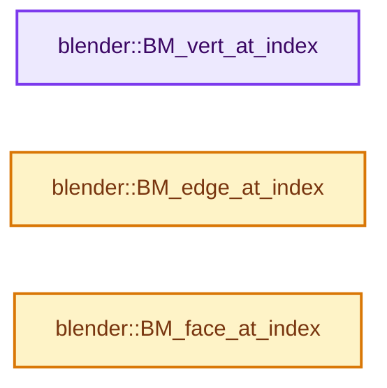
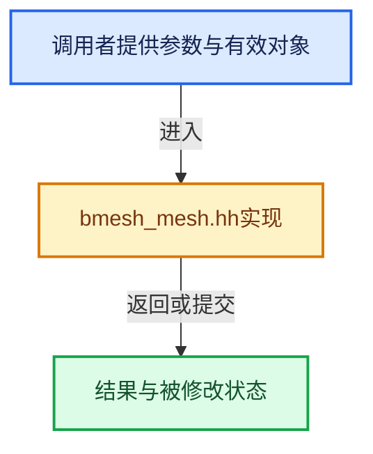

# 实现依赖专题：source/blender/bmesh/intern/bmesh_mesh.hh

[方向导航](README.md) · [符号索引](../%E7%AC%A6%E5%8F%B7%E4%BE%9D%E8%B5%96%E4%B8%8E%E5%AE%9E%E7%8E%B0%E7%B4%A2%E5%BC%95.md)

本专题从正文实际调用进入，集中保存共享实现。函数有稳定锚点，可从调用处直接跳到对应完整函数；递归与互相调用通过回链组织。

## 本文件的实现关系






<a id="m-5e1aa99d2227"></a>

## 宏 `BMALLOC_TEMPLATE_FROM_ME`

<!-- annotated:f4d74358139421 -->

```cpp
#define BMALLOC_TEMPLATE_FROM_ME(...) \
  VA_NARGS_CALL_OVERLOAD(_VA_BMALLOC_TEMPLATE_FROM_ME_, __VA_ARGS__)

```

<details>
<summary>核对原始源码：source/blender/bmesh/intern/bmesh_mesh.hh · L206—L208</summary>

<!-- original:f4d74358139421:source/blender/bmesh/intern/bmesh_mesh.hh:206:208 -->

```cpp
#define BMALLOC_TEMPLATE_FROM_ME(...) \
  VA_NARGS_CALL_OVERLOAD(_VA_BMALLOC_TEMPLATE_FROM_ME_, __VA_ARGS__)

```

</details>

宏在预处理阶段展开，参数替换、重复求值和条件编译应直接从该定义检查。与普通函数不同，宏不会自动提供参数类型检查；构建配置选择哪个定义需结合外围条件。

## 完整成员与函数实现

<a id="f-aced0ebcd417a2f4"></a>

### `blender::BM_vert_at_index`

实现位置：[source/blender/bmesh/intern/bmesh_mesh.hh](../../../../../source/blender/bmesh/intern/bmesh_mesh.hh) · L110—L115。

接口参数：

- `BMesh *bm`
- `const int index`

**教学注释版**

<!-- annotated:2c142c770051c0 -->

```cpp
BLI_INLINE BMVert *BM_vert_at_index(BMesh *bm, const int index)
{
  BLI_assert((index >= 0) && (index < bm->totvert));
  BLI_assert((bm->elem_table_dirty & BM_VERT) == 0);
  return bm->vtable[index];
}
```

<details>
<summary>核对原始源码：source/blender/bmesh/intern/bmesh_mesh.hh · L110—L115</summary>

<!-- original:2c142c770051c0:source/blender/bmesh/intern/bmesh_mesh.hh:110:115 -->

```cpp
BLI_INLINE BMVert *BM_vert_at_index(BMesh *bm, const int index)
{
  BLI_assert((index >= 0) && (index < bm->totvert));
  BLI_assert((bm->elem_table_dirty & BM_VERT) == 0);
  return bm->vtable[index];
}
```

</details>

**结果出口**

- `return bm->vtable[index];`

**继续追踪实现**

- `BLI_assert` → [BLI_assert · L48](../01-%E5%9F%BA%E7%A1%80%E5%AE%B9%E5%99%A8%E4%B8%8E%E7%8E%B0%E4%BB%A3CPP/%E4%BE%9D%E8%B5%96-BLI_assert-cc98e8.md#m-57a88495704d)；[BLI_assert · L63](../01-%E5%9F%BA%E7%A1%80%E5%AE%B9%E5%99%A8%E4%B8%8E%E7%8E%B0%E4%BB%A3CPP/%E4%BE%9D%E8%B5%96-BLI_assert-cc98e8.md#m-d07050020cb5)。宏定义由构建条件选择。

<a id="f-81d027fd9e6b4c84"></a>

### `blender::BM_edge_at_index`

实现位置：[source/blender/bmesh/intern/bmesh_mesh.hh](../../../../../source/blender/bmesh/intern/bmesh_mesh.hh) · L116—L121。

接口参数：

- `BMesh *bm`
- `const int index`

**教学注释版**

<!-- annotated:a0bbcb04196634 -->

```cpp
BLI_INLINE BMEdge *BM_edge_at_index(BMesh *bm, const int index)
{
  BLI_assert((index >= 0) && (index < bm->totedge));
  BLI_assert((bm->elem_table_dirty & BM_EDGE) == 0);
  return bm->etable[index];
}
```

<details>
<summary>核对原始源码：source/blender/bmesh/intern/bmesh_mesh.hh · L116—L121</summary>

<!-- original:a0bbcb04196634:source/blender/bmesh/intern/bmesh_mesh.hh:116:121 -->

```cpp
BLI_INLINE BMEdge *BM_edge_at_index(BMesh *bm, const int index)
{
  BLI_assert((index >= 0) && (index < bm->totedge));
  BLI_assert((bm->elem_table_dirty & BM_EDGE) == 0);
  return bm->etable[index];
}
```

</details>

**结果出口**

- `return bm->etable[index];`

**继续追踪实现**

- `BLI_assert` → [BLI_assert · L48](../01-%E5%9F%BA%E7%A1%80%E5%AE%B9%E5%99%A8%E4%B8%8E%E7%8E%B0%E4%BB%A3CPP/%E4%BE%9D%E8%B5%96-BLI_assert-cc98e8.md#m-57a88495704d)；[BLI_assert · L63](../01-%E5%9F%BA%E7%A1%80%E5%AE%B9%E5%99%A8%E4%B8%8E%E7%8E%B0%E4%BB%A3CPP/%E4%BE%9D%E8%B5%96-BLI_assert-cc98e8.md#m-d07050020cb5)。宏定义由构建条件选择。

<a id="f-366df62c166d5094"></a>

### `blender::BM_face_at_index`

实现位置：[source/blender/bmesh/intern/bmesh_mesh.hh](../../../../../source/blender/bmesh/intern/bmesh_mesh.hh) · L122—L127。

接口参数：

- `BMesh *bm`
- `const int index`

**教学注释版**

<!-- annotated:5e127e8fb5f758 -->

```cpp
BLI_INLINE BMFace *BM_face_at_index(BMesh *bm, const int index)
{
  BLI_assert((index >= 0) && (index < bm->totface));
  BLI_assert((bm->elem_table_dirty & BM_FACE) == 0);
  return bm->ftable[index];
}
```

<details>
<summary>核对原始源码：source/blender/bmesh/intern/bmesh_mesh.hh · L122—L127</summary>

<!-- original:5e127e8fb5f758:source/blender/bmesh/intern/bmesh_mesh.hh:122:127 -->

```cpp
BLI_INLINE BMFace *BM_face_at_index(BMesh *bm, const int index)
{
  BLI_assert((index >= 0) && (index < bm->totface));
  BLI_assert((bm->elem_table_dirty & BM_FACE) == 0);
  return bm->ftable[index];
}
```

</details>

**结果出口**

- `return bm->ftable[index];`

**继续追踪实现**

- `BLI_assert` → [BLI_assert · L48](../01-%E5%9F%BA%E7%A1%80%E5%AE%B9%E5%99%A8%E4%B8%8E%E7%8E%B0%E4%BB%A3CPP/%E4%BE%9D%E8%B5%96-BLI_assert-cc98e8.md#m-57a88495704d)；[BLI_assert · L63](../01-%E5%9F%BA%E7%A1%80%E5%AE%B9%E5%99%A8%E4%B8%8E%E7%8E%B0%E4%BB%A3CPP/%E4%BE%9D%E8%B5%96-BLI_assert-cc98e8.md#m-d07050020cb5)。宏定义由构建条件选择。
