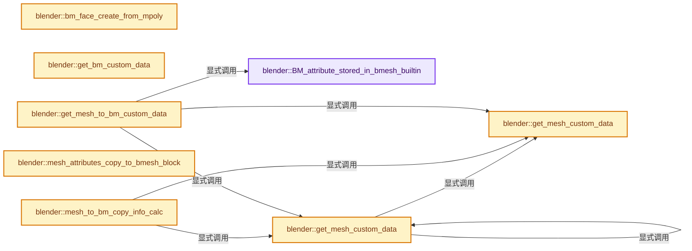
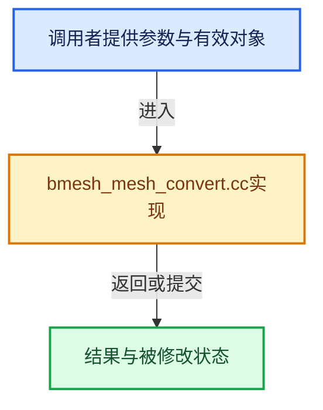

# 实现依赖专题：source/blender/bmesh/intern/bmesh_mesh_convert.cc

[方向导航](README.md) · [符号索引](../%E7%AC%A6%E5%8F%B7%E4%BE%9D%E8%B5%96%E4%B8%8E%E5%AE%9E%E7%8E%B0%E7%B4%A2%E5%BC%95.md)

本专题从正文实际调用进入，集中保存共享实现。函数有稳定锚点，可从调用处直接跳到对应完整函数；递归与互相调用通过回链组织。

## 本文件的实现关系






## 完整成员与函数实现

<a id="f-c524291093f702fd"></a>

### `blender::BM_attribute_stored_in_bmesh_builtin`

实现位置：[source/blender/bmesh/intern/bmesh_mesh_convert.cc](../../../../../source/blender/bmesh/intern/bmesh_mesh_convert.cc) · L118—L139。

接口参数：

- `const StringRef name`

**教学注释版**

<!-- annotated:65bb6197aa2c02 -->

```cpp
bool BM_attribute_stored_in_bmesh_builtin(const StringRef name)
{
  if (name.is_empty()) {
    return false;
  }
  if (name[0] == '.') {
    return ELEM(name,
                ".edge_verts",
                ".corner_vert",
                ".corner_edge",
                ".hide_vert",
                ".hide_edge",
                ".hide_poly",
                ".select_vert",
                ".select_edge",
                ".select_poly",
                ".uv_select_vert",
                ".uv_select_edge",
                ".uv_select_face");
  }
  return ELEM(name, "position", "uv_seam", "material_index", "sharp_face", "sharp_edge");
}
```

<details>
<summary>核对原始源码：source/blender/bmesh/intern/bmesh_mesh_convert.cc · L118—L139</summary>

<!-- original:65bb6197aa2c02:source/blender/bmesh/intern/bmesh_mesh_convert.cc:118:139 -->

```cpp
bool BM_attribute_stored_in_bmesh_builtin(const StringRef name)
{
  if (name.is_empty()) {
    return false;
  }
  if (name[0] == '.') {
    return ELEM(name,
                ".edge_verts",
                ".corner_vert",
                ".corner_edge",
                ".hide_vert",
                ".hide_edge",
                ".hide_poly",
                ".select_vert",
                ".select_edge",
                ".select_poly",
                ".uv_select_vert",
                ".uv_select_edge",
                ".uv_select_face");
  }
  return ELEM(name, "position", "uv_seam", "material_index", "sharp_face", "sharp_edge");
}
```

</details>

**结果出口**

- `return false;`
- `return ELEM(name,`
- `return ELEM(name, "position", "uv_seam", "material_index", "sharp_face", "sharp_edge");`

**继续追踪实现**

- `name.is_empty` → [blender::Bounds<T>::is_empty · L533](../12-%E7%A9%BA%E9%97%B4%E6%95%B0%E6%8D%AE%E7%BB%93%E6%9E%84%E4%B8%8E%E5%87%A0%E4%BD%95%E7%AE%97%E6%B3%95/07-Bounds%E4%B8%8EBVH%E5%AF%B9%E6%AF%94.md#f-55ac376b3d0a0944)；[blender::GVArrayCommon::is_empty · L767](../04-%E8%99%9A%E6%8B%9F%E6%95%B0%E7%BB%84%E4%B8%8E%E7%B4%A2%E5%BC%95%E9%80%89%E6%8B%A9/05-GVArray%E8%BF%90%E8%A1%8C%E6%97%B6%E7%B1%BB%E5%9E%8B.md#f-c1da602ffc5555f9)；[blender::StringRefBase::is_empty · L201](../01-%E5%9F%BA%E7%A1%80%E5%AE%B9%E5%99%A8%E4%B8%8E%E7%8E%B0%E4%BB%A3CPP/15-StringRef%E5%AD%97%E7%AC%A6%E4%B8%B2%E8%A7%86%E5%9B%BE.md#f-9f6c3d2da1cb1796)；[blender::KDTreeNew<T>::is_empty · L498](../12-%E7%A9%BA%E9%97%B4%E6%95%B0%E6%8D%AE%E7%BB%93%E6%9E%84%E4%B8%8E%E5%87%A0%E4%BD%95%E7%AE%97%E6%B3%95/05-K%E8%BF%91%E9%82%BB%E4%B8%8E%E8%8C%83%E5%9B%B4%E6%9F%A5%E8%AF%A2.md#f-67f0ff91cf00b00b)。同名重载需按实参类型选择。
- `ELEM` → [ELEM · L88](%E4%BE%9D%E8%B5%96-GHOST_utildefines-34b996.md#m-d28724a15928)；[ELEM · L135](../01-%E5%9F%BA%E7%A1%80%E5%AE%B9%E5%99%A8%E4%B8%8E%E7%8E%B0%E4%BB%A3CPP/%E4%BE%9D%E8%B5%96-BLI_utildefines-293a0a.md#m-d6572de7cae0)。宏定义由构建条件选择。

<a id="f-406e194e33c4c17a"></a>

### `blender::bm_face_create_from_mpoly`

实现位置：[source/blender/bmesh/intern/bmesh_mesh_convert.cc](../../../../../source/blender/bmesh/intern/bmesh_mesh_convert.cc) · L141—L157。

接口参数：

- `BMesh &bm`
- `Span<int> face_verts`
- `Span<int> face_edges`
- `Span<BMVert *> vtable`
- `Span<BMEdge *> etable`

**教学注释版**

<!-- annotated:121c88c5be50ec -->

```cpp
static BMFace *bm_face_create_from_mpoly(BMesh &bm,
                                         Span<int> face_verts,
                                         Span<int> face_edges,
                                         Span<BMVert *> vtable,
                                         Span<BMEdge *> etable)
{
  // [讲解] face_verts.size：查询视图长度或生成对应有效索引区间。
  const int size = face_verts.size();
  Array<BMVert *, BM_DEFAULT_NGON_STACK_SIZE> verts(size);
  Array<BMEdge *, BM_DEFAULT_NGON_STACK_SIZE> edges(size);

  for (const int i : IndexRange(size)) {
    verts[i] = vtable[face_verts[i]];
    edges[i] = etable[face_edges[i]];
  }

  // [讲解] verts.data：提供数组的借用访问入口。
  return BM_face_create(&bm, verts.data(), edges.data(), size, nullptr, BM_CREATE_SKIP_CD);
}
```

<details>
<summary>核对原始源码：source/blender/bmesh/intern/bmesh_mesh_convert.cc · L141—L157</summary>

<!-- original:121c88c5be50ec:source/blender/bmesh/intern/bmesh_mesh_convert.cc:141:157 -->

```cpp
static BMFace *bm_face_create_from_mpoly(BMesh &bm,
                                         Span<int> face_verts,
                                         Span<int> face_edges,
                                         Span<BMVert *> vtable,
                                         Span<BMEdge *> etable)
{
  const int size = face_verts.size();
  Array<BMVert *, BM_DEFAULT_NGON_STACK_SIZE> verts(size);
  Array<BMEdge *, BM_DEFAULT_NGON_STACK_SIZE> edges(size);

  for (const int i : IndexRange(size)) {
    verts[i] = vtable[face_verts[i]];
    edges[i] = etable[face_edges[i]];
  }

  return BM_face_create(&bm, verts.data(), edges.data(), size, nullptr, BM_CREATE_SKIP_CD);
}
```

</details>

**沿实际写入检查状态**

- `verts[i] = vtable[face_verts[i]];`
- `edges[i] = etable[face_edges[i]];`

**结果出口**

- `return BM_face_create(&bm, verts.data(), edges.data(), size, nullptr, BM_CREATE_SKIP_CD);`

**继续追踪实现**

- `face_verts.size` → [blender::Span::size · L256](../01-%E5%9F%BA%E7%A1%80%E5%AE%B9%E5%99%A8%E4%B8%8E%E7%8E%B0%E4%BB%A3CPP/05-Span%E5%8F%AA%E8%AF%BB%E8%BF%9E%E7%BB%AD%E8%A7%86%E5%9B%BE.md#f-5f80fa006089c998)。
- `IndexRange` → [blender::IndexRange](../01-%E5%9F%BA%E7%A1%80%E5%AE%B9%E5%99%A8%E4%B8%8E%E7%8E%B0%E4%BB%A3CPP/%E4%BE%9D%E8%B5%96-BLI_index_range-7d7cc5.md#t-caa3466d6776)；[blender::gpu::shader::parser::IndexRange](%E4%BE%9D%E8%B5%96-utils-06433d.md#t-82d2bd4ea71c)；[blender::IndexRange](%E4%BE%9D%E8%B5%96-DNA_node_types-6708b9.md#t-0448cc889d39)。
- `BM_face_create` → [blender::BM_face_create · L516](%E4%BE%9D%E8%B5%96-bmesh_core-9fd9f8.md#f-bff201f281bcc55d)。
- `verts.data` → [blender::Array::data · L323](../01-%E5%9F%BA%E7%A1%80%E5%AE%B9%E5%99%A8%E4%B8%8E%E7%8E%B0%E4%BB%A3CPP/08-Array%E5%A4%8D%E5%88%B6%E7%A7%BB%E5%8A%A8%E4%B8%8E%E9%94%80%E6%AF%81.md#f-95648c799002f4ba)；[blender::Array::data · L327](../01-%E5%9F%BA%E7%A1%80%E5%AE%B9%E5%99%A8%E4%B8%8E%E7%8E%B0%E4%BB%A3CPP/08-Array%E5%A4%8D%E5%88%B6%E7%A7%BB%E5%8A%A8%E4%B8%8E%E9%94%80%E6%AF%81.md#f-50c18301f8c40f9e)。同名重载需按实参类型选择。
- `edges.data` → [blender::Array::data · L323](../01-%E5%9F%BA%E7%A1%80%E5%AE%B9%E5%99%A8%E4%B8%8E%E7%8E%B0%E4%BB%A3CPP/08-Array%E5%A4%8D%E5%88%B6%E7%A7%BB%E5%8A%A8%E4%B8%8E%E9%94%80%E6%AF%81.md#f-95648c799002f4ba)；[blender::Array::data · L327](../01-%E5%9F%BA%E7%A1%80%E5%AE%B9%E5%99%A8%E4%B8%8E%E7%8E%B0%E4%BB%A3CPP/08-Array%E5%A4%8D%E5%88%B6%E7%A7%BB%E5%8A%A8%E4%B8%8E%E9%94%80%E6%AF%81.md#f-50c18301f8c40f9e)。同名重载需按实参类型选择。

<a id="f-8a4699dec4847ce1"></a>

### `blender::get_bm_custom_data`

实现位置：[source/blender/bmesh/intern/bmesh_mesh_convert.cc](../../../../../source/blender/bmesh/intern/bmesh_mesh_convert.cc) · L159—L174。

接口参数：

- `const BMesh &bm`
- `const bke::AttrDomain domain`

**教学注释版**

<!-- annotated:a3fac8073229c8 -->

```cpp
static const CustomData &get_bm_custom_data(const BMesh &bm, const bke::AttrDomain domain)
{
  switch (domain) {
    case bke::AttrDomain::Point:
      return bm.vdata;
    case bke::AttrDomain::Edge:
      return bm.edata;
    case bke::AttrDomain::Face:
      return bm.pdata;
    case bke::AttrDomain::Corner:
      return bm.ldata;
    default:
      BLI_assert_unreachable();
      return bm.vdata;
  }
}
```

<details>
<summary>核对原始源码：source/blender/bmesh/intern/bmesh_mesh_convert.cc · L159—L174</summary>

<!-- original:a3fac8073229c8:source/blender/bmesh/intern/bmesh_mesh_convert.cc:159:174 -->

```cpp
static const CustomData &get_bm_custom_data(const BMesh &bm, const bke::AttrDomain domain)
{
  switch (domain) {
    case bke::AttrDomain::Point:
      return bm.vdata;
    case bke::AttrDomain::Edge:
      return bm.edata;
    case bke::AttrDomain::Face:
      return bm.pdata;
    case bke::AttrDomain::Corner:
      return bm.ldata;
    default:
      BLI_assert_unreachable();
      return bm.vdata;
  }
}
```

</details>

**结果出口**

- `return bm.vdata;`
- `return bm.edata;`
- `return bm.pdata;`
- `return bm.ldata;`

**继续追踪实现**

- `BLI_assert_unreachable` → [BLI_assert_unreachable · L77](../01-%E5%9F%BA%E7%A1%80%E5%AE%B9%E5%99%A8%E4%B8%8E%E7%8E%B0%E4%BB%A3CPP/%E4%BE%9D%E8%B5%96-BLI_assert-cc98e8.md#m-7a2d91a67d8e)。宏定义由构建条件选择。

<a id="f-33d13aab0fa01949"></a>

### `blender::get_mesh_custom_data`

实现位置：[source/blender/bmesh/intern/bmesh_mesh_convert.cc](../../../../../source/blender/bmesh/intern/bmesh_mesh_convert.cc) · L176—L191。

接口参数：

- `const Mesh &mesh`
- `const bke::AttrDomain domain`

**教学注释版**

<!-- annotated:7952909eb01259 -->

```cpp
static const CustomData &get_mesh_custom_data(const Mesh &mesh, const bke::AttrDomain domain)
{
  switch (domain) {
    case bke::AttrDomain::Point:
      return mesh.vert_data;
    case bke::AttrDomain::Edge:
      return mesh.edge_data;
    case bke::AttrDomain::Face:
      return mesh.face_data;
    case bke::AttrDomain::Corner:
      return mesh.corner_data;
    default:
      BLI_assert_unreachable();
      return mesh.vert_data;
  }
}
```

<details>
<summary>核对原始源码：source/blender/bmesh/intern/bmesh_mesh_convert.cc · L176—L191</summary>

<!-- original:7952909eb01259:source/blender/bmesh/intern/bmesh_mesh_convert.cc:176:191 -->

```cpp
static const CustomData &get_mesh_custom_data(const Mesh &mesh, const bke::AttrDomain domain)
{
  switch (domain) {
    case bke::AttrDomain::Point:
      return mesh.vert_data;
    case bke::AttrDomain::Edge:
      return mesh.edge_data;
    case bke::AttrDomain::Face:
      return mesh.face_data;
    case bke::AttrDomain::Corner:
      return mesh.corner_data;
    default:
      BLI_assert_unreachable();
      return mesh.vert_data;
  }
}
```

</details>

**结果出口**

- `return mesh.vert_data;`
- `return mesh.edge_data;`
- `return mesh.face_data;`
- `return mesh.corner_data;`

**继续追踪实现**

- `BLI_assert_unreachable` → [BLI_assert_unreachable · L77](../01-%E5%9F%BA%E7%A1%80%E5%AE%B9%E5%99%A8%E4%B8%8E%E7%8E%B0%E4%BB%A3CPP/%E4%BE%9D%E8%B5%96-BLI_assert-cc98e8.md#m-7a2d91a67d8e)。宏定义由构建条件选择。

<a id="f-3ee035720076b0d8"></a>

### `blender::get_mesh_custom_data`

实现位置：[source/blender/bmesh/intern/bmesh_mesh_convert.cc](../../../../../source/blender/bmesh/intern/bmesh_mesh_convert.cc) · L193—L196。

接口参数：

- `Mesh &mesh`
- `const bke::AttrDomain domain`

**教学注释版**

<!-- annotated:19ca1a435ab129 -->

```cpp
static CustomData &get_mesh_custom_data(Mesh &mesh, const bke::AttrDomain domain)
{
  return const_cast<CustomData &>(get_mesh_custom_data(const_cast<const Mesh &>(mesh), domain));
}
```

<details>
<summary>核对原始源码：source/blender/bmesh/intern/bmesh_mesh_convert.cc · L193—L196</summary>

<!-- original:19ca1a435ab129:source/blender/bmesh/intern/bmesh_mesh_convert.cc:193:196 -->

```cpp
static CustomData &get_mesh_custom_data(Mesh &mesh, const bke::AttrDomain domain)
{
  return const_cast<CustomData &>(get_mesh_custom_data(const_cast<const Mesh &>(mesh), domain));
}
```

</details>

**结果出口**

- `return const_cast<CustomData &>(get_mesh_custom_data(const_cast<const Mesh &>(mesh), domain));`

**继续追踪实现**

- `get_mesh_custom_data` → [blender::get_mesh_custom_data · L176](%E4%BE%9D%E8%B5%96-bmesh_mesh_convert-19b1b9.md#f-33d13aab0fa01949)；[blender::get_mesh_custom_data · L193](%E4%BE%9D%E8%B5%96-bmesh_mesh_convert-19b1b9.md#f-3ee035720076b0d8)。同名重载需按实参类型选择。

<a id="f-2c132bf64ecd96b8"></a>

### `blender::mesh_to_bm_copy_info_calc`

实现位置：[source/blender/bmesh/intern/bmesh_mesh_convert.cc](../../../../../source/blender/bmesh/intern/bmesh_mesh_convert.cc) · L211—L262。

接口参数：

- `const Mesh &mesh`
- `const bke::AttrDomain domain`
- `CustomData &bm_data`

**教学注释版**

<!-- annotated:e963c4525872c8 -->

```cpp
static Vector<MeshToBMeshLayerInfo> mesh_to_bm_copy_info_calc(const Mesh &mesh,
                                                              const bke::AttrDomain domain,
                                                              CustomData &bm_data)
{
  const bke::AttributeStorage &storage = mesh.attribute_storage.wrap();
  const CustomData &mesh_data = get_mesh_custom_data(mesh, domain);

  Vector<MeshToBMeshLayerInfo> infos;
  std::array<int, CD_NUMTYPES> per_type_index;
  per_type_index.fill(0);
  for (const int i : IndexRange(bm_data.totlayer)) {
    const CustomDataLayer &bm_layer = bm_data.layers[i];
    const StringRef layer_name = bm_layer.name;
    const eCustomDataType type = eCustomDataType(bm_layer.type);

    MeshToBMeshLayerInfo info{};
    info.type = type;
    info.bmesh_offset = bm_layer.offset;
    const bke::Attribute *attr = storage.lookup(layer_name);
    if (attr && attr->domain() == domain) {
      switch (attr->storage_type()) {
        case bke::AttrStorageType::Array: {
          const auto &array_data = std::get<bke::Attribute::ArrayData>(attr->data());
          info.mesh_data = array_data.data;
          info.mesh_stride = bke::attribute_type_to_cpp_type(attr->data_type()).size;
          break;
        }
        case bke::AttrStorageType::Single: {
          const auto &single_data = std::get<bke::Attribute::SingleData>(attr->data());
          info.mesh_data = single_data.value;
          info.mesh_stride = 0;
          break;
        }
      }
    }
    else {
      const int mesh_layer_index =
          layer_name.is_empty() ?
              CustomData_get_layer_index_n(&mesh_data, type, per_type_index[type]) :
              CustomData_get_named_layer_index(&mesh_data, type, layer_name);
      if (mesh_layer_index != -1) {
        BLI_assert((CD_TYPE_AS_MASK(type) & CD_MASK_PROP_ALL) == 0);
        info.mesh_data = mesh_data.layers[mesh_layer_index].data;
        info.mesh_stride = CustomData_get_elem_size(&bm_layer);
      }
    }
    // [讲解] infos.append：在尾部建立新元素，必要时先扩大存储。
    infos.append(info);

    per_type_index[type]++;
  }
  return infos;
}
```

<details>
<summary>核对原始源码：source/blender/bmesh/intern/bmesh_mesh_convert.cc · L211—L262</summary>

<!-- original:e963c4525872c8:source/blender/bmesh/intern/bmesh_mesh_convert.cc:211:262 -->

```cpp
static Vector<MeshToBMeshLayerInfo> mesh_to_bm_copy_info_calc(const Mesh &mesh,
                                                              const bke::AttrDomain domain,
                                                              CustomData &bm_data)
{
  const bke::AttributeStorage &storage = mesh.attribute_storage.wrap();
  const CustomData &mesh_data = get_mesh_custom_data(mesh, domain);

  Vector<MeshToBMeshLayerInfo> infos;
  std::array<int, CD_NUMTYPES> per_type_index;
  per_type_index.fill(0);
  for (const int i : IndexRange(bm_data.totlayer)) {
    const CustomDataLayer &bm_layer = bm_data.layers[i];
    const StringRef layer_name = bm_layer.name;
    const eCustomDataType type = eCustomDataType(bm_layer.type);

    MeshToBMeshLayerInfo info{};
    info.type = type;
    info.bmesh_offset = bm_layer.offset;
    const bke::Attribute *attr = storage.lookup(layer_name);
    if (attr && attr->domain() == domain) {
      switch (attr->storage_type()) {
        case bke::AttrStorageType::Array: {
          const auto &array_data = std::get<bke::Attribute::ArrayData>(attr->data());
          info.mesh_data = array_data.data;
          info.mesh_stride = bke::attribute_type_to_cpp_type(attr->data_type()).size;
          break;
        }
        case bke::AttrStorageType::Single: {
          const auto &single_data = std::get<bke::Attribute::SingleData>(attr->data());
          info.mesh_data = single_data.value;
          info.mesh_stride = 0;
          break;
        }
      }
    }
    else {
      const int mesh_layer_index =
          layer_name.is_empty() ?
              CustomData_get_layer_index_n(&mesh_data, type, per_type_index[type]) :
              CustomData_get_named_layer_index(&mesh_data, type, layer_name);
      if (mesh_layer_index != -1) {
        BLI_assert((CD_TYPE_AS_MASK(type) & CD_MASK_PROP_ALL) == 0);
        info.mesh_data = mesh_data.layers[mesh_layer_index].data;
        info.mesh_stride = CustomData_get_elem_size(&bm_layer);
      }
    }
    infos.append(info);

    per_type_index[type]++;
  }
  return infos;
}
```

</details>

**沿实际写入检查状态**

- `info.type = type;`
- `info.bmesh_offset = bm_layer.offset;`
- `info.mesh_data = array_data.data;`
- `info.mesh_stride = bke::attribute_type_to_cpp_type(attr->data_type()).size;`
- `info.mesh_data = single_data.value;`
- `info.mesh_stride = 0;`
- `info.mesh_data = mesh_data.layers[mesh_layer_index].data;`
- `info.mesh_stride = CustomData_get_elem_size(&bm_layer);`

**结果出口**

- `return infos;`

**继续追踪实现**

- `mesh.attribute_storage.wrap` → [调用协议](../%E6%A8%A1%E6%9D%BF%E5%AE%8F%E4%B8%8E%E5%8A%A8%E6%80%81%E5%88%86%E6%B4%BE%E5%8D%8F%E8%AE%AE.md)：接收对象类型依赖auto、返回值或模板实例；不按同名猜测目标。调用位置L215。
- `get_mesh_custom_data` → [blender::get_mesh_custom_data · L176](%E4%BE%9D%E8%B5%96-bmesh_mesh_convert-19b1b9.md#f-33d13aab0fa01949)；[blender::get_mesh_custom_data · L193](%E4%BE%9D%E8%B5%96-bmesh_mesh_convert-19b1b9.md#f-3ee035720076b0d8)。同名重载需按实参类型选择。
- `per_type_index.fill` → [外部契约](https://eel.is/c++draft/)：这个边界按实际表达式及所属类型核对参数、返回值、寿命与失败行为。这里提供接口入口，不声称已解释该第三方版本的内部实现。
- `IndexRange` → [blender::IndexRange](../01-%E5%9F%BA%E7%A1%80%E5%AE%B9%E5%99%A8%E4%B8%8E%E7%8E%B0%E4%BB%A3CPP/%E4%BE%9D%E8%B5%96-BLI_index_range-7d7cc5.md#t-caa3466d6776)；[blender::gpu::shader::parser::IndexRange](%E4%BE%9D%E8%B5%96-utils-06433d.md#t-82d2bd4ea71c)；[blender::IndexRange](%E4%BE%9D%E8%B5%96-DNA_node_types-6708b9.md#t-0448cc889d39)。
- `eCustomDataType` → [blender::eCustomDataType](%E4%BE%9D%E8%B5%96-DNA_customdata_types-f584e8.md#t-dfbf4a4ce0e1)。
- `storage.lookup` → [blender::bke::AttributeStorage::lookup · L218](%E4%BE%9D%E8%B5%96-attribute_storage-1cb73b.md#f-7fdc83fb77004833)；[blender::bke::AttributeStorage::lookup · L228](%E4%BE%9D%E8%B5%96-attribute_storage-1cb73b.md#f-4c9ec35a31afcd06)。同名重载需按实参类型选择。
- `attr->domain` → [blender::bke::Attribute::domain · L286](10-%E5%B8%83%E5%B1%80%E5%85%BC%E5%AE%B9%E4%B8%8E%E5%87%A0%E4%BD%95%E5%AE%9E%E6%88%98.md#f-03667cd47954e9ff)。
- `attr->storage_type` → [blender::bke::Attribute::storage_type · L301](10-%E5%B8%83%E5%B1%80%E5%85%BC%E5%AE%B9%E4%B8%8E%E5%87%A0%E4%BD%95%E5%AE%9E%E6%88%98.md#f-e08ee0374bedc01d)。
- `std::get<bke::Attribute::ArrayData>` → [外部契约](https://eel.is/c++draft/)：这个边界按实际表达式及所属类型核对参数、返回值、寿命与失败行为。这里提供接口入口，不声称已解释该第三方版本的内部实现。
- `attr->data` → [blender::bke::Attribute::data · L296](10-%E5%B8%83%E5%B1%80%E5%85%BC%E5%AE%B9%E4%B8%8E%E5%87%A0%E4%BD%95%E5%AE%9E%E6%88%98.md#f-1d913000744fef94)。
- `bke::attribute_type_to_cpp_type` → [blender::bke::attribute_type_to_cpp_type · L44](%E4%BE%9D%E8%B5%96-attribute_access-bceef3.md#f-69deacfd0fca6244)。
- `attr->data_type` → [blender::bke::Attribute::data_type · L291](10-%E5%B8%83%E5%B1%80%E5%85%BC%E5%AE%B9%E4%B8%8E%E5%87%A0%E4%BD%95%E5%AE%9E%E6%88%98.md#f-d86548da166fa237)。
- `std::get<bke::Attribute::SingleData>` → [外部契约](https://eel.is/c++draft/)：这个边界按实际表达式及所属类型核对参数、返回值、寿命与失败行为。这里提供接口入口，不声称已解释该第三方版本的内部实现。
- `layer_name.is_empty` → [blender::Bounds<T>::is_empty · L533](../12-%E7%A9%BA%E9%97%B4%E6%95%B0%E6%8D%AE%E7%BB%93%E6%9E%84%E4%B8%8E%E5%87%A0%E4%BD%95%E7%AE%97%E6%B3%95/07-Bounds%E4%B8%8EBVH%E5%AF%B9%E6%AF%94.md#f-55ac376b3d0a0944)；[blender::GVArrayCommon::is_empty · L767](../04-%E8%99%9A%E6%8B%9F%E6%95%B0%E7%BB%84%E4%B8%8E%E7%B4%A2%E5%BC%95%E9%80%89%E6%8B%A9/05-GVArray%E8%BF%90%E8%A1%8C%E6%97%B6%E7%B1%BB%E5%9E%8B.md#f-c1da602ffc5555f9)；[blender::StringRefBase::is_empty · L201](../01-%E5%9F%BA%E7%A1%80%E5%AE%B9%E5%99%A8%E4%B8%8E%E7%8E%B0%E4%BB%A3CPP/15-StringRef%E5%AD%97%E7%AC%A6%E4%B8%B2%E8%A7%86%E5%9B%BE.md#f-9f6c3d2da1cb1796)；[blender::KDTreeNew<T>::is_empty · L498](../12-%E7%A9%BA%E9%97%B4%E6%95%B0%E6%8D%AE%E7%BB%93%E6%9E%84%E4%B8%8E%E5%87%A0%E4%BD%95%E7%AE%97%E6%B3%95/05-K%E8%BF%91%E9%82%BB%E4%B8%8E%E8%8C%83%E5%9B%B4%E6%9F%A5%E8%AF%A2.md#f-67f0ff91cf00b00b)。同名重载需按实参类型选择。
- `CustomData_get_layer_index_n` → [blender::CustomData_get_layer_index_n · L2562](%E4%BE%9D%E8%B5%96-customdata-2eef81.md#f-a5c18b99111c4b5f)。
- `CustomData_get_named_layer_index` → [blender::CustomData_get_named_layer_index · L2575](%E4%BE%9D%E8%B5%96-customdata-2eef81.md#f-73565438765aba60)。
- `BLI_assert` → [BLI_assert · L48](../01-%E5%9F%BA%E7%A1%80%E5%AE%B9%E5%99%A8%E4%B8%8E%E7%8E%B0%E4%BB%A3CPP/%E4%BE%9D%E8%B5%96-BLI_assert-cc98e8.md#m-57a88495704d)；[BLI_assert · L63](../01-%E5%9F%BA%E7%A1%80%E5%AE%B9%E5%99%A8%E4%B8%8E%E7%8E%B0%E4%BB%A3CPP/%E4%BE%9D%E8%B5%96-BLI_assert-cc98e8.md#m-d07050020cb5)。宏定义由构建条件选择。
- `CD_TYPE_AS_MASK` → [blender::CD_TYPE_AS_MASK · L94](%E4%BE%9D%E8%B5%96-BKE_customdata-f70cc3.md#f-f2cef00614e98db3)。
- `CustomData_get_elem_size` → [blender::CustomData_get_elem_size · L5082](%E4%BE%9D%E8%B5%96-customdata-2eef81.md#f-f4e2ed15d90c7c87)。
- `infos.append` → [blender::Vector::append · L498](../01-%E5%9F%BA%E7%A1%80%E5%AE%B9%E5%99%A8%E4%B8%8E%E7%8E%B0%E4%BB%A3CPP/11-Vector%E6%8F%92%E5%85%A5%E5%88%A0%E9%99%A4%E4%B8%8E%E9%87%8D%E6%8E%92.md#f-5bde268a69e443ec)；[blender::Vector::append · L502](../01-%E5%9F%BA%E7%A1%80%E5%AE%B9%E5%99%A8%E4%B8%8E%E7%8E%B0%E4%BB%A3CPP/11-Vector%E6%8F%92%E5%85%A5%E5%88%A0%E9%99%A4%E4%B8%8E%E9%87%8D%E6%8E%92.md#f-591e0b15e6308532)。同名重载需按实参类型选择。

<a id="f-caf8fe3861f24900"></a>

### `blender::mesh_attributes_copy_to_bmesh_block`

实现位置：[source/blender/bmesh/intern/bmesh_mesh_convert.cc](../../../../../source/blender/bmesh/intern/bmesh_mesh_convert.cc) · L264—L280。

接口参数：

- `CustomData &data`
- `const Span<MeshToBMeshLayerInfo> copy_info`
- `const int mesh_index`
- `BMHeader &header`

**教学注释版**

<!-- annotated:e7890ef9d36905 -->

```cpp
static void mesh_attributes_copy_to_bmesh_block(CustomData &data,
                                                const Span<MeshToBMeshLayerInfo> copy_info,
                                                const int mesh_index,
                                                BMHeader &header)
{
  CustomData_bmesh_alloc_block(&data, &header.data);
  for (const MeshToBMeshLayerInfo &info : copy_info) {
    if (info.mesh_data) {
      CustomData_data_copy_value(info.type,
                                 POINTER_OFFSET(info.mesh_data, info.mesh_stride * mesh_index),
                                 POINTER_OFFSET(header.data, info.bmesh_offset));
    }
    else {
      CustomData_data_set_default_value(info.type, POINTER_OFFSET(header.data, info.bmesh_offset));
    }
  }
}
```

<details>
<summary>核对原始源码：source/blender/bmesh/intern/bmesh_mesh_convert.cc · L264—L280</summary>

<!-- original:e7890ef9d36905:source/blender/bmesh/intern/bmesh_mesh_convert.cc:264:280 -->

```cpp
static void mesh_attributes_copy_to_bmesh_block(CustomData &data,
                                                const Span<MeshToBMeshLayerInfo> copy_info,
                                                const int mesh_index,
                                                BMHeader &header)
{
  CustomData_bmesh_alloc_block(&data, &header.data);
  for (const MeshToBMeshLayerInfo &info : copy_info) {
    if (info.mesh_data) {
      CustomData_data_copy_value(info.type,
                                 POINTER_OFFSET(info.mesh_data, info.mesh_stride * mesh_index),
                                 POINTER_OFFSET(header.data, info.bmesh_offset));
    }
    else {
      CustomData_data_set_default_value(info.type, POINTER_OFFSET(header.data, info.bmesh_offset));
    }
  }
}
```

</details>

**继续追踪实现**

- `CustomData_bmesh_alloc_block` → [blender::CustomData_bmesh_alloc_block · L3601](%E4%BE%9D%E8%B5%96-customdata-2eef81.md#f-9c1636ce060a3cc2)。
- `CustomData_data_copy_value` → [blender::CustomData_data_copy_value · L3836](%E4%BE%9D%E8%B5%96-customdata-2eef81.md#f-6af7c7cd70d5bb32)。
- `POINTER_OFFSET` → [POINTER_OFFSET · L316](../01-%E5%9F%BA%E7%A1%80%E5%AE%B9%E5%99%A8%E4%B8%8E%E7%8E%B0%E4%BB%A3CPP/%E4%BE%9D%E8%B5%96-BLI_utildefines-293a0a.md#m-c812e199f26c)。宏定义由构建条件选择。
- `CustomData_data_set_default_value` → [blender::CustomData_data_set_default_value · L3615](%E4%BE%9D%E8%B5%96-customdata-2eef81.md#f-a8927dbdf67199a7)。

<a id="f-be0cf3844778492f"></a>

### `blender::get_mesh_to_bm_custom_data`

实现位置：[source/blender/bmesh/intern/bmesh_mesh_convert.cc](../../../../../source/blender/bmesh/intern/bmesh_mesh_convert.cc) · L282—L316。

接口参数：

- `const Mesh &mesh`
- `const bke::AttrDomain domain`
- `const uint64_t cd_type_mask`

**教学注释版**

<!-- annotated:74efe63780907d -->

```cpp
static CustomData get_mesh_to_bm_custom_data(const Mesh &mesh,
                                             const bke::AttrDomain domain,
                                             const uint64_t cd_type_mask)
{
  CustomData custom_data;
  CustomData_reset(&custom_data);
  for (const bke::Attribute &attr : mesh.attribute_storage.wrap()) {
    if (attr.domain() != domain) {
      continue;
    }
    if (BM_attribute_stored_in_bmesh_builtin(attr.name())) {
      continue;
    }
    const eCustomDataType data_type = *bke::attr_type_to_custom_data_type(attr.data_type());
    if ((CD_TYPE_AS_MASK(data_type) & cd_type_mask) == 0) {
      continue;
    }
    CustomData_add_layer_named(&custom_data, data_type, CD_SET_DEFAULT, 0, attr.name());
  }
  const CustomData &mesh_data = get_mesh_custom_data(mesh, domain);
  for (const CustomDataLayer &layer : Span(mesh_data.layers, mesh_data.totlayer)) {
    if ((CD_TYPE_AS_MASK(eCustomDataType(layer.type)) & cd_type_mask) == 0) {
      continue;
    }
    CustomData_add_layer_named(
        &custom_data, eCustomDataType(layer.type), CD_SET_DEFAULT, 0, layer.name);
    if (layer.type == CD_MDISPS && layer.flag & CD_FLAG_EXTERNAL) {
      const int new_layer_i = CustomData_get_layer_index(&custom_data, layer.type);
      BLI_assert(new_layer_i != -1);
      CustomDataLayer &new_layer = custom_data.layers[new_layer_i];
      new_layer.flag = layer.flag;
    }
  }
  return custom_data;
}
```

<details>
<summary>核对原始源码：source/blender/bmesh/intern/bmesh_mesh_convert.cc · L282—L316</summary>

<!-- original:74efe63780907d:source/blender/bmesh/intern/bmesh_mesh_convert.cc:282:316 -->

```cpp
static CustomData get_mesh_to_bm_custom_data(const Mesh &mesh,
                                             const bke::AttrDomain domain,
                                             const uint64_t cd_type_mask)
{
  CustomData custom_data;
  CustomData_reset(&custom_data);
  for (const bke::Attribute &attr : mesh.attribute_storage.wrap()) {
    if (attr.domain() != domain) {
      continue;
    }
    if (BM_attribute_stored_in_bmesh_builtin(attr.name())) {
      continue;
    }
    const eCustomDataType data_type = *bke::attr_type_to_custom_data_type(attr.data_type());
    if ((CD_TYPE_AS_MASK(data_type) & cd_type_mask) == 0) {
      continue;
    }
    CustomData_add_layer_named(&custom_data, data_type, CD_SET_DEFAULT, 0, attr.name());
  }
  const CustomData &mesh_data = get_mesh_custom_data(mesh, domain);
  for (const CustomDataLayer &layer : Span(mesh_data.layers, mesh_data.totlayer)) {
    if ((CD_TYPE_AS_MASK(eCustomDataType(layer.type)) & cd_type_mask) == 0) {
      continue;
    }
    CustomData_add_layer_named(
        &custom_data, eCustomDataType(layer.type), CD_SET_DEFAULT, 0, layer.name);
    if (layer.type == CD_MDISPS && layer.flag & CD_FLAG_EXTERNAL) {
      const int new_layer_i = CustomData_get_layer_index(&custom_data, layer.type);
      BLI_assert(new_layer_i != -1);
      CustomDataLayer &new_layer = custom_data.layers[new_layer_i];
      new_layer.flag = layer.flag;
    }
  }
  return custom_data;
}
```

</details>

**沿实际写入检查状态**

- `new_layer.flag = layer.flag;`

**结果出口**

- `return custom_data;`

**继续追踪实现**

- `CustomData_reset` → [blender::CustomData_reset · L2495](%E4%BE%9D%E8%B5%96-customdata-2eef81.md#f-b5d2fd143bcd64b1)。
- `mesh.attribute_storage.wrap` → [调用协议](../%E6%A8%A1%E6%9D%BF%E5%AE%8F%E4%B8%8E%E5%8A%A8%E6%80%81%E5%88%86%E6%B4%BE%E5%8D%8F%E8%AE%AE.md)：接收对象类型依赖auto、返回值或模板实例；不按同名猜测目标。调用位置L288。
- `attr.domain` → [调用协议](../%E6%A8%A1%E6%9D%BF%E5%AE%8F%E4%B8%8E%E5%8A%A8%E6%80%81%E5%88%86%E6%B4%BE%E5%8D%8F%E8%AE%AE.md)：接收对象类型依赖auto、返回值或模板实例；不按同名猜测目标。调用位置L289。
- `BM_attribute_stored_in_bmesh_builtin` → [blender::BM_attribute_stored_in_bmesh_builtin · L118](%E4%BE%9D%E8%B5%96-bmesh_mesh_convert-19b1b9.md#f-c524291093f702fd)。
- `attr.name` → [调用协议](../%E6%A8%A1%E6%9D%BF%E5%AE%8F%E4%B8%8E%E5%8A%A8%E6%80%81%E5%88%86%E6%B4%BE%E5%8D%8F%E8%AE%AE.md)：接收对象类型依赖auto、返回值或模板实例；不按同名猜测目标。调用位置L292。
- `bke::attr_type_to_custom_data_type` → [blender::bke::attr_type_to_custom_data_type · L193](%E4%BE%9D%E8%B5%96-attribute_legacy_convert-5c03a1.md#f-bb0105aef27ae3a3)。
- `attr.data_type` → [调用协议](../%E6%A8%A1%E6%9D%BF%E5%AE%8F%E4%B8%8E%E5%8A%A8%E6%80%81%E5%88%86%E6%B4%BE%E5%8D%8F%E8%AE%AE.md)：接收对象类型依赖auto、返回值或模板实例；不按同名猜测目标。调用位置L295。
- `CD_TYPE_AS_MASK` → [blender::CD_TYPE_AS_MASK · L94](%E4%BE%9D%E8%B5%96-BKE_customdata-f70cc3.md#f-f2cef00614e98db3)。
- `CustomData_add_layer_named` → [blender::CustomData_add_layer_named · L2888](%E4%BE%9D%E8%B5%96-customdata-2eef81.md#f-6cd4a60e28dc200e)。
- `get_mesh_custom_data` → [blender::get_mesh_custom_data · L176](%E4%BE%9D%E8%B5%96-bmesh_mesh_convert-19b1b9.md#f-33d13aab0fa01949)；[blender::get_mesh_custom_data · L193](%E4%BE%9D%E8%B5%96-bmesh_mesh_convert-19b1b9.md#f-3ee035720076b0d8)。同名重载需按实参类型选择。
- `Span` → [blender::Span · L214](../01-%E5%9F%BA%E7%A1%80%E5%AE%B9%E5%99%A8%E4%B8%8E%E7%8E%B0%E4%BB%A3CPP/15-StringRef%E5%AD%97%E7%AC%A6%E4%B8%B2%E8%A7%86%E5%9B%BE.md#f-eea723436ab634ed)。
- `eCustomDataType` → [blender::eCustomDataType](%E4%BE%9D%E8%B5%96-DNA_customdata_types-f584e8.md#t-dfbf4a4ce0e1)。
- `CustomData_get_layer_index` → [blender::CustomData_get_layer_index · L2556](%E4%BE%9D%E8%B5%96-customdata-2eef81.md#f-e6d99d20af929991)。
- `BLI_assert` → [BLI_assert · L48](../01-%E5%9F%BA%E7%A1%80%E5%AE%B9%E5%99%A8%E4%B8%8E%E7%8E%B0%E4%BB%A3CPP/%E4%BE%9D%E8%B5%96-BLI_assert-cc98e8.md#m-57a88495704d)；[BLI_assert · L63](../01-%E5%9F%BA%E7%A1%80%E5%AE%B9%E5%99%A8%E4%B8%8E%E7%8E%B0%E4%BB%A3CPP/%E4%BE%9D%E8%B5%96-BLI_assert-cc98e8.md#m-d07050020cb5)。宏定义由构建条件选择。

<a id="f-42cdcd301dcfbcd6"></a>

### `blender::BM_mesh_bm_from_me`

实现位置：[source/blender/bmesh/intern/bmesh_mesh_convert.cc](../../../../../source/blender/bmesh/intern/bmesh_mesh_convert.cc) · L318—L732。

接口参数：

- `BMesh *bm`
- `const Mesh *mesh`
- `const BMeshFromMeshParams *params`

**教学注释版**

<!-- annotated:0f09ae95461372 -->

```cpp
void BM_mesh_bm_from_me(BMesh *bm, const Mesh *mesh, const BMeshFromMeshParams *params)
{
  if (!mesh) {
    /* Sanity check. */
    return;
  }
  const bool is_new = !(bm->totvert || (bm->vdata.totlayer || bm->edata.totlayer ||
                                        bm->pdata.totlayer || bm->ldata.totlayer));
  KeyBlock *actkey;
  float (*keyco)[3] = nullptr;
  CustomData_MeshMasks mask = CD_MASK_BMESH;
  CustomData_MeshMasks_update(&mask, &params->cd_mask_extra);

  CustomData mesh_vdata = get_mesh_to_bm_custom_data(*mesh, bke::AttrDomain::Point, mask.vmask);
  CustomData mesh_edata = get_mesh_to_bm_custom_data(*mesh, bke::AttrDomain::Edge, mask.emask);
  CustomData mesh_pdata = get_mesh_to_bm_custom_data(*mesh, bke::AttrDomain::Face, mask.pmask);
  CustomData mesh_ldata = get_mesh_to_bm_custom_data(*mesh, bke::AttrDomain::Corner, mask.lmask);

  const CustomData &mesh_data = get_mesh_custom_data(*mesh, AttrDomain::Corner);
  if (mesh_data.external) {
    mesh_ldata.external = MEM_dupalloc(mesh_data.external);
  }

  Vector<std::string> temporary_layers_to_delete;

  for (const int layer_index :
       IndexRange(CustomData_number_of_layers(&mesh_ldata, CD_PROP_FLOAT2)))
  {
    char buffer[MAX_CUSTOMDATA_LAYER_NAME];
    {
      const StringRef name = BKE_uv_map_pin_name_get(
          CustomData_get_layer_name(&mesh_ldata, CD_PROP_FLOAT2, layer_index), buffer);
      if (CustomData_get_named_layer_index(&mesh_ldata, CD_PROP_BOOL, name) < 0) {
        CustomData_add_layer_named(
            &mesh_ldata, CD_PROP_BOOL, CD_SET_DEFAULT, mesh->corners_num, name);
        // [讲解] temporary_layers_to_delete.append：在尾部建立新元素，必要时先扩大存储。
        temporary_layers_to_delete.append(std::string(name));
      }
    }
  }

  BLI_SCOPED_DEFER([&]() {
    for (const std::string &name : temporary_layers_to_delete) {
      CustomData_free_layer_named(&mesh_ldata, name);
    }

    MEM_SAFE_DELETE(mesh_ldata.external);

    MEM_SAFE_DELETE(mesh_vdata.layers);
    MEM_SAFE_DELETE(mesh_edata.layers);
    MEM_SAFE_DELETE(mesh_pdata.layers);
    MEM_SAFE_DELETE(mesh_ldata.layers);
  });

  if (mesh->verts_num == 0) {
    if (is_new) {
      /* No verts? still copy custom-data layout. */
      CustomData_init_layout_from(&mesh_vdata, &bm->vdata, mask.vmask, CD_CONSTRUCT, 0);
      CustomData_init_layout_from(&mesh_edata, &bm->edata, mask.emask, CD_CONSTRUCT, 0);
      CustomData_init_layout_from(&mesh_pdata, &bm->pdata, mask.pmask, CD_CONSTRUCT, 0);
      CustomData_init_layout_from(&mesh_ldata, &bm->ldata, mask.lmask, CD_CONSTRUCT, 0);

      CustomData_bmesh_init_pool(&bm->vdata, mesh->verts_num, BM_VERT);
      CustomData_bmesh_init_pool(&bm->edata, mesh->edges_num, BM_EDGE);
      CustomData_bmesh_init_pool(&bm->ldata, mesh->corners_num, BM_LOOP);
      CustomData_bmesh_init_pool(&bm->pdata, mesh->faces_num, BM_FACE);
    }
    return;
  }

  Span<float3> vert_normals;
  if (params->calc_vert_normal) {
    vert_normals = mesh->vert_normals();
  }

  if (is_new) {
    CustomData_init_layout_from(&mesh_vdata, &bm->vdata, mask.vmask, CD_SET_DEFAULT, 0);
    CustomData_init_layout_from(&mesh_edata, &bm->edata, mask.emask, CD_SET_DEFAULT, 0);
    CustomData_init_layout_from(&mesh_pdata, &bm->pdata, mask.pmask, CD_SET_DEFAULT, 0);
    CustomData_init_layout_from(&mesh_ldata, &bm->ldata, mask.lmask, CD_SET_DEFAULT, 0);
  }
  else {
    CustomData_bmesh_merge_layout(
        &mesh_vdata, &bm->vdata, mask.vmask, CD_SET_DEFAULT, bm, BM_VERT);
    CustomData_bmesh_merge_layout(
        &mesh_edata, &bm->edata, mask.emask, CD_SET_DEFAULT, bm, BM_EDGE);
    CustomData_bmesh_merge_layout(
        &mesh_pdata, &bm->pdata, mask.pmask, CD_SET_DEFAULT, bm, BM_FACE);
    CustomData_bmesh_merge_layout(
        &mesh_ldata, &bm->ldata, mask.lmask, CD_SET_DEFAULT, bm, BM_LOOP);
  }

  {
    const StringRef name = mesh->active_uv_map_name();
    const int index = CustomData_get_named_layer(&bm->ldata, CD_PROP_FLOAT2, name);
    // [讲解] std::max：按比较关系选取较大值。本讲解中的增长公式同时满足最低请求和几何增长；若保存返回引用，还需注意实参寿命。
    CustomData_set_layer_active(&bm->ldata, CD_PROP_FLOAT2, std::max(index, 0));
  }
  {
    const StringRef name = mesh->default_uv_map_name();
    const int index = CustomData_get_named_layer(&bm->ldata, CD_PROP_FLOAT2, name);
    CustomData_set_layer_render(&bm->ldata, CD_PROP_FLOAT2, std::max(index, 0));
  }

  /* -------------------------------------------------------------------- */
  /* Shape Key */
  int tot_shape_keys = 0;
  if (mesh->key != nullptr && DEG_is_original(mesh)) {
    /* Evaluated meshes can be topologically inconsistent with their shape keys.
     * Shape keys are also already integrated into the state of the evaluated
     * mesh, so considering them here would kind of apply them twice. */
    tot_shape_keys = mesh->key->block.count();

    /* Original meshes must never contain a shape-key custom-data layers.
     *
     * This may happen if and object's mesh data is accidentally
     * set to the output from the modifier stack, causing it to be an "original" ID,
     * even though the data isn't fully compatible (hence this assert).
     *
     * This results in:
     * - The newly created #BMesh having twice the number of custom-data layers.
     * - When converting the #BMesh back to a regular mesh,
     *   At least one of the extra shape-key blocks will be created in #Mesh.key
     *   depending on the value of #CustomDataLayer.uid.
     *
     * We could support mixing both kinds of data if there is a compelling use-case for it.
     * At the moment it's simplest to assume all original meshes use the key-block and meshes
     * that are evaluated (through the modifier stack for example) use custom-data layers.
     */
    BLI_assert(!CustomData_has_layer(&mesh->vert_data, CD_SHAPEKEY));
  }
  if (is_new == false) {
    tot_shape_keys = min_ii(tot_shape_keys, CustomData_number_of_layers(&bm->vdata, CD_SHAPEKEY));
  }
  Array<const float (*)[3], 32> shape_key_table_buf(tot_shape_keys);
  // [讲解] shape_key_table_buf.data：提供数组的借用访问入口。
  const float (**shape_key_table)[3] = tot_shape_keys ? shape_key_table_buf.data() : nullptr;

  if ((params->active_shapekey != 0) && tot_shape_keys > 0) {
    actkey = static_cast<KeyBlock *>(BLI_findlink(&mesh->key->block, params->active_shapekey - 1));
  }
  else {
    actkey = nullptr;
  }

  if (is_new) {
    if (tot_shape_keys || params->add_key_index) {
      CustomData_add_layer(&bm->vdata, CD_SHAPE_KEYINDEX, CD_SET_DEFAULT, 0);
    }
  }

  if (tot_shape_keys) {
    if (is_new) {
      /* Check if we need to generate unique ids for the shape-keys.
       * This also exists in the file reading code, but is here for a sanity check. */
      if (!mesh->key->uidgen) {
        fprintf(stderr,
                "%s had to generate shape key uid's in a situation we shouldn't need to! "
                "(bmesh internal error)\n",
                __func__);

        mesh->key->uidgen = 1;
        for (KeyBlock &block : mesh->key->block) {
          block.uid = mesh->key->uidgen++;
        }
      }
    }

    if (actkey && actkey->totelem == mesh->verts_num) {
      keyco = params->use_shapekey ? static_cast<float (*)[3]>(actkey->data) : nullptr;
      if (is_new) {
        bm->shapenr = params->active_shapekey;
      }
    }

    int i;
    KeyBlock *block;
    for (i = 0, block = mesh->key->block.first(); i < tot_shape_keys; block = block->next, i++) {
      if (is_new) {
        CustomData_add_layer_named(&bm->vdata, CD_SHAPEKEY, CD_SET_DEFAULT, 0, block->name);
        int j = CustomData_get_layer_index_n(&bm->vdata, CD_SHAPEKEY, i);
        bm->vdata.layers[j].uid = block->uid;
      }
      shape_key_table[i] = static_cast<const float (*)[3]>(block->data);
    }
  }

  const Vector<MeshToBMeshLayerInfo> vert_info = mesh_to_bm_copy_info_calc(
      *mesh, bke::AttrDomain::Point, bm->vdata);
  const Vector<MeshToBMeshLayerInfo> edge_info = mesh_to_bm_copy_info_calc(
      *mesh, bke::AttrDomain::Edge, bm->edata);
  const Vector<MeshToBMeshLayerInfo> poly_info = mesh_to_bm_copy_info_calc(
      *mesh, bke::AttrDomain::Face, bm->pdata);
  const Vector<MeshToBMeshLayerInfo> loop_info = mesh_to_bm_copy_info_calc(
      *mesh, bke::AttrDomain::Corner, bm->ldata);
  if (is_new) {
    CustomData_bmesh_init_pool(&bm->vdata, mesh->verts_num, BM_VERT);
    CustomData_bmesh_init_pool(&bm->edata, mesh->edges_num, BM_EDGE);
    CustomData_bmesh_init_pool(&bm->ldata, mesh->corners_num, BM_LOOP);
    CustomData_bmesh_init_pool(&bm->pdata, mesh->faces_num, BM_FACE);
  }

  /* Only copy these values over if the source mesh is flagged to be using them.
   * Even if `bm` has these layers, they may have been added from another mesh, when `!is_new`. */
  const int cd_shape_key_offset = tot_shape_keys ? CustomData_get_offset(&bm->vdata, CD_SHAPEKEY) :
                                                   -1;
  const int cd_shape_keyindex_offset = is_new && (tot_shape_keys || params->add_key_index) ?
                                           CustomData_get_offset(&bm->vdata, CD_SHAPE_KEYINDEX) :
                                           -1;

  const bke::AttributeAccessor attributes = mesh->attributes();
  const VArraySpan select_vert = *attributes.lookup<bool>(".select_vert", AttrDomain::Point);
  const VArraySpan select_edge = *attributes.lookup<bool>(".select_edge", AttrDomain::Edge);
  const VArraySpan select_poly = *attributes.lookup<bool>(".select_poly", AttrDomain::Face);
  const VArraySpan hide_vert = *attributes.lookup<bool>(".hide_vert", AttrDomain::Point);
  const VArraySpan hide_edge = *attributes.lookup<bool>(".hide_edge", AttrDomain::Edge);
  const VArraySpan hide_poly = *attributes.lookup<bool>(".hide_poly", AttrDomain::Face);
  const VArraySpan material_indices = *attributes.lookup<int>("material_index", AttrDomain::Face);
  const VArraySpan sharp_faces = *attributes.lookup<bool>("sharp_face", AttrDomain::Face);
  const VArraySpan sharp_edges = *attributes.lookup<bool>("sharp_edge", AttrDomain::Edge);
  const VArraySpan uv_seams = *attributes.lookup<bool>("uv_seam", AttrDomain::Edge);

  const VArraySpan uv_select_vert = *attributes.lookup<bool>(".uv_select_vert",
                                                             AttrDomain::Corner);
  const VArraySpan uv_select_edge = *attributes.lookup<bool>(".uv_select_edge",
                                                             AttrDomain::Corner);
  const VArraySpan uv_select_face = *attributes.lookup<bool>(".uv_select_face", AttrDomain::Face);

  const bool need_uv_select = is_new && (!uv_select_vert.is_empty() &&
                                         !uv_select_edge.is_empty() && !uv_select_face.is_empty());

  const Span<float3> positions = mesh->vert_positions();
  Array<BMVert *> vtable(mesh->verts_num);
  // [讲解] positions.index_range：查询视图长度或生成对应有效索引区间。
  for (const int i : positions.index_range()) {
    BMVert *v = vtable[i] = BM_vert_create(
        bm, keyco ? keyco[i] : positions[i], nullptr, BM_CREATE_SKIP_CD);
    BM_elem_index_set(v, i); /* set_ok */

    if (!hide_vert.is_empty() && hide_vert[i]) {
      BM_elem_flag_enable(v, BM_ELEM_HIDDEN);
    }
    if (!select_vert.is_empty() && select_vert[i]) {
      BM_vert_select_set(bm, v, true);
    }

    // [讲解] vert_normals.is_empty：查询视图长度或生成对应有效索引区间。
    if (!vert_normals.is_empty()) {
      copy_v3_v3(v->no, vert_normals[i]);
    }

    mesh_attributes_copy_to_bmesh_block(bm->vdata, vert_info, i, v->head);

    /* Set shape key original index. */
    if (cd_shape_keyindex_offset != -1) {
      BM_ELEM_CD_SET_INT(v, cd_shape_keyindex_offset, i);
    }

    /* Set shape-key data. */
    if (tot_shape_keys) {
      float (*co_dst)[3] = static_cast<float (*)[3]> BM_ELEM_CD_GET_VOID_P(v, cd_shape_key_offset);
      for (int j = 0; j < tot_shape_keys; j++, co_dst++) {
        copy_v3_v3(*co_dst, shape_key_table[j][i]);
      }
    }
  }
  if (is_new) {
    bm->elem_index_dirty &= ~BM_VERT; /* Added in order, clear dirty flag. */
  }

  const Span<int2> edges = mesh->edges();
  Array<BMEdge *> etable(mesh->edges_num);
  for (const int i : edges.index_range()) {
    BMEdge *e = etable[i] = BM_edge_create(
        bm, vtable[edges[i][0]], vtable[edges[i][1]], nullptr, BM_CREATE_SKIP_CD);
    BM_elem_index_set(e, i); /* set_ok */

    e->head.hflag = 0;
    if (!uv_seams.is_empty() && uv_seams[i]) {
      BM_elem_flag_enable(e, BM_ELEM_SEAM);
    }
    if (!hide_edge.is_empty() && hide_edge[i]) {
      BM_elem_flag_enable(e, BM_ELEM_HIDDEN);
    }
    if (!select_edge.is_empty() && select_edge[i]) {
      BM_edge_select_set(bm, e, true);
    }
    if (!(!sharp_edges.is_empty() && sharp_edges[i])) {
      BM_elem_flag_enable(e, BM_ELEM_SMOOTH);
    }

    mesh_attributes_copy_to_bmesh_block(bm->edata, edge_info, i, e->head);
  }
  if (is_new) {
    bm->elem_index_dirty &= ~BM_EDGE; /* Added in order, clear dirty flag. */
  }

  const OffsetIndices faces = mesh->faces();
  const Span<int> corner_verts = mesh->corner_verts();
  const Span<int> corner_edges = mesh->corner_edges();

  /* Only needed for selection. */

  Array<BMFace *> ftable;
  if (mesh->mselect && mesh->totselect != 0) {
    // [讲解] ftable.reinitialize：以新长度重建数组。
    ftable.reinitialize(mesh->faces_num);
  }

  int totloops = 0;
  for (const int i : faces.index_range()) {
    const IndexRange face = faces[i];
    BMFace *f = bm_face_create_from_mpoly(
        // [讲解] corner_verts.slice：建立原连续范围的子视图。
        *bm, corner_verts.slice(face), corner_edges.slice(face), vtable, etable);
    if (!ftable.is_empty()) {
      ftable[i] = f;
    }

    if (f == nullptr) [[unlikely]] {
      printf(
          "%s: Warning! Bad face in mesh"
          " \"%s\" at index %d!, skipping\n",
          __func__,
          mesh->id.name + 2,
          i);
      continue;
    }

    /* Don't use 'i' since we may have skipped the face. */
    BM_elem_index_set(f, bm->totface - 1); /* set_ok */

    /* Transfer flag. */
    if (!(!sharp_faces.is_empty() && sharp_faces[i])) {
      BM_elem_flag_enable(f, BM_ELEM_SMOOTH);
    }
    if (!hide_poly.is_empty() && hide_poly[i]) {
      BM_elem_flag_enable(f, BM_ELEM_HIDDEN);
    }
    if (!select_poly.is_empty() && select_poly[i]) {
      BM_face_select_set(bm, f, true);
    }

    f->mat_nr = material_indices.is_empty() ? 0 : material_indices[i];
    if (i == mesh->act_face) {
      bm->act_face = f;
    }

    // [讲解] face.start：读取连续区间或分组的边界信息。
    int j = face.start();
    BMLoop *l_first = BM_FACE_FIRST_LOOP(f);
    BMLoop *l_iter = l_first;
    do {
      /* Don't use 'j' since we may have skipped some faces, hence some loops. */
      BM_elem_index_set(l_iter, totloops++); /* set_ok */

      mesh_attributes_copy_to_bmesh_block(bm->ldata, loop_info, j, l_iter->head);

      if (need_uv_select) {
        if (uv_select_vert[j]) {
          BM_elem_flag_enable(l_iter, BM_ELEM_SELECT_UV);
        }
        if (uv_select_edge[j]) {
          BM_elem_flag_enable(l_iter, BM_ELEM_SELECT_UV_EDGE);
        }
      }

      j++;
    } while ((l_iter = l_iter->next) != l_first);

    mesh_attributes_copy_to_bmesh_block(bm->pdata, poly_info, i, f->head);

    if (need_uv_select) {
      if (uv_select_face[i]) {
        BM_elem_flag_enable(f, BM_ELEM_SELECT_UV);
      }
    }

    if (params->calc_face_normal) {
      BM_face_normal_update(f);
    }
  }
  if (is_new) {
    bm->elem_index_dirty &= ~(BM_FACE | BM_LOOP); /* Added in order, clear dirty flag. */
  }

  bm->uv_select_sync_valid = (need_uv_select && (mesh->flag & ME_FLAG_UV_SELECT_SYNC_VALID)) != 0;

  /* -------------------------------------------------------------------- */
  /* MSelect clears the array elements (to avoid adding multiple times).
   *
   * Take care to keep this last and not use (v/e/ftable) after this.
   */

  if (mesh->mselect && mesh->totselect != 0) {
    for (const int i : IndexRange(mesh->totselect)) {
      const MSelect &msel = mesh->mselect[i];

      BMElem **ele_p;
      switch (msel.type) {
        case ME_VSEL:
          ele_p = reinterpret_cast<BMElem **>(&vtable[msel.index]);
          break;
        case ME_ESEL:
          ele_p = reinterpret_cast<BMElem **>(&etable[msel.index]);
          break;
        case ME_FSEL:
          ele_p = reinterpret_cast<BMElem **>(&ftable[msel.index]);
          break;
        default:
          continue;
      }

      if (*ele_p != nullptr) {
        BM_select_history_store_notest(bm, *ele_p);
        *ele_p = nullptr;
      }
    }
  }
  else {
    BM_select_history_clear(bm);
  }
}
```

<details>
<summary>核对原始源码：source/blender/bmesh/intern/bmesh_mesh_convert.cc · L318—L732</summary>

<!-- original:0f09ae95461372:source/blender/bmesh/intern/bmesh_mesh_convert.cc:318:732 -->

```cpp
void BM_mesh_bm_from_me(BMesh *bm, const Mesh *mesh, const BMeshFromMeshParams *params)
{
  if (!mesh) {
    /* Sanity check. */
    return;
  }
  const bool is_new = !(bm->totvert || (bm->vdata.totlayer || bm->edata.totlayer ||
                                        bm->pdata.totlayer || bm->ldata.totlayer));
  KeyBlock *actkey;
  float (*keyco)[3] = nullptr;
  CustomData_MeshMasks mask = CD_MASK_BMESH;
  CustomData_MeshMasks_update(&mask, &params->cd_mask_extra);

  CustomData mesh_vdata = get_mesh_to_bm_custom_data(*mesh, bke::AttrDomain::Point, mask.vmask);
  CustomData mesh_edata = get_mesh_to_bm_custom_data(*mesh, bke::AttrDomain::Edge, mask.emask);
  CustomData mesh_pdata = get_mesh_to_bm_custom_data(*mesh, bke::AttrDomain::Face, mask.pmask);
  CustomData mesh_ldata = get_mesh_to_bm_custom_data(*mesh, bke::AttrDomain::Corner, mask.lmask);

  const CustomData &mesh_data = get_mesh_custom_data(*mesh, AttrDomain::Corner);
  if (mesh_data.external) {
    mesh_ldata.external = MEM_dupalloc(mesh_data.external);
  }

  Vector<std::string> temporary_layers_to_delete;

  for (const int layer_index :
       IndexRange(CustomData_number_of_layers(&mesh_ldata, CD_PROP_FLOAT2)))
  {
    char buffer[MAX_CUSTOMDATA_LAYER_NAME];
    {
      const StringRef name = BKE_uv_map_pin_name_get(
          CustomData_get_layer_name(&mesh_ldata, CD_PROP_FLOAT2, layer_index), buffer);
      if (CustomData_get_named_layer_index(&mesh_ldata, CD_PROP_BOOL, name) < 0) {
        CustomData_add_layer_named(
            &mesh_ldata, CD_PROP_BOOL, CD_SET_DEFAULT, mesh->corners_num, name);
        temporary_layers_to_delete.append(std::string(name));
      }
    }
  }

  BLI_SCOPED_DEFER([&]() {
    for (const std::string &name : temporary_layers_to_delete) {
      CustomData_free_layer_named(&mesh_ldata, name);
    }

    MEM_SAFE_DELETE(mesh_ldata.external);

    MEM_SAFE_DELETE(mesh_vdata.layers);
    MEM_SAFE_DELETE(mesh_edata.layers);
    MEM_SAFE_DELETE(mesh_pdata.layers);
    MEM_SAFE_DELETE(mesh_ldata.layers);
  });

  if (mesh->verts_num == 0) {
    if (is_new) {
      /* No verts? still copy custom-data layout. */
      CustomData_init_layout_from(&mesh_vdata, &bm->vdata, mask.vmask, CD_CONSTRUCT, 0);
      CustomData_init_layout_from(&mesh_edata, &bm->edata, mask.emask, CD_CONSTRUCT, 0);
      CustomData_init_layout_from(&mesh_pdata, &bm->pdata, mask.pmask, CD_CONSTRUCT, 0);
      CustomData_init_layout_from(&mesh_ldata, &bm->ldata, mask.lmask, CD_CONSTRUCT, 0);

      CustomData_bmesh_init_pool(&bm->vdata, mesh->verts_num, BM_VERT);
      CustomData_bmesh_init_pool(&bm->edata, mesh->edges_num, BM_EDGE);
      CustomData_bmesh_init_pool(&bm->ldata, mesh->corners_num, BM_LOOP);
      CustomData_bmesh_init_pool(&bm->pdata, mesh->faces_num, BM_FACE);
    }
    return;
  }

  Span<float3> vert_normals;
  if (params->calc_vert_normal) {
    vert_normals = mesh->vert_normals();
  }

  if (is_new) {
    CustomData_init_layout_from(&mesh_vdata, &bm->vdata, mask.vmask, CD_SET_DEFAULT, 0);
    CustomData_init_layout_from(&mesh_edata, &bm->edata, mask.emask, CD_SET_DEFAULT, 0);
    CustomData_init_layout_from(&mesh_pdata, &bm->pdata, mask.pmask, CD_SET_DEFAULT, 0);
    CustomData_init_layout_from(&mesh_ldata, &bm->ldata, mask.lmask, CD_SET_DEFAULT, 0);
  }
  else {
    CustomData_bmesh_merge_layout(
        &mesh_vdata, &bm->vdata, mask.vmask, CD_SET_DEFAULT, bm, BM_VERT);
    CustomData_bmesh_merge_layout(
        &mesh_edata, &bm->edata, mask.emask, CD_SET_DEFAULT, bm, BM_EDGE);
    CustomData_bmesh_merge_layout(
        &mesh_pdata, &bm->pdata, mask.pmask, CD_SET_DEFAULT, bm, BM_FACE);
    CustomData_bmesh_merge_layout(
        &mesh_ldata, &bm->ldata, mask.lmask, CD_SET_DEFAULT, bm, BM_LOOP);
  }

  {
    const StringRef name = mesh->active_uv_map_name();
    const int index = CustomData_get_named_layer(&bm->ldata, CD_PROP_FLOAT2, name);
    CustomData_set_layer_active(&bm->ldata, CD_PROP_FLOAT2, std::max(index, 0));
  }
  {
    const StringRef name = mesh->default_uv_map_name();
    const int index = CustomData_get_named_layer(&bm->ldata, CD_PROP_FLOAT2, name);
    CustomData_set_layer_render(&bm->ldata, CD_PROP_FLOAT2, std::max(index, 0));
  }

  /* -------------------------------------------------------------------- */
  /* Shape Key */
  int tot_shape_keys = 0;
  if (mesh->key != nullptr && DEG_is_original(mesh)) {
    /* Evaluated meshes can be topologically inconsistent with their shape keys.
     * Shape keys are also already integrated into the state of the evaluated
     * mesh, so considering them here would kind of apply them twice. */
    tot_shape_keys = mesh->key->block.count();

    /* Original meshes must never contain a shape-key custom-data layers.
     *
     * This may happen if and object's mesh data is accidentally
     * set to the output from the modifier stack, causing it to be an "original" ID,
     * even though the data isn't fully compatible (hence this assert).
     *
     * This results in:
     * - The newly created #BMesh having twice the number of custom-data layers.
     * - When converting the #BMesh back to a regular mesh,
     *   At least one of the extra shape-key blocks will be created in #Mesh.key
     *   depending on the value of #CustomDataLayer.uid.
     *
     * We could support mixing both kinds of data if there is a compelling use-case for it.
     * At the moment it's simplest to assume all original meshes use the key-block and meshes
     * that are evaluated (through the modifier stack for example) use custom-data layers.
     */
    BLI_assert(!CustomData_has_layer(&mesh->vert_data, CD_SHAPEKEY));
  }
  if (is_new == false) {
    tot_shape_keys = min_ii(tot_shape_keys, CustomData_number_of_layers(&bm->vdata, CD_SHAPEKEY));
  }
  Array<const float (*)[3], 32> shape_key_table_buf(tot_shape_keys);
  const float (**shape_key_table)[3] = tot_shape_keys ? shape_key_table_buf.data() : nullptr;

  if ((params->active_shapekey != 0) && tot_shape_keys > 0) {
    actkey = static_cast<KeyBlock *>(BLI_findlink(&mesh->key->block, params->active_shapekey - 1));
  }
  else {
    actkey = nullptr;
  }

  if (is_new) {
    if (tot_shape_keys || params->add_key_index) {
      CustomData_add_layer(&bm->vdata, CD_SHAPE_KEYINDEX, CD_SET_DEFAULT, 0);
    }
  }

  if (tot_shape_keys) {
    if (is_new) {
      /* Check if we need to generate unique ids for the shape-keys.
       * This also exists in the file reading code, but is here for a sanity check. */
      if (!mesh->key->uidgen) {
        fprintf(stderr,
                "%s had to generate shape key uid's in a situation we shouldn't need to! "
                "(bmesh internal error)\n",
                __func__);

        mesh->key->uidgen = 1;
        for (KeyBlock &block : mesh->key->block) {
          block.uid = mesh->key->uidgen++;
        }
      }
    }

    if (actkey && actkey->totelem == mesh->verts_num) {
      keyco = params->use_shapekey ? static_cast<float (*)[3]>(actkey->data) : nullptr;
      if (is_new) {
        bm->shapenr = params->active_shapekey;
      }
    }

    int i;
    KeyBlock *block;
    for (i = 0, block = mesh->key->block.first(); i < tot_shape_keys; block = block->next, i++) {
      if (is_new) {
        CustomData_add_layer_named(&bm->vdata, CD_SHAPEKEY, CD_SET_DEFAULT, 0, block->name);
        int j = CustomData_get_layer_index_n(&bm->vdata, CD_SHAPEKEY, i);
        bm->vdata.layers[j].uid = block->uid;
      }
      shape_key_table[i] = static_cast<const float (*)[3]>(block->data);
    }
  }

  const Vector<MeshToBMeshLayerInfo> vert_info = mesh_to_bm_copy_info_calc(
      *mesh, bke::AttrDomain::Point, bm->vdata);
  const Vector<MeshToBMeshLayerInfo> edge_info = mesh_to_bm_copy_info_calc(
      *mesh, bke::AttrDomain::Edge, bm->edata);
  const Vector<MeshToBMeshLayerInfo> poly_info = mesh_to_bm_copy_info_calc(
      *mesh, bke::AttrDomain::Face, bm->pdata);
  const Vector<MeshToBMeshLayerInfo> loop_info = mesh_to_bm_copy_info_calc(
      *mesh, bke::AttrDomain::Corner, bm->ldata);
  if (is_new) {
    CustomData_bmesh_init_pool(&bm->vdata, mesh->verts_num, BM_VERT);
    CustomData_bmesh_init_pool(&bm->edata, mesh->edges_num, BM_EDGE);
    CustomData_bmesh_init_pool(&bm->ldata, mesh->corners_num, BM_LOOP);
    CustomData_bmesh_init_pool(&bm->pdata, mesh->faces_num, BM_FACE);
  }

  /* Only copy these values over if the source mesh is flagged to be using them.
   * Even if `bm` has these layers, they may have been added from another mesh, when `!is_new`. */
  const int cd_shape_key_offset = tot_shape_keys ? CustomData_get_offset(&bm->vdata, CD_SHAPEKEY) :
                                                   -1;
  const int cd_shape_keyindex_offset = is_new && (tot_shape_keys || params->add_key_index) ?
                                           CustomData_get_offset(&bm->vdata, CD_SHAPE_KEYINDEX) :
                                           -1;

  const bke::AttributeAccessor attributes = mesh->attributes();
  const VArraySpan select_vert = *attributes.lookup<bool>(".select_vert", AttrDomain::Point);
  const VArraySpan select_edge = *attributes.lookup<bool>(".select_edge", AttrDomain::Edge);
  const VArraySpan select_poly = *attributes.lookup<bool>(".select_poly", AttrDomain::Face);
  const VArraySpan hide_vert = *attributes.lookup<bool>(".hide_vert", AttrDomain::Point);
  const VArraySpan hide_edge = *attributes.lookup<bool>(".hide_edge", AttrDomain::Edge);
  const VArraySpan hide_poly = *attributes.lookup<bool>(".hide_poly", AttrDomain::Face);
  const VArraySpan material_indices = *attributes.lookup<int>("material_index", AttrDomain::Face);
  const VArraySpan sharp_faces = *attributes.lookup<bool>("sharp_face", AttrDomain::Face);
  const VArraySpan sharp_edges = *attributes.lookup<bool>("sharp_edge", AttrDomain::Edge);
  const VArraySpan uv_seams = *attributes.lookup<bool>("uv_seam", AttrDomain::Edge);

  const VArraySpan uv_select_vert = *attributes.lookup<bool>(".uv_select_vert",
                                                             AttrDomain::Corner);
  const VArraySpan uv_select_edge = *attributes.lookup<bool>(".uv_select_edge",
                                                             AttrDomain::Corner);
  const VArraySpan uv_select_face = *attributes.lookup<bool>(".uv_select_face", AttrDomain::Face);

  const bool need_uv_select = is_new && (!uv_select_vert.is_empty() &&
                                         !uv_select_edge.is_empty() && !uv_select_face.is_empty());

  const Span<float3> positions = mesh->vert_positions();
  Array<BMVert *> vtable(mesh->verts_num);
  for (const int i : positions.index_range()) {
    BMVert *v = vtable[i] = BM_vert_create(
        bm, keyco ? keyco[i] : positions[i], nullptr, BM_CREATE_SKIP_CD);
    BM_elem_index_set(v, i); /* set_ok */

    if (!hide_vert.is_empty() && hide_vert[i]) {
      BM_elem_flag_enable(v, BM_ELEM_HIDDEN);
    }
    if (!select_vert.is_empty() && select_vert[i]) {
      BM_vert_select_set(bm, v, true);
    }

    if (!vert_normals.is_empty()) {
      copy_v3_v3(v->no, vert_normals[i]);
    }

    mesh_attributes_copy_to_bmesh_block(bm->vdata, vert_info, i, v->head);

    /* Set shape key original index. */
    if (cd_shape_keyindex_offset != -1) {
      BM_ELEM_CD_SET_INT(v, cd_shape_keyindex_offset, i);
    }

    /* Set shape-key data. */
    if (tot_shape_keys) {
      float (*co_dst)[3] = static_cast<float (*)[3]> BM_ELEM_CD_GET_VOID_P(v, cd_shape_key_offset);
      for (int j = 0; j < tot_shape_keys; j++, co_dst++) {
        copy_v3_v3(*co_dst, shape_key_table[j][i]);
      }
    }
  }
  if (is_new) {
    bm->elem_index_dirty &= ~BM_VERT; /* Added in order, clear dirty flag. */
  }

  const Span<int2> edges = mesh->edges();
  Array<BMEdge *> etable(mesh->edges_num);
  for (const int i : edges.index_range()) {
    BMEdge *e = etable[i] = BM_edge_create(
        bm, vtable[edges[i][0]], vtable[edges[i][1]], nullptr, BM_CREATE_SKIP_CD);
    BM_elem_index_set(e, i); /* set_ok */

    e->head.hflag = 0;
    if (!uv_seams.is_empty() && uv_seams[i]) {
      BM_elem_flag_enable(e, BM_ELEM_SEAM);
    }
    if (!hide_edge.is_empty() && hide_edge[i]) {
      BM_elem_flag_enable(e, BM_ELEM_HIDDEN);
    }
    if (!select_edge.is_empty() && select_edge[i]) {
      BM_edge_select_set(bm, e, true);
    }
    if (!(!sharp_edges.is_empty() && sharp_edges[i])) {
      BM_elem_flag_enable(e, BM_ELEM_SMOOTH);
    }

    mesh_attributes_copy_to_bmesh_block(bm->edata, edge_info, i, e->head);
  }
  if (is_new) {
    bm->elem_index_dirty &= ~BM_EDGE; /* Added in order, clear dirty flag. */
  }

  const OffsetIndices faces = mesh->faces();
  const Span<int> corner_verts = mesh->corner_verts();
  const Span<int> corner_edges = mesh->corner_edges();

  /* Only needed for selection. */

  Array<BMFace *> ftable;
  if (mesh->mselect && mesh->totselect != 0) {
    ftable.reinitialize(mesh->faces_num);
  }

  int totloops = 0;
  for (const int i : faces.index_range()) {
    const IndexRange face = faces[i];
    BMFace *f = bm_face_create_from_mpoly(
        *bm, corner_verts.slice(face), corner_edges.slice(face), vtable, etable);
    if (!ftable.is_empty()) {
      ftable[i] = f;
    }

    if (f == nullptr) [[unlikely]] {
      printf(
          "%s: Warning! Bad face in mesh"
          " \"%s\" at index %d!, skipping\n",
          __func__,
          mesh->id.name + 2,
          i);
      continue;
    }

    /* Don't use 'i' since we may have skipped the face. */
    BM_elem_index_set(f, bm->totface - 1); /* set_ok */

    /* Transfer flag. */
    if (!(!sharp_faces.is_empty() && sharp_faces[i])) {
      BM_elem_flag_enable(f, BM_ELEM_SMOOTH);
    }
    if (!hide_poly.is_empty() && hide_poly[i]) {
      BM_elem_flag_enable(f, BM_ELEM_HIDDEN);
    }
    if (!select_poly.is_empty() && select_poly[i]) {
      BM_face_select_set(bm, f, true);
    }

    f->mat_nr = material_indices.is_empty() ? 0 : material_indices[i];
    if (i == mesh->act_face) {
      bm->act_face = f;
    }

    int j = face.start();
    BMLoop *l_first = BM_FACE_FIRST_LOOP(f);
    BMLoop *l_iter = l_first;
    do {
      /* Don't use 'j' since we may have skipped some faces, hence some loops. */
      BM_elem_index_set(l_iter, totloops++); /* set_ok */

      mesh_attributes_copy_to_bmesh_block(bm->ldata, loop_info, j, l_iter->head);

      if (need_uv_select) {
        if (uv_select_vert[j]) {
          BM_elem_flag_enable(l_iter, BM_ELEM_SELECT_UV);
        }
        if (uv_select_edge[j]) {
          BM_elem_flag_enable(l_iter, BM_ELEM_SELECT_UV_EDGE);
        }
      }

      j++;
    } while ((l_iter = l_iter->next) != l_first);

    mesh_attributes_copy_to_bmesh_block(bm->pdata, poly_info, i, f->head);

    if (need_uv_select) {
      if (uv_select_face[i]) {
        BM_elem_flag_enable(f, BM_ELEM_SELECT_UV);
      }
    }

    if (params->calc_face_normal) {
      BM_face_normal_update(f);
    }
  }
  if (is_new) {
    bm->elem_index_dirty &= ~(BM_FACE | BM_LOOP); /* Added in order, clear dirty flag. */
  }

  bm->uv_select_sync_valid = (need_uv_select && (mesh->flag & ME_FLAG_UV_SELECT_SYNC_VALID)) != 0;

  /* -------------------------------------------------------------------- */
  /* MSelect clears the array elements (to avoid adding multiple times).
   *
   * Take care to keep this last and not use (v/e/ftable) after this.
   */

  if (mesh->mselect && mesh->totselect != 0) {
    for (const int i : IndexRange(mesh->totselect)) {
      const MSelect &msel = mesh->mselect[i];

      BMElem **ele_p;
      switch (msel.type) {
        case ME_VSEL:
          ele_p = reinterpret_cast<BMElem **>(&vtable[msel.index]);
          break;
        case ME_ESEL:
          ele_p = reinterpret_cast<BMElem **>(&etable[msel.index]);
          break;
        case ME_FSEL:
          ele_p = reinterpret_cast<BMElem **>(&ftable[msel.index]);
          break;
        default:
          continue;
      }

      if (*ele_p != nullptr) {
        BM_select_history_store_notest(bm, *ele_p);
        *ele_p = nullptr;
      }
    }
  }
  else {
    BM_select_history_clear(bm);
  }
}
```

</details>

**沿实际写入检查状态**

- `mesh_ldata.external = MEM_dupalloc(mesh_data.external);`
- `vert_normals = mesh->vert_normals();`
- `tot_shape_keys = mesh->key->block.count();`
- `tot_shape_keys = min_ii(tot_shape_keys, CustomData_number_of_layers(&bm->vdata, CD_SHAPEKEY));`
- `actkey = static_cast<KeyBlock *>(BLI_findlink(&mesh->key->block, params->active_shapekey - 1));`
- `actkey = nullptr;`
- `mesh->key->uidgen = 1;`
- `block.uid = mesh->key->uidgen++;`
- `keyco = params->use_shapekey ? static_cast<float (*)[3]>(actkey->data) : nullptr;`
- `bm->shapenr = params->active_shapekey;`
- `bm->vdata.layers[j].uid = block->uid;`
- `shape_key_table[i] = static_cast<const float (*)[3]>(block->data);`
- `bm->elem_index_dirty &= ~BM_VERT; /* Added in order, clear dirty flag. */`
- `e->head.hflag = 0;`
- `bm->elem_index_dirty &= ~BM_EDGE; /* Added in order, clear dirty flag. */`
- `ftable[i] = f;`
- `f->mat_nr = material_indices.is_empty() ? 0 : material_indices[i];`
- `bm->act_face = f;`
- `bm->elem_index_dirty &= ~(BM_FACE | BM_LOOP); /* Added in order, clear dirty flag. */`
- `bm->uv_select_sync_valid = (need_uv_select && (mesh->flag & ME_FLAG_UV_SELECT_SYNC_VALID)) != 0;`
- `ele_p = reinterpret_cast<BMElem **>(&vtable[msel.index]);`
- `ele_p = reinterpret_cast<BMElem **>(&etable[msel.index]);`
- `ele_p = reinterpret_cast<BMElem **>(&ftable[msel.index]);`

**继续追踪实现**

- `CustomData_MeshMasks_update` → [blender::CustomData_MeshMasks_update · L89](%E4%BE%9D%E8%B5%96-customdata-2eef81.md#f-5a41f0d857270b16)。
- `get_mesh_to_bm_custom_data` → [blender::get_mesh_to_bm_custom_data · L282](%E4%BE%9D%E8%B5%96-bmesh_mesh_convert-19b1b9.md#f-be0cf3844778492f)。
- `get_mesh_custom_data` → [blender::get_mesh_custom_data · L176](%E4%BE%9D%E8%B5%96-bmesh_mesh_convert-19b1b9.md#f-33d13aab0fa01949)；[blender::get_mesh_custom_data · L193](%E4%BE%9D%E8%B5%96-bmesh_mesh_convert-19b1b9.md#f-3ee035720076b0d8)。同名重载需按实参类型选择。
- `MEM_dupalloc` → [MEM_dupalloc · L627](../03-%E5%86%85%E5%AD%98%E5%88%86%E9%85%8D%E4%B8%8E%E8%BF%90%E8%A1%8C%E6%97%B6%E7%B1%BB%E5%9E%8B/%E4%BE%9D%E8%B5%96-MEM_guardedalloc-b54eca.md#f-78a72b71e3c57010)。
- `IndexRange` → [blender::IndexRange](../01-%E5%9F%BA%E7%A1%80%E5%AE%B9%E5%99%A8%E4%B8%8E%E7%8E%B0%E4%BB%A3CPP/%E4%BE%9D%E8%B5%96-BLI_index_range-7d7cc5.md#t-caa3466d6776)；[blender::gpu::shader::parser::IndexRange](%E4%BE%9D%E8%B5%96-utils-06433d.md#t-82d2bd4ea71c)；[blender::IndexRange](%E4%BE%9D%E8%B5%96-DNA_node_types-6708b9.md#t-0448cc889d39)。
- `CustomData_number_of_layers` → [blender::CustomData_number_of_layers · L3010](%E4%BE%9D%E8%B5%96-customdata-2eef81.md#f-32d0d8916c76103d)。
- `BKE_uv_map_pin_name_get` → [blender::BKE_uv_map_pin_name_get · L1001](%E4%BE%9D%E8%B5%96-attribute-2d9c29.md#f-d992dfa0848838f1)。
- `CustomData_get_layer_name` → [blender::CustomData_get_layer_name · L3425](%E4%BE%9D%E8%B5%96-customdata-2eef81.md#f-e8c5ba73e472d8e2)。
- `CustomData_get_named_layer_index` → [blender::CustomData_get_named_layer_index · L2575](%E4%BE%9D%E8%B5%96-customdata-2eef81.md#f-73565438765aba60)。
- `CustomData_add_layer_named` → [blender::CustomData_add_layer_named · L2888](%E4%BE%9D%E8%B5%96-customdata-2eef81.md#f-6cd4a60e28dc200e)。
- `temporary_layers_to_delete.append` → [blender::Vector::append · L498](../01-%E5%9F%BA%E7%A1%80%E5%AE%B9%E5%99%A8%E4%B8%8E%E7%8E%B0%E4%BB%A3CPP/11-Vector%E6%8F%92%E5%85%A5%E5%88%A0%E9%99%A4%E4%B8%8E%E9%87%8D%E6%8E%92.md#f-5bde268a69e443ec)；[blender::Vector::append · L502](../01-%E5%9F%BA%E7%A1%80%E5%AE%B9%E5%99%A8%E4%B8%8E%E7%8E%B0%E4%BB%A3CPP/11-Vector%E6%8F%92%E5%85%A5%E5%88%A0%E9%99%A4%E4%B8%8E%E9%87%8D%E6%8E%92.md#f-591e0b15e6308532)。同名重载需按实参类型选择。
- `std::string` → [外部契约](https://eel.is/c++draft/)：这个边界按实际表达式及所属类型核对参数、返回值、寿命与失败行为。这里提供接口入口，不声称已解释该第三方版本的内部实现。
- `BLI_SCOPED_DEFER` → [BLI_SCOPED_DEFER · L367](../03-%E5%86%85%E5%AD%98%E5%88%86%E9%85%8D%E4%B8%8E%E8%BF%90%E8%A1%8C%E6%97%B6%E7%B1%BB%E5%9E%8B/%E4%BE%9D%E8%B5%96-BLI_memory_utils-e249c3.md#m-f6328443021d)。宏定义由构建条件选择。
- `CustomData_free_layer_named` → [blender::CustomData_free_layer_named · L2967](%E4%BE%9D%E8%B5%96-customdata-2eef81.md#f-640da6a9fadc5bf4)。
- `MEM_SAFE_DELETE` → [MEM_SAFE_DELETE · L436](../03-%E5%86%85%E5%AD%98%E5%88%86%E9%85%8D%E4%B8%8E%E8%BF%90%E8%A1%8C%E6%97%B6%E7%B1%BB%E5%9E%8B/%E4%BE%9D%E8%B5%96-MEM_guardedalloc-b54eca.md#m-eadb3bc5b902)。宏定义由构建条件选择。
- `CustomData_init_layout_from` → [blender::CustomData_init_layout_from · L2462](%E4%BE%9D%E8%B5%96-customdata-2eef81.md#f-eca3e47bb8d9590e)。
- `CustomData_bmesh_init_pool` → [blender::CustomData_bmesh_init_pool · L3436](%E4%BE%9D%E8%B5%96-customdata-2eef81.md#f-c036b3a7e4f11622)。
- `mesh->vert_normals` → [blender::Mesh::vert_normals · L349](../06-%E9%9A%90%E5%BC%8F%E5%85%B1%E4%BA%AB%E4%B8%8E%E7%BC%93%E5%AD%98%E7%B3%BB%E7%BB%9F/08-%E6%B3%95%E7%BA%BF%E7%BC%93%E5%AD%98%E7%9A%84%E7%9C%9F%E5%AE%9E%E4%BE%9D%E8%B5%96.md#f-e9a9d50dc8e15fba)。
- `CustomData_bmesh_merge_layout` → [blender::CustomData_bmesh_merge_layout · L3468](%E4%BE%9D%E8%B5%96-customdata-2eef81.md#f-3e04244b1bf25aef)。
- `mesh->active_uv_map_name` → [Mesh::active_uv_map_name · L1319](03-MPoly%E8%BF%81%E7%A7%BB%E4%B8%8E%E5%85%BC%E5%AE%B9.md#f-9b4762e851836e79)。
- `CustomData_get_named_layer` → [blender::CustomData_get_named_layer · L2618](%E4%BE%9D%E8%B5%96-customdata-2eef81.md#f-bc658244208de203)。
- `CustomData_set_layer_active` → [blender::CustomData_set_layer_active · L2655](%E4%BE%9D%E8%B5%96-customdata-2eef81.md#f-7a64c9afa5283dde)。
- `std::max` → [外部契约](https://eel.is/c++draft/alg.min.max)：按比较关系选取较大值。本讲解中的增长公式同时满足最低请求和几何增长；若保存返回引用，还需注意实参寿命。
- `mesh->default_uv_map_name` → [Mesh::default_uv_map_name · L1328](03-MPoly%E8%BF%81%E7%A7%BB%E4%B8%8E%E5%85%BC%E5%AE%B9.md#f-69e95ac159da434a)。
- `CustomData_set_layer_render` → [blender::CustomData_set_layer_render · L2668](%E4%BE%9D%E8%B5%96-customdata-2eef81.md#f-0ea1616af75edc3a)。
- `DEG_is_original` → [blender::DEG_is_original · L158](../11-Depsgraph%E4%B8%8E%E5%B9%B6%E8%A1%8C%E4%BB%BB%E5%8A%A1%E7%B3%BB%E7%BB%9F/%E4%BE%9D%E8%B5%96-DEG_depsgraph_query-db0d31.md#f-729ea058ec76a2a8)。
- `mesh->key->block.count` → [调用协议](../%E6%A8%A1%E6%9D%BF%E5%AE%8F%E4%B8%8E%E5%8A%A8%E6%80%81%E5%88%86%E6%B4%BE%E5%8D%8F%E8%AE%AE.md)：接收对象类型依赖auto、返回值或模板实例；不按同名猜测目标。调用位置L427。
- `BLI_assert` → [BLI_assert · L48](../01-%E5%9F%BA%E7%A1%80%E5%AE%B9%E5%99%A8%E4%B8%8E%E7%8E%B0%E4%BB%A3CPP/%E4%BE%9D%E8%B5%96-BLI_assert-cc98e8.md#m-57a88495704d)；[BLI_assert · L63](../01-%E5%9F%BA%E7%A1%80%E5%AE%B9%E5%99%A8%E4%B8%8E%E7%8E%B0%E4%BB%A3CPP/%E4%BE%9D%E8%B5%96-BLI_assert-cc98e8.md#m-d07050020cb5)。宏定义由构建条件选择。
- `CustomData_has_layer` → [blender::CustomData_has_layer · L3005](%E4%BE%9D%E8%B5%96-customdata-2eef81.md#f-7333340531d48ea3)。
- `min_ii` → [blender::min_ii · L364](../12-%E7%A9%BA%E9%97%B4%E6%95%B0%E6%8D%AE%E7%BB%93%E6%9E%84%E4%B8%8E%E5%87%A0%E4%BD%95%E7%AE%97%E6%B3%95/%E4%BE%9D%E8%B5%96-math_base_inline-546b00.md#f-30336db35b2810b8)。
- `shape_key_table_buf.data` → [blender::Array::data · L323](../01-%E5%9F%BA%E7%A1%80%E5%AE%B9%E5%99%A8%E4%B8%8E%E7%8E%B0%E4%BB%A3CPP/08-Array%E5%A4%8D%E5%88%B6%E7%A7%BB%E5%8A%A8%E4%B8%8E%E9%94%80%E6%AF%81.md#f-95648c799002f4ba)；[blender::Array::data · L327](../01-%E5%9F%BA%E7%A1%80%E5%AE%B9%E5%99%A8%E4%B8%8E%E7%8E%B0%E4%BB%A3CPP/08-Array%E5%A4%8D%E5%88%B6%E7%A7%BB%E5%8A%A8%E4%B8%8E%E9%94%80%E6%AF%81.md#f-50c18301f8c40f9e)。同名重载需按实参类型选择。
- `BLI_findlink` → [blender::BLI_findlink · L541](../01-%E5%9F%BA%E7%A1%80%E5%AE%B9%E5%99%A8%E4%B8%8E%E7%8E%B0%E4%BB%A3CPP/%E4%BE%9D%E8%B5%96-listbase-2816d9.md#f-6d3fd65974b4e808)。
- `CustomData_add_layer` → [blender::CustomData_add_layer · L2851](%E4%BE%9D%E8%B5%96-customdata-2eef81.md#f-4c7988e825541059)。
- `fprintf` → [外部契约](https://eel.is/c++draft/)：这个边界按实际表达式及所属类型核对参数、返回值、寿命与失败行为。这里提供接口入口，不声称已解释该第三方版本的内部实现。
- `mesh->key->block.first` → [调用协议](../%E6%A8%A1%E6%9D%BF%E5%AE%8F%E4%B8%8E%E5%8A%A8%E6%80%81%E5%88%86%E6%B4%BE%E5%8D%8F%E8%AE%AE.md)：接收对象类型依赖auto、返回值或模板实例；不按同名猜测目标。调用位置L492。
- `CustomData_get_layer_index_n` → [blender::CustomData_get_layer_index_n · L2562](%E4%BE%9D%E8%B5%96-customdata-2eef81.md#f-a5c18b99111c4b5f)。
- `mesh_to_bm_copy_info_calc` → [blender::mesh_to_bm_copy_info_calc · L211](%E4%BE%9D%E8%B5%96-bmesh_mesh_convert-19b1b9.md#f-2c132bf64ecd96b8)。
- `CustomData_get_offset` → [blender::CustomData_get_offset · L3379](%E4%BE%9D%E8%B5%96-customdata-2eef81.md#f-e0e230c6120acc9a)。
- `mesh->attributes` → [Mesh::attributes · L1298](03-MPoly%E8%BF%81%E7%A7%BB%E4%B8%8E%E5%85%BC%E5%AE%B9.md#f-607bbfe3e57cfc7f)。
- `attributes.lookup<bool>` → [blender::bke::AttributeAccessor::lookup · L401](%E4%BE%9D%E8%B5%96-attribute_access-bceef3.md#f-4673351b7bb3b651)；[blender::bke::AttributeAccessor::lookup · L585](08-AttributeAccessor%E6%8E%A5%E5%8F%A3.md#f-432b90c796a80893)；[blender::bke::AttributeAccessor::lookup · L602](08-AttributeAccessor%E6%8E%A5%E5%8F%A3.md#f-a60c1a45b85155d9)；[blender::bke::AttributeAccessor::lookup · L611](08-AttributeAccessor%E6%8E%A5%E5%8F%A3.md#f-16ca459803fc30a6)；[blender::bke::AttributeAccessor::lookup · L620](08-AttributeAccessor%E6%8E%A5%E5%8F%A3.md#f-403fd8a9d1a16c6d)。同名重载需按实参类型选择。
- `attributes.lookup<int>` → [blender::bke::AttributeAccessor::lookup · L401](%E4%BE%9D%E8%B5%96-attribute_access-bceef3.md#f-4673351b7bb3b651)；[blender::bke::AttributeAccessor::lookup · L585](08-AttributeAccessor%E6%8E%A5%E5%8F%A3.md#f-432b90c796a80893)；[blender::bke::AttributeAccessor::lookup · L602](08-AttributeAccessor%E6%8E%A5%E5%8F%A3.md#f-a60c1a45b85155d9)；[blender::bke::AttributeAccessor::lookup · L611](08-AttributeAccessor%E6%8E%A5%E5%8F%A3.md#f-16ca459803fc30a6)；[blender::bke::AttributeAccessor::lookup · L620](08-AttributeAccessor%E6%8E%A5%E5%8F%A3.md#f-403fd8a9d1a16c6d)。同名重载需按实参类型选择。
- `uv_select_vert.is_empty` → [blender::Bounds<T>::is_empty · L533](../12-%E7%A9%BA%E9%97%B4%E6%95%B0%E6%8D%AE%E7%BB%93%E6%9E%84%E4%B8%8E%E5%87%A0%E4%BD%95%E7%AE%97%E6%B3%95/07-Bounds%E4%B8%8EBVH%E5%AF%B9%E6%AF%94.md#f-55ac376b3d0a0944)；[blender::GVArrayCommon::is_empty · L767](../04-%E8%99%9A%E6%8B%9F%E6%95%B0%E7%BB%84%E4%B8%8E%E7%B4%A2%E5%BC%95%E9%80%89%E6%8B%A9/05-GVArray%E8%BF%90%E8%A1%8C%E6%97%B6%E7%B1%BB%E5%9E%8B.md#f-c1da602ffc5555f9)；[blender::StringRefBase::is_empty · L201](../01-%E5%9F%BA%E7%A1%80%E5%AE%B9%E5%99%A8%E4%B8%8E%E7%8E%B0%E4%BB%A3CPP/15-StringRef%E5%AD%97%E7%AC%A6%E4%B8%B2%E8%A7%86%E5%9B%BE.md#f-9f6c3d2da1cb1796)；[blender::KDTreeNew<T>::is_empty · L498](../12-%E7%A9%BA%E9%97%B4%E6%95%B0%E6%8D%AE%E7%BB%93%E6%9E%84%E4%B8%8E%E5%87%A0%E4%BD%95%E7%AE%97%E6%B3%95/05-K%E8%BF%91%E9%82%BB%E4%B8%8E%E8%8C%83%E5%9B%B4%E6%9F%A5%E8%AF%A2.md#f-67f0ff91cf00b00b)。同名重载需按实参类型选择。
- `uv_select_edge.is_empty` → [blender::Bounds<T>::is_empty · L533](../12-%E7%A9%BA%E9%97%B4%E6%95%B0%E6%8D%AE%E7%BB%93%E6%9E%84%E4%B8%8E%E5%87%A0%E4%BD%95%E7%AE%97%E6%B3%95/07-Bounds%E4%B8%8EBVH%E5%AF%B9%E6%AF%94.md#f-55ac376b3d0a0944)；[blender::GVArrayCommon::is_empty · L767](../04-%E8%99%9A%E6%8B%9F%E6%95%B0%E7%BB%84%E4%B8%8E%E7%B4%A2%E5%BC%95%E9%80%89%E6%8B%A9/05-GVArray%E8%BF%90%E8%A1%8C%E6%97%B6%E7%B1%BB%E5%9E%8B.md#f-c1da602ffc5555f9)；[blender::StringRefBase::is_empty · L201](../01-%E5%9F%BA%E7%A1%80%E5%AE%B9%E5%99%A8%E4%B8%8E%E7%8E%B0%E4%BB%A3CPP/15-StringRef%E5%AD%97%E7%AC%A6%E4%B8%B2%E8%A7%86%E5%9B%BE.md#f-9f6c3d2da1cb1796)；[blender::KDTreeNew<T>::is_empty · L498](../12-%E7%A9%BA%E9%97%B4%E6%95%B0%E6%8D%AE%E7%BB%93%E6%9E%84%E4%B8%8E%E5%87%A0%E4%BD%95%E7%AE%97%E6%B3%95/05-K%E8%BF%91%E9%82%BB%E4%B8%8E%E8%8C%83%E5%9B%B4%E6%9F%A5%E8%AF%A2.md#f-67f0ff91cf00b00b)。同名重载需按实参类型选择。
- `uv_select_face.is_empty` → [blender::Bounds<T>::is_empty · L533](../12-%E7%A9%BA%E9%97%B4%E6%95%B0%E6%8D%AE%E7%BB%93%E6%9E%84%E4%B8%8E%E5%87%A0%E4%BD%95%E7%AE%97%E6%B3%95/07-Bounds%E4%B8%8EBVH%E5%AF%B9%E6%AF%94.md#f-55ac376b3d0a0944)；[blender::GVArrayCommon::is_empty · L767](../04-%E8%99%9A%E6%8B%9F%E6%95%B0%E7%BB%84%E4%B8%8E%E7%B4%A2%E5%BC%95%E9%80%89%E6%8B%A9/05-GVArray%E8%BF%90%E8%A1%8C%E6%97%B6%E7%B1%BB%E5%9E%8B.md#f-c1da602ffc5555f9)；[blender::StringRefBase::is_empty · L201](../01-%E5%9F%BA%E7%A1%80%E5%AE%B9%E5%99%A8%E4%B8%8E%E7%8E%B0%E4%BB%A3CPP/15-StringRef%E5%AD%97%E7%AC%A6%E4%B8%B2%E8%A7%86%E5%9B%BE.md#f-9f6c3d2da1cb1796)；[blender::KDTreeNew<T>::is_empty · L498](../12-%E7%A9%BA%E9%97%B4%E6%95%B0%E6%8D%AE%E7%BB%93%E6%9E%84%E4%B8%8E%E5%87%A0%E4%BD%95%E7%AE%97%E6%B3%95/05-K%E8%BF%91%E9%82%BB%E4%B8%8E%E8%8C%83%E5%9B%B4%E6%9F%A5%E8%AF%A2.md#f-67f0ff91cf00b00b)。同名重载需按实参类型选择。
- `mesh->vert_positions` → [Mesh::vert_positions · L1193](03-MPoly%E8%BF%81%E7%A7%BB%E4%B8%8E%E5%85%BC%E5%AE%B9.md#f-ae4177e5c5f2b371)。
- `positions.index_range` → [blender::Span::index_range · L405](../01-%E5%9F%BA%E7%A1%80%E5%AE%B9%E5%99%A8%E4%B8%8E%E7%8E%B0%E4%BB%A3CPP/05-Span%E5%8F%AA%E8%AF%BB%E8%BF%9E%E7%BB%AD%E8%A7%86%E5%9B%BE.md#f-caaa9b06e13e53e0)。
- `BM_vert_create` → [blender::BM_vert_create · L130](%E4%BE%9D%E8%B5%96-bmesh_core-9fd9f8.md#f-dfad50d18825b328)。
- `BM_elem_index_set` → [BM_elem_index_set · L121](%E4%BE%9D%E8%B5%96-bmesh_inline-74f1be.md#m-7bd559c53007)。宏定义由构建条件选择。
- `hide_vert.is_empty` → [blender::Bounds<T>::is_empty · L533](../12-%E7%A9%BA%E9%97%B4%E6%95%B0%E6%8D%AE%E7%BB%93%E6%9E%84%E4%B8%8E%E5%87%A0%E4%BD%95%E7%AE%97%E6%B3%95/07-Bounds%E4%B8%8EBVH%E5%AF%B9%E6%AF%94.md#f-55ac376b3d0a0944)；[blender::GVArrayCommon::is_empty · L767](../04-%E8%99%9A%E6%8B%9F%E6%95%B0%E7%BB%84%E4%B8%8E%E7%B4%A2%E5%BC%95%E9%80%89%E6%8B%A9/05-GVArray%E8%BF%90%E8%A1%8C%E6%97%B6%E7%B1%BB%E5%9E%8B.md#f-c1da602ffc5555f9)；[blender::StringRefBase::is_empty · L201](../01-%E5%9F%BA%E7%A1%80%E5%AE%B9%E5%99%A8%E4%B8%8E%E7%8E%B0%E4%BB%A3CPP/15-StringRef%E5%AD%97%E7%AC%A6%E4%B8%B2%E8%A7%86%E5%9B%BE.md#f-9f6c3d2da1cb1796)；[blender::KDTreeNew<T>::is_empty · L498](../12-%E7%A9%BA%E9%97%B4%E6%95%B0%E6%8D%AE%E7%BB%93%E6%9E%84%E4%B8%8E%E5%87%A0%E4%BD%95%E7%AE%97%E6%B3%95/05-K%E8%BF%91%E9%82%BB%E4%B8%8E%E8%8C%83%E5%9B%B4%E6%9F%A5%E8%AF%A2.md#f-67f0ff91cf00b00b)。同名重载需按实参类型选择。
- `BM_elem_flag_enable` → [BM_elem_flag_enable · L23](%E4%BE%9D%E8%B5%96-bmesh_inline-74f1be.md#m-4400242f1540)。宏定义由构建条件选择。
- `select_vert.is_empty` → [blender::Bounds<T>::is_empty · L533](../12-%E7%A9%BA%E9%97%B4%E6%95%B0%E6%8D%AE%E7%BB%93%E6%9E%84%E4%B8%8E%E5%87%A0%E4%BD%95%E7%AE%97%E6%B3%95/07-Bounds%E4%B8%8EBVH%E5%AF%B9%E6%AF%94.md#f-55ac376b3d0a0944)；[blender::GVArrayCommon::is_empty · L767](../04-%E8%99%9A%E6%8B%9F%E6%95%B0%E7%BB%84%E4%B8%8E%E7%B4%A2%E5%BC%95%E9%80%89%E6%8B%A9/05-GVArray%E8%BF%90%E8%A1%8C%E6%97%B6%E7%B1%BB%E5%9E%8B.md#f-c1da602ffc5555f9)；[blender::StringRefBase::is_empty · L201](../01-%E5%9F%BA%E7%A1%80%E5%AE%B9%E5%99%A8%E4%B8%8E%E7%8E%B0%E4%BB%A3CPP/15-StringRef%E5%AD%97%E7%AC%A6%E4%B8%B2%E8%A7%86%E5%9B%BE.md#f-9f6c3d2da1cb1796)；[blender::KDTreeNew<T>::is_empty · L498](../12-%E7%A9%BA%E9%97%B4%E6%95%B0%E6%8D%AE%E7%BB%93%E6%9E%84%E4%B8%8E%E5%87%A0%E4%BD%95%E7%AE%97%E6%B3%95/05-K%E8%BF%91%E9%82%BB%E4%B8%8E%E8%8C%83%E5%9B%B4%E6%9F%A5%E8%AF%A2.md#f-67f0ff91cf00b00b)。同名重载需按实参类型选择。
- `BM_vert_select_set` → [blender::BM_vert_select_set · L623](%E4%BE%9D%E8%B5%96-bmesh_marking-fbaba1.md#f-b45fee356185a30b)。
- `vert_normals.is_empty` → [blender::Span::is_empty · L264](../01-%E5%9F%BA%E7%A1%80%E5%AE%B9%E5%99%A8%E4%B8%8E%E7%8E%B0%E4%BB%A3CPP/05-Span%E5%8F%AA%E8%AF%BB%E8%BF%9E%E7%BB%AD%E8%A7%86%E5%9B%BE.md#f-8cc1d7ba8feb50e6)。
- `copy_v3_v3` → [blender::copy_v3_v3 · L47](../12-%E7%A9%BA%E9%97%B4%E6%95%B0%E6%8D%AE%E7%BB%93%E6%9E%84%E4%B8%8E%E5%87%A0%E4%BD%95%E7%AE%97%E6%B3%95/%E4%BE%9D%E8%B5%96-math_vector_inline-0c8541.md#f-037a0d5fa5060bd6)。
- `mesh_attributes_copy_to_bmesh_block` → [blender::mesh_attributes_copy_to_bmesh_block · L264](%E4%BE%9D%E8%B5%96-bmesh_mesh_convert-19b1b9.md#f-caf8fe3861f24900)。
- `BM_ELEM_CD_SET_INT` → [BM_ELEM_CD_SET_INT · L574](%E4%BE%9D%E8%B5%96-bmesh_class-4cf146.md#m-c0f0ab052376)。宏定义由构建条件选择。
- `BM_ELEM_CD_GET_VOID_P` → [BM_ELEM_CD_GET_VOID_P · L610](%E4%BE%9D%E8%B5%96-bmesh_class-4cf146.md#m-cdfe9f3023fa)；[BM_ELEM_CD_GET_VOID_P · L618](%E4%BE%9D%E8%B5%96-bmesh_class-4cf146.md#m-126b1260772d)。宏定义由构建条件选择。
- `mesh->edges` → [Mesh::edges · L1205](03-MPoly%E8%BF%81%E7%A7%BB%E4%B8%8E%E5%85%BC%E5%AE%B9.md#f-7232f6756b674d12)。
- `edges.index_range` → [blender::Span::index_range · L405](../01-%E5%9F%BA%E7%A1%80%E5%AE%B9%E5%99%A8%E4%B8%8E%E7%8E%B0%E4%BB%A3CPP/05-Span%E5%8F%AA%E8%AF%BB%E8%BF%9E%E7%BB%AD%E8%A7%86%E5%9B%BE.md#f-caaa9b06e13e53e0)。
- `BM_edge_create` → [blender::BM_edge_create · L213](%E4%BE%9D%E8%B5%96-bmesh_core-9fd9f8.md#f-fc71228706cebaf6)。
- `uv_seams.is_empty` → [blender::Bounds<T>::is_empty · L533](../12-%E7%A9%BA%E9%97%B4%E6%95%B0%E6%8D%AE%E7%BB%93%E6%9E%84%E4%B8%8E%E5%87%A0%E4%BD%95%E7%AE%97%E6%B3%95/07-Bounds%E4%B8%8EBVH%E5%AF%B9%E6%AF%94.md#f-55ac376b3d0a0944)；[blender::GVArrayCommon::is_empty · L767](../04-%E8%99%9A%E6%8B%9F%E6%95%B0%E7%BB%84%E4%B8%8E%E7%B4%A2%E5%BC%95%E9%80%89%E6%8B%A9/05-GVArray%E8%BF%90%E8%A1%8C%E6%97%B6%E7%B1%BB%E5%9E%8B.md#f-c1da602ffc5555f9)；[blender::StringRefBase::is_empty · L201](../01-%E5%9F%BA%E7%A1%80%E5%AE%B9%E5%99%A8%E4%B8%8E%E7%8E%B0%E4%BB%A3CPP/15-StringRef%E5%AD%97%E7%AC%A6%E4%B8%B2%E8%A7%86%E5%9B%BE.md#f-9f6c3d2da1cb1796)；[blender::KDTreeNew<T>::is_empty · L498](../12-%E7%A9%BA%E9%97%B4%E6%95%B0%E6%8D%AE%E7%BB%93%E6%9E%84%E4%B8%8E%E5%87%A0%E4%BD%95%E7%AE%97%E6%B3%95/05-K%E8%BF%91%E9%82%BB%E4%B8%8E%E8%8C%83%E5%9B%B4%E6%9F%A5%E8%AF%A2.md#f-67f0ff91cf00b00b)。同名重载需按实参类型选择。
- `hide_edge.is_empty` → [blender::Bounds<T>::is_empty · L533](../12-%E7%A9%BA%E9%97%B4%E6%95%B0%E6%8D%AE%E7%BB%93%E6%9E%84%E4%B8%8E%E5%87%A0%E4%BD%95%E7%AE%97%E6%B3%95/07-Bounds%E4%B8%8EBVH%E5%AF%B9%E6%AF%94.md#f-55ac376b3d0a0944)；[blender::GVArrayCommon::is_empty · L767](../04-%E8%99%9A%E6%8B%9F%E6%95%B0%E7%BB%84%E4%B8%8E%E7%B4%A2%E5%BC%95%E9%80%89%E6%8B%A9/05-GVArray%E8%BF%90%E8%A1%8C%E6%97%B6%E7%B1%BB%E5%9E%8B.md#f-c1da602ffc5555f9)；[blender::StringRefBase::is_empty · L201](../01-%E5%9F%BA%E7%A1%80%E5%AE%B9%E5%99%A8%E4%B8%8E%E7%8E%B0%E4%BB%A3CPP/15-StringRef%E5%AD%97%E7%AC%A6%E4%B8%B2%E8%A7%86%E5%9B%BE.md#f-9f6c3d2da1cb1796)；[blender::KDTreeNew<T>::is_empty · L498](../12-%E7%A9%BA%E9%97%B4%E6%95%B0%E6%8D%AE%E7%BB%93%E6%9E%84%E4%B8%8E%E5%87%A0%E4%BD%95%E7%AE%97%E6%B3%95/05-K%E8%BF%91%E9%82%BB%E4%B8%8E%E8%8C%83%E5%9B%B4%E6%9F%A5%E8%AF%A2.md#f-67f0ff91cf00b00b)。同名重载需按实参类型选择。
- `select_edge.is_empty` → [blender::Bounds<T>::is_empty · L533](../12-%E7%A9%BA%E9%97%B4%E6%95%B0%E6%8D%AE%E7%BB%93%E6%9E%84%E4%B8%8E%E5%87%A0%E4%BD%95%E7%AE%97%E6%B3%95/07-Bounds%E4%B8%8EBVH%E5%AF%B9%E6%AF%94.md#f-55ac376b3d0a0944)；[blender::GVArrayCommon::is_empty · L767](../04-%E8%99%9A%E6%8B%9F%E6%95%B0%E7%BB%84%E4%B8%8E%E7%B4%A2%E5%BC%95%E9%80%89%E6%8B%A9/05-GVArray%E8%BF%90%E8%A1%8C%E6%97%B6%E7%B1%BB%E5%9E%8B.md#f-c1da602ffc5555f9)；[blender::StringRefBase::is_empty · L201](../01-%E5%9F%BA%E7%A1%80%E5%AE%B9%E5%99%A8%E4%B8%8E%E7%8E%B0%E4%BB%A3CPP/15-StringRef%E5%AD%97%E7%AC%A6%E4%B8%B2%E8%A7%86%E5%9B%BE.md#f-9f6c3d2da1cb1796)；[blender::KDTreeNew<T>::is_empty · L498](../12-%E7%A9%BA%E9%97%B4%E6%95%B0%E6%8D%AE%E7%BB%93%E6%9E%84%E4%B8%8E%E5%87%A0%E4%BD%95%E7%AE%97%E6%B3%95/05-K%E8%BF%91%E9%82%BB%E4%B8%8E%E8%8C%83%E5%9B%B4%E6%9F%A5%E8%AF%A2.md#f-67f0ff91cf00b00b)。同名重载需按实参类型选择。
- `BM_edge_select_set` → [blender::BM_edge_select_set · L645](%E4%BE%9D%E8%B5%96-bmesh_marking-fbaba1.md#f-984e704cd946cd33)。
- `sharp_edges.is_empty` → [blender::Bounds<T>::is_empty · L533](../12-%E7%A9%BA%E9%97%B4%E6%95%B0%E6%8D%AE%E7%BB%93%E6%9E%84%E4%B8%8E%E5%87%A0%E4%BD%95%E7%AE%97%E6%B3%95/07-Bounds%E4%B8%8EBVH%E5%AF%B9%E6%AF%94.md#f-55ac376b3d0a0944)；[blender::GVArrayCommon::is_empty · L767](../04-%E8%99%9A%E6%8B%9F%E6%95%B0%E7%BB%84%E4%B8%8E%E7%B4%A2%E5%BC%95%E9%80%89%E6%8B%A9/05-GVArray%E8%BF%90%E8%A1%8C%E6%97%B6%E7%B1%BB%E5%9E%8B.md#f-c1da602ffc5555f9)；[blender::StringRefBase::is_empty · L201](../01-%E5%9F%BA%E7%A1%80%E5%AE%B9%E5%99%A8%E4%B8%8E%E7%8E%B0%E4%BB%A3CPP/15-StringRef%E5%AD%97%E7%AC%A6%E4%B8%B2%E8%A7%86%E5%9B%BE.md#f-9f6c3d2da1cb1796)；[blender::KDTreeNew<T>::is_empty · L498](../12-%E7%A9%BA%E9%97%B4%E6%95%B0%E6%8D%AE%E7%BB%93%E6%9E%84%E4%B8%8E%E5%87%A0%E4%BD%95%E7%AE%97%E6%B3%95/05-K%E8%BF%91%E9%82%BB%E4%B8%8E%E8%8C%83%E5%9B%B4%E6%9F%A5%E8%AF%A2.md#f-67f0ff91cf00b00b)。同名重载需按实参类型选择。
- `mesh->faces` → [Mesh::faces · L1217](03-MPoly%E8%BF%81%E7%A7%BB%E4%B8%8E%E5%85%BC%E5%AE%B9.md#f-ea444760154e17b2)。
- `mesh->corner_verts` → [Mesh::corner_verts · L1238](03-MPoly%E8%BF%81%E7%A7%BB%E4%B8%8E%E5%85%BC%E5%AE%B9.md#f-a59c61f583b64bc4)。
- `mesh->corner_edges` → [Mesh::corner_edges · L1252](03-MPoly%E8%BF%81%E7%A7%BB%E4%B8%8E%E5%85%BC%E5%AE%B9.md#f-687b790868e7f257)。
- `ftable.reinitialize` → [blender::Array::reinitialize · L430](../01-%E5%9F%BA%E7%A1%80%E5%AE%B9%E5%99%A8%E4%B8%8E%E7%8E%B0%E4%BB%A3CPP/08-Array%E5%A4%8D%E5%88%B6%E7%A7%BB%E5%8A%A8%E4%B8%8E%E9%94%80%E6%AF%81.md#f-3414f619e246b688)。
- `faces.index_range` → [blender::offset_indices::OffsetIndices::index_range · L77](02-OffsetIndices%E5%AE%8C%E6%95%B4%E6%8E%A5%E5%8F%A3.md#f-19b5ca1456de007d)。
- `bm_face_create_from_mpoly` → [blender::bm_face_create_from_mpoly · L141](%E4%BE%9D%E8%B5%96-bmesh_mesh_convert-19b1b9.md#f-406e194e33c4c17a)。
- `corner_verts.slice` → [blender::Span::slice · L141](../01-%E5%9F%BA%E7%A1%80%E5%AE%B9%E5%99%A8%E4%B8%8E%E7%8E%B0%E4%BB%A3CPP/05-Span%E5%8F%AA%E8%AF%BB%E8%BF%9E%E7%BB%AD%E8%A7%86%E5%9B%BE.md#f-380a0e8fdcbd53cc)；[blender::Span::slice · L149](../01-%E5%9F%BA%E7%A1%80%E5%AE%B9%E5%99%A8%E4%B8%8E%E7%8E%B0%E4%BB%A3CPP/05-Span%E5%8F%AA%E8%AF%BB%E8%BF%9E%E7%BB%AD%E8%A7%86%E5%9B%BE.md#f-9b9c15e78dd54eec)。同名重载需按实参类型选择。
- `corner_edges.slice` → [blender::Span::slice · L141](../01-%E5%9F%BA%E7%A1%80%E5%AE%B9%E5%99%A8%E4%B8%8E%E7%8E%B0%E4%BB%A3CPP/05-Span%E5%8F%AA%E8%AF%BB%E8%BF%9E%E7%BB%AD%E8%A7%86%E5%9B%BE.md#f-380a0e8fdcbd53cc)；[blender::Span::slice · L149](../01-%E5%9F%BA%E7%A1%80%E5%AE%B9%E5%99%A8%E4%B8%8E%E7%8E%B0%E4%BB%A3CPP/05-Span%E5%8F%AA%E8%AF%BB%E8%BF%9E%E7%BB%AD%E8%A7%86%E5%9B%BE.md#f-9b9c15e78dd54eec)。同名重载需按实参类型选择。
- `ftable.is_empty` → [blender::Array::is_empty · L275](../01-%E5%9F%BA%E7%A1%80%E5%AE%B9%E5%99%A8%E4%B8%8E%E7%8E%B0%E4%BB%A3CPP/08-Array%E5%A4%8D%E5%88%B6%E7%A7%BB%E5%8A%A8%E4%B8%8E%E9%94%80%E6%AF%81.md#f-5eba6dba0f0e521b)。
- `printf` → [外部契约](https://eel.is/c++draft/)：这个边界按实际表达式及所属类型核对参数、返回值、寿命与失败行为。这里提供接口入口，不声称已解释该第三方版本的内部实现。
- `sharp_faces.is_empty` → [blender::Bounds<T>::is_empty · L533](../12-%E7%A9%BA%E9%97%B4%E6%95%B0%E6%8D%AE%E7%BB%93%E6%9E%84%E4%B8%8E%E5%87%A0%E4%BD%95%E7%AE%97%E6%B3%95/07-Bounds%E4%B8%8EBVH%E5%AF%B9%E6%AF%94.md#f-55ac376b3d0a0944)；[blender::GVArrayCommon::is_empty · L767](../04-%E8%99%9A%E6%8B%9F%E6%95%B0%E7%BB%84%E4%B8%8E%E7%B4%A2%E5%BC%95%E9%80%89%E6%8B%A9/05-GVArray%E8%BF%90%E8%A1%8C%E6%97%B6%E7%B1%BB%E5%9E%8B.md#f-c1da602ffc5555f9)；[blender::StringRefBase::is_empty · L201](../01-%E5%9F%BA%E7%A1%80%E5%AE%B9%E5%99%A8%E4%B8%8E%E7%8E%B0%E4%BB%A3CPP/15-StringRef%E5%AD%97%E7%AC%A6%E4%B8%B2%E8%A7%86%E5%9B%BE.md#f-9f6c3d2da1cb1796)；[blender::KDTreeNew<T>::is_empty · L498](../12-%E7%A9%BA%E9%97%B4%E6%95%B0%E6%8D%AE%E7%BB%93%E6%9E%84%E4%B8%8E%E5%87%A0%E4%BD%95%E7%AE%97%E6%B3%95/05-K%E8%BF%91%E9%82%BB%E4%B8%8E%E8%8C%83%E5%9B%B4%E6%9F%A5%E8%AF%A2.md#f-67f0ff91cf00b00b)。同名重载需按实参类型选择。
- `hide_poly.is_empty` → [blender::Bounds<T>::is_empty · L533](../12-%E7%A9%BA%E9%97%B4%E6%95%B0%E6%8D%AE%E7%BB%93%E6%9E%84%E4%B8%8E%E5%87%A0%E4%BD%95%E7%AE%97%E6%B3%95/07-Bounds%E4%B8%8EBVH%E5%AF%B9%E6%AF%94.md#f-55ac376b3d0a0944)；[blender::GVArrayCommon::is_empty · L767](../04-%E8%99%9A%E6%8B%9F%E6%95%B0%E7%BB%84%E4%B8%8E%E7%B4%A2%E5%BC%95%E9%80%89%E6%8B%A9/05-GVArray%E8%BF%90%E8%A1%8C%E6%97%B6%E7%B1%BB%E5%9E%8B.md#f-c1da602ffc5555f9)；[blender::StringRefBase::is_empty · L201](../01-%E5%9F%BA%E7%A1%80%E5%AE%B9%E5%99%A8%E4%B8%8E%E7%8E%B0%E4%BB%A3CPP/15-StringRef%E5%AD%97%E7%AC%A6%E4%B8%B2%E8%A7%86%E5%9B%BE.md#f-9f6c3d2da1cb1796)；[blender::KDTreeNew<T>::is_empty · L498](../12-%E7%A9%BA%E9%97%B4%E6%95%B0%E6%8D%AE%E7%BB%93%E6%9E%84%E4%B8%8E%E5%87%A0%E4%BD%95%E7%AE%97%E6%B3%95/05-K%E8%BF%91%E9%82%BB%E4%B8%8E%E8%8C%83%E5%9B%B4%E6%9F%A5%E8%AF%A2.md#f-67f0ff91cf00b00b)。同名重载需按实参类型选择。
- `select_poly.is_empty` → [blender::Bounds<T>::is_empty · L533](../12-%E7%A9%BA%E9%97%B4%E6%95%B0%E6%8D%AE%E7%BB%93%E6%9E%84%E4%B8%8E%E5%87%A0%E4%BD%95%E7%AE%97%E6%B3%95/07-Bounds%E4%B8%8EBVH%E5%AF%B9%E6%AF%94.md#f-55ac376b3d0a0944)；[blender::GVArrayCommon::is_empty · L767](../04-%E8%99%9A%E6%8B%9F%E6%95%B0%E7%BB%84%E4%B8%8E%E7%B4%A2%E5%BC%95%E9%80%89%E6%8B%A9/05-GVArray%E8%BF%90%E8%A1%8C%E6%97%B6%E7%B1%BB%E5%9E%8B.md#f-c1da602ffc5555f9)；[blender::StringRefBase::is_empty · L201](../01-%E5%9F%BA%E7%A1%80%E5%AE%B9%E5%99%A8%E4%B8%8E%E7%8E%B0%E4%BB%A3CPP/15-StringRef%E5%AD%97%E7%AC%A6%E4%B8%B2%E8%A7%86%E5%9B%BE.md#f-9f6c3d2da1cb1796)；[blender::KDTreeNew<T>::is_empty · L498](../12-%E7%A9%BA%E9%97%B4%E6%95%B0%E6%8D%AE%E7%BB%93%E6%9E%84%E4%B8%8E%E5%87%A0%E4%BD%95%E7%AE%97%E6%B3%95/05-K%E8%BF%91%E9%82%BB%E4%B8%8E%E8%8C%83%E5%9B%B4%E6%9F%A5%E8%AF%A2.md#f-67f0ff91cf00b00b)。同名重载需按实参类型选择。
- `BM_face_select_set` → [blender::BM_face_select_set · L685](%E4%BE%9D%E8%B5%96-bmesh_marking-fbaba1.md#f-c2007a9ca2044e0c)。
- `material_indices.is_empty` → [blender::Bounds<T>::is_empty · L533](../12-%E7%A9%BA%E9%97%B4%E6%95%B0%E6%8D%AE%E7%BB%93%E6%9E%84%E4%B8%8E%E5%87%A0%E4%BD%95%E7%AE%97%E6%B3%95/07-Bounds%E4%B8%8EBVH%E5%AF%B9%E6%AF%94.md#f-55ac376b3d0a0944)；[blender::GVArrayCommon::is_empty · L767](../04-%E8%99%9A%E6%8B%9F%E6%95%B0%E7%BB%84%E4%B8%8E%E7%B4%A2%E5%BC%95%E9%80%89%E6%8B%A9/05-GVArray%E8%BF%90%E8%A1%8C%E6%97%B6%E7%B1%BB%E5%9E%8B.md#f-c1da602ffc5555f9)；[blender::StringRefBase::is_empty · L201](../01-%E5%9F%BA%E7%A1%80%E5%AE%B9%E5%99%A8%E4%B8%8E%E7%8E%B0%E4%BB%A3CPP/15-StringRef%E5%AD%97%E7%AC%A6%E4%B8%B2%E8%A7%86%E5%9B%BE.md#f-9f6c3d2da1cb1796)；[blender::KDTreeNew<T>::is_empty · L498](../12-%E7%A9%BA%E9%97%B4%E6%95%B0%E6%8D%AE%E7%BB%93%E6%9E%84%E4%B8%8E%E5%87%A0%E4%BD%95%E7%AE%97%E6%B3%95/05-K%E8%BF%91%E9%82%BB%E4%B8%8E%E8%8C%83%E5%9B%B4%E6%9F%A5%E8%AF%A2.md#f-67f0ff91cf00b00b)。同名重载需按实参类型选择。
- `face.start` → [blender::IndexRange::start · L243](../01-%E5%9F%BA%E7%A1%80%E5%AE%B9%E5%99%A8%E4%B8%8E%E7%8E%B0%E4%BB%A3CPP/04-IndexRange%E8%BF%9E%E7%BB%AD%E6%95%B4%E6%95%B0%E5%8C%BA%E9%97%B4.md#f-99d2195bd9cfd1f0)。
- `BM_FACE_FIRST_LOOP` → [BM_FACE_FIRST_LOOP · L697](%E4%BE%9D%E8%B5%96-bmesh_class-4cf146.md#m-c7e10ffb38e6)；[BM_FACE_FIRST_LOOP · L699](%E4%BE%9D%E8%B5%96-bmesh_class-4cf146.md#m-76a054cc4770)。宏定义由构建条件选择。
- `BM_face_normal_update` → [blender::BM_face_normal_update · L851](%E4%BE%9D%E8%B5%96-bmesh_polygon-a8ec8c.md#f-d8c9aad00022af01)。
- `BM_select_history_store_notest` → [BM_select_history_store_notest · L179](%E4%BE%9D%E8%B5%96-bmesh_marking-abf002.md#m-d2d3015c5864)。宏定义由构建条件选择。
- `BM_select_history_clear` → [blender::BM_select_history_clear · L1211](%E4%BE%9D%E8%B5%96-bmesh_marking-fbaba1.md#f-463c330be38365c8)。

<a id="f-d4a6d58a508b6cc1"></a>

### `blender::bm_to_mesh_vertex_map`

实现位置：[source/blender/bmesh/intern/bmesh_mesh_convert.cc](../../../../../source/blender/bmesh/intern/bmesh_mesh_convert.cc) · L737—L774。

接口参数：

- `BMesh *bm`
- `const int old_verts_num`

**教学注释版**

<!-- annotated:ce2280abfc89d4 -->

```cpp
static BMVert **bm_to_mesh_vertex_map(BMesh *bm, const int old_verts_num)
{
  const int cd_shape_keyindex_offset = CustomData_get_offset(&bm->vdata, CD_SHAPE_KEYINDEX);
  BMVert **vertMap = nullptr;
  BMVert *eve;
  int i = 0;
  BMIter iter;

  /* Caller needs to ensure this. */
  BLI_assert(old_verts_num > 0);

  vertMap = MEM_new_array_zeroed<BMVert *>(old_verts_num, "vertMap");
  if (cd_shape_keyindex_offset != -1) {
    BM_ITER_MESH_INDEX (eve, &iter, bm, BM_VERTS_OF_MESH, i) {
      const int keyi = BM_ELEM_CD_GET_INT(eve, cd_shape_keyindex_offset);
      if ((keyi != ORIGINDEX_NONE) && (keyi < old_verts_num) &&
          /* Not fool-proof, but chances are if we have many verts with the same index,
           * we will want to use the first one,
           * since the second is more likely to be a duplicate. */
          (vertMap[keyi] == nullptr))
      {
        vertMap[keyi] = eve;
      }
    }
  }
  else {
    BM_ITER_MESH_INDEX (eve, &iter, bm, BM_VERTS_OF_MESH, i) {
      if (i < old_verts_num) {
        vertMap[i] = eve;
      }
      else {
        break;
      }
    }
  }

  return vertMap;
}
```

<details>
<summary>核对原始源码：source/blender/bmesh/intern/bmesh_mesh_convert.cc · L737—L774</summary>

<!-- original:ce2280abfc89d4:source/blender/bmesh/intern/bmesh_mesh_convert.cc:737:774 -->

```cpp
static BMVert **bm_to_mesh_vertex_map(BMesh *bm, const int old_verts_num)
{
  const int cd_shape_keyindex_offset = CustomData_get_offset(&bm->vdata, CD_SHAPE_KEYINDEX);
  BMVert **vertMap = nullptr;
  BMVert *eve;
  int i = 0;
  BMIter iter;

  /* Caller needs to ensure this. */
  BLI_assert(old_verts_num > 0);

  vertMap = MEM_new_array_zeroed<BMVert *>(old_verts_num, "vertMap");
  if (cd_shape_keyindex_offset != -1) {
    BM_ITER_MESH_INDEX (eve, &iter, bm, BM_VERTS_OF_MESH, i) {
      const int keyi = BM_ELEM_CD_GET_INT(eve, cd_shape_keyindex_offset);
      if ((keyi != ORIGINDEX_NONE) && (keyi < old_verts_num) &&
          /* Not fool-proof, but chances are if we have many verts with the same index,
           * we will want to use the first one,
           * since the second is more likely to be a duplicate. */
          (vertMap[keyi] == nullptr))
      {
        vertMap[keyi] = eve;
      }
    }
  }
  else {
    BM_ITER_MESH_INDEX (eve, &iter, bm, BM_VERTS_OF_MESH, i) {
      if (i < old_verts_num) {
        vertMap[i] = eve;
      }
      else {
        break;
      }
    }
  }

  return vertMap;
}
```

</details>

**沿实际写入检查状态**

- `vertMap = MEM_new_array_zeroed<BMVert *>(old_verts_num, "vertMap");`
- `vertMap[keyi] = eve;`
- `vertMap[i] = eve;`

**结果出口**

- `return vertMap;`

**继续追踪实现**

- `CustomData_get_offset` → [blender::CustomData_get_offset · L3379](%E4%BE%9D%E8%B5%96-customdata-2eef81.md#f-e0e230c6120acc9a)。
- `BLI_assert` → [BLI_assert · L48](../01-%E5%9F%BA%E7%A1%80%E5%AE%B9%E5%99%A8%E4%B8%8E%E7%8E%B0%E4%BB%A3CPP/%E4%BE%9D%E8%B5%96-BLI_assert-cc98e8.md#m-57a88495704d)；[BLI_assert · L63](../01-%E5%9F%BA%E7%A1%80%E5%AE%B9%E5%99%A8%E4%B8%8E%E7%8E%B0%E4%BB%A3CPP/%E4%BE%9D%E8%B5%96-BLI_assert-cc98e8.md#m-d07050020cb5)。宏定义由构建条件选择。
- `MEM_new_array_zeroed<BMVert *>` → [MEM_new_array_zeroed · L566](../03-%E5%86%85%E5%AD%98%E5%88%86%E9%85%8D%E4%B8%8E%E8%BF%90%E8%A1%8C%E6%97%B6%E7%B1%BB%E5%9E%8B/%E4%BE%9D%E8%B5%96-MEM_guardedalloc-b54eca.md#f-3a0cf63fb5216500)；[MEM_new_array_zeroed · L119](../03-%E5%86%85%E5%AD%98%E5%88%86%E9%85%8D%E4%B8%8E%E8%BF%90%E8%A1%8C%E6%97%B6%E7%B1%BB%E5%9E%8B/%E4%BE%9D%E8%B5%96-mallocn-afdcd4.md#f-6825557da566fdbe)。同名重载需按实参类型选择。
- `BM_ITER_MESH_INDEX` → [BM_ITER_MESH_INDEX · L76](%E4%BE%9D%E8%B5%96-bmesh_iterators-13971c.md#m-6a0cac4538f9)。宏定义由构建条件选择。
- `BM_ELEM_CD_GET_INT` → [BM_ELEM_CD_GET_INT · L582](%E4%BE%9D%E8%B5%96-bmesh_class-4cf146.md#m-d722975f4396)。宏定义由构建条件选择。

<a id="f-8f5d16d696069c40"></a>

### `blender::bm_to_mesh_shape_layer_index_from_kb`

实现位置：[source/blender/bmesh/intern/bmesh_mesh_convert.cc](../../../../../source/blender/bmesh/intern/bmesh_mesh_convert.cc) · L861—L875。

接口参数：

- `BMesh *bm`
- `KeyBlock *currkey`

**教学注释版**

<!-- annotated:9361ebb3f067e5 -->

```cpp
static int bm_to_mesh_shape_layer_index_from_kb(BMesh *bm, KeyBlock *currkey)
{
  int i;
  int j = 0;

  for (i = 0; i < bm->vdata.totlayer; i++) {
    if (bm->vdata.layers[i].type == CD_SHAPEKEY) {
      if (currkey->uid == bm->vdata.layers[i].uid) {
        return j;
      }
      j++;
    }
  }
  return -1;
}
```

<details>
<summary>核对原始源码：source/blender/bmesh/intern/bmesh_mesh_convert.cc · L861—L875</summary>

<!-- original:9361ebb3f067e5:source/blender/bmesh/intern/bmesh_mesh_convert.cc:861:875 -->

```cpp
static int bm_to_mesh_shape_layer_index_from_kb(BMesh *bm, KeyBlock *currkey)
{
  int i;
  int j = 0;

  for (i = 0; i < bm->vdata.totlayer; i++) {
    if (bm->vdata.layers[i].type == CD_SHAPEKEY) {
      if (currkey->uid == bm->vdata.layers[i].uid) {
        return j;
      }
      j++;
    }
  }
  return -1;
}
```

</details>

**结果出口**

- `return j;`
- `return -1;`

**继续追踪实现**

本实现没有需要继续展开的显式调用；检查返回表达式、对象转换和调用者前置条件。

<a id="f-a4098bb9f2ca8580"></a>

### `blender::bm_to_mesh_shape`

实现位置：[source/blender/bmesh/intern/bmesh_mesh_convert.cc](../../../../../source/blender/bmesh/intern/bmesh_mesh_convert.cc) · L889—L1093。

接口参数：

- `BMesh *bm`
- `Key *key`
- `MutableSpan<float3> positions`
- `const bool active_shapekey_to_mvert`

**教学注释版**

<!-- annotated:b25ab644866c58 -->

```cpp
static void bm_to_mesh_shape(BMesh *bm,
                             Key *key,
                             MutableSpan<float3> positions,
                             const bool active_shapekey_to_mvert)
{
  KeyBlock *actkey = static_cast<KeyBlock *>(BLI_findlink(&key->block, bm->shapenr - 1));

  /* It's unlikely this ever remains false, check for correctness. */
  bool actkey_has_layer = false;

  /* Go through and find any shape-key custom-data layers
   * that might not have corresponding KeyBlocks, and add them if necessary. */
  for (int i = 0; i < bm->vdata.totlayer; i++) {
    if (bm->vdata.layers[i].type != CD_SHAPEKEY) {
      continue;
    }

    KeyBlock *currkey;
    for (currkey = key->block.first(); currkey; currkey = currkey->next) {
      if (currkey->uid == bm->vdata.layers[i].uid) {
        break;
      }
    }

    if (currkey) {
      if (currkey == actkey) {
        actkey_has_layer = true;
      }
    }
    else {
      currkey = BKE_keyblock_add(key, bm->vdata.layers[i].name);
      currkey->uid = bm->vdata.layers[i].uid;
    }
  }

  const int cd_shape_keyindex_offset = CustomData_get_offset(&bm->vdata, CD_SHAPE_KEYINDEX);
  BMIter iter;
  BMVert *eve;
  float (*ofs)[3] = nullptr;
  std::optional<Array<bool>> dependent;

  /* Editing the basis key updates others. */
  if ((key->type == KEY_RELATIVE) &&
      /* The shape-key coordinates used from entering edit-mode are used. */
      (actkey_has_layer == true) &&
      /* Original key-indices are only used to check the vertex existed when entering edit-mode. */
      (cd_shape_keyindex_offset != -1) &&
      /* Offsets are only needed if the current shape is a basis for others. */
      (dependent = BKE_keyblock_get_dependent_keys(key, bm->shapenr - 1)).has_value())
  {

    BLI_assert(actkey != nullptr); /* Assured by `actkey_has_layer` check. */
    const int actkey_uuid = bm_to_mesh_shape_layer_index_from_kb(bm, actkey);

    /* Since `actkey_has_layer == true`, this must never fail. */
    BLI_assert(actkey_uuid != -1);

    const int cd_shape_offset = CustomData_get_n_offset(&bm->vdata, CD_SHAPEKEY, actkey_uuid);

    ofs = MEM_new_array_uninitialized<float[3]>(bm->totvert, __func__);
    int i;
    BM_ITER_MESH_INDEX (eve, &iter, bm, BM_VERTS_OF_MESH, i) {
      const int keyi = BM_ELEM_CD_GET_INT(eve, cd_shape_keyindex_offset);
      /* Check the vertex existed when entering edit-mode (otherwise don't apply an offset). */
      if (keyi != ORIGINDEX_NONE) {
        float *co_orig = static_cast<float *> BM_ELEM_CD_GET_VOID_P(eve, cd_shape_offset);
        /* Could use 'eve->co' or the destination position, they're the same at this point. */
        sub_v3_v3v3(ofs[i], eve->co, co_orig);
      }
      else {
        /* If there are new vertices in the mesh, we can't propagate the offset
         * because it will only work for the existing vertices and not the new
         * ones, creating a mess when doing e.g. subdivide + translate. */
        MEM_delete(ofs);
        ofs = nullptr;
        dependent.reset();
        break;
      }
    }
  }

  /* Without this, the real mesh coordinates (uneditable) as soon as you create the Basis shape.
   * while users might not notice since the shape-key is applied in the viewport,
   * exporters for example may still use the underlying coordinates, see: #30771 & #96135.
   *
   * Needed when editing any shape that isn't the (`key->refkey`), the vertices in mesh positions
   * currently have vertex coordinates set from the current-shape (initialized from #BMVert.co).
   * In this case it's important to overwrite these coordinates with the basis-keys coordinates. */
  bool update_vertex_coords_from_refkey = false;
  int cd_shape_offset_refkey = -1;
  if (active_shapekey_to_mvert == false) {
    if ((actkey != key->refkey) && (cd_shape_keyindex_offset != -1)) {
      const int refkey_uuid = bm_to_mesh_shape_layer_index_from_kb(bm, key->refkey);
      if (refkey_uuid != -1) {
        cd_shape_offset_refkey = CustomData_get_n_offset(&bm->vdata, CD_SHAPEKEY, refkey_uuid);
        if (cd_shape_offset_refkey != -1) {
          update_vertex_coords_from_refkey = true;
        }
      }
    }
  }

  for (const auto [currkey_i, currkey] : key->block.enumerate()) {
    int keyi;
    float (*currkey_data)[3];

    const int currkey_uuid = bm_to_mesh_shape_layer_index_from_kb(bm, &currkey);
    const int cd_shape_offset = (currkey_uuid == -1) ?
                                    -1 :
                                    CustomData_get_n_offset(&bm->vdata, CD_SHAPEKEY, currkey_uuid);

    /* Common case, the layer data is available, use it where possible. */
    if (cd_shape_offset != -1) {
      const bool apply_offset = (ofs != nullptr) && (&currkey != actkey) &&
                                (*dependent)[currkey_i];

      if (currkey.data && (currkey.totelem == bm->totvert)) {
        /* Use memory in-place. */
      }
      else {
        currkey.data = MEM_realloc_uninitialized(currkey.data, key->elemsize * bm->totvert);
        currkey.totelem = bm->totvert;
      }
      currkey_data = static_cast<float (*)[3]>(currkey.data);

      int i;
      BM_ITER_MESH_INDEX (eve, &iter, bm, BM_VERTS_OF_MESH, i) {
        float *co_orig = static_cast<float *> BM_ELEM_CD_GET_VOID_P(eve, cd_shape_offset);

        if (&currkey == actkey) {
          copy_v3_v3(currkey_data[i], eve->co);

          if (update_vertex_coords_from_refkey) {
            BLI_assert(actkey != key->refkey);
            keyi = BM_ELEM_CD_GET_INT(eve, cd_shape_keyindex_offset);
            if (keyi != ORIGINDEX_NONE) {
              float *co_refkey = static_cast<float *> BM_ELEM_CD_GET_VOID_P(
                  eve, cd_shape_offset_refkey);
              copy_v3_v3(positions[i], co_refkey);
            }
          }
        }
        else {
          copy_v3_v3(currkey_data[i], co_orig);
        }

        /* Propagate edited basis offsets to other shapes. */
        if (apply_offset) {
          add_v3_v3(currkey_data[i], ofs[i]);
        }

        /* Apply back new coordinates shape-keys that have offset into #BMesh.
         * Otherwise, in case we call again #BM_mesh_bm_to_me on same #BMesh,
         * we'll apply diff from previous call to #BM_mesh_bm_to_me,
         * to shape-key values from original creation of the #BMesh. See #50524. */
        copy_v3_v3(co_orig, currkey_data[i]);
      }
    }
    else {
      /* No original layer data, use fallback information. */
      if (currkey.data && (cd_shape_keyindex_offset != -1)) {
        CLOG_WARN(&LOG,
                  "Found shape-key but no CD_SHAPEKEY layers to read from, "
                  "using existing shape-key data where possible");
      }
      else {
        CLOG_WARN(&LOG,
                  "Found shape-key but no CD_SHAPEKEY layers to read from, "
                  "using basis shape-key data");
      }

      currkey_data = static_cast<float (*)[3]>(
          MEM_new_uninitialized(key->elemsize * bm->totvert, "currkey->data"));

      int i;
      BM_ITER_MESH_INDEX (eve, &iter, bm, BM_VERTS_OF_MESH, i) {

        if ((currkey.data != nullptr) && (cd_shape_keyindex_offset != -1) &&
            ((keyi = BM_ELEM_CD_GET_INT(eve, cd_shape_keyindex_offset)) != ORIGINDEX_NONE) &&
            (keyi < currkey.totelem))
        {
          /* Reconstruct keys via vertices original key indices.
           * WARNING(@ideasman42): `currkey->data` is known to be unreliable as the edit-mesh
           * coordinates may be flushed back to the shape-key when exporting or rendering.
           * This is a last resort! If this branch is running as part of regular usage
           * it can be considered a bug. */
          const float (*oldkey)[3] = static_cast<const float (*)[3]>(currkey.data);
          copy_v3_v3(currkey_data[i], oldkey[keyi]);
        }
        else {
          /* Fail! fill in with dummy value. */
          copy_v3_v3(currkey_data[i], eve->co);
        }
      }

      currkey.totelem = bm->totvert;
      if (currkey.data) {
        // [讲解] MEM_delete_void：以原始存储释放约定调用当前后端。
        MEM_delete_void(currkey.data);
      }
      currkey.data = currkey_data;
    }
  }

  MEM_SAFE_DELETE(ofs);
}
```

<details>
<summary>核对原始源码：source/blender/bmesh/intern/bmesh_mesh_convert.cc · L889—L1093</summary>

<!-- original:b25ab644866c58:source/blender/bmesh/intern/bmesh_mesh_convert.cc:889:1093 -->

```cpp
static void bm_to_mesh_shape(BMesh *bm,
                             Key *key,
                             MutableSpan<float3> positions,
                             const bool active_shapekey_to_mvert)
{
  KeyBlock *actkey = static_cast<KeyBlock *>(BLI_findlink(&key->block, bm->shapenr - 1));

  /* It's unlikely this ever remains false, check for correctness. */
  bool actkey_has_layer = false;

  /* Go through and find any shape-key custom-data layers
   * that might not have corresponding KeyBlocks, and add them if necessary. */
  for (int i = 0; i < bm->vdata.totlayer; i++) {
    if (bm->vdata.layers[i].type != CD_SHAPEKEY) {
      continue;
    }

    KeyBlock *currkey;
    for (currkey = key->block.first(); currkey; currkey = currkey->next) {
      if (currkey->uid == bm->vdata.layers[i].uid) {
        break;
      }
    }

    if (currkey) {
      if (currkey == actkey) {
        actkey_has_layer = true;
      }
    }
    else {
      currkey = BKE_keyblock_add(key, bm->vdata.layers[i].name);
      currkey->uid = bm->vdata.layers[i].uid;
    }
  }

  const int cd_shape_keyindex_offset = CustomData_get_offset(&bm->vdata, CD_SHAPE_KEYINDEX);
  BMIter iter;
  BMVert *eve;
  float (*ofs)[3] = nullptr;
  std::optional<Array<bool>> dependent;

  /* Editing the basis key updates others. */
  if ((key->type == KEY_RELATIVE) &&
      /* The shape-key coordinates used from entering edit-mode are used. */
      (actkey_has_layer == true) &&
      /* Original key-indices are only used to check the vertex existed when entering edit-mode. */
      (cd_shape_keyindex_offset != -1) &&
      /* Offsets are only needed if the current shape is a basis for others. */
      (dependent = BKE_keyblock_get_dependent_keys(key, bm->shapenr - 1)).has_value())
  {

    BLI_assert(actkey != nullptr); /* Assured by `actkey_has_layer` check. */
    const int actkey_uuid = bm_to_mesh_shape_layer_index_from_kb(bm, actkey);

    /* Since `actkey_has_layer == true`, this must never fail. */
    BLI_assert(actkey_uuid != -1);

    const int cd_shape_offset = CustomData_get_n_offset(&bm->vdata, CD_SHAPEKEY, actkey_uuid);

    ofs = MEM_new_array_uninitialized<float[3]>(bm->totvert, __func__);
    int i;
    BM_ITER_MESH_INDEX (eve, &iter, bm, BM_VERTS_OF_MESH, i) {
      const int keyi = BM_ELEM_CD_GET_INT(eve, cd_shape_keyindex_offset);
      /* Check the vertex existed when entering edit-mode (otherwise don't apply an offset). */
      if (keyi != ORIGINDEX_NONE) {
        float *co_orig = static_cast<float *> BM_ELEM_CD_GET_VOID_P(eve, cd_shape_offset);
        /* Could use 'eve->co' or the destination position, they're the same at this point. */
        sub_v3_v3v3(ofs[i], eve->co, co_orig);
      }
      else {
        /* If there are new vertices in the mesh, we can't propagate the offset
         * because it will only work for the existing vertices and not the new
         * ones, creating a mess when doing e.g. subdivide + translate. */
        MEM_delete(ofs);
        ofs = nullptr;
        dependent.reset();
        break;
      }
    }
  }

  /* Without this, the real mesh coordinates (uneditable) as soon as you create the Basis shape.
   * while users might not notice since the shape-key is applied in the viewport,
   * exporters for example may still use the underlying coordinates, see: #30771 & #96135.
   *
   * Needed when editing any shape that isn't the (`key->refkey`), the vertices in mesh positions
   * currently have vertex coordinates set from the current-shape (initialized from #BMVert.co).
   * In this case it's important to overwrite these coordinates with the basis-keys coordinates. */
  bool update_vertex_coords_from_refkey = false;
  int cd_shape_offset_refkey = -1;
  if (active_shapekey_to_mvert == false) {
    if ((actkey != key->refkey) && (cd_shape_keyindex_offset != -1)) {
      const int refkey_uuid = bm_to_mesh_shape_layer_index_from_kb(bm, key->refkey);
      if (refkey_uuid != -1) {
        cd_shape_offset_refkey = CustomData_get_n_offset(&bm->vdata, CD_SHAPEKEY, refkey_uuid);
        if (cd_shape_offset_refkey != -1) {
          update_vertex_coords_from_refkey = true;
        }
      }
    }
  }

  for (const auto [currkey_i, currkey] : key->block.enumerate()) {
    int keyi;
    float (*currkey_data)[3];

    const int currkey_uuid = bm_to_mesh_shape_layer_index_from_kb(bm, &currkey);
    const int cd_shape_offset = (currkey_uuid == -1) ?
                                    -1 :
                                    CustomData_get_n_offset(&bm->vdata, CD_SHAPEKEY, currkey_uuid);

    /* Common case, the layer data is available, use it where possible. */
    if (cd_shape_offset != -1) {
      const bool apply_offset = (ofs != nullptr) && (&currkey != actkey) &&
                                (*dependent)[currkey_i];

      if (currkey.data && (currkey.totelem == bm->totvert)) {
        /* Use memory in-place. */
      }
      else {
        currkey.data = MEM_realloc_uninitialized(currkey.data, key->elemsize * bm->totvert);
        currkey.totelem = bm->totvert;
      }
      currkey_data = static_cast<float (*)[3]>(currkey.data);

      int i;
      BM_ITER_MESH_INDEX (eve, &iter, bm, BM_VERTS_OF_MESH, i) {
        float *co_orig = static_cast<float *> BM_ELEM_CD_GET_VOID_P(eve, cd_shape_offset);

        if (&currkey == actkey) {
          copy_v3_v3(currkey_data[i], eve->co);

          if (update_vertex_coords_from_refkey) {
            BLI_assert(actkey != key->refkey);
            keyi = BM_ELEM_CD_GET_INT(eve, cd_shape_keyindex_offset);
            if (keyi != ORIGINDEX_NONE) {
              float *co_refkey = static_cast<float *> BM_ELEM_CD_GET_VOID_P(
                  eve, cd_shape_offset_refkey);
              copy_v3_v3(positions[i], co_refkey);
            }
          }
        }
        else {
          copy_v3_v3(currkey_data[i], co_orig);
        }

        /* Propagate edited basis offsets to other shapes. */
        if (apply_offset) {
          add_v3_v3(currkey_data[i], ofs[i]);
        }

        /* Apply back new coordinates shape-keys that have offset into #BMesh.
         * Otherwise, in case we call again #BM_mesh_bm_to_me on same #BMesh,
         * we'll apply diff from previous call to #BM_mesh_bm_to_me,
         * to shape-key values from original creation of the #BMesh. See #50524. */
        copy_v3_v3(co_orig, currkey_data[i]);
      }
    }
    else {
      /* No original layer data, use fallback information. */
      if (currkey.data && (cd_shape_keyindex_offset != -1)) {
        CLOG_WARN(&LOG,
                  "Found shape-key but no CD_SHAPEKEY layers to read from, "
                  "using existing shape-key data where possible");
      }
      else {
        CLOG_WARN(&LOG,
                  "Found shape-key but no CD_SHAPEKEY layers to read from, "
                  "using basis shape-key data");
      }

      currkey_data = static_cast<float (*)[3]>(
          MEM_new_uninitialized(key->elemsize * bm->totvert, "currkey->data"));

      int i;
      BM_ITER_MESH_INDEX (eve, &iter, bm, BM_VERTS_OF_MESH, i) {

        if ((currkey.data != nullptr) && (cd_shape_keyindex_offset != -1) &&
            ((keyi = BM_ELEM_CD_GET_INT(eve, cd_shape_keyindex_offset)) != ORIGINDEX_NONE) &&
            (keyi < currkey.totelem))
        {
          /* Reconstruct keys via vertices original key indices.
           * WARNING(@ideasman42): `currkey->data` is known to be unreliable as the edit-mesh
           * coordinates may be flushed back to the shape-key when exporting or rendering.
           * This is a last resort! If this branch is running as part of regular usage
           * it can be considered a bug. */
          const float (*oldkey)[3] = static_cast<const float (*)[3]>(currkey.data);
          copy_v3_v3(currkey_data[i], oldkey[keyi]);
        }
        else {
          /* Fail! fill in with dummy value. */
          copy_v3_v3(currkey_data[i], eve->co);
        }
      }

      currkey.totelem = bm->totvert;
      if (currkey.data) {
        MEM_delete_void(currkey.data);
      }
      currkey.data = currkey_data;
    }
  }

  MEM_SAFE_DELETE(ofs);
}
```

</details>

**沿实际写入检查状态**

- `actkey_has_layer = true;`
- `currkey = BKE_keyblock_add(key, bm->vdata.layers[i].name);`
- `currkey->uid = bm->vdata.layers[i].uid;`
- `ofs = MEM_new_array_uninitialized<float[3]>(bm->totvert, __func__);`
- `ofs = nullptr;`
- `cd_shape_offset_refkey = CustomData_get_n_offset(&bm->vdata, CD_SHAPEKEY, refkey_uuid);`
- `update_vertex_coords_from_refkey = true;`
- `currkey.data = MEM_realloc_uninitialized(currkey.data, key->elemsize * bm->totvert);`
- `currkey.totelem = bm->totvert;`
- `currkey_data = static_cast<float (*)[3]>(currkey.data);`
- `keyi = BM_ELEM_CD_GET_INT(eve, cd_shape_keyindex_offset);`
- `currkey_data = static_cast<float (*)[3]>(`
- `currkey.data = currkey_data;`

**继续追踪实现**

- `BLI_findlink` → [blender::BLI_findlink · L541](../01-%E5%9F%BA%E7%A1%80%E5%AE%B9%E5%99%A8%E4%B8%8E%E7%8E%B0%E4%BB%A3CPP/%E4%BE%9D%E8%B5%96-listbase-2816d9.md#f-6d3fd65974b4e808)。
- `key->block.first` → [调用协议](../%E6%A8%A1%E6%9D%BF%E5%AE%8F%E4%B8%8E%E5%8A%A8%E6%80%81%E5%88%86%E6%B4%BE%E5%8D%8F%E8%AE%AE.md)：接收对象类型依赖auto、返回值或模板实例；不按同名猜测目标。调用位置L907。
- `BKE_keyblock_add` → [blender::BKE_keyblock_add · L1322](%E4%BE%9D%E8%B5%96-key-2b3be3.md#f-4c187367672bc993)。
- `CustomData_get_offset` → [blender::CustomData_get_offset · L3379](%E4%BE%9D%E8%B5%96-customdata-2eef81.md#f-e0e230c6120acc9a)。
- `(dependent = BKE_keyblock_get_dependent_keys(key, bm->shapenr - 1)).has_value` → [调用协议](../%E6%A8%A1%E6%9D%BF%E5%AE%8F%E4%B8%8E%E5%8A%A8%E6%80%81%E5%88%86%E6%B4%BE%E5%8D%8F%E8%AE%AE.md)：接收对象类型依赖auto、返回值或模板实例；不按同名猜测目标。调用位置L937。
- `BKE_keyblock_get_dependent_keys` → [blender::BKE_keyblock_get_dependent_keys · L1875](%E4%BE%9D%E8%B5%96-key-2b3be3.md#f-ab313440717581a2)。
- `BLI_assert` → [BLI_assert · L48](../01-%E5%9F%BA%E7%A1%80%E5%AE%B9%E5%99%A8%E4%B8%8E%E7%8E%B0%E4%BB%A3CPP/%E4%BE%9D%E8%B5%96-BLI_assert-cc98e8.md#m-57a88495704d)；[BLI_assert · L63](../01-%E5%9F%BA%E7%A1%80%E5%AE%B9%E5%99%A8%E4%B8%8E%E7%8E%B0%E4%BB%A3CPP/%E4%BE%9D%E8%B5%96-BLI_assert-cc98e8.md#m-d07050020cb5)。宏定义由构建条件选择。
- `bm_to_mesh_shape_layer_index_from_kb` → [blender::bm_to_mesh_shape_layer_index_from_kb · L861](%E4%BE%9D%E8%B5%96-bmesh_mesh_convert-19b1b9.md#f-8f5d16d696069c40)。
- `CustomData_get_n_offset` → [blender::CustomData_get_n_offset · L3388](%E4%BE%9D%E8%B5%96-customdata-2eef81.md#f-46b812b051a02779)。
- `MEM_new_array_uninitialized<float[3]>` → [MEM_new_array_uninitialized · L608](../03-%E5%86%85%E5%AD%98%E5%88%86%E9%85%8D%E4%B8%8E%E8%BF%90%E8%A1%8C%E6%97%B6%E7%B1%BB%E5%9E%8B/%E4%BE%9D%E8%B5%96-MEM_guardedalloc-b54eca.md#f-b7103eae8eb57b05)；[MEM_new_array_uninitialized · L129](../03-%E5%86%85%E5%AD%98%E5%88%86%E9%85%8D%E4%B8%8E%E8%BF%90%E8%A1%8C%E6%97%B6%E7%B1%BB%E5%9E%8B/%E4%BE%9D%E8%B5%96-mallocn-afdcd4.md#f-bf6ef4ddcfb6e5df)。同名重载需按实参类型选择。
- `BM_ITER_MESH_INDEX` → [BM_ITER_MESH_INDEX · L76](%E4%BE%9D%E8%B5%96-bmesh_iterators-13971c.md#m-6a0cac4538f9)。宏定义由构建条件选择。
- `BM_ELEM_CD_GET_INT` → [BM_ELEM_CD_GET_INT · L582](%E4%BE%9D%E8%B5%96-bmesh_class-4cf146.md#m-d722975f4396)。宏定义由构建条件选择。
- `BM_ELEM_CD_GET_VOID_P` → [BM_ELEM_CD_GET_VOID_P · L610](%E4%BE%9D%E8%B5%96-bmesh_class-4cf146.md#m-cdfe9f3023fa)；[BM_ELEM_CD_GET_VOID_P · L618](%E4%BE%9D%E8%B5%96-bmesh_class-4cf146.md#m-126b1260772d)。宏定义由构建条件选择。
- `sub_v3_v3v3` → [blender::sub_v3_v3v3 · L360](../12-%E7%A9%BA%E9%97%B4%E6%95%B0%E6%8D%AE%E7%BB%93%E6%9E%84%E4%B8%8E%E5%87%A0%E4%BD%95%E7%AE%97%E6%B3%95/%E4%BE%9D%E8%B5%96-math_vector_inline-0c8541.md#f-23781c252db8b30c)。
- `MEM_delete` → [MEM_delete · L400](../03-%E5%86%85%E5%AD%98%E5%88%86%E9%85%8D%E4%B8%8E%E8%BF%90%E8%A1%8C%E6%97%B6%E7%B1%BB%E5%9E%8B/%E4%BE%9D%E8%B5%96-MEM_guardedalloc-b54eca.md#f-9049ffdd1682887c)。
- `dependent.reset` → [外部契约](https://eel.is/c++draft/)：这个边界按实际表达式及所属类型核对参数、返回值、寿命与失败行为。这里提供接口入口，不声称已解释该第三方版本的内部实现。
- `key->block.enumerate` → [调用协议](../%E6%A8%A1%E6%9D%BF%E5%AE%8F%E4%B8%8E%E5%8A%A8%E6%80%81%E5%88%86%E6%B4%BE%E5%8D%8F%E8%AE%AE.md)：接收对象类型依赖auto、返回值或模板实例；不按同名猜测目标。调用位置L991。
- `MEM_realloc_uninitialized` → [MEM_realloc_uninitialized · L118](../03-%E5%86%85%E5%AD%98%E5%88%86%E9%85%8D%E4%B8%8E%E8%BF%90%E8%A1%8C%E6%97%B6%E7%B1%BB%E5%9E%8B/%E4%BE%9D%E8%B5%96-MEM_guardedalloc-b54eca.md#m-813b7cd3fcff)。宏定义由构建条件选择。
- `copy_v3_v3` → [blender::copy_v3_v3 · L47](../12-%E7%A9%BA%E9%97%B4%E6%95%B0%E6%8D%AE%E7%BB%93%E6%9E%84%E4%B8%8E%E5%87%A0%E4%BD%95%E7%AE%97%E6%B3%95/%E4%BE%9D%E8%B5%96-math_vector_inline-0c8541.md#f-037a0d5fa5060bd6)。
- `add_v3_v3` → [blender::add_v3_v3 · L286](../12-%E7%A9%BA%E9%97%B4%E6%95%B0%E6%8D%AE%E7%BB%93%E6%9E%84%E4%B8%8E%E5%87%A0%E4%BD%95%E7%AE%97%E6%B3%95/%E4%BE%9D%E8%B5%96-math_vector_inline-0c8541.md#f-e7930c6fdefe462c)。
- `CLOG_WARN` → [CLOG_WARN · L189](%E4%BE%9D%E8%B5%96-CLG_log-e9051b.md#m-9da21a06cdbe)。宏定义由构建条件选择。
- `MEM_new_uninitialized` → [MEM_new_uninitialized · L590](../03-%E5%86%85%E5%AD%98%E5%88%86%E9%85%8D%E4%B8%8E%E8%BF%90%E8%A1%8C%E6%97%B6%E7%B1%BB%E5%9E%8B/%E4%BE%9D%E8%B5%96-MEM_guardedalloc-b54eca.md#f-c773b2e5b8fe70e4)；[MEM_new_uninitialized · L124](../03-%E5%86%85%E5%AD%98%E5%88%86%E9%85%8D%E4%B8%8E%E8%BF%90%E8%A1%8C%E6%97%B6%E7%B1%BB%E5%9E%8B/%E4%BE%9D%E8%B5%96-mallocn-afdcd4.md#f-28a7e00a1e67f699)。同名重载需按实参类型选择。
- `MEM_delete_void` → [MEM_delete_void · L647](../03-%E5%86%85%E5%AD%98%E5%88%86%E9%85%8D%E4%B8%8E%E8%BF%90%E8%A1%8C%E6%97%B6%E7%B1%BB%E5%9E%8B/%E4%BE%9D%E8%B5%96-MEM_guardedalloc-b54eca.md#f-642896c7c62ff8b9)；[MEM_delete_void · L109](../03-%E5%86%85%E5%AD%98%E5%88%86%E9%85%8D%E4%B8%8E%E8%BF%90%E8%A1%8C%E6%97%B6%E7%B1%BB%E5%9E%8B/%E4%BE%9D%E8%B5%96-mallocn-afdcd4.md#f-9a07b26421f2bee6)。同名重载需按实参类型选择。
- `MEM_SAFE_DELETE` → [MEM_SAFE_DELETE · L436](../03-%E5%86%85%E5%AD%98%E5%88%86%E9%85%8D%E4%B8%8E%E8%BF%90%E8%A1%8C%E6%97%B6%E7%B1%BB%E5%9E%8B/%E4%BE%9D%E8%B5%96-MEM_guardedalloc-b54eca.md#m-eadb3bc5b902)。宏定义由构建条件选择。

<a id="f-436cfc8ef60fe09c"></a>

### `blender::assert_bmesh_has_no_mesh_only_attributes`

实现位置：[source/blender/bmesh/intern/bmesh_mesh_convert.cc](../../../../../source/blender/bmesh/intern/bmesh_mesh_convert.cc) · L1097—L1112。

接口参数：

- `const BMesh &bm`

**教学注释版**

<!-- annotated:5b047a9697888a -->

```cpp
static void assert_bmesh_has_no_mesh_only_attributes(const BMesh &bm)
{
  (void)bm; /* Unused in the release builds. */
  BLI_assert(!CustomData_has_layer_named(&bm.vdata, CD_PROP_FLOAT3, "position"));
  BLI_assert(!CustomData_has_layer_named(&bm.ldata, CD_PROP_FLOAT3, ".corner_vert"));
  BLI_assert(!CustomData_has_layer_named(&bm.ldata, CD_PROP_FLOAT3, ".corner_edge"));

  /* The "hide" attributes are stored as flags on #BMesh. */
  BLI_assert(!CustomData_has_layer_named(&bm.vdata, CD_PROP_BOOL, ".hide_vert"));
  BLI_assert(!CustomData_has_layer_named(&bm.edata, CD_PROP_BOOL, ".hide_edge"));
  BLI_assert(!CustomData_has_layer_named(&bm.pdata, CD_PROP_BOOL, ".hide_poly"));
  /* The "selection" attributes are stored as flags on #BMesh. */
  BLI_assert(!CustomData_has_layer_named(&bm.vdata, CD_PROP_BOOL, ".select_vert"));
  BLI_assert(!CustomData_has_layer_named(&bm.edata, CD_PROP_BOOL, ".select_edge"));
  BLI_assert(!CustomData_has_layer_named(&bm.pdata, CD_PROP_BOOL, ".select_poly"));
}
```

<details>
<summary>核对原始源码：source/blender/bmesh/intern/bmesh_mesh_convert.cc · L1097—L1112</summary>

<!-- original:5b047a9697888a:source/blender/bmesh/intern/bmesh_mesh_convert.cc:1097:1112 -->

```cpp
static void assert_bmesh_has_no_mesh_only_attributes(const BMesh &bm)
{
  (void)bm; /* Unused in the release builds. */
  BLI_assert(!CustomData_has_layer_named(&bm.vdata, CD_PROP_FLOAT3, "position"));
  BLI_assert(!CustomData_has_layer_named(&bm.ldata, CD_PROP_FLOAT3, ".corner_vert"));
  BLI_assert(!CustomData_has_layer_named(&bm.ldata, CD_PROP_FLOAT3, ".corner_edge"));

  /* The "hide" attributes are stored as flags on #BMesh. */
  BLI_assert(!CustomData_has_layer_named(&bm.vdata, CD_PROP_BOOL, ".hide_vert"));
  BLI_assert(!CustomData_has_layer_named(&bm.edata, CD_PROP_BOOL, ".hide_edge"));
  BLI_assert(!CustomData_has_layer_named(&bm.pdata, CD_PROP_BOOL, ".hide_poly"));
  /* The "selection" attributes are stored as flags on #BMesh. */
  BLI_assert(!CustomData_has_layer_named(&bm.vdata, CD_PROP_BOOL, ".select_vert"));
  BLI_assert(!CustomData_has_layer_named(&bm.edata, CD_PROP_BOOL, ".select_edge"));
  BLI_assert(!CustomData_has_layer_named(&bm.pdata, CD_PROP_BOOL, ".select_poly"));
}
```

</details>

**继续追踪实现**

- `BLI_assert` → [BLI_assert · L48](../01-%E5%9F%BA%E7%A1%80%E5%AE%B9%E5%99%A8%E4%B8%8E%E7%8E%B0%E4%BB%A3CPP/%E4%BE%9D%E8%B5%96-BLI_assert-cc98e8.md#m-57a88495704d)；[BLI_assert · L63](../01-%E5%9F%BA%E7%A1%80%E5%AE%B9%E5%99%A8%E4%B8%8E%E7%8E%B0%E4%BB%A3CPP/%E4%BE%9D%E8%B5%96-BLI_assert-cc98e8.md#m-d07050020cb5)。宏定义由构建条件选择。
- `CustomData_has_layer_named` → [blender::CustomData_has_layer_named · L2998](%E4%BE%9D%E8%B5%96-customdata-2eef81.md#f-5faa0eea3d0b58c5)。

<a id="f-53fab1f5017376d9"></a>

### `blender::bmesh_to_mesh_calc_object_remap`

实现位置：[source/blender/bmesh/intern/bmesh_mesh_convert.cc](../../../../../source/blender/bmesh/intern/bmesh_mesh_convert.cc) · L1114—L1181。

接口参数：

- `Main &bmain`
- `Mesh &mesh`
- `BMesh &bm`
- `const int old_totvert`

**教学注释版**

<!-- annotated:5e57fb49cc29aa -->

```cpp
static void bmesh_to_mesh_calc_object_remap(Main &bmain,
                                            Mesh &mesh,
                                            BMesh &bm,
                                            const int old_totvert)
{
  BMVert **vertMap = nullptr;
  BMVert *eve;

  for (Object &ob : bmain.objects) {
    if ((ob.parent) && (ob.parent->data == id_cast<ID *>(&mesh)) &&
        ELEM(ob.partype, PARVERT1, PARVERT3))
    {

      if (vertMap == nullptr) {
        vertMap = bm_to_mesh_vertex_map(&bm, old_totvert);
      }

      if (ob.par1 < old_totvert) {
        eve = vertMap[ob.par1];
        if (eve) {
          ob.par1 = BM_elem_index_get(eve);
        }
      }
      if (ob.par2 < old_totvert) {
        eve = vertMap[ob.par2];
        if (eve) {
          ob.par2 = BM_elem_index_get(eve);
        }
      }
      if (ob.par3 < old_totvert) {
        eve = vertMap[ob.par3];
        if (eve) {
          ob.par3 = BM_elem_index_get(eve);
        }
      }
    }
    if (ob.data == id_cast<ID *>(&mesh)) {
      for (ModifierData &md : ob.modifiers) {
        if (md.type == eModifierType_Hook) {
          HookModifierData *hmd = reinterpret_cast<HookModifierData *>(&md);

          if (vertMap == nullptr) {
            vertMap = bm_to_mesh_vertex_map(&bm, old_totvert);
          }
          int i, j;
          for (i = j = 0; i < hmd->indexar_num; i++) {
            if (hmd->indexar[i] < old_totvert) {
              eve = vertMap[hmd->indexar[i]];

              if (eve) {
                hmd->indexar[j++] = BM_elem_index_get(eve);
              }
            }
            else {
              j++;
            }
          }

          hmd->indexar_num = j;
        }
      }
    }
  }

  if (vertMap) {
    MEM_delete(vertMap);
  }
}
```

<details>
<summary>核对原始源码：source/blender/bmesh/intern/bmesh_mesh_convert.cc · L1114—L1181</summary>

<!-- original:5e57fb49cc29aa:source/blender/bmesh/intern/bmesh_mesh_convert.cc:1114:1181 -->

```cpp
static void bmesh_to_mesh_calc_object_remap(Main &bmain,
                                            Mesh &mesh,
                                            BMesh &bm,
                                            const int old_totvert)
{
  BMVert **vertMap = nullptr;
  BMVert *eve;

  for (Object &ob : bmain.objects) {
    if ((ob.parent) && (ob.parent->data == id_cast<ID *>(&mesh)) &&
        ELEM(ob.partype, PARVERT1, PARVERT3))
    {

      if (vertMap == nullptr) {
        vertMap = bm_to_mesh_vertex_map(&bm, old_totvert);
      }

      if (ob.par1 < old_totvert) {
        eve = vertMap[ob.par1];
        if (eve) {
          ob.par1 = BM_elem_index_get(eve);
        }
      }
      if (ob.par2 < old_totvert) {
        eve = vertMap[ob.par2];
        if (eve) {
          ob.par2 = BM_elem_index_get(eve);
        }
      }
      if (ob.par3 < old_totvert) {
        eve = vertMap[ob.par3];
        if (eve) {
          ob.par3 = BM_elem_index_get(eve);
        }
      }
    }
    if (ob.data == id_cast<ID *>(&mesh)) {
      for (ModifierData &md : ob.modifiers) {
        if (md.type == eModifierType_Hook) {
          HookModifierData *hmd = reinterpret_cast<HookModifierData *>(&md);

          if (vertMap == nullptr) {
            vertMap = bm_to_mesh_vertex_map(&bm, old_totvert);
          }
          int i, j;
          for (i = j = 0; i < hmd->indexar_num; i++) {
            if (hmd->indexar[i] < old_totvert) {
              eve = vertMap[hmd->indexar[i]];

              if (eve) {
                hmd->indexar[j++] = BM_elem_index_get(eve);
              }
            }
            else {
              j++;
            }
          }

          hmd->indexar_num = j;
        }
      }
    }
  }

  if (vertMap) {
    MEM_delete(vertMap);
  }
}
```

</details>

**沿实际写入检查状态**

- `vertMap = bm_to_mesh_vertex_map(&bm, old_totvert);`
- `eve = vertMap[ob.par1];`
- `ob.par1 = BM_elem_index_get(eve);`
- `eve = vertMap[ob.par2];`
- `ob.par2 = BM_elem_index_get(eve);`
- `eve = vertMap[ob.par3];`
- `ob.par3 = BM_elem_index_get(eve);`
- `eve = vertMap[hmd->indexar[i]];`
- `hmd->indexar_num = j;`

**继续追踪实现**

- `id_cast<ID *>` → [blender::id_cast · L1417](%E4%BE%9D%E8%B5%96-DNA_ID-3eb091.md#f-6c8ac6412850ac5a)。
- `ELEM` → [ELEM · L88](%E4%BE%9D%E8%B5%96-GHOST_utildefines-34b996.md#m-d28724a15928)；[ELEM · L135](../01-%E5%9F%BA%E7%A1%80%E5%AE%B9%E5%99%A8%E4%B8%8E%E7%8E%B0%E4%BB%A3CPP/%E4%BE%9D%E8%B5%96-BLI_utildefines-293a0a.md#m-d6572de7cae0)。宏定义由构建条件选择。
- `bm_to_mesh_vertex_map` → [blender::bm_to_mesh_vertex_map · L737](%E4%BE%9D%E8%B5%96-bmesh_mesh_convert-19b1b9.md#f-d4a6d58a508b6cc1)。
- `BM_elem_index_get` → [BM_elem_index_get · L120](%E4%BE%9D%E8%B5%96-bmesh_inline-74f1be.md#m-201981cdc62d)。宏定义由构建条件选择。
- `MEM_delete` → [MEM_delete · L400](../03-%E5%86%85%E5%AD%98%E5%88%86%E9%85%8D%E4%B8%8E%E8%BF%90%E8%A1%8C%E6%97%B6%E7%B1%BB%E5%9E%8B/%E4%BE%9D%E8%B5%96-MEM_guardedalloc-b54eca.md#f-9049ffdd1682887c)。

<a id="f-0e4c1d4b511598ef"></a>

### `blender::bm_to_mesh_copy_info_calc`

实现位置：[source/blender/bmesh/intern/bmesh_mesh_convert.cc](../../../../../source/blender/bmesh/intern/bmesh_mesh_convert.cc) · L1196—L1253。

接口参数：

- `const CustomData &bm_data`
- `const bke::AttrDomain domain`
- `Mesh &mesh`

**教学注释版**

<!-- annotated:91c5cd2bf2c96a -->

```cpp
static Vector<BMeshToMeshLayerInfo> bm_to_mesh_copy_info_calc(const CustomData &bm_data,
                                                              const bke::AttrDomain domain,
                                                              Mesh &mesh)
{
  bke::AttributeStorage &storage = mesh.attribute_storage.wrap();
  CustomData &mesh_data = get_mesh_custom_data(mesh, domain);
  Vector<BMeshToMeshLayerInfo> infos;
  std::array<int, CD_NUMTYPES> per_type_index;
  per_type_index.fill(0);
  for (const int i : IndexRange(mesh_data.totlayer)) {
    const CustomDataLayer &mesh_layer = mesh_data.layers[i];
    const eCustomDataType type = eCustomDataType(mesh_layer.type);
    const int bm_layer_index =
        mesh_layer.name[0] == '\0' ?
            CustomData_get_layer_index_n(&bm_data, type, per_type_index[type]) :
            CustomData_get_named_layer_index(&bm_data, type, mesh_layer.name);

    /* Skip layers that don't exist in `bm_data` or are explicitly set to not be
     * copied. The layers are either set separately or shouldn't exist on the mesh. */
    if (bm_layer_index == -1) {
      continue;
    }
    const CustomDataLayer &bm_layer = bm_data.layers[bm_layer_index];
    if (bm_layer.flag & CD_FLAG_NOCOPY) {
      continue;
    }

    BMeshToMeshLayerInfo info{};
    info.type = type;
    info.bmesh_offset = bm_layer.offset;
    info.mesh_data = mesh_layer.data;
    info.elem_size = CustomData_get_elem_size(&mesh_layer);
    // [讲解] infos.append：在尾部建立新元素，必要时先扩大存储。
    infos.append(info);

    per_type_index[type]++;
  }
  for (bke::Attribute &attr : storage) {
    if (attr.domain() != domain) {
      continue;
    }
    const eCustomDataType cd_type = *bke::attr_type_to_custom_data_type(attr.data_type());
    const int bm_layer_index = CustomData_get_named_layer_index(&bm_data, cd_type, attr.name());
    if (bm_layer_index == -1) {
      continue;
    }
    const CustomDataLayer &bm_layer = bm_data.layers[bm_layer_index];
    if (bm_layer.flag & CD_FLAG_NOCOPY) {
      continue;
    }
    BMeshToMeshLayerInfo info{};
    info.type = cd_type;
    info.bmesh_offset = bm_layer.offset;
    info.mesh_data = std::get<bke::Attribute::ArrayData>(attr.data_for_write()).data;
    info.elem_size = bke::attribute_type_to_cpp_type(attr.data_type()).size;
    infos.append(info);
  }
  return infos;
}
```

<details>
<summary>核对原始源码：source/blender/bmesh/intern/bmesh_mesh_convert.cc · L1196—L1253</summary>

<!-- original:91c5cd2bf2c96a:source/blender/bmesh/intern/bmesh_mesh_convert.cc:1196:1253 -->

```cpp
static Vector<BMeshToMeshLayerInfo> bm_to_mesh_copy_info_calc(const CustomData &bm_data,
                                                              const bke::AttrDomain domain,
                                                              Mesh &mesh)
{
  bke::AttributeStorage &storage = mesh.attribute_storage.wrap();
  CustomData &mesh_data = get_mesh_custom_data(mesh, domain);
  Vector<BMeshToMeshLayerInfo> infos;
  std::array<int, CD_NUMTYPES> per_type_index;
  per_type_index.fill(0);
  for (const int i : IndexRange(mesh_data.totlayer)) {
    const CustomDataLayer &mesh_layer = mesh_data.layers[i];
    const eCustomDataType type = eCustomDataType(mesh_layer.type);
    const int bm_layer_index =
        mesh_layer.name[0] == '\0' ?
            CustomData_get_layer_index_n(&bm_data, type, per_type_index[type]) :
            CustomData_get_named_layer_index(&bm_data, type, mesh_layer.name);

    /* Skip layers that don't exist in `bm_data` or are explicitly set to not be
     * copied. The layers are either set separately or shouldn't exist on the mesh. */
    if (bm_layer_index == -1) {
      continue;
    }
    const CustomDataLayer &bm_layer = bm_data.layers[bm_layer_index];
    if (bm_layer.flag & CD_FLAG_NOCOPY) {
      continue;
    }

    BMeshToMeshLayerInfo info{};
    info.type = type;
    info.bmesh_offset = bm_layer.offset;
    info.mesh_data = mesh_layer.data;
    info.elem_size = CustomData_get_elem_size(&mesh_layer);
    infos.append(info);

    per_type_index[type]++;
  }
  for (bke::Attribute &attr : storage) {
    if (attr.domain() != domain) {
      continue;
    }
    const eCustomDataType cd_type = *bke::attr_type_to_custom_data_type(attr.data_type());
    const int bm_layer_index = CustomData_get_named_layer_index(&bm_data, cd_type, attr.name());
    if (bm_layer_index == -1) {
      continue;
    }
    const CustomDataLayer &bm_layer = bm_data.layers[bm_layer_index];
    if (bm_layer.flag & CD_FLAG_NOCOPY) {
      continue;
    }
    BMeshToMeshLayerInfo info{};
    info.type = cd_type;
    info.bmesh_offset = bm_layer.offset;
    info.mesh_data = std::get<bke::Attribute::ArrayData>(attr.data_for_write()).data;
    info.elem_size = bke::attribute_type_to_cpp_type(attr.data_type()).size;
    infos.append(info);
  }
  return infos;
}
```

</details>

**沿实际写入检查状态**

- `info.type = type;`
- `info.bmesh_offset = bm_layer.offset;`
- `info.mesh_data = mesh_layer.data;`
- `info.elem_size = CustomData_get_elem_size(&mesh_layer);`
- `info.type = cd_type;`
- `info.mesh_data = std::get<bke::Attribute::ArrayData>(attr.data_for_write()).data;`
- `info.elem_size = bke::attribute_type_to_cpp_type(attr.data_type()).size;`

**结果出口**

- `return infos;`

**继续追踪实现**

- `mesh.attribute_storage.wrap` → [调用协议](../%E6%A8%A1%E6%9D%BF%E5%AE%8F%E4%B8%8E%E5%8A%A8%E6%80%81%E5%88%86%E6%B4%BE%E5%8D%8F%E8%AE%AE.md)：接收对象类型依赖auto、返回值或模板实例；不按同名猜测目标。调用位置L1200。
- `get_mesh_custom_data` → [blender::get_mesh_custom_data · L176](%E4%BE%9D%E8%B5%96-bmesh_mesh_convert-19b1b9.md#f-33d13aab0fa01949)；[blender::get_mesh_custom_data · L193](%E4%BE%9D%E8%B5%96-bmesh_mesh_convert-19b1b9.md#f-3ee035720076b0d8)。同名重载需按实参类型选择。
- `per_type_index.fill` → [外部契约](https://eel.is/c++draft/)：这个边界按实际表达式及所属类型核对参数、返回值、寿命与失败行为。这里提供接口入口，不声称已解释该第三方版本的内部实现。
- `IndexRange` → [blender::IndexRange](../01-%E5%9F%BA%E7%A1%80%E5%AE%B9%E5%99%A8%E4%B8%8E%E7%8E%B0%E4%BB%A3CPP/%E4%BE%9D%E8%B5%96-BLI_index_range-7d7cc5.md#t-caa3466d6776)；[blender::gpu::shader::parser::IndexRange](%E4%BE%9D%E8%B5%96-utils-06433d.md#t-82d2bd4ea71c)；[blender::IndexRange](%E4%BE%9D%E8%B5%96-DNA_node_types-6708b9.md#t-0448cc889d39)。
- `eCustomDataType` → [blender::eCustomDataType](%E4%BE%9D%E8%B5%96-DNA_customdata_types-f584e8.md#t-dfbf4a4ce0e1)。
- `CustomData_get_layer_index_n` → [blender::CustomData_get_layer_index_n · L2562](%E4%BE%9D%E8%B5%96-customdata-2eef81.md#f-a5c18b99111c4b5f)。
- `CustomData_get_named_layer_index` → [blender::CustomData_get_named_layer_index · L2575](%E4%BE%9D%E8%B5%96-customdata-2eef81.md#f-73565438765aba60)。
- `CustomData_get_elem_size` → [blender::CustomData_get_elem_size · L5082](%E4%BE%9D%E8%B5%96-customdata-2eef81.md#f-f4e2ed15d90c7c87)。
- `infos.append` → [blender::Vector::append · L498](../01-%E5%9F%BA%E7%A1%80%E5%AE%B9%E5%99%A8%E4%B8%8E%E7%8E%B0%E4%BB%A3CPP/11-Vector%E6%8F%92%E5%85%A5%E5%88%A0%E9%99%A4%E4%B8%8E%E9%87%8D%E6%8E%92.md#f-5bde268a69e443ec)；[blender::Vector::append · L502](../01-%E5%9F%BA%E7%A1%80%E5%AE%B9%E5%99%A8%E4%B8%8E%E7%8E%B0%E4%BB%A3CPP/11-Vector%E6%8F%92%E5%85%A5%E5%88%A0%E9%99%A4%E4%B8%8E%E9%87%8D%E6%8E%92.md#f-591e0b15e6308532)。同名重载需按实参类型选择。
- `attr.domain` → [调用协议](../%E6%A8%A1%E6%9D%BF%E5%AE%8F%E4%B8%8E%E5%8A%A8%E6%80%81%E5%88%86%E6%B4%BE%E5%8D%8F%E8%AE%AE.md)：接收对象类型依赖auto、返回值或模板实例；不按同名猜测目标。调用位置L1233。
- `bke::attr_type_to_custom_data_type` → [blender::bke::attr_type_to_custom_data_type · L193](%E4%BE%9D%E8%B5%96-attribute_legacy_convert-5c03a1.md#f-bb0105aef27ae3a3)。
- `attr.data_type` → [调用协议](../%E6%A8%A1%E6%9D%BF%E5%AE%8F%E4%B8%8E%E5%8A%A8%E6%80%81%E5%88%86%E6%B4%BE%E5%8D%8F%E8%AE%AE.md)：接收对象类型依赖auto、返回值或模板实例；不按同名猜测目标。调用位置L1236。
- `attr.name` → [调用协议](../%E6%A8%A1%E6%9D%BF%E5%AE%8F%E4%B8%8E%E5%8A%A8%E6%80%81%E5%88%86%E6%B4%BE%E5%8D%8F%E8%AE%AE.md)：接收对象类型依赖auto、返回值或模板实例；不按同名猜测目标。调用位置L1237。
- `std::get<bke::Attribute::ArrayData>` → [外部契约](https://eel.is/c++draft/)：这个边界按实际表达式及所属类型核对参数、返回值、寿命与失败行为。这里提供接口入口，不声称已解释该第三方版本的内部实现。
- `attr.data_for_write` → [调用协议](../%E6%A8%A1%E6%9D%BF%E5%AE%8F%E4%B8%8E%E5%8A%A8%E6%80%81%E5%88%86%E6%B4%BE%E5%8D%8F%E8%AE%AE.md)：接收对象类型依赖auto、返回值或模板实例；不按同名猜测目标。调用位置L1248。
- `bke::attribute_type_to_cpp_type` → [blender::bke::attribute_type_to_cpp_type · L44](%E4%BE%9D%E8%B5%96-attribute_access-bceef3.md#f-69deacfd0fca6244)。

<a id="f-a7ed386d466f4b1c"></a>

### `blender::bm_vert_table_build`

实现位置：[source/blender/bmesh/intern/bmesh_mesh_convert.cc](../../../../../source/blender/bmesh/intern/bmesh_mesh_convert.cc) · L1255—L1271。

接口参数：

- `BMesh &bm`
- `MutableSpan<const BMVert *> table`
- `bool &need_select_vert`
- `bool &need_hide_vert`

**教学注释版**

<!-- annotated:31b759fab1ae88 -->

```cpp
static void bm_vert_table_build(BMesh &bm,
                                MutableSpan<const BMVert *> table,
                                bool &need_select_vert,
                                bool &need_hide_vert)
{
  char hflag = 0;
  BMIter iter;
  int i;
  BMVert *vert;
  BM_ITER_MESH_INDEX (vert, &iter, &bm, BM_VERTS_OF_MESH, i) {
    BM_elem_index_set(vert, i); /* set_inline */
    table[i] = vert;
    hflag |= vert->head.hflag;
  }
  need_select_vert = (hflag & BM_ELEM_SELECT) != 0;
  need_hide_vert = (hflag & BM_ELEM_HIDDEN) != 0;
}
```

<details>
<summary>核对原始源码：source/blender/bmesh/intern/bmesh_mesh_convert.cc · L1255—L1271</summary>

<!-- original:31b759fab1ae88:source/blender/bmesh/intern/bmesh_mesh_convert.cc:1255:1271 -->

```cpp
static void bm_vert_table_build(BMesh &bm,
                                MutableSpan<const BMVert *> table,
                                bool &need_select_vert,
                                bool &need_hide_vert)
{
  char hflag = 0;
  BMIter iter;
  int i;
  BMVert *vert;
  BM_ITER_MESH_INDEX (vert, &iter, &bm, BM_VERTS_OF_MESH, i) {
    BM_elem_index_set(vert, i); /* set_inline */
    table[i] = vert;
    hflag |= vert->head.hflag;
  }
  need_select_vert = (hflag & BM_ELEM_SELECT) != 0;
  need_hide_vert = (hflag & BM_ELEM_HIDDEN) != 0;
}
```

</details>

**沿实际写入检查状态**

- `table[i] = vert;`
- `hflag |= vert->head.hflag;`
- `need_select_vert = (hflag & BM_ELEM_SELECT) != 0;`
- `need_hide_vert = (hflag & BM_ELEM_HIDDEN) != 0;`

**继续追踪实现**

- `BM_ITER_MESH_INDEX` → [BM_ITER_MESH_INDEX · L76](%E4%BE%9D%E8%B5%96-bmesh_iterators-13971c.md#m-6a0cac4538f9)。宏定义由构建条件选择。
- `BM_elem_index_set` → [BM_elem_index_set · L121](%E4%BE%9D%E8%B5%96-bmesh_inline-74f1be.md#m-7bd559c53007)。宏定义由构建条件选择。

<a id="f-30538e2eb03b87c0"></a>

### `blender::bm_edge_table_build`

实现位置：[source/blender/bmesh/intern/bmesh_mesh_convert.cc](../../../../../source/blender/bmesh/intern/bmesh_mesh_convert.cc) · L1273—L1293。

接口参数：

- `BMesh &bm`
- `MutableSpan<const BMEdge *> table`
- `bool &need_select_edge`
- `bool &need_hide_edge`
- `bool &need_sharp_edge`
- `bool &need_uv_seams`

**教学注释版**

<!-- annotated:268daf99ade90e -->

```cpp
static void bm_edge_table_build(BMesh &bm,
                                MutableSpan<const BMEdge *> table,
                                bool &need_select_edge,
                                bool &need_hide_edge,
                                bool &need_sharp_edge,
                                bool &need_uv_seams)
{
  char hflag = 0;
  BMIter iter;
  int i;
  BMEdge *edge;
  BM_ITER_MESH_INDEX (edge, &iter, &bm, BM_EDGES_OF_MESH, i) {
    BM_elem_index_set(edge, i); /* set_inline */
    table[i] = edge;
    hflag |= edge->head.hflag;
    need_sharp_edge |= (edge->head.hflag & BM_ELEM_SMOOTH) == 0;
  }
  need_select_edge = (hflag & BM_ELEM_SELECT) != 0;
  need_hide_edge = (hflag & BM_ELEM_HIDDEN) != 0;
  need_uv_seams = (hflag & BM_ELEM_SEAM) != 0;
}
```

<details>
<summary>核对原始源码：source/blender/bmesh/intern/bmesh_mesh_convert.cc · L1273—L1293</summary>

<!-- original:268daf99ade90e:source/blender/bmesh/intern/bmesh_mesh_convert.cc:1273:1293 -->

```cpp
static void bm_edge_table_build(BMesh &bm,
                                MutableSpan<const BMEdge *> table,
                                bool &need_select_edge,
                                bool &need_hide_edge,
                                bool &need_sharp_edge,
                                bool &need_uv_seams)
{
  char hflag = 0;
  BMIter iter;
  int i;
  BMEdge *edge;
  BM_ITER_MESH_INDEX (edge, &iter, &bm, BM_EDGES_OF_MESH, i) {
    BM_elem_index_set(edge, i); /* set_inline */
    table[i] = edge;
    hflag |= edge->head.hflag;
    need_sharp_edge |= (edge->head.hflag & BM_ELEM_SMOOTH) == 0;
  }
  need_select_edge = (hflag & BM_ELEM_SELECT) != 0;
  need_hide_edge = (hflag & BM_ELEM_HIDDEN) != 0;
  need_uv_seams = (hflag & BM_ELEM_SEAM) != 0;
}
```

</details>

**沿实际写入检查状态**

- `table[i] = edge;`
- `hflag |= edge->head.hflag;`
- `need_sharp_edge |= (edge->head.hflag & BM_ELEM_SMOOTH) == 0;`
- `need_select_edge = (hflag & BM_ELEM_SELECT) != 0;`
- `need_hide_edge = (hflag & BM_ELEM_HIDDEN) != 0;`
- `need_uv_seams = (hflag & BM_ELEM_SEAM) != 0;`

**继续追踪实现**

- `BM_ITER_MESH_INDEX` → [BM_ITER_MESH_INDEX · L76](%E4%BE%9D%E8%B5%96-bmesh_iterators-13971c.md#m-6a0cac4538f9)。宏定义由构建条件选择。
- `BM_elem_index_set` → [BM_elem_index_set · L121](%E4%BE%9D%E8%B5%96-bmesh_inline-74f1be.md#m-7bd559c53007)。宏定义由构建条件选择。

<a id="f-af2e763010e6fdd3"></a>

### `blender::bm_face_loop_table_build`

实现位置：[source/blender/bmesh/intern/bmesh_mesh_convert.cc](../../../../../source/blender/bmesh/intern/bmesh_mesh_convert.cc) · L1301—L1362。

接口参数：

- `BMesh &bm`
- `MutableSpan<const BMFace *> face_table`
- `MutableSpan<const BMLoop *> loop_table`
- `bool &need_select_poly`
- `bool &need_hide_poly`
- `bool &need_sharp_face`
- `bool &need_material_index`
- `Vector<int> &loop_layers_not_to_copy`

**教学注释版**

<!-- annotated:a8437b3403691d -->

```cpp
static void bm_face_loop_table_build(BMesh &bm,
                                     MutableSpan<const BMFace *> face_table,
                                     MutableSpan<const BMLoop *> loop_table,
                                     bool &need_select_poly,
                                     bool &need_hide_poly,
                                     bool &need_sharp_face,
                                     bool &need_material_index,
                                     Vector<int> &loop_layers_not_to_copy)
{
  const CustomData &ldata = bm.ldata;
  Vector<int> pin_layers;
  for (const int i : IndexRange(CustomData_number_of_layers(&ldata, CD_PROP_FLOAT2))) {
    char const *layer_name = CustomData_get_layer_name(&ldata, CD_PROP_FLOAT2, i);
    char sub_layer_name[MAX_CUSTOMDATA_LAYER_NAME];
    auto add_bool_layer = [&](Vector<int> &layers, const StringRef name) {
      const int layer_index = CustomData_get_named_layer_index(&ldata, CD_PROP_BOOL, name);
      if (layer_index != -1) {
        // [讲解] layers.append：在尾部建立新元素，必要时先扩大存储。
        layers.append(layer_index);
      }
    };
    add_bool_layer(pin_layers, BKE_uv_map_pin_name_get(layer_name, sub_layer_name));
  }
  // [讲解] pin_layers.size：用end_减begin_得到活元素数量。
  Array<int> pin_offsets(pin_layers.size());
  for (const int i : pin_layers.index_range()) {
    pin_offsets[i] = ldata.layers[pin_layers[i]].offset;
  }

  Array<bool> need_pin(pin_layers.size(), false);
  char hflag = 0;
  BMIter iter;
  int face_i = 0;
  int loop_i = 0;
  BMFace *face;
  BM_ITER_MESH_INDEX (face, &iter, &bm, BM_FACES_OF_MESH, face_i) {
    BM_elem_index_set(face, face_i); /* set_inline */
    face_table[face_i] = face;
    hflag |= face->head.hflag;
    need_sharp_face |= (face->head.hflag & BM_ELEM_SMOOTH) == 0;
    need_material_index |= face->mat_nr != 0;

    BMLoop *loop = BM_FACE_FIRST_LOOP(face);
    for ([[maybe_unused]] const int i : IndexRange(face->len)) {
      BM_elem_index_set(loop, loop_i); /* set_inline */
      loop_table[loop_i] = loop;
      // [讲解] pin_offsets.index_range：查询固定有效长度及其索引范围。
      for (const int i : pin_offsets.index_range()) {
        if (BM_ELEM_CD_GET_BOOL(loop, pin_offsets[i])) {
          need_pin[i] = true;
        }
      }
      loop = loop->next;
      loop_i++;
    }
  }
  need_select_poly = (hflag & BM_ELEM_SELECT) != 0;
  need_hide_poly = (hflag & BM_ELEM_HIDDEN) != 0;

  for (const int i : pin_layers.index_range()) {
    if (!need_pin[i]) {
      loop_layers_not_to_copy.append(pin_layers[i]);
    }
  }
}
```

<details>
<summary>核对原始源码：source/blender/bmesh/intern/bmesh_mesh_convert.cc · L1301—L1362</summary>

<!-- original:a8437b3403691d:source/blender/bmesh/intern/bmesh_mesh_convert.cc:1301:1362 -->

```cpp
static void bm_face_loop_table_build(BMesh &bm,
                                     MutableSpan<const BMFace *> face_table,
                                     MutableSpan<const BMLoop *> loop_table,
                                     bool &need_select_poly,
                                     bool &need_hide_poly,
                                     bool &need_sharp_face,
                                     bool &need_material_index,
                                     Vector<int> &loop_layers_not_to_copy)
{
  const CustomData &ldata = bm.ldata;
  Vector<int> pin_layers;
  for (const int i : IndexRange(CustomData_number_of_layers(&ldata, CD_PROP_FLOAT2))) {
    char const *layer_name = CustomData_get_layer_name(&ldata, CD_PROP_FLOAT2, i);
    char sub_layer_name[MAX_CUSTOMDATA_LAYER_NAME];
    auto add_bool_layer = [&](Vector<int> &layers, const StringRef name) {
      const int layer_index = CustomData_get_named_layer_index(&ldata, CD_PROP_BOOL, name);
      if (layer_index != -1) {
        layers.append(layer_index);
      }
    };
    add_bool_layer(pin_layers, BKE_uv_map_pin_name_get(layer_name, sub_layer_name));
  }
  Array<int> pin_offsets(pin_layers.size());
  for (const int i : pin_layers.index_range()) {
    pin_offsets[i] = ldata.layers[pin_layers[i]].offset;
  }

  Array<bool> need_pin(pin_layers.size(), false);
  char hflag = 0;
  BMIter iter;
  int face_i = 0;
  int loop_i = 0;
  BMFace *face;
  BM_ITER_MESH_INDEX (face, &iter, &bm, BM_FACES_OF_MESH, face_i) {
    BM_elem_index_set(face, face_i); /* set_inline */
    face_table[face_i] = face;
    hflag |= face->head.hflag;
    need_sharp_face |= (face->head.hflag & BM_ELEM_SMOOTH) == 0;
    need_material_index |= face->mat_nr != 0;

    BMLoop *loop = BM_FACE_FIRST_LOOP(face);
    for ([[maybe_unused]] const int i : IndexRange(face->len)) {
      BM_elem_index_set(loop, loop_i); /* set_inline */
      loop_table[loop_i] = loop;
      for (const int i : pin_offsets.index_range()) {
        if (BM_ELEM_CD_GET_BOOL(loop, pin_offsets[i])) {
          need_pin[i] = true;
        }
      }
      loop = loop->next;
      loop_i++;
    }
  }
  need_select_poly = (hflag & BM_ELEM_SELECT) != 0;
  need_hide_poly = (hflag & BM_ELEM_HIDDEN) != 0;

  for (const int i : pin_layers.index_range()) {
    if (!need_pin[i]) {
      loop_layers_not_to_copy.append(pin_layers[i]);
    }
  }
}
```

</details>

**沿实际写入检查状态**

- `pin_offsets[i] = ldata.layers[pin_layers[i]].offset;`
- `face_table[face_i] = face;`
- `hflag |= face->head.hflag;`
- `need_sharp_face |= (face->head.hflag & BM_ELEM_SMOOTH) == 0;`
- `need_material_index |= face->mat_nr != 0;`
- `loop_table[loop_i] = loop;`
- `need_pin[i] = true;`
- `loop = loop->next;`
- `need_select_poly = (hflag & BM_ELEM_SELECT) != 0;`
- `need_hide_poly = (hflag & BM_ELEM_HIDDEN) != 0;`

**继续追踪实现**

- `IndexRange` → [blender::IndexRange](../01-%E5%9F%BA%E7%A1%80%E5%AE%B9%E5%99%A8%E4%B8%8E%E7%8E%B0%E4%BB%A3CPP/%E4%BE%9D%E8%B5%96-BLI_index_range-7d7cc5.md#t-caa3466d6776)；[blender::gpu::shader::parser::IndexRange](%E4%BE%9D%E8%B5%96-utils-06433d.md#t-82d2bd4ea71c)；[blender::IndexRange](%E4%BE%9D%E8%B5%96-DNA_node_types-6708b9.md#t-0448cc889d39)。
- `CustomData_number_of_layers` → [blender::CustomData_number_of_layers · L3010](%E4%BE%9D%E8%B5%96-customdata-2eef81.md#f-32d0d8916c76103d)。
- `CustomData_get_layer_name` → [blender::CustomData_get_layer_name · L3425](%E4%BE%9D%E8%B5%96-customdata-2eef81.md#f-e8c5ba73e472d8e2)。
- `CustomData_get_named_layer_index` → [blender::CustomData_get_named_layer_index · L2575](%E4%BE%9D%E8%B5%96-customdata-2eef81.md#f-73565438765aba60)。
- `layers.append` → [blender::Vector::append · L498](../01-%E5%9F%BA%E7%A1%80%E5%AE%B9%E5%99%A8%E4%B8%8E%E7%8E%B0%E4%BB%A3CPP/11-Vector%E6%8F%92%E5%85%A5%E5%88%A0%E9%99%A4%E4%B8%8E%E9%87%8D%E6%8E%92.md#f-5bde268a69e443ec)；[blender::Vector::append · L502](../01-%E5%9F%BA%E7%A1%80%E5%AE%B9%E5%99%A8%E4%B8%8E%E7%8E%B0%E4%BB%A3CPP/11-Vector%E6%8F%92%E5%85%A5%E5%88%A0%E9%99%A4%E4%B8%8E%E9%87%8D%E6%8E%92.md#f-591e0b15e6308532)。同名重载需按实参类型选择。
- `add_bool_layer` → [调用协议](../%E6%A8%A1%E6%9D%BF%E5%AE%8F%E4%B8%8E%E5%8A%A8%E6%80%81%E5%88%86%E6%B4%BE%E5%8D%8F%E8%AE%AE.md)：局部可调用对象，须结合其初始化与捕获环境。调用位置L1321。
- `BKE_uv_map_pin_name_get` → [blender::BKE_uv_map_pin_name_get · L1001](%E4%BE%9D%E8%B5%96-attribute-2d9c29.md#f-d992dfa0848838f1)。
- `pin_layers.size` → [blender::Vector::size · L780](../01-%E5%9F%BA%E7%A1%80%E5%AE%B9%E5%99%A8%E4%B8%8E%E7%8E%B0%E4%BB%A3CPP/11-Vector%E6%8F%92%E5%85%A5%E5%88%A0%E9%99%A4%E4%B8%8E%E9%87%8D%E6%8E%92.md#f-714773731767349c)。
- `pin_layers.index_range` → [blender::Vector::index_range · L1026](../01-%E5%9F%BA%E7%A1%80%E5%AE%B9%E5%99%A8%E4%B8%8E%E7%8E%B0%E4%BB%A3CPP/12-Vector%E5%BC%82%E5%B8%B8%E5%AE%89%E5%85%A8%E4%B8%8E%E8%BE%B9%E7%95%8C.md#f-ac29cf36ef185ab9)。
- `BM_ITER_MESH_INDEX` → [BM_ITER_MESH_INDEX · L76](%E4%BE%9D%E8%B5%96-bmesh_iterators-13971c.md#m-6a0cac4538f9)。宏定义由构建条件选择。
- `BM_elem_index_set` → [BM_elem_index_set · L121](%E4%BE%9D%E8%B5%96-bmesh_inline-74f1be.md#m-7bd559c53007)。宏定义由构建条件选择。
- `BM_FACE_FIRST_LOOP` → [BM_FACE_FIRST_LOOP · L697](%E4%BE%9D%E8%B5%96-bmesh_class-4cf146.md#m-c7e10ffb38e6)；[BM_FACE_FIRST_LOOP · L699](%E4%BE%9D%E8%B5%96-bmesh_class-4cf146.md#m-76a054cc4770)。宏定义由构建条件选择。
- `pin_offsets.index_range` → [blender::Array::index_range · L371](../01-%E5%9F%BA%E7%A1%80%E5%AE%B9%E5%99%A8%E4%B8%8E%E7%8E%B0%E4%BB%A3CPP/08-Array%E5%A4%8D%E5%88%B6%E7%A7%BB%E5%8A%A8%E4%B8%8E%E9%94%80%E6%AF%81.md#f-50a09e14742887a0)。
- `BM_ELEM_CD_GET_BOOL` → [BM_ELEM_CD_GET_BOOL · L593](%E4%BE%9D%E8%B5%96-bmesh_class-4cf146.md#m-6cba9d53d692)。宏定义由构建条件选择。
- `loop_layers_not_to_copy.append` → [blender::Vector::append · L498](../01-%E5%9F%BA%E7%A1%80%E5%AE%B9%E5%99%A8%E4%B8%8E%E7%8E%B0%E4%BB%A3CPP/11-Vector%E6%8F%92%E5%85%A5%E5%88%A0%E9%99%A4%E4%B8%8E%E9%87%8D%E6%8E%92.md#f-5bde268a69e443ec)；[blender::Vector::append · L502](../01-%E5%9F%BA%E7%A1%80%E5%AE%B9%E5%99%A8%E4%B8%8E%E7%8E%B0%E4%BB%A3CPP/11-Vector%E6%8F%92%E5%85%A5%E5%88%A0%E9%99%A4%E4%B8%8E%E9%87%8D%E6%8E%92.md#f-591e0b15e6308532)。同名重载需按实参类型选择。

<a id="f-337d132c2f898ec3"></a>

### `blender::bmesh_block_copy_to_mesh_attributes`

实现位置：[source/blender/bmesh/intern/bmesh_mesh_convert.cc](../../../../../source/blender/bmesh/intern/bmesh_mesh_convert.cc) · L1364—L1373。

接口参数：

- `const Span<BMeshToMeshLayerInfo> copy_info`
- `const int mesh_index`
- `const void *block`

**教学注释版**

<!-- annotated:971dfb966dd5e9 -->

```cpp
static void bmesh_block_copy_to_mesh_attributes(const Span<BMeshToMeshLayerInfo> copy_info,
                                                const int mesh_index,
                                                const void *block)
{
  for (const BMeshToMeshLayerInfo &info : copy_info) {
    CustomData_data_copy_value(info.type,
                               POINTER_OFFSET(block, info.bmesh_offset),
                               POINTER_OFFSET(info.mesh_data, info.elem_size * mesh_index));
  }
}
```

<details>
<summary>核对原始源码：source/blender/bmesh/intern/bmesh_mesh_convert.cc · L1364—L1373</summary>

<!-- original:971dfb966dd5e9:source/blender/bmesh/intern/bmesh_mesh_convert.cc:1364:1373 -->

```cpp
static void bmesh_block_copy_to_mesh_attributes(const Span<BMeshToMeshLayerInfo> copy_info,
                                                const int mesh_index,
                                                const void *block)
{
  for (const BMeshToMeshLayerInfo &info : copy_info) {
    CustomData_data_copy_value(info.type,
                               POINTER_OFFSET(block, info.bmesh_offset),
                               POINTER_OFFSET(info.mesh_data, info.elem_size * mesh_index));
  }
}
```

</details>

**继续追踪实现**

- `CustomData_data_copy_value` → [blender::CustomData_data_copy_value · L3836](%E4%BE%9D%E8%B5%96-customdata-2eef81.md#f-6af7c7cd70d5bb32)。
- `POINTER_OFFSET` → [POINTER_OFFSET · L316](../01-%E5%9F%BA%E7%A1%80%E5%AE%B9%E5%99%A8%E4%B8%8E%E7%8E%B0%E4%BB%A3CPP/%E4%BE%9D%E8%B5%96-BLI_utildefines-293a0a.md#m-c812e199f26c)。宏定义由构建条件选择。

<a id="f-93aded608f42ca42"></a>

### `blender::AttrSingleValueChecker::check_range`

实现位置：[source/blender/bmesh/intern/bmesh_mesh_convert.cc](../../../../../source/blender/bmesh/intern/bmesh_mesh_convert.cc) · L1409—L1424。

接口参数：

- `const IndexRange range`

**教学注释版**

<!-- annotated:0fe11d7453d3a5 -->

```cpp
  void check_range(const IndexRange range)
  {
    for (const int attr_i : attrs_.index_range()) {
      if (!can_be_single_[attr_i].load(std::memory_order_relaxed)) {
        continue;
      }
      bke::attribute_math::to_static_type(attrs_[attr_i]->data_type(), [&]<typename T>() {
        const Span<T> data = spans_[attr_i].typed<T>();
        // [讲解] data.first：按视图边界访问元素。
        const T &first = data.first();
        if (std::any_of(range.begin(), range.end(), [&](const int i) { return data[i] != first; }))
        {
          can_be_single_[attr_i].store(false, std::memory_order_relaxed);
        }
      });
    }
  }
```

<details>
<summary>核对原始源码：source/blender/bmesh/intern/bmesh_mesh_convert.cc · L1409—L1424</summary>

<!-- original:0fe11d7453d3a5:source/blender/bmesh/intern/bmesh_mesh_convert.cc:1409:1424 -->

```cpp
  void check_range(const IndexRange range)
  {
    for (const int attr_i : attrs_.index_range()) {
      if (!can_be_single_[attr_i].load(std::memory_order_relaxed)) {
        continue;
      }
      bke::attribute_math::to_static_type(attrs_[attr_i]->data_type(), [&]<typename T>() {
        const Span<T> data = spans_[attr_i].typed<T>();
        const T &first = data.first();
        if (std::any_of(range.begin(), range.end(), [&](const int i) { return data[i] != first; }))
        {
          can_be_single_[attr_i].store(false, std::memory_order_relaxed);
        }
      });
    }
  }
```

</details>

**继续追踪实现**

- `attrs_.index_range` → [blender::Vector::index_range · L1026](../01-%E5%9F%BA%E7%A1%80%E5%AE%B9%E5%99%A8%E4%B8%8E%E7%8E%B0%E4%BB%A3CPP/12-Vector%E5%BC%82%E5%B8%B8%E5%AE%89%E5%85%A8%E4%B8%8E%E8%BE%B9%E7%95%8C.md#f-ac29cf36ef185ab9)。
- `can_be_single_[attr_i].load` → [调用协议](../%E6%A8%A1%E6%9D%BF%E5%AE%8F%E4%B8%8E%E5%8A%A8%E6%80%81%E5%88%86%E6%B4%BE%E5%8D%8F%E8%AE%AE.md)：接收对象类型依赖auto、返回值或模板实例；不按同名猜测目标。调用位置L1412。
- `bke::attribute_math::to_static_type` → [blender::bke::attribute_math::to_static_type · L35](%E4%BE%9D%E8%B5%96-BKE_attribute_math-ac7998.md#f-fdfaf0b86a24f278)；[blender::bke::attribute_math::to_static_type · L52](%E4%BE%9D%E8%B5%96-BKE_attribute_math-ac7998.md#f-5346ade4e816ebd6)。同名重载需按实参类型选择。
- `attrs_[attr_i]->data_type` → [调用协议](../%E6%A8%A1%E6%9D%BF%E5%AE%8F%E4%B8%8E%E5%8A%A8%E6%80%81%E5%88%86%E6%B4%BE%E5%8D%8F%E8%AE%AE.md)：接收对象类型依赖auto、返回值或模板实例；不按同名猜测目标。调用位置L1415。
- `spans_[attr_i].typed<T>` → [调用协议](../%E6%A8%A1%E6%9D%BF%E5%AE%8F%E4%B8%8E%E5%8A%A8%E6%80%81%E5%88%86%E6%B4%BE%E5%8D%8F%E8%AE%AE.md)：接收对象类型依赖auto、返回值或模板实例；不按同名猜测目标。调用位置L1416。
- `data.first` → [blender::Span::first · L319](../01-%E5%9F%BA%E7%A1%80%E5%AE%B9%E5%99%A8%E4%B8%8E%E7%8E%B0%E4%BB%A3CPP/05-Span%E5%8F%AA%E8%AF%BB%E8%BF%9E%E7%BB%AD%E8%A7%86%E5%9B%BE.md#f-d8c9bcc3e9757248)。
- `std::any_of` → [外部契约](https://eel.is/c++draft/)：这个边界按实际表达式及所属类型核对参数、返回值、寿命与失败行为。这里提供接口入口，不声称已解释该第三方版本的内部实现。
- `range.begin` → [blender::IndexRange::begin · L121](../01-%E5%9F%BA%E7%A1%80%E5%AE%B9%E5%99%A8%E4%B8%8E%E7%8E%B0%E4%BB%A3CPP/04-IndexRange%E8%BF%9E%E7%BB%AD%E6%95%B4%E6%95%B0%E5%8C%BA%E9%97%B4.md#f-1ea3c945dec55d0a)。
- `range.end` → [blender::IndexRange::end · L126](../01-%E5%9F%BA%E7%A1%80%E5%AE%B9%E5%99%A8%E4%B8%8E%E7%8E%B0%E4%BB%A3CPP/04-IndexRange%E8%BF%9E%E7%BB%AD%E6%95%B4%E6%95%B0%E5%8C%BA%E9%97%B4.md#f-119dd529d7090e64)。
- `can_be_single_[attr_i].store` → [调用协议](../%E6%A8%A1%E6%9D%BF%E5%AE%8F%E4%B8%8E%E5%8A%A8%E6%80%81%E5%88%86%E6%B4%BE%E5%8D%8F%E8%AE%AE.md)：接收对象类型依赖auto、返回值或模板实例；不按同名猜测目标。调用位置L1420。

<a id="f-cea4a8f0ca038aec"></a>

### `blender::AttrSingleValueChecker::optimize_storage`

实现位置：[source/blender/bmesh/intern/bmesh_mesh_convert.cc](../../../../../source/blender/bmesh/intern/bmesh_mesh_convert.cc) · L1427—L1438。

**教学注释版**

<!-- annotated:bbd91f99e6f297 -->

```cpp
  void optimize_storage()
  {
    for (const int attr_i : attrs_.index_range()) {
      if (spans_[attr_i].is_empty()) {
        continue;
      }
      if (can_be_single_[attr_i]) {
        const GPointer value(spans_[attr_i].type(), spans_[attr_i][0]);
        attrs_[attr_i]->assign_data(bke::Attribute::SingleData::from_value(value));
      }
    }
  }
```

<details>
<summary>核对原始源码：source/blender/bmesh/intern/bmesh_mesh_convert.cc · L1427—L1438</summary>

<!-- original:bbd91f99e6f297:source/blender/bmesh/intern/bmesh_mesh_convert.cc:1427:1438 -->

```cpp
  void optimize_storage()
  {
    for (const int attr_i : attrs_.index_range()) {
      if (spans_[attr_i].is_empty()) {
        continue;
      }
      if (can_be_single_[attr_i]) {
        const GPointer value(spans_[attr_i].type(), spans_[attr_i][0]);
        attrs_[attr_i]->assign_data(bke::Attribute::SingleData::from_value(value));
      }
    }
  }
```

</details>

**继续追踪实现**

- `attrs_.index_range` → [blender::Vector::index_range · L1026](../01-%E5%9F%BA%E7%A1%80%E5%AE%B9%E5%99%A8%E4%B8%8E%E7%8E%B0%E4%BB%A3CPP/12-Vector%E5%BC%82%E5%B8%B8%E5%AE%89%E5%85%A8%E4%B8%8E%E8%BE%B9%E7%95%8C.md#f-ac29cf36ef185ab9)。
- `spans_[attr_i].is_empty` → [调用协议](../%E6%A8%A1%E6%9D%BF%E5%AE%8F%E4%B8%8E%E5%8A%A8%E6%80%81%E5%88%86%E6%B4%BE%E5%8D%8F%E8%AE%AE.md)：接收对象类型依赖auto、返回值或模板实例；不按同名猜测目标。调用位置L1430。
- `spans_[attr_i].type` → [调用协议](../%E6%A8%A1%E6%9D%BF%E5%AE%8F%E4%B8%8E%E5%8A%A8%E6%80%81%E5%88%86%E6%B4%BE%E5%8D%8F%E8%AE%AE.md)：接收对象类型依赖auto、返回值或模板实例；不按同名猜测目标。调用位置L1434。
- `attrs_[attr_i]->assign_data` → [调用协议](../%E6%A8%A1%E6%9D%BF%E5%AE%8F%E4%B8%8E%E5%8A%A8%E6%80%81%E5%88%86%E6%B4%BE%E5%8D%8F%E8%AE%AE.md)：接收对象类型依赖auto、返回值或模板实例；不按同名猜测目标。调用位置L1435。
- `bke::Attribute::SingleData::from_value` → [blender::bke::Attribute::SingleData::from_value · L105](%E4%BE%9D%E8%B5%96-attribute_storage-1cb73b.md#f-f977a7eff1a396a8)。

<a id="f-c03be64e9b6a9a15"></a>

### `blender::bm_to_mesh_verts`

实现位置：[source/blender/bmesh/intern/bmesh_mesh_convert.cc](../../../../../source/blender/bmesh/intern/bmesh_mesh_convert.cc) · L1441—L1484。

接口参数：

- `Mesh &mesh`
- `const Span<const BMVert *> bm_verts`
- `const Span<BMeshToMeshLayerInfo> copy_info`
- `AttrSingleValueChecker &single_checker`
- `MutableSpan<bool> select_vert`
- `MutableSpan<bool> hide_vert`

**教学注释版**

<!-- annotated:4385e33f2b1f74 -->

```cpp
static void bm_to_mesh_verts(Mesh &mesh,
                             const Span<const BMVert *> bm_verts,
                             const Span<BMeshToMeshLayerInfo> copy_info,
                             AttrSingleValueChecker &single_checker,
                             MutableSpan<bool> select_vert,
                             MutableSpan<bool> hide_vert)
{
  MutableSpan<float3> dst_vert_positions = mesh.vert_positions_for_write();

  std::atomic<bool> any_loose_vert = false;
  const auto process_verts = [&](const IndexRange range) {
    bool any_loose_vert_local = false;
    for (const int vert_i : range) {
      const BMVert &src_vert = *bm_verts[vert_i];
      copy_v3_v3(dst_vert_positions[vert_i], src_vert.co);
      bmesh_block_copy_to_mesh_attributes(copy_info, vert_i, src_vert.head.data);
      any_loose_vert_local = any_loose_vert_local || src_vert.e == nullptr;
    }
    if (any_loose_vert_local) {
      any_loose_vert.store(true, std::memory_order_relaxed);
    }
    // [讲解] select_vert.is_empty：查询视图长度或生成对应有效索引区间。
    if (!select_vert.is_empty()) {
      for (const int vert_i : range) {
        select_vert[vert_i] = BM_elem_flag_test(bm_verts[vert_i], BM_ELEM_SELECT);
      }
    }
    if (!hide_vert.is_empty()) {
      for (const int vert_i : range) {
        hide_vert[vert_i] = BM_elem_flag_test(bm_verts[vert_i], BM_ELEM_HIDDEN);
      }
    }
  };

  // [讲解] bm_verts.index_range：查询视图长度或生成对应有效索引区间。
  process_verts(bm_verts.index_range().take_front(1));

  threading::parallel_for(bm_verts.index_range().drop_front(1), 1024, [&](const IndexRange range) {
    process_verts(range);
    single_checker.check_range(range);
  });

  if (!any_loose_vert) {
    mesh.tag_loose_verts_none();
  }
}
```

<details>
<summary>核对原始源码：source/blender/bmesh/intern/bmesh_mesh_convert.cc · L1441—L1484</summary>

<!-- original:4385e33f2b1f74:source/blender/bmesh/intern/bmesh_mesh_convert.cc:1441:1484 -->

```cpp
static void bm_to_mesh_verts(Mesh &mesh,
                             const Span<const BMVert *> bm_verts,
                             const Span<BMeshToMeshLayerInfo> copy_info,
                             AttrSingleValueChecker &single_checker,
                             MutableSpan<bool> select_vert,
                             MutableSpan<bool> hide_vert)
{
  MutableSpan<float3> dst_vert_positions = mesh.vert_positions_for_write();

  std::atomic<bool> any_loose_vert = false;
  const auto process_verts = [&](const IndexRange range) {
    bool any_loose_vert_local = false;
    for (const int vert_i : range) {
      const BMVert &src_vert = *bm_verts[vert_i];
      copy_v3_v3(dst_vert_positions[vert_i], src_vert.co);
      bmesh_block_copy_to_mesh_attributes(copy_info, vert_i, src_vert.head.data);
      any_loose_vert_local = any_loose_vert_local || src_vert.e == nullptr;
    }
    if (any_loose_vert_local) {
      any_loose_vert.store(true, std::memory_order_relaxed);
    }
    if (!select_vert.is_empty()) {
      for (const int vert_i : range) {
        select_vert[vert_i] = BM_elem_flag_test(bm_verts[vert_i], BM_ELEM_SELECT);
      }
    }
    if (!hide_vert.is_empty()) {
      for (const int vert_i : range) {
        hide_vert[vert_i] = BM_elem_flag_test(bm_verts[vert_i], BM_ELEM_HIDDEN);
      }
    }
  };

  process_verts(bm_verts.index_range().take_front(1));

  threading::parallel_for(bm_verts.index_range().drop_front(1), 1024, [&](const IndexRange range) {
    process_verts(range);
    single_checker.check_range(range);
  });

  if (!any_loose_vert) {
    mesh.tag_loose_verts_none();
  }
}
```

</details>

**沿实际写入检查状态**

- `any_loose_vert_local = any_loose_vert_local || src_vert.e == nullptr;`
- `select_vert[vert_i] = BM_elem_flag_test(bm_verts[vert_i], BM_ELEM_SELECT);`
- `hide_vert[vert_i] = BM_elem_flag_test(bm_verts[vert_i], BM_ELEM_HIDDEN);`

**继续追踪实现**

- `mesh.vert_positions_for_write` → [Mesh::vert_positions_for_write · L1199](03-MPoly%E8%BF%81%E7%A7%BB%E4%B8%8E%E5%85%BC%E5%AE%B9.md#f-ae8d77205112d843)。
- `copy_v3_v3` → [blender::copy_v3_v3 · L47](../12-%E7%A9%BA%E9%97%B4%E6%95%B0%E6%8D%AE%E7%BB%93%E6%9E%84%E4%B8%8E%E5%87%A0%E4%BD%95%E7%AE%97%E6%B3%95/%E4%BE%9D%E8%B5%96-math_vector_inline-0c8541.md#f-037a0d5fa5060bd6)。
- `bmesh_block_copy_to_mesh_attributes` → [blender::bmesh_block_copy_to_mesh_attributes · L1364](%E4%BE%9D%E8%B5%96-bmesh_mesh_convert-19b1b9.md#f-337d132c2f898ec3)。
- `any_loose_vert.store` → [外部契约](https://eel.is/c++draft/)：这个边界按实际表达式及所属类型核对参数、返回值、寿命与失败行为。这里提供接口入口，不声称已解释该第三方版本的内部实现。
- `select_vert.is_empty` → [blender::MutableSpan::is_empty · L515](../01-%E5%9F%BA%E7%A1%80%E5%AE%B9%E5%99%A8%E4%B8%8E%E7%8E%B0%E4%BB%A3CPP/06-MutableSpan%E5%8F%AF%E5%86%99%E8%A7%86%E5%9B%BE.md#f-be88df1422757437)。
- `BM_elem_flag_test` → [BM_elem_flag_test · L21](%E4%BE%9D%E8%B5%96-bmesh_inline-74f1be.md#m-2431d1179b41)。宏定义由构建条件选择。
- `hide_vert.is_empty` → [blender::MutableSpan::is_empty · L515](../01-%E5%9F%BA%E7%A1%80%E5%AE%B9%E5%99%A8%E4%B8%8E%E7%8E%B0%E4%BB%A3CPP/06-MutableSpan%E5%8F%AF%E5%86%99%E8%A7%86%E5%9B%BE.md#f-be88df1422757437)。
- `process_verts` → [调用协议](../%E6%A8%A1%E6%9D%BF%E5%AE%8F%E4%B8%8E%E5%8A%A8%E6%80%81%E5%88%86%E6%B4%BE%E5%8D%8F%E8%AE%AE.md)：局部可调用对象，须结合其初始化与捕获环境。调用位置L1474。
- `bm_verts.index_range().take_front` → [调用协议](../%E6%A8%A1%E6%9D%BF%E5%AE%8F%E4%B8%8E%E5%8A%A8%E6%80%81%E5%88%86%E6%B4%BE%E5%8D%8F%E8%AE%AE.md)：接收对象类型依赖auto、返回值或模板实例；不按同名猜测目标。调用位置L1474。
- `bm_verts.index_range` → [blender::Span::index_range · L405](../01-%E5%9F%BA%E7%A1%80%E5%AE%B9%E5%99%A8%E4%B8%8E%E7%8E%B0%E4%BB%A3CPP/05-Span%E5%8F%AA%E8%AF%BB%E8%BF%9E%E7%BB%AD%E8%A7%86%E5%9B%BE.md#f-caaa9b06e13e53e0)。
- `threading::parallel_for` → [blender::threading::parallel_for · L68](../11-Depsgraph%E4%B8%8E%E5%B9%B6%E8%A1%8C%E4%BB%BB%E5%8A%A1%E7%B3%BB%E7%BB%9F/07-%E4%BB%BB%E5%8A%A1%E6%B1%A0%E4%B8%8ETBB%E6%8E%A5%E5%85%A5.md#f-838294754c24426c)。
- `bm_verts.index_range().drop_front` → [调用协议](../%E6%A8%A1%E6%9D%BF%E5%AE%8F%E4%B8%8E%E5%8A%A8%E6%80%81%E5%88%86%E6%B4%BE%E5%8D%8F%E8%AE%AE.md)：接收对象类型依赖auto、返回值或模板实例；不按同名猜测目标。调用位置L1476。
- `single_checker.check_range` → [blender::AttrSingleValueChecker::check_range · L1409](%E4%BE%9D%E8%B5%96-bmesh_mesh_convert-19b1b9.md#f-93aded608f42ca42)。
- `mesh.tag_loose_verts_none` → [blender::Mesh::tag_loose_verts_none · L207](../06-%E9%9A%90%E5%BC%8F%E5%85%B1%E4%BA%AB%E4%B8%8E%E7%BC%93%E5%AD%98%E7%B3%BB%E7%BB%9F/10-%E5%B1%80%E9%83%A8%E6%9B%B4%E6%96%B0%E4%B8%8E%E5%A4%B1%E6%95%88%E4%BF%AE%E5%A4%8D.md#f-496bb182c3efc1ed)。

<a id="f-6be88745f8efd29a"></a>

### `blender::bm_to_mesh_edges`

实现位置：[source/blender/bmesh/intern/bmesh_mesh_convert.cc](../../../../../source/blender/bmesh/intern/bmesh_mesh_convert.cc) · L1486—L1541。

接口参数：

- `Mesh &mesh`
- `const Span<const BMEdge *> bm_edges`
- `const Span<BMeshToMeshLayerInfo> copy_info`
- `AttrSingleValueChecker &single_checker`
- `MutableSpan<bool> select_edge`
- `MutableSpan<bool> hide_edge`
- `MutableSpan<bool> sharp_edge`
- `MutableSpan<bool> uv_seams`

**教学注释版**

<!-- annotated:30605f0406f71c -->

```cpp
static void bm_to_mesh_edges(Mesh &mesh,
                             const Span<const BMEdge *> bm_edges,
                             const Span<BMeshToMeshLayerInfo> copy_info,
                             AttrSingleValueChecker &single_checker,
                             MutableSpan<bool> select_edge,
                             MutableSpan<bool> hide_edge,
                             MutableSpan<bool> sharp_edge,
                             MutableSpan<bool> uv_seams)
{
  MutableSpan<int2> dst_edges = mesh.edges_for_write();

  std::atomic<bool> any_loose_edge = false;
  const auto process_edges = [&](const IndexRange range) {
    bool any_loose_edge_local = false;
    for (const int edge_i : range) {
      const BMEdge &src_edge = *bm_edges[edge_i];
      dst_edges[edge_i] = int2(BM_elem_index_get(src_edge.v1), BM_elem_index_get(src_edge.v2));
      bmesh_block_copy_to_mesh_attributes(copy_info, edge_i, src_edge.head.data);
      any_loose_edge_local |= BM_edge_is_wire(&src_edge);
    }
    if (any_loose_edge_local) {
      any_loose_edge.store(true, std::memory_order_relaxed);
    }
    // [讲解] select_edge.is_empty：查询视图长度或生成对应有效索引区间。
    if (!select_edge.is_empty()) {
      for (const int edge_i : range) {
        select_edge[edge_i] = BM_elem_flag_test(bm_edges[edge_i], BM_ELEM_SELECT);
      }
    }
    if (!hide_edge.is_empty()) {
      for (const int edge_i : range) {
        hide_edge[edge_i] = BM_elem_flag_test(bm_edges[edge_i], BM_ELEM_HIDDEN);
      }
    }
    if (!sharp_edge.is_empty()) {
      for (const int edge_i : range) {
        sharp_edge[edge_i] = !BM_elem_flag_test(bm_edges[edge_i], BM_ELEM_SMOOTH);
      }
    }
    if (!uv_seams.is_empty()) {
      for (const int edge_i : range) {
        uv_seams[edge_i] = BM_elem_flag_test(bm_edges[edge_i], BM_ELEM_SEAM);
      }
    }
  };

  // [讲解] bm_edges.index_range：查询视图长度或生成对应有效索引区间。
  process_edges(bm_edges.index_range().take_front(1));

  threading::parallel_for(dst_edges.index_range().drop_front(1), 512, [&](const IndexRange range) {
    process_edges(range);
    single_checker.check_range(range);
  });

  if (!any_loose_edge) {
    mesh.tag_loose_edges_none();
  }
}
```

<details>
<summary>核对原始源码：source/blender/bmesh/intern/bmesh_mesh_convert.cc · L1486—L1541</summary>

<!-- original:30605f0406f71c:source/blender/bmesh/intern/bmesh_mesh_convert.cc:1486:1541 -->

```cpp
static void bm_to_mesh_edges(Mesh &mesh,
                             const Span<const BMEdge *> bm_edges,
                             const Span<BMeshToMeshLayerInfo> copy_info,
                             AttrSingleValueChecker &single_checker,
                             MutableSpan<bool> select_edge,
                             MutableSpan<bool> hide_edge,
                             MutableSpan<bool> sharp_edge,
                             MutableSpan<bool> uv_seams)
{
  MutableSpan<int2> dst_edges = mesh.edges_for_write();

  std::atomic<bool> any_loose_edge = false;
  const auto process_edges = [&](const IndexRange range) {
    bool any_loose_edge_local = false;
    for (const int edge_i : range) {
      const BMEdge &src_edge = *bm_edges[edge_i];
      dst_edges[edge_i] = int2(BM_elem_index_get(src_edge.v1), BM_elem_index_get(src_edge.v2));
      bmesh_block_copy_to_mesh_attributes(copy_info, edge_i, src_edge.head.data);
      any_loose_edge_local |= BM_edge_is_wire(&src_edge);
    }
    if (any_loose_edge_local) {
      any_loose_edge.store(true, std::memory_order_relaxed);
    }
    if (!select_edge.is_empty()) {
      for (const int edge_i : range) {
        select_edge[edge_i] = BM_elem_flag_test(bm_edges[edge_i], BM_ELEM_SELECT);
      }
    }
    if (!hide_edge.is_empty()) {
      for (const int edge_i : range) {
        hide_edge[edge_i] = BM_elem_flag_test(bm_edges[edge_i], BM_ELEM_HIDDEN);
      }
    }
    if (!sharp_edge.is_empty()) {
      for (const int edge_i : range) {
        sharp_edge[edge_i] = !BM_elem_flag_test(bm_edges[edge_i], BM_ELEM_SMOOTH);
      }
    }
    if (!uv_seams.is_empty()) {
      for (const int edge_i : range) {
        uv_seams[edge_i] = BM_elem_flag_test(bm_edges[edge_i], BM_ELEM_SEAM);
      }
    }
  };

  process_edges(bm_edges.index_range().take_front(1));

  threading::parallel_for(dst_edges.index_range().drop_front(1), 512, [&](const IndexRange range) {
    process_edges(range);
    single_checker.check_range(range);
  });

  if (!any_loose_edge) {
    mesh.tag_loose_edges_none();
  }
}
```

</details>

**沿实际写入检查状态**

- `dst_edges[edge_i] = int2(BM_elem_index_get(src_edge.v1), BM_elem_index_get(src_edge.v2));`
- `any_loose_edge_local |= BM_edge_is_wire(&src_edge);`
- `select_edge[edge_i] = BM_elem_flag_test(bm_edges[edge_i], BM_ELEM_SELECT);`
- `hide_edge[edge_i] = BM_elem_flag_test(bm_edges[edge_i], BM_ELEM_HIDDEN);`
- `sharp_edge[edge_i] = !BM_elem_flag_test(bm_edges[edge_i], BM_ELEM_SMOOTH);`
- `uv_seams[edge_i] = BM_elem_flag_test(bm_edges[edge_i], BM_ELEM_SEAM);`

**继续追踪实现**

- `mesh.edges_for_write` → [Mesh::edges_for_write · L1211](03-MPoly%E8%BF%81%E7%A7%BB%E4%B8%8E%E5%85%BC%E5%AE%B9.md#f-a4c919c44eeede7c)。
- `int2` → [int2 · L643](%E4%BE%9D%E8%B5%96-smaa-b67bc2.md#m-8960c8e6139d)。宏定义由构建条件选择。
- `BM_elem_index_get` → [BM_elem_index_get · L120](%E4%BE%9D%E8%B5%96-bmesh_inline-74f1be.md#m-201981cdc62d)。宏定义由构建条件选择。
- `bmesh_block_copy_to_mesh_attributes` → [blender::bmesh_block_copy_to_mesh_attributes · L1364](%E4%BE%9D%E8%B5%96-bmesh_mesh_convert-19b1b9.md#f-337d132c2f898ec3)。
- `BM_edge_is_wire` → [blender::BM_edge_is_wire · L68](%E4%BE%9D%E8%B5%96-bmesh_query_inline-c93392.md#f-8171635700fdb320)。
- `any_loose_edge.store` → [外部契约](https://eel.is/c++draft/)：这个边界按实际表达式及所属类型核对参数、返回值、寿命与失败行为。这里提供接口入口，不声称已解释该第三方版本的内部实现。
- `select_edge.is_empty` → [blender::MutableSpan::is_empty · L515](../01-%E5%9F%BA%E7%A1%80%E5%AE%B9%E5%99%A8%E4%B8%8E%E7%8E%B0%E4%BB%A3CPP/06-MutableSpan%E5%8F%AF%E5%86%99%E8%A7%86%E5%9B%BE.md#f-be88df1422757437)。
- `BM_elem_flag_test` → [BM_elem_flag_test · L21](%E4%BE%9D%E8%B5%96-bmesh_inline-74f1be.md#m-2431d1179b41)。宏定义由构建条件选择。
- `hide_edge.is_empty` → [blender::MutableSpan::is_empty · L515](../01-%E5%9F%BA%E7%A1%80%E5%AE%B9%E5%99%A8%E4%B8%8E%E7%8E%B0%E4%BB%A3CPP/06-MutableSpan%E5%8F%AF%E5%86%99%E8%A7%86%E5%9B%BE.md#f-be88df1422757437)。
- `sharp_edge.is_empty` → [blender::MutableSpan::is_empty · L515](../01-%E5%9F%BA%E7%A1%80%E5%AE%B9%E5%99%A8%E4%B8%8E%E7%8E%B0%E4%BB%A3CPP/06-MutableSpan%E5%8F%AF%E5%86%99%E8%A7%86%E5%9B%BE.md#f-be88df1422757437)。
- `uv_seams.is_empty` → [blender::MutableSpan::is_empty · L515](../01-%E5%9F%BA%E7%A1%80%E5%AE%B9%E5%99%A8%E4%B8%8E%E7%8E%B0%E4%BB%A3CPP/06-MutableSpan%E5%8F%AF%E5%86%99%E8%A7%86%E5%9B%BE.md#f-be88df1422757437)。
- `process_edges` → [调用协议](../%E6%A8%A1%E6%9D%BF%E5%AE%8F%E4%B8%8E%E5%8A%A8%E6%80%81%E5%88%86%E6%B4%BE%E5%8D%8F%E8%AE%AE.md)：局部可调用对象，须结合其初始化与捕获环境。调用位置L1531。
- `bm_edges.index_range().take_front` → [调用协议](../%E6%A8%A1%E6%9D%BF%E5%AE%8F%E4%B8%8E%E5%8A%A8%E6%80%81%E5%88%86%E6%B4%BE%E5%8D%8F%E8%AE%AE.md)：接收对象类型依赖auto、返回值或模板实例；不按同名猜测目标。调用位置L1531。
- `bm_edges.index_range` → [blender::Span::index_range · L405](../01-%E5%9F%BA%E7%A1%80%E5%AE%B9%E5%99%A8%E4%B8%8E%E7%8E%B0%E4%BB%A3CPP/05-Span%E5%8F%AA%E8%AF%BB%E8%BF%9E%E7%BB%AD%E8%A7%86%E5%9B%BE.md#f-caaa9b06e13e53e0)。
- `threading::parallel_for` → [blender::threading::parallel_for · L68](../11-Depsgraph%E4%B8%8E%E5%B9%B6%E8%A1%8C%E4%BB%BB%E5%8A%A1%E7%B3%BB%E7%BB%9F/07-%E4%BB%BB%E5%8A%A1%E6%B1%A0%E4%B8%8ETBB%E6%8E%A5%E5%85%A5.md#f-838294754c24426c)。
- `dst_edges.index_range().drop_front` → [调用协议](../%E6%A8%A1%E6%9D%BF%E5%AE%8F%E4%B8%8E%E5%8A%A8%E6%80%81%E5%88%86%E6%B4%BE%E5%8D%8F%E8%AE%AE.md)：接收对象类型依赖auto、返回值或模板实例；不按同名猜测目标。调用位置L1533。
- `dst_edges.index_range` → [blender::MutableSpan::index_range · L676](../01-%E5%9F%BA%E7%A1%80%E5%AE%B9%E5%99%A8%E4%B8%8E%E7%8E%B0%E4%BB%A3CPP/06-MutableSpan%E5%8F%AF%E5%86%99%E8%A7%86%E5%9B%BE.md#f-f9a9d59a69ca64b5)。
- `single_checker.check_range` → [blender::AttrSingleValueChecker::check_range · L1409](%E4%BE%9D%E8%B5%96-bmesh_mesh_convert-19b1b9.md#f-93aded608f42ca42)。
- `mesh.tag_loose_edges_none` → [blender::Mesh::tag_loose_edges_none · L218](../06-%E9%9A%90%E5%BC%8F%E5%85%B1%E4%BA%AB%E4%B8%8E%E7%BC%93%E5%AD%98%E7%B3%BB%E7%BB%9F/10-%E5%B1%80%E9%83%A8%E6%9B%B4%E6%96%B0%E4%B8%8E%E5%A4%B1%E6%95%88%E4%BF%AE%E5%A4%8D.md#f-ce3d1779ee275444)。

<a id="f-213c56b65a33da98"></a>

### `blender::bm_to_mesh_faces`

实现位置：[source/blender/bmesh/intern/bmesh_mesh_convert.cc](../../../../../source/blender/bmesh/intern/bmesh_mesh_convert.cc) · L1543—L1596。

接口参数：

- `Mesh &mesh`
- `const Span<const BMFace *> bm_faces`
- `const Span<BMeshToMeshLayerInfo> copy_info`
- `AttrSingleValueChecker &single_checker`
- `MutableSpan<bool> select_poly`
- `MutableSpan<bool> hide_poly`
- `MutableSpan<bool> sharp_faces`
- `MutableSpan<bool> uv_select_face`
- `MutableSpan<int> material_indices`

**教学注释版**

<!-- annotated:400d3cc2f39765 -->

```cpp
static void bm_to_mesh_faces(Mesh &mesh,
                             const Span<const BMFace *> bm_faces,
                             const Span<BMeshToMeshLayerInfo> copy_info,
                             AttrSingleValueChecker &single_checker,
                             MutableSpan<bool> select_poly,
                             MutableSpan<bool> hide_poly,
                             MutableSpan<bool> sharp_faces,
                             MutableSpan<bool> uv_select_face,
                             MutableSpan<int> material_indices)
{
  BKE_mesh_face_offsets_ensure_alloc(&mesh);

  MutableSpan<int> dst_face_offsets = mesh.face_offsets_for_write();

  const auto process_faces = [&](const IndexRange range) {
    for (const int face_i : range) {
      const BMFace &src_face = *bm_faces[face_i];
      dst_face_offsets[face_i] = BM_elem_index_get(BM_FACE_FIRST_LOOP(&src_face));
      bmesh_block_copy_to_mesh_attributes(copy_info, face_i, src_face.head.data);
    }
    // [讲解] select_poly.is_empty：查询视图长度或生成对应有效索引区间。
    if (!select_poly.is_empty()) {
      for (const int face_i : range) {
        select_poly[face_i] = BM_elem_flag_test(bm_faces[face_i], BM_ELEM_SELECT);
      }
    }
    if (!hide_poly.is_empty()) {
      for (const int face_i : range) {
        hide_poly[face_i] = BM_elem_flag_test(bm_faces[face_i], BM_ELEM_HIDDEN);
      }
    }
    if (!material_indices.is_empty()) {
      for (const int face_i : range) {
        material_indices[face_i] = bm_faces[face_i]->mat_nr;
      }
    }
    if (!sharp_faces.is_empty()) {
      for (const int face_i : range) {
        sharp_faces[face_i] = !BM_elem_flag_test(bm_faces[face_i], BM_ELEM_SMOOTH);
      }
    }
    if (!uv_select_face.is_empty()) {
      for (const int face_i : range) {
        uv_select_face[face_i] = BM_elem_flag_test(bm_faces[face_i], BM_ELEM_SELECT_UV);
      }
    }
  };

  // [讲解] bm_faces.index_range：查询视图长度或生成对应有效索引区间。
  process_faces(bm_faces.index_range().take_front(1));

  threading::parallel_for(bm_faces.index_range().drop_front(1), 1024, [&](const IndexRange range) {
    process_faces(range);
    single_checker.check_range(range);
  });
}
```

<details>
<summary>核对原始源码：source/blender/bmesh/intern/bmesh_mesh_convert.cc · L1543—L1596</summary>

<!-- original:400d3cc2f39765:source/blender/bmesh/intern/bmesh_mesh_convert.cc:1543:1596 -->

```cpp
static void bm_to_mesh_faces(Mesh &mesh,
                             const Span<const BMFace *> bm_faces,
                             const Span<BMeshToMeshLayerInfo> copy_info,
                             AttrSingleValueChecker &single_checker,
                             MutableSpan<bool> select_poly,
                             MutableSpan<bool> hide_poly,
                             MutableSpan<bool> sharp_faces,
                             MutableSpan<bool> uv_select_face,
                             MutableSpan<int> material_indices)
{
  BKE_mesh_face_offsets_ensure_alloc(&mesh);

  MutableSpan<int> dst_face_offsets = mesh.face_offsets_for_write();

  const auto process_faces = [&](const IndexRange range) {
    for (const int face_i : range) {
      const BMFace &src_face = *bm_faces[face_i];
      dst_face_offsets[face_i] = BM_elem_index_get(BM_FACE_FIRST_LOOP(&src_face));
      bmesh_block_copy_to_mesh_attributes(copy_info, face_i, src_face.head.data);
    }
    if (!select_poly.is_empty()) {
      for (const int face_i : range) {
        select_poly[face_i] = BM_elem_flag_test(bm_faces[face_i], BM_ELEM_SELECT);
      }
    }
    if (!hide_poly.is_empty()) {
      for (const int face_i : range) {
        hide_poly[face_i] = BM_elem_flag_test(bm_faces[face_i], BM_ELEM_HIDDEN);
      }
    }
    if (!material_indices.is_empty()) {
      for (const int face_i : range) {
        material_indices[face_i] = bm_faces[face_i]->mat_nr;
      }
    }
    if (!sharp_faces.is_empty()) {
      for (const int face_i : range) {
        sharp_faces[face_i] = !BM_elem_flag_test(bm_faces[face_i], BM_ELEM_SMOOTH);
      }
    }
    if (!uv_select_face.is_empty()) {
      for (const int face_i : range) {
        uv_select_face[face_i] = BM_elem_flag_test(bm_faces[face_i], BM_ELEM_SELECT_UV);
      }
    }
  };

  process_faces(bm_faces.index_range().take_front(1));

  threading::parallel_for(bm_faces.index_range().drop_front(1), 1024, [&](const IndexRange range) {
    process_faces(range);
    single_checker.check_range(range);
  });
}
```

</details>

**沿实际写入检查状态**

- `dst_face_offsets[face_i] = BM_elem_index_get(BM_FACE_FIRST_LOOP(&src_face));`
- `select_poly[face_i] = BM_elem_flag_test(bm_faces[face_i], BM_ELEM_SELECT);`
- `hide_poly[face_i] = BM_elem_flag_test(bm_faces[face_i], BM_ELEM_HIDDEN);`
- `material_indices[face_i] = bm_faces[face_i]->mat_nr;`
- `sharp_faces[face_i] = !BM_elem_flag_test(bm_faces[face_i], BM_ELEM_SMOOTH);`
- `uv_select_face[face_i] = BM_elem_flag_test(bm_faces[face_i], BM_ELEM_SELECT_UV);`

**继续追踪实现**

- `BKE_mesh_face_offsets_ensure_alloc` → [BKE_mesh_face_offsets_ensure_alloc · L1172](03-MPoly%E8%BF%81%E7%A7%BB%E4%B8%8E%E5%85%BC%E5%AE%B9.md#f-84769033a40a5901)。
- `mesh.face_offsets_for_write` → [Mesh::face_offsets_for_write · L1228](03-MPoly%E8%BF%81%E7%A7%BB%E4%B8%8E%E5%85%BC%E5%AE%B9.md#f-483f42747ab436a2)。
- `BM_elem_index_get` → [BM_elem_index_get · L120](%E4%BE%9D%E8%B5%96-bmesh_inline-74f1be.md#m-201981cdc62d)。宏定义由构建条件选择。
- `BM_FACE_FIRST_LOOP` → [BM_FACE_FIRST_LOOP · L697](%E4%BE%9D%E8%B5%96-bmesh_class-4cf146.md#m-c7e10ffb38e6)；[BM_FACE_FIRST_LOOP · L699](%E4%BE%9D%E8%B5%96-bmesh_class-4cf146.md#m-76a054cc4770)。宏定义由构建条件选择。
- `bmesh_block_copy_to_mesh_attributes` → [blender::bmesh_block_copy_to_mesh_attributes · L1364](%E4%BE%9D%E8%B5%96-bmesh_mesh_convert-19b1b9.md#f-337d132c2f898ec3)。
- `select_poly.is_empty` → [blender::MutableSpan::is_empty · L515](../01-%E5%9F%BA%E7%A1%80%E5%AE%B9%E5%99%A8%E4%B8%8E%E7%8E%B0%E4%BB%A3CPP/06-MutableSpan%E5%8F%AF%E5%86%99%E8%A7%86%E5%9B%BE.md#f-be88df1422757437)。
- `BM_elem_flag_test` → [BM_elem_flag_test · L21](%E4%BE%9D%E8%B5%96-bmesh_inline-74f1be.md#m-2431d1179b41)。宏定义由构建条件选择。
- `hide_poly.is_empty` → [blender::MutableSpan::is_empty · L515](../01-%E5%9F%BA%E7%A1%80%E5%AE%B9%E5%99%A8%E4%B8%8E%E7%8E%B0%E4%BB%A3CPP/06-MutableSpan%E5%8F%AF%E5%86%99%E8%A7%86%E5%9B%BE.md#f-be88df1422757437)。
- `material_indices.is_empty` → [blender::MutableSpan::is_empty · L515](../01-%E5%9F%BA%E7%A1%80%E5%AE%B9%E5%99%A8%E4%B8%8E%E7%8E%B0%E4%BB%A3CPP/06-MutableSpan%E5%8F%AF%E5%86%99%E8%A7%86%E5%9B%BE.md#f-be88df1422757437)。
- `sharp_faces.is_empty` → [blender::MutableSpan::is_empty · L515](../01-%E5%9F%BA%E7%A1%80%E5%AE%B9%E5%99%A8%E4%B8%8E%E7%8E%B0%E4%BB%A3CPP/06-MutableSpan%E5%8F%AF%E5%86%99%E8%A7%86%E5%9B%BE.md#f-be88df1422757437)。
- `uv_select_face.is_empty` → [blender::MutableSpan::is_empty · L515](../01-%E5%9F%BA%E7%A1%80%E5%AE%B9%E5%99%A8%E4%B8%8E%E7%8E%B0%E4%BB%A3CPP/06-MutableSpan%E5%8F%AF%E5%86%99%E8%A7%86%E5%9B%BE.md#f-be88df1422757437)。
- `process_faces` → [调用协议](../%E6%A8%A1%E6%9D%BF%E5%AE%8F%E4%B8%8E%E5%8A%A8%E6%80%81%E5%88%86%E6%B4%BE%E5%8D%8F%E8%AE%AE.md)：局部可调用对象，须结合其初始化与捕获环境。调用位置L1590。
- `bm_faces.index_range().take_front` → [调用协议](../%E6%A8%A1%E6%9D%BF%E5%AE%8F%E4%B8%8E%E5%8A%A8%E6%80%81%E5%88%86%E6%B4%BE%E5%8D%8F%E8%AE%AE.md)：接收对象类型依赖auto、返回值或模板实例；不按同名猜测目标。调用位置L1590。
- `bm_faces.index_range` → [blender::Span::index_range · L405](../01-%E5%9F%BA%E7%A1%80%E5%AE%B9%E5%99%A8%E4%B8%8E%E7%8E%B0%E4%BB%A3CPP/05-Span%E5%8F%AA%E8%AF%BB%E8%BF%9E%E7%BB%AD%E8%A7%86%E5%9B%BE.md#f-caaa9b06e13e53e0)。
- `threading::parallel_for` → [blender::threading::parallel_for · L68](../11-Depsgraph%E4%B8%8E%E5%B9%B6%E8%A1%8C%E4%BB%BB%E5%8A%A1%E7%B3%BB%E7%BB%9F/07-%E4%BB%BB%E5%8A%A1%E6%B1%A0%E4%B8%8ETBB%E6%8E%A5%E5%85%A5.md#f-838294754c24426c)。
- `bm_faces.index_range().drop_front` → [调用协议](../%E6%A8%A1%E6%9D%BF%E5%AE%8F%E4%B8%8E%E5%8A%A8%E6%80%81%E5%88%86%E6%B4%BE%E5%8D%8F%E8%AE%AE.md)：接收对象类型依赖auto、返回值或模板实例；不按同名猜测目标。调用位置L1592。
- `single_checker.check_range` → [blender::AttrSingleValueChecker::check_range · L1409](%E4%BE%9D%E8%B5%96-bmesh_mesh_convert-19b1b9.md#f-93aded608f42ca42)。

<a id="f-1f31c73791e5127e"></a>

### `blender::add_bm_cd_to_mesh`

实现位置：[source/blender/bmesh/intern/bmesh_mesh_convert.cc](../../../../../source/blender/bmesh/intern/bmesh_mesh_convert.cc) · L1598—L1629。

接口参数：

- `const BMesh &bm`
- `const bke::AttrDomain domain`
- `const uint64_t cd_type_mask`
- `Mesh &mesh`

**教学注释版**

<!-- annotated:1095c139275fc3 -->

```cpp
static void add_bm_cd_to_mesh(const BMesh &bm,
                              const bke::AttrDomain domain,
                              const uint64_t cd_type_mask,
                              Mesh &mesh)
{
  const CustomData &bm_data = get_bm_custom_data(bm, domain);
  CustomData &mesh_data = get_mesh_custom_data(mesh, domain);
  bke::MutableAttributeAccessor attrs = mesh.attributes_for_write();
  const int domain_size = attrs.domain_size(domain);
  for (const CustomDataLayer &layer : Span(bm_data.layers, bm_data.totlayer)) {
    if (layer.flag & CD_FLAG_NOCOPY) {
      continue;
    }
    const eCustomDataType cd_type = eCustomDataType(layer.type);
    if (const std::optional<bke::AttrType> attr_type = bke::custom_data_type_to_attr_type(cd_type))
    {
      attrs.add(layer.name, domain, *attr_type, bke::AttributeInitConstruct());
    }
    else {
      if ((CD_TYPE_AS_MASK(cd_type) & cd_type_mask) == 0) {
        continue;
      }
      CustomData_add_layer_named(&mesh_data, cd_type, CD_CONSTRUCT, domain_size, layer.name);
      if (layer.type == CD_MDISPS && layer.flag & CD_FLAG_EXTERNAL) {
        const int new_layer_i = CustomData_get_layer_index(&mesh_data, layer.type);
        BLI_assert(new_layer_i != -1);
        CustomDataLayer &new_layer = mesh_data.layers[new_layer_i];
        new_layer.flag = layer.flag;
      }
    }
  }
}
```

<details>
<summary>核对原始源码：source/blender/bmesh/intern/bmesh_mesh_convert.cc · L1598—L1629</summary>

<!-- original:1095c139275fc3:source/blender/bmesh/intern/bmesh_mesh_convert.cc:1598:1629 -->

```cpp
static void add_bm_cd_to_mesh(const BMesh &bm,
                              const bke::AttrDomain domain,
                              const uint64_t cd_type_mask,
                              Mesh &mesh)
{
  const CustomData &bm_data = get_bm_custom_data(bm, domain);
  CustomData &mesh_data = get_mesh_custom_data(mesh, domain);
  bke::MutableAttributeAccessor attrs = mesh.attributes_for_write();
  const int domain_size = attrs.domain_size(domain);
  for (const CustomDataLayer &layer : Span(bm_data.layers, bm_data.totlayer)) {
    if (layer.flag & CD_FLAG_NOCOPY) {
      continue;
    }
    const eCustomDataType cd_type = eCustomDataType(layer.type);
    if (const std::optional<bke::AttrType> attr_type = bke::custom_data_type_to_attr_type(cd_type))
    {
      attrs.add(layer.name, domain, *attr_type, bke::AttributeInitConstruct());
    }
    else {
      if ((CD_TYPE_AS_MASK(cd_type) & cd_type_mask) == 0) {
        continue;
      }
      CustomData_add_layer_named(&mesh_data, cd_type, CD_CONSTRUCT, domain_size, layer.name);
      if (layer.type == CD_MDISPS && layer.flag & CD_FLAG_EXTERNAL) {
        const int new_layer_i = CustomData_get_layer_index(&mesh_data, layer.type);
        BLI_assert(new_layer_i != -1);
        CustomDataLayer &new_layer = mesh_data.layers[new_layer_i];
        new_layer.flag = layer.flag;
      }
    }
  }
}
```

</details>

**沿实际写入检查状态**

- `new_layer.flag = layer.flag;`

**继续追踪实现**

- `get_bm_custom_data` → [blender::get_bm_custom_data · L159](%E4%BE%9D%E8%B5%96-bmesh_mesh_convert-19b1b9.md#f-8a4699dec4847ce1)。
- `get_mesh_custom_data` → [blender::get_mesh_custom_data · L176](%E4%BE%9D%E8%B5%96-bmesh_mesh_convert-19b1b9.md#f-33d13aab0fa01949)；[blender::get_mesh_custom_data · L193](%E4%BE%9D%E8%B5%96-bmesh_mesh_convert-19b1b9.md#f-3ee035720076b0d8)。同名重载需按实参类型选择。
- `mesh.attributes_for_write` → [Mesh::attributes_for_write · L1303](03-MPoly%E8%BF%81%E7%A7%BB%E4%B8%8E%E5%85%BC%E5%AE%B9.md#f-ca7af2f1a15f0bc4)。
- `attrs.domain_size` → [调用协议](../%E6%A8%A1%E6%9D%BF%E5%AE%8F%E4%B8%8E%E5%8A%A8%E6%80%81%E5%88%86%E6%B4%BE%E5%8D%8F%E8%AE%AE.md)：由接收对象具体类型或运行时策略提供实现。调用位置L1606。
- `Span` → [blender::Span · L214](../01-%E5%9F%BA%E7%A1%80%E5%AE%B9%E5%99%A8%E4%B8%8E%E7%8E%B0%E4%BB%A3CPP/15-StringRef%E5%AD%97%E7%AC%A6%E4%B8%B2%E8%A7%86%E5%9B%BE.md#f-eea723436ab634ed)。
- `eCustomDataType` → [blender::eCustomDataType](%E4%BE%9D%E8%B5%96-DNA_customdata_types-f584e8.md#t-dfbf4a4ce0e1)。
- `bke::custom_data_type_to_attr_type` → [blender::bke::custom_data_type_to_attr_type · L25](%E4%BE%9D%E8%B5%96-attribute_legacy_convert-5c03a1.md#f-765b795490374bcf)。
- `attrs.add` → [blender::bke::MutableAttributeAccessor::add · L769](08-AttributeAccessor%E6%8E%A5%E5%8F%A3.md#f-5fa7f06d7e22891a)；[blender::bke::MutableAttributeAccessor::add · L785](08-AttributeAccessor%E6%8E%A5%E5%8F%A3.md#f-42998ceb23ada8cc)。同名重载需按实参类型选择。
- `bke::AttributeInitConstruct` → [blender::bke::AttributeInitConstruct::AttributeInitConstruct · L90](08-AttributeAccessor%E6%8E%A5%E5%8F%A3.md#f-864cb8bb6c1e50b4)。
- `CD_TYPE_AS_MASK` → [blender::CD_TYPE_AS_MASK · L94](%E4%BE%9D%E8%B5%96-BKE_customdata-f70cc3.md#f-f2cef00614e98db3)。
- `CustomData_add_layer_named` → [blender::CustomData_add_layer_named · L2888](%E4%BE%9D%E8%B5%96-customdata-2eef81.md#f-6cd4a60e28dc200e)。
- `CustomData_get_layer_index` → [blender::CustomData_get_layer_index · L2556](%E4%BE%9D%E8%B5%96-customdata-2eef81.md#f-e6d99d20af929991)。
- `BLI_assert` → [BLI_assert · L48](../01-%E5%9F%BA%E7%A1%80%E5%AE%B9%E5%99%A8%E4%B8%8E%E7%8E%B0%E4%BB%A3CPP/%E4%BE%9D%E8%B5%96-BLI_assert-cc98e8.md#m-57a88495704d)；[BLI_assert · L63](../01-%E5%9F%BA%E7%A1%80%E5%AE%B9%E5%99%A8%E4%B8%8E%E7%8E%B0%E4%BB%A3CPP/%E4%BE%9D%E8%B5%96-BLI_assert-cc98e8.md#m-d07050020cb5)。宏定义由构建条件选择。

<a id="f-06687324359fac3b"></a>

### `blender::bm_to_mesh_loops`

实现位置：[source/blender/bmesh/intern/bmesh_mesh_convert.cc](../../../../../source/blender/bmesh/intern/bmesh_mesh_convert.cc) · L1631—L1666。

接口参数：

- `Mesh &mesh`
- `const Span<const BMLoop *> bm_loops`
- `const Span<BMeshToMeshLayerInfo> copy_info`
- `AttrSingleValueChecker &single_checker`
- `MutableSpan<bool> uv_select_vert`
- `MutableSpan<bool> uv_select_edge`

**教学注释版**

<!-- annotated:650b517bb4c749 -->

```cpp
static void bm_to_mesh_loops(Mesh &mesh,
                             const Span<const BMLoop *> bm_loops,
                             const Span<BMeshToMeshLayerInfo> copy_info,
                             AttrSingleValueChecker &single_checker,
                             MutableSpan<bool> uv_select_vert,
                             MutableSpan<bool> uv_select_edge)
{
  MutableSpan<int> dst_corner_verts = mesh.corner_verts_for_write();
  MutableSpan<int> dst_corner_edges = mesh.corner_edges_for_write();
  // [讲解] uv_select_vert.is_empty：查询视图长度或生成对应有效索引区间。
  const bool need_uv_select = !uv_select_vert.is_empty() && !uv_select_edge.is_empty();

  const auto process_corners = [&](const IndexRange range) {
    for (const int loop_i : range) {
      const BMLoop &src_loop = *bm_loops[loop_i];
      dst_corner_verts[loop_i] = BM_elem_index_get(src_loop.v);
      dst_corner_edges[loop_i] = BM_elem_index_get(src_loop.e);
      bmesh_block_copy_to_mesh_attributes(copy_info, loop_i, src_loop.head.data);
    }

    if (need_uv_select) {
      for (const int loop_i : range) {
        const BMLoop &src_loop = *bm_loops[loop_i];
        uv_select_vert[loop_i] = BM_elem_flag_test(&src_loop, BM_ELEM_SELECT_UV);
        uv_select_edge[loop_i] = BM_elem_flag_test(&src_loop, BM_ELEM_SELECT_UV_EDGE);
      }
    }
  };

  // [讲解] bm_loops.index_range：查询视图长度或生成对应有效索引区间。
  process_corners(bm_loops.index_range().take_front(1));

  threading::parallel_for(
      dst_corner_verts.index_range().drop_front(1), 1024, [&](const IndexRange range) {
        process_corners(range);
        single_checker.check_range(range);
      });
}
```

<details>
<summary>核对原始源码：source/blender/bmesh/intern/bmesh_mesh_convert.cc · L1631—L1666</summary>

<!-- original:650b517bb4c749:source/blender/bmesh/intern/bmesh_mesh_convert.cc:1631:1666 -->

```cpp
static void bm_to_mesh_loops(Mesh &mesh,
                             const Span<const BMLoop *> bm_loops,
                             const Span<BMeshToMeshLayerInfo> copy_info,
                             AttrSingleValueChecker &single_checker,
                             MutableSpan<bool> uv_select_vert,
                             MutableSpan<bool> uv_select_edge)
{
  MutableSpan<int> dst_corner_verts = mesh.corner_verts_for_write();
  MutableSpan<int> dst_corner_edges = mesh.corner_edges_for_write();
  const bool need_uv_select = !uv_select_vert.is_empty() && !uv_select_edge.is_empty();

  const auto process_corners = [&](const IndexRange range) {
    for (const int loop_i : range) {
      const BMLoop &src_loop = *bm_loops[loop_i];
      dst_corner_verts[loop_i] = BM_elem_index_get(src_loop.v);
      dst_corner_edges[loop_i] = BM_elem_index_get(src_loop.e);
      bmesh_block_copy_to_mesh_attributes(copy_info, loop_i, src_loop.head.data);
    }

    if (need_uv_select) {
      for (const int loop_i : range) {
        const BMLoop &src_loop = *bm_loops[loop_i];
        uv_select_vert[loop_i] = BM_elem_flag_test(&src_loop, BM_ELEM_SELECT_UV);
        uv_select_edge[loop_i] = BM_elem_flag_test(&src_loop, BM_ELEM_SELECT_UV_EDGE);
      }
    }
  };

  process_corners(bm_loops.index_range().take_front(1));

  threading::parallel_for(
      dst_corner_verts.index_range().drop_front(1), 1024, [&](const IndexRange range) {
        process_corners(range);
        single_checker.check_range(range);
      });
}
```

</details>

**沿实际写入检查状态**

- `dst_corner_verts[loop_i] = BM_elem_index_get(src_loop.v);`
- `dst_corner_edges[loop_i] = BM_elem_index_get(src_loop.e);`
- `uv_select_vert[loop_i] = BM_elem_flag_test(&src_loop, BM_ELEM_SELECT_UV);`
- `uv_select_edge[loop_i] = BM_elem_flag_test(&src_loop, BM_ELEM_SELECT_UV_EDGE);`

**继续追踪实现**

- `mesh.corner_verts_for_write` → [Mesh::corner_verts_for_write · L1246](03-MPoly%E8%BF%81%E7%A7%BB%E4%B8%8E%E5%85%BC%E5%AE%B9.md#f-6dfaf316a81ba215)。
- `mesh.corner_edges_for_write` → [Mesh::corner_edges_for_write · L1260](03-MPoly%E8%BF%81%E7%A7%BB%E4%B8%8E%E5%85%BC%E5%AE%B9.md#f-51e939a4353adb83)。
- `uv_select_vert.is_empty` → [blender::MutableSpan::is_empty · L515](../01-%E5%9F%BA%E7%A1%80%E5%AE%B9%E5%99%A8%E4%B8%8E%E7%8E%B0%E4%BB%A3CPP/06-MutableSpan%E5%8F%AF%E5%86%99%E8%A7%86%E5%9B%BE.md#f-be88df1422757437)。
- `uv_select_edge.is_empty` → [blender::MutableSpan::is_empty · L515](../01-%E5%9F%BA%E7%A1%80%E5%AE%B9%E5%99%A8%E4%B8%8E%E7%8E%B0%E4%BB%A3CPP/06-MutableSpan%E5%8F%AF%E5%86%99%E8%A7%86%E5%9B%BE.md#f-be88df1422757437)。
- `BM_elem_index_get` → [BM_elem_index_get · L120](%E4%BE%9D%E8%B5%96-bmesh_inline-74f1be.md#m-201981cdc62d)。宏定义由构建条件选择。
- `bmesh_block_copy_to_mesh_attributes` → [blender::bmesh_block_copy_to_mesh_attributes · L1364](%E4%BE%9D%E8%B5%96-bmesh_mesh_convert-19b1b9.md#f-337d132c2f898ec3)。
- `BM_elem_flag_test` → [BM_elem_flag_test · L21](%E4%BE%9D%E8%B5%96-bmesh_inline-74f1be.md#m-2431d1179b41)。宏定义由构建条件选择。
- `process_corners` → [调用协议](../%E6%A8%A1%E6%9D%BF%E5%AE%8F%E4%B8%8E%E5%8A%A8%E6%80%81%E5%88%86%E6%B4%BE%E5%8D%8F%E8%AE%AE.md)：局部可调用对象，须结合其初始化与捕获环境。调用位置L1659。
- `bm_loops.index_range().take_front` → [调用协议](../%E6%A8%A1%E6%9D%BF%E5%AE%8F%E4%B8%8E%E5%8A%A8%E6%80%81%E5%88%86%E6%B4%BE%E5%8D%8F%E8%AE%AE.md)：接收对象类型依赖auto、返回值或模板实例；不按同名猜测目标。调用位置L1659。
- `bm_loops.index_range` → [blender::Span::index_range · L405](../01-%E5%9F%BA%E7%A1%80%E5%AE%B9%E5%99%A8%E4%B8%8E%E7%8E%B0%E4%BB%A3CPP/05-Span%E5%8F%AA%E8%AF%BB%E8%BF%9E%E7%BB%AD%E8%A7%86%E5%9B%BE.md#f-caaa9b06e13e53e0)。
- `threading::parallel_for` → [blender::threading::parallel_for · L68](../11-Depsgraph%E4%B8%8E%E5%B9%B6%E8%A1%8C%E4%BB%BB%E5%8A%A1%E7%B3%BB%E7%BB%9F/07-%E4%BB%BB%E5%8A%A1%E6%B1%A0%E4%B8%8ETBB%E6%8E%A5%E5%85%A5.md#f-838294754c24426c)。
- `dst_corner_verts.index_range().drop_front` → [调用协议](../%E6%A8%A1%E6%9D%BF%E5%AE%8F%E4%B8%8E%E5%8A%A8%E6%80%81%E5%88%86%E6%B4%BE%E5%8D%8F%E8%AE%AE.md)：接收对象类型依赖auto、返回值或模板实例；不按同名猜测目标。调用位置L1662。
- `dst_corner_verts.index_range` → [blender::MutableSpan::index_range · L676](../01-%E5%9F%BA%E7%A1%80%E5%AE%B9%E5%99%A8%E4%B8%8E%E7%8E%B0%E4%BB%A3CPP/06-MutableSpan%E5%8F%AF%E5%86%99%E8%A7%86%E5%9B%BE.md#f-f9a9d59a69ca64b5)。
- `single_checker.check_range` → [blender::AttrSingleValueChecker::check_range · L1409](%E4%BE%9D%E8%B5%96-bmesh_mesh_convert-19b1b9.md#f-93aded608f42ca42)。

<a id="f-32502224f5928f98"></a>

### `blender::BM_mesh_bm_to_me`

实现位置：[source/blender/bmesh/intern/bmesh_mesh_convert.cc](../../../../../source/blender/bmesh/intern/bmesh_mesh_convert.cc) · L1668—L1969。

接口参数：

- `Main *bmain`
- `BMesh *bm`
- `Mesh *mesh`
- `const BMeshToMeshParams *params`

**教学注释版**

<!-- annotated:4a84f75d877a90 -->

```cpp
void BM_mesh_bm_to_me(Main *bmain, BMesh *bm, Mesh *mesh, const BMeshToMeshParams *params)
{
  const int old_verts_num = mesh->verts_num;
  AttributeOwner owner = AttributeOwner::from_id(&mesh->id);
  const std::string attributes_active_name = BKE_attributes_active_name_get(owner).value_or("");

  if (attributes_active_name.empty()) {
    BLI_assert(mesh->attributes_active_index == -1);
    mesh->attributes_active_index = -1;
  }

  BKE_mesh_clear_geometry(mesh);

  mesh->verts_num = bm->totvert;
  mesh->edges_num = bm->totedge;
  mesh->totface_legacy = 0;
  mesh->corners_num = bm->totloop;
  mesh->faces_num = bm->totface;
  mesh->act_face = -1;

  /* Will have been cleared when clearing geometry. */
  const bool need_uv_select = CustomData_has_layer(&bm->ldata, CD_PROP_FLOAT2);
  if (need_uv_select & bm->uv_select_sync_valid) {
    mesh->flag |= ME_FLAG_UV_SELECT_SYNC_VALID;
  }

  bool need_select_vert = false;
  bool need_select_edge = false;
  bool need_select_poly = false;
  bool need_hide_vert = false;
  bool need_hide_edge = false;
  bool need_hide_poly = false;
  bool need_material_index = false;
  bool need_sharp_edge = false;
  bool need_sharp_face = false;
  bool need_uv_seams = false;
  Array<const BMVert *> vert_table;
  Array<const BMEdge *> edge_table;
  Array<const BMFace *> face_table;
  Array<const BMLoop *> loop_table;
  Vector<int> loop_layers_not_to_copy;
  threading::parallel_invoke(
      (mesh->faces_num + mesh->edges_num) > 1024,
      [&]() {
        // [讲解] vert_table.reinitialize：以新长度重建数组。
        vert_table.reinitialize(bm->totvert);
        bm_vert_table_build(*bm, vert_table, need_select_vert, need_hide_vert);
      },
      [&]() {
        edge_table.reinitialize(bm->totedge);
        bm_edge_table_build(
            *bm, edge_table, need_select_edge, need_hide_edge, need_sharp_edge, need_uv_seams);
      },
      [&]() {
        face_table.reinitialize(bm->totface);
        loop_table.reinitialize(bm->totloop);
        bm_face_loop_table_build(*bm,
                                 face_table,
                                 loop_table,
                                 need_select_poly,
                                 need_hide_poly,
                                 need_sharp_face,
                                 need_material_index,
                                 loop_layers_not_to_copy);
        for (const int i : loop_layers_not_to_copy) {
          bm->ldata.layers[i].flag |= CD_FLAG_NOCOPY;
        }
      });
  bm->elem_index_dirty &= ~(BM_VERT | BM_EDGE | BM_FACE | BM_LOOP);

  {
    CustomData_MeshMasks mask = CD_MASK_MESH;
    CustomData_MeshMasks_update(&mask, &params->cd_mask_extra);

    const CustomData &bm_data = get_bm_custom_data(*bm, AttrDomain::Corner);
    CustomData &mesh_data = get_mesh_custom_data(*mesh, AttrDomain::Corner);
    if (bm_data.external) {
      mesh_data.external = MEM_dupalloc(bm_data.external);
    }

    add_bm_cd_to_mesh(*bm, bke::AttrDomain::Point, mask.vmask, *mesh);
    add_bm_cd_to_mesh(*bm, bke::AttrDomain::Edge, mask.emask, *mesh);
    add_bm_cd_to_mesh(*bm, bke::AttrDomain::Face, mask.pmask, *mesh);
    add_bm_cd_to_mesh(*bm, bke::AttrDomain::Corner, mask.lmask, *mesh);
  }

  if (const char *name = CustomData_get_active_layer_name(&bm->ldata, CD_PROP_FLOAT2)) {
    MEM_SAFE_DELETE(mesh->active_uv_map_attribute);
    mesh->active_uv_map_attribute = BLI_strdup(name);
  }
  if (const char *name = CustomData_get_render_layer_name(&bm->ldata, CD_PROP_FLOAT2)) {
    MEM_SAFE_DELETE(mesh->default_uv_map_attribute);
    mesh->default_uv_map_attribute = BLI_strdup(name);
  }

  /* Add optional mesh attributes before parallel iteration. */
  assert_bmesh_has_no_mesh_only_attributes(*bm);
  bke::MutableAttributeAccessor attrs = mesh->attributes_for_write();
  bke::SpanAttributeWriter<bool> select_vert;
  bke::SpanAttributeWriter<bool> hide_vert;
  bke::SpanAttributeWriter<bool> select_edge;
  bke::SpanAttributeWriter<bool> hide_edge;
  bke::SpanAttributeWriter<bool> sharp_edge;
  bke::SpanAttributeWriter<bool> uv_seams;
  bke::SpanAttributeWriter<bool> select_poly;
  bke::SpanAttributeWriter<bool> hide_poly;
  bke::SpanAttributeWriter<bool> sharp_face;
  bke::SpanAttributeWriter<bool> uv_select_vert;
  bke::SpanAttributeWriter<bool> uv_select_edge;
  bke::SpanAttributeWriter<bool> uv_select_face;
  bke::SpanAttributeWriter<int> material_index;
  if (need_select_vert) {
    select_vert = attrs.lookup_or_add_for_write_only_span<bool>(".select_vert", AttrDomain::Point);
  }
  if (need_hide_vert) {
    hide_vert = attrs.lookup_or_add_for_write_only_span<bool>(".hide_vert", AttrDomain::Point);
  }
  if (need_select_edge) {
    select_edge = attrs.lookup_or_add_for_write_only_span<bool>(".select_edge", AttrDomain::Edge);
  }
  if (need_sharp_edge) {
    sharp_edge = attrs.lookup_or_add_for_write_only_span<bool>("sharp_edge", AttrDomain::Edge);
  }
  if (need_uv_seams) {
    uv_seams = attrs.lookup_or_add_for_write_only_span<bool>("uv_seam", AttrDomain::Edge);
  }
  if (need_hide_edge) {
    hide_edge = attrs.lookup_or_add_for_write_only_span<bool>(".hide_edge", AttrDomain::Edge);
  }
  if (need_select_poly) {
    select_poly = attrs.lookup_or_add_for_write_only_span<bool>(".select_poly", AttrDomain::Face);
  }
  if (need_hide_poly) {
    hide_poly = attrs.lookup_or_add_for_write_only_span<bool>(".hide_poly", AttrDomain::Face);
  }
  if (need_sharp_face) {
    sharp_face = attrs.lookup_or_add_for_write_only_span<bool>("sharp_face", AttrDomain::Face);
  }
  if (need_uv_select) {
    uv_select_vert = attrs.lookup_or_add_for_write_only_span<bool>(".uv_select_vert",
                                                                   AttrDomain::Corner);
    uv_select_edge = attrs.lookup_or_add_for_write_only_span<bool>(".uv_select_edge",
                                                                   AttrDomain::Corner);
    uv_select_face = attrs.lookup_or_add_for_write_only_span<bool>(".uv_select_face",
                                                                   AttrDomain::Face);
  }
  if (need_material_index) {
    material_index = attrs.lookup_or_add_for_write_only_span<int>("material_index",
                                                                  AttrDomain::Face);
  }

  attrs.add<float3>("position", bke::AttrDomain::Point, bke::AttributeInitConstruct());
  attrs.add<int2>(".edge_verts", bke::AttrDomain::Edge, bke::AttributeInitConstruct());
  attrs.add<int>(".corner_vert", bke::AttrDomain::Corner, bke::AttributeInitConstruct());
  attrs.add<int>(".corner_edge", bke::AttrDomain::Corner, bke::AttributeInitConstruct());

  const Vector<BMeshToMeshLayerInfo> vert_copy_info = bm_to_mesh_copy_info_calc(
      bm->vdata, bke::AttrDomain::Point, *mesh);
  const Vector<BMeshToMeshLayerInfo> edge_copy_info = bm_to_mesh_copy_info_calc(
      bm->edata, bke::AttrDomain::Edge, *mesh);
  const Vector<BMeshToMeshLayerInfo> face_copy_info = bm_to_mesh_copy_info_calc(
      bm->pdata, bke::AttrDomain::Face, *mesh);
  const Vector<BMeshToMeshLayerInfo> corner_copy_info = bm_to_mesh_copy_info_calc(
      bm->ldata, bke::AttrDomain::Corner, *mesh);
  AttrSingleValueChecker vert_single_checker(
      mesh->attribute_storage.wrap(), bke::AttrDomain::Point, {"position"});
  AttrSingleValueChecker edge_single_checker(
      mesh->attribute_storage.wrap(), bke::AttrDomain::Edge, {".edge_verts"});
  AttrSingleValueChecker face_single_checker(
      mesh->attribute_storage.wrap(), bke::AttrDomain::Face, {});
  AttrSingleValueChecker corner_single_checker(
      mesh->attribute_storage.wrap(), bke::AttrDomain::Corner, {".corner_vert", ".corner_edge"});

  /* Loop over all elements in parallel, copying attributes and building the Mesh topology. */
  threading::parallel_invoke(
      (mesh->faces_num + mesh->edges_num) > 1024,
      [&]() {
        bm_to_mesh_verts(*mesh,
                         vert_table,
                         vert_copy_info,
                         vert_single_checker,
                         select_vert.span,
                         hide_vert.span);
        if (mesh->key) {
          bm_to_mesh_shape(
              bm, mesh->key, mesh->vert_positions_for_write(), params->active_shapekey_to_mvert);
        }
      },
      [&]() {
        bm_to_mesh_edges(*mesh,
                         edge_table,
                         edge_copy_info,
                         edge_single_checker,
                         select_edge.span,
                         hide_edge.span,
                         sharp_edge.span,
                         uv_seams.span);
      },
      [&]() {
        bm_to_mesh_faces(*mesh,
                         face_table,
                         face_copy_info,
                         face_single_checker,
                         select_poly.span,
                         hide_poly.span,
                         sharp_face.span,
                         uv_select_face.span,
                         material_index.span);
        if (bm->act_face) {
          mesh->act_face = BM_elem_index_get(bm->act_face);
        }
      },
      [&]() {
        bm_to_mesh_loops(*mesh,
                         loop_table,
                         corner_copy_info,
                         corner_single_checker,
                         uv_select_vert.span,
                         uv_select_edge.span);
        /* Topology could be changed, ensure #CD_MDISPS are ok. */
        multires_topology_changed(mesh);
        for (const int i : loop_layers_not_to_copy) {
          bm->ldata.layers[i].flag &= ~CD_FLAG_NOCOPY;
        }
      },
      [&]() {
        /* Patch hook indices and vertex parents. */
        if (params->calc_object_remap && (old_verts_num > 0)) {
          bmesh_to_mesh_calc_object_remap(*bmain, *mesh, *bm, old_verts_num);
        }
      },
      [&]() {
        mesh->totselect = BLI_listbase_count(&(bm->selected));

        MEM_SAFE_DELETE(mesh->mselect);
        if (mesh->totselect != 0) {
          mesh->mselect = MEM_new_array_uninitialized<MSelect>(mesh->totselect,
                                                               "Mesh selection history");
        }

        for (const auto [i, selected] : bm->selected.enumerate()) {
          if (selected.htype == BM_VERT) {
            mesh->mselect[i].type = ME_VSEL;
          }
          else if (selected.htype == BM_EDGE) {
            mesh->mselect[i].type = ME_ESEL;
          }
          else if (selected.htype == BM_FACE) {
            mesh->mselect[i].type = ME_FSEL;
          }

          mesh->mselect[i].index = BM_elem_index_get(selected.ele);
        }
      },
      [&]() {
        /* Run this even when shape keys aren't used since it may be used for hooks or vertex
         * parents. */
        if (params->update_shapekey_indices) {
          /* We have written a new shape key, if this mesh is _not_ going to be freed,
           * update the shape key indices to match the newly updated. */
          const int cd_shape_keyindex_offset = CustomData_get_offset(&bm->vdata,
                                                                     CD_SHAPE_KEYINDEX);
          if (cd_shape_keyindex_offset != -1) {
            BMIter iter;
            BMVert *vert;
            int i;
            BM_ITER_MESH_INDEX (vert, &iter, bm, BM_VERTS_OF_MESH, i) {
              BM_ELEM_CD_SET_INT(vert, cd_shape_keyindex_offset, i);
            }
          }
        }
      });

  select_vert.finish();
  hide_vert.finish();
  select_edge.finish();
  hide_edge.finish();
  sharp_edge.finish();
  uv_seams.finish();
  select_poly.finish();
  hide_poly.finish();
  sharp_face.finish();
  uv_select_vert.finish();
  uv_select_edge.finish();
  uv_select_face.finish();
  material_index.finish();

  vert_single_checker.optimize_storage();
  edge_single_checker.optimize_storage();
  face_single_checker.optimize_storage();
  corner_single_checker.optimize_storage();

  /* Conversion to edit-mesh may have modified the attribute layers.
   * Re-resolve the active attribute by name to keep it stable. */
  if (!attributes_active_name.empty()) {
    BLI_assert(bke::allow_procedural_attribute_access(attributes_active_name));
    BKE_attributes_active_set(owner, attributes_active_name);
  }
  else {
    BLI_assert(mesh->attributes_active_index == -1);
    mesh->attributes_active_index = -1;
  }
}
```

<details>
<summary>核对原始源码：source/blender/bmesh/intern/bmesh_mesh_convert.cc · L1668—L1969</summary>

<!-- original:4a84f75d877a90:source/blender/bmesh/intern/bmesh_mesh_convert.cc:1668:1969 -->

```cpp
void BM_mesh_bm_to_me(Main *bmain, BMesh *bm, Mesh *mesh, const BMeshToMeshParams *params)
{
  const int old_verts_num = mesh->verts_num;
  AttributeOwner owner = AttributeOwner::from_id(&mesh->id);
  const std::string attributes_active_name = BKE_attributes_active_name_get(owner).value_or("");

  if (attributes_active_name.empty()) {
    BLI_assert(mesh->attributes_active_index == -1);
    mesh->attributes_active_index = -1;
  }

  BKE_mesh_clear_geometry(mesh);

  mesh->verts_num = bm->totvert;
  mesh->edges_num = bm->totedge;
  mesh->totface_legacy = 0;
  mesh->corners_num = bm->totloop;
  mesh->faces_num = bm->totface;
  mesh->act_face = -1;

  /* Will have been cleared when clearing geometry. */
  const bool need_uv_select = CustomData_has_layer(&bm->ldata, CD_PROP_FLOAT2);
  if (need_uv_select & bm->uv_select_sync_valid) {
    mesh->flag |= ME_FLAG_UV_SELECT_SYNC_VALID;
  }

  bool need_select_vert = false;
  bool need_select_edge = false;
  bool need_select_poly = false;
  bool need_hide_vert = false;
  bool need_hide_edge = false;
  bool need_hide_poly = false;
  bool need_material_index = false;
  bool need_sharp_edge = false;
  bool need_sharp_face = false;
  bool need_uv_seams = false;
  Array<const BMVert *> vert_table;
  Array<const BMEdge *> edge_table;
  Array<const BMFace *> face_table;
  Array<const BMLoop *> loop_table;
  Vector<int> loop_layers_not_to_copy;
  threading::parallel_invoke(
      (mesh->faces_num + mesh->edges_num) > 1024,
      [&]() {
        vert_table.reinitialize(bm->totvert);
        bm_vert_table_build(*bm, vert_table, need_select_vert, need_hide_vert);
      },
      [&]() {
        edge_table.reinitialize(bm->totedge);
        bm_edge_table_build(
            *bm, edge_table, need_select_edge, need_hide_edge, need_sharp_edge, need_uv_seams);
      },
      [&]() {
        face_table.reinitialize(bm->totface);
        loop_table.reinitialize(bm->totloop);
        bm_face_loop_table_build(*bm,
                                 face_table,
                                 loop_table,
                                 need_select_poly,
                                 need_hide_poly,
                                 need_sharp_face,
                                 need_material_index,
                                 loop_layers_not_to_copy);
        for (const int i : loop_layers_not_to_copy) {
          bm->ldata.layers[i].flag |= CD_FLAG_NOCOPY;
        }
      });
  bm->elem_index_dirty &= ~(BM_VERT | BM_EDGE | BM_FACE | BM_LOOP);

  {
    CustomData_MeshMasks mask = CD_MASK_MESH;
    CustomData_MeshMasks_update(&mask, &params->cd_mask_extra);

    const CustomData &bm_data = get_bm_custom_data(*bm, AttrDomain::Corner);
    CustomData &mesh_data = get_mesh_custom_data(*mesh, AttrDomain::Corner);
    if (bm_data.external) {
      mesh_data.external = MEM_dupalloc(bm_data.external);
    }

    add_bm_cd_to_mesh(*bm, bke::AttrDomain::Point, mask.vmask, *mesh);
    add_bm_cd_to_mesh(*bm, bke::AttrDomain::Edge, mask.emask, *mesh);
    add_bm_cd_to_mesh(*bm, bke::AttrDomain::Face, mask.pmask, *mesh);
    add_bm_cd_to_mesh(*bm, bke::AttrDomain::Corner, mask.lmask, *mesh);
  }

  if (const char *name = CustomData_get_active_layer_name(&bm->ldata, CD_PROP_FLOAT2)) {
    MEM_SAFE_DELETE(mesh->active_uv_map_attribute);
    mesh->active_uv_map_attribute = BLI_strdup(name);
  }
  if (const char *name = CustomData_get_render_layer_name(&bm->ldata, CD_PROP_FLOAT2)) {
    MEM_SAFE_DELETE(mesh->default_uv_map_attribute);
    mesh->default_uv_map_attribute = BLI_strdup(name);
  }

  /* Add optional mesh attributes before parallel iteration. */
  assert_bmesh_has_no_mesh_only_attributes(*bm);
  bke::MutableAttributeAccessor attrs = mesh->attributes_for_write();
  bke::SpanAttributeWriter<bool> select_vert;
  bke::SpanAttributeWriter<bool> hide_vert;
  bke::SpanAttributeWriter<bool> select_edge;
  bke::SpanAttributeWriter<bool> hide_edge;
  bke::SpanAttributeWriter<bool> sharp_edge;
  bke::SpanAttributeWriter<bool> uv_seams;
  bke::SpanAttributeWriter<bool> select_poly;
  bke::SpanAttributeWriter<bool> hide_poly;
  bke::SpanAttributeWriter<bool> sharp_face;
  bke::SpanAttributeWriter<bool> uv_select_vert;
  bke::SpanAttributeWriter<bool> uv_select_edge;
  bke::SpanAttributeWriter<bool> uv_select_face;
  bke::SpanAttributeWriter<int> material_index;
  if (need_select_vert) {
    select_vert = attrs.lookup_or_add_for_write_only_span<bool>(".select_vert", AttrDomain::Point);
  }
  if (need_hide_vert) {
    hide_vert = attrs.lookup_or_add_for_write_only_span<bool>(".hide_vert", AttrDomain::Point);
  }
  if (need_select_edge) {
    select_edge = attrs.lookup_or_add_for_write_only_span<bool>(".select_edge", AttrDomain::Edge);
  }
  if (need_sharp_edge) {
    sharp_edge = attrs.lookup_or_add_for_write_only_span<bool>("sharp_edge", AttrDomain::Edge);
  }
  if (need_uv_seams) {
    uv_seams = attrs.lookup_or_add_for_write_only_span<bool>("uv_seam", AttrDomain::Edge);
  }
  if (need_hide_edge) {
    hide_edge = attrs.lookup_or_add_for_write_only_span<bool>(".hide_edge", AttrDomain::Edge);
  }
  if (need_select_poly) {
    select_poly = attrs.lookup_or_add_for_write_only_span<bool>(".select_poly", AttrDomain::Face);
  }
  if (need_hide_poly) {
    hide_poly = attrs.lookup_or_add_for_write_only_span<bool>(".hide_poly", AttrDomain::Face);
  }
  if (need_sharp_face) {
    sharp_face = attrs.lookup_or_add_for_write_only_span<bool>("sharp_face", AttrDomain::Face);
  }
  if (need_uv_select) {
    uv_select_vert = attrs.lookup_or_add_for_write_only_span<bool>(".uv_select_vert",
                                                                   AttrDomain::Corner);
    uv_select_edge = attrs.lookup_or_add_for_write_only_span<bool>(".uv_select_edge",
                                                                   AttrDomain::Corner);
    uv_select_face = attrs.lookup_or_add_for_write_only_span<bool>(".uv_select_face",
                                                                   AttrDomain::Face);
  }
  if (need_material_index) {
    material_index = attrs.lookup_or_add_for_write_only_span<int>("material_index",
                                                                  AttrDomain::Face);
  }

  attrs.add<float3>("position", bke::AttrDomain::Point, bke::AttributeInitConstruct());
  attrs.add<int2>(".edge_verts", bke::AttrDomain::Edge, bke::AttributeInitConstruct());
  attrs.add<int>(".corner_vert", bke::AttrDomain::Corner, bke::AttributeInitConstruct());
  attrs.add<int>(".corner_edge", bke::AttrDomain::Corner, bke::AttributeInitConstruct());

  const Vector<BMeshToMeshLayerInfo> vert_copy_info = bm_to_mesh_copy_info_calc(
      bm->vdata, bke::AttrDomain::Point, *mesh);
  const Vector<BMeshToMeshLayerInfo> edge_copy_info = bm_to_mesh_copy_info_calc(
      bm->edata, bke::AttrDomain::Edge, *mesh);
  const Vector<BMeshToMeshLayerInfo> face_copy_info = bm_to_mesh_copy_info_calc(
      bm->pdata, bke::AttrDomain::Face, *mesh);
  const Vector<BMeshToMeshLayerInfo> corner_copy_info = bm_to_mesh_copy_info_calc(
      bm->ldata, bke::AttrDomain::Corner, *mesh);
  AttrSingleValueChecker vert_single_checker(
      mesh->attribute_storage.wrap(), bke::AttrDomain::Point, {"position"});
  AttrSingleValueChecker edge_single_checker(
      mesh->attribute_storage.wrap(), bke::AttrDomain::Edge, {".edge_verts"});
  AttrSingleValueChecker face_single_checker(
      mesh->attribute_storage.wrap(), bke::AttrDomain::Face, {});
  AttrSingleValueChecker corner_single_checker(
      mesh->attribute_storage.wrap(), bke::AttrDomain::Corner, {".corner_vert", ".corner_edge"});

  /* Loop over all elements in parallel, copying attributes and building the Mesh topology. */
  threading::parallel_invoke(
      (mesh->faces_num + mesh->edges_num) > 1024,
      [&]() {
        bm_to_mesh_verts(*mesh,
                         vert_table,
                         vert_copy_info,
                         vert_single_checker,
                         select_vert.span,
                         hide_vert.span);
        if (mesh->key) {
          bm_to_mesh_shape(
              bm, mesh->key, mesh->vert_positions_for_write(), params->active_shapekey_to_mvert);
        }
      },
      [&]() {
        bm_to_mesh_edges(*mesh,
                         edge_table,
                         edge_copy_info,
                         edge_single_checker,
                         select_edge.span,
                         hide_edge.span,
                         sharp_edge.span,
                         uv_seams.span);
      },
      [&]() {
        bm_to_mesh_faces(*mesh,
                         face_table,
                         face_copy_info,
                         face_single_checker,
                         select_poly.span,
                         hide_poly.span,
                         sharp_face.span,
                         uv_select_face.span,
                         material_index.span);
        if (bm->act_face) {
          mesh->act_face = BM_elem_index_get(bm->act_face);
        }
      },
      [&]() {
        bm_to_mesh_loops(*mesh,
                         loop_table,
                         corner_copy_info,
                         corner_single_checker,
                         uv_select_vert.span,
                         uv_select_edge.span);
        /* Topology could be changed, ensure #CD_MDISPS are ok. */
        multires_topology_changed(mesh);
        for (const int i : loop_layers_not_to_copy) {
          bm->ldata.layers[i].flag &= ~CD_FLAG_NOCOPY;
        }
      },
      [&]() {
        /* Patch hook indices and vertex parents. */
        if (params->calc_object_remap && (old_verts_num > 0)) {
          bmesh_to_mesh_calc_object_remap(*bmain, *mesh, *bm, old_verts_num);
        }
      },
      [&]() {
        mesh->totselect = BLI_listbase_count(&(bm->selected));

        MEM_SAFE_DELETE(mesh->mselect);
        if (mesh->totselect != 0) {
          mesh->mselect = MEM_new_array_uninitialized<MSelect>(mesh->totselect,
                                                               "Mesh selection history");
        }

        for (const auto [i, selected] : bm->selected.enumerate()) {
          if (selected.htype == BM_VERT) {
            mesh->mselect[i].type = ME_VSEL;
          }
          else if (selected.htype == BM_EDGE) {
            mesh->mselect[i].type = ME_ESEL;
          }
          else if (selected.htype == BM_FACE) {
            mesh->mselect[i].type = ME_FSEL;
          }

          mesh->mselect[i].index = BM_elem_index_get(selected.ele);
        }
      },
      [&]() {
        /* Run this even when shape keys aren't used since it may be used for hooks or vertex
         * parents. */
        if (params->update_shapekey_indices) {
          /* We have written a new shape key, if this mesh is _not_ going to be freed,
           * update the shape key indices to match the newly updated. */
          const int cd_shape_keyindex_offset = CustomData_get_offset(&bm->vdata,
                                                                     CD_SHAPE_KEYINDEX);
          if (cd_shape_keyindex_offset != -1) {
            BMIter iter;
            BMVert *vert;
            int i;
            BM_ITER_MESH_INDEX (vert, &iter, bm, BM_VERTS_OF_MESH, i) {
              BM_ELEM_CD_SET_INT(vert, cd_shape_keyindex_offset, i);
            }
          }
        }
      });

  select_vert.finish();
  hide_vert.finish();
  select_edge.finish();
  hide_edge.finish();
  sharp_edge.finish();
  uv_seams.finish();
  select_poly.finish();
  hide_poly.finish();
  sharp_face.finish();
  uv_select_vert.finish();
  uv_select_edge.finish();
  uv_select_face.finish();
  material_index.finish();

  vert_single_checker.optimize_storage();
  edge_single_checker.optimize_storage();
  face_single_checker.optimize_storage();
  corner_single_checker.optimize_storage();

  /* Conversion to edit-mesh may have modified the attribute layers.
   * Re-resolve the active attribute by name to keep it stable. */
  if (!attributes_active_name.empty()) {
    BLI_assert(bke::allow_procedural_attribute_access(attributes_active_name));
    BKE_attributes_active_set(owner, attributes_active_name);
  }
  else {
    BLI_assert(mesh->attributes_active_index == -1);
    mesh->attributes_active_index = -1;
  }
}
```

</details>

**沿实际写入检查状态**

- `mesh->attributes_active_index = -1;`
- `mesh->verts_num = bm->totvert;`
- `mesh->edges_num = bm->totedge;`
- `mesh->totface_legacy = 0;`
- `mesh->corners_num = bm->totloop;`
- `mesh->faces_num = bm->totface;`
- `mesh->act_face = -1;`
- `mesh->flag |= ME_FLAG_UV_SELECT_SYNC_VALID;`
- `bm->ldata.layers[i].flag |= CD_FLAG_NOCOPY;`
- `bm->elem_index_dirty &= ~(BM_VERT | BM_EDGE | BM_FACE | BM_LOOP);`
- `mesh_data.external = MEM_dupalloc(bm_data.external);`
- `mesh->active_uv_map_attribute = BLI_strdup(name);`
- `mesh->default_uv_map_attribute = BLI_strdup(name);`
- `select_vert = attrs.lookup_or_add_for_write_only_span<bool>(".select_vert", AttrDomain::Point);`
- `hide_vert = attrs.lookup_or_add_for_write_only_span<bool>(".hide_vert", AttrDomain::Point);`
- `select_edge = attrs.lookup_or_add_for_write_only_span<bool>(".select_edge", AttrDomain::Edge);`
- `sharp_edge = attrs.lookup_or_add_for_write_only_span<bool>("sharp_edge", AttrDomain::Edge);`
- `uv_seams = attrs.lookup_or_add_for_write_only_span<bool>("uv_seam", AttrDomain::Edge);`
- `hide_edge = attrs.lookup_or_add_for_write_only_span<bool>(".hide_edge", AttrDomain::Edge);`
- `select_poly = attrs.lookup_or_add_for_write_only_span<bool>(".select_poly", AttrDomain::Face);`
- `hide_poly = attrs.lookup_or_add_for_write_only_span<bool>(".hide_poly", AttrDomain::Face);`
- `sharp_face = attrs.lookup_or_add_for_write_only_span<bool>("sharp_face", AttrDomain::Face);`
- `uv_select_vert = attrs.lookup_or_add_for_write_only_span<bool>(".uv_select_vert",`
- `uv_select_edge = attrs.lookup_or_add_for_write_only_span<bool>(".uv_select_edge",`
- `uv_select_face = attrs.lookup_or_add_for_write_only_span<bool>(".uv_select_face",`
- `material_index = attrs.lookup_or_add_for_write_only_span<int>("material_index",`
- `mesh->act_face = BM_elem_index_get(bm->act_face);`
- `bm->ldata.layers[i].flag &= ~CD_FLAG_NOCOPY;`
- `mesh->totselect = BLI_listbase_count(&(bm->selected));`
- `mesh->mselect = MEM_new_array_uninitialized<MSelect>(mesh->totselect,`
- `mesh->mselect[i].type = ME_VSEL;`
- `mesh->mselect[i].type = ME_ESEL;`
- `mesh->mselect[i].type = ME_FSEL;`
- `mesh->mselect[i].index = BM_elem_index_get(selected.ele);`

**继续追踪实现**

- `AttributeOwner::from_id` → [blender::AttributeOwner::from_id · L46](%E4%BE%9D%E8%B5%96-attribute-2d9c29.md#f-866554bb7829a861)。
- `BKE_attributes_active_name_get(owner).value_or` → [调用协议](../%E6%A8%A1%E6%9D%BF%E5%AE%8F%E4%B8%8E%E5%8A%A8%E6%80%81%E5%88%86%E6%B4%BE%E5%8D%8F%E8%AE%AE.md)：接收对象类型依赖auto、返回值或模板实例；不按同名猜测目标。调用位置L1672。
- `BKE_attributes_active_name_get` → [blender::BKE_attributes_active_name_get · L683](%E4%BE%9D%E8%B5%96-attribute-2d9c29.md#f-074ee98cb578ffb5)。
- `attributes_active_name.empty` → [外部契约](https://eel.is/c++draft/)：这个边界按实际表达式及所属类型核对参数、返回值、寿命与失败行为。这里提供接口入口，不声称已解释该第三方版本的内部实现。
- `BLI_assert` → [BLI_assert · L48](../01-%E5%9F%BA%E7%A1%80%E5%AE%B9%E5%99%A8%E4%B8%8E%E7%8E%B0%E4%BB%A3CPP/%E4%BE%9D%E8%B5%96-BLI_assert-cc98e8.md#m-57a88495704d)；[BLI_assert · L63](../01-%E5%9F%BA%E7%A1%80%E5%AE%B9%E5%99%A8%E4%B8%8E%E7%8E%B0%E4%BB%A3CPP/%E4%BE%9D%E8%B5%96-BLI_assert-cc98e8.md#m-d07050020cb5)。宏定义由构建条件选择。
- `BKE_mesh_clear_geometry` → [BKE_mesh_clear_geometry · L1142](03-MPoly%E8%BF%81%E7%A7%BB%E4%B8%8E%E5%85%BC%E5%AE%B9.md#f-42690fbc498b2f85)。
- `CustomData_has_layer` → [blender::CustomData_has_layer · L3005](%E4%BE%9D%E8%B5%96-customdata-2eef81.md#f-7333340531d48ea3)。
- `threading::parallel_invoke` → [blender::threading::parallel_invoke · L197](../11-Depsgraph%E4%B8%8E%E5%B9%B6%E8%A1%8C%E4%BB%BB%E5%8A%A1%E7%B3%BB%E7%BB%9F/07-%E4%BB%BB%E5%8A%A1%E6%B1%A0%E4%B8%8ETBB%E6%8E%A5%E5%85%A5.md#f-82fe32e383788161)；[blender::threading::parallel_invoke · L211](../11-Depsgraph%E4%B8%8E%E5%B9%B6%E8%A1%8C%E4%BB%BB%E5%8A%A1%E7%B3%BB%E7%BB%9F/07-%E4%BB%BB%E5%8A%A1%E6%B1%A0%E4%B8%8ETBB%E6%8E%A5%E5%85%A5.md#f-8600ab96e862d7e4)。同名重载需按实参类型选择。
- `vert_table.reinitialize` → [blender::Array::reinitialize · L430](../01-%E5%9F%BA%E7%A1%80%E5%AE%B9%E5%99%A8%E4%B8%8E%E7%8E%B0%E4%BB%A3CPP/08-Array%E5%A4%8D%E5%88%B6%E7%A7%BB%E5%8A%A8%E4%B8%8E%E9%94%80%E6%AF%81.md#f-3414f619e246b688)。
- `bm_vert_table_build` → [blender::bm_vert_table_build · L1255](%E4%BE%9D%E8%B5%96-bmesh_mesh_convert-19b1b9.md#f-a7ed386d466f4b1c)。
- `edge_table.reinitialize` → [blender::Array::reinitialize · L430](../01-%E5%9F%BA%E7%A1%80%E5%AE%B9%E5%99%A8%E4%B8%8E%E7%8E%B0%E4%BB%A3CPP/08-Array%E5%A4%8D%E5%88%B6%E7%A7%BB%E5%8A%A8%E4%B8%8E%E9%94%80%E6%AF%81.md#f-3414f619e246b688)。
- `bm_edge_table_build` → [blender::bm_edge_table_build · L1273](%E4%BE%9D%E8%B5%96-bmesh_mesh_convert-19b1b9.md#f-30538e2eb03b87c0)。
- `face_table.reinitialize` → [blender::Array::reinitialize · L430](../01-%E5%9F%BA%E7%A1%80%E5%AE%B9%E5%99%A8%E4%B8%8E%E7%8E%B0%E4%BB%A3CPP/08-Array%E5%A4%8D%E5%88%B6%E7%A7%BB%E5%8A%A8%E4%B8%8E%E9%94%80%E6%AF%81.md#f-3414f619e246b688)。
- `loop_table.reinitialize` → [blender::Array::reinitialize · L430](../01-%E5%9F%BA%E7%A1%80%E5%AE%B9%E5%99%A8%E4%B8%8E%E7%8E%B0%E4%BB%A3CPP/08-Array%E5%A4%8D%E5%88%B6%E7%A7%BB%E5%8A%A8%E4%B8%8E%E9%94%80%E6%AF%81.md#f-3414f619e246b688)。
- `bm_face_loop_table_build` → [blender::bm_face_loop_table_build · L1301](%E4%BE%9D%E8%B5%96-bmesh_mesh_convert-19b1b9.md#f-af2e763010e6fdd3)。
- `CustomData_MeshMasks_update` → [blender::CustomData_MeshMasks_update · L89](%E4%BE%9D%E8%B5%96-customdata-2eef81.md#f-5a41f0d857270b16)。
- `get_bm_custom_data` → [blender::get_bm_custom_data · L159](%E4%BE%9D%E8%B5%96-bmesh_mesh_convert-19b1b9.md#f-8a4699dec4847ce1)。
- `get_mesh_custom_data` → [blender::get_mesh_custom_data · L176](%E4%BE%9D%E8%B5%96-bmesh_mesh_convert-19b1b9.md#f-33d13aab0fa01949)；[blender::get_mesh_custom_data · L193](%E4%BE%9D%E8%B5%96-bmesh_mesh_convert-19b1b9.md#f-3ee035720076b0d8)。同名重载需按实参类型选择。
- `MEM_dupalloc` → [MEM_dupalloc · L627](../03-%E5%86%85%E5%AD%98%E5%88%86%E9%85%8D%E4%B8%8E%E8%BF%90%E8%A1%8C%E6%97%B6%E7%B1%BB%E5%9E%8B/%E4%BE%9D%E8%B5%96-MEM_guardedalloc-b54eca.md#f-78a72b71e3c57010)。
- `add_bm_cd_to_mesh` → [blender::add_bm_cd_to_mesh · L1598](%E4%BE%9D%E8%B5%96-bmesh_mesh_convert-19b1b9.md#f-1f31c73791e5127e)。
- `CustomData_get_active_layer_name` → [blender::CustomData_get_active_layer_name · L2642](%E4%BE%9D%E8%B5%96-customdata-2eef81.md#f-7270960aab2e3699)。
- `MEM_SAFE_DELETE` → [MEM_SAFE_DELETE · L436](../03-%E5%86%85%E5%AD%98%E5%88%86%E9%85%8D%E4%B8%8E%E8%BF%90%E8%A1%8C%E6%97%B6%E7%B1%BB%E5%9E%8B/%E4%BE%9D%E8%B5%96-MEM_guardedalloc-b54eca.md#m-eadb3bc5b902)。宏定义由构建条件选择。
- `BLI_strdup` → [blender::BLI_strdup · L43](../01-%E5%9F%BA%E7%A1%80%E5%AE%B9%E5%99%A8%E4%B8%8E%E7%8E%B0%E4%BB%A3CPP/%E4%BE%9D%E8%B5%96-string-1d986f.md#f-7e6d5c696c20c0e1)。
- `CustomData_get_render_layer_name` → [blender::CustomData_get_render_layer_name · L2649](%E4%BE%9D%E8%B5%96-customdata-2eef81.md#f-46837f7f30739924)。
- `assert_bmesh_has_no_mesh_only_attributes` → [blender::assert_bmesh_has_no_mesh_only_attributes · L1097](%E4%BE%9D%E8%B5%96-bmesh_mesh_convert-19b1b9.md#f-436cfc8ef60fe09c)。
- `mesh->attributes_for_write` → [Mesh::attributes_for_write · L1303](03-MPoly%E8%BF%81%E7%A7%BB%E4%B8%8E%E5%85%BC%E5%AE%B9.md#f-ca7af2f1a15f0bc4)。
- `attrs.lookup_or_add_for_write_only_span<bool>` → [blender::bke::MutableAttributeAccessor::lookup_or_add_for_write_only_span · L546](%E4%BE%9D%E8%B5%96-attribute_access-bceef3.md#f-97af899f7983a038)；[blender::bke::MutableAttributeAccessor::lookup_or_add_for_write_only_span · L891](08-AttributeAccessor%E6%8E%A5%E5%8F%A3.md#f-ee8d09f75408ac4f)。同名重载需按实参类型选择。
- `attrs.lookup_or_add_for_write_only_span<int>` → [blender::bke::MutableAttributeAccessor::lookup_or_add_for_write_only_span · L546](%E4%BE%9D%E8%B5%96-attribute_access-bceef3.md#f-97af899f7983a038)；[blender::bke::MutableAttributeAccessor::lookup_or_add_for_write_only_span · L891](08-AttributeAccessor%E6%8E%A5%E5%8F%A3.md#f-ee8d09f75408ac4f)。同名重载需按实参类型选择。
- `attrs.add<float3>` → [blender::bke::MutableAttributeAccessor::add · L769](08-AttributeAccessor%E6%8E%A5%E5%8F%A3.md#f-5fa7f06d7e22891a)；[blender::bke::MutableAttributeAccessor::add · L785](08-AttributeAccessor%E6%8E%A5%E5%8F%A3.md#f-42998ceb23ada8cc)。同名重载需按实参类型选择。
- `bke::AttributeInitConstruct` → [blender::bke::AttributeInitConstruct::AttributeInitConstruct · L90](08-AttributeAccessor%E6%8E%A5%E5%8F%A3.md#f-864cb8bb6c1e50b4)。
- `attrs.add<int2>` → [blender::bke::MutableAttributeAccessor::add · L769](08-AttributeAccessor%E6%8E%A5%E5%8F%A3.md#f-5fa7f06d7e22891a)；[blender::bke::MutableAttributeAccessor::add · L785](08-AttributeAccessor%E6%8E%A5%E5%8F%A3.md#f-42998ceb23ada8cc)。同名重载需按实参类型选择。
- `attrs.add<int>` → [blender::bke::MutableAttributeAccessor::add · L769](08-AttributeAccessor%E6%8E%A5%E5%8F%A3.md#f-5fa7f06d7e22891a)；[blender::bke::MutableAttributeAccessor::add · L785](08-AttributeAccessor%E6%8E%A5%E5%8F%A3.md#f-42998ceb23ada8cc)。同名重载需按实参类型选择。
- `bm_to_mesh_copy_info_calc` → [blender::bm_to_mesh_copy_info_calc · L1196](%E4%BE%9D%E8%B5%96-bmesh_mesh_convert-19b1b9.md#f-0e4c1d4b511598ef)。
- `mesh->attribute_storage.wrap` → [调用协议](../%E6%A8%A1%E6%9D%BF%E5%AE%8F%E4%B8%8E%E5%8A%A8%E6%80%81%E5%88%86%E6%B4%BE%E5%8D%8F%E8%AE%AE.md)：接收对象类型依赖auto、返回值或模板实例；不按同名猜测目标。调用位置L1832。
- `bm_to_mesh_verts` → [blender::bm_to_mesh_verts · L1441](%E4%BE%9D%E8%B5%96-bmesh_mesh_convert-19b1b9.md#f-c03be64e9b6a9a15)。
- `bm_to_mesh_shape` → [blender::bm_to_mesh_shape · L889](%E4%BE%9D%E8%B5%96-bmesh_mesh_convert-19b1b9.md#f-a4098bb9f2ca8580)。
- `mesh->vert_positions_for_write` → [Mesh::vert_positions_for_write · L1199](03-MPoly%E8%BF%81%E7%A7%BB%E4%B8%8E%E5%85%BC%E5%AE%B9.md#f-ae8d77205112d843)。
- `bm_to_mesh_edges` → [blender::bm_to_mesh_edges · L1486](%E4%BE%9D%E8%B5%96-bmesh_mesh_convert-19b1b9.md#f-6be88745f8efd29a)。
- `bm_to_mesh_faces` → [blender::bm_to_mesh_faces · L1543](%E4%BE%9D%E8%B5%96-bmesh_mesh_convert-19b1b9.md#f-213c56b65a33da98)。
- `BM_elem_index_get` → [BM_elem_index_get · L120](%E4%BE%9D%E8%B5%96-bmesh_inline-74f1be.md#m-201981cdc62d)。宏定义由构建条件选择。
- `bm_to_mesh_loops` → [blender::bm_to_mesh_loops · L1631](%E4%BE%9D%E8%B5%96-bmesh_mesh_convert-19b1b9.md#f-06687324359fac3b)。
- `multires_topology_changed` → [blender::multires_topology_changed · L733](%E4%BE%9D%E8%B5%96-multires-7e6ba8.md#f-19dd5f7ed88cf947)。
- `bmesh_to_mesh_calc_object_remap` → [blender::bmesh_to_mesh_calc_object_remap · L1114](%E4%BE%9D%E8%B5%96-bmesh_mesh_convert-19b1b9.md#f-53fab1f5017376d9)。
- `BLI_listbase_count` → [blender::BLI_listbase_count · L531](../01-%E5%9F%BA%E7%A1%80%E5%AE%B9%E5%99%A8%E4%B8%8E%E7%8E%B0%E4%BB%A3CPP/%E4%BE%9D%E8%B5%96-listbase-2816d9.md#f-da3c4037e01d7006)。
- `MEM_new_array_uninitialized<MSelect>` → [MEM_new_array_uninitialized · L608](../03-%E5%86%85%E5%AD%98%E5%88%86%E9%85%8D%E4%B8%8E%E8%BF%90%E8%A1%8C%E6%97%B6%E7%B1%BB%E5%9E%8B/%E4%BE%9D%E8%B5%96-MEM_guardedalloc-b54eca.md#f-b7103eae8eb57b05)；[MEM_new_array_uninitialized · L129](../03-%E5%86%85%E5%AD%98%E5%88%86%E9%85%8D%E4%B8%8E%E8%BF%90%E8%A1%8C%E6%97%B6%E7%B1%BB%E5%9E%8B/%E4%BE%9D%E8%B5%96-mallocn-afdcd4.md#f-bf6ef4ddcfb6e5df)。同名重载需按实参类型选择。
- `bm->selected.enumerate` → [调用协议](../%E6%A8%A1%E6%9D%BF%E5%AE%8F%E4%B8%8E%E5%8A%A8%E6%80%81%E5%88%86%E6%B4%BE%E5%8D%8F%E8%AE%AE.md)：接收对象类型依赖auto、返回值或模板实例；不按同名猜测目标。调用位置L1907。
- `CustomData_get_offset` → [blender::CustomData_get_offset · L3379](%E4%BE%9D%E8%B5%96-customdata-2eef81.md#f-e0e230c6120acc9a)。
- `BM_ITER_MESH_INDEX` → [BM_ITER_MESH_INDEX · L76](%E4%BE%9D%E8%B5%96-bmesh_iterators-13971c.md#m-6a0cac4538f9)。宏定义由构建条件选择。
- `BM_ELEM_CD_SET_INT` → [BM_ELEM_CD_SET_INT · L574](%E4%BE%9D%E8%B5%96-bmesh_class-4cf146.md#m-c0f0ab052376)。宏定义由构建条件选择。
- `select_vert.finish` → [blender::bke::SpanAttributeWriter::finish · L279](08-AttributeAccessor%E6%8E%A5%E5%8F%A3.md#f-585970a3b1bd4da4)。
- `hide_vert.finish` → [blender::bke::SpanAttributeWriter::finish · L279](08-AttributeAccessor%E6%8E%A5%E5%8F%A3.md#f-585970a3b1bd4da4)。
- `select_edge.finish` → [blender::bke::SpanAttributeWriter::finish · L279](08-AttributeAccessor%E6%8E%A5%E5%8F%A3.md#f-585970a3b1bd4da4)。
- `hide_edge.finish` → [blender::bke::SpanAttributeWriter::finish · L279](08-AttributeAccessor%E6%8E%A5%E5%8F%A3.md#f-585970a3b1bd4da4)。
- `sharp_edge.finish` → [blender::bke::SpanAttributeWriter::finish · L279](08-AttributeAccessor%E6%8E%A5%E5%8F%A3.md#f-585970a3b1bd4da4)。
- `uv_seams.finish` → [blender::bke::SpanAttributeWriter::finish · L279](08-AttributeAccessor%E6%8E%A5%E5%8F%A3.md#f-585970a3b1bd4da4)。
- `select_poly.finish` → [blender::bke::SpanAttributeWriter::finish · L279](08-AttributeAccessor%E6%8E%A5%E5%8F%A3.md#f-585970a3b1bd4da4)。
- `hide_poly.finish` → [blender::bke::SpanAttributeWriter::finish · L279](08-AttributeAccessor%E6%8E%A5%E5%8F%A3.md#f-585970a3b1bd4da4)。
- `sharp_face.finish` → [blender::bke::SpanAttributeWriter::finish · L279](08-AttributeAccessor%E6%8E%A5%E5%8F%A3.md#f-585970a3b1bd4da4)。
- `uv_select_vert.finish` → [blender::bke::SpanAttributeWriter::finish · L279](08-AttributeAccessor%E6%8E%A5%E5%8F%A3.md#f-585970a3b1bd4da4)。
- `uv_select_edge.finish` → [blender::bke::SpanAttributeWriter::finish · L279](08-AttributeAccessor%E6%8E%A5%E5%8F%A3.md#f-585970a3b1bd4da4)。
- `uv_select_face.finish` → [blender::bke::SpanAttributeWriter::finish · L279](08-AttributeAccessor%E6%8E%A5%E5%8F%A3.md#f-585970a3b1bd4da4)。
- `material_index.finish` → [blender::bke::SpanAttributeWriter::finish · L279](08-AttributeAccessor%E6%8E%A5%E5%8F%A3.md#f-585970a3b1bd4da4)。
- `vert_single_checker.optimize_storage` → [blender::AttrSingleValueChecker::optimize_storage · L1427](%E4%BE%9D%E8%B5%96-bmesh_mesh_convert-19b1b9.md#f-cea4a8f0ca038aec)。
- `edge_single_checker.optimize_storage` → [blender::AttrSingleValueChecker::optimize_storage · L1427](%E4%BE%9D%E8%B5%96-bmesh_mesh_convert-19b1b9.md#f-cea4a8f0ca038aec)。
- `face_single_checker.optimize_storage` → [blender::AttrSingleValueChecker::optimize_storage · L1427](%E4%BE%9D%E8%B5%96-bmesh_mesh_convert-19b1b9.md#f-cea4a8f0ca038aec)。
- `corner_single_checker.optimize_storage` → [blender::AttrSingleValueChecker::optimize_storage · L1427](%E4%BE%9D%E8%B5%96-bmesh_mesh_convert-19b1b9.md#f-cea4a8f0ca038aec)。
- `bke::allow_procedural_attribute_access` → [blender::bke::allow_procedural_attribute_access · L214](%E4%BE%9D%E8%B5%96-attribute_access-bceef3.md#f-ad250cc5467d3ea3)。
- `BKE_attributes_active_set` → [blender::BKE_attributes_active_set · L727](%E4%BE%9D%E8%B5%96-attribute-2d9c29.md#f-64679bd8ab36e6db)。

<a id="f-72a4d4d2b2a64ef4"></a>

### `blender::mesh_bm_to_me_compact`

实现位置：[source/blender/bmesh/intern/bmesh_mesh_convert.cc](../../../../../source/blender/bmesh/intern/bmesh_mesh_convert.cc) · L1971—L2224。

接口参数：

- `BMesh &bm`
- `Mesh &mesh`
- `const CustomData_MeshMasks *mask`
- `const bool only_select_and_hide`

**教学注释版**

<!-- annotated:a947146285b166 -->

```cpp
static void mesh_bm_to_me_compact(BMesh &bm,
                                  Mesh &mesh,
                                  const CustomData_MeshMasks *mask,
                                  const bool only_select_and_hide)
{
  /* NOTE: The function is called from multiple threads with the same input BMesh and different
   * mesh objects. */

  /* Must be an empty mesh. */
  BLI_assert(mesh.verts_num == 0);

  /* Just in case, clear the derived geometry caches from the input mesh. */
  BKE_mesh_runtime_clear_geometry(&mesh);

  mesh.verts_num = bm.totvert;
  mesh.edges_num = bm.totedge;
  mesh.totface_legacy = 0;
  mesh.corners_num = bm.totloop;
  mesh.faces_num = bm.totface;

  /* Will have been cleared when clearing geometry. */
  const bool need_uv_select = !only_select_and_hide &&
                              CustomData_has_layer(&bm.ldata, CD_PROP_FLOAT2);
  if (need_uv_select && bm.uv_select_sync_valid) {
    mesh.flag |= ME_FLAG_UV_SELECT_SYNC_VALID;
  }

  mesh.runtime->deformed_only = true;

  const bool use_threading = (mesh.faces_num + mesh.edges_num) > 1024;

  /* In a first pass, update indices of BMesh elements and build tables for easy iteration later.
   * Also check if some optional mesh attributes should be added in the next step. Since each
   * domain has no effect on others, process the independent domains on separate threads. */
  bool need_select_vert = false;
  bool need_select_edge = false;
  bool need_select_poly = false;
  bool need_hide_vert = false;
  bool need_hide_edge = false;
  bool need_hide_poly = false;
  bool need_material_index = false;
  bool need_sharp_edge = false;
  bool need_sharp_face = false;
  bool need_uv_seams = false;

  Array<const BMVert *> vert_table;
  Array<const BMEdge *> edge_table;
  Array<const BMFace *> face_table;
  Array<const BMLoop *> loop_table;
  Vector<int> loop_layers_not_to_copy;
  threading::parallel_invoke(
      use_threading,
      [&]() {
        // [讲解] vert_table.reinitialize：以新长度重建数组。
        vert_table.reinitialize(bm.totvert);
        bm_vert_table_build(bm, vert_table, need_select_vert, need_hide_vert);
      },
      [&]() {
        edge_table.reinitialize(bm.totedge);
        bm_edge_table_build(
            bm, edge_table, need_select_edge, need_hide_edge, need_sharp_edge, need_uv_seams);
      },
      [&]() {
        face_table.reinitialize(bm.totface);
        loop_table.reinitialize(bm.totloop);
        bm_face_loop_table_build(bm,
                                 face_table,
                                 loop_table,
                                 need_select_poly,
                                 need_hide_poly,
                                 need_sharp_face,
                                 need_material_index,
                                 loop_layers_not_to_copy);
        for (const int i : loop_layers_not_to_copy) {
          bm.ldata.layers[i].flag |= CD_FLAG_NOCOPY;
        }
      });
  bm.elem_index_dirty &= ~(BM_VERT | BM_EDGE | BM_FACE | BM_LOOP);

  if (only_select_and_hide) {
    need_material_index = false;
    need_sharp_edge = false;
    need_sharp_face = false;
    need_uv_seams = false;
  }
  else {
    const CustomData_MeshMasks &mask_final = mask ? *mask : CD_MASK_DERIVEDMESH;

    const CustomData &bm_data = get_bm_custom_data(bm, AttrDomain::Corner);
    CustomData &mesh_data = get_mesh_custom_data(mesh, AttrDomain::Corner);
    if (bm_data.external) {
      mesh_data.external = MEM_dupalloc(bm_data.external);
    }

    add_bm_cd_to_mesh(bm, bke::AttrDomain::Point, mask_final.vmask, mesh);
    add_bm_cd_to_mesh(bm, bke::AttrDomain::Edge, mask_final.emask, mesh);
    add_bm_cd_to_mesh(bm, bke::AttrDomain::Face, mask_final.pmask, mesh);
    add_bm_cd_to_mesh(bm, bke::AttrDomain::Corner, mask_final.lmask, mesh);

    if (const char *name = CustomData_get_active_layer_name(&bm.ldata, CD_PROP_FLOAT2)) {
      MEM_SAFE_DELETE(mesh.active_uv_map_attribute);
      mesh.active_uv_map_attribute = BLI_strdup(name);
    }

    if (const char *name = CustomData_get_render_layer_name(&bm.ldata, CD_PROP_FLOAT2)) {
      MEM_SAFE_DELETE(mesh.default_uv_map_attribute);
      mesh.default_uv_map_attribute = BLI_strdup(name);
    }
  }

  /* Add optional mesh attributes before parallel iteration. */
  assert_bmesh_has_no_mesh_only_attributes(bm);
  bke::SpanAttributeWriter<bool> select_vert;
  bke::SpanAttributeWriter<bool> hide_vert;
  bke::SpanAttributeWriter<bool> select_edge;
  bke::SpanAttributeWriter<bool> hide_edge;
  bke::SpanAttributeWriter<bool> sharp_edge;
  bke::SpanAttributeWriter<bool> uv_seams;
  bke::SpanAttributeWriter<bool> select_poly;
  bke::SpanAttributeWriter<bool> hide_poly;
  bke::SpanAttributeWriter<bool> sharp_face;
  bke::SpanAttributeWriter<bool> uv_select_vert;
  bke::SpanAttributeWriter<bool> uv_select_edge;
  bke::SpanAttributeWriter<bool> uv_select_face;
  bke::SpanAttributeWriter<int> material_index;

  bke::MutableAttributeAccessor attrs = mesh.attributes_for_write();
  if (need_select_vert) {
    select_vert = attrs.lookup_or_add_for_write_only_span<bool>(".select_vert", AttrDomain::Point);
  }
  if (need_hide_vert) {
    hide_vert = attrs.lookup_or_add_for_write_only_span<bool>(".hide_vert", AttrDomain::Point);
  }
  if (need_select_edge) {
    select_edge = attrs.lookup_or_add_for_write_only_span<bool>(".select_edge", AttrDomain::Edge);
  }
  if (need_sharp_edge) {
    sharp_edge = attrs.lookup_or_add_for_write_only_span<bool>("sharp_edge", AttrDomain::Edge);
  }
  if (need_uv_seams) {
    uv_seams = attrs.lookup_or_add_for_write_only_span<bool>("uv_seam", AttrDomain::Edge);
  }
  if (need_hide_edge) {
    hide_edge = attrs.lookup_or_add_for_write_only_span<bool>(".hide_edge", AttrDomain::Edge);
  }
  if (need_select_poly) {
    select_poly = attrs.lookup_or_add_for_write_only_span<bool>(".select_poly", AttrDomain::Face);
  }
  if (need_hide_poly) {
    hide_poly = attrs.lookup_or_add_for_write_only_span<bool>(".hide_poly", AttrDomain::Face);
  }
  if (need_sharp_face) {
    sharp_face = attrs.lookup_or_add_for_write_only_span<bool>("sharp_face", AttrDomain::Face);
  }
  if (need_uv_select) {
    uv_select_vert = attrs.lookup_or_add_for_write_only_span<bool>(".uv_select_vert",
                                                                   AttrDomain::Corner);
    uv_select_edge = attrs.lookup_or_add_for_write_only_span<bool>(".uv_select_edge",
                                                                   AttrDomain::Corner);
    uv_select_face = attrs.lookup_or_add_for_write_only_span<bool>(".uv_select_face",
                                                                   AttrDomain::Face);
  }
  if (need_material_index) {
    material_index = attrs.lookup_or_add_for_write_only_span<int>("material_index",
                                                                  AttrDomain::Face);
  }

  attrs.add<float3>("position", bke::AttrDomain::Point, bke::AttributeInitConstruct());
  attrs.add<int2>(".edge_verts", bke::AttrDomain::Edge, bke::AttributeInitConstruct());
  attrs.add<int>(".corner_vert", bke::AttrDomain::Corner, bke::AttributeInitConstruct());
  attrs.add<int>(".corner_edge", bke::AttrDomain::Corner, bke::AttributeInitConstruct());

  const Vector<BMeshToMeshLayerInfo> vert_copy_info = bm_to_mesh_copy_info_calc(
      bm.vdata, bke::AttrDomain::Point, mesh);
  const Vector<BMeshToMeshLayerInfo> edge_copy_info = bm_to_mesh_copy_info_calc(
      bm.edata, bke::AttrDomain::Edge, mesh);
  const Vector<BMeshToMeshLayerInfo> face_copy_info = bm_to_mesh_copy_info_calc(
      bm.pdata, bke::AttrDomain::Face, mesh);
  const Vector<BMeshToMeshLayerInfo> corner_copy_info = bm_to_mesh_copy_info_calc(
      bm.ldata, bke::AttrDomain::Corner, mesh);
  AttrSingleValueChecker vert_single_checker(
      mesh.attribute_storage.wrap(), bke::AttrDomain::Point, {"position"});
  AttrSingleValueChecker edge_single_checker(
      mesh.attribute_storage.wrap(), bke::AttrDomain::Edge, {".edge_verts"});
  AttrSingleValueChecker face_single_checker(
      mesh.attribute_storage.wrap(), bke::AttrDomain::Face, {});
  AttrSingleValueChecker corner_single_checker(
      mesh.attribute_storage.wrap(), bke::AttrDomain::Corner, {".corner_vert", ".corner_edge"});

  /* Loop over all elements in parallel, copying attributes and building the Mesh topology. */
  threading::parallel_invoke(
      use_threading,
      [&]() {
        bm_to_mesh_verts(mesh,
                         vert_table,
                         vert_copy_info,
                         vert_single_checker,
                         select_vert.span,
                         hide_vert.span);
      },
      [&]() {
        bm_to_mesh_edges(mesh,
                         edge_table,
                         edge_copy_info,
                         edge_single_checker,
                         select_edge.span,
                         hide_edge.span,
                         sharp_edge.span,
                         uv_seams.span);
      },
      [&]() {
        bm_to_mesh_faces(mesh,
                         face_table,
                         face_copy_info,
                         face_single_checker,
                         select_poly.span,
                         hide_poly.span,
                         sharp_face.span,
                         uv_select_face.span,
                         material_index.span);
        if (bm.act_face) {
          mesh.act_face = BM_elem_index_get(bm.act_face);
        }
      },
      [&]() {
        bm_to_mesh_loops(mesh,
                         loop_table,
                         corner_copy_info,
                         corner_single_checker,
                         uv_select_vert.span,
                         uv_select_edge.span);
        for (const int i : loop_layers_not_to_copy) {
          bm.ldata.layers[i].flag &= ~CD_FLAG_NOCOPY;
        }
      });

  select_vert.finish();
  hide_vert.finish();
  select_edge.finish();
  hide_edge.finish();
  sharp_edge.finish();
  uv_seams.finish();
  select_poly.finish();
  hide_poly.finish();
  sharp_face.finish();
  uv_select_vert.finish();
  uv_select_edge.finish();
  uv_select_face.finish();
  material_index.finish();

  vert_single_checker.optimize_storage();
  edge_single_checker.optimize_storage();
  face_single_checker.optimize_storage();
  corner_single_checker.optimize_storage();
}
```

<details>
<summary>核对原始源码：source/blender/bmesh/intern/bmesh_mesh_convert.cc · L1971—L2224</summary>

<!-- original:a947146285b166:source/blender/bmesh/intern/bmesh_mesh_convert.cc:1971:2224 -->

```cpp
static void mesh_bm_to_me_compact(BMesh &bm,
                                  Mesh &mesh,
                                  const CustomData_MeshMasks *mask,
                                  const bool only_select_and_hide)
{
  /* NOTE: The function is called from multiple threads with the same input BMesh and different
   * mesh objects. */

  /* Must be an empty mesh. */
  BLI_assert(mesh.verts_num == 0);

  /* Just in case, clear the derived geometry caches from the input mesh. */
  BKE_mesh_runtime_clear_geometry(&mesh);

  mesh.verts_num = bm.totvert;
  mesh.edges_num = bm.totedge;
  mesh.totface_legacy = 0;
  mesh.corners_num = bm.totloop;
  mesh.faces_num = bm.totface;

  /* Will have been cleared when clearing geometry. */
  const bool need_uv_select = !only_select_and_hide &&
                              CustomData_has_layer(&bm.ldata, CD_PROP_FLOAT2);
  if (need_uv_select && bm.uv_select_sync_valid) {
    mesh.flag |= ME_FLAG_UV_SELECT_SYNC_VALID;
  }

  mesh.runtime->deformed_only = true;

  const bool use_threading = (mesh.faces_num + mesh.edges_num) > 1024;

  /* In a first pass, update indices of BMesh elements and build tables for easy iteration later.
   * Also check if some optional mesh attributes should be added in the next step. Since each
   * domain has no effect on others, process the independent domains on separate threads. */
  bool need_select_vert = false;
  bool need_select_edge = false;
  bool need_select_poly = false;
  bool need_hide_vert = false;
  bool need_hide_edge = false;
  bool need_hide_poly = false;
  bool need_material_index = false;
  bool need_sharp_edge = false;
  bool need_sharp_face = false;
  bool need_uv_seams = false;

  Array<const BMVert *> vert_table;
  Array<const BMEdge *> edge_table;
  Array<const BMFace *> face_table;
  Array<const BMLoop *> loop_table;
  Vector<int> loop_layers_not_to_copy;
  threading::parallel_invoke(
      use_threading,
      [&]() {
        vert_table.reinitialize(bm.totvert);
        bm_vert_table_build(bm, vert_table, need_select_vert, need_hide_vert);
      },
      [&]() {
        edge_table.reinitialize(bm.totedge);
        bm_edge_table_build(
            bm, edge_table, need_select_edge, need_hide_edge, need_sharp_edge, need_uv_seams);
      },
      [&]() {
        face_table.reinitialize(bm.totface);
        loop_table.reinitialize(bm.totloop);
        bm_face_loop_table_build(bm,
                                 face_table,
                                 loop_table,
                                 need_select_poly,
                                 need_hide_poly,
                                 need_sharp_face,
                                 need_material_index,
                                 loop_layers_not_to_copy);
        for (const int i : loop_layers_not_to_copy) {
          bm.ldata.layers[i].flag |= CD_FLAG_NOCOPY;
        }
      });
  bm.elem_index_dirty &= ~(BM_VERT | BM_EDGE | BM_FACE | BM_LOOP);

  if (only_select_and_hide) {
    need_material_index = false;
    need_sharp_edge = false;
    need_sharp_face = false;
    need_uv_seams = false;
  }
  else {
    const CustomData_MeshMasks &mask_final = mask ? *mask : CD_MASK_DERIVEDMESH;

    const CustomData &bm_data = get_bm_custom_data(bm, AttrDomain::Corner);
    CustomData &mesh_data = get_mesh_custom_data(mesh, AttrDomain::Corner);
    if (bm_data.external) {
      mesh_data.external = MEM_dupalloc(bm_data.external);
    }

    add_bm_cd_to_mesh(bm, bke::AttrDomain::Point, mask_final.vmask, mesh);
    add_bm_cd_to_mesh(bm, bke::AttrDomain::Edge, mask_final.emask, mesh);
    add_bm_cd_to_mesh(bm, bke::AttrDomain::Face, mask_final.pmask, mesh);
    add_bm_cd_to_mesh(bm, bke::AttrDomain::Corner, mask_final.lmask, mesh);

    if (const char *name = CustomData_get_active_layer_name(&bm.ldata, CD_PROP_FLOAT2)) {
      MEM_SAFE_DELETE(mesh.active_uv_map_attribute);
      mesh.active_uv_map_attribute = BLI_strdup(name);
    }

    if (const char *name = CustomData_get_render_layer_name(&bm.ldata, CD_PROP_FLOAT2)) {
      MEM_SAFE_DELETE(mesh.default_uv_map_attribute);
      mesh.default_uv_map_attribute = BLI_strdup(name);
    }
  }

  /* Add optional mesh attributes before parallel iteration. */
  assert_bmesh_has_no_mesh_only_attributes(bm);
  bke::SpanAttributeWriter<bool> select_vert;
  bke::SpanAttributeWriter<bool> hide_vert;
  bke::SpanAttributeWriter<bool> select_edge;
  bke::SpanAttributeWriter<bool> hide_edge;
  bke::SpanAttributeWriter<bool> sharp_edge;
  bke::SpanAttributeWriter<bool> uv_seams;
  bke::SpanAttributeWriter<bool> select_poly;
  bke::SpanAttributeWriter<bool> hide_poly;
  bke::SpanAttributeWriter<bool> sharp_face;
  bke::SpanAttributeWriter<bool> uv_select_vert;
  bke::SpanAttributeWriter<bool> uv_select_edge;
  bke::SpanAttributeWriter<bool> uv_select_face;
  bke::SpanAttributeWriter<int> material_index;

  bke::MutableAttributeAccessor attrs = mesh.attributes_for_write();
  if (need_select_vert) {
    select_vert = attrs.lookup_or_add_for_write_only_span<bool>(".select_vert", AttrDomain::Point);
  }
  if (need_hide_vert) {
    hide_vert = attrs.lookup_or_add_for_write_only_span<bool>(".hide_vert", AttrDomain::Point);
  }
  if (need_select_edge) {
    select_edge = attrs.lookup_or_add_for_write_only_span<bool>(".select_edge", AttrDomain::Edge);
  }
  if (need_sharp_edge) {
    sharp_edge = attrs.lookup_or_add_for_write_only_span<bool>("sharp_edge", AttrDomain::Edge);
  }
  if (need_uv_seams) {
    uv_seams = attrs.lookup_or_add_for_write_only_span<bool>("uv_seam", AttrDomain::Edge);
  }
  if (need_hide_edge) {
    hide_edge = attrs.lookup_or_add_for_write_only_span<bool>(".hide_edge", AttrDomain::Edge);
  }
  if (need_select_poly) {
    select_poly = attrs.lookup_or_add_for_write_only_span<bool>(".select_poly", AttrDomain::Face);
  }
  if (need_hide_poly) {
    hide_poly = attrs.lookup_or_add_for_write_only_span<bool>(".hide_poly", AttrDomain::Face);
  }
  if (need_sharp_face) {
    sharp_face = attrs.lookup_or_add_for_write_only_span<bool>("sharp_face", AttrDomain::Face);
  }
  if (need_uv_select) {
    uv_select_vert = attrs.lookup_or_add_for_write_only_span<bool>(".uv_select_vert",
                                                                   AttrDomain::Corner);
    uv_select_edge = attrs.lookup_or_add_for_write_only_span<bool>(".uv_select_edge",
                                                                   AttrDomain::Corner);
    uv_select_face = attrs.lookup_or_add_for_write_only_span<bool>(".uv_select_face",
                                                                   AttrDomain::Face);
  }
  if (need_material_index) {
    material_index = attrs.lookup_or_add_for_write_only_span<int>("material_index",
                                                                  AttrDomain::Face);
  }

  attrs.add<float3>("position", bke::AttrDomain::Point, bke::AttributeInitConstruct());
  attrs.add<int2>(".edge_verts", bke::AttrDomain::Edge, bke::AttributeInitConstruct());
  attrs.add<int>(".corner_vert", bke::AttrDomain::Corner, bke::AttributeInitConstruct());
  attrs.add<int>(".corner_edge", bke::AttrDomain::Corner, bke::AttributeInitConstruct());

  const Vector<BMeshToMeshLayerInfo> vert_copy_info = bm_to_mesh_copy_info_calc(
      bm.vdata, bke::AttrDomain::Point, mesh);
  const Vector<BMeshToMeshLayerInfo> edge_copy_info = bm_to_mesh_copy_info_calc(
      bm.edata, bke::AttrDomain::Edge, mesh);
  const Vector<BMeshToMeshLayerInfo> face_copy_info = bm_to_mesh_copy_info_calc(
      bm.pdata, bke::AttrDomain::Face, mesh);
  const Vector<BMeshToMeshLayerInfo> corner_copy_info = bm_to_mesh_copy_info_calc(
      bm.ldata, bke::AttrDomain::Corner, mesh);
  AttrSingleValueChecker vert_single_checker(
      mesh.attribute_storage.wrap(), bke::AttrDomain::Point, {"position"});
  AttrSingleValueChecker edge_single_checker(
      mesh.attribute_storage.wrap(), bke::AttrDomain::Edge, {".edge_verts"});
  AttrSingleValueChecker face_single_checker(
      mesh.attribute_storage.wrap(), bke::AttrDomain::Face, {});
  AttrSingleValueChecker corner_single_checker(
      mesh.attribute_storage.wrap(), bke::AttrDomain::Corner, {".corner_vert", ".corner_edge"});

  /* Loop over all elements in parallel, copying attributes and building the Mesh topology. */
  threading::parallel_invoke(
      use_threading,
      [&]() {
        bm_to_mesh_verts(mesh,
                         vert_table,
                         vert_copy_info,
                         vert_single_checker,
                         select_vert.span,
                         hide_vert.span);
      },
      [&]() {
        bm_to_mesh_edges(mesh,
                         edge_table,
                         edge_copy_info,
                         edge_single_checker,
                         select_edge.span,
                         hide_edge.span,
                         sharp_edge.span,
                         uv_seams.span);
      },
      [&]() {
        bm_to_mesh_faces(mesh,
                         face_table,
                         face_copy_info,
                         face_single_checker,
                         select_poly.span,
                         hide_poly.span,
                         sharp_face.span,
                         uv_select_face.span,
                         material_index.span);
        if (bm.act_face) {
          mesh.act_face = BM_elem_index_get(bm.act_face);
        }
      },
      [&]() {
        bm_to_mesh_loops(mesh,
                         loop_table,
                         corner_copy_info,
                         corner_single_checker,
                         uv_select_vert.span,
                         uv_select_edge.span);
        for (const int i : loop_layers_not_to_copy) {
          bm.ldata.layers[i].flag &= ~CD_FLAG_NOCOPY;
        }
      });

  select_vert.finish();
  hide_vert.finish();
  select_edge.finish();
  hide_edge.finish();
  sharp_edge.finish();
  uv_seams.finish();
  select_poly.finish();
  hide_poly.finish();
  sharp_face.finish();
  uv_select_vert.finish();
  uv_select_edge.finish();
  uv_select_face.finish();
  material_index.finish();

  vert_single_checker.optimize_storage();
  edge_single_checker.optimize_storage();
  face_single_checker.optimize_storage();
  corner_single_checker.optimize_storage();
}
```

</details>

**沿实际写入检查状态**

- `mesh.verts_num = bm.totvert;`
- `mesh.edges_num = bm.totedge;`
- `mesh.totface_legacy = 0;`
- `mesh.corners_num = bm.totloop;`
- `mesh.faces_num = bm.totface;`
- `mesh.flag |= ME_FLAG_UV_SELECT_SYNC_VALID;`
- `mesh.runtime->deformed_only = true;`
- `bm.ldata.layers[i].flag |= CD_FLAG_NOCOPY;`
- `bm.elem_index_dirty &= ~(BM_VERT | BM_EDGE | BM_FACE | BM_LOOP);`
- `need_material_index = false;`
- `need_sharp_edge = false;`
- `need_sharp_face = false;`
- `need_uv_seams = false;`
- `mesh_data.external = MEM_dupalloc(bm_data.external);`
- `mesh.active_uv_map_attribute = BLI_strdup(name);`
- `mesh.default_uv_map_attribute = BLI_strdup(name);`
- `select_vert = attrs.lookup_or_add_for_write_only_span<bool>(".select_vert", AttrDomain::Point);`
- `hide_vert = attrs.lookup_or_add_for_write_only_span<bool>(".hide_vert", AttrDomain::Point);`
- `select_edge = attrs.lookup_or_add_for_write_only_span<bool>(".select_edge", AttrDomain::Edge);`
- `sharp_edge = attrs.lookup_or_add_for_write_only_span<bool>("sharp_edge", AttrDomain::Edge);`
- `uv_seams = attrs.lookup_or_add_for_write_only_span<bool>("uv_seam", AttrDomain::Edge);`
- `hide_edge = attrs.lookup_or_add_for_write_only_span<bool>(".hide_edge", AttrDomain::Edge);`
- `select_poly = attrs.lookup_or_add_for_write_only_span<bool>(".select_poly", AttrDomain::Face);`
- `hide_poly = attrs.lookup_or_add_for_write_only_span<bool>(".hide_poly", AttrDomain::Face);`
- `sharp_face = attrs.lookup_or_add_for_write_only_span<bool>("sharp_face", AttrDomain::Face);`
- `uv_select_vert = attrs.lookup_or_add_for_write_only_span<bool>(".uv_select_vert",`
- `uv_select_edge = attrs.lookup_or_add_for_write_only_span<bool>(".uv_select_edge",`
- `uv_select_face = attrs.lookup_or_add_for_write_only_span<bool>(".uv_select_face",`
- `material_index = attrs.lookup_or_add_for_write_only_span<int>("material_index",`
- `mesh.act_face = BM_elem_index_get(bm.act_face);`
- `bm.ldata.layers[i].flag &= ~CD_FLAG_NOCOPY;`

**继续追踪实现**

- `BLI_assert` → [BLI_assert · L48](../01-%E5%9F%BA%E7%A1%80%E5%AE%B9%E5%99%A8%E4%B8%8E%E7%8E%B0%E4%BB%A3CPP/%E4%BE%9D%E8%B5%96-BLI_assert-cc98e8.md#m-57a88495704d)；[BLI_assert · L63](../01-%E5%9F%BA%E7%A1%80%E5%AE%B9%E5%99%A8%E4%B8%8E%E7%8E%B0%E4%BB%A3CPP/%E4%BE%9D%E8%B5%96-BLI_assert-cc98e8.md#m-d07050020cb5)。宏定义由构建条件选择。
- `BKE_mesh_runtime_clear_geometry` → [blender::BKE_mesh_runtime_clear_geometry · L317](../06-%E9%9A%90%E5%BC%8F%E5%85%B1%E4%BA%AB%E4%B8%8E%E7%BC%93%E5%AD%98%E7%B3%BB%E7%BB%9F/10-%E5%B1%80%E9%83%A8%E6%9B%B4%E6%96%B0%E4%B8%8E%E5%A4%B1%E6%95%88%E4%BF%AE%E5%A4%8D.md#f-b0e508c51e37f71f)。
- `CustomData_has_layer` → [blender::CustomData_has_layer · L3005](%E4%BE%9D%E8%B5%96-customdata-2eef81.md#f-7333340531d48ea3)。
- `threading::parallel_invoke` → [blender::threading::parallel_invoke · L197](../11-Depsgraph%E4%B8%8E%E5%B9%B6%E8%A1%8C%E4%BB%BB%E5%8A%A1%E7%B3%BB%E7%BB%9F/07-%E4%BB%BB%E5%8A%A1%E6%B1%A0%E4%B8%8ETBB%E6%8E%A5%E5%85%A5.md#f-82fe32e383788161)；[blender::threading::parallel_invoke · L211](../11-Depsgraph%E4%B8%8E%E5%B9%B6%E8%A1%8C%E4%BB%BB%E5%8A%A1%E7%B3%BB%E7%BB%9F/07-%E4%BB%BB%E5%8A%A1%E6%B1%A0%E4%B8%8ETBB%E6%8E%A5%E5%85%A5.md#f-8600ab96e862d7e4)。同名重载需按实参类型选择。
- `vert_table.reinitialize` → [blender::Array::reinitialize · L430](../01-%E5%9F%BA%E7%A1%80%E5%AE%B9%E5%99%A8%E4%B8%8E%E7%8E%B0%E4%BB%A3CPP/08-Array%E5%A4%8D%E5%88%B6%E7%A7%BB%E5%8A%A8%E4%B8%8E%E9%94%80%E6%AF%81.md#f-3414f619e246b688)。
- `bm_vert_table_build` → [blender::bm_vert_table_build · L1255](%E4%BE%9D%E8%B5%96-bmesh_mesh_convert-19b1b9.md#f-a7ed386d466f4b1c)。
- `edge_table.reinitialize` → [blender::Array::reinitialize · L430](../01-%E5%9F%BA%E7%A1%80%E5%AE%B9%E5%99%A8%E4%B8%8E%E7%8E%B0%E4%BB%A3CPP/08-Array%E5%A4%8D%E5%88%B6%E7%A7%BB%E5%8A%A8%E4%B8%8E%E9%94%80%E6%AF%81.md#f-3414f619e246b688)。
- `bm_edge_table_build` → [blender::bm_edge_table_build · L1273](%E4%BE%9D%E8%B5%96-bmesh_mesh_convert-19b1b9.md#f-30538e2eb03b87c0)。
- `face_table.reinitialize` → [blender::Array::reinitialize · L430](../01-%E5%9F%BA%E7%A1%80%E5%AE%B9%E5%99%A8%E4%B8%8E%E7%8E%B0%E4%BB%A3CPP/08-Array%E5%A4%8D%E5%88%B6%E7%A7%BB%E5%8A%A8%E4%B8%8E%E9%94%80%E6%AF%81.md#f-3414f619e246b688)。
- `loop_table.reinitialize` → [blender::Array::reinitialize · L430](../01-%E5%9F%BA%E7%A1%80%E5%AE%B9%E5%99%A8%E4%B8%8E%E7%8E%B0%E4%BB%A3CPP/08-Array%E5%A4%8D%E5%88%B6%E7%A7%BB%E5%8A%A8%E4%B8%8E%E9%94%80%E6%AF%81.md#f-3414f619e246b688)。
- `bm_face_loop_table_build` → [blender::bm_face_loop_table_build · L1301](%E4%BE%9D%E8%B5%96-bmesh_mesh_convert-19b1b9.md#f-af2e763010e6fdd3)。
- `get_bm_custom_data` → [blender::get_bm_custom_data · L159](%E4%BE%9D%E8%B5%96-bmesh_mesh_convert-19b1b9.md#f-8a4699dec4847ce1)。
- `get_mesh_custom_data` → [blender::get_mesh_custom_data · L176](%E4%BE%9D%E8%B5%96-bmesh_mesh_convert-19b1b9.md#f-33d13aab0fa01949)；[blender::get_mesh_custom_data · L193](%E4%BE%9D%E8%B5%96-bmesh_mesh_convert-19b1b9.md#f-3ee035720076b0d8)。同名重载需按实参类型选择。
- `MEM_dupalloc` → [MEM_dupalloc · L627](../03-%E5%86%85%E5%AD%98%E5%88%86%E9%85%8D%E4%B8%8E%E8%BF%90%E8%A1%8C%E6%97%B6%E7%B1%BB%E5%9E%8B/%E4%BE%9D%E8%B5%96-MEM_guardedalloc-b54eca.md#f-78a72b71e3c57010)。
- `add_bm_cd_to_mesh` → [blender::add_bm_cd_to_mesh · L1598](%E4%BE%9D%E8%B5%96-bmesh_mesh_convert-19b1b9.md#f-1f31c73791e5127e)。
- `CustomData_get_active_layer_name` → [blender::CustomData_get_active_layer_name · L2642](%E4%BE%9D%E8%B5%96-customdata-2eef81.md#f-7270960aab2e3699)。
- `MEM_SAFE_DELETE` → [MEM_SAFE_DELETE · L436](../03-%E5%86%85%E5%AD%98%E5%88%86%E9%85%8D%E4%B8%8E%E8%BF%90%E8%A1%8C%E6%97%B6%E7%B1%BB%E5%9E%8B/%E4%BE%9D%E8%B5%96-MEM_guardedalloc-b54eca.md#m-eadb3bc5b902)。宏定义由构建条件选择。
- `BLI_strdup` → [blender::BLI_strdup · L43](../01-%E5%9F%BA%E7%A1%80%E5%AE%B9%E5%99%A8%E4%B8%8E%E7%8E%B0%E4%BB%A3CPP/%E4%BE%9D%E8%B5%96-string-1d986f.md#f-7e6d5c696c20c0e1)。
- `CustomData_get_render_layer_name` → [blender::CustomData_get_render_layer_name · L2649](%E4%BE%9D%E8%B5%96-customdata-2eef81.md#f-46837f7f30739924)。
- `assert_bmesh_has_no_mesh_only_attributes` → [blender::assert_bmesh_has_no_mesh_only_attributes · L1097](%E4%BE%9D%E8%B5%96-bmesh_mesh_convert-19b1b9.md#f-436cfc8ef60fe09c)。
- `mesh.attributes_for_write` → [Mesh::attributes_for_write · L1303](03-MPoly%E8%BF%81%E7%A7%BB%E4%B8%8E%E5%85%BC%E5%AE%B9.md#f-ca7af2f1a15f0bc4)。
- `attrs.lookup_or_add_for_write_only_span<bool>` → [blender::bke::MutableAttributeAccessor::lookup_or_add_for_write_only_span · L546](%E4%BE%9D%E8%B5%96-attribute_access-bceef3.md#f-97af899f7983a038)；[blender::bke::MutableAttributeAccessor::lookup_or_add_for_write_only_span · L891](08-AttributeAccessor%E6%8E%A5%E5%8F%A3.md#f-ee8d09f75408ac4f)。同名重载需按实参类型选择。
- `attrs.lookup_or_add_for_write_only_span<int>` → [blender::bke::MutableAttributeAccessor::lookup_or_add_for_write_only_span · L546](%E4%BE%9D%E8%B5%96-attribute_access-bceef3.md#f-97af899f7983a038)；[blender::bke::MutableAttributeAccessor::lookup_or_add_for_write_only_span · L891](08-AttributeAccessor%E6%8E%A5%E5%8F%A3.md#f-ee8d09f75408ac4f)。同名重载需按实参类型选择。
- `attrs.add<float3>` → [blender::bke::MutableAttributeAccessor::add · L769](08-AttributeAccessor%E6%8E%A5%E5%8F%A3.md#f-5fa7f06d7e22891a)；[blender::bke::MutableAttributeAccessor::add · L785](08-AttributeAccessor%E6%8E%A5%E5%8F%A3.md#f-42998ceb23ada8cc)。同名重载需按实参类型选择。
- `bke::AttributeInitConstruct` → [blender::bke::AttributeInitConstruct::AttributeInitConstruct · L90](08-AttributeAccessor%E6%8E%A5%E5%8F%A3.md#f-864cb8bb6c1e50b4)。
- `attrs.add<int2>` → [blender::bke::MutableAttributeAccessor::add · L769](08-AttributeAccessor%E6%8E%A5%E5%8F%A3.md#f-5fa7f06d7e22891a)；[blender::bke::MutableAttributeAccessor::add · L785](08-AttributeAccessor%E6%8E%A5%E5%8F%A3.md#f-42998ceb23ada8cc)。同名重载需按实参类型选择。
- `attrs.add<int>` → [blender::bke::MutableAttributeAccessor::add · L769](08-AttributeAccessor%E6%8E%A5%E5%8F%A3.md#f-5fa7f06d7e22891a)；[blender::bke::MutableAttributeAccessor::add · L785](08-AttributeAccessor%E6%8E%A5%E5%8F%A3.md#f-42998ceb23ada8cc)。同名重载需按实参类型选择。
- `bm_to_mesh_copy_info_calc` → [blender::bm_to_mesh_copy_info_calc · L1196](%E4%BE%9D%E8%B5%96-bmesh_mesh_convert-19b1b9.md#f-0e4c1d4b511598ef)。
- `mesh.attribute_storage.wrap` → [调用协议](../%E6%A8%A1%E6%9D%BF%E5%AE%8F%E4%B8%8E%E5%8A%A8%E6%80%81%E5%88%86%E6%B4%BE%E5%8D%8F%E8%AE%AE.md)：接收对象类型依赖auto、返回值或模板实例；不按同名猜测目标。调用位置L2151。
- `bm_to_mesh_verts` → [blender::bm_to_mesh_verts · L1441](%E4%BE%9D%E8%B5%96-bmesh_mesh_convert-19b1b9.md#f-c03be64e9b6a9a15)。
- `bm_to_mesh_edges` → [blender::bm_to_mesh_edges · L1486](%E4%BE%9D%E8%B5%96-bmesh_mesh_convert-19b1b9.md#f-6be88745f8efd29a)。
- `bm_to_mesh_faces` → [blender::bm_to_mesh_faces · L1543](%E4%BE%9D%E8%B5%96-bmesh_mesh_convert-19b1b9.md#f-213c56b65a33da98)。
- `BM_elem_index_get` → [BM_elem_index_get · L120](%E4%BE%9D%E8%B5%96-bmesh_inline-74f1be.md#m-201981cdc62d)。宏定义由构建条件选择。
- `bm_to_mesh_loops` → [blender::bm_to_mesh_loops · L1631](%E4%BE%9D%E8%B5%96-bmesh_mesh_convert-19b1b9.md#f-06687324359fac3b)。
- `select_vert.finish` → [blender::bke::SpanAttributeWriter::finish · L279](08-AttributeAccessor%E6%8E%A5%E5%8F%A3.md#f-585970a3b1bd4da4)。
- `hide_vert.finish` → [blender::bke::SpanAttributeWriter::finish · L279](08-AttributeAccessor%E6%8E%A5%E5%8F%A3.md#f-585970a3b1bd4da4)。
- `select_edge.finish` → [blender::bke::SpanAttributeWriter::finish · L279](08-AttributeAccessor%E6%8E%A5%E5%8F%A3.md#f-585970a3b1bd4da4)。
- `hide_edge.finish` → [blender::bke::SpanAttributeWriter::finish · L279](08-AttributeAccessor%E6%8E%A5%E5%8F%A3.md#f-585970a3b1bd4da4)。
- `sharp_edge.finish` → [blender::bke::SpanAttributeWriter::finish · L279](08-AttributeAccessor%E6%8E%A5%E5%8F%A3.md#f-585970a3b1bd4da4)。
- `uv_seams.finish` → [blender::bke::SpanAttributeWriter::finish · L279](08-AttributeAccessor%E6%8E%A5%E5%8F%A3.md#f-585970a3b1bd4da4)。
- `select_poly.finish` → [blender::bke::SpanAttributeWriter::finish · L279](08-AttributeAccessor%E6%8E%A5%E5%8F%A3.md#f-585970a3b1bd4da4)。
- `hide_poly.finish` → [blender::bke::SpanAttributeWriter::finish · L279](08-AttributeAccessor%E6%8E%A5%E5%8F%A3.md#f-585970a3b1bd4da4)。
- `sharp_face.finish` → [blender::bke::SpanAttributeWriter::finish · L279](08-AttributeAccessor%E6%8E%A5%E5%8F%A3.md#f-585970a3b1bd4da4)。
- `uv_select_vert.finish` → [blender::bke::SpanAttributeWriter::finish · L279](08-AttributeAccessor%E6%8E%A5%E5%8F%A3.md#f-585970a3b1bd4da4)。
- `uv_select_edge.finish` → [blender::bke::SpanAttributeWriter::finish · L279](08-AttributeAccessor%E6%8E%A5%E5%8F%A3.md#f-585970a3b1bd4da4)。
- `uv_select_face.finish` → [blender::bke::SpanAttributeWriter::finish · L279](08-AttributeAccessor%E6%8E%A5%E5%8F%A3.md#f-585970a3b1bd4da4)。
- `material_index.finish` → [blender::bke::SpanAttributeWriter::finish · L279](08-AttributeAccessor%E6%8E%A5%E5%8F%A3.md#f-585970a3b1bd4da4)。
- `vert_single_checker.optimize_storage` → [blender::AttrSingleValueChecker::optimize_storage · L1427](%E4%BE%9D%E8%B5%96-bmesh_mesh_convert-19b1b9.md#f-cea4a8f0ca038aec)。
- `edge_single_checker.optimize_storage` → [blender::AttrSingleValueChecker::optimize_storage · L1427](%E4%BE%9D%E8%B5%96-bmesh_mesh_convert-19b1b9.md#f-cea4a8f0ca038aec)。
- `face_single_checker.optimize_storage` → [blender::AttrSingleValueChecker::optimize_storage · L1427](%E4%BE%9D%E8%B5%96-bmesh_mesh_convert-19b1b9.md#f-cea4a8f0ca038aec)。
- `corner_single_checker.optimize_storage` → [blender::AttrSingleValueChecker::optimize_storage · L1427](%E4%BE%9D%E8%B5%96-bmesh_mesh_convert-19b1b9.md#f-cea4a8f0ca038aec)。

<a id="f-d52b5f348bb9a67d"></a>

### `blender::BM_mesh_bm_to_me_for_eval`

实现位置：[source/blender/bmesh/intern/bmesh_mesh_convert.cc](../../../../../source/blender/bmesh/intern/bmesh_mesh_convert.cc) · L2226—L2237。

接口参数：

- `BMesh &bm`
- `Mesh &mesh`
- `const CustomData_MeshMasks *cd_mask_extra`

**教学注释版**

<!-- annotated:d66bfe6de70215 -->

```cpp
void BM_mesh_bm_to_me_for_eval(BMesh &bm, Mesh &mesh, const CustomData_MeshMasks *cd_mask_extra)
{
  /* Don't process shape-keys. We only feed them through the modifier stack as needed,
   * e.g. for applying modifiers or the like. */
  CustomData_MeshMasks mask = CD_MASK_DERIVEDMESH;
  if (cd_mask_extra != nullptr) {
    CustomData_MeshMasks_update(&mask, cd_mask_extra);
  }
  mask.vmask &= ~CD_MASK_SHAPEKEY;

  mesh_bm_to_me_compact(bm, mesh, &mask, false);
}
```

<details>
<summary>核对原始源码：source/blender/bmesh/intern/bmesh_mesh_convert.cc · L2226—L2237</summary>

<!-- original:d66bfe6de70215:source/blender/bmesh/intern/bmesh_mesh_convert.cc:2226:2237 -->

```cpp
void BM_mesh_bm_to_me_for_eval(BMesh &bm, Mesh &mesh, const CustomData_MeshMasks *cd_mask_extra)
{
  /* Don't process shape-keys. We only feed them through the modifier stack as needed,
   * e.g. for applying modifiers or the like. */
  CustomData_MeshMasks mask = CD_MASK_DERIVEDMESH;
  if (cd_mask_extra != nullptr) {
    CustomData_MeshMasks_update(&mask, cd_mask_extra);
  }
  mask.vmask &= ~CD_MASK_SHAPEKEY;

  mesh_bm_to_me_compact(bm, mesh, &mask, false);
}
```

</details>

**沿实际写入检查状态**

- `mask.vmask &= ~CD_MASK_SHAPEKEY;`

**继续追踪实现**

- `CustomData_MeshMasks_update` → [blender::CustomData_MeshMasks_update · L89](%E4%BE%9D%E8%B5%96-customdata-2eef81.md#f-5a41f0d857270b16)。
- `mesh_bm_to_me_compact` → [blender::mesh_bm_to_me_compact · L1971](%E4%BE%9D%E8%B5%96-bmesh_mesh_convert-19b1b9.md#f-72a4d4d2b2a64ef4)。
