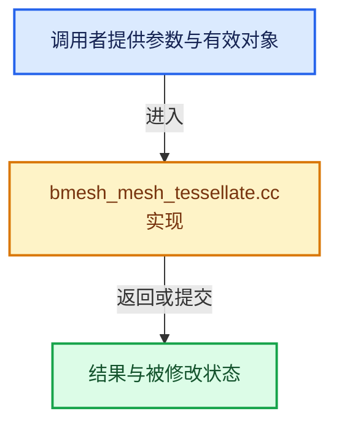

# 实现依赖专题：source/blender/bmesh/intern/bmesh_mesh_tessellate.cc

[方向导航](README.md) · [符号索引](../%E7%AC%A6%E5%8F%B7%E4%BE%9D%E8%B5%96%E4%B8%8E%E5%AE%9E%E7%8E%B0%E7%B4%A2%E5%BC%95.md)

本专题从正文实际调用进入，集中保存共享实现。函数有稳定锚点，可从调用处直接跳到对应完整函数；递归与互相调用通过回链组织。

## 本文件的实现关系





## 完整成员与函数实现

<a id="f-fb499f3f0971497f"></a>

### `blender::bmesh_calc_tessellation_for_face_beauty`

实现位置：[source/blender/bmesh/intern/bmesh_mesh_tessellate.cc](../../../../../source/blender/bmesh/intern/bmesh_mesh_tessellate.cc) · L423—L535。

接口参数：

- `std::array<BMLoop *, 3> *looptris`
- `BMFace *efa`
- `MemArena **pf_arena_p`
- `Heap **pf_heap_p`

**教学注释版**

<!-- annotated:31e9a60b51ac2c -->

```cpp
static int bmesh_calc_tessellation_for_face_beauty(std::array<BMLoop *, 3> *looptris,
                                                   BMFace *efa,
                                                   MemArena **pf_arena_p,
                                                   Heap **pf_heap_p)
{
  switch (efa->len) {
    case 3: {
      BMLoop *l;
      BMLoop **l_ptr = looptris[0].data();
      l_ptr[0] = l = BM_FACE_FIRST_LOOP(efa);
      l_ptr[1] = l = l->next;
      l_ptr[2] = l->next;
      return 1;
    }
    case 4: {
      BMLoop *l_v1 = BM_FACE_FIRST_LOOP(efa);
      BMLoop *l_v2 = l_v1->next;
      BMLoop *l_v3 = l_v2->next;
      BMLoop *l_v4 = l_v1->prev;

/* #BM_verts_calc_rotate_beauty performs excessive checks we don't need!
 * It's meant for rotating edges, it also calculates a new normal.
 *
 * Use #BLI_polyfill_beautify_quad_rotate_calc since we have the normal.
 */
#if 0
      const bool split_13 = (BM_verts_calc_rotate_beauty(
                                 l_v1->v, l_v2->v, l_v3->v, l_v4->v, 0, 0) < 0.0f);
#else
      float axis_mat[3][3], v_quad[4][2];
      axis_dominant_v3_to_m3(axis_mat, efa->no);
      mul_v2_m3v3(v_quad[0], axis_mat, l_v1->v->co);
      mul_v2_m3v3(v_quad[1], axis_mat, l_v2->v->co);
      mul_v2_m3v3(v_quad[2], axis_mat, l_v3->v->co);
      mul_v2_m3v3(v_quad[3], axis_mat, l_v4->v->co);

      const bool split_13 = BLI_polyfill_beautify_quad_rotate_calc(
                                v_quad[0], v_quad[1], v_quad[2], v_quad[3]) < 0.0f;
#endif

      BMLoop **l_ptr_a = looptris[0].data();
      BMLoop **l_ptr_b = looptris[1].data();
      if (split_13) {
        l_ptr_a[0] = l_v1;
        l_ptr_a[1] = l_v2;
        l_ptr_a[2] = l_v3;

        l_ptr_b[0] = l_v1;
        l_ptr_b[1] = l_v3;
        l_ptr_b[2] = l_v4;
      }
      else {
        l_ptr_a[0] = l_v1;
        l_ptr_a[1] = l_v2;
        l_ptr_a[2] = l_v4;

        l_ptr_b[0] = l_v2;
        l_ptr_b[1] = l_v3;
        l_ptr_b[2] = l_v4;
      }
      return 2;
    }
    default: {
      MemArena *pf_arena = *pf_arena_p;
      Heap *pf_heap = *pf_heap_p;
      if (pf_arena == nullptr) [[unlikely]] {
        pf_arena = *pf_arena_p = BLI_memarena_new(BLI_MEMARENA_STD_BUFSIZE, __func__);
        pf_heap = *pf_heap_p = BLI_heap_new_ex(BLI_POLYFILL_ALLOC_NGON_RESERVE);
      }

      BMLoop *l_iter, *l_first;
      BMLoop **l_arr;

      float axis_mat[3][3];
      float (*projverts)[2];
      uint(*tris)[3];

      const int tris_len = efa->len - 2;

      tris = static_cast<uint(*)[3]>(BLI_memarena_alloc(pf_arena, sizeof(*tris) * tris_len));
      l_arr = static_cast<BMLoop **>(BLI_memarena_alloc(pf_arena, sizeof(*l_arr) * efa->len));
      projverts = static_cast<float (*)[2]>(
          BLI_memarena_alloc(pf_arena, sizeof(*projverts) * efa->len));

      axis_dominant_v3_to_m3_negate(axis_mat, efa->no);

      int i = 0;
      l_iter = l_first = BM_FACE_FIRST_LOOP(efa);
      do {
        l_arr[i] = l_iter;
        mul_v2_m3v3(projverts[i], axis_mat, l_iter->v->co);
        i++;
      } while ((l_iter = l_iter->next) != l_first);

      BLI_polyfill_calc_arena(projverts, efa->len, 1, tris, pf_arena);

      BLI_polyfill_beautify(projverts, efa->len, tris, pf_arena, pf_heap);

      for (i = 0; i < tris_len; i++) {
        BMLoop **l_ptr = looptris[i].data();
        uint *tri = tris[i];

        l_ptr[0] = l_arr[tri[0]];
        l_ptr[1] = l_arr[tri[1]];
        l_ptr[2] = l_arr[tri[2]];
      }

      BLI_memarena_clear(pf_arena);

      return tris_len;
    }
  }
}
```

<details>
<summary>核对原始源码：source/blender/bmesh/intern/bmesh_mesh_tessellate.cc · L423—L535</summary>

<!-- original:31e9a60b51ac2c:source/blender/bmesh/intern/bmesh_mesh_tessellate.cc:423:535 -->

```cpp
static int bmesh_calc_tessellation_for_face_beauty(std::array<BMLoop *, 3> *looptris,
                                                   BMFace *efa,
                                                   MemArena **pf_arena_p,
                                                   Heap **pf_heap_p)
{
  switch (efa->len) {
    case 3: {
      BMLoop *l;
      BMLoop **l_ptr = looptris[0].data();
      l_ptr[0] = l = BM_FACE_FIRST_LOOP(efa);
      l_ptr[1] = l = l->next;
      l_ptr[2] = l->next;
      return 1;
    }
    case 4: {
      BMLoop *l_v1 = BM_FACE_FIRST_LOOP(efa);
      BMLoop *l_v2 = l_v1->next;
      BMLoop *l_v3 = l_v2->next;
      BMLoop *l_v4 = l_v1->prev;

/* #BM_verts_calc_rotate_beauty performs excessive checks we don't need!
 * It's meant for rotating edges, it also calculates a new normal.
 *
 * Use #BLI_polyfill_beautify_quad_rotate_calc since we have the normal.
 */
#if 0
      const bool split_13 = (BM_verts_calc_rotate_beauty(
                                 l_v1->v, l_v2->v, l_v3->v, l_v4->v, 0, 0) < 0.0f);
#else
      float axis_mat[3][3], v_quad[4][2];
      axis_dominant_v3_to_m3(axis_mat, efa->no);
      mul_v2_m3v3(v_quad[0], axis_mat, l_v1->v->co);
      mul_v2_m3v3(v_quad[1], axis_mat, l_v2->v->co);
      mul_v2_m3v3(v_quad[2], axis_mat, l_v3->v->co);
      mul_v2_m3v3(v_quad[3], axis_mat, l_v4->v->co);

      const bool split_13 = BLI_polyfill_beautify_quad_rotate_calc(
                                v_quad[0], v_quad[1], v_quad[2], v_quad[3]) < 0.0f;
#endif

      BMLoop **l_ptr_a = looptris[0].data();
      BMLoop **l_ptr_b = looptris[1].data();
      if (split_13) {
        l_ptr_a[0] = l_v1;
        l_ptr_a[1] = l_v2;
        l_ptr_a[2] = l_v3;

        l_ptr_b[0] = l_v1;
        l_ptr_b[1] = l_v3;
        l_ptr_b[2] = l_v4;
      }
      else {
        l_ptr_a[0] = l_v1;
        l_ptr_a[1] = l_v2;
        l_ptr_a[2] = l_v4;

        l_ptr_b[0] = l_v2;
        l_ptr_b[1] = l_v3;
        l_ptr_b[2] = l_v4;
      }
      return 2;
    }
    default: {
      MemArena *pf_arena = *pf_arena_p;
      Heap *pf_heap = *pf_heap_p;
      if (pf_arena == nullptr) [[unlikely]] {
        pf_arena = *pf_arena_p = BLI_memarena_new(BLI_MEMARENA_STD_BUFSIZE, __func__);
        pf_heap = *pf_heap_p = BLI_heap_new_ex(BLI_POLYFILL_ALLOC_NGON_RESERVE);
      }

      BMLoop *l_iter, *l_first;
      BMLoop **l_arr;

      float axis_mat[3][3];
      float (*projverts)[2];
      uint(*tris)[3];

      const int tris_len = efa->len - 2;

      tris = static_cast<uint(*)[3]>(BLI_memarena_alloc(pf_arena, sizeof(*tris) * tris_len));
      l_arr = static_cast<BMLoop **>(BLI_memarena_alloc(pf_arena, sizeof(*l_arr) * efa->len));
      projverts = static_cast<float (*)[2]>(
          BLI_memarena_alloc(pf_arena, sizeof(*projverts) * efa->len));

      axis_dominant_v3_to_m3_negate(axis_mat, efa->no);

      int i = 0;
      l_iter = l_first = BM_FACE_FIRST_LOOP(efa);
      do {
        l_arr[i] = l_iter;
        mul_v2_m3v3(projverts[i], axis_mat, l_iter->v->co);
        i++;
      } while ((l_iter = l_iter->next) != l_first);

      BLI_polyfill_calc_arena(projverts, efa->len, 1, tris, pf_arena);

      BLI_polyfill_beautify(projverts, efa->len, tris, pf_arena, pf_heap);

      for (i = 0; i < tris_len; i++) {
        BMLoop **l_ptr = looptris[i].data();
        uint *tri = tris[i];

        l_ptr[0] = l_arr[tri[0]];
        l_ptr[1] = l_arr[tri[1]];
        l_ptr[2] = l_arr[tri[2]];
      }

      BLI_memarena_clear(pf_arena);

      return tris_len;
    }
  }
}
```

</details>

**沿实际写入检查状态**

- `l_ptr[0] = l = BM_FACE_FIRST_LOOP(efa);`
- `l_ptr[1] = l = l->next;`
- `l_ptr[2] = l->next;`
- `l_ptr_a[0] = l_v1;`
- `l_ptr_a[1] = l_v2;`
- `l_ptr_a[2] = l_v3;`
- `l_ptr_b[0] = l_v1;`
- `l_ptr_b[1] = l_v3;`
- `l_ptr_b[2] = l_v4;`
- `l_ptr_a[2] = l_v4;`
- `l_ptr_b[0] = l_v2;`
- `pf_arena = *pf_arena_p = BLI_memarena_new(BLI_MEMARENA_STD_BUFSIZE, __func__);`
- `pf_heap = *pf_heap_p = BLI_heap_new_ex(BLI_POLYFILL_ALLOC_NGON_RESERVE);`
- `tris = static_cast<uint(*)[3]>(BLI_memarena_alloc(pf_arena, sizeof(*tris) * tris_len));`
- `l_arr = static_cast<BMLoop **>(BLI_memarena_alloc(pf_arena, sizeof(*l_arr) * efa->len));`
- `projverts = static_cast<float (*)[2]>(`
- `l_iter = l_first = BM_FACE_FIRST_LOOP(efa);`
- `l_arr[i] = l_iter;`
- `l_ptr[0] = l_arr[tri[0]];`
- `l_ptr[1] = l_arr[tri[1]];`
- `l_ptr[2] = l_arr[tri[2]];`

**结果出口**

- `return 1;`
- `return 2;`
- `return tris_len;`

**继续追踪实现**

- `looptris[0].data` → [调用协议](../%E6%A8%A1%E6%9D%BF%E5%AE%8F%E4%B8%8E%E5%8A%A8%E6%80%81%E5%88%86%E6%B4%BE%E5%8D%8F%E8%AE%AE.md)：接收对象类型依赖auto、返回值或模板实例；不按同名猜测目标。调用位置L431。
- `BM_FACE_FIRST_LOOP` → [BM_FACE_FIRST_LOOP · L697](%E4%BE%9D%E8%B5%96-bmesh_class-4cf146.md#m-c7e10ffb38e6)；[BM_FACE_FIRST_LOOP · L699](%E4%BE%9D%E8%B5%96-bmesh_class-4cf146.md#m-76a054cc4770)。宏定义由构建条件选择。
- `BM_verts_calc_rotate_beauty` → [blender::BM_verts_calc_rotate_beauty · L171](%E4%BE%9D%E8%B5%96-bmesh_beautify-9cc7e3.md#f-aaadc1a9d9afe57c)。
- `axis_dominant_v3_to_m3` → [blender::axis_dominant_v3_to_m3 · L3702](../12-%E7%A9%BA%E9%97%B4%E6%95%B0%E6%8D%AE%E7%BB%93%E6%9E%84%E4%B8%8E%E5%87%A0%E4%BD%95%E7%AE%97%E6%B3%95/%E4%BE%9D%E8%B5%96-math_geom-8d91a3.md#f-3e28943552d479d7)。
- `mul_v2_m3v3` → [blender::mul_v2_m3v3 · L844](../12-%E7%A9%BA%E9%97%B4%E6%95%B0%E6%8D%AE%E7%BB%93%E6%9E%84%E4%B8%8E%E5%87%A0%E4%BD%95%E7%AE%97%E6%B3%95/%E4%BE%9D%E8%B5%96-math_matrix_c-004123.md#f-2550a487d003ca6b)。
- `BLI_polyfill_beautify_quad_rotate_calc` → [BLI_polyfill_beautify_quad_rotate_calc · L53](../01-%E5%9F%BA%E7%A1%80%E5%AE%B9%E5%99%A8%E4%B8%8E%E7%8E%B0%E4%BB%A3CPP/%E4%BE%9D%E8%B5%96-BLI_polyfill_2d_beautify-3f6f75.md#m-ade6cb142968)。宏定义由构建条件选择。
- `looptris[1].data` → [调用协议](../%E6%A8%A1%E6%9D%BF%E5%AE%8F%E4%B8%8E%E5%8A%A8%E6%80%81%E5%88%86%E6%B4%BE%E5%8D%8F%E8%AE%AE.md)：接收对象类型依赖auto、返回值或模板实例；不按同名猜测目标。调用位置L464。
- `BLI_memarena_new` → [blender::BLI_memarena_new · L73](../01-%E5%9F%BA%E7%A1%80%E5%AE%B9%E5%99%A8%E4%B8%8E%E7%8E%B0%E4%BB%A3CPP/%E4%BE%9D%E8%B5%96-BLI_memarena-aea32a.md#f-590ef4f6ab548c98)。
- `BLI_heap_new_ex` → [blender::BLI_heap_new_ex · L173](../01-%E5%9F%BA%E7%A1%80%E5%AE%B9%E5%99%A8%E4%B8%8E%E7%8E%B0%E4%BB%A3CPP/%E4%BE%9D%E8%B5%96-BLI_heap-16714e.md#f-f7be2a63ad410ef3)。
- `BLI_memarena_alloc` → [blender::BLI_memarena_alloc · L125](../01-%E5%9F%BA%E7%A1%80%E5%AE%B9%E5%99%A8%E4%B8%8E%E7%8E%B0%E4%BB%A3CPP/%E4%BE%9D%E8%B5%96-BLI_memarena-aea32a.md#f-ae79828c3629e134)；[blender::BLI_memarena_alloc · L43](../01-%E5%9F%BA%E7%A1%80%E5%AE%B9%E5%99%A8%E4%B8%8E%E7%8E%B0%E4%BB%A3CPP/%E4%BE%9D%E8%B5%96-BLI_memarena-d0ed90.md#f-3c7ccf0d8384021b)。同名重载需按实参类型选择。
- `axis_dominant_v3_to_m3_negate` → [blender::axis_dominant_v3_to_m3_negate · L3719](../12-%E7%A9%BA%E9%97%B4%E6%95%B0%E6%8D%AE%E7%BB%93%E6%9E%84%E4%B8%8E%E5%87%A0%E4%BD%95%E7%AE%97%E6%B3%95/%E4%BE%9D%E8%B5%96-math_geom-8d91a3.md#f-a179811fe7db7a80)。
- `BLI_polyfill_calc_arena` → [blender::BLI_polyfill_calc_arena · L1065](../01-%E5%9F%BA%E7%A1%80%E5%AE%B9%E5%99%A8%E4%B8%8E%E7%8E%B0%E4%BB%A3CPP/%E4%BE%9D%E8%B5%96-polyfill_2d-89228d.md#f-85769b09e7961330)。
- `BLI_polyfill_beautify` → [blender::BLI_polyfill_beautify · L366](../01-%E5%9F%BA%E7%A1%80%E5%AE%B9%E5%99%A8%E4%B8%8E%E7%8E%B0%E4%BB%A3CPP/%E4%BE%9D%E8%B5%96-polyfill_2d_beautify-cdcaad.md#f-ac60e49e1ca03e85)。
- `looptris[i].data` → [调用协议](../%E6%A8%A1%E6%9D%BF%E5%AE%8F%E4%B8%8E%E5%8A%A8%E6%80%81%E5%88%86%E6%B4%BE%E5%8D%8F%E8%AE%AE.md)：接收对象类型依赖auto、返回值或模板实例；不按同名猜测目标。调用位置L522。
- `BLI_memarena_clear` → [blender::BLI_memarena_clear · L225](../01-%E5%9F%BA%E7%A1%80%E5%AE%B9%E5%99%A8%E4%B8%8E%E7%8E%B0%E4%BB%A3CPP/%E4%BE%9D%E8%B5%96-BLI_memarena-aea32a.md#f-58102a3c4f840caa)。

<a id="f-46f71d023aa796a3"></a>

### `blender::BM_mesh_calc_tessellation_beauty`

实现位置：[source/blender/bmesh/intern/bmesh_mesh_tessellate.cc](../../../../../source/blender/bmesh/intern/bmesh_mesh_tessellate.cc) · L537—L564。

接口参数：

- `BMesh *bm`
- `MutableSpan<std::array<BMLoop *, 3>> looptris`

**教学注释版**

<!-- annotated:3a14661435cf51 -->

```cpp
void BM_mesh_calc_tessellation_beauty(BMesh *bm, MutableSpan<std::array<BMLoop *, 3>> looptris)
{
#ifndef NDEBUG
  const int looptris_tot = poly_to_tri_count(bm->totface, bm->totloop);
#endif

  BMIter iter;
  BMFace *efa;
  int i = 0;

  MemArena *pf_arena = nullptr;

  /* use_beauty */
  Heap *pf_heap = nullptr;

  BM_ITER_MESH (efa, &iter, bm, BM_FACES_OF_MESH) {
    BLI_assert(efa->len >= 3);
    // [讲解] looptris.data：返回借用范围的地址。
    i += bmesh_calc_tessellation_for_face_beauty(looptris.data() + i, efa, &pf_arena, &pf_heap);
  }

  if (pf_arena) {
    BLI_memarena_free(pf_arena);

    BLI_heap_free(pf_heap, nullptr);
  }

  BLI_assert(i <= looptris_tot);
}
```

<details>
<summary>核对原始源码：source/blender/bmesh/intern/bmesh_mesh_tessellate.cc · L537—L564</summary>

<!-- original:3a14661435cf51:source/blender/bmesh/intern/bmesh_mesh_tessellate.cc:537:564 -->

```cpp
void BM_mesh_calc_tessellation_beauty(BMesh *bm, MutableSpan<std::array<BMLoop *, 3>> looptris)
{
#ifndef NDEBUG
  const int looptris_tot = poly_to_tri_count(bm->totface, bm->totloop);
#endif

  BMIter iter;
  BMFace *efa;
  int i = 0;

  MemArena *pf_arena = nullptr;

  /* use_beauty */
  Heap *pf_heap = nullptr;

  BM_ITER_MESH (efa, &iter, bm, BM_FACES_OF_MESH) {
    BLI_assert(efa->len >= 3);
    i += bmesh_calc_tessellation_for_face_beauty(looptris.data() + i, efa, &pf_arena, &pf_heap);
  }

  if (pf_arena) {
    BLI_memarena_free(pf_arena);

    BLI_heap_free(pf_heap, nullptr);
  }

  BLI_assert(i <= looptris_tot);
}
```

</details>

**沿实际写入检查状态**

- `i += bmesh_calc_tessellation_for_face_beauty(looptris.data() + i, efa, &pf_arena, &pf_heap);`

**继续追踪实现**

- `poly_to_tri_count` → [blender::poly_to_tri_count · L118](../12-%E7%A9%BA%E9%97%B4%E6%95%B0%E6%8D%AE%E7%BB%93%E6%9E%84%E4%B8%8E%E5%87%A0%E4%BD%95%E7%AE%97%E6%B3%95/%E4%BE%9D%E8%B5%96-math_geom_inline-672303.md#f-fd5a0e76d62e3b0b)。
- `BM_ITER_MESH` → [BM_ITER_MESH · L72](%E4%BE%9D%E8%B5%96-bmesh_iterators-13971c.md#m-cfc837c73218)。宏定义由构建条件选择。
- `BLI_assert` → [BLI_assert · L48](../01-%E5%9F%BA%E7%A1%80%E5%AE%B9%E5%99%A8%E4%B8%8E%E7%8E%B0%E4%BB%A3CPP/%E4%BE%9D%E8%B5%96-BLI_assert-cc98e8.md#m-57a88495704d)；[BLI_assert · L63](../01-%E5%9F%BA%E7%A1%80%E5%AE%B9%E5%99%A8%E4%B8%8E%E7%8E%B0%E4%BB%A3CPP/%E4%BE%9D%E8%B5%96-BLI_assert-cc98e8.md#m-d07050020cb5)。宏定义由构建条件选择。
- `bmesh_calc_tessellation_for_face_beauty` → [blender::bmesh_calc_tessellation_for_face_beauty · L423](%E4%BE%9D%E8%B5%96-bmesh_mesh_tessellate-948e63.md#f-fb499f3f0971497f)。
- `looptris.data` → [blender::MutableSpan::data · L545](../01-%E5%9F%BA%E7%A1%80%E5%AE%B9%E5%99%A8%E4%B8%8E%E7%8E%B0%E4%BB%A3CPP/06-MutableSpan%E5%8F%AF%E5%86%99%E8%A7%86%E5%9B%BE.md#f-eb45a6e4d8211efd)；[blender::gpu::shader::parser::MutableSpan::data · L82](%E4%BE%9D%E8%B5%96-utils-06433d.md#f-ad0a09cec9741c65)。同名重载需按实参类型选择。
- `BLI_memarena_free` → [blender::BLI_memarena_free · L103](../01-%E5%9F%BA%E7%A1%80%E5%AE%B9%E5%99%A8%E4%B8%8E%E7%8E%B0%E4%BB%A3CPP/%E4%BE%9D%E8%B5%96-BLI_memarena-aea32a.md#f-a655794ad41d1bdf)。
- `BLI_heap_free` → [blender::BLI_heap_free · L193](../01-%E5%9F%BA%E7%A1%80%E5%AE%B9%E5%99%A8%E4%B8%8E%E7%8E%B0%E4%BB%A3CPP/%E4%BE%9D%E8%B5%96-BLI_heap-16714e.md#f-8460909856d9ccf1)。
