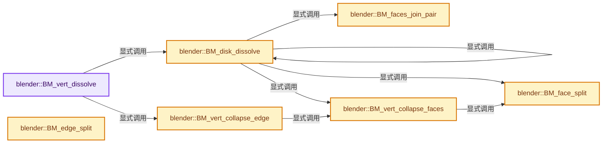
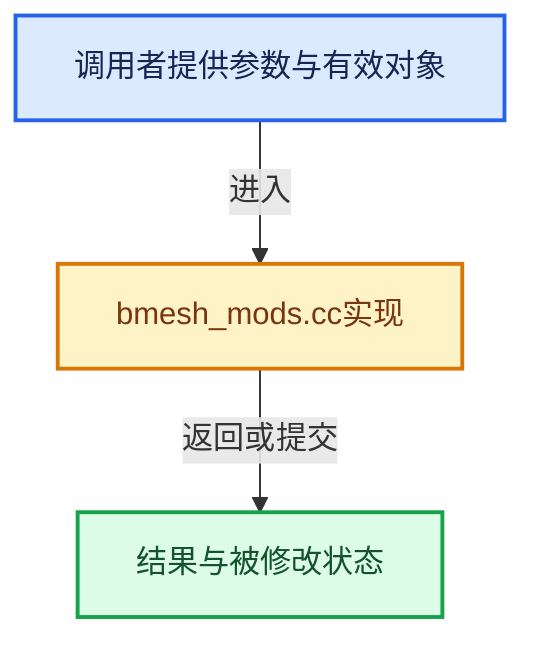

# 实现依赖专题：source/blender/bmesh/intern/bmesh_mods.cc

[方向导航](README.md) · [符号索引](../%E7%AC%A6%E5%8F%B7%E4%BE%9D%E8%B5%96%E4%B8%8E%E5%AE%9E%E7%8E%B0%E7%B4%A2%E5%BC%95.md)

本专题从正文实际调用进入，集中保存共享实现。函数有稳定锚点，可从调用处直接跳到对应完整函数；递归与互相调用通过回链组织。

## 本文件的实现关系






## 完整成员与函数实现

<a id="f-ec38a2375646aaf9"></a>

### `blender::BM_vert_dissolve`

实现位置：[source/blender/bmesh/intern/bmesh_mods.cc](../../../../../source/blender/bmesh/intern/bmesh_mods.cc) · L22—L51。

接口参数：

- `BMesh *bm`
- `BMVert *v`

**教学注释版**

<!-- annotated:5d3e3edcc661d8 -->

```cpp
bool BM_vert_dissolve(BMesh *bm, BMVert *v)
{
  /* logic for 3 or more is identical */
  const int len = BM_vert_edge_count_at_most(v, 3);

  if (len == 1) {
    BM_vert_kill(bm, v); /* will kill edges too */
    return true;
  }
  if (!BM_vert_is_manifold(v)) {
    if (!v->e) {
      BM_vert_kill(bm, v);
      return true;
    }
    if (!v->e->l) {
      if (len == 2) {
        return (BM_vert_collapse_edge(bm, v->e, v, true, true, true) != nullptr);
      }
      /* used to kill the vertex here, but it may be connected to faces.
       * so better do nothing */
      return false;
    }
    return false;
  }
  if (len == 2 && BM_vert_face_count_is_equal(v, 1)) {
    /* boundary vertex on a face */
    return (BM_vert_collapse_edge(bm, v->e, v, true, true, true) != nullptr);
  }
  return BM_disk_dissolve(bm, v);
}
```

<details>
<summary>核对原始源码：source/blender/bmesh/intern/bmesh_mods.cc · L22—L51</summary>

<!-- original:5d3e3edcc661d8:source/blender/bmesh/intern/bmesh_mods.cc:22:51 -->

```cpp
bool BM_vert_dissolve(BMesh *bm, BMVert *v)
{
  /* logic for 3 or more is identical */
  const int len = BM_vert_edge_count_at_most(v, 3);

  if (len == 1) {
    BM_vert_kill(bm, v); /* will kill edges too */
    return true;
  }
  if (!BM_vert_is_manifold(v)) {
    if (!v->e) {
      BM_vert_kill(bm, v);
      return true;
    }
    if (!v->e->l) {
      if (len == 2) {
        return (BM_vert_collapse_edge(bm, v->e, v, true, true, true) != nullptr);
      }
      /* used to kill the vertex here, but it may be connected to faces.
       * so better do nothing */
      return false;
    }
    return false;
  }
  if (len == 2 && BM_vert_face_count_is_equal(v, 1)) {
    /* boundary vertex on a face */
    return (BM_vert_collapse_edge(bm, v->e, v, true, true, true) != nullptr);
  }
  return BM_disk_dissolve(bm, v);
}
```

</details>

**结果出口**

- `return true;`
- `return (BM_vert_collapse_edge(bm, v->e, v, true, true, true) != nullptr);`
- `return false;`
- `return BM_disk_dissolve(bm, v);`

**继续追踪实现**

- `BM_vert_edge_count_at_most` → [blender::BM_vert_edge_count_at_most · L624](%E4%BE%9D%E8%B5%96-bmesh_query-b0f8d6.md#f-470746625e1ef19a)。
- `BM_vert_kill` → [blender::BM_vert_kill · L1068](%E4%BE%9D%E8%B5%96-bmesh_core-9fd9f8.md#f-0895632efe77ce45)。
- `BM_vert_is_manifold` → [blender::BM_vert_is_manifold · L717](%E4%BE%9D%E8%B5%96-bmesh_query-b0f8d6.md#f-be46e39965fb7762)。
- `BM_vert_collapse_edge` → [blender::BM_vert_collapse_edge · L429](%E4%BE%9D%E8%B5%96-bmesh_mods-0dee70.md#f-ef4ded8bbee4c726)。
- `BM_vert_face_count_is_equal` → [BM_vert_face_count_is_equal · L264](%E4%BE%9D%E8%B5%96-bmesh_query-cc0fec.md#m-26abee26988c)。宏定义由构建条件选择。
- `BM_disk_dissolve` → [blender::BM_disk_dissolve · L53](%E4%BE%9D%E8%B5%96-bmesh_mods-0dee70.md#f-231521cb418c8314)。

<a id="f-231521cb418c8314"></a>

### `blender::BM_disk_dissolve`

实现位置：[source/blender/bmesh/intern/bmesh_mods.cc](../../../../../source/blender/bmesh/intern/bmesh_mods.cc) · L53—L191。

接口参数：

- `BMesh *bm`
- `BMVert *v`

**教学注释版**

<!-- annotated:852f8b99101d58 -->

```cpp
bool BM_disk_dissolve(BMesh *bm, BMVert *v)
{
  BMEdge *e, *keepedge = nullptr, *baseedge = nullptr;
  int len = 0;

  if (!BM_vert_is_manifold(v)) {
    return false;
  }

  if (v->e) {
    /* v->e we keep, what else */
    e = v->e;
    do {
      e = bmesh_disk_edge_next(e, v);
      if (!BM_edge_share_face_check(e, v->e)) {
        keepedge = e;
        baseedge = v->e;
        break;
      }
      len++;
    } while (e != v->e);
  }

  /* this code for handling 2 and 3-valence verts
   * may be totally bad */
  if (keepedge == nullptr && len == 3) {
#if 0
    /* handle specific case for three-valence.  solve it by
     * increasing valence to four.  this may be hackish. */
    BMLoop *l_a = BM_face_vert_share_loop(e->l->f, v);
    BMLoop *l_b = (e->l->v == v) ? e->l->next : e->l;

    if (!BM_face_split(bm, e->l->f, l_a, l_b, nullptr, nullptr, false)) {
      return false;
    }

    if (!BM_disk_dissolve(bm, v)) {
      return false;
    }
#else
    BMFace *f_double;

    if (!BM_faces_join_pair(bm, e->l, e->l->radial_next, true, &f_double)) [[unlikely]] {
      return false;
    }

    /* See #BM_faces_join note on callers asserting when `r_double` is non-null. */
    BLI_assert_msg(f_double == nullptr,
                   "Doubled face detected at " AT ". Resulting mesh may be corrupt.");

    if (!BM_vert_collapse_faces(bm, v->e, v, 1.0, true, false, true, true)) [[unlikely]] {
      return false;
    }
#endif
    return true;
  }
  if (keepedge == nullptr && len == 2) {
    /* collapse the vertex */
    e = BM_vert_collapse_faces(bm, v->e, v, 1.0, true, true, true, true);

    if (!e) {
      return false;
    }

    /* handle two-valence */
    if (e->l != e->l->radial_next) {
      BMFace *f_double;

      if (!BM_faces_join_pair(bm, e->l, e->l->radial_next, true, &f_double)) {
        return false;
      }

      /* See #BM_faces_join note on callers asserting when `r_double` is non-null. */
      BLI_assert_msg(f_double == nullptr,
                     "Doubled face detected at " AT ". Resulting mesh may be corrupt.");
    }

    return true;
  }

  if (keepedge) {
    bool done = false;

    while (!done) {
      done = true;
      e = v->e;
      do {
        BMFace *f = nullptr;
        if (BM_edge_is_manifold(e) && (e != baseedge) && (e != keepedge)) {
          BMFace *f_double;

          f = BM_faces_join_pair(bm, e->l, e->l->radial_next, true, &f_double);
          /* return if couldn't join faces in manifold
           * conditions */
          /* !disabled for testing why bad things happen */
          if (!f) {
            return false;
          }

          /* See #BM_faces_join note on callers asserting when `r_double` is non-null. */
          BLI_assert_msg(f_double == nullptr,
                         "Doubled face detected at " AT ". Resulting mesh may be corrupt.");
        }

        if (f) {
          done = false;
          break;
        }
      } while ((e = bmesh_disk_edge_next(e, v)) != v->e);
    }

    /* collapse the vertex */
    /* NOTE: the baseedge can be a boundary of manifold, use this as join_faces arg. */
    e = BM_vert_collapse_faces(
        bm, baseedge, v, 1.0, true, !BM_edge_is_boundary(baseedge), true, true);

    if (!e) {
      return false;
    }

    if (e->l) {
      /* get remaining two faces */
      if (e->l != e->l->radial_next) {
        BMFace *f_double;

        /* join two remaining faces */
        if (!BM_faces_join_pair(bm, e->l, e->l->radial_next, true, &f_double)) {
          return false;
        }

        /* See #BM_faces_join note on callers asserting when `r_double` is non-null. */
        BLI_assert_msg(f_double == nullptr,
                       "Doubled face detected at " AT ". Resulting mesh may be corrupt.");
      }
    }
  }

  return true;
}
```

<details>
<summary>核对原始源码：source/blender/bmesh/intern/bmesh_mods.cc · L53—L191</summary>

<!-- original:852f8b99101d58:source/blender/bmesh/intern/bmesh_mods.cc:53:191 -->

```cpp
bool BM_disk_dissolve(BMesh *bm, BMVert *v)
{
  BMEdge *e, *keepedge = nullptr, *baseedge = nullptr;
  int len = 0;

  if (!BM_vert_is_manifold(v)) {
    return false;
  }

  if (v->e) {
    /* v->e we keep, what else */
    e = v->e;
    do {
      e = bmesh_disk_edge_next(e, v);
      if (!BM_edge_share_face_check(e, v->e)) {
        keepedge = e;
        baseedge = v->e;
        break;
      }
      len++;
    } while (e != v->e);
  }

  /* this code for handling 2 and 3-valence verts
   * may be totally bad */
  if (keepedge == nullptr && len == 3) {
#if 0
    /* handle specific case for three-valence.  solve it by
     * increasing valence to four.  this may be hackish. */
    BMLoop *l_a = BM_face_vert_share_loop(e->l->f, v);
    BMLoop *l_b = (e->l->v == v) ? e->l->next : e->l;

    if (!BM_face_split(bm, e->l->f, l_a, l_b, nullptr, nullptr, false)) {
      return false;
    }

    if (!BM_disk_dissolve(bm, v)) {
      return false;
    }
#else
    BMFace *f_double;

    if (!BM_faces_join_pair(bm, e->l, e->l->radial_next, true, &f_double)) [[unlikely]] {
      return false;
    }

    /* See #BM_faces_join note on callers asserting when `r_double` is non-null. */
    BLI_assert_msg(f_double == nullptr,
                   "Doubled face detected at " AT ". Resulting mesh may be corrupt.");

    if (!BM_vert_collapse_faces(bm, v->e, v, 1.0, true, false, true, true)) [[unlikely]] {
      return false;
    }
#endif
    return true;
  }
  if (keepedge == nullptr && len == 2) {
    /* collapse the vertex */
    e = BM_vert_collapse_faces(bm, v->e, v, 1.0, true, true, true, true);

    if (!e) {
      return false;
    }

    /* handle two-valence */
    if (e->l != e->l->radial_next) {
      BMFace *f_double;

      if (!BM_faces_join_pair(bm, e->l, e->l->radial_next, true, &f_double)) {
        return false;
      }

      /* See #BM_faces_join note on callers asserting when `r_double` is non-null. */
      BLI_assert_msg(f_double == nullptr,
                     "Doubled face detected at " AT ". Resulting mesh may be corrupt.");
    }

    return true;
  }

  if (keepedge) {
    bool done = false;

    while (!done) {
      done = true;
      e = v->e;
      do {
        BMFace *f = nullptr;
        if (BM_edge_is_manifold(e) && (e != baseedge) && (e != keepedge)) {
          BMFace *f_double;

          f = BM_faces_join_pair(bm, e->l, e->l->radial_next, true, &f_double);
          /* return if couldn't join faces in manifold
           * conditions */
          /* !disabled for testing why bad things happen */
          if (!f) {
            return false;
          }

          /* See #BM_faces_join note on callers asserting when `r_double` is non-null. */
          BLI_assert_msg(f_double == nullptr,
                         "Doubled face detected at " AT ". Resulting mesh may be corrupt.");
        }

        if (f) {
          done = false;
          break;
        }
      } while ((e = bmesh_disk_edge_next(e, v)) != v->e);
    }

    /* collapse the vertex */
    /* NOTE: the baseedge can be a boundary of manifold, use this as join_faces arg. */
    e = BM_vert_collapse_faces(
        bm, baseedge, v, 1.0, true, !BM_edge_is_boundary(baseedge), true, true);

    if (!e) {
      return false;
    }

    if (e->l) {
      /* get remaining two faces */
      if (e->l != e->l->radial_next) {
        BMFace *f_double;

        /* join two remaining faces */
        if (!BM_faces_join_pair(bm, e->l, e->l->radial_next, true, &f_double)) {
          return false;
        }

        /* See #BM_faces_join note on callers asserting when `r_double` is non-null. */
        BLI_assert_msg(f_double == nullptr,
                       "Doubled face detected at " AT ". Resulting mesh may be corrupt.");
      }
    }
  }

  return true;
}
```

</details>

**沿实际写入检查状态**

- `e = v->e;`
- `e = bmesh_disk_edge_next(e, v);`
- `keepedge = e;`
- `baseedge = v->e;`
- `e = BM_vert_collapse_faces(bm, v->e, v, 1.0, true, true, true, true);`
- `done = true;`
- `f = BM_faces_join_pair(bm, e->l, e->l->radial_next, true, &f_double);`
- `done = false;`
- `e = BM_vert_collapse_faces(`

**结果出口**

- `return false;`
- `return true;`

**继续追踪实现**

- `BM_vert_is_manifold` → [blender::BM_vert_is_manifold · L717](%E4%BE%9D%E8%B5%96-bmesh_query-b0f8d6.md#f-be46e39965fb7762)。
- `bmesh_disk_edge_next` → [blender::bmesh_disk_edge_next · L59](%E4%BE%9D%E8%B5%96-bmesh_structure_inline-3e4d59.md#f-bde0a66632cf5785)。
- `BM_edge_share_face_check` → [blender::BM_edge_share_face_check · L1050](%E4%BE%9D%E8%B5%96-bmesh_query-b0f8d6.md#f-bacd2c070617e557)。
- `BM_face_vert_share_loop` → [blender::BM_face_vert_share_loop · L1114](%E4%BE%9D%E8%B5%96-bmesh_query-b0f8d6.md#f-1cd9a48462ab71ad)。
- `BM_face_split` → [blender::BM_face_split · L207](%E4%BE%9D%E8%B5%96-bmesh_mods-0dee70.md#f-78df25669fa1d1c1)。
- `BM_disk_dissolve` → [blender::BM_disk_dissolve · L53](%E4%BE%9D%E8%B5%96-bmesh_mods-0dee70.md#f-231521cb418c8314)。
- `BM_faces_join_pair` → [blender::BM_faces_join_pair · L193](%E4%BE%9D%E8%B5%96-bmesh_mods-0dee70.md#f-6b83fe95e12b0cee)。
- `BLI_assert_msg` → [BLI_assert_msg · L55](../01-%E5%9F%BA%E7%A1%80%E5%AE%B9%E5%99%A8%E4%B8%8E%E7%8E%B0%E4%BB%A3CPP/%E4%BE%9D%E8%B5%96-BLI_assert-cc98e8.md#m-695eed20dceb)；[BLI_assert_msg · L64](../01-%E5%9F%BA%E7%A1%80%E5%AE%B9%E5%99%A8%E4%B8%8E%E7%8E%B0%E4%BB%A3CPP/%E4%BE%9D%E8%B5%96-BLI_assert-cc98e8.md#m-7de5563de4db)。宏定义由构建条件选择。
- `BM_vert_collapse_faces` → [blender::BM_vert_collapse_faces · L344](%E4%BE%9D%E8%B5%96-bmesh_mods-0dee70.md#f-c88c000fcaebdb97)。
- `BM_edge_is_manifold` → [blender::BM_edge_is_manifold · L79](%E4%BE%9D%E8%B5%96-bmesh_query_inline-c93392.md#f-4944cfa861683f59)；[blender::BM_edge_is_manifold · L86](%E4%BE%9D%E8%B5%96-bmesh_query_inline-c93392.md#f-f07686548bcc2440)。同名重载需按实参类型选择。
- `BM_edge_is_boundary` → [blender::BM_edge_is_boundary · L111](%E4%BE%9D%E8%B5%96-bmesh_query_inline-c93392.md#f-9626087cfab8be44)；[blender::BM_edge_is_boundary · L117](%E4%BE%9D%E8%B5%96-bmesh_query_inline-c93392.md#f-2fee18c217b38784)。同名重载需按实参类型选择。

<a id="f-6b83fe95e12b0cee"></a>

### `blender::BM_faces_join_pair`

实现位置：[source/blender/bmesh/intern/bmesh_mods.cc](../../../../../source/blender/bmesh/intern/bmesh_mods.cc) · L193—L205。

接口参数：

- `BMesh *bm`
- `BMLoop *l_a`
- `BMLoop *l_b`
- `const bool do_del`
- `BMFace **r_double`

**教学注释版**

<!-- annotated:7b1a3402f09ae2 -->

```cpp
BMFace *BM_faces_join_pair(
    BMesh *bm, BMLoop *l_a, BMLoop *l_b, const bool do_del, BMFace **r_double)
{
  BLI_assert((l_a != l_b) && (l_a->e == l_b->e));

  if (l_a->v == l_b->v) {
    const int cd_loop_mdisp_offset = CustomData_get_offset(&bm->ldata, CD_MDISPS);
    bmesh_kernel_loop_reverse(bm, l_b->f, cd_loop_mdisp_offset, true);
  }

  BMFace *faces[2] = {l_a->f, l_b->f};
  return BM_faces_join(bm, faces, 2, do_del, r_double);
}
```

<details>
<summary>核对原始源码：source/blender/bmesh/intern/bmesh_mods.cc · L193—L205</summary>

<!-- original:7b1a3402f09ae2:source/blender/bmesh/intern/bmesh_mods.cc:193:205 -->

```cpp
BMFace *BM_faces_join_pair(
    BMesh *bm, BMLoop *l_a, BMLoop *l_b, const bool do_del, BMFace **r_double)
{
  BLI_assert((l_a != l_b) && (l_a->e == l_b->e));

  if (l_a->v == l_b->v) {
    const int cd_loop_mdisp_offset = CustomData_get_offset(&bm->ldata, CD_MDISPS);
    bmesh_kernel_loop_reverse(bm, l_b->f, cd_loop_mdisp_offset, true);
  }

  BMFace *faces[2] = {l_a->f, l_b->f};
  return BM_faces_join(bm, faces, 2, do_del, r_double);
}
```

</details>

**结果出口**

- `return BM_faces_join(bm, faces, 2, do_del, r_double);`

**继续追踪实现**

- `BLI_assert` → [BLI_assert · L48](../01-%E5%9F%BA%E7%A1%80%E5%AE%B9%E5%99%A8%E4%B8%8E%E7%8E%B0%E4%BB%A3CPP/%E4%BE%9D%E8%B5%96-BLI_assert-cc98e8.md#m-57a88495704d)；[BLI_assert · L63](../01-%E5%9F%BA%E7%A1%80%E5%AE%B9%E5%99%A8%E4%B8%8E%E7%8E%B0%E4%BB%A3CPP/%E4%BE%9D%E8%B5%96-BLI_assert-cc98e8.md#m-d07050020cb5)。宏定义由构建条件选择。
- `CustomData_get_offset` → [blender::CustomData_get_offset · L3379](%E4%BE%9D%E8%B5%96-customdata-2eef81.md#f-e0e230c6120acc9a)。
- `bmesh_kernel_loop_reverse` → [blender::bmesh_kernel_loop_reverse · L1094](%E4%BE%9D%E8%B5%96-bmesh_core-9fd9f8.md#f-ac8d2fac841417cf)。
- `BM_faces_join` → [blender::BM_faces_join · L1252](%E4%BE%9D%E8%B5%96-bmesh_core-9fd9f8.md#f-09db837c1b24f3d0)。

<a id="f-78df25669fa1d1c1"></a>

### `blender::BM_face_split`

实现位置：[source/blender/bmesh/intern/bmesh_mods.cc](../../../../../source/blender/bmesh/intern/bmesh_mods.cc) · L207—L269。

接口参数：

- `BMesh *bm`
- `BMFace *f`
- `BMLoop *l_a`
- `BMLoop *l_b`
- `BMLoop **r_l`
- `BMEdge *example`
- `const bool no_double`

**教学注释版**

<!-- annotated:dde8679534f829 -->

```cpp
BMFace *BM_face_split(BMesh *bm,
                      BMFace *f,
                      BMLoop *l_a,
                      BMLoop *l_b,
                      BMLoop **r_l,
                      BMEdge *example,
                      const bool no_double)
{
  const int cd_loop_mdisp_offset = CustomData_get_offset(&bm->ldata, CD_MDISPS);
  BMFace *f_new, *f_tmp;

  BLI_assert(l_a != l_b);
  BLI_assert(f == l_a->f && f == l_b->f);
  BLI_assert(!BM_loop_is_adjacent(l_a, l_b));

  /* could be an assert */
  if (UNLIKELY(BM_loop_is_adjacent(l_a, l_b)) || UNLIKELY(f != l_a->f || f != l_b->f)) {
    if (r_l) {
      *r_l = nullptr;
    }
    return nullptr;
  }

  /* do we have a multires layer? */
  if (cd_loop_mdisp_offset != -1) {
    f_tmp = BM_face_copy(bm, f, false, false);
  }

#ifdef USE_BMESH_HOLES
  f_new = bmesh_kernel_split_face_make_edge(bm, f, l_a, l_b, r_l, nullptr, example, no_double);
#else
  f_new = bmesh_kernel_split_face_make_edge(bm, f, l_a, l_b, r_l, example, no_double);
#endif

  if (f_new) {
    /* handle multires update */
    if (cd_loop_mdisp_offset != -1) {
      float f_dst_center[3];
      float f_src_center[3];

      BM_face_calc_center_median(f_tmp, f_src_center);

      BM_face_calc_center_median(f, f_dst_center);
      BM_face_interp_multires_ex(bm, f, f_tmp, f_dst_center, f_src_center, cd_loop_mdisp_offset);

      BM_face_calc_center_median(f_new, f_dst_center);
      BM_face_interp_multires_ex(
          bm, f_new, f_tmp, f_dst_center, f_src_center, cd_loop_mdisp_offset);

#if 0
      /* BM_face_multires_bounds_smooth doesn't flip displacement correct */
      BM_face_multires_bounds_smooth(bm, f);
      BM_face_multires_bounds_smooth(bm, f_new);
#endif
    }
  }

  if (cd_loop_mdisp_offset != -1) {
    BM_face_kill(bm, f_tmp);
  }

  return f_new;
}
```

<details>
<summary>核对原始源码：source/blender/bmesh/intern/bmesh_mods.cc · L207—L269</summary>

<!-- original:dde8679534f829:source/blender/bmesh/intern/bmesh_mods.cc:207:269 -->

```cpp
BMFace *BM_face_split(BMesh *bm,
                      BMFace *f,
                      BMLoop *l_a,
                      BMLoop *l_b,
                      BMLoop **r_l,
                      BMEdge *example,
                      const bool no_double)
{
  const int cd_loop_mdisp_offset = CustomData_get_offset(&bm->ldata, CD_MDISPS);
  BMFace *f_new, *f_tmp;

  BLI_assert(l_a != l_b);
  BLI_assert(f == l_a->f && f == l_b->f);
  BLI_assert(!BM_loop_is_adjacent(l_a, l_b));

  /* could be an assert */
  if (UNLIKELY(BM_loop_is_adjacent(l_a, l_b)) || UNLIKELY(f != l_a->f || f != l_b->f)) {
    if (r_l) {
      *r_l = nullptr;
    }
    return nullptr;
  }

  /* do we have a multires layer? */
  if (cd_loop_mdisp_offset != -1) {
    f_tmp = BM_face_copy(bm, f, false, false);
  }

#ifdef USE_BMESH_HOLES
  f_new = bmesh_kernel_split_face_make_edge(bm, f, l_a, l_b, r_l, nullptr, example, no_double);
#else
  f_new = bmesh_kernel_split_face_make_edge(bm, f, l_a, l_b, r_l, example, no_double);
#endif

  if (f_new) {
    /* handle multires update */
    if (cd_loop_mdisp_offset != -1) {
      float f_dst_center[3];
      float f_src_center[3];

      BM_face_calc_center_median(f_tmp, f_src_center);

      BM_face_calc_center_median(f, f_dst_center);
      BM_face_interp_multires_ex(bm, f, f_tmp, f_dst_center, f_src_center, cd_loop_mdisp_offset);

      BM_face_calc_center_median(f_new, f_dst_center);
      BM_face_interp_multires_ex(
          bm, f_new, f_tmp, f_dst_center, f_src_center, cd_loop_mdisp_offset);

#if 0
      /* BM_face_multires_bounds_smooth doesn't flip displacement correct */
      BM_face_multires_bounds_smooth(bm, f);
      BM_face_multires_bounds_smooth(bm, f_new);
#endif
    }
  }

  if (cd_loop_mdisp_offset != -1) {
    BM_face_kill(bm, f_tmp);
  }

  return f_new;
}
```

</details>

**沿实际写入检查状态**

- `f_tmp = BM_face_copy(bm, f, false, false);`
- `f_new = bmesh_kernel_split_face_make_edge(bm, f, l_a, l_b, r_l, nullptr, example, no_double);`
- `f_new = bmesh_kernel_split_face_make_edge(bm, f, l_a, l_b, r_l, example, no_double);`

**结果出口**

- `return nullptr;`
- `return f_new;`

**继续追踪实现**

- `CustomData_get_offset` → [blender::CustomData_get_offset · L3379](%E4%BE%9D%E8%B5%96-customdata-2eef81.md#f-e0e230c6120acc9a)。
- `BLI_assert` → [BLI_assert · L48](../01-%E5%9F%BA%E7%A1%80%E5%AE%B9%E5%99%A8%E4%B8%8E%E7%8E%B0%E4%BB%A3CPP/%E4%BE%9D%E8%B5%96-BLI_assert-cc98e8.md#m-57a88495704d)；[BLI_assert · L63](../01-%E5%9F%BA%E7%A1%80%E5%AE%B9%E5%99%A8%E4%B8%8E%E7%8E%B0%E4%BB%A3CPP/%E4%BE%9D%E8%B5%96-BLI_assert-cc98e8.md#m-d07050020cb5)。宏定义由构建条件选择。
- `BM_loop_is_adjacent` → [blender::BM_loop_is_adjacent · L127](%E4%BE%9D%E8%B5%96-bmesh_query_inline-c93392.md#f-62894948dd4628b0)。
- `UNLIKELY` → [UNLIKELY · L52](../03-%E5%86%85%E5%AD%98%E5%88%86%E9%85%8D%E4%B8%8E%E8%BF%90%E8%A1%8C%E6%97%B6%E7%B1%BB%E5%9E%8B/%E4%BE%9D%E8%B5%96-mallocn_intern-e4d317.md#m-b66d81651173)；[UNLIKELY · L55](../03-%E5%86%85%E5%AD%98%E5%88%86%E9%85%8D%E4%B8%8E%E8%BF%90%E8%A1%8C%E6%97%B6%E7%B1%BB%E5%9E%8B/%E4%BE%9D%E8%B5%96-mallocn_intern-e4d317.md#m-43069123e9fe)；[UNLIKELY · L108](%E4%BE%9D%E8%B5%96-defines-cd82f8.md#m-c50729f638e8)；[UNLIKELY · L111](%E4%BE%9D%E8%B5%96-defines-cd82f8.md#m-08e633831622)；[UNLIKELY · L25](../12-%E7%A9%BA%E9%97%B4%E6%95%B0%E6%8D%AE%E7%BB%93%E6%9E%84%E4%B8%8E%E5%87%A0%E4%BD%95%E7%AE%97%E6%B3%95/%E4%BE%9D%E8%B5%96-math_base_inline-546b00.md#m-beab6e34c61e)；[UNLIKELY · L27](../12-%E7%A9%BA%E9%97%B4%E6%95%B0%E6%8D%AE%E7%BB%93%E6%9E%84%E4%B8%8E%E5%87%A0%E4%BD%95%E7%AE%97%E6%B3%95/%E4%BE%9D%E8%B5%96-math_base_inline-546b00.md#m-9b279ffdd95b)；[UNLIKELY · L544](../01-%E5%9F%BA%E7%A1%80%E5%AE%B9%E5%99%A8%E4%B8%8E%E7%8E%B0%E4%BB%A3CPP/%E4%BE%9D%E8%B5%96-BLI_utildefines-293a0a.md#m-74644b8209a0)；[UNLIKELY · L547](../01-%E5%9F%BA%E7%A1%80%E5%AE%B9%E5%99%A8%E4%B8%8E%E7%8E%B0%E4%BB%A3CPP/%E4%BE%9D%E8%B5%96-BLI_utildefines-293a0a.md#m-3a47ebab6298)。宏定义由构建条件选择。
- `BM_face_copy` → [blender::BM_face_copy · L422](%E4%BE%9D%E8%B5%96-bmesh_core-9fd9f8.md#f-452af8995b5462cd)；[blender::BM_face_copy · L444](%E4%BE%9D%E8%B5%96-bmesh_core-9fd9f8.md#f-47051662504b8f00)。同名重载需按实参类型选择。
- `bmesh_kernel_split_face_make_edge` → [blender::bmesh_kernel_split_face_make_edge · L1496](%E4%BE%9D%E8%B5%96-bmesh_core-9fd9f8.md#f-a53f95a8c5ca66d8)。
- `BM_face_calc_center_median` → [blender::BM_face_calc_center_median · L655](%E4%BE%9D%E8%B5%96-bmesh_polygon-a8ec8c.md#f-ca9310cae0d0c57b)。
- `BM_face_interp_multires_ex` → [blender::BM_face_interp_multires_ex · L554](%E4%BE%9D%E8%B5%96-bmesh_interp-cac3db.md#f-bc2b5bc199fc541d)。
- `BM_face_multires_bounds_smooth` → [blender::BM_face_multires_bounds_smooth · L584](%E4%BE%9D%E8%B5%96-bmesh_interp-cac3db.md#f-f0b330be4846e2b3)。
- `BM_face_kill` → [blender::BM_face_kill · L957](%E4%BE%9D%E8%B5%96-bmesh_core-9fd9f8.md#f-fbdcd02b85e7db02)。

<a id="f-c88c000fcaebdb97"></a>

### `blender::BM_vert_collapse_faces`

实现位置：[source/blender/bmesh/intern/bmesh_mods.cc](../../../../../source/blender/bmesh/intern/bmesh_mods.cc) · L344—L427。

接口参数：

- `BMesh *bm`
- `BMEdge *e_kill`
- `BMVert *v_kill`
- `float fac`
- `const bool do_del`
- `const bool join_faces`
- `const bool kill_degenerate_faces`
- `const bool kill_duplicate_faces`

**教学注释版**

<!-- annotated:4cceb82770d2e0 -->

```cpp
BMEdge *BM_vert_collapse_faces(BMesh *bm,
                               BMEdge *e_kill,
                               BMVert *v_kill,
                               float fac,
                               const bool do_del,
                               const bool join_faces,
                               const bool kill_degenerate_faces,
                               const bool kill_duplicate_faces)
{
  BMEdge *e_new = nullptr;
  BMVert *tv = BM_edge_other_vert(e_kill, v_kill);

  BMEdge *e2;
  BMVert *tv2;

  /* Only intended to be called for 2-valence vertices */
  BLI_assert(bmesh_disk_count(v_kill) <= 2);

  /* first modify the face loop data */

  if (e_kill->l) {
    BMLoop *l_iter;
    const float w[2] = {1.0f - fac, fac};

    l_iter = e_kill->l;
    do {
      if (l_iter->v == tv && l_iter->next->v == v_kill) {
        const void *src[2];
        BMLoop *tvloop = l_iter;
        BMLoop *kvloop = l_iter->next;

        src[0] = kvloop->head.data;
        src[1] = tvloop->head.data;
        CustomData_bmesh_interp(&bm->ldata, src, w, 2, kvloop->head.data);
      }
    } while ((l_iter = l_iter->radial_next) != e_kill->l);
  }

  /* now interpolate the vertex data */
  BM_data_interp_from_verts(bm, v_kill, tv, v_kill, fac);

  e2 = bmesh_disk_edge_next(e_kill, v_kill);
  tv2 = BM_edge_other_vert(e2, v_kill);

  if (join_faces) {
    BMIter fiter;
    BMFace *f;

    Vector<BMFace *, BM_DEFAULT_ITER_STACK_SIZE> faces;
    BM_ITER_ELEM (f, &fiter, v_kill, BM_FACES_OF_VERT) {
      // [讲解] faces.append：在尾部建立新元素，必要时先扩大存储。
      faces.append(f);
    }

    // [讲解] faces.size：用end_减begin_得到活元素数量。
    if (faces.size() >= 2) {
      BMFace *f_double;
      // [讲解] faces.data：提供当前存储或有效范围的地址。
      if (BMFace *f2 = BM_faces_join(bm, faces.data(), faces.size(), true, &f_double)) {
        if (kill_duplicate_faces && (f_double != nullptr)) {
          BM_face_kill(bm, f_double);
        }

        BMLoop *l_a, *l_b;

        if ((l_a = BM_face_vert_share_loop(f2, tv)) && (l_b = BM_face_vert_share_loop(f2, tv2))) {
          BMLoop *l_new;

          if (BM_face_split(bm, f2, l_a, l_b, &l_new, nullptr, false)) {
            e_new = l_new->e;
          }
        }
      }
    }
  }
  else {
    /* single face or no faces */
    /* same as BM_vert_collapse_edge() however we already
     * have vars to perform this operation so don't call. */
    e_new = bmesh_kernel_join_edge_kill_vert(
        bm, e_kill, v_kill, do_del, true, kill_degenerate_faces, kill_duplicate_faces);

    // e_new = BM_edge_exists(tv, tv2); /* Same as return above. */
  }

  return e_new;
}
```

<details>
<summary>核对原始源码：source/blender/bmesh/intern/bmesh_mods.cc · L344—L427</summary>

<!-- original:4cceb82770d2e0:source/blender/bmesh/intern/bmesh_mods.cc:344:427 -->

```cpp
BMEdge *BM_vert_collapse_faces(BMesh *bm,
                               BMEdge *e_kill,
                               BMVert *v_kill,
                               float fac,
                               const bool do_del,
                               const bool join_faces,
                               const bool kill_degenerate_faces,
                               const bool kill_duplicate_faces)
{
  BMEdge *e_new = nullptr;
  BMVert *tv = BM_edge_other_vert(e_kill, v_kill);

  BMEdge *e2;
  BMVert *tv2;

  /* Only intended to be called for 2-valence vertices */
  BLI_assert(bmesh_disk_count(v_kill) <= 2);

  /* first modify the face loop data */

  if (e_kill->l) {
    BMLoop *l_iter;
    const float w[2] = {1.0f - fac, fac};

    l_iter = e_kill->l;
    do {
      if (l_iter->v == tv && l_iter->next->v == v_kill) {
        const void *src[2];
        BMLoop *tvloop = l_iter;
        BMLoop *kvloop = l_iter->next;

        src[0] = kvloop->head.data;
        src[1] = tvloop->head.data;
        CustomData_bmesh_interp(&bm->ldata, src, w, 2, kvloop->head.data);
      }
    } while ((l_iter = l_iter->radial_next) != e_kill->l);
  }

  /* now interpolate the vertex data */
  BM_data_interp_from_verts(bm, v_kill, tv, v_kill, fac);

  e2 = bmesh_disk_edge_next(e_kill, v_kill);
  tv2 = BM_edge_other_vert(e2, v_kill);

  if (join_faces) {
    BMIter fiter;
    BMFace *f;

    Vector<BMFace *, BM_DEFAULT_ITER_STACK_SIZE> faces;
    BM_ITER_ELEM (f, &fiter, v_kill, BM_FACES_OF_VERT) {
      faces.append(f);
    }

    if (faces.size() >= 2) {
      BMFace *f_double;
      if (BMFace *f2 = BM_faces_join(bm, faces.data(), faces.size(), true, &f_double)) {
        if (kill_duplicate_faces && (f_double != nullptr)) {
          BM_face_kill(bm, f_double);
        }

        BMLoop *l_a, *l_b;

        if ((l_a = BM_face_vert_share_loop(f2, tv)) && (l_b = BM_face_vert_share_loop(f2, tv2))) {
          BMLoop *l_new;

          if (BM_face_split(bm, f2, l_a, l_b, &l_new, nullptr, false)) {
            e_new = l_new->e;
          }
        }
      }
    }
  }
  else {
    /* single face or no faces */
    /* same as BM_vert_collapse_edge() however we already
     * have vars to perform this operation so don't call. */
    e_new = bmesh_kernel_join_edge_kill_vert(
        bm, e_kill, v_kill, do_del, true, kill_degenerate_faces, kill_duplicate_faces);

    // e_new = BM_edge_exists(tv, tv2); /* Same as return above. */
  }

  return e_new;
}
```

</details>

**沿实际写入检查状态**

- `l_iter = e_kill->l;`
- `src[0] = kvloop->head.data;`
- `src[1] = tvloop->head.data;`
- `e2 = bmesh_disk_edge_next(e_kill, v_kill);`
- `tv2 = BM_edge_other_vert(e2, v_kill);`
- `e_new = l_new->e;`
- `e_new = bmesh_kernel_join_edge_kill_vert(`

**结果出口**

- `return e_new;`

**继续追踪实现**

- `BM_edge_other_vert` → [blender::BM_edge_other_vert · L52](%E4%BE%9D%E8%B5%96-bmesh_query_inline-c93392.md#f-464fb9614b23d180)。
- `BLI_assert` → [BLI_assert · L48](../01-%E5%9F%BA%E7%A1%80%E5%AE%B9%E5%99%A8%E4%B8%8E%E7%8E%B0%E4%BB%A3CPP/%E4%BE%9D%E8%B5%96-BLI_assert-cc98e8.md#m-57a88495704d)；[BLI_assert · L63](../01-%E5%9F%BA%E7%A1%80%E5%AE%B9%E5%99%A8%E4%B8%8E%E7%8E%B0%E4%BB%A3CPP/%E4%BE%9D%E8%B5%96-BLI_assert-cc98e8.md#m-d07050020cb5)。宏定义由构建条件选择。
- `bmesh_disk_count` → [blender::bmesh_disk_count · L202](%E4%BE%9D%E8%B5%96-bmesh_structure-8ade17.md#f-a9996c5c854d54c2)。
- `CustomData_bmesh_interp` → [blender::CustomData_bmesh_interp · L3954](%E4%BE%9D%E8%B5%96-customdata-2eef81.md#f-098f274d067755f3)。
- `BM_data_interp_from_verts` → [blender::BM_data_interp_from_verts · L75](%E4%BE%9D%E8%B5%96-bmesh_interp-cac3db.md#f-45595550baec6862)。
- `bmesh_disk_edge_next` → [blender::bmesh_disk_edge_next · L59](%E4%BE%9D%E8%B5%96-bmesh_structure_inline-3e4d59.md#f-bde0a66632cf5785)。
- `BM_ITER_ELEM` → [BM_ITER_ELEM · L97](%E4%BE%9D%E8%B5%96-bmesh_iterators-13971c.md#m-751d15be7ee4)。宏定义由构建条件选择。
- `faces.append` → [blender::Vector::append · L498](../01-%E5%9F%BA%E7%A1%80%E5%AE%B9%E5%99%A8%E4%B8%8E%E7%8E%B0%E4%BB%A3CPP/11-Vector%E6%8F%92%E5%85%A5%E5%88%A0%E9%99%A4%E4%B8%8E%E9%87%8D%E6%8E%92.md#f-5bde268a69e443ec)；[blender::Vector::append · L502](../01-%E5%9F%BA%E7%A1%80%E5%AE%B9%E5%99%A8%E4%B8%8E%E7%8E%B0%E4%BB%A3CPP/11-Vector%E6%8F%92%E5%85%A5%E5%88%A0%E9%99%A4%E4%B8%8E%E9%87%8D%E6%8E%92.md#f-591e0b15e6308532)。同名重载需按实参类型选择。
- `faces.size` → [blender::Vector::size · L780](../01-%E5%9F%BA%E7%A1%80%E5%AE%B9%E5%99%A8%E4%B8%8E%E7%8E%B0%E4%BB%A3CPP/11-Vector%E6%8F%92%E5%85%A5%E5%88%A0%E9%99%A4%E4%B8%8E%E9%87%8D%E6%8E%92.md#f-714773731767349c)。
- `BM_faces_join` → [blender::BM_faces_join · L1252](%E4%BE%9D%E8%B5%96-bmesh_core-9fd9f8.md#f-09db837c1b24f3d0)。
- `faces.data` → [blender::Vector::data · L954](../01-%E5%9F%BA%E7%A1%80%E5%AE%B9%E5%99%A8%E4%B8%8E%E7%8E%B0%E4%BB%A3CPP/12-Vector%E5%BC%82%E5%B8%B8%E5%AE%89%E5%85%A8%E4%B8%8E%E8%BE%B9%E7%95%8C.md#f-6e441591404715bc)；[blender::Vector::data · L962](../01-%E5%9F%BA%E7%A1%80%E5%AE%B9%E5%99%A8%E4%B8%8E%E7%8E%B0%E4%BB%A3CPP/12-Vector%E5%BC%82%E5%B8%B8%E5%AE%89%E5%85%A8%E4%B8%8E%E8%BE%B9%E7%95%8C.md#f-4bc78d4954c1021a)。同名重载需按实参类型选择。
- `BM_face_kill` → [blender::BM_face_kill · L957](%E4%BE%9D%E8%B5%96-bmesh_core-9fd9f8.md#f-fbdcd02b85e7db02)。
- `BM_face_vert_share_loop` → [blender::BM_face_vert_share_loop · L1114](%E4%BE%9D%E8%B5%96-bmesh_query-b0f8d6.md#f-1cd9a48462ab71ad)。
- `BM_face_split` → [blender::BM_face_split · L207](%E4%BE%9D%E8%B5%96-bmesh_mods-0dee70.md#f-78df25669fa1d1c1)。
- `bmesh_kernel_join_edge_kill_vert` → [blender::bmesh_kernel_join_edge_kill_vert · L1788](%E4%BE%9D%E8%B5%96-bmesh_core-9fd9f8.md#f-f66cc8c942bcfd95)。

<a id="f-ef4ded8bbee4c726"></a>

### `blender::BM_vert_collapse_edge`

实现位置：[source/blender/bmesh/intern/bmesh_mods.cc](../../../../../source/blender/bmesh/intern/bmesh_mods.cc) · L429—L465。

接口参数：

- `BMesh *bm`
- `BMEdge *e_kill`
- `BMVert *v_kill`
- `const bool do_del`
- `const bool kill_degenerate_faces`
- `const bool kill_duplicate_faces`

**教学注释版**

<!-- annotated:bba0253141b737 -->

```cpp
BMEdge *BM_vert_collapse_edge(BMesh *bm,
                              BMEdge *e_kill,
                              BMVert *v_kill,
                              const bool do_del,
                              const bool kill_degenerate_faces,
                              const bool kill_duplicate_faces)
{
/* nice example implementation but we want loops to have their customdata
 * accounted for */
#if 0
  BMEdge *e_new = nullptr;

  /* Collapse between 2 edges */

  /* in this case we want to keep all faces and not join them,
   * rather just get rid of the vertex - see bug #28645. */
  BMVert *tv = BM_edge_other_vert(e_kill, v_kill);
  if (tv) {
    BMEdge *e2 = bmesh_disk_edge_next(e_kill, v_kill);
    if (e2) {
      BMVert *tv2 = BM_edge_other_vert(e2, v_kill);
      if (tv2) {
        /* only action, other calls here only get the edge to return */
        e_new = bmesh_kernel_join_edge_kill_vert(
            bm, e_kill, v_kill, do_del, true, kill_degenerate_faces);
      }
    }
  }

  return e_new;
#else
  /* with these args faces are never joined, same as above
   * but account for loop customdata */
  return BM_vert_collapse_faces(
      bm, e_kill, v_kill, 1.0f, do_del, false, kill_degenerate_faces, kill_duplicate_faces);
#endif
}
```

<details>
<summary>核对原始源码：source/blender/bmesh/intern/bmesh_mods.cc · L429—L465</summary>

<!-- original:bba0253141b737:source/blender/bmesh/intern/bmesh_mods.cc:429:465 -->

```cpp
BMEdge *BM_vert_collapse_edge(BMesh *bm,
                              BMEdge *e_kill,
                              BMVert *v_kill,
                              const bool do_del,
                              const bool kill_degenerate_faces,
                              const bool kill_duplicate_faces)
{
/* nice example implementation but we want loops to have their customdata
 * accounted for */
#if 0
  BMEdge *e_new = nullptr;

  /* Collapse between 2 edges */

  /* in this case we want to keep all faces and not join them,
   * rather just get rid of the vertex - see bug #28645. */
  BMVert *tv = BM_edge_other_vert(e_kill, v_kill);
  if (tv) {
    BMEdge *e2 = bmesh_disk_edge_next(e_kill, v_kill);
    if (e2) {
      BMVert *tv2 = BM_edge_other_vert(e2, v_kill);
      if (tv2) {
        /* only action, other calls here only get the edge to return */
        e_new = bmesh_kernel_join_edge_kill_vert(
            bm, e_kill, v_kill, do_del, true, kill_degenerate_faces);
      }
    }
  }

  return e_new;
#else
  /* with these args faces are never joined, same as above
   * but account for loop customdata */
  return BM_vert_collapse_faces(
      bm, e_kill, v_kill, 1.0f, do_del, false, kill_degenerate_faces, kill_duplicate_faces);
#endif
}
```

</details>

**沿实际写入检查状态**

- `e_new = bmesh_kernel_join_edge_kill_vert(`

**结果出口**

- `return e_new;`
- `return BM_vert_collapse_faces(`

**继续追踪实现**

- `BM_edge_other_vert` → [blender::BM_edge_other_vert · L52](%E4%BE%9D%E8%B5%96-bmesh_query_inline-c93392.md#f-464fb9614b23d180)。
- `bmesh_disk_edge_next` → [blender::bmesh_disk_edge_next · L59](%E4%BE%9D%E8%B5%96-bmesh_structure_inline-3e4d59.md#f-bde0a66632cf5785)。
- `bmesh_kernel_join_edge_kill_vert` → [blender::bmesh_kernel_join_edge_kill_vert · L1788](%E4%BE%9D%E8%B5%96-bmesh_core-9fd9f8.md#f-f66cc8c942bcfd95)。
- `BM_vert_collapse_faces` → [blender::BM_vert_collapse_faces · L344](%E4%BE%9D%E8%B5%96-bmesh_mods-0dee70.md#f-c88c000fcaebdb97)。

<a id="f-0555f301f9399e97"></a>

### `blender::BM_edge_split`

实现位置：[source/blender/bmesh/intern/bmesh_mods.cc](../../../../../source/blender/bmesh/intern/bmesh_mods.cc) · L475—L579。

接口参数：

- `BMesh *bm`
- `BMEdge *e`
- `BMVert *v`
- `BMEdge **r_e`
- `float fac`

**教学注释版**

<!-- annotated:d162067e4452f8 -->

```cpp
BMVert *BM_edge_split(BMesh *bm, BMEdge *e, BMVert *v, BMEdge **r_e, float fac)
{
  BMVert *v_new, *v_other;
  BMEdge *e_new;

  Vector<BMFace *, 32> oldfaces;
  const int cd_loop_mdisp_offset = BM_edge_is_wire(e) ?
                                       -1 :
                                       CustomData_get_offset(&bm->ldata, CD_MDISPS);

  BLI_assert(BM_vert_in_edge(e, v) == true);

  /* do we have a multi-res layer? */
  if (cd_loop_mdisp_offset != -1) {
    BMLoop *l = e->l;
    do {
      // [讲解] oldfaces.append：在尾部建立新元素，必要时先扩大存储。
      oldfaces.append(l->f);
      l = l->radial_next;
    } while (l != e->l);

    /* flag existing faces so we can differentiate oldfaces from new faces */
    // [讲解] oldfaces.size：用end_减begin_得到活元素数量。
    for (int64_t i = 0; i < oldfaces.size(); i++) {
      BM_ELEM_API_FLAG_ENABLE(oldfaces[i], _FLAG_OVERLAP);
      oldfaces[i] = BM_face_copy(bm, oldfaces[i], true, true);
      BM_ELEM_API_FLAG_DISABLE(oldfaces[i], _FLAG_OVERLAP);
    }
  }

  v_other = BM_edge_other_vert(e, v);
  v_new = bmesh_kernel_split_edge_make_vert(bm, v, e, &e_new);
  if (r_e != nullptr) {
    *r_e = e_new;
  }

  BLI_assert(v_new != nullptr);
  BLI_assert(BM_vert_in_edge(e_new, v) && BM_vert_in_edge(e_new, v_new));
  BLI_assert(BM_vert_in_edge(e, v_new) && BM_vert_in_edge(e, v_other));

  sub_v3_v3v3(v_new->co, v_other->co, v->co);
  madd_v3_v3v3fl(v_new->co, v->co, v_new->co, fac);

  e_new->head.hflag = e->head.hflag;
  BM_elem_attrs_copy(bm, e, e_new);

  /* v->v_new->v2 */
  BM_data_interp_face_vert_edge(bm, v_other, v, v_new, e, fac);
  BM_data_interp_from_verts(bm, v, v_other, v_new, fac);

  if (cd_loop_mdisp_offset != -1) {
    /* interpolate new/changed loop data from copied old faces */
    for (BMFace *oldface : oldfaces) {
      float f_center_old[3];

      BM_face_calc_center_median(oldface, f_center_old);

      for (int j = 0; j < 2; j++) {
        BMEdge *e1 = j ? e_new : e;
        BMLoop *l = e1->l;

        if (!l) [[unlikely]] {
          BMESH_ASSERT(0);
          break;
        }

        do {
          /* check this is an old face */
          if (BM_ELEM_API_FLAG_TEST(l->f, _FLAG_OVERLAP)) {
            float f_center[3];

            BM_face_calc_center_median(l->f, f_center);
            BM_face_interp_multires_ex(
                bm, l->f, oldface, f_center, f_center_old, cd_loop_mdisp_offset);
          }
          l = l->radial_next;
        } while (l != e1->l);
      }
    }

    /* destroy the old faces */
    for (BMFace *oldface : oldfaces) {
      BM_face_verts_kill(bm, oldface);
    }

/* fix boundaries a bit, doesn't work too well quite yet */
#if 0
    for (int j = 0; j < 2; j++) {
      BMEdge *e1 = j ? e_new : e;
      BMLoop *l, *l2;

      l = e1->l;
      if (!l) [[unlikely]] {
        BMESH_ASSERT(0);
        break;
      }

      do {
        BM_face_multires_bounds_smooth(bm, l->f);
        l = l->radial_next;
      } while (l != e1->l);
    }
#endif
  }

  return v_new;
}
```

<details>
<summary>核对原始源码：source/blender/bmesh/intern/bmesh_mods.cc · L475—L579</summary>

<!-- original:d162067e4452f8:source/blender/bmesh/intern/bmesh_mods.cc:475:579 -->

```cpp
BMVert *BM_edge_split(BMesh *bm, BMEdge *e, BMVert *v, BMEdge **r_e, float fac)
{
  BMVert *v_new, *v_other;
  BMEdge *e_new;

  Vector<BMFace *, 32> oldfaces;
  const int cd_loop_mdisp_offset = BM_edge_is_wire(e) ?
                                       -1 :
                                       CustomData_get_offset(&bm->ldata, CD_MDISPS);

  BLI_assert(BM_vert_in_edge(e, v) == true);

  /* do we have a multi-res layer? */
  if (cd_loop_mdisp_offset != -1) {
    BMLoop *l = e->l;
    do {
      oldfaces.append(l->f);
      l = l->radial_next;
    } while (l != e->l);

    /* flag existing faces so we can differentiate oldfaces from new faces */
    for (int64_t i = 0; i < oldfaces.size(); i++) {
      BM_ELEM_API_FLAG_ENABLE(oldfaces[i], _FLAG_OVERLAP);
      oldfaces[i] = BM_face_copy(bm, oldfaces[i], true, true);
      BM_ELEM_API_FLAG_DISABLE(oldfaces[i], _FLAG_OVERLAP);
    }
  }

  v_other = BM_edge_other_vert(e, v);
  v_new = bmesh_kernel_split_edge_make_vert(bm, v, e, &e_new);
  if (r_e != nullptr) {
    *r_e = e_new;
  }

  BLI_assert(v_new != nullptr);
  BLI_assert(BM_vert_in_edge(e_new, v) && BM_vert_in_edge(e_new, v_new));
  BLI_assert(BM_vert_in_edge(e, v_new) && BM_vert_in_edge(e, v_other));

  sub_v3_v3v3(v_new->co, v_other->co, v->co);
  madd_v3_v3v3fl(v_new->co, v->co, v_new->co, fac);

  e_new->head.hflag = e->head.hflag;
  BM_elem_attrs_copy(bm, e, e_new);

  /* v->v_new->v2 */
  BM_data_interp_face_vert_edge(bm, v_other, v, v_new, e, fac);
  BM_data_interp_from_verts(bm, v, v_other, v_new, fac);

  if (cd_loop_mdisp_offset != -1) {
    /* interpolate new/changed loop data from copied old faces */
    for (BMFace *oldface : oldfaces) {
      float f_center_old[3];

      BM_face_calc_center_median(oldface, f_center_old);

      for (int j = 0; j < 2; j++) {
        BMEdge *e1 = j ? e_new : e;
        BMLoop *l = e1->l;

        if (!l) [[unlikely]] {
          BMESH_ASSERT(0);
          break;
        }

        do {
          /* check this is an old face */
          if (BM_ELEM_API_FLAG_TEST(l->f, _FLAG_OVERLAP)) {
            float f_center[3];

            BM_face_calc_center_median(l->f, f_center);
            BM_face_interp_multires_ex(
                bm, l->f, oldface, f_center, f_center_old, cd_loop_mdisp_offset);
          }
          l = l->radial_next;
        } while (l != e1->l);
      }
    }

    /* destroy the old faces */
    for (BMFace *oldface : oldfaces) {
      BM_face_verts_kill(bm, oldface);
    }

/* fix boundaries a bit, doesn't work too well quite yet */
#if 0
    for (int j = 0; j < 2; j++) {
      BMEdge *e1 = j ? e_new : e;
      BMLoop *l, *l2;

      l = e1->l;
      if (!l) [[unlikely]] {
        BMESH_ASSERT(0);
        break;
      }

      do {
        BM_face_multires_bounds_smooth(bm, l->f);
        l = l->radial_next;
      } while (l != e1->l);
    }
#endif
  }

  return v_new;
}
```

</details>

**沿实际写入检查状态**

- `l = l->radial_next;`
- `oldfaces[i] = BM_face_copy(bm, oldfaces[i], true, true);`
- `v_other = BM_edge_other_vert(e, v);`
- `v_new = bmesh_kernel_split_edge_make_vert(bm, v, e, &e_new);`
- `e_new->head.hflag = e->head.hflag;`
- `l = e1->l;`

**结果出口**

- `return v_new;`

**继续追踪实现**

- `BM_edge_is_wire` → [blender::BM_edge_is_wire · L68](%E4%BE%9D%E8%B5%96-bmesh_query_inline-c93392.md#f-8171635700fdb320)。
- `CustomData_get_offset` → [blender::CustomData_get_offset · L3379](%E4%BE%9D%E8%B5%96-customdata-2eef81.md#f-e0e230c6120acc9a)。
- `BLI_assert` → [BLI_assert · L48](../01-%E5%9F%BA%E7%A1%80%E5%AE%B9%E5%99%A8%E4%B8%8E%E7%8E%B0%E4%BB%A3CPP/%E4%BE%9D%E8%B5%96-BLI_assert-cc98e8.md#m-57a88495704d)；[BLI_assert · L63](../01-%E5%9F%BA%E7%A1%80%E5%AE%B9%E5%99%A8%E4%B8%8E%E7%8E%B0%E4%BB%A3CPP/%E4%BE%9D%E8%B5%96-BLI_assert-cc98e8.md#m-d07050020cb5)。宏定义由构建条件选择。
- `BM_vert_in_edge` → [blender::BM_vert_in_edge · L24](%E4%BE%9D%E8%B5%96-bmesh_query_inline-c93392.md#f-bca1d91adf4264fd)。
- `oldfaces.append` → [blender::Vector::append · L498](../01-%E5%9F%BA%E7%A1%80%E5%AE%B9%E5%99%A8%E4%B8%8E%E7%8E%B0%E4%BB%A3CPP/11-Vector%E6%8F%92%E5%85%A5%E5%88%A0%E9%99%A4%E4%B8%8E%E9%87%8D%E6%8E%92.md#f-5bde268a69e443ec)；[blender::Vector::append · L502](../01-%E5%9F%BA%E7%A1%80%E5%AE%B9%E5%99%A8%E4%B8%8E%E7%8E%B0%E4%BB%A3CPP/11-Vector%E6%8F%92%E5%85%A5%E5%88%A0%E9%99%A4%E4%B8%8E%E9%87%8D%E6%8E%92.md#f-591e0b15e6308532)。同名重载需按实参类型选择。
- `oldfaces.size` → [blender::Vector::size · L780](../01-%E5%9F%BA%E7%A1%80%E5%AE%B9%E5%99%A8%E4%B8%8E%E7%8E%B0%E4%BB%A3CPP/11-Vector%E6%8F%92%E5%85%A5%E5%88%A0%E9%99%A4%E4%B8%8E%E9%87%8D%E6%8E%92.md#f-714773731767349c)。
- `BM_ELEM_API_FLAG_ENABLE` → [BM_ELEM_API_FLAG_ENABLE · L67](%E4%BE%9D%E8%B5%96-bmesh_private-781987.md#m-f71d74e3af7b)。宏定义由构建条件选择。
- `BM_face_copy` → [blender::BM_face_copy · L422](%E4%BE%9D%E8%B5%96-bmesh_core-9fd9f8.md#f-452af8995b5462cd)；[blender::BM_face_copy · L444](%E4%BE%9D%E8%B5%96-bmesh_core-9fd9f8.md#f-47051662504b8f00)。同名重载需按实参类型选择。
- `BM_ELEM_API_FLAG_DISABLE` → [BM_ELEM_API_FLAG_DISABLE · L72](%E4%BE%9D%E8%B5%96-bmesh_private-781987.md#m-2d2cdca90e2f)。宏定义由构建条件选择。
- `BM_edge_other_vert` → [blender::BM_edge_other_vert · L52](%E4%BE%9D%E8%B5%96-bmesh_query_inline-c93392.md#f-464fb9614b23d180)。
- `bmesh_kernel_split_edge_make_vert` → [blender::bmesh_kernel_split_edge_make_vert · L1635](%E4%BE%9D%E8%B5%96-bmesh_core-9fd9f8.md#f-51827d7672a77dd9)。
- `sub_v3_v3v3` → [blender::sub_v3_v3v3 · L360](../12-%E7%A9%BA%E9%97%B4%E6%95%B0%E6%8D%AE%E7%BB%93%E6%9E%84%E4%B8%8E%E5%87%A0%E4%BD%95%E7%AE%97%E6%B3%95/%E4%BE%9D%E8%B5%96-math_vector_inline-0c8541.md#f-23781c252db8b30c)。
- `madd_v3_v3v3fl` → [blender::madd_v3_v3v3fl · L514](../12-%E7%A9%BA%E9%97%B4%E6%95%B0%E6%8D%AE%E7%BB%93%E6%9E%84%E4%B8%8E%E5%87%A0%E4%BD%95%E7%AE%97%E6%B3%95/%E4%BE%9D%E8%B5%96-math_vector_inline-0c8541.md#f-862faf7c108f3bb8)。
- `BM_elem_attrs_copy` → [blender::BM_elem_attrs_copy · L333](%E4%BE%9D%E8%B5%96-bmesh_construct-9cb32e.md#f-ec0c0d58a048ea96)；[blender::BM_elem_attrs_copy · L341](%E4%BE%9D%E8%B5%96-bmesh_construct-9cb32e.md#f-80ae04d80fdc35ae)；[blender::BM_elem_attrs_copy · L348](%E4%BE%9D%E8%B5%96-bmesh_construct-9cb32e.md#f-dbcbb231c158b98b)；[blender::BM_elem_attrs_copy · L357](%E4%BE%9D%E8%B5%96-bmesh_construct-9cb32e.md#f-eafdea205e3abf45)；[blender::BM_elem_attrs_copy · L365](%E4%BE%9D%E8%B5%96-bmesh_construct-9cb32e.md#f-a1b7dd83514bd4e2)；[blender::BM_elem_attrs_copy · L373](%E4%BE%9D%E8%B5%96-bmesh_construct-9cb32e.md#f-e5833bc564364b26)；[blender::BM_elem_attrs_copy · L380](%E4%BE%9D%E8%B5%96-bmesh_construct-9cb32e.md#f-297cf479a7b72bc0)；[blender::BM_elem_attrs_copy · L389](%E4%BE%9D%E8%B5%96-bmesh_construct-9cb32e.md#f-9014de1117364c14)。同名重载需按实参类型选择。
- `BM_data_interp_face_vert_edge` → [blender::BM_data_interp_face_vert_edge · L106](%E4%BE%9D%E8%B5%96-bmesh_interp-cac3db.md#f-6b1d62fa6476a5fc)。
- `BM_data_interp_from_verts` → [blender::BM_data_interp_from_verts · L75](%E4%BE%9D%E8%B5%96-bmesh_interp-cac3db.md#f-45595550baec6862)。
- `BM_face_calc_center_median` → [blender::BM_face_calc_center_median · L655](%E4%BE%9D%E8%B5%96-bmesh_polygon-a8ec8c.md#f-ca9310cae0d0c57b)。
- `BMESH_ASSERT` → [BMESH_ASSERT · L86](%E4%BE%9D%E8%B5%96-bmesh_error-8056e3.md#m-00685b9e20fb)。宏定义由构建条件选择。
- `BM_ELEM_API_FLAG_TEST` → [BM_ELEM_API_FLAG_TEST · L77](%E4%BE%9D%E8%B5%96-bmesh_private-781987.md#m-633a16510ffa)。宏定义由构建条件选择。
- `BM_face_interp_multires_ex` → [blender::BM_face_interp_multires_ex · L554](%E4%BE%9D%E8%B5%96-bmesh_interp-cac3db.md#f-bc2b5bc199fc541d)。
- `BM_face_verts_kill` → [blender::BM_face_verts_kill · L939](%E4%BE%9D%E8%B5%96-bmesh_core-9fd9f8.md#f-f376cc7f6d38f9c0)。
- `BM_face_multires_bounds_smooth` → [blender::BM_face_multires_bounds_smooth · L584](%E4%BE%9D%E8%B5%96-bmesh_interp-cac3db.md#f-f0b330be4846e2b3)。
