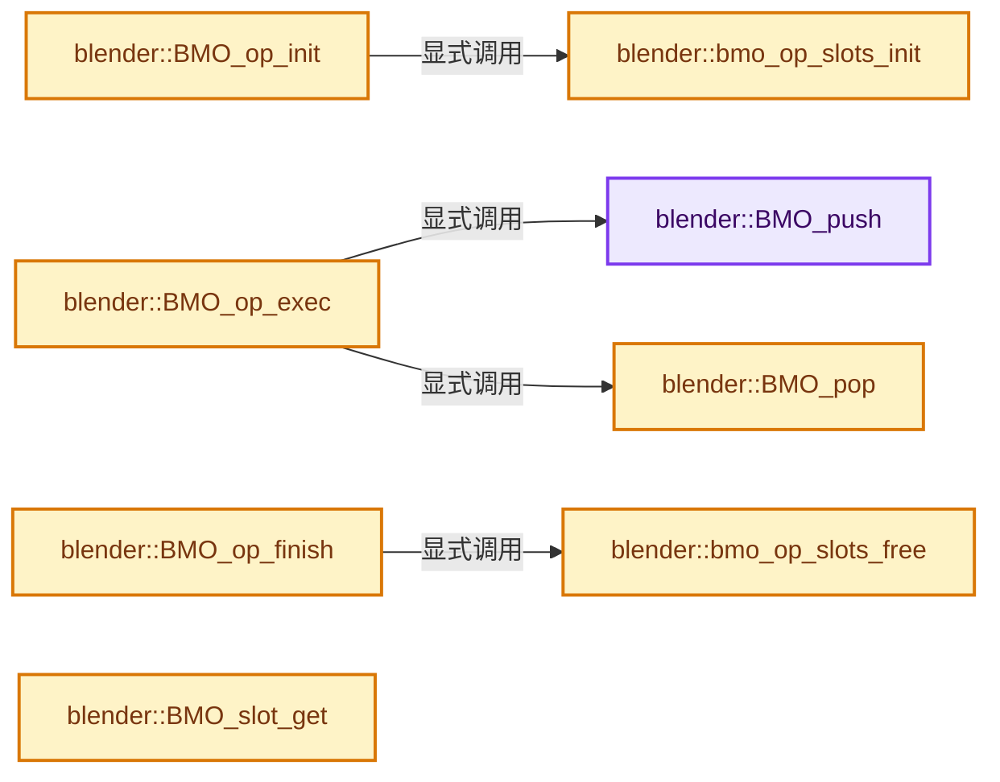

# 实现依赖专题：source/blender/bmesh/intern/bmesh_operators.cc

[方向导航](README.md) · [符号索引](../%E7%AC%A6%E5%8F%B7%E4%BE%9D%E8%B5%96%E4%B8%8E%E5%AE%9E%E7%8E%B0%E7%B4%A2%E5%BC%95.md)

本专题从正文实际调用进入，集中保存共享实现。函数有稳定锚点，可从调用处直接跳到对应完整函数；递归与互相调用通过回链组织。

## 本文件的实现关系




<a id="m-80dc2fe0ccbe"></a>

## 宏 `NEXT_CHAR`

<!-- annotated:bdd5a6650a1523 -->

```cpp
#define NEXT_CHAR(fmt) ((fmt)[0] != 0 ? (fmt)[1] : 0)

```

<details>
<summary>核对原始源码：source/blender/bmesh/intern/bmesh_operators.cc · L1563—L1564</summary>

<!-- original:bdd5a6650a1523:source/blender/bmesh/intern/bmesh_operators.cc:1563:1564 -->

```cpp
#define NEXT_CHAR(fmt) ((fmt)[0] != 0 ? (fmt)[1] : 0)

```

</details>

宏在预处理阶段展开，参数替换、重复求值和条件编译应直接从该定义检查。与普通函数不同，宏不会自动提供参数类型检查；构建配置选择哪个定义需结合外围条件。

## 完整成员与函数实现

<a id="f-5d13d9c531e76298"></a>

### `blender::BMO_push`

实现位置：[source/blender/bmesh/intern/bmesh_operators.cc](../../../../../source/blender/bmesh/intern/bmesh_operators.cc) · L62—L75。

接口参数：

- `BMesh *bm`
- `BMOperator *`

**教学注释版**

<!-- annotated:b4723b26e5007f -->

```cpp
void BMO_push(BMesh *bm, BMOperator * /*op*/)
{
  bm->toolflag_index++;

  BLI_assert(bm->totflags > 0);

  /* add flag layer, if appropriate */
  if (bm->toolflag_index > 0) {
    bmo_flag_layer_alloc(bm);
  }
  else {
    bmo_flag_layer_clear(bm);
  }
}
```

<details>
<summary>核对原始源码：source/blender/bmesh/intern/bmesh_operators.cc · L62—L75</summary>

<!-- original:b4723b26e5007f:source/blender/bmesh/intern/bmesh_operators.cc:62:75 -->

```cpp
void BMO_push(BMesh *bm, BMOperator * /*op*/)
{
  bm->toolflag_index++;

  BLI_assert(bm->totflags > 0);

  /* add flag layer, if appropriate */
  if (bm->toolflag_index > 0) {
    bmo_flag_layer_alloc(bm);
  }
  else {
    bmo_flag_layer_clear(bm);
  }
}
```

</details>

**继续追踪实现**

- `BLI_assert` → [BLI_assert · L48](../01-%E5%9F%BA%E7%A1%80%E5%AE%B9%E5%99%A8%E4%B8%8E%E7%8E%B0%E4%BB%A3CPP/%E4%BE%9D%E8%B5%96-BLI_assert-cc98e8.md#m-57a88495704d)；[BLI_assert · L63](../01-%E5%9F%BA%E7%A1%80%E5%AE%B9%E5%99%A8%E4%B8%8E%E7%8E%B0%E4%BB%A3CPP/%E4%BE%9D%E8%B5%96-BLI_assert-cc98e8.md#m-d07050020cb5)。宏定义由构建条件选择。
- `bmo_flag_layer_alloc` → [blender::bmo_flag_layer_alloc · L1196](%E4%BE%9D%E8%B5%96-bmesh_operators-ef2e74.md#f-445dd6b59aa50c4b)。
- `bmo_flag_layer_clear` → [blender::bmo_flag_layer_clear · L1318](%E4%BE%9D%E8%B5%96-bmesh_operators-ef2e74.md#f-fc1141d6b82c747e)。

<a id="f-d80f7e85d98669a9"></a>

### `blender::BMO_pop`

实现位置：[source/blender/bmesh/intern/bmesh_operators.cc](../../../../../source/blender/bmesh/intern/bmesh_operators.cc) · L77—L84。

接口参数：

- `BMesh *bm`

**教学注释版**

<!-- annotated:fb1af096457eb8 -->

```cpp
void BMO_pop(BMesh *bm)
{
  if (bm->toolflag_index > 0) {
    bmo_flag_layer_free(bm);
  }

  bm->toolflag_index--;
}
```

<details>
<summary>核对原始源码：source/blender/bmesh/intern/bmesh_operators.cc · L77—L84</summary>

<!-- original:fb1af096457eb8:source/blender/bmesh/intern/bmesh_operators.cc:77:84 -->

```cpp
void BMO_pop(BMesh *bm)
{
  if (bm->toolflag_index > 0) {
    bmo_flag_layer_free(bm);
  }

  bm->toolflag_index--;
}
```

</details>

**继续追踪实现**

- `bmo_flag_layer_free` → [blender::bmo_flag_layer_free · L1258](%E4%BE%9D%E8%B5%96-bmesh_operators-ef2e74.md#f-88bacbf02799e4c9)。

<a id="f-7e3e1f686fd11d3a"></a>

### `blender::bmo_op_slots_init`

实现位置：[source/blender/bmesh/intern/bmesh_operators.cc](../../../../../source/blender/bmesh/intern/bmesh_operators.cc) · L87—L115。

接口参数：

- `const BMOSlotType *slot_types`
- `BMOpSlot *slot_args`

**教学注释版**

<!-- annotated:098c5494c8ca16 -->

```cpp
static void bmo_op_slots_init(const BMOSlotType *slot_types, BMOpSlot *slot_args)
{
  BMOpSlot *slot;
  uint i;
  for (i = 0; slot_types[i].type; i++) {
    slot = &slot_args[i];
    slot->slot_name = slot_types[i].name;
    slot->slot_type = slot_types[i].type;
    slot->slot_subtype = slot_types[i].subtype;
    // slot->index = i;  // UNUSED

    switch (slot->slot_type) {
      case BMO_OP_SLOT_MAPPING:
        slot->data.ghash = BLI_ghash_ptr_new("bmesh slot map hash");
        break;
      case BMO_OP_SLOT_INT:
        if (ELEM(slot->slot_subtype.intg,
                 BMO_OP_SLOT_SUBTYPE_INT_ENUM,
                 BMO_OP_SLOT_SUBTYPE_INT_FLAG))
        {
          slot->data.enum_data.flags = slot_types[i].enum_flags;
          /* Set the first value of the enum as the default value. */
          slot->data.i = slot->data.enum_data.flags[0].value;
        }
      default:
        break;
    }
  }
}
```

<details>
<summary>核对原始源码：source/blender/bmesh/intern/bmesh_operators.cc · L87—L115</summary>

<!-- original:098c5494c8ca16:source/blender/bmesh/intern/bmesh_operators.cc:87:115 -->

```cpp
static void bmo_op_slots_init(const BMOSlotType *slot_types, BMOpSlot *slot_args)
{
  BMOpSlot *slot;
  uint i;
  for (i = 0; slot_types[i].type; i++) {
    slot = &slot_args[i];
    slot->slot_name = slot_types[i].name;
    slot->slot_type = slot_types[i].type;
    slot->slot_subtype = slot_types[i].subtype;
    // slot->index = i;  // UNUSED

    switch (slot->slot_type) {
      case BMO_OP_SLOT_MAPPING:
        slot->data.ghash = BLI_ghash_ptr_new("bmesh slot map hash");
        break;
      case BMO_OP_SLOT_INT:
        if (ELEM(slot->slot_subtype.intg,
                 BMO_OP_SLOT_SUBTYPE_INT_ENUM,
                 BMO_OP_SLOT_SUBTYPE_INT_FLAG))
        {
          slot->data.enum_data.flags = slot_types[i].enum_flags;
          /* Set the first value of the enum as the default value. */
          slot->data.i = slot->data.enum_data.flags[0].value;
        }
      default:
        break;
    }
  }
}
```

</details>

**沿实际写入检查状态**

- `slot = &slot_args[i];`
- `slot->slot_name = slot_types[i].name;`
- `slot->slot_type = slot_types[i].type;`
- `slot->slot_subtype = slot_types[i].subtype;`
- `slot->data.ghash = BLI_ghash_ptr_new("bmesh slot map hash");`
- `slot->data.enum_data.flags = slot_types[i].enum_flags;`
- `slot->data.i = slot->data.enum_data.flags[0].value;`

**继续追踪实现**

- `BLI_ghash_ptr_new` → [blender::BLI_ghash_ptr_new · L195](../02-%E5%93%88%E5%B8%8C%E8%A1%A8%E4%B8%8E%E5%85%B3%E8%81%94%E6%95%B0%E6%8D%AE%E7%BB%93%E6%9E%84/%E4%BE%9D%E8%B5%96-BLI_ghash_utils-cd85d4.md#f-3f62c3ad44129174)。
- `ELEM` → [ELEM · L88](%E4%BE%9D%E8%B5%96-GHOST_utildefines-34b996.md#m-d28724a15928)；[ELEM · L135](../01-%E5%9F%BA%E7%A1%80%E5%AE%B9%E5%99%A8%E4%B8%8E%E7%8E%B0%E4%BB%A3CPP/%E4%BE%9D%E8%B5%96-BLI_utildefines-293a0a.md#m-d6572de7cae0)。宏定义由构建条件选择。

<a id="f-29c54fd3d4674875"></a>

### `blender::bmo_op_slots_free`

实现位置：[source/blender/bmesh/intern/bmesh_operators.cc](../../../../../source/blender/bmesh/intern/bmesh_operators.cc) · L117—L131。

接口参数：

- `const BMOSlotType *slot_types`
- `BMOpSlot *slot_args`

**教学注释版**

<!-- annotated:2bf5bcee168318 -->

```cpp
static void bmo_op_slots_free(const BMOSlotType *slot_types, BMOpSlot *slot_args)
{
  BMOpSlot *slot;
  uint i;
  for (i = 0; slot_types[i].type; i++) {
    slot = &slot_args[i];
    switch (slot->slot_type) {
      case BMO_OP_SLOT_MAPPING:
        BLI_ghash_free(slot->data.ghash, nullptr, nullptr);
        break;
      default:
        break;
    }
  }
}
```

<details>
<summary>核对原始源码：source/blender/bmesh/intern/bmesh_operators.cc · L117—L131</summary>

<!-- original:2bf5bcee168318:source/blender/bmesh/intern/bmesh_operators.cc:117:131 -->

```cpp
static void bmo_op_slots_free(const BMOSlotType *slot_types, BMOpSlot *slot_args)
{
  BMOpSlot *slot;
  uint i;
  for (i = 0; slot_types[i].type; i++) {
    slot = &slot_args[i];
    switch (slot->slot_type) {
      case BMO_OP_SLOT_MAPPING:
        BLI_ghash_free(slot->data.ghash, nullptr, nullptr);
        break;
      default:
        break;
    }
  }
}
```

</details>

**沿实际写入检查状态**

- `slot = &slot_args[i];`

**继续追踪实现**

- `BLI_ghash_free` → [blender::BLI_ghash_free · L866](../02-%E5%93%88%E5%B8%8C%E8%A1%A8%E4%B8%8E%E5%85%B3%E8%81%94%E6%95%B0%E6%8D%AE%E7%BB%93%E6%9E%84/%E4%BE%9D%E8%B5%96-BLI_ghash-ceaea0.md#f-ab6fda2cc049587d)。

<a id="f-df04d9e344c77a6e"></a>

### `blender::BMO_op_init`

实现位置：[source/blender/bmesh/intern/bmesh_operators.cc](../../../../../source/blender/bmesh/intern/bmesh_operators.cc) · L133—L166。

接口参数：

- `BMesh *bm`
- `BMOperator *op`
- `const int flag`
- `const char *opname`

**教学注释版**

<!-- annotated:ac950860884af0 -->

```cpp
void BMO_op_init(BMesh *bm, BMOperator *op, const int flag, const char *opname)
{
  int opcode = BMO_opcode_from_opname(opname);

#ifndef NDEBUG
  BM_ELEM_INDEX_VALIDATE(bm, "pre bmo", opname);
#else
  (void)bm;
#endif

  if (opcode == -1) {
    opcode = 0; /* error!, already printed, have a better way to handle this? */
  }

  // [讲解] memset：填充字节，不调用T构造函数，也不保证任意类型的全零表示是合法或期望值。
  memset(op, 0, sizeof(BMOperator));
  op->type = opcode;
  op->type_flag = bmo_opdefines[opcode]->type_flag;
  op->flag = flag;

  /* initialize the operator slot types */
  bmo_op_slots_init(bmo_opdefines[opcode]->slot_types_in, op->slots_in);
  bmo_op_slots_init(bmo_opdefines[opcode]->slot_types_out, op->slots_out);

  /* callback */
  op->exec = bmo_opdefines[opcode]->exec;

  /* memarena, used for operator's slot buffers */
  op->arena = BLI_memarena_new(BLI_MEMARENA_STD_BUFSIZE, __func__);
  BLI_memarena_use_calloc(op->arena);

  if (bmo_opdefines[opcode]->init) {
    bmo_opdefines[opcode]->init(op);
  }
}
```

<details>
<summary>核对原始源码：source/blender/bmesh/intern/bmesh_operators.cc · L133—L166</summary>

<!-- original:ac950860884af0:source/blender/bmesh/intern/bmesh_operators.cc:133:166 -->

```cpp
void BMO_op_init(BMesh *bm, BMOperator *op, const int flag, const char *opname)
{
  int opcode = BMO_opcode_from_opname(opname);

#ifndef NDEBUG
  BM_ELEM_INDEX_VALIDATE(bm, "pre bmo", opname);
#else
  (void)bm;
#endif

  if (opcode == -1) {
    opcode = 0; /* error!, already printed, have a better way to handle this? */
  }

  memset(op, 0, sizeof(BMOperator));
  op->type = opcode;
  op->type_flag = bmo_opdefines[opcode]->type_flag;
  op->flag = flag;

  /* initialize the operator slot types */
  bmo_op_slots_init(bmo_opdefines[opcode]->slot_types_in, op->slots_in);
  bmo_op_slots_init(bmo_opdefines[opcode]->slot_types_out, op->slots_out);

  /* callback */
  op->exec = bmo_opdefines[opcode]->exec;

  /* memarena, used for operator's slot buffers */
  op->arena = BLI_memarena_new(BLI_MEMARENA_STD_BUFSIZE, __func__);
  BLI_memarena_use_calloc(op->arena);

  if (bmo_opdefines[opcode]->init) {
    bmo_opdefines[opcode]->init(op);
  }
}
```

</details>

**沿实际写入检查状态**

- `opcode = 0; /* error!, already printed, have a better way to handle this? */`
- `op->type = opcode;`
- `op->type_flag = bmo_opdefines[opcode]->type_flag;`
- `op->flag = flag;`
- `op->exec = bmo_opdefines[opcode]->exec;`
- `op->arena = BLI_memarena_new(BLI_MEMARENA_STD_BUFSIZE, __func__);`

**继续追踪实现**

- `BMO_opcode_from_opname` → [blender::BMO_opcode_from_opname · L1594](%E4%BE%9D%E8%B5%96-bmesh_operators-ef2e74.md#f-4e87b8e2344a0915)。
- `BM_ELEM_INDEX_VALIDATE` → [BM_ELEM_INDEX_VALIDATE · L72](%E4%BE%9D%E8%B5%96-bmesh_error-8056e3.md#m-fee7b758515b)。宏定义由构建条件选择。
- `memset` → [外部契约](https://eel.is/c++draft/cstring.syn)：填充字节，不调用T构造函数，也不保证任意类型的全零表示是合法或期望值。
- `bmo_op_slots_init` → [blender::bmo_op_slots_init · L87](%E4%BE%9D%E8%B5%96-bmesh_operators-ef2e74.md#f-7e3e1f686fd11d3a)。
- `BLI_memarena_new` → [blender::BLI_memarena_new · L73](../01-%E5%9F%BA%E7%A1%80%E5%AE%B9%E5%99%A8%E4%B8%8E%E7%8E%B0%E4%BB%A3CPP/%E4%BE%9D%E8%B5%96-BLI_memarena-aea32a.md#f-590ef4f6ab548c98)。
- `BLI_memarena_use_calloc` → [blender::BLI_memarena_use_calloc · L85](../01-%E5%9F%BA%E7%A1%80%E5%AE%B9%E5%99%A8%E4%B8%8E%E7%8E%B0%E4%BB%A3CPP/%E4%BE%9D%E8%B5%96-BLI_memarena-aea32a.md#f-5fefcfa991d74f3f)。
- `bmo_opdefines[opcode]->init` → [调用协议](../%E6%A8%A1%E6%9D%BF%E5%AE%8F%E4%B8%8E%E5%8A%A8%E6%80%81%E5%88%86%E6%B4%BE%E5%8D%8F%E8%AE%AE.md)：接收对象类型依赖auto、返回值或模板实例；不按同名猜测目标。调用位置L164。

<a id="f-ee792a4c12a5fa82"></a>

### `blender::BMO_op_exec`

实现位置：[source/blender/bmesh/intern/bmesh_operators.cc](../../../../../source/blender/bmesh/intern/bmesh_operators.cc) · L168—L185。

接口参数：

- `BMesh *bm`
- `BMOperator *op`

**教学注释版**

<!-- annotated:33d2ec6384dc63 -->

```cpp
void BMO_op_exec(BMesh *bm, BMOperator *op)
{
  /* allocate tool flags on demand */
  BM_mesh_elem_toolflags_ensure(bm);

  BMO_push(bm, op);

  if (bm->toolflag_index == 1) {
    bmesh_edit_begin(bm, op->type_flag);
  }
  op->exec(bm, op);

  if (bm->toolflag_index == 1) {
    bmesh_edit_end(bm, op->type_flag);
  }

  BMO_pop(bm);
}
```

<details>
<summary>核对原始源码：source/blender/bmesh/intern/bmesh_operators.cc · L168—L185</summary>

<!-- original:33d2ec6384dc63:source/blender/bmesh/intern/bmesh_operators.cc:168:185 -->

```cpp
void BMO_op_exec(BMesh *bm, BMOperator *op)
{
  /* allocate tool flags on demand */
  BM_mesh_elem_toolflags_ensure(bm);

  BMO_push(bm, op);

  if (bm->toolflag_index == 1) {
    bmesh_edit_begin(bm, op->type_flag);
  }
  op->exec(bm, op);

  if (bm->toolflag_index == 1) {
    bmesh_edit_end(bm, op->type_flag);
  }

  BMO_pop(bm);
}
```

</details>

**继续追踪实现**

- `BM_mesh_elem_toolflags_ensure` → [blender::BM_mesh_elem_toolflags_ensure · L78](%E4%BE%9D%E8%B5%96-bmesh_mesh-283e2d.md#f-fa1651f520d88161)。
- `BMO_push` → [blender::BMO_push · L62](%E4%BE%9D%E8%B5%96-bmesh_operators-ef2e74.md#f-5d13d9c531e76298)。
- `bmesh_edit_begin` → [blender::bmesh_edit_begin · L278](%E4%BE%9D%E8%B5%96-bmesh_mesh-283e2d.md#f-9037d3aa8785b91c)。
- `op->exec` → [blender::exec · L18](../09-LazyFunction%E4%B8%8E%E8%8A%82%E7%82%B9%E6%89%A7%E8%A1%8C%E6%9E%B6%E6%9E%84/%E4%BE%9D%E8%B5%96-node_texture_viewer-94e883.md#f-0a4f7b633fa4c9a2)；[blender::exec · L55](../09-LazyFunction%E4%B8%8E%E8%8A%82%E7%82%B9%E6%89%A7%E8%A1%8C%E6%9E%B6%E6%9E%84/%E4%BE%9D%E8%B5%96-node_texture_valToNor-bf2019.md#f-f25f8661a9a26142)；[blender::exec · L38](../09-LazyFunction%E4%B8%8E%E8%8A%82%E7%82%B9%E6%89%A7%E8%A1%8C%E6%9E%B6%E6%9E%84/%E4%BE%9D%E8%B5%96-node_texture_translate-81b3d2.md#f-3f14f5115102d93c)；[blender::exec · L66](../09-LazyFunction%E4%B8%8E%E8%8A%82%E7%82%B9%E6%89%A7%E8%A1%8C%E6%9E%B6%E6%9E%84/%E4%BE%9D%E8%B5%96-node_texture_texture-50a6bf.md#f-08cf32c3f8b94397)；[blender::exec · L81](../09-LazyFunction%E4%B8%8E%E8%8A%82%E7%82%B9%E6%89%A7%E8%A1%8C%E6%9E%B6%E6%9E%84/%E4%BE%9D%E8%B5%96-node_texture_separate_color-ac4f58.md#f-a2ba67cb7d826650)；[blender::exec · L41](../09-LazyFunction%E4%B8%8E%E8%8A%82%E7%82%B9%E6%89%A7%E8%A1%8C%E6%9E%B6%E6%9E%84/%E4%BE%9D%E8%B5%96-node_texture_scale-c1ee05.md#f-1e6fa9571ea3c28c)；[blender::exec · L66](../09-LazyFunction%E4%B8%8E%E8%8A%82%E7%82%B9%E6%89%A7%E8%A1%8C%E6%9E%B6%E6%9E%84/%E4%BE%9D%E8%B5%96-node_texture_rotate-aaac02.md#f-401a0a2e049dc886)；[blender::exec · L25](../09-LazyFunction%E4%B8%8E%E8%8A%82%E7%82%B9%E6%89%A7%E8%A1%8C%E6%9E%B6%E6%9E%84/%E4%BE%9D%E8%B5%96-node_texture_output-72ffb1.md#f-3fe17be3f6c19ca5)；[blender::exec · L49](../09-LazyFunction%E4%B8%8E%E8%8A%82%E7%82%B9%E6%89%A7%E8%A1%8C%E6%9E%B6%E6%9E%84/%E4%BE%9D%E8%B5%96-node_texture_mixRgb-0b13f4.md#f-aacd6f6d5004fb6a)；[blender::exec · L377](../09-LazyFunction%E4%B8%8E%E8%8A%82%E7%82%B9%E6%89%A7%E8%A1%8C%E6%9E%B6%E6%9E%84/%E4%BE%9D%E8%B5%96-node_texture_math-b73f97.md#f-0efae845cef4d6b7)；[blender::exec · L39](../09-LazyFunction%E4%B8%8E%E8%8A%82%E7%82%B9%E6%89%A7%E8%A1%8C%E6%9E%B6%E6%9E%84/%E4%BE%9D%E8%B5%96-node_texture_invert-c82131.md#f-8120149fe8306791)；[blender::exec · L82](../09-LazyFunction%E4%B8%8E%E8%8A%82%E7%82%B9%E6%89%A7%E8%A1%8C%E6%9E%B6%E6%9E%84/%E4%BE%9D%E8%B5%96-node_texture_image-1f2158.md#f-f026e73ac7424c6d)；[blender::exec · L84](../09-LazyFunction%E4%B8%8E%E8%8A%82%E7%82%B9%E6%89%A7%E8%A1%8C%E6%9E%B6%E6%9E%84/%E4%BE%9D%E8%B5%96-node_texture_hueSatVal-b95607.md#f-75c5822f425a93fc)；[blender::exec · L35](../09-LazyFunction%E4%B8%8E%E8%8A%82%E7%82%B9%E6%89%A7%E8%A1%8C%E6%9E%B6%E6%9E%84/%E4%BE%9D%E8%B5%96-node_texture_distance-80e161.md#f-3b85409dc042e863)；[blender::exec · L25](../09-LazyFunction%E4%B8%8E%E8%8A%82%E7%82%B9%E6%89%A7%E8%A1%8C%E6%9E%B6%E6%9E%84/%E4%BE%9D%E8%B5%96-node_texture_coord-c67a70.md#f-26d14b25ea6174b3)；[blender::exec · L59](../09-LazyFunction%E4%B8%8E%E8%8A%82%E7%82%B9%E6%89%A7%E8%A1%8C%E6%9E%B6%E6%9E%84/%E4%BE%9D%E8%B5%96-node_texture_combine_color-871e59.md#f-82d3a0f0f261a73d)；[blender::exec · L45](../09-LazyFunction%E4%B8%8E%E8%8A%82%E7%82%B9%E6%89%A7%E8%A1%8C%E6%9E%B6%E6%9E%84/%E4%BE%9D%E8%B5%96-node_texture_checker-aa8f0d.md#f-30cef2d5216b6059)；[blender::exec · L98](../09-LazyFunction%E4%B8%8E%E8%8A%82%E7%82%B9%E6%89%A7%E8%A1%8C%E6%9E%B6%E6%9E%84/%E4%BE%9D%E8%B5%96-node_texture_bricks-53f1ab.md#f-5d60acabdb1a6a20)；[blender::exec · L33](../09-LazyFunction%E4%B8%8E%E8%8A%82%E7%82%B9%E6%89%A7%E8%A1%8C%E6%9E%B6%E6%9E%84/%E4%BE%9D%E8%B5%96-node_texture_at-4eef79.md#f-a1f97438d0d8238f)。同名重载需按实参类型选择。
- `bmesh_edit_end` → [blender::bmesh_edit_end · L298](%E4%BE%9D%E8%B5%96-bmesh_mesh-283e2d.md#f-cdb6571e24c7db6a)。
- `BMO_pop` → [blender::BMO_pop · L77](%E4%BE%9D%E8%B5%96-bmesh_operators-ef2e74.md#f-d80f7e85d98669a9)。

<a id="f-46b0ea2e3bf3ab00"></a>

### `blender::BMO_op_finish`

实现位置：[source/blender/bmesh/intern/bmesh_operators.cc](../../../../../source/blender/bmesh/intern/bmesh_operators.cc) · L187—L202。

接口参数：

- `BMesh *bm`
- `BMOperator *op`

**教学注释版**

<!-- annotated:87f65061c79def -->

```cpp
void BMO_op_finish(BMesh *bm, BMOperator *op)
{
  bmo_op_slots_free(bmo_opdefines[op->type]->slot_types_in, op->slots_in);
  bmo_op_slots_free(bmo_opdefines[op->type]->slot_types_out, op->slots_out);

  BLI_memarena_free(op->arena);

#ifndef NDEBUG
  BM_ELEM_INDEX_VALIDATE(bm, "post bmo", bmo_opdefines[op->type]->opname);

  /* avoid accidental re-use */
  // [讲解] memset：填充字节，不调用T构造函数，也不保证任意类型的全零表示是合法或期望值。
  memset(op, 0xff, sizeof(*op));
#else
  (void)bm;
#endif
}
```

<details>
<summary>核对原始源码：source/blender/bmesh/intern/bmesh_operators.cc · L187—L202</summary>

<!-- original:87f65061c79def:source/blender/bmesh/intern/bmesh_operators.cc:187:202 -->

```cpp
void BMO_op_finish(BMesh *bm, BMOperator *op)
{
  bmo_op_slots_free(bmo_opdefines[op->type]->slot_types_in, op->slots_in);
  bmo_op_slots_free(bmo_opdefines[op->type]->slot_types_out, op->slots_out);

  BLI_memarena_free(op->arena);

#ifndef NDEBUG
  BM_ELEM_INDEX_VALIDATE(bm, "post bmo", bmo_opdefines[op->type]->opname);

  /* avoid accidental re-use */
  memset(op, 0xff, sizeof(*op));
#else
  (void)bm;
#endif
}
```

</details>

**继续追踪实现**

- `bmo_op_slots_free` → [blender::bmo_op_slots_free · L117](%E4%BE%9D%E8%B5%96-bmesh_operators-ef2e74.md#f-29c54fd3d4674875)。
- `BLI_memarena_free` → [blender::BLI_memarena_free · L103](../01-%E5%9F%BA%E7%A1%80%E5%AE%B9%E5%99%A8%E4%B8%8E%E7%8E%B0%E4%BB%A3CPP/%E4%BE%9D%E8%B5%96-BLI_memarena-aea32a.md#f-a655794ad41d1bdf)。
- `BM_ELEM_INDEX_VALIDATE` → [BM_ELEM_INDEX_VALIDATE · L72](%E4%BE%9D%E8%B5%96-bmesh_error-8056e3.md#m-fee7b758515b)。宏定义由构建条件选择。
- `memset` → [外部契约](https://eel.is/c++draft/cstring.syn)：填充字节，不调用T构造函数，也不保证任意类型的全零表示是合法或期望值。

<a id="f-d6270d9fda730ef7"></a>

### `blender::BMO_slot_get`

实现位置：[source/blender/bmesh/intern/bmesh_operators.cc](../../../../../source/blender/bmesh/intern/bmesh_operators.cc) · L210—L221。

接口参数：

- `BMOpSlot slot_args[BMO_OP_MAX_SLOTS]`
- `const char *identifier`

**教学注释版**

<!-- annotated:81db220f47d9d5 -->

```cpp
BMOpSlot *BMO_slot_get(BMOpSlot slot_args[BMO_OP_MAX_SLOTS], const char *identifier)
{
  int slot_code = bmo_name_to_slotcode_check(slot_args, identifier);

  if (slot_code < 0) [[unlikely]] {
    // return &BMOpEmptySlot;
    BLI_assert(0);
    return nullptr; /* better crash */
  }

  return &slot_args[slot_code];
}
```

<details>
<summary>核对原始源码：source/blender/bmesh/intern/bmesh_operators.cc · L210—L221</summary>

<!-- original:81db220f47d9d5:source/blender/bmesh/intern/bmesh_operators.cc:210:221 -->

```cpp
BMOpSlot *BMO_slot_get(BMOpSlot slot_args[BMO_OP_MAX_SLOTS], const char *identifier)
{
  int slot_code = bmo_name_to_slotcode_check(slot_args, identifier);

  if (slot_code < 0) [[unlikely]] {
    // return &BMOpEmptySlot;
    BLI_assert(0);
    return nullptr; /* better crash */
  }

  return &slot_args[slot_code];
}
```

</details>

**结果出口**

- `return nullptr; /* better crash */`
- `return &slot_args[slot_code];`

**继续追踪实现**

- `bmo_name_to_slotcode_check` → [blender::bmo_name_to_slotcode_check · L1580](%E4%BE%9D%E8%B5%96-bmesh_operators-ef2e74.md#f-851a383eb86cfa47)。
- `BLI_assert` → [BLI_assert · L48](../01-%E5%9F%BA%E7%A1%80%E5%AE%B9%E5%99%A8%E4%B8%8E%E7%8E%B0%E4%BB%A3CPP/%E4%BE%9D%E8%B5%96-BLI_assert-cc98e8.md#m-57a88495704d)；[BLI_assert · L63](../01-%E5%9F%BA%E7%A1%80%E5%AE%B9%E5%99%A8%E4%B8%8E%E7%8E%B0%E4%BB%A3CPP/%E4%BE%9D%E8%B5%96-BLI_assert-cc98e8.md#m-d07050020cb5)。宏定义由构建条件选择。

<a id="f-34268ad3956b185c"></a>

### `blender::BMO_slot_float_set`

实现位置：[source/blender/bmesh/intern/bmesh_operators.cc](../../../../../source/blender/bmesh/intern/bmesh_operators.cc) · L312—L321。

接口参数：

- `BMOpSlot slot_args[BMO_OP_MAX_SLOTS]`
- `const char *slot_name`
- `const float f`

**教学注释版**

<!-- annotated:18fd134ace62bc -->

```cpp
void BMO_slot_float_set(BMOpSlot slot_args[BMO_OP_MAX_SLOTS], const char *slot_name, const float f)
{
  BMOpSlot *slot = BMO_slot_get(slot_args, slot_name);
  BLI_assert(slot->slot_type == BMO_OP_SLOT_FLT);
  if (!(slot->slot_type == BMO_OP_SLOT_FLT)) {
    return;
  }

  slot->data.f = f;
}
```

<details>
<summary>核对原始源码：source/blender/bmesh/intern/bmesh_operators.cc · L312—L321</summary>

<!-- original:18fd134ace62bc:source/blender/bmesh/intern/bmesh_operators.cc:312:321 -->

```cpp
void BMO_slot_float_set(BMOpSlot slot_args[BMO_OP_MAX_SLOTS], const char *slot_name, const float f)
{
  BMOpSlot *slot = BMO_slot_get(slot_args, slot_name);
  BLI_assert(slot->slot_type == BMO_OP_SLOT_FLT);
  if (!(slot->slot_type == BMO_OP_SLOT_FLT)) {
    return;
  }

  slot->data.f = f;
}
```

</details>

**沿实际写入检查状态**

- `slot->data.f = f;`

**继续追踪实现**

- `BMO_slot_get` → [blender::BMO_slot_get · L210](%E4%BE%9D%E8%B5%96-bmesh_operators-ef2e74.md#f-d6270d9fda730ef7)。
- `BLI_assert` → [BLI_assert · L48](../01-%E5%9F%BA%E7%A1%80%E5%AE%B9%E5%99%A8%E4%B8%8E%E7%8E%B0%E4%BB%A3CPP/%E4%BE%9D%E8%B5%96-BLI_assert-cc98e8.md#m-57a88495704d)；[BLI_assert · L63](../01-%E5%9F%BA%E7%A1%80%E5%AE%B9%E5%99%A8%E4%B8%8E%E7%8E%B0%E4%BB%A3CPP/%E4%BE%9D%E8%B5%96-BLI_assert-cc98e8.md#m-d07050020cb5)。宏定义由构建条件选择。

<a id="f-8dbd44e129a71625"></a>

### `blender::BMO_slot_int_set`

实现位置：[source/blender/bmesh/intern/bmesh_operators.cc](../../../../../source/blender/bmesh/intern/bmesh_operators.cc) · L323—L332。

接口参数：

- `BMOpSlot slot_args[BMO_OP_MAX_SLOTS]`
- `const char *slot_name`
- `const int i`

**教学注释版**

<!-- annotated:c18f6df9f42dc7 -->

```cpp
void BMO_slot_int_set(BMOpSlot slot_args[BMO_OP_MAX_SLOTS], const char *slot_name, const int i)
{
  BMOpSlot *slot = BMO_slot_get(slot_args, slot_name);
  BLI_assert(slot->slot_type == BMO_OP_SLOT_INT);
  if (!(slot->slot_type == BMO_OP_SLOT_INT)) {
    return;
  }

  slot->data.i = i;
}
```

<details>
<summary>核对原始源码：source/blender/bmesh/intern/bmesh_operators.cc · L323—L332</summary>

<!-- original:c18f6df9f42dc7:source/blender/bmesh/intern/bmesh_operators.cc:323:332 -->

```cpp
void BMO_slot_int_set(BMOpSlot slot_args[BMO_OP_MAX_SLOTS], const char *slot_name, const int i)
{
  BMOpSlot *slot = BMO_slot_get(slot_args, slot_name);
  BLI_assert(slot->slot_type == BMO_OP_SLOT_INT);
  if (!(slot->slot_type == BMO_OP_SLOT_INT)) {
    return;
  }

  slot->data.i = i;
}
```

</details>

**沿实际写入检查状态**

- `slot->data.i = i;`

**继续追踪实现**

- `BMO_slot_get` → [blender::BMO_slot_get · L210](%E4%BE%9D%E8%B5%96-bmesh_operators-ef2e74.md#f-d6270d9fda730ef7)。
- `BLI_assert` → [BLI_assert · L48](../01-%E5%9F%BA%E7%A1%80%E5%AE%B9%E5%99%A8%E4%B8%8E%E7%8E%B0%E4%BB%A3CPP/%E4%BE%9D%E8%B5%96-BLI_assert-cc98e8.md#m-57a88495704d)；[BLI_assert · L63](../01-%E5%9F%BA%E7%A1%80%E5%AE%B9%E5%99%A8%E4%B8%8E%E7%8E%B0%E4%BB%A3CPP/%E4%BE%9D%E8%B5%96-BLI_assert-cc98e8.md#m-d07050020cb5)。宏定义由构建条件选择。

<a id="f-4594ef310c60a5f3"></a>

### `blender::BMO_slot_bool_set`

实现位置：[source/blender/bmesh/intern/bmesh_operators.cc](../../../../../source/blender/bmesh/intern/bmesh_operators.cc) · L334—L343。

接口参数：

- `BMOpSlot slot_args[BMO_OP_MAX_SLOTS]`
- `const char *slot_name`
- `const bool i`

**教学注释版**

<!-- annotated:1c800cd940c2d3 -->

```cpp
void BMO_slot_bool_set(BMOpSlot slot_args[BMO_OP_MAX_SLOTS], const char *slot_name, const bool i)
{
  BMOpSlot *slot = BMO_slot_get(slot_args, slot_name);
  BLI_assert(slot->slot_type == BMO_OP_SLOT_BOOL);
  if (!(slot->slot_type == BMO_OP_SLOT_BOOL)) {
    return;
  }

  slot->data.i = i;
}
```

<details>
<summary>核对原始源码：source/blender/bmesh/intern/bmesh_operators.cc · L334—L343</summary>

<!-- original:1c800cd940c2d3:source/blender/bmesh/intern/bmesh_operators.cc:334:343 -->

```cpp
void BMO_slot_bool_set(BMOpSlot slot_args[BMO_OP_MAX_SLOTS], const char *slot_name, const bool i)
{
  BMOpSlot *slot = BMO_slot_get(slot_args, slot_name);
  BLI_assert(slot->slot_type == BMO_OP_SLOT_BOOL);
  if (!(slot->slot_type == BMO_OP_SLOT_BOOL)) {
    return;
  }

  slot->data.i = i;
}
```

</details>

**沿实际写入检查状态**

- `slot->data.i = i;`

**继续追踪实现**

- `BMO_slot_get` → [blender::BMO_slot_get · L210](%E4%BE%9D%E8%B5%96-bmesh_operators-ef2e74.md#f-d6270d9fda730ef7)。
- `BLI_assert` → [BLI_assert · L48](../01-%E5%9F%BA%E7%A1%80%E5%AE%B9%E5%99%A8%E4%B8%8E%E7%8E%B0%E4%BB%A3CPP/%E4%BE%9D%E8%B5%96-BLI_assert-cc98e8.md#m-57a88495704d)；[BLI_assert · L63](../01-%E5%9F%BA%E7%A1%80%E5%AE%B9%E5%99%A8%E4%B8%8E%E7%8E%B0%E4%BB%A3CPP/%E4%BE%9D%E8%B5%96-BLI_assert-cc98e8.md#m-d07050020cb5)。宏定义由构建条件选择。

<a id="f-41dce16bf7f00837"></a>

### `blender::BMO_slot_mat_set`

实现位置：[source/blender/bmesh/intern/bmesh_operators.cc](../../../../../source/blender/bmesh/intern/bmesh_operators.cc) · L345—L371。

接口参数：

- `BMOperator *op`
- `BMOpSlot slot_args[BMO_OP_MAX_SLOTS]`
- `const char *slot_name`
- `const float *mat`
- `int size`

**教学注释版**

<!-- annotated:bd7942d2d06176 -->

```cpp
void BMO_slot_mat_set(BMOperator *op,
                      BMOpSlot slot_args[BMO_OP_MAX_SLOTS],
                      const char *slot_name,
                      const float *mat,
                      int size)
{
  BMOpSlot *slot = BMO_slot_get(slot_args, slot_name);
  BLI_assert(slot->slot_type == BMO_OP_SLOT_MAT);
  if (!(slot->slot_type == BMO_OP_SLOT_MAT)) {
    return;
  }

  slot->len = 4;
  slot->data.p = BLI_memarena_alloc(op->arena, sizeof(float[4][4]));

  if (size == 4) {
    copy_m4_m4(static_cast<float (*)[4]>(slot->data.p), reinterpret_cast<const float (*)[4]>(mat));
  }
  else if (size == 3) {
    copy_m4_m3(static_cast<float (*)[4]>(slot->data.p), reinterpret_cast<const float (*)[3]>(mat));
  }
  else {
    fprintf(stderr, "%s: invalid size argument %d (bmesh internal error)\n", __func__, size);

    zero_m4(static_cast<float (*)[4]>(slot->data.p));
  }
}
```

<details>
<summary>核对原始源码：source/blender/bmesh/intern/bmesh_operators.cc · L345—L371</summary>

<!-- original:bd7942d2d06176:source/blender/bmesh/intern/bmesh_operators.cc:345:371 -->

```cpp
void BMO_slot_mat_set(BMOperator *op,
                      BMOpSlot slot_args[BMO_OP_MAX_SLOTS],
                      const char *slot_name,
                      const float *mat,
                      int size)
{
  BMOpSlot *slot = BMO_slot_get(slot_args, slot_name);
  BLI_assert(slot->slot_type == BMO_OP_SLOT_MAT);
  if (!(slot->slot_type == BMO_OP_SLOT_MAT)) {
    return;
  }

  slot->len = 4;
  slot->data.p = BLI_memarena_alloc(op->arena, sizeof(float[4][4]));

  if (size == 4) {
    copy_m4_m4(static_cast<float (*)[4]>(slot->data.p), reinterpret_cast<const float (*)[4]>(mat));
  }
  else if (size == 3) {
    copy_m4_m3(static_cast<float (*)[4]>(slot->data.p), reinterpret_cast<const float (*)[3]>(mat));
  }
  else {
    fprintf(stderr, "%s: invalid size argument %d (bmesh internal error)\n", __func__, size);

    zero_m4(static_cast<float (*)[4]>(slot->data.p));
  }
}
```

</details>

**沿实际写入检查状态**

- `slot->len = 4;`
- `slot->data.p = BLI_memarena_alloc(op->arena, sizeof(float[4][4]));`

**继续追踪实现**

- `BMO_slot_get` → [blender::BMO_slot_get · L210](%E4%BE%9D%E8%B5%96-bmesh_operators-ef2e74.md#f-d6270d9fda730ef7)。
- `BLI_assert` → [BLI_assert · L48](../01-%E5%9F%BA%E7%A1%80%E5%AE%B9%E5%99%A8%E4%B8%8E%E7%8E%B0%E4%BB%A3CPP/%E4%BE%9D%E8%B5%96-BLI_assert-cc98e8.md#m-57a88495704d)；[BLI_assert · L63](../01-%E5%9F%BA%E7%A1%80%E5%AE%B9%E5%99%A8%E4%B8%8E%E7%8E%B0%E4%BB%A3CPP/%E4%BE%9D%E8%B5%96-BLI_assert-cc98e8.md#m-d07050020cb5)。宏定义由构建条件选择。
- `BLI_memarena_alloc` → [blender::BLI_memarena_alloc · L125](../01-%E5%9F%BA%E7%A1%80%E5%AE%B9%E5%99%A8%E4%B8%8E%E7%8E%B0%E4%BB%A3CPP/%E4%BE%9D%E8%B5%96-BLI_memarena-aea32a.md#f-ae79828c3629e134)；[blender::BLI_memarena_alloc · L43](../01-%E5%9F%BA%E7%A1%80%E5%AE%B9%E5%99%A8%E4%B8%8E%E7%8E%B0%E4%BB%A3CPP/%E4%BE%9D%E8%B5%96-BLI_memarena-d0ed90.md#f-3c7ccf0d8384021b)。同名重载需按实参类型选择。
- `copy_m4_m4` → [blender::copy_m4_m4 · L84](../12-%E7%A9%BA%E9%97%B4%E6%95%B0%E6%8D%AE%E7%BB%93%E6%9E%84%E4%B8%8E%E5%87%A0%E4%BD%95%E7%AE%97%E6%B3%95/%E4%BE%9D%E8%B5%96-math_matrix_c-004123.md#f-b4390cf8c94710f5)。
- `copy_m4_m3` → [blender::copy_m4_m3 · L109](../12-%E7%A9%BA%E9%97%B4%E6%95%B0%E6%8D%AE%E7%BB%93%E6%9E%84%E4%B8%8E%E5%87%A0%E4%BD%95%E7%AE%97%E6%B3%95/%E4%BE%9D%E8%B5%96-math_matrix_c-004123.md#f-6915e4040afabeb8)。
- `fprintf` → [外部契约](https://eel.is/c++draft/)：这个边界按实际表达式及所属类型核对参数、返回值、寿命与失败行为。这里提供接口入口，不声称已解释该第三方版本的内部实现。
- `zero_m4` → [blender::zero_m4 · L35](../12-%E7%A9%BA%E9%97%B4%E6%95%B0%E6%8D%AE%E7%BB%93%E6%9E%84%E4%B8%8E%E5%87%A0%E4%BD%95%E7%AE%97%E6%B3%95/%E4%BE%9D%E8%B5%96-math_matrix_c-004123.md#f-2797e7c2db22f01d)。

<a id="f-a8c8de8b2e6ff938"></a>

### `blender::BMO_slot_ptr_set`

实现位置：[source/blender/bmesh/intern/bmesh_operators.cc](../../../../../source/blender/bmesh/intern/bmesh_operators.cc) · L409—L418。

接口参数：

- `BMOpSlot slot_args[BMO_OP_MAX_SLOTS]`
- `const char *slot_name`
- `void *p`

**教学注释版**

<!-- annotated:4f4db8ab14a640 -->

```cpp
void BMO_slot_ptr_set(BMOpSlot slot_args[BMO_OP_MAX_SLOTS], const char *slot_name, void *p)
{
  BMOpSlot *slot = BMO_slot_get(slot_args, slot_name);
  BLI_assert(slot->slot_type == BMO_OP_SLOT_PTR);
  if (!(slot->slot_type == BMO_OP_SLOT_PTR)) {
    return;
  }

  slot->data.p = p;
}
```

<details>
<summary>核对原始源码：source/blender/bmesh/intern/bmesh_operators.cc · L409—L418</summary>

<!-- original:4f4db8ab14a640:source/blender/bmesh/intern/bmesh_operators.cc:409:418 -->

```cpp
void BMO_slot_ptr_set(BMOpSlot slot_args[BMO_OP_MAX_SLOTS], const char *slot_name, void *p)
{
  BMOpSlot *slot = BMO_slot_get(slot_args, slot_name);
  BLI_assert(slot->slot_type == BMO_OP_SLOT_PTR);
  if (!(slot->slot_type == BMO_OP_SLOT_PTR)) {
    return;
  }

  slot->data.p = p;
}
```

</details>

**沿实际写入检查状态**

- `slot->data.p = p;`

**继续追踪实现**

- `BMO_slot_get` → [blender::BMO_slot_get · L210](%E4%BE%9D%E8%B5%96-bmesh_operators-ef2e74.md#f-d6270d9fda730ef7)。
- `BLI_assert` → [BLI_assert · L48](../01-%E5%9F%BA%E7%A1%80%E5%AE%B9%E5%99%A8%E4%B8%8E%E7%8E%B0%E4%BB%A3CPP/%E4%BE%9D%E8%B5%96-BLI_assert-cc98e8.md#m-57a88495704d)；[BLI_assert · L63](../01-%E5%9F%BA%E7%A1%80%E5%AE%B9%E5%99%A8%E4%B8%8E%E7%8E%B0%E4%BB%A3CPP/%E4%BE%9D%E8%B5%96-BLI_assert-cc98e8.md#m-d07050020cb5)。宏定义由构建条件选择。

<a id="f-415aa7eab0810a19"></a>

### `blender::BMO_slot_vec_set`

实现位置：[source/blender/bmesh/intern/bmesh_operators.cc](../../../../../source/blender/bmesh/intern/bmesh_operators.cc) · L420—L431。

接口参数：

- `BMOpSlot slot_args[BMO_OP_MAX_SLOTS]`
- `const char *slot_name`
- `const float vec[3]`

**教学注释版**

<!-- annotated:b1a2826cb4cd16 -->

```cpp
void BMO_slot_vec_set(BMOpSlot slot_args[BMO_OP_MAX_SLOTS],
                      const char *slot_name,
                      const float vec[3])
{
  BMOpSlot *slot = BMO_slot_get(slot_args, slot_name);
  BLI_assert(slot->slot_type == BMO_OP_SLOT_VEC);
  if (!(slot->slot_type == BMO_OP_SLOT_VEC)) {
    return;
  }

  copy_v3_v3(slot->data.vec, vec);
}
```

<details>
<summary>核对原始源码：source/blender/bmesh/intern/bmesh_operators.cc · L420—L431</summary>

<!-- original:b1a2826cb4cd16:source/blender/bmesh/intern/bmesh_operators.cc:420:431 -->

```cpp
void BMO_slot_vec_set(BMOpSlot slot_args[BMO_OP_MAX_SLOTS],
                      const char *slot_name,
                      const float vec[3])
{
  BMOpSlot *slot = BMO_slot_get(slot_args, slot_name);
  BLI_assert(slot->slot_type == BMO_OP_SLOT_VEC);
  if (!(slot->slot_type == BMO_OP_SLOT_VEC)) {
    return;
  }

  copy_v3_v3(slot->data.vec, vec);
}
```

</details>

**继续追踪实现**

- `BMO_slot_get` → [blender::BMO_slot_get · L210](%E4%BE%9D%E8%B5%96-bmesh_operators-ef2e74.md#f-d6270d9fda730ef7)。
- `BLI_assert` → [BLI_assert · L48](../01-%E5%9F%BA%E7%A1%80%E5%AE%B9%E5%99%A8%E4%B8%8E%E7%8E%B0%E4%BB%A3CPP/%E4%BE%9D%E8%B5%96-BLI_assert-cc98e8.md#m-57a88495704d)；[BLI_assert · L63](../01-%E5%9F%BA%E7%A1%80%E5%AE%B9%E5%99%A8%E4%B8%8E%E7%8E%B0%E4%BB%A3CPP/%E4%BE%9D%E8%B5%96-BLI_assert-cc98e8.md#m-d07050020cb5)。宏定义由构建条件选择。
- `copy_v3_v3` → [blender::copy_v3_v3 · L47](../12-%E7%A9%BA%E9%97%B4%E6%95%B0%E6%8D%AE%E7%BB%93%E6%9E%84%E4%B8%8E%E5%87%A0%E4%BD%95%E7%AE%97%E6%B3%95/%E4%BE%9D%E8%B5%96-math_vector_inline-0c8541.md#f-037a0d5fa5060bd6)。

<a id="f-29b4004b0b88718d"></a>

### `blender::bmo_mesh_flag_count`

实现位置：[source/blender/bmesh/intern/bmesh_operators.cc](../../../../../source/blender/bmesh/intern/bmesh_operators.cc) · L509—L545。

接口参数：

- `BMesh *bm`
- `const char htype`
- `const short oflag`
- `const bool test_for_enabled`

**教学注释版**

<!-- annotated:5ab4e8f40a1bb0 -->

```cpp
static int bmo_mesh_flag_count(BMesh *bm,
                               const char htype,
                               const short oflag,
                               const bool test_for_enabled)
{
  int count_vert = 0, count_edge = 0, count_face = 0;

  if (htype & BM_VERT) {
    BMIter iter;
    BMVert *ele;
    BM_ITER_MESH (ele, &iter, bm, BM_VERTS_OF_MESH) {
      if (BMO_vert_flag_test_bool(bm, ele, oflag) == test_for_enabled) {
        count_vert++;
      }
    }
  }
  if (htype & BM_EDGE) {
    BMIter iter;
    BMEdge *ele;
    BM_ITER_MESH (ele, &iter, bm, BM_EDGES_OF_MESH) {
      if (BMO_edge_flag_test_bool(bm, ele, oflag) == test_for_enabled) {
        count_edge++;
      }
    }
  }
  if (htype & BM_FACE) {
    BMIter iter;
    BMFace *ele;
    BM_ITER_MESH (ele, &iter, bm, BM_FACES_OF_MESH) {
      if (BMO_face_flag_test_bool(bm, ele, oflag) == test_for_enabled) {
        count_face++;
      }
    }
  }

  return (count_vert + count_edge + count_face);
}
```

<details>
<summary>核对原始源码：source/blender/bmesh/intern/bmesh_operators.cc · L509—L545</summary>

<!-- original:5ab4e8f40a1bb0:source/blender/bmesh/intern/bmesh_operators.cc:509:545 -->

```cpp
static int bmo_mesh_flag_count(BMesh *bm,
                               const char htype,
                               const short oflag,
                               const bool test_for_enabled)
{
  int count_vert = 0, count_edge = 0, count_face = 0;

  if (htype & BM_VERT) {
    BMIter iter;
    BMVert *ele;
    BM_ITER_MESH (ele, &iter, bm, BM_VERTS_OF_MESH) {
      if (BMO_vert_flag_test_bool(bm, ele, oflag) == test_for_enabled) {
        count_vert++;
      }
    }
  }
  if (htype & BM_EDGE) {
    BMIter iter;
    BMEdge *ele;
    BM_ITER_MESH (ele, &iter, bm, BM_EDGES_OF_MESH) {
      if (BMO_edge_flag_test_bool(bm, ele, oflag) == test_for_enabled) {
        count_edge++;
      }
    }
  }
  if (htype & BM_FACE) {
    BMIter iter;
    BMFace *ele;
    BM_ITER_MESH (ele, &iter, bm, BM_FACES_OF_MESH) {
      if (BMO_face_flag_test_bool(bm, ele, oflag) == test_for_enabled) {
        count_face++;
      }
    }
  }

  return (count_vert + count_edge + count_face);
}
```

</details>

**结果出口**

- `return (count_vert + count_edge + count_face);`

**继续追踪实现**

- `BM_ITER_MESH` → [BM_ITER_MESH · L72](%E4%BE%9D%E8%B5%96-bmesh_iterators-13971c.md#m-cfc837c73218)。宏定义由构建条件选择。
- `BMO_vert_flag_test_bool` → [BMO_vert_flag_test_bool · L146](%E4%BE%9D%E8%B5%96-bmesh_operator_api-4be594.md#m-ac9fb06695b0)。宏定义由构建条件选择。
- `BMO_edge_flag_test_bool` → [BMO_edge_flag_test_bool · L157](%E4%BE%9D%E8%B5%96-bmesh_operator_api-4be594.md#m-f151e66f6737)。宏定义由构建条件选择。
- `BMO_face_flag_test_bool` → [BMO_face_flag_test_bool · L168](%E4%BE%9D%E8%B5%96-bmesh_operator_api-4be594.md#m-ab8737bca4d0)。宏定义由构建条件选择。

<a id="f-5dd11248e22181d4"></a>

### `blender::BMO_mesh_enabled_flag_count`

实现位置：[source/blender/bmesh/intern/bmesh_operators.cc](../../../../../source/blender/bmesh/intern/bmesh_operators.cc) · L547—L550。

接口参数：

- `BMesh *bm`
- `const char htype`
- `const short oflag`

**教学注释版**

<!-- annotated:25cf2a81ffaa26 -->

```cpp
int BMO_mesh_enabled_flag_count(BMesh *bm, const char htype, const short oflag)
{
  return bmo_mesh_flag_count(bm, htype, oflag, true);
}
```

<details>
<summary>核对原始源码：source/blender/bmesh/intern/bmesh_operators.cc · L547—L550</summary>

<!-- original:25cf2a81ffaa26:source/blender/bmesh/intern/bmesh_operators.cc:547:550 -->

```cpp
int BMO_mesh_enabled_flag_count(BMesh *bm, const char htype, const short oflag)
{
  return bmo_mesh_flag_count(bm, htype, oflag, true);
}
```

</details>

**结果出口**

- `return bmo_mesh_flag_count(bm, htype, oflag, true);`

**继续追踪实现**

- `bmo_mesh_flag_count` → [blender::bmo_mesh_flag_count · L509](%E4%BE%9D%E8%B5%96-bmesh_operators-ef2e74.md#f-29b4004b0b88718d)。

<a id="f-e866948fcb357b36"></a>

### `blender::BMO_mesh_disabled_flag_count`

实现位置：[source/blender/bmesh/intern/bmesh_operators.cc](../../../../../source/blender/bmesh/intern/bmesh_operators.cc) · L552—L555。

接口参数：

- `BMesh *bm`
- `const char htype`
- `const short oflag`

**教学注释版**

<!-- annotated:d68c9fc960d9ec -->

```cpp
int BMO_mesh_disabled_flag_count(BMesh *bm, const char htype, const short oflag)
{
  return bmo_mesh_flag_count(bm, htype, oflag, false);
}
```

<details>
<summary>核对原始源码：source/blender/bmesh/intern/bmesh_operators.cc · L552—L555</summary>

<!-- original:d68c9fc960d9ec:source/blender/bmesh/intern/bmesh_operators.cc:552:555 -->

```cpp
int BMO_mesh_disabled_flag_count(BMesh *bm, const char htype, const short oflag)
{
  return bmo_mesh_flag_count(bm, htype, oflag, false);
}
```

</details>

**结果出口**

- `return bmo_mesh_flag_count(bm, htype, oflag, false);`

**继续追踪实现**

- `bmo_mesh_flag_count` → [blender::bmo_mesh_flag_count · L509](%E4%BE%9D%E8%B5%96-bmesh_operators-ef2e74.md#f-29b4004b0b88718d)。

<a id="f-69e878c1f34ae929"></a>

### `blender::BMO_slot_map_insert`

实现位置：[source/blender/bmesh/intern/bmesh_operators.cc](../../../../../source/blender/bmesh/intern/bmesh_operators.cc) · L646—L654。

接口参数：

- `BMOperator *op`
- `BMOpSlot *slot`
- `const void *element`
- `const void *data`

**教学注释版**

<!-- annotated:38921783ac84f9 -->

```cpp
void BMO_slot_map_insert(BMOperator *op, BMOpSlot *slot, const void *element, const void *data)
{
  (void)op; /* Ignored in release builds. */

  BLI_assert(slot->slot_type == BMO_OP_SLOT_MAPPING);
  BMO_ASSERT_SLOT_IN_OP(slot, op);

  BLI_ghash_insert(slot->data.ghash, const_cast<void *>(element), const_cast<void *>(data));
}
```

<details>
<summary>核对原始源码：source/blender/bmesh/intern/bmesh_operators.cc · L646—L654</summary>

<!-- original:38921783ac84f9:source/blender/bmesh/intern/bmesh_operators.cc:646:654 -->

```cpp
void BMO_slot_map_insert(BMOperator *op, BMOpSlot *slot, const void *element, const void *data)
{
  (void)op; /* Ignored in release builds. */

  BLI_assert(slot->slot_type == BMO_OP_SLOT_MAPPING);
  BMO_ASSERT_SLOT_IN_OP(slot, op);

  BLI_ghash_insert(slot->data.ghash, const_cast<void *>(element), const_cast<void *>(data));
}
```

</details>

**继续追踪实现**

- `BLI_assert` → [BLI_assert · L48](../01-%E5%9F%BA%E7%A1%80%E5%AE%B9%E5%99%A8%E4%B8%8E%E7%8E%B0%E4%BB%A3CPP/%E4%BE%9D%E8%B5%96-BLI_assert-cc98e8.md#m-57a88495704d)；[BLI_assert · L63](../01-%E5%9F%BA%E7%A1%80%E5%AE%B9%E5%99%A8%E4%B8%8E%E7%8E%B0%E4%BB%A3CPP/%E4%BE%9D%E8%B5%96-BLI_assert-cc98e8.md#m-d07050020cb5)。宏定义由构建条件选择。
- `BMO_ASSERT_SLOT_IN_OP` → [BMO_ASSERT_SLOT_IN_OP · L284](%E4%BE%9D%E8%B5%96-bmesh_operator_api-4be594.md#m-e31186f288c4)。宏定义由构建条件选择。
- `BLI_ghash_insert` → [blender::BLI_ghash_insert · L711](../02-%E5%93%88%E5%B8%8C%E8%A1%A8%E4%B8%8E%E5%85%B3%E8%81%94%E6%95%B0%E6%8D%AE%E7%BB%93%E6%9E%84/%E4%BE%9D%E8%B5%96-BLI_ghash-ceaea0.md#f-b42d4e109f8d76f5)。

<a id="f-621d31a7f8e00670"></a>

### `blender::BMO_slot_buffer_alloc`

实现位置：[source/blender/bmesh/intern/bmesh_operators.cc](../../../../../source/blender/bmesh/intern/bmesh_operators.cc) · L718—L740。

接口参数：

- `BMOperator *op`
- `BMOpSlot slot_args[BMO_OP_MAX_SLOTS]`
- `const char *slot_name`
- `const int len`

**教学注释版**

<!-- annotated:595906b5879e7a -->

```cpp
void *BMO_slot_buffer_alloc(BMOperator *op,
                            BMOpSlot slot_args[BMO_OP_MAX_SLOTS],
                            const char *slot_name,
                            const int len)
{
  BMOpSlot *slot = BMO_slot_get(slot_args, slot_name);

  /* check if its actually a buffer */
  if (slot->slot_type != BMO_OP_SLOT_ELEMENT_BUF) {
    return nullptr;
  }

  slot->len = len;
  if (len) {
    slot->data.buf = static_cast<void **>(
        BLI_memarena_alloc(op->arena, BMO_OPSLOT_TYPEINFO[slot->slot_type] * len));
  }
  else {
    slot->data.buf = nullptr;
  }

  return slot->data.buf;
}
```

<details>
<summary>核对原始源码：source/blender/bmesh/intern/bmesh_operators.cc · L718—L740</summary>

<!-- original:595906b5879e7a:source/blender/bmesh/intern/bmesh_operators.cc:718:740 -->

```cpp
void *BMO_slot_buffer_alloc(BMOperator *op,
                            BMOpSlot slot_args[BMO_OP_MAX_SLOTS],
                            const char *slot_name,
                            const int len)
{
  BMOpSlot *slot = BMO_slot_get(slot_args, slot_name);

  /* check if its actually a buffer */
  if (slot->slot_type != BMO_OP_SLOT_ELEMENT_BUF) {
    return nullptr;
  }

  slot->len = len;
  if (len) {
    slot->data.buf = static_cast<void **>(
        BLI_memarena_alloc(op->arena, BMO_OPSLOT_TYPEINFO[slot->slot_type] * len));
  }
  else {
    slot->data.buf = nullptr;
  }

  return slot->data.buf;
}
```

</details>

**沿实际写入检查状态**

- `slot->len = len;`
- `slot->data.buf = static_cast<void **>(`
- `slot->data.buf = nullptr;`

**结果出口**

- `return nullptr;`
- `return slot->data.buf;`

**继续追踪实现**

- `BMO_slot_get` → [blender::BMO_slot_get · L210](%E4%BE%9D%E8%B5%96-bmesh_operators-ef2e74.md#f-d6270d9fda730ef7)。
- `BLI_memarena_alloc` → [blender::BLI_memarena_alloc · L125](../01-%E5%9F%BA%E7%A1%80%E5%AE%B9%E5%99%A8%E4%B8%8E%E7%8E%B0%E4%BB%A3CPP/%E4%BE%9D%E8%B5%96-BLI_memarena-aea32a.md#f-ae79828c3629e134)；[blender::BLI_memarena_alloc · L43](../01-%E5%9F%BA%E7%A1%80%E5%AE%B9%E5%99%A8%E4%B8%8E%E7%8E%B0%E4%BB%A3CPP/%E4%BE%9D%E8%B5%96-BLI_memarena-d0ed90.md#f-3c7ccf0d8384021b)。同名重载需按实参类型选择。

<a id="f-fe57075d654314db"></a>

### `blender::BMO_slot_buffer_from_all`

实现位置：[source/blender/bmesh/intern/bmesh_operators.cc](../../../../../source/blender/bmesh/intern/bmesh_operators.cc) · L742—L793。

接口参数：

- `BMesh *bm`
- `BMOperator *op`
- `BMOpSlot slot_args[BMO_OP_MAX_SLOTS]`
- `const char *slot_name`
- `const char htype`

**教学注释版**

<!-- annotated:ce51e358a462d4 -->

```cpp
void BMO_slot_buffer_from_all(BMesh *bm,
                              BMOperator *op,
                              BMOpSlot slot_args[BMO_OP_MAX_SLOTS],
                              const char *slot_name,
                              const char htype)
{
  BMOpSlot *output = BMO_slot_get(slot_args, slot_name);
  int totelement = 0, i = 0;

  BLI_assert(output->slot_type == BMO_OP_SLOT_ELEMENT_BUF);
  BLI_assert(((output->slot_subtype.elem & BM_ALL_NOLOOP) & htype) == htype);

  if (htype & BM_VERT) {
    totelement += bm->totvert;
  }
  if (htype & BM_EDGE) {
    totelement += bm->totedge;
  }
  if (htype & BM_FACE) {
    totelement += bm->totface;
  }

  if (totelement) {
    BMIter iter;
    BMHeader *ele;

    BMO_slot_buffer_alloc(op, slot_args, slot_name, totelement);

    /* TODO: collapse these loops into one. */

    if (htype & BM_VERT) {
      BM_ITER_MESH (ele, &iter, bm, BM_VERTS_OF_MESH) {
        output->data.buf[i] = ele;
        i++;
      }
    }

    if (htype & BM_EDGE) {
      BM_ITER_MESH (ele, &iter, bm, BM_EDGES_OF_MESH) {
        output->data.buf[i] = ele;
        i++;
      }
    }

    if (htype & BM_FACE) {
      BM_ITER_MESH (ele, &iter, bm, BM_FACES_OF_MESH) {
        output->data.buf[i] = ele;
        i++;
      }
    }
  }
}
```

<details>
<summary>核对原始源码：source/blender/bmesh/intern/bmesh_operators.cc · L742—L793</summary>

<!-- original:ce51e358a462d4:source/blender/bmesh/intern/bmesh_operators.cc:742:793 -->

```cpp
void BMO_slot_buffer_from_all(BMesh *bm,
                              BMOperator *op,
                              BMOpSlot slot_args[BMO_OP_MAX_SLOTS],
                              const char *slot_name,
                              const char htype)
{
  BMOpSlot *output = BMO_slot_get(slot_args, slot_name);
  int totelement = 0, i = 0;

  BLI_assert(output->slot_type == BMO_OP_SLOT_ELEMENT_BUF);
  BLI_assert(((output->slot_subtype.elem & BM_ALL_NOLOOP) & htype) == htype);

  if (htype & BM_VERT) {
    totelement += bm->totvert;
  }
  if (htype & BM_EDGE) {
    totelement += bm->totedge;
  }
  if (htype & BM_FACE) {
    totelement += bm->totface;
  }

  if (totelement) {
    BMIter iter;
    BMHeader *ele;

    BMO_slot_buffer_alloc(op, slot_args, slot_name, totelement);

    /* TODO: collapse these loops into one. */

    if (htype & BM_VERT) {
      BM_ITER_MESH (ele, &iter, bm, BM_VERTS_OF_MESH) {
        output->data.buf[i] = ele;
        i++;
      }
    }

    if (htype & BM_EDGE) {
      BM_ITER_MESH (ele, &iter, bm, BM_EDGES_OF_MESH) {
        output->data.buf[i] = ele;
        i++;
      }
    }

    if (htype & BM_FACE) {
      BM_ITER_MESH (ele, &iter, bm, BM_FACES_OF_MESH) {
        output->data.buf[i] = ele;
        i++;
      }
    }
  }
}
```

</details>

**沿实际写入检查状态**

- `totelement += bm->totvert;`
- `totelement += bm->totedge;`
- `totelement += bm->totface;`
- `output->data.buf[i] = ele;`

**继续追踪实现**

- `BMO_slot_get` → [blender::BMO_slot_get · L210](%E4%BE%9D%E8%B5%96-bmesh_operators-ef2e74.md#f-d6270d9fda730ef7)。
- `BLI_assert` → [BLI_assert · L48](../01-%E5%9F%BA%E7%A1%80%E5%AE%B9%E5%99%A8%E4%B8%8E%E7%8E%B0%E4%BB%A3CPP/%E4%BE%9D%E8%B5%96-BLI_assert-cc98e8.md#m-57a88495704d)；[BLI_assert · L63](../01-%E5%9F%BA%E7%A1%80%E5%AE%B9%E5%99%A8%E4%B8%8E%E7%8E%B0%E4%BB%A3CPP/%E4%BE%9D%E8%B5%96-BLI_assert-cc98e8.md#m-d07050020cb5)。宏定义由构建条件选择。
- `BMO_slot_buffer_alloc` → [blender::BMO_slot_buffer_alloc · L718](%E4%BE%9D%E8%B5%96-bmesh_operators-ef2e74.md#f-621d31a7f8e00670)。
- `BM_ITER_MESH` → [BM_ITER_MESH · L72](%E4%BE%9D%E8%B5%96-bmesh_iterators-13971c.md#m-cfc837c73218)。宏定义由构建条件选择。

<a id="f-cf4dde3fd4c6fa81"></a>

### `blender::bmo_slot_buffer_from_hflag`

实现位置：[source/blender/bmesh/intern/bmesh_operators.cc](../../../../../source/blender/bmesh/intern/bmesh_operators.cc) · L801—L869。

接口参数：

- `BMesh *bm`
- `BMOperator *op`
- `BMOpSlot slot_args[BMO_OP_MAX_SLOTS]`
- `const char *slot_name`
- `const char htype`
- `const char hflag`
- `const bool test_for_enabled`

**教学注释版**

<!-- annotated:09cc235e47f089 -->

```cpp
static void bmo_slot_buffer_from_hflag(BMesh *bm,
                                       BMOperator *op,
                                       BMOpSlot slot_args[BMO_OP_MAX_SLOTS],
                                       const char *slot_name,
                                       const char htype,
                                       const char hflag,
                                       const bool test_for_enabled)
{
  BMOpSlot *output = BMO_slot_get(slot_args, slot_name);
  int totelement = 0, i = 0;
  const bool respecthide = ((op->flag & BMO_FLAG_RESPECT_HIDE) != 0) &&
                           ((hflag & BM_ELEM_HIDDEN) == 0);

  BLI_assert(output->slot_type == BMO_OP_SLOT_ELEMENT_BUF);
  BLI_assert(((output->slot_subtype.elem & BM_ALL_NOLOOP) & htype) == htype);
  BLI_assert((output->slot_subtype.elem & BMO_OP_SLOT_SUBTYPE_ELEM_IS_SINGLE) == 0);

  if (test_for_enabled) {
    totelement = BM_mesh_elem_hflag_count_enabled(bm, htype, hflag, respecthide);
  }
  else {
    totelement = BM_mesh_elem_hflag_count_disabled(bm, htype, hflag, respecthide);
  }

  if (totelement) {
    BMIter iter;
    BMElem *ele;

    BMO_slot_buffer_alloc(op, slot_args, slot_name, totelement);

    /* TODO: collapse these loops into one. */

    if (htype & BM_VERT) {
      BM_ITER_MESH (ele, &iter, bm, BM_VERTS_OF_MESH) {
        if ((!respecthide || !BM_elem_flag_test(ele, BM_ELEM_HIDDEN)) &&
            BM_elem_flag_test_bool(ele, hflag) == test_for_enabled)
        {
          output->data.buf[i] = ele;
          i++;
        }
      }
    }

    if (htype & BM_EDGE) {
      BM_ITER_MESH (ele, &iter, bm, BM_EDGES_OF_MESH) {
        if ((!respecthide || !BM_elem_flag_test(ele, BM_ELEM_HIDDEN)) &&
            BM_elem_flag_test_bool(ele, hflag) == test_for_enabled)
        {
          output->data.buf[i] = ele;
          i++;
        }
      }
    }

    if (htype & BM_FACE) {
      BM_ITER_MESH (ele, &iter, bm, BM_FACES_OF_MESH) {
        if ((!respecthide || !BM_elem_flag_test(ele, BM_ELEM_HIDDEN)) &&
            BM_elem_flag_test_bool(ele, hflag) == test_for_enabled)
        {
          output->data.buf[i] = ele;
          i++;
        }
      }
    }
  }
  else {
    output->len = 0;
  }
}
```

<details>
<summary>核对原始源码：source/blender/bmesh/intern/bmesh_operators.cc · L801—L869</summary>

<!-- original:09cc235e47f089:source/blender/bmesh/intern/bmesh_operators.cc:801:869 -->

```cpp
static void bmo_slot_buffer_from_hflag(BMesh *bm,
                                       BMOperator *op,
                                       BMOpSlot slot_args[BMO_OP_MAX_SLOTS],
                                       const char *slot_name,
                                       const char htype,
                                       const char hflag,
                                       const bool test_for_enabled)
{
  BMOpSlot *output = BMO_slot_get(slot_args, slot_name);
  int totelement = 0, i = 0;
  const bool respecthide = ((op->flag & BMO_FLAG_RESPECT_HIDE) != 0) &&
                           ((hflag & BM_ELEM_HIDDEN) == 0);

  BLI_assert(output->slot_type == BMO_OP_SLOT_ELEMENT_BUF);
  BLI_assert(((output->slot_subtype.elem & BM_ALL_NOLOOP) & htype) == htype);
  BLI_assert((output->slot_subtype.elem & BMO_OP_SLOT_SUBTYPE_ELEM_IS_SINGLE) == 0);

  if (test_for_enabled) {
    totelement = BM_mesh_elem_hflag_count_enabled(bm, htype, hflag, respecthide);
  }
  else {
    totelement = BM_mesh_elem_hflag_count_disabled(bm, htype, hflag, respecthide);
  }

  if (totelement) {
    BMIter iter;
    BMElem *ele;

    BMO_slot_buffer_alloc(op, slot_args, slot_name, totelement);

    /* TODO: collapse these loops into one. */

    if (htype & BM_VERT) {
      BM_ITER_MESH (ele, &iter, bm, BM_VERTS_OF_MESH) {
        if ((!respecthide || !BM_elem_flag_test(ele, BM_ELEM_HIDDEN)) &&
            BM_elem_flag_test_bool(ele, hflag) == test_for_enabled)
        {
          output->data.buf[i] = ele;
          i++;
        }
      }
    }

    if (htype & BM_EDGE) {
      BM_ITER_MESH (ele, &iter, bm, BM_EDGES_OF_MESH) {
        if ((!respecthide || !BM_elem_flag_test(ele, BM_ELEM_HIDDEN)) &&
            BM_elem_flag_test_bool(ele, hflag) == test_for_enabled)
        {
          output->data.buf[i] = ele;
          i++;
        }
      }
    }

    if (htype & BM_FACE) {
      BM_ITER_MESH (ele, &iter, bm, BM_FACES_OF_MESH) {
        if ((!respecthide || !BM_elem_flag_test(ele, BM_ELEM_HIDDEN)) &&
            BM_elem_flag_test_bool(ele, hflag) == test_for_enabled)
        {
          output->data.buf[i] = ele;
          i++;
        }
      }
    }
  }
  else {
    output->len = 0;
  }
}
```

</details>

**沿实际写入检查状态**

- `totelement = BM_mesh_elem_hflag_count_enabled(bm, htype, hflag, respecthide);`
- `totelement = BM_mesh_elem_hflag_count_disabled(bm, htype, hflag, respecthide);`
- `output->data.buf[i] = ele;`
- `output->len = 0;`

**继续追踪实现**

- `BMO_slot_get` → [blender::BMO_slot_get · L210](%E4%BE%9D%E8%B5%96-bmesh_operators-ef2e74.md#f-d6270d9fda730ef7)。
- `BLI_assert` → [BLI_assert · L48](../01-%E5%9F%BA%E7%A1%80%E5%AE%B9%E5%99%A8%E4%B8%8E%E7%8E%B0%E4%BB%A3CPP/%E4%BE%9D%E8%B5%96-BLI_assert-cc98e8.md#m-57a88495704d)；[BLI_assert · L63](../01-%E5%9F%BA%E7%A1%80%E5%AE%B9%E5%99%A8%E4%B8%8E%E7%8E%B0%E4%BB%A3CPP/%E4%BE%9D%E8%B5%96-BLI_assert-cc98e8.md#m-d07050020cb5)。宏定义由构建条件选择。
- `BM_mesh_elem_hflag_count_enabled` → [blender::BM_mesh_elem_hflag_count_enabled · L909](%E4%BE%9D%E8%B5%96-bmesh_marking-fbaba1.md#f-53a9bb56e05e1e87)。
- `BM_mesh_elem_hflag_count_disabled` → [blender::BM_mesh_elem_hflag_count_disabled · L917](%E4%BE%9D%E8%B5%96-bmesh_marking-fbaba1.md#f-d6c81ca84b264838)。
- `BMO_slot_buffer_alloc` → [blender::BMO_slot_buffer_alloc · L718](%E4%BE%9D%E8%B5%96-bmesh_operators-ef2e74.md#f-621d31a7f8e00670)。
- `BM_ITER_MESH` → [BM_ITER_MESH · L72](%E4%BE%9D%E8%B5%96-bmesh_iterators-13971c.md#m-cfc837c73218)。宏定义由构建条件选择。
- `BM_elem_flag_test` → [BM_elem_flag_test · L21](%E4%BE%9D%E8%B5%96-bmesh_inline-74f1be.md#m-2431d1179b41)。宏定义由构建条件选择。
- `BM_elem_flag_test_bool` → [BM_elem_flag_test_bool · L22](%E4%BE%9D%E8%B5%96-bmesh_inline-74f1be.md#m-a8ef8d976b74)。宏定义由构建条件选择。

<a id="f-e35d73adf1893476"></a>

### `blender::BMO_slot_buffer_from_enabled_hflag`

实现位置：[source/blender/bmesh/intern/bmesh_operators.cc](../../../../../source/blender/bmesh/intern/bmesh_operators.cc) · L871—L879。

接口参数：

- `BMesh *bm`
- `BMOperator *op`
- `BMOpSlot slot_args[BMO_OP_MAX_SLOTS]`
- `const char *slot_name`
- `const char htype`
- `const char hflag`

**教学注释版**

<!-- annotated:6d99ca46869ff0 -->

```cpp
void BMO_slot_buffer_from_enabled_hflag(BMesh *bm,
                                        BMOperator *op,
                                        BMOpSlot slot_args[BMO_OP_MAX_SLOTS],
                                        const char *slot_name,
                                        const char htype,
                                        const char hflag)
{
  bmo_slot_buffer_from_hflag(bm, op, slot_args, slot_name, htype, hflag, true);
}
```

<details>
<summary>核对原始源码：source/blender/bmesh/intern/bmesh_operators.cc · L871—L879</summary>

<!-- original:6d99ca46869ff0:source/blender/bmesh/intern/bmesh_operators.cc:871:879 -->

```cpp
void BMO_slot_buffer_from_enabled_hflag(BMesh *bm,
                                        BMOperator *op,
                                        BMOpSlot slot_args[BMO_OP_MAX_SLOTS],
                                        const char *slot_name,
                                        const char htype,
                                        const char hflag)
{
  bmo_slot_buffer_from_hflag(bm, op, slot_args, slot_name, htype, hflag, true);
}
```

</details>

**继续追踪实现**

- `bmo_slot_buffer_from_hflag` → [blender::bmo_slot_buffer_from_hflag · L801](%E4%BE%9D%E8%B5%96-bmesh_operators-ef2e74.md#f-cf4dde3fd4c6fa81)。

<a id="f-1943dfd1b6c05812"></a>

### `blender::BMO_slot_buffer_from_disabled_hflag`

实现位置：[source/blender/bmesh/intern/bmesh_operators.cc](../../../../../source/blender/bmesh/intern/bmesh_operators.cc) · L881—L889。

接口参数：

- `BMesh *bm`
- `BMOperator *op`
- `BMOpSlot slot_args[BMO_OP_MAX_SLOTS]`
- `const char *slot_name`
- `const char htype`
- `const char hflag`

**教学注释版**

<!-- annotated:6cb7c8b8a534ff -->

```cpp
void BMO_slot_buffer_from_disabled_hflag(BMesh *bm,
                                         BMOperator *op,
                                         BMOpSlot slot_args[BMO_OP_MAX_SLOTS],
                                         const char *slot_name,
                                         const char htype,
                                         const char hflag)
{
  bmo_slot_buffer_from_hflag(bm, op, slot_args, slot_name, htype, hflag, false);
}
```

<details>
<summary>核对原始源码：source/blender/bmesh/intern/bmesh_operators.cc · L881—L889</summary>

<!-- original:6cb7c8b8a534ff:source/blender/bmesh/intern/bmesh_operators.cc:881:889 -->

```cpp
void BMO_slot_buffer_from_disabled_hflag(BMesh *bm,
                                         BMOperator *op,
                                         BMOpSlot slot_args[BMO_OP_MAX_SLOTS],
                                         const char *slot_name,
                                         const char htype,
                                         const char hflag)
{
  bmo_slot_buffer_from_hflag(bm, op, slot_args, slot_name, htype, hflag, false);
}
```

</details>

**继续追踪实现**

- `bmo_slot_buffer_from_hflag` → [blender::bmo_slot_buffer_from_hflag · L801](%E4%BE%9D%E8%B5%96-bmesh_operators-ef2e74.md#f-cf4dde3fd4c6fa81)。

<a id="f-5be2b16b03fe9403"></a>

### `blender::BMO_slot_buffer_from_single`

实现位置：[source/blender/bmesh/intern/bmesh_operators.cc](../../../../../source/blender/bmesh/intern/bmesh_operators.cc) · L891—L904。

接口参数：

- `BMOperator *op`
- `BMOpSlot *slot`
- `BMHeader *ele`

**教学注释版**

<!-- annotated:6af06c814ec46d -->

```cpp
void BMO_slot_buffer_from_single(BMOperator *op, BMOpSlot *slot, BMHeader *ele)
{
  BMO_ASSERT_SLOT_IN_OP(slot, op);
  BLI_assert(slot->slot_type == BMO_OP_SLOT_ELEMENT_BUF);
  BLI_assert(slot->slot_subtype.elem & BMO_OP_SLOT_SUBTYPE_ELEM_IS_SINGLE);
  BLI_assert(ELEM(slot->len, 0, 1));

  BLI_assert(slot->slot_subtype.elem & ele->htype);

  slot->data.buf = static_cast<void **>(
      BLI_memarena_alloc(op->arena, sizeof(void *) * 4)); /* XXX, why 'x4' ? */
  slot->len = 1;
  *slot->data.buf = ele;
}
```

<details>
<summary>核对原始源码：source/blender/bmesh/intern/bmesh_operators.cc · L891—L904</summary>

<!-- original:6af06c814ec46d:source/blender/bmesh/intern/bmesh_operators.cc:891:904 -->

```cpp
void BMO_slot_buffer_from_single(BMOperator *op, BMOpSlot *slot, BMHeader *ele)
{
  BMO_ASSERT_SLOT_IN_OP(slot, op);
  BLI_assert(slot->slot_type == BMO_OP_SLOT_ELEMENT_BUF);
  BLI_assert(slot->slot_subtype.elem & BMO_OP_SLOT_SUBTYPE_ELEM_IS_SINGLE);
  BLI_assert(ELEM(slot->len, 0, 1));

  BLI_assert(slot->slot_subtype.elem & ele->htype);

  slot->data.buf = static_cast<void **>(
      BLI_memarena_alloc(op->arena, sizeof(void *) * 4)); /* XXX, why 'x4' ? */
  slot->len = 1;
  *slot->data.buf = ele;
}
```

</details>

**沿实际写入检查状态**

- `slot->data.buf = static_cast<void **>(`
- `slot->len = 1;`

**继续追踪实现**

- `BMO_ASSERT_SLOT_IN_OP` → [BMO_ASSERT_SLOT_IN_OP · L284](%E4%BE%9D%E8%B5%96-bmesh_operator_api-4be594.md#m-e31186f288c4)。宏定义由构建条件选择。
- `BLI_assert` → [BLI_assert · L48](../01-%E5%9F%BA%E7%A1%80%E5%AE%B9%E5%99%A8%E4%B8%8E%E7%8E%B0%E4%BB%A3CPP/%E4%BE%9D%E8%B5%96-BLI_assert-cc98e8.md#m-57a88495704d)；[BLI_assert · L63](../01-%E5%9F%BA%E7%A1%80%E5%AE%B9%E5%99%A8%E4%B8%8E%E7%8E%B0%E4%BB%A3CPP/%E4%BE%9D%E8%B5%96-BLI_assert-cc98e8.md#m-d07050020cb5)。宏定义由构建条件选择。
- `ELEM` → [ELEM · L88](%E4%BE%9D%E8%B5%96-GHOST_utildefines-34b996.md#m-d28724a15928)；[ELEM · L135](../01-%E5%9F%BA%E7%A1%80%E5%AE%B9%E5%99%A8%E4%B8%8E%E7%8E%B0%E4%BB%A3CPP/%E4%BE%9D%E8%B5%96-BLI_utildefines-293a0a.md#m-d6572de7cae0)。宏定义由构建条件选择。
- `BLI_memarena_alloc` → [blender::BLI_memarena_alloc · L125](../01-%E5%9F%BA%E7%A1%80%E5%AE%B9%E5%99%A8%E4%B8%8E%E7%8E%B0%E4%BB%A3CPP/%E4%BE%9D%E8%B5%96-BLI_memarena-aea32a.md#f-ae79828c3629e134)；[blender::BLI_memarena_alloc · L43](../01-%E5%9F%BA%E7%A1%80%E5%AE%B9%E5%99%A8%E4%B8%8E%E7%8E%B0%E4%BB%A3CPP/%E4%BE%9D%E8%B5%96-BLI_memarena-d0ed90.md#f-3c7ccf0d8384021b)。同名重载需按实参类型选择。

<a id="f-96562f8676fd2c7c"></a>

### `blender::BMO_slot_buffer_from_array`

实现位置：[source/blender/bmesh/intern/bmesh_operators.cc](../../../../../source/blender/bmesh/intern/bmesh_operators.cc) · L906—L922。

接口参数：

- `BMOperator *op`
- `BMOpSlot *slot`
- `BMHeader **ele_buffer`
- `int ele_buffer_len`

**教学注释版**

<!-- annotated:092565250071aa -->

```cpp
void BMO_slot_buffer_from_array(BMOperator *op,
                                BMOpSlot *slot,
                                BMHeader **ele_buffer,
                                int ele_buffer_len)
{
  BMO_ASSERT_SLOT_IN_OP(slot, op);
  BLI_assert(slot->slot_type == BMO_OP_SLOT_ELEMENT_BUF);
  BLI_assert(ELEM(slot->len, 0, ele_buffer_len));

  if (slot->data.buf == nullptr) {
    slot->data.buf = static_cast<void **>(
        BLI_memarena_alloc(op->arena, sizeof(*slot->data.buf) * ele_buffer_len));
  }

  slot->len = ele_buffer_len;
  // [讲解] memcpy：复制字节，源与目标不应重叠。类型生命周期、对齐和可复制表示须由调用者证明，不是任意对象的复制构造。
  memcpy(slot->data.buf, ele_buffer, ele_buffer_len * sizeof(*slot->data.buf));
}
```

<details>
<summary>核对原始源码：source/blender/bmesh/intern/bmesh_operators.cc · L906—L922</summary>

<!-- original:092565250071aa:source/blender/bmesh/intern/bmesh_operators.cc:906:922 -->

```cpp
void BMO_slot_buffer_from_array(BMOperator *op,
                                BMOpSlot *slot,
                                BMHeader **ele_buffer,
                                int ele_buffer_len)
{
  BMO_ASSERT_SLOT_IN_OP(slot, op);
  BLI_assert(slot->slot_type == BMO_OP_SLOT_ELEMENT_BUF);
  BLI_assert(ELEM(slot->len, 0, ele_buffer_len));

  if (slot->data.buf == nullptr) {
    slot->data.buf = static_cast<void **>(
        BLI_memarena_alloc(op->arena, sizeof(*slot->data.buf) * ele_buffer_len));
  }

  slot->len = ele_buffer_len;
  memcpy(slot->data.buf, ele_buffer, ele_buffer_len * sizeof(*slot->data.buf));
}
```

</details>

**沿实际写入检查状态**

- `slot->data.buf = static_cast<void **>(`
- `slot->len = ele_buffer_len;`

**继续追踪实现**

- `BMO_ASSERT_SLOT_IN_OP` → [BMO_ASSERT_SLOT_IN_OP · L284](%E4%BE%9D%E8%B5%96-bmesh_operator_api-4be594.md#m-e31186f288c4)。宏定义由构建条件选择。
- `BLI_assert` → [BLI_assert · L48](../01-%E5%9F%BA%E7%A1%80%E5%AE%B9%E5%99%A8%E4%B8%8E%E7%8E%B0%E4%BB%A3CPP/%E4%BE%9D%E8%B5%96-BLI_assert-cc98e8.md#m-57a88495704d)；[BLI_assert · L63](../01-%E5%9F%BA%E7%A1%80%E5%AE%B9%E5%99%A8%E4%B8%8E%E7%8E%B0%E4%BB%A3CPP/%E4%BE%9D%E8%B5%96-BLI_assert-cc98e8.md#m-d07050020cb5)。宏定义由构建条件选择。
- `ELEM` → [ELEM · L88](%E4%BE%9D%E8%B5%96-GHOST_utildefines-34b996.md#m-d28724a15928)；[ELEM · L135](../01-%E5%9F%BA%E7%A1%80%E5%AE%B9%E5%99%A8%E4%B8%8E%E7%8E%B0%E4%BB%A3CPP/%E4%BE%9D%E8%B5%96-BLI_utildefines-293a0a.md#m-d6572de7cae0)。宏定义由构建条件选择。
- `BLI_memarena_alloc` → [blender::BLI_memarena_alloc · L125](../01-%E5%9F%BA%E7%A1%80%E5%AE%B9%E5%99%A8%E4%B8%8E%E7%8E%B0%E4%BB%A3CPP/%E4%BE%9D%E8%B5%96-BLI_memarena-aea32a.md#f-ae79828c3629e134)；[blender::BLI_memarena_alloc · L43](../01-%E5%9F%BA%E7%A1%80%E5%AE%B9%E5%99%A8%E4%B8%8E%E7%8E%B0%E4%BB%A3CPP/%E4%BE%9D%E8%B5%96-BLI_memarena-d0ed90.md#f-3c7ccf0d8384021b)。同名重载需按实参类型选择。
- `memcpy` → [外部契约](https://eel.is/c++draft/cstring.syn)：复制字节，源与目标不应重叠。类型生命周期、对齐和可复制表示须由调用者证明，不是任意对象的复制构造。

<a id="f-8249ee8fd2605dee"></a>

### `blender::bmo_slot_buffer_from_flag`

实现位置：[source/blender/bmesh/intern/bmesh_operators.cc](../../../../../source/blender/bmesh/intern/bmesh_operators.cc) · L972—L1037。

接口参数：

- `BMesh *bm`
- `BMOperator *op`
- `BMOpSlot slot_args[BMO_OP_MAX_SLOTS]`
- `const char *slot_name`
- `const char htype`
- `const short oflag`
- `const bool test_for_enabled`

**教学注释版**

<!-- annotated:bf4b45926006d6 -->

```cpp
static void bmo_slot_buffer_from_flag(BMesh *bm,
                                      BMOperator *op,
                                      BMOpSlot slot_args[BMO_OP_MAX_SLOTS],
                                      const char *slot_name,
                                      const char htype,
                                      const short oflag,
                                      const bool test_for_enabled)
{
  BMOpSlot *slot = BMO_slot_get(slot_args, slot_name);
  int totelement, i = 0;

  BLI_assert(op->slots_in == slot_args || op->slots_out == slot_args);

  BLI_assert(slot->slot_type == BMO_OP_SLOT_ELEMENT_BUF);
  BLI_assert(((slot->slot_subtype.elem & BM_ALL_NOLOOP) & htype) == htype);
  BLI_assert((slot->slot_subtype.elem & BMO_OP_SLOT_SUBTYPE_ELEM_IS_SINGLE) == 0);

  if (test_for_enabled) {
    totelement = BMO_mesh_enabled_flag_count(bm, htype, oflag);
  }
  else {
    totelement = BMO_mesh_disabled_flag_count(bm, htype, oflag);
  }

  if (totelement) {
    BMIter iter;
    BMHeader *ele;
    BMHeader **ele_array;

    BMO_slot_buffer_alloc(op, slot_args, slot_name, totelement);

    ele_array = reinterpret_cast<BMHeader **>(slot->data.buf);

    /* TODO: collapse these loops into one. */

    if (htype & BM_VERT) {
      BM_ITER_MESH (ele, &iter, bm, BM_VERTS_OF_MESH) {
        if (BMO_vert_flag_test_bool(bm, (BMVert *)ele, oflag) == test_for_enabled) {
          ele_array[i] = ele;
          i++;
        }
      }
    }

    if (htype & BM_EDGE) {
      BM_ITER_MESH (ele, &iter, bm, BM_EDGES_OF_MESH) {
        if (BMO_edge_flag_test_bool(bm, (BMEdge *)ele, oflag) == test_for_enabled) {
          ele_array[i] = ele;
          i++;
        }
      }
    }

    if (htype & BM_FACE) {
      BM_ITER_MESH (ele, &iter, bm, BM_FACES_OF_MESH) {
        if (BMO_face_flag_test_bool(bm, (BMFace *)ele, oflag) == test_for_enabled) {
          ele_array[i] = ele;
          i++;
        }
      }
    }
  }
  else {
    slot->len = 0;
  }
}
```

<details>
<summary>核对原始源码：source/blender/bmesh/intern/bmesh_operators.cc · L972—L1037</summary>

<!-- original:bf4b45926006d6:source/blender/bmesh/intern/bmesh_operators.cc:972:1037 -->

```cpp
static void bmo_slot_buffer_from_flag(BMesh *bm,
                                      BMOperator *op,
                                      BMOpSlot slot_args[BMO_OP_MAX_SLOTS],
                                      const char *slot_name,
                                      const char htype,
                                      const short oflag,
                                      const bool test_for_enabled)
{
  BMOpSlot *slot = BMO_slot_get(slot_args, slot_name);
  int totelement, i = 0;

  BLI_assert(op->slots_in == slot_args || op->slots_out == slot_args);

  BLI_assert(slot->slot_type == BMO_OP_SLOT_ELEMENT_BUF);
  BLI_assert(((slot->slot_subtype.elem & BM_ALL_NOLOOP) & htype) == htype);
  BLI_assert((slot->slot_subtype.elem & BMO_OP_SLOT_SUBTYPE_ELEM_IS_SINGLE) == 0);

  if (test_for_enabled) {
    totelement = BMO_mesh_enabled_flag_count(bm, htype, oflag);
  }
  else {
    totelement = BMO_mesh_disabled_flag_count(bm, htype, oflag);
  }

  if (totelement) {
    BMIter iter;
    BMHeader *ele;
    BMHeader **ele_array;

    BMO_slot_buffer_alloc(op, slot_args, slot_name, totelement);

    ele_array = reinterpret_cast<BMHeader **>(slot->data.buf);

    /* TODO: collapse these loops into one. */

    if (htype & BM_VERT) {
      BM_ITER_MESH (ele, &iter, bm, BM_VERTS_OF_MESH) {
        if (BMO_vert_flag_test_bool(bm, (BMVert *)ele, oflag) == test_for_enabled) {
          ele_array[i] = ele;
          i++;
        }
      }
    }

    if (htype & BM_EDGE) {
      BM_ITER_MESH (ele, &iter, bm, BM_EDGES_OF_MESH) {
        if (BMO_edge_flag_test_bool(bm, (BMEdge *)ele, oflag) == test_for_enabled) {
          ele_array[i] = ele;
          i++;
        }
      }
    }

    if (htype & BM_FACE) {
      BM_ITER_MESH (ele, &iter, bm, BM_FACES_OF_MESH) {
        if (BMO_face_flag_test_bool(bm, (BMFace *)ele, oflag) == test_for_enabled) {
          ele_array[i] = ele;
          i++;
        }
      }
    }
  }
  else {
    slot->len = 0;
  }
}
```

</details>

**沿实际写入检查状态**

- `totelement = BMO_mesh_enabled_flag_count(bm, htype, oflag);`
- `totelement = BMO_mesh_disabled_flag_count(bm, htype, oflag);`
- `ele_array = reinterpret_cast<BMHeader **>(slot->data.buf);`
- `ele_array[i] = ele;`
- `slot->len = 0;`

**继续追踪实现**

- `BMO_slot_get` → [blender::BMO_slot_get · L210](%E4%BE%9D%E8%B5%96-bmesh_operators-ef2e74.md#f-d6270d9fda730ef7)。
- `BLI_assert` → [BLI_assert · L48](../01-%E5%9F%BA%E7%A1%80%E5%AE%B9%E5%99%A8%E4%B8%8E%E7%8E%B0%E4%BB%A3CPP/%E4%BE%9D%E8%B5%96-BLI_assert-cc98e8.md#m-57a88495704d)；[BLI_assert · L63](../01-%E5%9F%BA%E7%A1%80%E5%AE%B9%E5%99%A8%E4%B8%8E%E7%8E%B0%E4%BB%A3CPP/%E4%BE%9D%E8%B5%96-BLI_assert-cc98e8.md#m-d07050020cb5)。宏定义由构建条件选择。
- `BMO_mesh_enabled_flag_count` → [blender::BMO_mesh_enabled_flag_count · L547](%E4%BE%9D%E8%B5%96-bmesh_operators-ef2e74.md#f-5dd11248e22181d4)。
- `BMO_mesh_disabled_flag_count` → [blender::BMO_mesh_disabled_flag_count · L552](%E4%BE%9D%E8%B5%96-bmesh_operators-ef2e74.md#f-e866948fcb357b36)。
- `BMO_slot_buffer_alloc` → [blender::BMO_slot_buffer_alloc · L718](%E4%BE%9D%E8%B5%96-bmesh_operators-ef2e74.md#f-621d31a7f8e00670)。
- `BM_ITER_MESH` → [BM_ITER_MESH · L72](%E4%BE%9D%E8%B5%96-bmesh_iterators-13971c.md#m-cfc837c73218)。宏定义由构建条件选择。
- `BMO_vert_flag_test_bool` → [BMO_vert_flag_test_bool · L146](%E4%BE%9D%E8%B5%96-bmesh_operator_api-4be594.md#m-ac9fb06695b0)。宏定义由构建条件选择。
- `BMO_edge_flag_test_bool` → [BMO_edge_flag_test_bool · L157](%E4%BE%9D%E8%B5%96-bmesh_operator_api-4be594.md#m-f151e66f6737)。宏定义由构建条件选择。
- `BMO_face_flag_test_bool` → [BMO_face_flag_test_bool · L168](%E4%BE%9D%E8%B5%96-bmesh_operator_api-4be594.md#m-ab8737bca4d0)。宏定义由构建条件选择。

<a id="f-5ad900e8f890e9d0"></a>

### `blender::BMO_slot_buffer_from_enabled_flag`

实现位置：[source/blender/bmesh/intern/bmesh_operators.cc](../../../../../source/blender/bmesh/intern/bmesh_operators.cc) · L1039—L1047。

接口参数：

- `BMesh *bm`
- `BMOperator *op`
- `BMOpSlot slot_args[BMO_OP_MAX_SLOTS]`
- `const char *slot_name`
- `const char htype`
- `const short oflag`

**教学注释版**

<!-- annotated:f8ff32235a0ca1 -->

```cpp
void BMO_slot_buffer_from_enabled_flag(BMesh *bm,
                                       BMOperator *op,
                                       BMOpSlot slot_args[BMO_OP_MAX_SLOTS],
                                       const char *slot_name,
                                       const char htype,
                                       const short oflag)
{
  bmo_slot_buffer_from_flag(bm, op, slot_args, slot_name, htype, oflag, true);
}
```

<details>
<summary>核对原始源码：source/blender/bmesh/intern/bmesh_operators.cc · L1039—L1047</summary>

<!-- original:f8ff32235a0ca1:source/blender/bmesh/intern/bmesh_operators.cc:1039:1047 -->

```cpp
void BMO_slot_buffer_from_enabled_flag(BMesh *bm,
                                       BMOperator *op,
                                       BMOpSlot slot_args[BMO_OP_MAX_SLOTS],
                                       const char *slot_name,
                                       const char htype,
                                       const short oflag)
{
  bmo_slot_buffer_from_flag(bm, op, slot_args, slot_name, htype, oflag, true);
}
```

</details>

**继续追踪实现**

- `bmo_slot_buffer_from_flag` → [blender::bmo_slot_buffer_from_flag · L972](%E4%BE%9D%E8%B5%96-bmesh_operators-ef2e74.md#f-8249ee8fd2605dee)。

<a id="f-756572dbfcccdfc4"></a>

### `blender::BMO_slot_buffer_from_disabled_flag`

实现位置：[source/blender/bmesh/intern/bmesh_operators.cc](../../../../../source/blender/bmesh/intern/bmesh_operators.cc) · L1049—L1057。

接口参数：

- `BMesh *bm`
- `BMOperator *op`
- `BMOpSlot slot_args[BMO_OP_MAX_SLOTS]`
- `const char *slot_name`
- `const char htype`
- `const short oflag`

**教学注释版**

<!-- annotated:eb2347d90f6ffe -->

```cpp
void BMO_slot_buffer_from_disabled_flag(BMesh *bm,
                                        BMOperator *op,
                                        BMOpSlot slot_args[BMO_OP_MAX_SLOTS],
                                        const char *slot_name,
                                        const char htype,
                                        const short oflag)
{
  bmo_slot_buffer_from_flag(bm, op, slot_args, slot_name, htype, oflag, false);
}
```

<details>
<summary>核对原始源码：source/blender/bmesh/intern/bmesh_operators.cc · L1049—L1057</summary>

<!-- original:eb2347d90f6ffe:source/blender/bmesh/intern/bmesh_operators.cc:1049:1057 -->

```cpp
void BMO_slot_buffer_from_disabled_flag(BMesh *bm,
                                        BMOperator *op,
                                        BMOpSlot slot_args[BMO_OP_MAX_SLOTS],
                                        const char *slot_name,
                                        const char htype,
                                        const short oflag)
{
  bmo_slot_buffer_from_flag(bm, op, slot_args, slot_name, htype, oflag, false);
}
```

</details>

**继续追踪实现**

- `bmo_slot_buffer_from_flag` → [blender::bmo_slot_buffer_from_flag · L972](%E4%BE%9D%E8%B5%96-bmesh_operators-ef2e74.md#f-8249ee8fd2605dee)。

<a id="f-445dd6b59aa50c4b"></a>

### `blender::bmo_flag_layer_alloc`

实现位置：[source/blender/bmesh/intern/bmesh_operators.cc](../../../../../source/blender/bmesh/intern/bmesh_operators.cc) · L1196—L1256。

接口参数：

- `BMesh *bm`

**教学注释版**

<!-- annotated:5b12e1506e70b0 -->

```cpp
static void bmo_flag_layer_alloc(BMesh *bm)
{
  /* set the index values since we are looping over all data anyway,
   * may save time later on */

  BLI_mempool *voldpool = bm->vtoolflagpool; /* old flag pool */
  BLI_mempool *eoldpool = bm->etoolflagpool; /* old flag pool */
  BLI_mempool *foldpool = bm->ftoolflagpool; /* old flag pool */

  /* store memcpy size for reuse */
  const size_t old_totflags_size = (bm->totflags * sizeof(BMFlagLayer));

  bm->totflags++;

  bm->vtoolflagpool = BLI_mempool_create(
      sizeof(BMFlagLayer) * bm->totflags, bm->totvert, 512, BLI_MEMPOOL_NOP);
  bm->etoolflagpool = BLI_mempool_create(
      sizeof(BMFlagLayer) * bm->totflags, bm->totedge, 512, BLI_MEMPOOL_NOP);
  bm->ftoolflagpool = BLI_mempool_create(
      sizeof(BMFlagLayer) * bm->totflags, bm->totface, 512, BLI_MEMPOOL_NOP);

  /* now go through and memcpy all the flags. Loops don't get a flag layer at this time. */
  BMIter iter;
  int i;

  BMVert_OFlag *v_oflag;
  BLI_mempool *newpool = bm->vtoolflagpool;
  BM_ITER_MESH_INDEX (v_oflag, &iter, bm, BM_VERTS_OF_MESH, i) {
    void *oldflags = v_oflag->oflags;
    v_oflag->oflags = static_cast<BMFlagLayer *>(BLI_mempool_calloc(newpool));
    // [讲解] memcpy：复制字节，源与目标不应重叠。类型生命周期、对齐和可复制表示须由调用者证明，不是任意对象的复制构造。
    memcpy(v_oflag->oflags, oldflags, old_totflags_size);
    BM_elem_index_set(&v_oflag->base, i); /* set_inline */
    BM_ELEM_API_FLAG_CLEAR((BMElemF *)v_oflag);
  }

  BMEdge_OFlag *e_oflag;
  newpool = bm->etoolflagpool;
  BM_ITER_MESH_INDEX (e_oflag, &iter, bm, BM_EDGES_OF_MESH, i) {
    void *oldflags = e_oflag->oflags;
    e_oflag->oflags = static_cast<BMFlagLayer *>(BLI_mempool_calloc(newpool));
    memcpy(e_oflag->oflags, oldflags, old_totflags_size);
    BM_elem_index_set(&e_oflag->base, i); /* set_inline */
    BM_ELEM_API_FLAG_CLEAR((BMElemF *)e_oflag);
  }

  BMFace_OFlag *f_oflag;
  newpool = bm->ftoolflagpool;
  BM_ITER_MESH_INDEX (f_oflag, &iter, bm, BM_FACES_OF_MESH, i) {
    void *oldflags = f_oflag->oflags;
    f_oflag->oflags = static_cast<BMFlagLayer *>(BLI_mempool_calloc(newpool));
    memcpy(f_oflag->oflags, oldflags, old_totflags_size);
    BM_elem_index_set(&f_oflag->base, i); /* set_inline */
    BM_ELEM_API_FLAG_CLEAR((BMElemF *)f_oflag);
  }

  BLI_mempool_destroy(voldpool);
  BLI_mempool_destroy(eoldpool);
  BLI_mempool_destroy(foldpool);

  bm->elem_index_dirty &= ~(BM_VERT | BM_EDGE | BM_FACE);
}
```

<details>
<summary>核对原始源码：source/blender/bmesh/intern/bmesh_operators.cc · L1196—L1256</summary>

<!-- original:5b12e1506e70b0:source/blender/bmesh/intern/bmesh_operators.cc:1196:1256 -->

```cpp
static void bmo_flag_layer_alloc(BMesh *bm)
{
  /* set the index values since we are looping over all data anyway,
   * may save time later on */

  BLI_mempool *voldpool = bm->vtoolflagpool; /* old flag pool */
  BLI_mempool *eoldpool = bm->etoolflagpool; /* old flag pool */
  BLI_mempool *foldpool = bm->ftoolflagpool; /* old flag pool */

  /* store memcpy size for reuse */
  const size_t old_totflags_size = (bm->totflags * sizeof(BMFlagLayer));

  bm->totflags++;

  bm->vtoolflagpool = BLI_mempool_create(
      sizeof(BMFlagLayer) * bm->totflags, bm->totvert, 512, BLI_MEMPOOL_NOP);
  bm->etoolflagpool = BLI_mempool_create(
      sizeof(BMFlagLayer) * bm->totflags, bm->totedge, 512, BLI_MEMPOOL_NOP);
  bm->ftoolflagpool = BLI_mempool_create(
      sizeof(BMFlagLayer) * bm->totflags, bm->totface, 512, BLI_MEMPOOL_NOP);

  /* now go through and memcpy all the flags. Loops don't get a flag layer at this time. */
  BMIter iter;
  int i;

  BMVert_OFlag *v_oflag;
  BLI_mempool *newpool = bm->vtoolflagpool;
  BM_ITER_MESH_INDEX (v_oflag, &iter, bm, BM_VERTS_OF_MESH, i) {
    void *oldflags = v_oflag->oflags;
    v_oflag->oflags = static_cast<BMFlagLayer *>(BLI_mempool_calloc(newpool));
    memcpy(v_oflag->oflags, oldflags, old_totflags_size);
    BM_elem_index_set(&v_oflag->base, i); /* set_inline */
    BM_ELEM_API_FLAG_CLEAR((BMElemF *)v_oflag);
  }

  BMEdge_OFlag *e_oflag;
  newpool = bm->etoolflagpool;
  BM_ITER_MESH_INDEX (e_oflag, &iter, bm, BM_EDGES_OF_MESH, i) {
    void *oldflags = e_oflag->oflags;
    e_oflag->oflags = static_cast<BMFlagLayer *>(BLI_mempool_calloc(newpool));
    memcpy(e_oflag->oflags, oldflags, old_totflags_size);
    BM_elem_index_set(&e_oflag->base, i); /* set_inline */
    BM_ELEM_API_FLAG_CLEAR((BMElemF *)e_oflag);
  }

  BMFace_OFlag *f_oflag;
  newpool = bm->ftoolflagpool;
  BM_ITER_MESH_INDEX (f_oflag, &iter, bm, BM_FACES_OF_MESH, i) {
    void *oldflags = f_oflag->oflags;
    f_oflag->oflags = static_cast<BMFlagLayer *>(BLI_mempool_calloc(newpool));
    memcpy(f_oflag->oflags, oldflags, old_totflags_size);
    BM_elem_index_set(&f_oflag->base, i); /* set_inline */
    BM_ELEM_API_FLAG_CLEAR((BMElemF *)f_oflag);
  }

  BLI_mempool_destroy(voldpool);
  BLI_mempool_destroy(eoldpool);
  BLI_mempool_destroy(foldpool);

  bm->elem_index_dirty &= ~(BM_VERT | BM_EDGE | BM_FACE);
}
```

</details>

**沿实际写入检查状态**

- `bm->vtoolflagpool = BLI_mempool_create(`
- `bm->etoolflagpool = BLI_mempool_create(`
- `bm->ftoolflagpool = BLI_mempool_create(`
- `v_oflag->oflags = static_cast<BMFlagLayer *>(BLI_mempool_calloc(newpool));`
- `newpool = bm->etoolflagpool;`
- `e_oflag->oflags = static_cast<BMFlagLayer *>(BLI_mempool_calloc(newpool));`
- `newpool = bm->ftoolflagpool;`
- `f_oflag->oflags = static_cast<BMFlagLayer *>(BLI_mempool_calloc(newpool));`
- `bm->elem_index_dirty &= ~(BM_VERT | BM_EDGE | BM_FACE);`

**继续追踪实现**

- `BLI_mempool_create` → [blender::BLI_mempool_create · L320](../01-%E5%9F%BA%E7%A1%80%E5%AE%B9%E5%99%A8%E4%B8%8E%E7%8E%B0%E4%BB%A3CPP/%E4%BE%9D%E8%B5%96-BLI_mempool-991442.md#f-90a2c14d1b30f9cf)。
- `BM_ITER_MESH_INDEX` → [BM_ITER_MESH_INDEX · L76](%E4%BE%9D%E8%B5%96-bmesh_iterators-13971c.md#m-6a0cac4538f9)。宏定义由构建条件选择。
- `BLI_mempool_calloc` → [blender::BLI_mempool_calloc · L428](../01-%E5%9F%BA%E7%A1%80%E5%AE%B9%E5%99%A8%E4%B8%8E%E7%8E%B0%E4%BB%A3CPP/%E4%BE%9D%E8%B5%96-BLI_mempool-991442.md#f-d69998b8a4465dc5)；[blender::BLI_mempool_calloc · L41](../01-%E5%9F%BA%E7%A1%80%E5%AE%B9%E5%99%A8%E4%B8%8E%E7%8E%B0%E4%BB%A3CPP/%E4%BE%9D%E8%B5%96-BLI_mempool-4b5fa7.md#f-202f5a34c11990d3)。同名重载需按实参类型选择。
- `memcpy` → [外部契约](https://eel.is/c++draft/cstring.syn)：复制字节，源与目标不应重叠。类型生命周期、对齐和可复制表示须由调用者证明，不是任意对象的复制构造。
- `BM_elem_index_set` → [BM_elem_index_set · L121](%E4%BE%9D%E8%B5%96-bmesh_inline-74f1be.md#m-7bd559c53007)。宏定义由构建条件选择。
- `BM_ELEM_API_FLAG_CLEAR` → [BM_ELEM_API_FLAG_CLEAR · L78](%E4%BE%9D%E8%B5%96-bmesh_private-781987.md#m-6dff94a00d29)。宏定义由构建条件选择。
- `BLI_mempool_destroy` → [blender::BLI_mempool_destroy · L844](../01-%E5%9F%BA%E7%A1%80%E5%AE%B9%E5%99%A8%E4%B8%8E%E7%8E%B0%E4%BB%A3CPP/%E4%BE%9D%E8%B5%96-BLI_mempool-991442.md#f-6f09741326791f2d)。

<a id="f-88bacbf02799e4c9"></a>

### `blender::bmo_flag_layer_free`

实现位置：[source/blender/bmesh/intern/bmesh_operators.cc](../../../../../source/blender/bmesh/intern/bmesh_operators.cc) · L1258—L1316。

接口参数：

- `BMesh *bm`

**教学注释版**

<!-- annotated:2c1e86f04b0c96 -->

```cpp
static void bmo_flag_layer_free(BMesh *bm)
{
  /* set the index values since we are looping over all data anyway,
   * may save time later on */

  BLI_mempool *voldpool = bm->vtoolflagpool;
  BLI_mempool *eoldpool = bm->etoolflagpool;
  BLI_mempool *foldpool = bm->ftoolflagpool;

  /* store memcpy size for reuse */
  const size_t new_totflags_size = ((bm->totflags - 1) * sizeof(BMFlagLayer));

  /* de-increment the totflags first. */
  bm->totflags--;

  bm->vtoolflagpool = BLI_mempool_create(new_totflags_size, bm->totvert, 512, BLI_MEMPOOL_NOP);
  bm->etoolflagpool = BLI_mempool_create(new_totflags_size, bm->totedge, 512, BLI_MEMPOOL_NOP);
  bm->ftoolflagpool = BLI_mempool_create(new_totflags_size, bm->totface, 512, BLI_MEMPOOL_NOP);

  /* now go through and memcpy all the flag */
  BMIter iter;
  int i;

  BMVert_OFlag *v_oflag;
  BLI_mempool *newpool = bm->vtoolflagpool;
  BM_ITER_MESH_INDEX (v_oflag, &iter, bm, BM_VERTS_OF_MESH, i) {
    void *oldflags = v_oflag->oflags;
    v_oflag->oflags = static_cast<BMFlagLayer *>(BLI_mempool_alloc(newpool));
    // [讲解] memcpy：复制字节，源与目标不应重叠。类型生命周期、对齐和可复制表示须由调用者证明，不是任意对象的复制构造。
    memcpy(v_oflag->oflags, oldflags, new_totflags_size);
    BM_elem_index_set(&v_oflag->base, i); /* set_inline */
    BM_ELEM_API_FLAG_CLEAR((BMElemF *)v_oflag);
  }

  BMEdge_OFlag *e_oflag;
  newpool = bm->etoolflagpool;
  BM_ITER_MESH_INDEX (e_oflag, &iter, bm, BM_EDGES_OF_MESH, i) {
    void *oldflags = e_oflag->oflags;
    e_oflag->oflags = static_cast<BMFlagLayer *>(BLI_mempool_alloc(newpool));
    memcpy(e_oflag->oflags, oldflags, new_totflags_size);
    BM_elem_index_set(&e_oflag->base, i); /* set_inline */
    BM_ELEM_API_FLAG_CLEAR((BMElemF *)e_oflag);
  }

  BMFace_OFlag *f_oflag;
  newpool = bm->ftoolflagpool;
  BM_ITER_MESH_INDEX (f_oflag, &iter, bm, BM_FACES_OF_MESH, i) {
    void *oldflags = f_oflag->oflags;
    f_oflag->oflags = static_cast<BMFlagLayer *>(BLI_mempool_alloc(newpool));
    memcpy(f_oflag->oflags, oldflags, new_totflags_size);
    BM_elem_index_set(&f_oflag->base, i); /* set_inline */
    BM_ELEM_API_FLAG_CLEAR((BMElemF *)f_oflag);
  }

  BLI_mempool_destroy(voldpool);
  BLI_mempool_destroy(eoldpool);
  BLI_mempool_destroy(foldpool);

  bm->elem_index_dirty &= ~(BM_VERT | BM_EDGE | BM_FACE);
}
```

<details>
<summary>核对原始源码：source/blender/bmesh/intern/bmesh_operators.cc · L1258—L1316</summary>

<!-- original:2c1e86f04b0c96:source/blender/bmesh/intern/bmesh_operators.cc:1258:1316 -->

```cpp
static void bmo_flag_layer_free(BMesh *bm)
{
  /* set the index values since we are looping over all data anyway,
   * may save time later on */

  BLI_mempool *voldpool = bm->vtoolflagpool;
  BLI_mempool *eoldpool = bm->etoolflagpool;
  BLI_mempool *foldpool = bm->ftoolflagpool;

  /* store memcpy size for reuse */
  const size_t new_totflags_size = ((bm->totflags - 1) * sizeof(BMFlagLayer));

  /* de-increment the totflags first. */
  bm->totflags--;

  bm->vtoolflagpool = BLI_mempool_create(new_totflags_size, bm->totvert, 512, BLI_MEMPOOL_NOP);
  bm->etoolflagpool = BLI_mempool_create(new_totflags_size, bm->totedge, 512, BLI_MEMPOOL_NOP);
  bm->ftoolflagpool = BLI_mempool_create(new_totflags_size, bm->totface, 512, BLI_MEMPOOL_NOP);

  /* now go through and memcpy all the flag */
  BMIter iter;
  int i;

  BMVert_OFlag *v_oflag;
  BLI_mempool *newpool = bm->vtoolflagpool;
  BM_ITER_MESH_INDEX (v_oflag, &iter, bm, BM_VERTS_OF_MESH, i) {
    void *oldflags = v_oflag->oflags;
    v_oflag->oflags = static_cast<BMFlagLayer *>(BLI_mempool_alloc(newpool));
    memcpy(v_oflag->oflags, oldflags, new_totflags_size);
    BM_elem_index_set(&v_oflag->base, i); /* set_inline */
    BM_ELEM_API_FLAG_CLEAR((BMElemF *)v_oflag);
  }

  BMEdge_OFlag *e_oflag;
  newpool = bm->etoolflagpool;
  BM_ITER_MESH_INDEX (e_oflag, &iter, bm, BM_EDGES_OF_MESH, i) {
    void *oldflags = e_oflag->oflags;
    e_oflag->oflags = static_cast<BMFlagLayer *>(BLI_mempool_alloc(newpool));
    memcpy(e_oflag->oflags, oldflags, new_totflags_size);
    BM_elem_index_set(&e_oflag->base, i); /* set_inline */
    BM_ELEM_API_FLAG_CLEAR((BMElemF *)e_oflag);
  }

  BMFace_OFlag *f_oflag;
  newpool = bm->ftoolflagpool;
  BM_ITER_MESH_INDEX (f_oflag, &iter, bm, BM_FACES_OF_MESH, i) {
    void *oldflags = f_oflag->oflags;
    f_oflag->oflags = static_cast<BMFlagLayer *>(BLI_mempool_alloc(newpool));
    memcpy(f_oflag->oflags, oldflags, new_totflags_size);
    BM_elem_index_set(&f_oflag->base, i); /* set_inline */
    BM_ELEM_API_FLAG_CLEAR((BMElemF *)f_oflag);
  }

  BLI_mempool_destroy(voldpool);
  BLI_mempool_destroy(eoldpool);
  BLI_mempool_destroy(foldpool);

  bm->elem_index_dirty &= ~(BM_VERT | BM_EDGE | BM_FACE);
}
```

</details>

**沿实际写入检查状态**

- `bm->vtoolflagpool = BLI_mempool_create(new_totflags_size, bm->totvert, 512, BLI_MEMPOOL_NOP);`
- `bm->etoolflagpool = BLI_mempool_create(new_totflags_size, bm->totedge, 512, BLI_MEMPOOL_NOP);`
- `bm->ftoolflagpool = BLI_mempool_create(new_totflags_size, bm->totface, 512, BLI_MEMPOOL_NOP);`
- `v_oflag->oflags = static_cast<BMFlagLayer *>(BLI_mempool_alloc(newpool));`
- `newpool = bm->etoolflagpool;`
- `e_oflag->oflags = static_cast<BMFlagLayer *>(BLI_mempool_alloc(newpool));`
- `newpool = bm->ftoolflagpool;`
- `f_oflag->oflags = static_cast<BMFlagLayer *>(BLI_mempool_alloc(newpool));`
- `bm->elem_index_dirty &= ~(BM_VERT | BM_EDGE | BM_FACE);`

**继续追踪实现**

- `BLI_mempool_create` → [blender::BLI_mempool_create · L320](../01-%E5%9F%BA%E7%A1%80%E5%AE%B9%E5%99%A8%E4%B8%8E%E7%8E%B0%E4%BB%A3CPP/%E4%BE%9D%E8%B5%96-BLI_mempool-991442.md#f-90a2c14d1b30f9cf)。
- `BM_ITER_MESH_INDEX` → [BM_ITER_MESH_INDEX · L76](%E4%BE%9D%E8%B5%96-bmesh_iterators-13971c.md#m-6a0cac4538f9)。宏定义由构建条件选择。
- `BLI_mempool_alloc` → [blender::BLI_mempool_alloc · L387](../01-%E5%9F%BA%E7%A1%80%E5%AE%B9%E5%99%A8%E4%B8%8E%E7%8E%B0%E4%BB%A3CPP/%E4%BE%9D%E8%B5%96-BLI_mempool-991442.md#f-2e4ccb76db23671b)；[blender::BLI_mempool_alloc · L33](../01-%E5%9F%BA%E7%A1%80%E5%AE%B9%E5%99%A8%E4%B8%8E%E7%8E%B0%E4%BB%A3CPP/%E4%BE%9D%E8%B5%96-BLI_mempool-4b5fa7.md#f-3a0a9f741b9d9972)。同名重载需按实参类型选择。
- `memcpy` → [外部契约](https://eel.is/c++draft/cstring.syn)：复制字节，源与目标不应重叠。类型生命周期、对齐和可复制表示须由调用者证明，不是任意对象的复制构造。
- `BM_elem_index_set` → [BM_elem_index_set · L121](%E4%BE%9D%E8%B5%96-bmesh_inline-74f1be.md#m-7bd559c53007)。宏定义由构建条件选择。
- `BM_ELEM_API_FLAG_CLEAR` → [BM_ELEM_API_FLAG_CLEAR · L78](%E4%BE%9D%E8%B5%96-bmesh_private-781987.md#m-6dff94a00d29)。宏定义由构建条件选择。
- `BLI_mempool_destroy` → [blender::BLI_mempool_destroy · L844](../01-%E5%9F%BA%E7%A1%80%E5%AE%B9%E5%99%A8%E4%B8%8E%E7%8E%B0%E4%BB%A3CPP/%E4%BE%9D%E8%B5%96-BLI_mempool-991442.md#f-6f09741326791f2d)。

<a id="f-fc1141d6b82c747e"></a>

### `blender::bmo_flag_layer_clear`

实现位置：[source/blender/bmesh/intern/bmesh_operators.cc](../../../../../source/blender/bmesh/intern/bmesh_operators.cc) · L1318—L1356。

接口参数：

- `BMesh *bm`

**教学注释版**

<!-- annotated:a8e0a0848e385e -->

```cpp
static void bmo_flag_layer_clear(BMesh *bm)
{
  /* set the index values since we are looping over all data anyway,
   * may save time later on */
  const BMFlagLayer zero_flag = {0};

  const int totflags_offset = bm->totflags - 1;

  /* now go through and memcpy all the flag */
  {
    BMIter iter;
    BMVert_OFlag *ele;
    int i;
    BM_ITER_MESH_INDEX (ele, &iter, bm, BM_VERTS_OF_MESH, i) {
      ele->oflags[totflags_offset] = zero_flag;
      BM_elem_index_set(&ele->base, i); /* set_inline */
    }
  }
  {
    BMIter iter;
    BMEdge_OFlag *ele;
    int i;
    BM_ITER_MESH_INDEX (ele, &iter, bm, BM_EDGES_OF_MESH, i) {
      ele->oflags[totflags_offset] = zero_flag;
      BM_elem_index_set(&ele->base, i); /* set_inline */
    }
  }
  {
    BMIter iter;
    BMFace_OFlag *ele;
    int i;
    BM_ITER_MESH_INDEX (ele, &iter, bm, BM_FACES_OF_MESH, i) {
      ele->oflags[totflags_offset] = zero_flag;
      BM_elem_index_set(&ele->base, i); /* set_inline */
    }
  }

  bm->elem_index_dirty &= ~(BM_VERT | BM_EDGE | BM_FACE);
}
```

<details>
<summary>核对原始源码：source/blender/bmesh/intern/bmesh_operators.cc · L1318—L1356</summary>

<!-- original:a8e0a0848e385e:source/blender/bmesh/intern/bmesh_operators.cc:1318:1356 -->

```cpp
static void bmo_flag_layer_clear(BMesh *bm)
{
  /* set the index values since we are looping over all data anyway,
   * may save time later on */
  const BMFlagLayer zero_flag = {0};

  const int totflags_offset = bm->totflags - 1;

  /* now go through and memcpy all the flag */
  {
    BMIter iter;
    BMVert_OFlag *ele;
    int i;
    BM_ITER_MESH_INDEX (ele, &iter, bm, BM_VERTS_OF_MESH, i) {
      ele->oflags[totflags_offset] = zero_flag;
      BM_elem_index_set(&ele->base, i); /* set_inline */
    }
  }
  {
    BMIter iter;
    BMEdge_OFlag *ele;
    int i;
    BM_ITER_MESH_INDEX (ele, &iter, bm, BM_EDGES_OF_MESH, i) {
      ele->oflags[totflags_offset] = zero_flag;
      BM_elem_index_set(&ele->base, i); /* set_inline */
    }
  }
  {
    BMIter iter;
    BMFace_OFlag *ele;
    int i;
    BM_ITER_MESH_INDEX (ele, &iter, bm, BM_FACES_OF_MESH, i) {
      ele->oflags[totflags_offset] = zero_flag;
      BM_elem_index_set(&ele->base, i); /* set_inline */
    }
  }

  bm->elem_index_dirty &= ~(BM_VERT | BM_EDGE | BM_FACE);
}
```

</details>

**沿实际写入检查状态**

- `ele->oflags[totflags_offset] = zero_flag;`
- `bm->elem_index_dirty &= ~(BM_VERT | BM_EDGE | BM_FACE);`

**继续追踪实现**

- `BM_ITER_MESH_INDEX` → [BM_ITER_MESH_INDEX · L76](%E4%BE%9D%E8%B5%96-bmesh_iterators-13971c.md#m-6a0cac4538f9)。宏定义由构建条件选择。
- `BM_elem_index_set` → [BM_elem_index_set · L121](%E4%BE%9D%E8%B5%96-bmesh_inline-74f1be.md#m-7bd559c53007)。宏定义由构建条件选择。

<a id="f-3bdea73e945d8989"></a>

### `blender::BMO_error_clear`

实现位置：[source/blender/bmesh/intern/bmesh_operators.cc](../../../../../source/blender/bmesh/intern/bmesh_operators.cc) · L1481—L1486。

接口参数：

- `BMesh *bm`

**教学注释版**

<!-- annotated:ca0a04d98e2577 -->

```cpp
void BMO_error_clear(BMesh *bm)
{
  while (BMO_error_pop(bm, nullptr, nullptr, nullptr)) {
    /* pass */
  }
}
```

<details>
<summary>核对原始源码：source/blender/bmesh/intern/bmesh_operators.cc · L1481—L1486</summary>

<!-- original:ca0a04d98e2577:source/blender/bmesh/intern/bmesh_operators.cc:1481:1486 -->

```cpp
void BMO_error_clear(BMesh *bm)
{
  while (BMO_error_pop(bm, nullptr, nullptr, nullptr)) {
    /* pass */
  }
}
```

</details>

**继续追踪实现**

- `BMO_error_pop` → [blender::BMO_error_pop · L1549](%E4%BE%9D%E8%B5%96-bmesh_operators-ef2e74.md#f-17f75b224d0cc561)。

<a id="f-1202f37254616234"></a>

### `blender::BMO_error_occurred_at_level`

实现位置：[source/blender/bmesh/intern/bmesh_operators.cc](../../../../../source/blender/bmesh/intern/bmesh_operators.cc) · L1499—L1507。

接口参数：

- `BMesh *bm`
- `eBMOpErrorLevel level`

**教学注释版**

<!-- annotated:fc0f44e3632ae6 -->

```cpp
bool BMO_error_occurred_at_level(BMesh *bm, eBMOpErrorLevel level)
{
  for (const BMOpError *err = bm->errorstack.first(); err; err = err->next) {
    if (err->level == level) {
      return true;
    }
  }
  return false;
}
```

<details>
<summary>核对原始源码：source/blender/bmesh/intern/bmesh_operators.cc · L1499—L1507</summary>

<!-- original:fc0f44e3632ae6:source/blender/bmesh/intern/bmesh_operators.cc:1499:1507 -->

```cpp
bool BMO_error_occurred_at_level(BMesh *bm, eBMOpErrorLevel level)
{
  for (const BMOpError *err = bm->errorstack.first(); err; err = err->next) {
    if (err->level == level) {
      return true;
    }
  }
  return false;
}
```

</details>

**结果出口**

- `return true;`
- `return false;`

**继续追踪实现**

- `bm->errorstack.first` → [调用协议](../%E6%A8%A1%E6%9D%BF%E5%AE%8F%E4%B8%8E%E5%8A%A8%E6%80%81%E5%88%86%E6%B4%BE%E5%8D%8F%E8%AE%AE.md)：接收对象类型依赖auto、返回值或模板实例；不按同名猜测目标。调用位置L1501。

<a id="f-63e9499dcae319d8"></a>

### `blender::BMO_error_get`

实现位置：[source/blender/bmesh/intern/bmesh_operators.cc](../../../../../source/blender/bmesh/intern/bmesh_operators.cc) · L1509—L1527。

接口参数：

- `BMesh *bm`
- `const char **r_msg`
- `BMOperator **r_op`
- `eBMOpErrorLevel *r_level`

**教学注释版**

<!-- annotated:c80ef4a5079418 -->

```cpp
bool BMO_error_get(BMesh *bm, const char **r_msg, BMOperator **r_op, eBMOpErrorLevel *r_level)
{
  BMOpError *err = bm->errorstack.first();
  if (err == nullptr) {
    return false;
  }

  if (r_msg) {
    *r_msg = err->msg;
  }
  if (r_op) {
    *r_op = err->op;
  }
  if (r_level) {
    *r_level = err->level;
  }

  return true;
}
```

<details>
<summary>核对原始源码：source/blender/bmesh/intern/bmesh_operators.cc · L1509—L1527</summary>

<!-- original:c80ef4a5079418:source/blender/bmesh/intern/bmesh_operators.cc:1509:1527 -->

```cpp
bool BMO_error_get(BMesh *bm, const char **r_msg, BMOperator **r_op, eBMOpErrorLevel *r_level)
{
  BMOpError *err = bm->errorstack.first();
  if (err == nullptr) {
    return false;
  }

  if (r_msg) {
    *r_msg = err->msg;
  }
  if (r_op) {
    *r_op = err->op;
  }
  if (r_level) {
    *r_level = err->level;
  }

  return true;
}
```

</details>

**结果出口**

- `return false;`
- `return true;`

**继续追踪实现**

- `bm->errorstack.first` → [调用协议](../%E6%A8%A1%E6%9D%BF%E5%AE%8F%E4%B8%8E%E5%8A%A8%E6%80%81%E5%88%86%E6%B4%BE%E5%8D%8F%E8%AE%AE.md)：接收对象类型依赖auto、返回值或模板实例；不按同名猜测目标。调用位置L1511。

<a id="f-17f75b224d0cc561"></a>

### `blender::BMO_error_pop`

实现位置：[source/blender/bmesh/intern/bmesh_operators.cc](../../../../../source/blender/bmesh/intern/bmesh_operators.cc) · L1549—L1561。

接口参数：

- `BMesh *bm`
- `const char **r_msg`
- `BMOperator **r_op`
- `eBMOpErrorLevel *r_level`

**教学注释版**

<!-- annotated:65e635462a1b54 -->

```cpp
bool BMO_error_pop(BMesh *bm, const char **r_msg, BMOperator **r_op, eBMOpErrorLevel *r_level)
{
  bool result = BMO_error_get(bm, r_msg, r_op, r_level);

  if (result) {
    BMOpError *err = bm->errorstack.first();

    BLI_remlink(&bm->errorstack, bm->errorstack.first_);
    MEM_delete(err);
  }

  return result;
}
```

<details>
<summary>核对原始源码：source/blender/bmesh/intern/bmesh_operators.cc · L1549—L1561</summary>

<!-- original:65e635462a1b54:source/blender/bmesh/intern/bmesh_operators.cc:1549:1561 -->

```cpp
bool BMO_error_pop(BMesh *bm, const char **r_msg, BMOperator **r_op, eBMOpErrorLevel *r_level)
{
  bool result = BMO_error_get(bm, r_msg, r_op, r_level);

  if (result) {
    BMOpError *err = bm->errorstack.first();

    BLI_remlink(&bm->errorstack, bm->errorstack.first_);
    MEM_delete(err);
  }

  return result;
}
```

</details>

**结果出口**

- `return result;`

**继续追踪实现**

- `BMO_error_get` → [blender::BMO_error_get · L1509](%E4%BE%9D%E8%B5%96-bmesh_operators-ef2e74.md#f-63e9499dcae319d8)。
- `bm->errorstack.first` → [调用协议](../%E6%A8%A1%E6%9D%BF%E5%AE%8F%E4%B8%8E%E5%8A%A8%E6%80%81%E5%88%86%E6%B4%BE%E5%8D%8F%E8%AE%AE.md)：接收对象类型依赖auto、返回值或模板实例；不按同名猜测目标。调用位置L1554。
- `BLI_remlink` → [blender::BLI_remlink · L138](../01-%E5%9F%BA%E7%A1%80%E5%AE%B9%E5%99%A8%E4%B8%8E%E7%8E%B0%E4%BB%A3CPP/%E4%BE%9D%E8%B5%96-listbase-2816d9.md#f-120d80f281ca4cb7)。
- `MEM_delete` → [MEM_delete · L400](../03-%E5%86%85%E5%AD%98%E5%88%86%E9%85%8D%E4%B8%8E%E8%BF%90%E8%A1%8C%E6%97%B6%E7%B1%BB%E5%9E%8B/%E4%BE%9D%E8%B5%96-MEM_guardedalloc-b54eca.md#f-9049ffdd1682887c)。

<a id="f-ace1936bb8015b0d"></a>

### `blender::bmo_name_to_slotcode`

实现位置：[source/blender/bmesh/intern/bmesh_operators.cc](../../../../../source/blender/bmesh/intern/bmesh_operators.cc) · L1565—L1578。

接口参数：

- `const BMOpSlot slot_args[BMO_OP_MAX_SLOTS]`
- `const char *identifier`

**教学注释版**

<!-- annotated:5cfcc65c738f86 -->

```cpp
static int bmo_name_to_slotcode(const BMOpSlot slot_args[BMO_OP_MAX_SLOTS], const char *identifier)
{
  int i = 0;

  while (slot_args->slot_name) {
    if (STREQLEN(identifier, slot_args->slot_name, MAX_SLOTNAME)) {
      return i;
    }
    slot_args++;
    i++;
  }

  return -1;
}
```

<details>
<summary>核对原始源码：source/blender/bmesh/intern/bmesh_operators.cc · L1565—L1578</summary>

<!-- original:5cfcc65c738f86:source/blender/bmesh/intern/bmesh_operators.cc:1565:1578 -->

```cpp
static int bmo_name_to_slotcode(const BMOpSlot slot_args[BMO_OP_MAX_SLOTS], const char *identifier)
{
  int i = 0;

  while (slot_args->slot_name) {
    if (STREQLEN(identifier, slot_args->slot_name, MAX_SLOTNAME)) {
      return i;
    }
    slot_args++;
    i++;
  }

  return -1;
}
```

</details>

**结果出口**

- `return i;`
- `return -1;`

**继续追踪实现**

- `STREQLEN` → [STREQLEN · L114](%E4%BE%9D%E8%B5%96-GHOST_utildefines-34b996.md#m-4c9fb75cc1d1)；[STREQLEN · L453](../01-%E5%9F%BA%E7%A1%80%E5%AE%B9%E5%99%A8%E4%B8%8E%E7%8E%B0%E4%BB%A3CPP/%E4%BE%9D%E8%B5%96-BLI_utildefines-293a0a.md#m-c74c1422ab62)；[STREQLEN · L56](%E4%BE%9D%E8%B5%96-clog-a0bec8.md#m-c4a18b1393b9)。宏定义由构建条件选择。

<a id="f-851a383eb86cfa47"></a>

### `blender::bmo_name_to_slotcode_check`

实现位置：[source/blender/bmesh/intern/bmesh_operators.cc](../../../../../source/blender/bmesh/intern/bmesh_operators.cc) · L1580—L1592。

接口参数：

- `const BMOpSlot slot_args[BMO_OP_MAX_SLOTS]`
- `const char *identifier`

**教学注释版**

<!-- annotated:e328e6d6a833e0 -->

```cpp
static int bmo_name_to_slotcode_check(const BMOpSlot slot_args[BMO_OP_MAX_SLOTS],
                                      const char *identifier)
{
  int i = bmo_name_to_slotcode(slot_args, identifier);
  if (i < 0) {
    fprintf(stderr,
            "%s: ! could not find bmesh slot for name %s! (bmesh internal error)\n",
            __func__,
            identifier);
  }

  return i;
}
```

<details>
<summary>核对原始源码：source/blender/bmesh/intern/bmesh_operators.cc · L1580—L1592</summary>

<!-- original:e328e6d6a833e0:source/blender/bmesh/intern/bmesh_operators.cc:1580:1592 -->

```cpp
static int bmo_name_to_slotcode_check(const BMOpSlot slot_args[BMO_OP_MAX_SLOTS],
                                      const char *identifier)
{
  int i = bmo_name_to_slotcode(slot_args, identifier);
  if (i < 0) {
    fprintf(stderr,
            "%s: ! could not find bmesh slot for name %s! (bmesh internal error)\n",
            __func__,
            identifier);
  }

  return i;
}
```

</details>

**结果出口**

- `return i;`

**继续追踪实现**

- `bmo_name_to_slotcode` → [blender::bmo_name_to_slotcode · L1565](%E4%BE%9D%E8%B5%96-bmesh_operators-ef2e74.md#f-ace1936bb8015b0d)。
- `fprintf` → [外部契约](https://eel.is/c++draft/)：这个边界按实际表达式及所属类型核对参数、返回值、寿命与失败行为。这里提供接口入口，不声称已解释该第三方版本的内部实现。

<a id="f-4e87b8e2344a0915"></a>

### `blender::BMO_opcode_from_opname`

实现位置：[source/blender/bmesh/intern/bmesh_operators.cc](../../../../../source/blender/bmesh/intern/bmesh_operators.cc) · L1594—L1605。

接口参数：

- `const char *opname`

**教学注释版**

<!-- annotated:ad8ecf023f2cfe -->

```cpp
int BMO_opcode_from_opname(const char *opname)
{

  const uint tot = bmo_opdefines_total;
  uint i;
  for (i = 0; i < tot; i++) {
    if (STREQ(bmo_opdefines[i]->opname, opname)) {
      return i;
    }
  }
  return -1;
}
```

<details>
<summary>核对原始源码：source/blender/bmesh/intern/bmesh_operators.cc · L1594—L1605</summary>

<!-- original:ad8ecf023f2cfe:source/blender/bmesh/intern/bmesh_operators.cc:1594:1605 -->

```cpp
int BMO_opcode_from_opname(const char *opname)
{

  const uint tot = bmo_opdefines_total;
  uint i;
  for (i = 0; i < tot; i++) {
    if (STREQ(bmo_opdefines[i]->opname, opname)) {
      return i;
    }
  }
  return -1;
}
```

</details>

**结果出口**

- `return i;`
- `return -1;`

**继续追踪实现**

- `STREQ` → [STREQ · L112](%E4%BE%9D%E8%B5%96-GHOST_utildefines-34b996.md#m-9549fb6aafd2)；[STREQ · L451](../01-%E5%9F%BA%E7%A1%80%E5%AE%B9%E5%99%A8%E4%B8%8E%E7%8E%B0%E4%BB%A3CPP/%E4%BE%9D%E8%B5%96-BLI_utildefines-293a0a.md#m-c7b745bcfad2)；[STREQ · L55](%E4%BE%9D%E8%B5%96-clog-a0bec8.md#m-96e78f386894)。宏定义由构建条件选择。

<a id="f-19b292280c40b7e0"></a>

### `blender::BMO_opcode_from_opname_check`

实现位置：[source/blender/bmesh/intern/bmesh_operators.cc](../../../../../source/blender/bmesh/intern/bmesh_operators.cc) · L1607—L1617。

接口参数：

- `const char *opname`

**教学注释版**

<!-- annotated:24cf1929a97097 -->

```cpp
static int BMO_opcode_from_opname_check(const char *opname)
{
  int i = BMO_opcode_from_opname(opname);
  if (i == -1) {
    fprintf(stderr,
            "%s: could not find bmesh slot for name %s! (bmesh internal error)\n",
            __func__,
            opname);
  }
  return i;
}
```

<details>
<summary>核对原始源码：source/blender/bmesh/intern/bmesh_operators.cc · L1607—L1617</summary>

<!-- original:24cf1929a97097:source/blender/bmesh/intern/bmesh_operators.cc:1607:1617 -->

```cpp
static int BMO_opcode_from_opname_check(const char *opname)
{
  int i = BMO_opcode_from_opname(opname);
  if (i == -1) {
    fprintf(stderr,
            "%s: could not find bmesh slot for name %s! (bmesh internal error)\n",
            __func__,
            opname);
  }
  return i;
}
```

</details>

**结果出口**

- `return i;`

**继续追踪实现**

- `BMO_opcode_from_opname` → [blender::BMO_opcode_from_opname · L1594](%E4%BE%9D%E8%B5%96-bmesh_operators-ef2e74.md#f-4e87b8e2344a0915)。
- `fprintf` → [外部契约](https://eel.is/c++draft/)：这个边界按实际表达式及所属类型核对参数、返回值、寿命与失败行为。这里提供接口入口，不声称已解释该第三方版本的内部实现。

<a id="f-a6873d712d8d72da"></a>

### `blender::BMO_op_vinitf`

实现位置：[source/blender/bmesh/intern/bmesh_operators.cc](../../../../../source/blender/bmesh/intern/bmesh_operators.cc) · L1619—L1882。

接口参数：

- `BMesh *bm`
- `BMOperator *op`
- `const int flag`
- `const char *_fmt`
- `va_list vlist`

**教学注释版**

<!-- annotated:1859b12c42d87e -->

```cpp
bool BMO_op_vinitf(BMesh *bm,
                   BMOperator *op,
                   const int flag,
                   const char *_fmt,
                   va_list vlist  // NOLINT
)
{
  //  BMOpDefine *def;
  char *opname, *ofmt, *fmt;
  char slot_name[64] = {0};
  int i, type;
  bool noslot, state;

  /* basic useful info to help find where bmop formatting strings fail */
  const char *err_reason = "Unknown";
  int lineno = -1;

#define GOTO_ERROR(reason) \
  { \
    err_reason = reason; \
    lineno = __LINE__; \
    goto error; \
  } \
  (void)0

  /* we muck around in here, so dup it */
  fmt = ofmt = BLI_strdup(_fmt);

  /* find operator name */
  i = strcspn(fmt, " ");

  opname = fmt;
  noslot = (opname[i] == '\0');
  opname[i] = '\0';

  fmt += i + (noslot ? 0 : 1);

  i = BMO_opcode_from_opname_check(opname);

  if (i == -1) {
    MEM_delete(ofmt);
    BLI_assert(0);
    return false;
  }

  BMO_op_init(bm, op, flag, opname);
  //  def = bmo_opdefines[i];

  i = 0;
  state = true; /* false: not inside slot_code name, true: inside slot_code name */

  while (*fmt) {
    if (state) {
      /* Jump past leading white-space. */
      i = strspn(fmt, " ");
      fmt += i;

      /* Ignore trailing white-space. */
      if (!fmt[i]) {
        break;
      }

      /* find end of slot name, only "slot=%f", can be used */
      i = strcspn(fmt, "=");
      if (!fmt[i]) {
        GOTO_ERROR("could not match end of slot name");
      }

      fmt[i] = 0;

      if (bmo_name_to_slotcode_check(op->slots_in, fmt) < 0) {
        GOTO_ERROR("name to slot code check failed");
      }

      STRNCPY(slot_name, fmt);

      state = false;
      fmt += i;
    }
    else {
      switch (*fmt) {
        case ' ':
        case '=':
        case '%':
          break;
        case 'm': {
          int size;
          const char c = NEXT_CHAR(fmt);
          fmt++;

          if (c == '3') {
            size = 3;
          }
          else if (c == '4') {
            size = 4;
          }
          else {
            GOTO_ERROR("matrix size was not 3 or 4");
          }

          BMO_slot_mat_set(op, op->slots_in, slot_name, va_arg(vlist, float *), size);
          state = true;
          break;
        }
        case 'v': {
          BMO_slot_vec_set(op->slots_in, slot_name, va_arg(vlist, float *));
          state = true;
          break;
        }
        case 'e': {
          BMOpSlot *slot = BMO_slot_get(op->slots_in, slot_name);

          if (NEXT_CHAR(fmt) == 'b') {
            BMHeader **ele_buffer = va_arg(vlist, BMHeader **);
            int ele_buffer_len = va_arg(vlist, int);

            BMO_slot_buffer_from_array(op, slot, ele_buffer, ele_buffer_len);
            fmt++;
          }
          else {
            /* single vert/edge/face */
            BMHeader *ele = va_arg(vlist, BMHeader *);

            BMO_slot_buffer_from_single(op, slot, ele);
          }

          state = true;
          break;
        }
        case 's':
        case 'S': {
          BMOperator *op_other = va_arg(vlist, BMOperator *);
          const char *slot_name_other = va_arg(vlist, char *);

          if (*fmt == 's') {
            BLI_assert(bmo_name_to_slotcode_check(op_other->slots_in, slot_name_other) != -1);
            BMO_slot_copy(op_other, slots_in, slot_name_other, op, slots_in, slot_name);
          }
          else {
            BLI_assert(bmo_name_to_slotcode_check(op_other->slots_out, slot_name_other) != -1);
            BMO_slot_copy(op_other, slots_out, slot_name_other, op, slots_in, slot_name);
          }
          state = true;
          break;
        }
        case 'i':
          BMO_slot_int_set(op->slots_in, slot_name, va_arg(vlist, int));
          state = true;
          break;
        case 'b':
          BMO_slot_bool_set(op->slots_in, slot_name, va_arg(vlist, int));
          state = true;
          break;
        case 'p':
          BMO_slot_ptr_set(op->slots_in, slot_name, va_arg(vlist, void *));
          state = true;
          break;
        case 'f':
        case 'F':
        case 'h':
        case 'H':
        case 'a':
          type = *fmt;

          if (NEXT_CHAR(fmt) == ' ' || NEXT_CHAR(fmt) == '\0') {
            BMO_slot_float_set(op->slots_in, slot_name, va_arg(vlist, double));
          }
          else {
            char htype = 0;

            while (true) {
              char htype_set;
              const char c = NEXT_CHAR(fmt);
              if (c == 'f') {
                htype_set = BM_FACE;
              }
              else if (c == 'e') {
                htype_set = BM_EDGE;
              }
              else if (c == 'v') {
                htype_set = BM_VERT;
              }
              else {
                break;
              }

              if (htype & htype_set) [[unlikely]] {
                GOTO_ERROR("htype duplicated");
              }

              htype |= htype_set;
              fmt++;
            }

            if (type == 'h') {
              BMO_slot_buffer_from_enabled_hflag(
                  bm, op, op->slots_in, slot_name, htype, va_arg(vlist, int));
            }
            else if (type == 'H') {
              BMO_slot_buffer_from_disabled_hflag(
                  bm, op, op->slots_in, slot_name, htype, va_arg(vlist, int));
            }
            else if (type == 'a') {
              if ((op->flag & BMO_FLAG_RESPECT_HIDE) == 0) {
                BMO_slot_buffer_from_all(bm, op, op->slots_in, slot_name, htype);
              }
              else {
                BMO_slot_buffer_from_disabled_hflag(
                    bm, op, op->slots_in, slot_name, htype, BM_ELEM_HIDDEN);
              }
            }
            else if (type == 'f') {
              BMO_slot_buffer_from_enabled_flag(
                  bm, op, op->slots_in, slot_name, htype, va_arg(vlist, int));
            }
            else if (type == 'F') {
              BMO_slot_buffer_from_disabled_flag(
                  bm, op, op->slots_in, slot_name, htype, va_arg(vlist, int));
            }
          }

          state = true;
          break;
        default:
          fprintf(stderr,
                  "%s: unrecognized bmop format char: '%c', %d in '%s'\n",
                  __func__,
                  *fmt,
                  int(fmt - ofmt),
                  ofmt);
          break;
      }
    }
    fmt++;
  }

  MEM_delete(ofmt);
  return true;
error:

  /* TODO: explain exactly what is failing (not urgent). */
  fprintf(stderr, "%s: error parsing formatting string\n", __func__);

  fprintf(stderr, "string: '%s', position %d\n", _fmt, int(fmt - ofmt));
  fprintf(stderr, "         ");
  {
    int pos = int(fmt - ofmt);
    for (i = 0; i < pos; i++) {
      fprintf(stderr, " ");
    }
    fprintf(stderr, "^\n");
  }

  fprintf(stderr, "source code:  %s:%d\n", __FILE__, lineno);

  fprintf(stderr, "reason: %s\n", err_reason);

  MEM_delete(ofmt);

  BMO_op_finish(bm, op);
  return false;

#undef GOTO_ERROR
}
```

<details>
<summary>核对原始源码：source/blender/bmesh/intern/bmesh_operators.cc · L1619—L1882</summary>

<!-- original:1859b12c42d87e:source/blender/bmesh/intern/bmesh_operators.cc:1619:1882 -->

```cpp
bool BMO_op_vinitf(BMesh *bm,
                   BMOperator *op,
                   const int flag,
                   const char *_fmt,
                   va_list vlist  // NOLINT
)
{
  //  BMOpDefine *def;
  char *opname, *ofmt, *fmt;
  char slot_name[64] = {0};
  int i, type;
  bool noslot, state;

  /* basic useful info to help find where bmop formatting strings fail */
  const char *err_reason = "Unknown";
  int lineno = -1;

#define GOTO_ERROR(reason) \
  { \
    err_reason = reason; \
    lineno = __LINE__; \
    goto error; \
  } \
  (void)0

  /* we muck around in here, so dup it */
  fmt = ofmt = BLI_strdup(_fmt);

  /* find operator name */
  i = strcspn(fmt, " ");

  opname = fmt;
  noslot = (opname[i] == '\0');
  opname[i] = '\0';

  fmt += i + (noslot ? 0 : 1);

  i = BMO_opcode_from_opname_check(opname);

  if (i == -1) {
    MEM_delete(ofmt);
    BLI_assert(0);
    return false;
  }

  BMO_op_init(bm, op, flag, opname);
  //  def = bmo_opdefines[i];

  i = 0;
  state = true; /* false: not inside slot_code name, true: inside slot_code name */

  while (*fmt) {
    if (state) {
      /* Jump past leading white-space. */
      i = strspn(fmt, " ");
      fmt += i;

      /* Ignore trailing white-space. */
      if (!fmt[i]) {
        break;
      }

      /* find end of slot name, only "slot=%f", can be used */
      i = strcspn(fmt, "=");
      if (!fmt[i]) {
        GOTO_ERROR("could not match end of slot name");
      }

      fmt[i] = 0;

      if (bmo_name_to_slotcode_check(op->slots_in, fmt) < 0) {
        GOTO_ERROR("name to slot code check failed");
      }

      STRNCPY(slot_name, fmt);

      state = false;
      fmt += i;
    }
    else {
      switch (*fmt) {
        case ' ':
        case '=':
        case '%':
          break;
        case 'm': {
          int size;
          const char c = NEXT_CHAR(fmt);
          fmt++;

          if (c == '3') {
            size = 3;
          }
          else if (c == '4') {
            size = 4;
          }
          else {
            GOTO_ERROR("matrix size was not 3 or 4");
          }

          BMO_slot_mat_set(op, op->slots_in, slot_name, va_arg(vlist, float *), size);
          state = true;
          break;
        }
        case 'v': {
          BMO_slot_vec_set(op->slots_in, slot_name, va_arg(vlist, float *));
          state = true;
          break;
        }
        case 'e': {
          BMOpSlot *slot = BMO_slot_get(op->slots_in, slot_name);

          if (NEXT_CHAR(fmt) == 'b') {
            BMHeader **ele_buffer = va_arg(vlist, BMHeader **);
            int ele_buffer_len = va_arg(vlist, int);

            BMO_slot_buffer_from_array(op, slot, ele_buffer, ele_buffer_len);
            fmt++;
          }
          else {
            /* single vert/edge/face */
            BMHeader *ele = va_arg(vlist, BMHeader *);

            BMO_slot_buffer_from_single(op, slot, ele);
          }

          state = true;
          break;
        }
        case 's':
        case 'S': {
          BMOperator *op_other = va_arg(vlist, BMOperator *);
          const char *slot_name_other = va_arg(vlist, char *);

          if (*fmt == 's') {
            BLI_assert(bmo_name_to_slotcode_check(op_other->slots_in, slot_name_other) != -1);
            BMO_slot_copy(op_other, slots_in, slot_name_other, op, slots_in, slot_name);
          }
          else {
            BLI_assert(bmo_name_to_slotcode_check(op_other->slots_out, slot_name_other) != -1);
            BMO_slot_copy(op_other, slots_out, slot_name_other, op, slots_in, slot_name);
          }
          state = true;
          break;
        }
        case 'i':
          BMO_slot_int_set(op->slots_in, slot_name, va_arg(vlist, int));
          state = true;
          break;
        case 'b':
          BMO_slot_bool_set(op->slots_in, slot_name, va_arg(vlist, int));
          state = true;
          break;
        case 'p':
          BMO_slot_ptr_set(op->slots_in, slot_name, va_arg(vlist, void *));
          state = true;
          break;
        case 'f':
        case 'F':
        case 'h':
        case 'H':
        case 'a':
          type = *fmt;

          if (NEXT_CHAR(fmt) == ' ' || NEXT_CHAR(fmt) == '\0') {
            BMO_slot_float_set(op->slots_in, slot_name, va_arg(vlist, double));
          }
          else {
            char htype = 0;

            while (true) {
              char htype_set;
              const char c = NEXT_CHAR(fmt);
              if (c == 'f') {
                htype_set = BM_FACE;
              }
              else if (c == 'e') {
                htype_set = BM_EDGE;
              }
              else if (c == 'v') {
                htype_set = BM_VERT;
              }
              else {
                break;
              }

              if (htype & htype_set) [[unlikely]] {
                GOTO_ERROR("htype duplicated");
              }

              htype |= htype_set;
              fmt++;
            }

            if (type == 'h') {
              BMO_slot_buffer_from_enabled_hflag(
                  bm, op, op->slots_in, slot_name, htype, va_arg(vlist, int));
            }
            else if (type == 'H') {
              BMO_slot_buffer_from_disabled_hflag(
                  bm, op, op->slots_in, slot_name, htype, va_arg(vlist, int));
            }
            else if (type == 'a') {
              if ((op->flag & BMO_FLAG_RESPECT_HIDE) == 0) {
                BMO_slot_buffer_from_all(bm, op, op->slots_in, slot_name, htype);
              }
              else {
                BMO_slot_buffer_from_disabled_hflag(
                    bm, op, op->slots_in, slot_name, htype, BM_ELEM_HIDDEN);
              }
            }
            else if (type == 'f') {
              BMO_slot_buffer_from_enabled_flag(
                  bm, op, op->slots_in, slot_name, htype, va_arg(vlist, int));
            }
            else if (type == 'F') {
              BMO_slot_buffer_from_disabled_flag(
                  bm, op, op->slots_in, slot_name, htype, va_arg(vlist, int));
            }
          }

          state = true;
          break;
        default:
          fprintf(stderr,
                  "%s: unrecognized bmop format char: '%c', %d in '%s'\n",
                  __func__,
                  *fmt,
                  int(fmt - ofmt),
                  ofmt);
          break;
      }
    }
    fmt++;
  }

  MEM_delete(ofmt);
  return true;
error:

  /* TODO: explain exactly what is failing (not urgent). */
  fprintf(stderr, "%s: error parsing formatting string\n", __func__);

  fprintf(stderr, "string: '%s', position %d\n", _fmt, int(fmt - ofmt));
  fprintf(stderr, "         ");
  {
    int pos = int(fmt - ofmt);
    for (i = 0; i < pos; i++) {
      fprintf(stderr, " ");
    }
    fprintf(stderr, "^\n");
  }

  fprintf(stderr, "source code:  %s:%d\n", __FILE__, lineno);

  fprintf(stderr, "reason: %s\n", err_reason);

  MEM_delete(ofmt);

  BMO_op_finish(bm, op);
  return false;

#undef GOTO_ERROR
}
```

</details>

**沿实际写入检查状态**

- `err_reason = reason; \`
- `lineno = __LINE__; \`
- `fmt = ofmt = BLI_strdup(_fmt);`
- `i = strcspn(fmt, " ");`
- `opname = fmt;`
- `noslot = (opname[i] == '\0');`
- `opname[i] = '\0';`
- `fmt += i + (noslot ? 0 : 1);`
- `i = BMO_opcode_from_opname_check(opname);`
- `i = 0;`
- `state = true; /* false: not inside slot_code name, true: inside slot_code name */`
- `i = strspn(fmt, " ");`
- `fmt += i;`
- `i = strcspn(fmt, "=");`
- `fmt[i] = 0;`
- `state = false;`
- `size = 3;`
- `size = 4;`
- `state = true;`
- `type = *fmt;`
- `htype_set = BM_FACE;`
- `htype_set = BM_EDGE;`
- `htype_set = BM_VERT;`
- `htype |= htype_set;`

**结果出口**

- `return false;`
- `return true;`

**继续追踪实现**

- `BLI_strdup` → [blender::BLI_strdup · L43](../01-%E5%9F%BA%E7%A1%80%E5%AE%B9%E5%99%A8%E4%B8%8E%E7%8E%B0%E4%BB%A3CPP/%E4%BE%9D%E8%B5%96-string-1d986f.md#f-7e6d5c696c20c0e1)。
- `strcspn` → [调用协议](../%E6%A8%A1%E6%9D%BF%E5%AE%8F%E4%B8%8E%E5%8A%A8%E6%80%81%E5%88%86%E6%B4%BE%E5%8D%8F%E8%AE%AE.md)：函数指针、局部可调用对象或未展开的宏；必须结合调用者环境。调用位置L1648。
- `BMO_opcode_from_opname_check` → [blender::BMO_opcode_from_opname_check · L1607](%E4%BE%9D%E8%B5%96-bmesh_operators-ef2e74.md#f-19b292280c40b7e0)。
- `MEM_delete` → [MEM_delete · L400](../03-%E5%86%85%E5%AD%98%E5%88%86%E9%85%8D%E4%B8%8E%E8%BF%90%E8%A1%8C%E6%97%B6%E7%B1%BB%E5%9E%8B/%E4%BE%9D%E8%B5%96-MEM_guardedalloc-b54eca.md#f-9049ffdd1682887c)。
- `BLI_assert` → [BLI_assert · L48](../01-%E5%9F%BA%E7%A1%80%E5%AE%B9%E5%99%A8%E4%B8%8E%E7%8E%B0%E4%BB%A3CPP/%E4%BE%9D%E8%B5%96-BLI_assert-cc98e8.md#m-57a88495704d)；[BLI_assert · L63](../01-%E5%9F%BA%E7%A1%80%E5%AE%B9%E5%99%A8%E4%B8%8E%E7%8E%B0%E4%BB%A3CPP/%E4%BE%9D%E8%B5%96-BLI_assert-cc98e8.md#m-d07050020cb5)。宏定义由构建条件选择。
- `BMO_op_init` → [blender::BMO_op_init · L133](%E4%BE%9D%E8%B5%96-bmesh_operators-ef2e74.md#f-df04d9e344c77a6e)。
- `strspn` → [调用协议](../%E6%A8%A1%E6%9D%BF%E5%AE%8F%E4%B8%8E%E5%8A%A8%E6%80%81%E5%88%86%E6%B4%BE%E5%8D%8F%E8%AE%AE.md)：函数指针、局部可调用对象或未展开的宏；必须结合调用者环境。调用位置L1673。
- `GOTO_ERROR` → [调用协议](../%E6%A8%A1%E6%9D%BF%E5%AE%8F%E4%B8%8E%E5%8A%A8%E6%80%81%E5%88%86%E6%B4%BE%E5%8D%8F%E8%AE%AE.md)：函数指针、局部可调用对象或未展开的宏；必须结合调用者环境。调用位置L1684。
- `bmo_name_to_slotcode_check` → [blender::bmo_name_to_slotcode_check · L1580](%E4%BE%9D%E8%B5%96-bmesh_operators-ef2e74.md#f-851a383eb86cfa47)。
- `STRNCPY` → [blender::STRNCPY · L690](../01-%E5%9F%BA%E7%A1%80%E5%AE%B9%E5%99%A8%E4%B8%8E%E7%8E%B0%E4%BB%A3CPP/%E4%BE%9D%E8%B5%96-BLI_string-b43058.md#f-6b2d861724026be6)。
- `NEXT_CHAR` → [NEXT_CHAR · L1563](%E4%BE%9D%E8%B5%96-bmesh_operators-ef2e74.md#m-80dc2fe0ccbe)。宏定义由构建条件选择。
- `BMO_slot_mat_set` → [blender::BMO_slot_mat_set · L345](%E4%BE%9D%E8%B5%96-bmesh_operators-ef2e74.md#f-41dce16bf7f00837)。
- `va_arg` → [调用协议](../%E6%A8%A1%E6%9D%BF%E5%AE%8F%E4%B8%8E%E5%8A%A8%E6%80%81%E5%88%86%E6%B4%BE%E5%8D%8F%E8%AE%AE.md)：函数指针、局部可调用对象或未展开的宏；必须结合调用者环境。调用位置L1719。
- `BMO_slot_vec_set` → [blender::BMO_slot_vec_set · L420](%E4%BE%9D%E8%B5%96-bmesh_operators-ef2e74.md#f-415aa7eab0810a19)。
- `BMO_slot_get` → [blender::BMO_slot_get · L210](%E4%BE%9D%E8%B5%96-bmesh_operators-ef2e74.md#f-d6270d9fda730ef7)。
- `BMO_slot_buffer_from_array` → [blender::BMO_slot_buffer_from_array · L906](%E4%BE%9D%E8%B5%96-bmesh_operators-ef2e74.md#f-96562f8676fd2c7c)。
- `BMO_slot_buffer_from_single` → [blender::BMO_slot_buffer_from_single · L891](%E4%BE%9D%E8%B5%96-bmesh_operators-ef2e74.md#f-5be2b16b03fe9403)。
- `BMO_slot_copy` → [BMO_slot_copy · L503](%E4%BE%9D%E8%B5%96-bmesh_operator_api-4be594.md#m-7bddd2957949)。宏定义由构建条件选择。
- `BMO_slot_int_set` → [blender::BMO_slot_int_set · L323](%E4%BE%9D%E8%B5%96-bmesh_operators-ef2e74.md#f-8dbd44e129a71625)。
- `BMO_slot_bool_set` → [blender::BMO_slot_bool_set · L334](%E4%BE%9D%E8%B5%96-bmesh_operators-ef2e74.md#f-4594ef310c60a5f3)。
- `BMO_slot_ptr_set` → [blender::BMO_slot_ptr_set · L409](%E4%BE%9D%E8%B5%96-bmesh_operators-ef2e74.md#f-a8c8de8b2e6ff938)。
- `BMO_slot_float_set` → [blender::BMO_slot_float_set · L312](%E4%BE%9D%E8%B5%96-bmesh_operators-ef2e74.md#f-34268ad3956b185c)。
- `BMO_slot_buffer_from_enabled_hflag` → [blender::BMO_slot_buffer_from_enabled_hflag · L871](%E4%BE%9D%E8%B5%96-bmesh_operators-ef2e74.md#f-e35d73adf1893476)。
- `BMO_slot_buffer_from_disabled_hflag` → [blender::BMO_slot_buffer_from_disabled_hflag · L881](%E4%BE%9D%E8%B5%96-bmesh_operators-ef2e74.md#f-1943dfd1b6c05812)。
- `BMO_slot_buffer_from_all` → [blender::BMO_slot_buffer_from_all · L742](%E4%BE%9D%E8%B5%96-bmesh_operators-ef2e74.md#f-fe57075d654314db)。
- `BMO_slot_buffer_from_enabled_flag` → [blender::BMO_slot_buffer_from_enabled_flag · L1039](%E4%BE%9D%E8%B5%96-bmesh_operators-ef2e74.md#f-5ad900e8f890e9d0)。
- `BMO_slot_buffer_from_disabled_flag` → [blender::BMO_slot_buffer_from_disabled_flag · L1049](%E4%BE%9D%E8%B5%96-bmesh_operators-ef2e74.md#f-756572dbfcccdfc4)。
- `fprintf` → [外部契约](https://eel.is/c++draft/)：这个边界按实际表达式及所属类型核对参数、返回值、寿命与失败行为。这里提供接口入口，不声称已解释该第三方版本的内部实现。
- `BMO_op_finish` → [blender::BMO_op_finish · L187](%E4%BE%9D%E8%B5%96-bmesh_operators-ef2e74.md#f-46b0ea2e3bf3ab00)。

<a id="f-f2bf723e95b087ed"></a>

### `blender::BMO_op_initf`

实现位置：[source/blender/bmesh/intern/bmesh_operators.cc](../../../../../source/blender/bmesh/intern/bmesh_operators.cc) · L1884—L1897。

接口参数：

- `BMesh *bm`
- `BMOperator *op`
- `const int flag`
- `const char *fmt`

**教学注释版**

<!-- annotated:3058a592fc84b5 -->

```cpp
bool BMO_op_initf(BMesh *bm, BMOperator *op, const int flag, const char *fmt, ...)
{
  va_list list;

  va_start(list, fmt);
  if (!BMO_op_vinitf(bm, op, flag, fmt, list)) {
    printf("%s: failed\n", __func__);
    va_end(list);
    return false;
  }
  va_end(list);

  return true;
}
```

<details>
<summary>核对原始源码：source/blender/bmesh/intern/bmesh_operators.cc · L1884—L1897</summary>

<!-- original:3058a592fc84b5:source/blender/bmesh/intern/bmesh_operators.cc:1884:1897 -->

```cpp
bool BMO_op_initf(BMesh *bm, BMOperator *op, const int flag, const char *fmt, ...)
{
  va_list list;

  va_start(list, fmt);
  if (!BMO_op_vinitf(bm, op, flag, fmt, list)) {
    printf("%s: failed\n", __func__);
    va_end(list);
    return false;
  }
  va_end(list);

  return true;
}
```

</details>

**结果出口**

- `return false;`
- `return true;`

**继续追踪实现**

- `va_start` → [调用协议](../%E6%A8%A1%E6%9D%BF%E5%AE%8F%E4%B8%8E%E5%8A%A8%E6%80%81%E5%88%86%E6%B4%BE%E5%8D%8F%E8%AE%AE.md)：函数指针、局部可调用对象或未展开的宏；必须结合调用者环境。调用位置L1888。
- `BMO_op_vinitf` → [blender::BMO_op_vinitf · L1619](%E4%BE%9D%E8%B5%96-bmesh_operators-ef2e74.md#f-a6873d712d8d72da)。
- `printf` → [外部契约](https://eel.is/c++draft/)：这个边界按实际表达式及所属类型核对参数、返回值、寿命与失败行为。这里提供接口入口，不声称已解释该第三方版本的内部实现。
- `va_end` → [调用协议](../%E6%A8%A1%E6%9D%BF%E5%AE%8F%E4%B8%8E%E5%8A%A8%E6%80%81%E5%88%86%E6%B4%BE%E5%8D%8F%E8%AE%AE.md)：函数指针、局部可调用对象或未展开的宏；必须结合调用者环境。调用位置L1891。

<a id="f-41579bfbabff5a93"></a>

### `blender::BMO_op_vcallf`

实现位置：[source/blender/bmesh/intern/bmesh_operators.cc](../../../../../source/blender/bmesh/intern/bmesh_operators.cc) · L1899—L1912。

接口参数：

- `BMesh *bm`
- `const int flag`
- `const char *fmt`
- `va_list list`

**教学注释版**

<!-- annotated:9760481968b066 -->

```cpp
bool BMO_op_vcallf(BMesh *bm, const int flag, const char *fmt, va_list list)
{
  BMOperator op;

  if (!BMO_op_vinitf(bm, &op, flag, fmt, list)) {
    printf("%s: failed, format is:\n    \"%s\"\n", __func__, fmt);
    return false;
  }

  BMO_op_exec(bm, &op);
  BMO_op_finish(bm, &op);

  return true;
}
```

<details>
<summary>核对原始源码：source/blender/bmesh/intern/bmesh_operators.cc · L1899—L1912</summary>

<!-- original:9760481968b066:source/blender/bmesh/intern/bmesh_operators.cc:1899:1912 -->

```cpp
bool BMO_op_vcallf(BMesh *bm, const int flag, const char *fmt, va_list list)
{
  BMOperator op;

  if (!BMO_op_vinitf(bm, &op, flag, fmt, list)) {
    printf("%s: failed, format is:\n    \"%s\"\n", __func__, fmt);
    return false;
  }

  BMO_op_exec(bm, &op);
  BMO_op_finish(bm, &op);

  return true;
}
```

</details>

**结果出口**

- `return false;`
- `return true;`

**继续追踪实现**

- `BMO_op_vinitf` → [blender::BMO_op_vinitf · L1619](%E4%BE%9D%E8%B5%96-bmesh_operators-ef2e74.md#f-a6873d712d8d72da)。
- `printf` → [外部契约](https://eel.is/c++draft/)：这个边界按实际表达式及所属类型核对参数、返回值、寿命与失败行为。这里提供接口入口，不声称已解释该第三方版本的内部实现。
- `BMO_op_exec` → [blender::BMO_op_exec · L168](%E4%BE%9D%E8%B5%96-bmesh_operators-ef2e74.md#f-ee792a4c12a5fa82)。
- `BMO_op_finish` → [blender::BMO_op_finish · L187](%E4%BE%9D%E8%B5%96-bmesh_operators-ef2e74.md#f-46b0ea2e3bf3ab00)。

<a id="f-0d888ea4749b10d1"></a>

### `blender::BMO_op_callf`

实现位置：[source/blender/bmesh/intern/bmesh_operators.cc](../../../../../source/blender/bmesh/intern/bmesh_operators.cc) · L1914—L1921。

接口参数：

- `BMesh *bm`
- `const int flag`
- `const char *fmt`

**教学注释版**

<!-- annotated:199a32b830c3a6 -->

```cpp
bool BMO_op_callf(BMesh *bm, const int flag, const char *fmt, ...)
{
  va_list list;
  va_start(list, fmt);
  const bool result = BMO_op_vcallf(bm, flag, fmt, list);
  va_end(list);
  return result;
}
```

<details>
<summary>核对原始源码：source/blender/bmesh/intern/bmesh_operators.cc · L1914—L1921</summary>

<!-- original:199a32b830c3a6:source/blender/bmesh/intern/bmesh_operators.cc:1914:1921 -->

```cpp
bool BMO_op_callf(BMesh *bm, const int flag, const char *fmt, ...)
{
  va_list list;
  va_start(list, fmt);
  const bool result = BMO_op_vcallf(bm, flag, fmt, list);
  va_end(list);
  return result;
}
```

</details>

**结果出口**

- `return result;`

**继续追踪实现**

- `va_start` → [调用协议](../%E6%A8%A1%E6%9D%BF%E5%AE%8F%E4%B8%8E%E5%8A%A8%E6%80%81%E5%88%86%E6%B4%BE%E5%8D%8F%E8%AE%AE.md)：函数指针、局部可调用对象或未展开的宏；必须结合调用者环境。调用位置L1917。
- `BMO_op_vcallf` → [blender::BMO_op_vcallf · L1899](%E4%BE%9D%E8%B5%96-bmesh_operators-ef2e74.md#f-41579bfbabff5a93)。
- `va_end` → [调用协议](../%E6%A8%A1%E6%9D%BF%E5%AE%8F%E4%B8%8E%E5%8A%A8%E6%80%81%E5%88%86%E6%B4%BE%E5%8D%8F%E8%AE%AE.md)：函数指针、局部可调用对象或未展开的宏；必须结合调用者环境。调用位置L1919。
