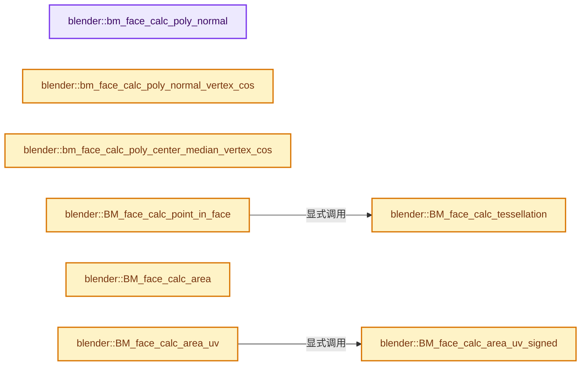

# 实现依赖专题：source/blender/bmesh/intern/bmesh_polygon.cc

[方向导航](README.md) · [符号索引](../%E7%AC%A6%E5%8F%B7%E4%BE%9D%E8%B5%96%E4%B8%8E%E5%AE%9E%E7%8E%B0%E7%B4%A2%E5%BC%95.md)

本专题从正文实际调用进入，集中保存共享实现。函数有稳定锚点，可从调用处直接跳到对应完整函数；递归与互相调用通过回链组织。

## 本文件的实现关系




## 完整成员与函数实现

<a id="f-d71846a6a0301e17"></a>

### `blender::bm_face_calc_poly_normal`

实现位置：[source/blender/bmesh/intern/bmesh_polygon.cc](../../../../../source/blender/bmesh/intern/bmesh_polygon.cc) · L55—L75。

接口参数：

- `const BMFace *f`
- `float n[3]`

**教学注释版**

<!-- annotated:6b01cfb2e88260 -->

```cpp
static float bm_face_calc_poly_normal(const BMFace *f, float n[3])
{
  BMLoop *l_first = BM_FACE_FIRST_LOOP(f);
  BMLoop *l_iter = l_first;
  const float *v_prev = l_first->prev->v->co;
  const float *v_curr = l_first->v->co;

  zero_v3(n);

  /* Newell's Method */
  do {
    add_newell_cross_v3_v3v3(n, v_prev, v_curr);

    l_iter = l_iter->next;
    v_prev = v_curr;
    v_curr = l_iter->v->co;

  } while (l_iter != l_first);

  return normalize_v3(n);
}
```

<details>
<summary>核对原始源码：source/blender/bmesh/intern/bmesh_polygon.cc · L55—L75</summary>

<!-- original:6b01cfb2e88260:source/blender/bmesh/intern/bmesh_polygon.cc:55:75 -->

```cpp
static float bm_face_calc_poly_normal(const BMFace *f, float n[3])
{
  BMLoop *l_first = BM_FACE_FIRST_LOOP(f);
  BMLoop *l_iter = l_first;
  const float *v_prev = l_first->prev->v->co;
  const float *v_curr = l_first->v->co;

  zero_v3(n);

  /* Newell's Method */
  do {
    add_newell_cross_v3_v3v3(n, v_prev, v_curr);

    l_iter = l_iter->next;
    v_prev = v_curr;
    v_curr = l_iter->v->co;

  } while (l_iter != l_first);

  return normalize_v3(n);
}
```

</details>

**沿实际写入检查状态**

- `l_iter = l_iter->next;`
- `v_prev = v_curr;`
- `v_curr = l_iter->v->co;`

**结果出口**

- `return normalize_v3(n);`

**继续追踪实现**

- `BM_FACE_FIRST_LOOP` → [BM_FACE_FIRST_LOOP · L697](%E4%BE%9D%E8%B5%96-bmesh_class-4cf146.md#m-c7e10ffb38e6)；[BM_FACE_FIRST_LOOP · L699](%E4%BE%9D%E8%B5%96-bmesh_class-4cf146.md#m-76a054cc4770)。宏定义由构建条件选择。
- `zero_v3` → [blender::zero_v3 · L26](../12-%E7%A9%BA%E9%97%B4%E6%95%B0%E6%8D%AE%E7%BB%93%E6%9E%84%E4%B8%8E%E5%87%A0%E4%BD%95%E7%AE%97%E6%B3%95/%E4%BE%9D%E8%B5%96-math_vector_inline-0c8541.md#f-13235b08fdecb098)。
- `add_newell_cross_v3_v3v3` → [blender::add_newell_cross_v3_v3v3 · L706](../12-%E7%A9%BA%E9%97%B4%E6%95%B0%E6%8D%AE%E7%BB%93%E6%9E%84%E4%B8%8E%E5%87%A0%E4%BD%95%E7%AE%97%E6%B3%95/%E4%BE%9D%E8%B5%96-math_vector_inline-0c8541.md#f-71334c1ecc57f554)。
- `normalize_v3` → [blender::normalize_v3 · L933](../12-%E7%A9%BA%E9%97%B4%E6%95%B0%E6%8D%AE%E7%BB%93%E6%9E%84%E4%B8%8E%E5%87%A0%E4%BD%95%E7%AE%97%E6%B3%95/%E4%BE%9D%E8%B5%96-math_vector_inline-0c8541.md#f-5f3257e657ef732c)。

<a id="f-347968daa3ed7918"></a>

### `blender::bm_face_calc_poly_normal_vertex_cos`

实现位置：[source/blender/bmesh/intern/bmesh_polygon.cc](../../../../../source/blender/bmesh/intern/bmesh_polygon.cc) · L83—L104。

接口参数：

- `const BMFace *f`
- `float r_no[3]`
- `const Span<float3> vertexCos`

**教学注释版**

<!-- annotated:914df0ab182dba -->

```cpp
static float bm_face_calc_poly_normal_vertex_cos(const BMFace *f,
                                                 float r_no[3],
                                                 const Span<float3> vertexCos)
{
  BMLoop *l_first = BM_FACE_FIRST_LOOP(f);
  BMLoop *l_iter = l_first;
  const float *v_prev = vertexCos[BM_elem_index_get(l_first->prev->v)];
  const float *v_curr = vertexCos[BM_elem_index_get(l_first->v)];

  zero_v3(r_no);

  /* Newell's Method */
  do {
    add_newell_cross_v3_v3v3(r_no, v_prev, v_curr);

    l_iter = l_iter->next;
    v_prev = v_curr;
    v_curr = vertexCos[BM_elem_index_get(l_iter->v)];
  } while (l_iter != l_first);

  return normalize_v3(r_no);
}
```

<details>
<summary>核对原始源码：source/blender/bmesh/intern/bmesh_polygon.cc · L83—L104</summary>

<!-- original:914df0ab182dba:source/blender/bmesh/intern/bmesh_polygon.cc:83:104 -->

```cpp
static float bm_face_calc_poly_normal_vertex_cos(const BMFace *f,
                                                 float r_no[3],
                                                 const Span<float3> vertexCos)
{
  BMLoop *l_first = BM_FACE_FIRST_LOOP(f);
  BMLoop *l_iter = l_first;
  const float *v_prev = vertexCos[BM_elem_index_get(l_first->prev->v)];
  const float *v_curr = vertexCos[BM_elem_index_get(l_first->v)];

  zero_v3(r_no);

  /* Newell's Method */
  do {
    add_newell_cross_v3_v3v3(r_no, v_prev, v_curr);

    l_iter = l_iter->next;
    v_prev = v_curr;
    v_curr = vertexCos[BM_elem_index_get(l_iter->v)];
  } while (l_iter != l_first);

  return normalize_v3(r_no);
}
```

</details>

**沿实际写入检查状态**

- `l_iter = l_iter->next;`
- `v_prev = v_curr;`
- `v_curr = vertexCos[BM_elem_index_get(l_iter->v)];`

**结果出口**

- `return normalize_v3(r_no);`

**继续追踪实现**

- `BM_FACE_FIRST_LOOP` → [BM_FACE_FIRST_LOOP · L697](%E4%BE%9D%E8%B5%96-bmesh_class-4cf146.md#m-c7e10ffb38e6)；[BM_FACE_FIRST_LOOP · L699](%E4%BE%9D%E8%B5%96-bmesh_class-4cf146.md#m-76a054cc4770)。宏定义由构建条件选择。
- `BM_elem_index_get` → [BM_elem_index_get · L120](%E4%BE%9D%E8%B5%96-bmesh_inline-74f1be.md#m-201981cdc62d)。宏定义由构建条件选择。
- `zero_v3` → [blender::zero_v3 · L26](../12-%E7%A9%BA%E9%97%B4%E6%95%B0%E6%8D%AE%E7%BB%93%E6%9E%84%E4%B8%8E%E5%87%A0%E4%BD%95%E7%AE%97%E6%B3%95/%E4%BE%9D%E8%B5%96-math_vector_inline-0c8541.md#f-13235b08fdecb098)。
- `add_newell_cross_v3_v3v3` → [blender::add_newell_cross_v3_v3v3 · L706](../12-%E7%A9%BA%E9%97%B4%E6%95%B0%E6%8D%AE%E7%BB%93%E6%9E%84%E4%B8%8E%E5%87%A0%E4%BD%95%E7%AE%97%E6%B3%95/%E4%BE%9D%E8%B5%96-math_vector_inline-0c8541.md#f-71334c1ecc57f554)。
- `normalize_v3` → [blender::normalize_v3 · L933](../12-%E7%A9%BA%E9%97%B4%E6%95%B0%E6%8D%AE%E7%BB%93%E6%9E%84%E4%B8%8E%E5%87%A0%E4%BD%95%E7%AE%97%E6%B3%95/%E4%BE%9D%E8%B5%96-math_vector_inline-0c8541.md#f-5f3257e657ef732c)。

<a id="f-3ad2b4bba6036272"></a>

### `blender::bm_face_calc_poly_center_median_vertex_cos`

实现位置：[source/blender/bmesh/intern/bmesh_polygon.cc](../../../../../source/blender/bmesh/intern/bmesh_polygon.cc) · L109—L123。

接口参数：

- `const BMFace *f`
- `float r_cent[3]`
- `const Span<float3> vert_positions`

**教学注释版**

<!-- annotated:d003af6fd45aa3 -->

```cpp
static void bm_face_calc_poly_center_median_vertex_cos(const BMFace *f,
                                                       float r_cent[3],
                                                       const Span<float3> vert_positions)
{
  const BMLoop *l_first, *l_iter;

  zero_v3(r_cent);

  /* Newell's Method */
  l_iter = l_first = BM_FACE_FIRST_LOOP(f);
  do {
    add_v3_v3(r_cent, vert_positions[BM_elem_index_get(l_iter->v)]);
  } while ((l_iter = l_iter->next) != l_first);
  mul_v3_fl(r_cent, 1.0f / f->len);
}
```

<details>
<summary>核对原始源码：source/blender/bmesh/intern/bmesh_polygon.cc · L109—L123</summary>

<!-- original:d003af6fd45aa3:source/blender/bmesh/intern/bmesh_polygon.cc:109:123 -->

```cpp
static void bm_face_calc_poly_center_median_vertex_cos(const BMFace *f,
                                                       float r_cent[3],
                                                       const Span<float3> vert_positions)
{
  const BMLoop *l_first, *l_iter;

  zero_v3(r_cent);

  /* Newell's Method */
  l_iter = l_first = BM_FACE_FIRST_LOOP(f);
  do {
    add_v3_v3(r_cent, vert_positions[BM_elem_index_get(l_iter->v)]);
  } while ((l_iter = l_iter->next) != l_first);
  mul_v3_fl(r_cent, 1.0f / f->len);
}
```

</details>

**沿实际写入检查状态**

- `l_iter = l_first = BM_FACE_FIRST_LOOP(f);`

**继续追踪实现**

- `zero_v3` → [blender::zero_v3 · L26](../12-%E7%A9%BA%E9%97%B4%E6%95%B0%E6%8D%AE%E7%BB%93%E6%9E%84%E4%B8%8E%E5%87%A0%E4%BD%95%E7%AE%97%E6%B3%95/%E4%BE%9D%E8%B5%96-math_vector_inline-0c8541.md#f-13235b08fdecb098)。
- `BM_FACE_FIRST_LOOP` → [BM_FACE_FIRST_LOOP · L697](%E4%BE%9D%E8%B5%96-bmesh_class-4cf146.md#m-c7e10ffb38e6)；[BM_FACE_FIRST_LOOP · L699](%E4%BE%9D%E8%B5%96-bmesh_class-4cf146.md#m-76a054cc4770)。宏定义由构建条件选择。
- `add_v3_v3` → [blender::add_v3_v3 · L286](../12-%E7%A9%BA%E9%97%B4%E6%95%B0%E6%8D%AE%E7%BB%93%E6%9E%84%E4%B8%8E%E5%87%A0%E4%BD%95%E7%AE%97%E6%B3%95/%E4%BE%9D%E8%B5%96-math_vector_inline-0c8541.md#f-e7930c6fdefe462c)。
- `BM_elem_index_get` → [BM_elem_index_get · L120](%E4%BE%9D%E8%B5%96-bmesh_inline-74f1be.md#m-201981cdc62d)。宏定义由构建条件选择。
- `mul_v3_fl` → [blender::mul_v3_fl · L414](../12-%E7%A9%BA%E9%97%B4%E6%95%B0%E6%8D%AE%E7%BB%93%E6%9E%84%E4%B8%8E%E5%87%A0%E4%BD%95%E7%AE%97%E6%B3%95/%E4%BE%9D%E8%B5%96-math_vector_inline-0c8541.md#f-00165156a06d1224)。

<a id="f-9b8fbd06c0b933bc"></a>

### `blender::BM_face_calc_tessellation`

实现位置：[source/blender/bmesh/intern/bmesh_polygon.cc](../../../../../source/blender/bmesh/intern/bmesh_polygon.cc) · L125—L174。

接口参数：

- `const BMFace *f`
- `const bool use_fixed_quad`
- `BMLoop **r_loops`
- `uint (*r_index)[3]`

**教学注释版**

<!-- annotated:260ec352af6aa0 -->

```cpp
void BM_face_calc_tessellation(const BMFace *f,
                               const bool use_fixed_quad,
                               BMLoop **r_loops,
                               uint (*r_index)[3])
{
  BMLoop *l_first = BM_FACE_FIRST_LOOP(f);
  BMLoop *l_iter;

  if (f->len == 3) {
    *r_loops++ = (l_iter = l_first);
    *r_loops++ = (l_iter = l_iter->next);
    *r_loops++ = (l_iter->next);

    r_index[0][0] = 0;
    r_index[0][1] = 1;
    r_index[0][2] = 2;
  }
  else if (f->len == 4 && use_fixed_quad) {
    *r_loops++ = (l_iter = l_first);
    *r_loops++ = (l_iter = l_iter->next);
    *r_loops++ = (l_iter = l_iter->next);
    *r_loops++ = (l_iter->next);

    r_index[0][0] = 0;
    r_index[0][1] = 1;
    r_index[0][2] = 2;

    r_index[1][0] = 0;
    r_index[1][1] = 2;
    r_index[1][2] = 3;
  }
  else {
    float axis_mat[3][3];
    Array<float2, BM_DEFAULT_NGON_STACK_SIZE> projverts(f->len);
    int j;

    axis_dominant_v3_to_m3_negate(axis_mat, f->no);

    j = 0;
    l_iter = l_first;
    do {
      mul_v2_m3v3(projverts[j], axis_mat, l_iter->v->co);
      r_loops[j] = l_iter;
      j++;
    } while ((l_iter = l_iter->next) != l_first);

    /* complete the loop */
    // [讲解] projverts.data：提供数组的借用访问入口。
    BLI_polyfill_calc(reinterpret_cast<float (*)[2]>(projverts.data()), f->len, 1, r_index);
  }
}
```

<details>
<summary>核对原始源码：source/blender/bmesh/intern/bmesh_polygon.cc · L125—L174</summary>

<!-- original:260ec352af6aa0:source/blender/bmesh/intern/bmesh_polygon.cc:125:174 -->

```cpp
void BM_face_calc_tessellation(const BMFace *f,
                               const bool use_fixed_quad,
                               BMLoop **r_loops,
                               uint (*r_index)[3])
{
  BMLoop *l_first = BM_FACE_FIRST_LOOP(f);
  BMLoop *l_iter;

  if (f->len == 3) {
    *r_loops++ = (l_iter = l_first);
    *r_loops++ = (l_iter = l_iter->next);
    *r_loops++ = (l_iter->next);

    r_index[0][0] = 0;
    r_index[0][1] = 1;
    r_index[0][2] = 2;
  }
  else if (f->len == 4 && use_fixed_quad) {
    *r_loops++ = (l_iter = l_first);
    *r_loops++ = (l_iter = l_iter->next);
    *r_loops++ = (l_iter = l_iter->next);
    *r_loops++ = (l_iter->next);

    r_index[0][0] = 0;
    r_index[0][1] = 1;
    r_index[0][2] = 2;

    r_index[1][0] = 0;
    r_index[1][1] = 2;
    r_index[1][2] = 3;
  }
  else {
    float axis_mat[3][3];
    Array<float2, BM_DEFAULT_NGON_STACK_SIZE> projverts(f->len);
    int j;

    axis_dominant_v3_to_m3_negate(axis_mat, f->no);

    j = 0;
    l_iter = l_first;
    do {
      mul_v2_m3v3(projverts[j], axis_mat, l_iter->v->co);
      r_loops[j] = l_iter;
      j++;
    } while ((l_iter = l_iter->next) != l_first);

    /* complete the loop */
    BLI_polyfill_calc(reinterpret_cast<float (*)[2]>(projverts.data()), f->len, 1, r_index);
  }
}
```

</details>

**沿实际写入检查状态**

- `r_index[0][0] = 0;`
- `r_index[0][1] = 1;`
- `r_index[0][2] = 2;`
- `r_index[1][0] = 0;`
- `r_index[1][1] = 2;`
- `r_index[1][2] = 3;`
- `j = 0;`
- `l_iter = l_first;`
- `r_loops[j] = l_iter;`

**继续追踪实现**

- `BM_FACE_FIRST_LOOP` → [BM_FACE_FIRST_LOOP · L697](%E4%BE%9D%E8%B5%96-bmesh_class-4cf146.md#m-c7e10ffb38e6)；[BM_FACE_FIRST_LOOP · L699](%E4%BE%9D%E8%B5%96-bmesh_class-4cf146.md#m-76a054cc4770)。宏定义由构建条件选择。
- `axis_dominant_v3_to_m3_negate` → [blender::axis_dominant_v3_to_m3_negate · L3719](../12-%E7%A9%BA%E9%97%B4%E6%95%B0%E6%8D%AE%E7%BB%93%E6%9E%84%E4%B8%8E%E5%87%A0%E4%BD%95%E7%AE%97%E6%B3%95/%E4%BE%9D%E8%B5%96-math_geom-8d91a3.md#f-a179811fe7db7a80)。
- `mul_v2_m3v3` → [blender::mul_v2_m3v3 · L844](../12-%E7%A9%BA%E9%97%B4%E6%95%B0%E6%8D%AE%E7%BB%93%E6%9E%84%E4%B8%8E%E5%87%A0%E4%BD%95%E7%AE%97%E6%B3%95/%E4%BE%9D%E8%B5%96-math_matrix_c-004123.md#f-2550a487d003ca6b)。
- `BLI_polyfill_calc` → [blender::BLI_polyfill_calc · L1112](../01-%E5%9F%BA%E7%A1%80%E5%AE%B9%E5%99%A8%E4%B8%8E%E7%8E%B0%E4%BB%A3CPP/%E4%BE%9D%E8%B5%96-polyfill_2d-89228d.md#f-88f1e5fb26ac2298)。
- `projverts.data` → [blender::Array::data · L323](../01-%E5%9F%BA%E7%A1%80%E5%AE%B9%E5%99%A8%E4%B8%8E%E7%8E%B0%E4%BB%A3CPP/08-Array%E5%A4%8D%E5%88%B6%E7%A7%BB%E5%8A%A8%E4%B8%8E%E9%94%80%E6%AF%81.md#f-95648c799002f4ba)；[blender::Array::data · L327](../01-%E5%9F%BA%E7%A1%80%E5%AE%B9%E5%99%A8%E4%B8%8E%E7%8E%B0%E4%BB%A3CPP/08-Array%E5%A4%8D%E5%88%B6%E7%A7%BB%E5%8A%A8%E4%B8%8E%E9%94%80%E6%AF%81.md#f-50c18301f8c40f9e)。同名重载需按实参类型选择。

<a id="f-679f492f1694b95b"></a>

### `blender::BM_face_calc_point_in_face`

实现位置：[source/blender/bmesh/intern/bmesh_polygon.cc](../../../../../source/blender/bmesh/intern/bmesh_polygon.cc) · L176—L212。

接口参数：

- `const BMFace *f`
- `float r_co[3]`

**教学注释版**

<!-- annotated:d688fefffc897c -->

```cpp
void BM_face_calc_point_in_face(const BMFace *f, float r_co[3])
{
  const BMLoop *ltri[3];

  if (f->len == 3) {
    const BMLoop *l = BM_FACE_FIRST_LOOP(f);
    ARRAY_SET_ITEMS(ltri, l, l->next, l->prev);
  }
  else {
    /* tessellation here seems overkill when in many cases this will be the center,
     * but without this we can't be sure the point is inside a concave face. */
    const int tottri = f->len - 2;
    Array<BMLoop *, BM_DEFAULT_NGON_STACK_SIZE> loops(f->len);
    Array<std::array<uint, 3>, BM_DEFAULT_NGON_STACK_SIZE> index(tottri);
    int j;
    int j_best = 0; /* use as fallback when unset */
    float area_best = -1.0f;

    // [讲解] loops.data：提供数组的借用访问入口。
    BM_face_calc_tessellation(f, false, loops.data(), reinterpret_cast<uint(*)[3]>(index.data()));

    for (j = 0; j < tottri; j++) {
      const float *p1 = loops[index[j][0]]->v->co;
      const float *p2 = loops[index[j][1]]->v->co;
      const float *p3 = loops[index[j][2]]->v->co;
      const float area = area_squared_tri_v3(p1, p2, p3);
      if (area > area_best) {
        j_best = j;
        area_best = area;
      }
    }

    ARRAY_SET_ITEMS(
        ltri, loops[index[j_best][0]], loops[index[j_best][1]], loops[index[j_best][2]]);
  }

  mid_v3_v3v3v3(r_co, ltri[0]->v->co, ltri[1]->v->co, ltri[2]->v->co);
}
```

<details>
<summary>核对原始源码：source/blender/bmesh/intern/bmesh_polygon.cc · L176—L212</summary>

<!-- original:d688fefffc897c:source/blender/bmesh/intern/bmesh_polygon.cc:176:212 -->

```cpp
void BM_face_calc_point_in_face(const BMFace *f, float r_co[3])
{
  const BMLoop *ltri[3];

  if (f->len == 3) {
    const BMLoop *l = BM_FACE_FIRST_LOOP(f);
    ARRAY_SET_ITEMS(ltri, l, l->next, l->prev);
  }
  else {
    /* tessellation here seems overkill when in many cases this will be the center,
     * but without this we can't be sure the point is inside a concave face. */
    const int tottri = f->len - 2;
    Array<BMLoop *, BM_DEFAULT_NGON_STACK_SIZE> loops(f->len);
    Array<std::array<uint, 3>, BM_DEFAULT_NGON_STACK_SIZE> index(tottri);
    int j;
    int j_best = 0; /* use as fallback when unset */
    float area_best = -1.0f;

    BM_face_calc_tessellation(f, false, loops.data(), reinterpret_cast<uint(*)[3]>(index.data()));

    for (j = 0; j < tottri; j++) {
      const float *p1 = loops[index[j][0]]->v->co;
      const float *p2 = loops[index[j][1]]->v->co;
      const float *p3 = loops[index[j][2]]->v->co;
      const float area = area_squared_tri_v3(p1, p2, p3);
      if (area > area_best) {
        j_best = j;
        area_best = area;
      }
    }

    ARRAY_SET_ITEMS(
        ltri, loops[index[j_best][0]], loops[index[j_best][1]], loops[index[j_best][2]]);
  }

  mid_v3_v3v3v3(r_co, ltri[0]->v->co, ltri[1]->v->co, ltri[2]->v->co);
}
```

</details>

**沿实际写入检查状态**

- `j_best = j;`
- `area_best = area;`

**继续追踪实现**

- `BM_FACE_FIRST_LOOP` → [BM_FACE_FIRST_LOOP · L697](%E4%BE%9D%E8%B5%96-bmesh_class-4cf146.md#m-c7e10ffb38e6)；[BM_FACE_FIRST_LOOP · L699](%E4%BE%9D%E8%B5%96-bmesh_class-4cf146.md#m-76a054cc4770)。宏定义由构建条件选择。
- `ARRAY_SET_ITEMS` → [ARRAY_SET_ITEMS · L304](../01-%E5%9F%BA%E7%A1%80%E5%AE%B9%E5%99%A8%E4%B8%8E%E7%8E%B0%E4%BB%A3CPP/%E4%BE%9D%E8%B5%96-BLI_utildefines-293a0a.md#m-80336b50a95e)。宏定义由构建条件选择。
- `BM_face_calc_tessellation` → [blender::BM_face_calc_tessellation · L125](%E4%BE%9D%E8%B5%96-bmesh_polygon-a8ec8c.md#f-9b8fbd06c0b933bc)。
- `loops.data` → [blender::Array::data · L323](../01-%E5%9F%BA%E7%A1%80%E5%AE%B9%E5%99%A8%E4%B8%8E%E7%8E%B0%E4%BB%A3CPP/08-Array%E5%A4%8D%E5%88%B6%E7%A7%BB%E5%8A%A8%E4%B8%8E%E9%94%80%E6%AF%81.md#f-95648c799002f4ba)；[blender::Array::data · L327](../01-%E5%9F%BA%E7%A1%80%E5%AE%B9%E5%99%A8%E4%B8%8E%E7%8E%B0%E4%BB%A3CPP/08-Array%E5%A4%8D%E5%88%B6%E7%A7%BB%E5%8A%A8%E4%B8%8E%E9%94%80%E6%AF%81.md#f-50c18301f8c40f9e)。同名重载需按实参类型选择。
- `index.data` → [blender::Array::data · L323](../01-%E5%9F%BA%E7%A1%80%E5%AE%B9%E5%99%A8%E4%B8%8E%E7%8E%B0%E4%BB%A3CPP/08-Array%E5%A4%8D%E5%88%B6%E7%A7%BB%E5%8A%A8%E4%B8%8E%E9%94%80%E6%AF%81.md#f-95648c799002f4ba)；[blender::Array::data · L327](../01-%E5%9F%BA%E7%A1%80%E5%AE%B9%E5%99%A8%E4%B8%8E%E7%8E%B0%E4%BB%A3CPP/08-Array%E5%A4%8D%E5%88%B6%E7%A7%BB%E5%8A%A8%E4%B8%8E%E9%94%80%E6%AF%81.md#f-50c18301f8c40f9e)。同名重载需按实参类型选择。
- `area_squared_tri_v3` → [blender::area_squared_tri_v3 · L111](../12-%E7%A9%BA%E9%97%B4%E6%95%B0%E6%8D%AE%E7%BB%93%E6%9E%84%E4%B8%8E%E5%87%A0%E4%BD%95%E7%AE%97%E6%B3%95/%E4%BE%9D%E8%B5%96-math_geom-8d91a3.md#f-bb9a1ea2bc8c98db)。
- `mid_v3_v3v3v3` → [blender::mid_v3_v3v3v3 · L202](../12-%E7%A9%BA%E9%97%B4%E6%95%B0%E6%8D%AE%E7%BB%93%E6%9E%84%E4%B8%8E%E5%87%A0%E4%BD%95%E7%AE%97%E6%B3%95/%E4%BE%9D%E8%B5%96-math_vector-5f35fa.md#f-f156931a76864a2b)。

<a id="f-68093575f608c8ea"></a>

### `blender::BM_face_calc_area`

实现位置：[source/blender/bmesh/intern/bmesh_polygon.cc](../../../../../source/blender/bmesh/intern/bmesh_polygon.cc) · L214—L226。

接口参数：

- `const BMFace *f`

**教学注释版**

<!-- annotated:74bc8de1c40b0f -->

```cpp
float BM_face_calc_area(const BMFace *f)
{
  /* inline 'area_poly_v3' logic, avoid creating a temp array */
  const BMLoop *l_iter, *l_first;
  float n[3];

  zero_v3(n);
  l_iter = l_first = BM_FACE_FIRST_LOOP(f);
  do {
    add_newell_cross_v3_v3v3(n, l_iter->v->co, l_iter->next->v->co);
  } while ((l_iter = l_iter->next) != l_first);
  return len_v3(n) * 0.5f;
}
```

<details>
<summary>核对原始源码：source/blender/bmesh/intern/bmesh_polygon.cc · L214—L226</summary>

<!-- original:74bc8de1c40b0f:source/blender/bmesh/intern/bmesh_polygon.cc:214:226 -->

```cpp
float BM_face_calc_area(const BMFace *f)
{
  /* inline 'area_poly_v3' logic, avoid creating a temp array */
  const BMLoop *l_iter, *l_first;
  float n[3];

  zero_v3(n);
  l_iter = l_first = BM_FACE_FIRST_LOOP(f);
  do {
    add_newell_cross_v3_v3v3(n, l_iter->v->co, l_iter->next->v->co);
  } while ((l_iter = l_iter->next) != l_first);
  return len_v3(n) * 0.5f;
}
```

</details>

**沿实际写入检查状态**

- `l_iter = l_first = BM_FACE_FIRST_LOOP(f);`

**结果出口**

- `return len_v3(n) * 0.5f;`

**继续追踪实现**

- `zero_v3` → [blender::zero_v3 · L26](../12-%E7%A9%BA%E9%97%B4%E6%95%B0%E6%8D%AE%E7%BB%93%E6%9E%84%E4%B8%8E%E5%87%A0%E4%BD%95%E7%AE%97%E6%B3%95/%E4%BE%9D%E8%B5%96-math_vector_inline-0c8541.md#f-13235b08fdecb098)。
- `BM_FACE_FIRST_LOOP` → [BM_FACE_FIRST_LOOP · L697](%E4%BE%9D%E8%B5%96-bmesh_class-4cf146.md#m-c7e10ffb38e6)；[BM_FACE_FIRST_LOOP · L699](%E4%BE%9D%E8%B5%96-bmesh_class-4cf146.md#m-76a054cc4770)。宏定义由构建条件选择。
- `add_newell_cross_v3_v3v3` → [blender::add_newell_cross_v3_v3v3 · L706](../12-%E7%A9%BA%E9%97%B4%E6%95%B0%E6%8D%AE%E7%BB%93%E6%9E%84%E4%B8%8E%E5%87%A0%E4%BD%95%E7%AE%97%E6%B3%95/%E4%BE%9D%E8%B5%96-math_vector_inline-0c8541.md#f-71334c1ecc57f554)。
- `len_v3` → [blender::len_v3 · L781](../12-%E7%A9%BA%E9%97%B4%E6%95%B0%E6%8D%AE%E7%BB%93%E6%9E%84%E4%B8%8E%E5%87%A0%E4%BD%95%E7%AE%97%E6%B3%95/%E4%BE%9D%E8%B5%96-math_vector_inline-0c8541.md#f-4ad88eb0aa8d70ab)。

<a id="f-1837dde74434eafd"></a>

### `blender::BM_face_calc_area_uv_signed`

实现位置：[source/blender/bmesh/intern/bmesh_polygon.cc](../../../../../source/blender/bmesh/intern/bmesh_polygon.cc) · L247—L262。

接口参数：

- `const BMFace *f`
- `int cd_loop_uv_offset`

**教学注释版**

<!-- annotated:b3891185c3320c -->

```cpp
float BM_face_calc_area_uv_signed(const BMFace *f, int cd_loop_uv_offset)
{
  /* inline 'area_poly_v2' logic, avoid creating a temp array */
  const BMLoop *l_iter, *l_first;

  l_iter = l_first = BM_FACE_FIRST_LOOP(f);
  /* Green's theorem applied to area of a polygon.
   * TODO: `cross` should be of type `double` to reduce rounding error. */
  float cross = 0.0f;
  do {
    const float *luv = BM_ELEM_CD_GET_FLOAT_P(l_iter, cd_loop_uv_offset);
    const float *luv_next = BM_ELEM_CD_GET_FLOAT_P(l_iter->next, cd_loop_uv_offset);
    cross += (luv_next[0] - luv[0]) * (luv_next[1] + luv[1]);
  } while ((l_iter = l_iter->next) != l_first);
  return cross * 0.5f;
}
```

<details>
<summary>核对原始源码：source/blender/bmesh/intern/bmesh_polygon.cc · L247—L262</summary>

<!-- original:b3891185c3320c:source/blender/bmesh/intern/bmesh_polygon.cc:247:262 -->

```cpp
float BM_face_calc_area_uv_signed(const BMFace *f, int cd_loop_uv_offset)
{
  /* inline 'area_poly_v2' logic, avoid creating a temp array */
  const BMLoop *l_iter, *l_first;

  l_iter = l_first = BM_FACE_FIRST_LOOP(f);
  /* Green's theorem applied to area of a polygon.
   * TODO: `cross` should be of type `double` to reduce rounding error. */
  float cross = 0.0f;
  do {
    const float *luv = BM_ELEM_CD_GET_FLOAT_P(l_iter, cd_loop_uv_offset);
    const float *luv_next = BM_ELEM_CD_GET_FLOAT_P(l_iter->next, cd_loop_uv_offset);
    cross += (luv_next[0] - luv[0]) * (luv_next[1] + luv[1]);
  } while ((l_iter = l_iter->next) != l_first);
  return cross * 0.5f;
}
```

</details>

**沿实际写入检查状态**

- `l_iter = l_first = BM_FACE_FIRST_LOOP(f);`
- `cross += (luv_next[0] - luv[0]) * (luv_next[1] + luv[1]);`

**结果出口**

- `return cross * 0.5f;`

**继续追踪实现**

- `BM_FACE_FIRST_LOOP` → [BM_FACE_FIRST_LOOP · L697](%E4%BE%9D%E8%B5%96-bmesh_class-4cf146.md#m-c7e10ffb38e6)；[BM_FACE_FIRST_LOOP · L699](%E4%BE%9D%E8%B5%96-bmesh_class-4cf146.md#m-76a054cc4770)。宏定义由构建条件选择。
- `BM_ELEM_CD_GET_FLOAT_P` → [BM_ELEM_CD_GET_FLOAT_P · L635](%E4%BE%9D%E8%B5%96-bmesh_class-4cf146.md#m-544f72c45c1b)；[BM_ELEM_CD_GET_FLOAT_P · L661](%E4%BE%9D%E8%B5%96-bmesh_class-4cf146.md#m-c11efbe96e86)。宏定义由构建条件选择。

<a id="f-d0a027e9bb559e5c"></a>

### `blender::BM_face_calc_area_uv`

实现位置：[source/blender/bmesh/intern/bmesh_polygon.cc](../../../../../source/blender/bmesh/intern/bmesh_polygon.cc) · L264—L267。

接口参数：

- `const BMFace *f`
- `int cd_loop_uv_offset`

**教学注释版**

<!-- annotated:979cef467b230c -->

```cpp
float BM_face_calc_area_uv(const BMFace *f, int cd_loop_uv_offset)
{
  return fabsf(BM_face_calc_area_uv_signed(f, cd_loop_uv_offset));
}
```

<details>
<summary>核对原始源码：source/blender/bmesh/intern/bmesh_polygon.cc · L264—L267</summary>

<!-- original:979cef467b230c:source/blender/bmesh/intern/bmesh_polygon.cc:264:267 -->

```cpp
float BM_face_calc_area_uv(const BMFace *f, int cd_loop_uv_offset)
{
  return fabsf(BM_face_calc_area_uv_signed(f, cd_loop_uv_offset));
}
```

</details>

**结果出口**

- `return fabsf(BM_face_calc_area_uv_signed(f, cd_loop_uv_offset));`

**继续追踪实现**

- `fabsf` → [fabsf · L21](%E4%BE%9D%E8%B5%96-radial_tiling_shared-98abf9.md#m-02cc4c69cfb3)；[fabsf · L43](%E4%BE%9D%E8%B5%96-radial_tiling_shared-98abf9.md#m-04effe61803b)；[fabsf · L74](%E4%BE%9D%E8%B5%96-radial_tiling_shared-98abf9.md#m-927dd4eba7dc)；[fabsf · L25](../01-%E5%9F%BA%E7%A1%80%E5%AE%B9%E5%99%A8%E4%B8%8E%E7%8E%B0%E4%BB%A3CPP/%E4%BE%9D%E8%B5%96-radial_tiling_shared-7989a4.md#m-8348d6b3d08f)；[fabsf · L47](../01-%E5%9F%BA%E7%A1%80%E5%AE%B9%E5%99%A8%E4%B8%8E%E7%8E%B0%E4%BB%A3CPP/%E4%BE%9D%E8%B5%96-radial_tiling_shared-7989a4.md#m-13b7e0b6d84f)；[fabsf · L78](../01-%E5%9F%BA%E7%A1%80%E5%AE%B9%E5%99%A8%E4%B8%8E%E7%8E%B0%E4%BB%A3CPP/%E4%BE%9D%E8%B5%96-radial_tiling_shared-7989a4.md#m-326c83464a0d)；[fabsf · L21](%E4%BE%9D%E8%B5%96-node_radial_tiling_shared-b14bc2.md#m-7c3ee12fc119)；[fabsf · L43](%E4%BE%9D%E8%B5%96-node_radial_tiling_shared-b14bc2.md#m-9112db0e2dd1)；[fabsf · L74](%E4%BE%9D%E8%B5%96-node_radial_tiling_shared-b14bc2.md#m-ee4e61908a6f)；[fabsf · L167](%E4%BE%9D%E8%B5%96-compat-56205c.md#m-b039ee6c1601)；[fabsf · L265](%E4%BE%9D%E8%B5%96-compat-efe0e9.md#m-6b21869e9f3f)。宏定义由构建条件选择。
- `BM_face_calc_area_uv_signed` → [blender::BM_face_calc_area_uv_signed · L247](%E4%BE%9D%E8%B5%96-bmesh_polygon-a8ec8c.md#f-1837dde74434eafd)。

<a id="f-868e4b65b9b7cbc1"></a>

### `blender::bm_vert_tri_find_unique_edge`

实现位置：[source/blender/bmesh/intern/bmesh_polygon.cc](../../../../../source/blender/bmesh/intern/bmesh_polygon.cc) · L305—L340。

接口参数：

- `BMVert *verts[3]`

**教学注释版**

<!-- annotated:e6d33b7895f7c5 -->

```cpp
static int bm_vert_tri_find_unique_edge(BMVert *verts[3])
{
/* find the most 'unique' loop, (greatest difference to others) */
#if 1
  /* Optimized version that avoids `sqrt`. */
  float difs[3];
  for (int i_prev = 1, i_curr = 2, i_next = 0; i_next < 3; i_prev = i_curr, i_curr = i_next++) {
    const float *co = verts[i_curr]->co;
    const float *co_other[2] = {verts[i_prev]->co, verts[i_next]->co};
    float proj_dir[3];
    mid_v3_v3v3(proj_dir, co_other[0], co_other[1]);
    sub_v3_v3(proj_dir, co);

    float proj_pair[2][3];
    project_v3_v3v3(proj_pair[0], co_other[0], proj_dir);
    project_v3_v3v3(proj_pair[1], co_other[1], proj_dir);
    difs[i_next] = len_squared_v3v3(proj_pair[0], proj_pair[1]);
  }
#else
  const float lens[3] = {
      len_v3v3(verts[0]->co, verts[1]->co),
      len_v3v3(verts[1]->co, verts[2]->co),
      len_v3v3(verts[2]->co, verts[0]->co),
  };
  const float difs[3] = {
      fabsf(lens[1] - lens[2]),
      fabsf(lens[2] - lens[0]),
      fabsf(lens[0] - lens[1]),
  };
#endif

  int order[3] = {0, 1, 2};
  axis_sort_v3(difs, order);

  return order[0];
}
```

<details>
<summary>核对原始源码：source/blender/bmesh/intern/bmesh_polygon.cc · L305—L340</summary>

<!-- original:e6d33b7895f7c5:source/blender/bmesh/intern/bmesh_polygon.cc:305:340 -->

```cpp
static int bm_vert_tri_find_unique_edge(BMVert *verts[3])
{
/* find the most 'unique' loop, (greatest difference to others) */
#if 1
  /* Optimized version that avoids `sqrt`. */
  float difs[3];
  for (int i_prev = 1, i_curr = 2, i_next = 0; i_next < 3; i_prev = i_curr, i_curr = i_next++) {
    const float *co = verts[i_curr]->co;
    const float *co_other[2] = {verts[i_prev]->co, verts[i_next]->co};
    float proj_dir[3];
    mid_v3_v3v3(proj_dir, co_other[0], co_other[1]);
    sub_v3_v3(proj_dir, co);

    float proj_pair[2][3];
    project_v3_v3v3(proj_pair[0], co_other[0], proj_dir);
    project_v3_v3v3(proj_pair[1], co_other[1], proj_dir);
    difs[i_next] = len_squared_v3v3(proj_pair[0], proj_pair[1]);
  }
#else
  const float lens[3] = {
      len_v3v3(verts[0]->co, verts[1]->co),
      len_v3v3(verts[1]->co, verts[2]->co),
      len_v3v3(verts[2]->co, verts[0]->co),
  };
  const float difs[3] = {
      fabsf(lens[1] - lens[2]),
      fabsf(lens[2] - lens[0]),
      fabsf(lens[0] - lens[1]),
  };
#endif

  int order[3] = {0, 1, 2};
  axis_sort_v3(difs, order);

  return order[0];
}
```

</details>

**沿实际写入检查状态**

- `difs[i_next] = len_squared_v3v3(proj_pair[0], proj_pair[1]);`

**结果出口**

- `return order[0];`

**继续追踪实现**

- `mid_v3_v3v3` → [blender::mid_v3_v3v3 · L183](../12-%E7%A9%BA%E9%97%B4%E6%95%B0%E6%8D%AE%E7%BB%93%E6%9E%84%E4%B8%8E%E5%87%A0%E4%BD%95%E7%AE%97%E6%B3%95/%E4%BE%9D%E8%B5%96-math_vector-5f35fa.md#f-b748c1b0b472ad9b)。
- `sub_v3_v3` → [blender::sub_v3_v3 · L353](../12-%E7%A9%BA%E9%97%B4%E6%95%B0%E6%8D%AE%E7%BB%93%E6%9E%84%E4%B8%8E%E5%87%A0%E4%BD%95%E7%AE%97%E6%B3%95/%E4%BE%9D%E8%B5%96-math_vector_inline-0c8541.md#f-da39d7342c417f4b)。
- `project_v3_v3v3` → [blender::project_v3_v3v3 · L495](../12-%E7%A9%BA%E9%97%B4%E6%95%B0%E6%8D%AE%E7%BB%93%E6%9E%84%E4%B8%8E%E5%87%A0%E4%BD%95%E7%AE%97%E6%B3%95/%E4%BE%9D%E8%B5%96-math_vector-5f35fa.md#f-650605f97ccd5047)。
- `len_squared_v3v3` → [blender::len_squared_v3v3 · L794](../12-%E7%A9%BA%E9%97%B4%E6%95%B0%E6%8D%AE%E7%BB%93%E6%9E%84%E4%B8%8E%E5%87%A0%E4%BD%95%E7%AE%97%E6%B3%95/%E4%BE%9D%E8%B5%96-math_vector_inline-0c8541.md#f-ae487ac3ef64aa87)。
- `len_v3v3` → [blender::len_v3v3 · L826](../12-%E7%A9%BA%E9%97%B4%E6%95%B0%E6%8D%AE%E7%BB%93%E6%9E%84%E4%B8%8E%E5%87%A0%E4%BD%95%E7%AE%97%E6%B3%95/%E4%BE%9D%E8%B5%96-math_vector_inline-0c8541.md#f-c873370566848169)。
- `fabsf` → [fabsf · L21](%E4%BE%9D%E8%B5%96-radial_tiling_shared-98abf9.md#m-02cc4c69cfb3)；[fabsf · L43](%E4%BE%9D%E8%B5%96-radial_tiling_shared-98abf9.md#m-04effe61803b)；[fabsf · L74](%E4%BE%9D%E8%B5%96-radial_tiling_shared-98abf9.md#m-927dd4eba7dc)；[fabsf · L25](../01-%E5%9F%BA%E7%A1%80%E5%AE%B9%E5%99%A8%E4%B8%8E%E7%8E%B0%E4%BB%A3CPP/%E4%BE%9D%E8%B5%96-radial_tiling_shared-7989a4.md#m-8348d6b3d08f)；[fabsf · L47](../01-%E5%9F%BA%E7%A1%80%E5%AE%B9%E5%99%A8%E4%B8%8E%E7%8E%B0%E4%BB%A3CPP/%E4%BE%9D%E8%B5%96-radial_tiling_shared-7989a4.md#m-13b7e0b6d84f)；[fabsf · L78](../01-%E5%9F%BA%E7%A1%80%E5%AE%B9%E5%99%A8%E4%B8%8E%E7%8E%B0%E4%BB%A3CPP/%E4%BE%9D%E8%B5%96-radial_tiling_shared-7989a4.md#m-326c83464a0d)；[fabsf · L21](%E4%BE%9D%E8%B5%96-node_radial_tiling_shared-b14bc2.md#m-7c3ee12fc119)；[fabsf · L43](%E4%BE%9D%E8%B5%96-node_radial_tiling_shared-b14bc2.md#m-9112db0e2dd1)；[fabsf · L74](%E4%BE%9D%E8%B5%96-node_radial_tiling_shared-b14bc2.md#m-ee4e61908a6f)；[fabsf · L167](%E4%BE%9D%E8%B5%96-compat-56205c.md#m-b039ee6c1601)；[fabsf · L265](%E4%BE%9D%E8%B5%96-compat-efe0e9.md#m-6b21869e9f3f)。宏定义由构建条件选择。
- `axis_sort_v3` → [blender::axis_sort_v3 · L758](../12-%E7%A9%BA%E9%97%B4%E6%95%B0%E6%8D%AE%E7%BB%93%E6%9E%84%E4%B8%8E%E5%87%A0%E4%BD%95%E7%AE%97%E6%B3%95/%E4%BE%9D%E8%B5%96-math_vector-5f35fa.md#f-8a362c52804222be)。

<a id="f-80f4da7dd48dd2e2"></a>

### `blender::BM_vert_tri_calc_tangent_from_edge`

实现位置：[source/blender/bmesh/intern/bmesh_polygon.cc](../../../../../source/blender/bmesh/intern/bmesh_polygon.cc) · L342—L349。

接口参数：

- `BMVert *verts[3]`
- `float r_tangent[3]`

**教学注释版**

<!-- annotated:a7854feee58605 -->

```cpp
void BM_vert_tri_calc_tangent_from_edge(BMVert *verts[3], float r_tangent[3])
{
  const int index = bm_vert_tri_find_unique_edge(verts);
  const int index_next = (index + 1) % 3;

  sub_v3_v3v3(r_tangent, verts[index]->co, verts[index_next]->co);
  normalize_v3(r_tangent);
}
```

<details>
<summary>核对原始源码：source/blender/bmesh/intern/bmesh_polygon.cc · L342—L349</summary>

<!-- original:a7854feee58605:source/blender/bmesh/intern/bmesh_polygon.cc:342:349 -->

```cpp
void BM_vert_tri_calc_tangent_from_edge(BMVert *verts[3], float r_tangent[3])
{
  const int index = bm_vert_tri_find_unique_edge(verts);
  const int index_next = (index + 1) % 3;

  sub_v3_v3v3(r_tangent, verts[index]->co, verts[index_next]->co);
  normalize_v3(r_tangent);
}
```

</details>

**继续追踪实现**

- `bm_vert_tri_find_unique_edge` → [blender::bm_vert_tri_find_unique_edge · L305](%E4%BE%9D%E8%B5%96-bmesh_polygon-a8ec8c.md#f-868e4b65b9b7cbc1)。
- `sub_v3_v3v3` → [blender::sub_v3_v3v3 · L360](../12-%E7%A9%BA%E9%97%B4%E6%95%B0%E6%8D%AE%E7%BB%93%E6%9E%84%E4%B8%8E%E5%87%A0%E4%BD%95%E7%AE%97%E6%B3%95/%E4%BE%9D%E8%B5%96-math_vector_inline-0c8541.md#f-23781c252db8b30c)。
- `normalize_v3` → [blender::normalize_v3 · L933](../12-%E7%A9%BA%E9%97%B4%E6%95%B0%E6%8D%AE%E7%BB%93%E6%9E%84%E4%B8%8E%E5%87%A0%E4%BD%95%E7%AE%97%E6%B3%95/%E4%BE%9D%E8%B5%96-math_vector_inline-0c8541.md#f-5f3257e657ef732c)。

<a id="f-8a52571ed08696a4"></a>

### `blender::BM_face_calc_tangent_from_edge`

实现位置：[source/blender/bmesh/intern/bmesh_polygon.cc](../../../../../source/blender/bmesh/intern/bmesh_polygon.cc) · L390—L397。

接口参数：

- `const BMFace *f`
- `float r_tangent[3]`

**教学注释版**

<!-- annotated:e58f2b4942be91 -->

```cpp
void BM_face_calc_tangent_from_edge(const BMFace *f, float r_tangent[3])
{
  const BMLoop *l_long = BM_face_find_longest_loop(const_cast<BMFace *>(f));

  sub_v3_v3v3(r_tangent, l_long->v->co, l_long->next->v->co);

  normalize_v3(r_tangent);
}
```

<details>
<summary>核对原始源码：source/blender/bmesh/intern/bmesh_polygon.cc · L390—L397</summary>

<!-- original:e58f2b4942be91:source/blender/bmesh/intern/bmesh_polygon.cc:390:397 -->

```cpp
void BM_face_calc_tangent_from_edge(const BMFace *f, float r_tangent[3])
{
  const BMLoop *l_long = BM_face_find_longest_loop(const_cast<BMFace *>(f));

  sub_v3_v3v3(r_tangent, l_long->v->co, l_long->next->v->co);

  normalize_v3(r_tangent);
}
```

</details>

**继续追踪实现**

- `BM_face_find_longest_loop` → [blender::BM_face_find_longest_loop · L1523](%E4%BE%9D%E8%B5%96-bmesh_query-b0f8d6.md#f-ad7e86c333f0f9d8)。
- `sub_v3_v3v3` → [blender::sub_v3_v3v3 · L360](../12-%E7%A9%BA%E9%97%B4%E6%95%B0%E6%8D%AE%E7%BB%93%E6%9E%84%E4%B8%8E%E5%87%A0%E4%BD%95%E7%AE%97%E6%B3%95/%E4%BE%9D%E8%B5%96-math_vector_inline-0c8541.md#f-23781c252db8b30c)。
- `normalize_v3` → [blender::normalize_v3 · L933](../12-%E7%A9%BA%E9%97%B4%E6%95%B0%E6%8D%AE%E7%BB%93%E6%9E%84%E4%B8%8E%E5%87%A0%E4%BD%95%E7%AE%97%E6%B3%95/%E4%BE%9D%E8%B5%96-math_vector_inline-0c8541.md#f-5f3257e657ef732c)。

<a id="f-7d688ef2d16857e5"></a>

### `blender::bm_face_calc_tangent_from_quad_edge_pair`

实现位置：[source/blender/bmesh/intern/bmesh_polygon.cc](../../../../../source/blender/bmesh/intern/bmesh_polygon.cc) · L399—L418。

接口参数：

- `const BMFace *f`
- `float r_tangent[3]`

**教学注释版**

<!-- annotated:d854780df7894e -->

```cpp
static void bm_face_calc_tangent_from_quad_edge_pair(const BMFace *f, float r_tangent[3])
{
  BMVert *verts[4];
  float vec[3], vec_a[3], vec_b[3];

  BM_face_as_array_vert_quad(const_cast<BMFace *>(f), verts);

  sub_v3_v3v3(vec_a, verts[3]->co, verts[2]->co);
  sub_v3_v3v3(vec_b, verts[0]->co, verts[1]->co);
  add_v3_v3v3(r_tangent, vec_a, vec_b);

  sub_v3_v3v3(vec_a, verts[0]->co, verts[3]->co);
  sub_v3_v3v3(vec_b, verts[1]->co, verts[2]->co);
  add_v3_v3v3(vec, vec_a, vec_b);
  /* use the longest edge length */
  if (len_squared_v3(r_tangent) < len_squared_v3(vec)) {
    copy_v3_v3(r_tangent, vec);
  }
  normalize_v3(r_tangent);
}
```

<details>
<summary>核对原始源码：source/blender/bmesh/intern/bmesh_polygon.cc · L399—L418</summary>

<!-- original:d854780df7894e:source/blender/bmesh/intern/bmesh_polygon.cc:399:418 -->

```cpp
static void bm_face_calc_tangent_from_quad_edge_pair(const BMFace *f, float r_tangent[3])
{
  BMVert *verts[4];
  float vec[3], vec_a[3], vec_b[3];

  BM_face_as_array_vert_quad(const_cast<BMFace *>(f), verts);

  sub_v3_v3v3(vec_a, verts[3]->co, verts[2]->co);
  sub_v3_v3v3(vec_b, verts[0]->co, verts[1]->co);
  add_v3_v3v3(r_tangent, vec_a, vec_b);

  sub_v3_v3v3(vec_a, verts[0]->co, verts[3]->co);
  sub_v3_v3v3(vec_b, verts[1]->co, verts[2]->co);
  add_v3_v3v3(vec, vec_a, vec_b);
  /* use the longest edge length */
  if (len_squared_v3(r_tangent) < len_squared_v3(vec)) {
    copy_v3_v3(r_tangent, vec);
  }
  normalize_v3(r_tangent);
}
```

</details>

**继续追踪实现**

- `BM_face_as_array_vert_quad` → [blender::BM_face_as_array_vert_quad · L1487](%E4%BE%9D%E8%B5%96-bmesh_polygon-a8ec8c.md#f-85e40bd46b2595ab)。
- `sub_v3_v3v3` → [blender::sub_v3_v3v3 · L360](../12-%E7%A9%BA%E9%97%B4%E6%95%B0%E6%8D%AE%E7%BB%93%E6%9E%84%E4%B8%8E%E5%87%A0%E4%BD%95%E7%AE%97%E6%B3%95/%E4%BE%9D%E8%B5%96-math_vector_inline-0c8541.md#f-23781c252db8b30c)。
- `add_v3_v3v3` → [blender::add_v3_v3v3 · L300](../12-%E7%A9%BA%E9%97%B4%E6%95%B0%E6%8D%AE%E7%BB%93%E6%9E%84%E4%B8%8E%E5%87%A0%E4%BD%95%E7%AE%97%E6%B3%95/%E4%BE%9D%E8%B5%96-math_vector_inline-0c8541.md#f-7343b459d0d3db69)。
- `len_squared_v3` → [blender::len_squared_v3 · L724](../12-%E7%A9%BA%E9%97%B4%E6%95%B0%E6%8D%AE%E7%BB%93%E6%9E%84%E4%B8%8E%E5%87%A0%E4%BD%95%E7%AE%97%E6%B3%95/%E4%BE%9D%E8%B5%96-math_vector_inline-0c8541.md#f-089409f6f09f82ef)。
- `copy_v3_v3` → [blender::copy_v3_v3 · L47](../12-%E7%A9%BA%E9%97%B4%E6%95%B0%E6%8D%AE%E7%BB%93%E6%9E%84%E4%B8%8E%E5%87%A0%E4%BD%95%E7%AE%97%E6%B3%95/%E4%BE%9D%E8%B5%96-math_vector_inline-0c8541.md#f-037a0d5fa5060bd6)。
- `normalize_v3` → [blender::normalize_v3 · L933](../12-%E7%A9%BA%E9%97%B4%E6%95%B0%E6%8D%AE%E7%BB%93%E6%9E%84%E4%B8%8E%E5%87%A0%E4%BD%95%E7%AE%97%E6%B3%95/%E4%BE%9D%E8%B5%96-math_vector_inline-0c8541.md#f-5f3257e657ef732c)。

<a id="f-b6c4450f4ffcf28f"></a>

### `blender::BM_face_calc_tangent_auto`

实现位置：[source/blender/bmesh/intern/bmesh_polygon.cc](../../../../../source/blender/bmesh/intern/bmesh_polygon.cc) · L573—L589。

接口参数：

- `const BMFace *f`
- `float r_tangent[3]`

**教学注释版**

<!-- annotated:418fa46125d1c3 -->

```cpp
void BM_face_calc_tangent_auto(const BMFace *f, float r_tangent[3])
{
  if (f->len == 3) {
    /* most 'unique' edge of a triangle */
    BMVert *verts[3];
    BM_face_as_array_vert_tri(const_cast<BMFace *>(f), verts);
    BM_vert_tri_calc_tangent_from_edge(verts, r_tangent);
  }
  else if (f->len == 4) {
    /* longest edge pair of a quad */
    bm_face_calc_tangent_from_quad_edge_pair(f, r_tangent);
  }
  else {
    /* longest edge of an ngon */
    BM_face_calc_tangent_from_edge(f, r_tangent);
  }
}
```

<details>
<summary>核对原始源码：source/blender/bmesh/intern/bmesh_polygon.cc · L573—L589</summary>

<!-- original:418fa46125d1c3:source/blender/bmesh/intern/bmesh_polygon.cc:573:589 -->

```cpp
void BM_face_calc_tangent_auto(const BMFace *f, float r_tangent[3])
{
  if (f->len == 3) {
    /* most 'unique' edge of a triangle */
    BMVert *verts[3];
    BM_face_as_array_vert_tri(const_cast<BMFace *>(f), verts);
    BM_vert_tri_calc_tangent_from_edge(verts, r_tangent);
  }
  else if (f->len == 4) {
    /* longest edge pair of a quad */
    bm_face_calc_tangent_from_quad_edge_pair(f, r_tangent);
  }
  else {
    /* longest edge of an ngon */
    BM_face_calc_tangent_from_edge(f, r_tangent);
  }
}
```

</details>

**继续追踪实现**

- `BM_face_as_array_vert_tri` → [blender::BM_face_as_array_vert_tri · L1474](%E4%BE%9D%E8%B5%96-bmesh_polygon-a8ec8c.md#f-e67f8f990897dbfd)。
- `BM_vert_tri_calc_tangent_from_edge` → [blender::BM_vert_tri_calc_tangent_from_edge · L342](%E4%BE%9D%E8%B5%96-bmesh_polygon-a8ec8c.md#f-80f4da7dd48dd2e2)。
- `bm_face_calc_tangent_from_quad_edge_pair` → [blender::bm_face_calc_tangent_from_quad_edge_pair · L399](%E4%BE%9D%E8%B5%96-bmesh_polygon-a8ec8c.md#f-7d688ef2d16857e5)。
- `BM_face_calc_tangent_from_edge` → [blender::BM_face_calc_tangent_from_edge · L390](%E4%BE%9D%E8%B5%96-bmesh_polygon-a8ec8c.md#f-8a52571ed08696a4)。

<a id="f-e9c986b76f7913f3"></a>

### `blender::BM_face_calc_center_bounds`

实现位置：[source/blender/bmesh/intern/bmesh_polygon.cc](../../../../../source/blender/bmesh/intern/bmesh_polygon.cc) · L618—L631。

接口参数：

- `const BMFace *f`
- `float r_cent[3]`

**教学注释版**

<!-- annotated:d020da89fba88c -->

```cpp
void BM_face_calc_center_bounds(const BMFace *f, float r_cent[3])
{
  const BMLoop *l_iter, *l_first;
  float min[3], max[3];

  INIT_MINMAX(min, max);

  l_iter = l_first = BM_FACE_FIRST_LOOP(f);
  do {
    minmax_v3v3_v3(min, max, l_iter->v->co);
  } while ((l_iter = l_iter->next) != l_first);

  mid_v3_v3v3(r_cent, min, max);
}
```

<details>
<summary>核对原始源码：source/blender/bmesh/intern/bmesh_polygon.cc · L618—L631</summary>

<!-- original:d020da89fba88c:source/blender/bmesh/intern/bmesh_polygon.cc:618:631 -->

```cpp
void BM_face_calc_center_bounds(const BMFace *f, float r_cent[3])
{
  const BMLoop *l_iter, *l_first;
  float min[3], max[3];

  INIT_MINMAX(min, max);

  l_iter = l_first = BM_FACE_FIRST_LOOP(f);
  do {
    minmax_v3v3_v3(min, max, l_iter->v->co);
  } while ((l_iter = l_iter->next) != l_first);

  mid_v3_v3v3(r_cent, min, max);
}
```

</details>

**沿实际写入检查状态**

- `l_iter = l_first = BM_FACE_FIRST_LOOP(f);`

**继续追踪实现**

- `INIT_MINMAX` → [INIT_MINMAX · L31](../01-%E5%9F%BA%E7%A1%80%E5%AE%B9%E5%99%A8%E4%B8%8E%E7%8E%B0%E4%BB%A3CPP/%E4%BE%9D%E8%B5%96-BLI_utildefines-293a0a.md#m-958c70eca94e)。宏定义由构建条件选择。
- `BM_FACE_FIRST_LOOP` → [BM_FACE_FIRST_LOOP · L697](%E4%BE%9D%E8%B5%96-bmesh_class-4cf146.md#m-c7e10ffb38e6)；[BM_FACE_FIRST_LOOP · L699](%E4%BE%9D%E8%B5%96-bmesh_class-4cf146.md#m-76a054cc4770)。宏定义由构建条件选择。
- `minmax_v3v3_v3` → [blender::minmax_v3v3_v3 · L716](../12-%E7%A9%BA%E9%97%B4%E6%95%B0%E6%8D%AE%E7%BB%93%E6%9E%84%E4%B8%8E%E5%87%A0%E4%BD%95%E7%AE%97%E6%B3%95/%E4%BE%9D%E8%B5%96-math_vector-5f35fa.md#f-9d9c3397f2360838)。
- `mid_v3_v3v3` → [blender::mid_v3_v3v3 · L183](../12-%E7%A9%BA%E9%97%B4%E6%95%B0%E6%8D%AE%E7%BB%93%E6%9E%84%E4%B8%8E%E5%87%A0%E4%BD%95%E7%AE%97%E6%B3%95/%E4%BE%9D%E8%B5%96-math_vector-5f35fa.md#f-b748c1b0b472ad9b)。

<a id="f-ca9310cae0d0c57b"></a>

### `blender::BM_face_calc_center_median`

实现位置：[source/blender/bmesh/intern/bmesh_polygon.cc](../../../../../source/blender/bmesh/intern/bmesh_polygon.cc) · L655—L666。

接口参数：

- `const BMFace *f`
- `float r_cent[3]`

**教学注释版**

<!-- annotated:b425a1fe0cffb3 -->

```cpp
void BM_face_calc_center_median(const BMFace *f, float r_cent[3])
{
  const BMLoop *l_iter, *l_first;

  zero_v3(r_cent);

  l_iter = l_first = BM_FACE_FIRST_LOOP(f);
  do {
    add_v3_v3(r_cent, l_iter->v->co);
  } while ((l_iter = l_iter->next) != l_first);
  mul_v3_fl(r_cent, 1.0f / float(f->len));
}
```

<details>
<summary>核对原始源码：source/blender/bmesh/intern/bmesh_polygon.cc · L655—L666</summary>

<!-- original:b425a1fe0cffb3:source/blender/bmesh/intern/bmesh_polygon.cc:655:666 -->

```cpp
void BM_face_calc_center_median(const BMFace *f, float r_cent[3])
{
  const BMLoop *l_iter, *l_first;

  zero_v3(r_cent);

  l_iter = l_first = BM_FACE_FIRST_LOOP(f);
  do {
    add_v3_v3(r_cent, l_iter->v->co);
  } while ((l_iter = l_iter->next) != l_first);
  mul_v3_fl(r_cent, 1.0f / float(f->len));
}
```

</details>

**沿实际写入检查状态**

- `l_iter = l_first = BM_FACE_FIRST_LOOP(f);`

**继续追踪实现**

- `zero_v3` → [blender::zero_v3 · L26](../12-%E7%A9%BA%E9%97%B4%E6%95%B0%E6%8D%AE%E7%BB%93%E6%9E%84%E4%B8%8E%E5%87%A0%E4%BD%95%E7%AE%97%E6%B3%95/%E4%BE%9D%E8%B5%96-math_vector_inline-0c8541.md#f-13235b08fdecb098)。
- `BM_FACE_FIRST_LOOP` → [BM_FACE_FIRST_LOOP · L697](%E4%BE%9D%E8%B5%96-bmesh_class-4cf146.md#m-c7e10ffb38e6)；[BM_FACE_FIRST_LOOP · L699](%E4%BE%9D%E8%B5%96-bmesh_class-4cf146.md#m-76a054cc4770)。宏定义由构建条件选择。
- `add_v3_v3` → [blender::add_v3_v3 · L286](../12-%E7%A9%BA%E9%97%B4%E6%95%B0%E6%8D%AE%E7%BB%93%E6%9E%84%E4%B8%8E%E5%87%A0%E4%BD%95%E7%AE%97%E6%B3%95/%E4%BE%9D%E8%B5%96-math_vector_inline-0c8541.md#f-e7930c6fdefe462c)。
- `mul_v3_fl` → [blender::mul_v3_fl · L414](../12-%E7%A9%BA%E9%97%B4%E6%95%B0%E6%8D%AE%E7%BB%93%E6%9E%84%E4%B8%8E%E5%87%A0%E4%BD%95%E7%AE%97%E6%B3%95/%E4%BE%9D%E8%B5%96-math_vector_inline-0c8541.md#f-00165156a06d1224)。

<a id="f-44bdd12af1b2c1fb"></a>

### `blender::bm_loop_normal_accum`

实现位置：[source/blender/bmesh/intern/bmesh_polygon.cc](../../../../../source/blender/bmesh/intern/bmesh_polygon.cc) · L720—L733。

接口参数：

- `const BMLoop *l`
- `float no[3]`

**教学注释版**

<!-- annotated:5dd22b91a13527 -->

```cpp
static void bm_loop_normal_accum(const BMLoop *l, float no[3])
{
  float vec1[3], vec2[3], fac;

  /* Same calculation used in BM_mesh_normals_update */
  sub_v3_v3v3(vec1, l->v->co, l->prev->v->co);
  sub_v3_v3v3(vec2, l->next->v->co, l->v->co);
  normalize_v3(vec1);
  normalize_v3(vec2);

  fac = math::safe_acos_approx(-dot_v3v3(vec1, vec2));

  madd_v3_v3fl(no, l->f->no, fac);
}
```

<details>
<summary>核对原始源码：source/blender/bmesh/intern/bmesh_polygon.cc · L720—L733</summary>

<!-- original:5dd22b91a13527:source/blender/bmesh/intern/bmesh_polygon.cc:720:733 -->

```cpp
static void bm_loop_normal_accum(const BMLoop *l, float no[3])
{
  float vec1[3], vec2[3], fac;

  /* Same calculation used in BM_mesh_normals_update */
  sub_v3_v3v3(vec1, l->v->co, l->prev->v->co);
  sub_v3_v3v3(vec2, l->next->v->co, l->v->co);
  normalize_v3(vec1);
  normalize_v3(vec2);

  fac = math::safe_acos_approx(-dot_v3v3(vec1, vec2));

  madd_v3_v3fl(no, l->f->no, fac);
}
```

</details>

**沿实际写入检查状态**

- `fac = math::safe_acos_approx(-dot_v3v3(vec1, vec2));`

**继续追踪实现**

- `sub_v3_v3v3` → [blender::sub_v3_v3v3 · L360](../12-%E7%A9%BA%E9%97%B4%E6%95%B0%E6%8D%AE%E7%BB%93%E6%9E%84%E4%B8%8E%E5%87%A0%E4%BD%95%E7%AE%97%E6%B3%95/%E4%BE%9D%E8%B5%96-math_vector_inline-0c8541.md#f-23781c252db8b30c)。
- `normalize_v3` → [blender::normalize_v3 · L933](../12-%E7%A9%BA%E9%97%B4%E6%95%B0%E6%8D%AE%E7%BB%93%E6%9E%84%E4%B8%8E%E5%87%A0%E4%BD%95%E7%AE%97%E6%B3%95/%E4%BE%9D%E8%B5%96-math_vector_inline-0c8541.md#f-5f3257e657ef732c)。
- `math::safe_acos_approx` → [blender::math::safe_acos_approx · L241](../12-%E7%A9%BA%E9%97%B4%E6%95%B0%E6%8D%AE%E7%BB%93%E6%9E%84%E4%B8%8E%E5%87%A0%E4%BD%95%E7%AE%97%E6%B3%95/%E4%BE%9D%E8%B5%96-BLI_math_base-0728eb.md#f-1f29eb306de0b3f7)。
- `dot_v3v3` → [blender::dot_v3v3 · L646](../12-%E7%A9%BA%E9%97%B4%E6%95%B0%E6%8D%AE%E7%BB%93%E6%9E%84%E4%B8%8E%E5%87%A0%E4%BD%95%E7%AE%97%E6%B3%95/%E4%BE%9D%E8%B5%96-math_vector_inline-0c8541.md#f-c88befa67d07591a)。
- `madd_v3_v3fl` → [blender::madd_v3_v3fl · L501](../12-%E7%A9%BA%E9%97%B4%E6%95%B0%E6%8D%AE%E7%BB%93%E6%9E%84%E4%B8%8E%E5%87%A0%E4%BD%95%E7%AE%97%E6%B3%95/%E4%BE%9D%E8%B5%96-math_vector_inline-0c8541.md#f-4f81667c5d595c80)。

<a id="f-c2f1b7ff93425ffe"></a>

### `blender::BM_vert_calc_normal`

实现位置：[source/blender/bmesh/intern/bmesh_polygon.cc](../../../../../source/blender/bmesh/intern/bmesh_polygon.cc) · L765—L791。

接口参数：

- `const BMVert *v`
- `float r_no[3]`

**教学注释版**

<!-- annotated:da41b40846adc0 -->

```cpp
bool BM_vert_calc_normal(const BMVert *v, float r_no[3])
{
  int len = 0;

  zero_v3(r_no);

  if (v->e) {
    const BMEdge *e = v->e;
    do {
      if (e->l) {
        const BMLoop *l = e->l;
        do {
          if (l->v == v) {
            bm_loop_normal_accum(l, r_no);
            len++;
          }
        } while ((l = l->radial_next) != e->l);
      }
    } while ((e = bmesh_disk_edge_next(e, v)) != v->e);
  }

  if (len) {
    normalize_v3(r_no);
    return true;
  }
  return false;
}
```

<details>
<summary>核对原始源码：source/blender/bmesh/intern/bmesh_polygon.cc · L765—L791</summary>

<!-- original:da41b40846adc0:source/blender/bmesh/intern/bmesh_polygon.cc:765:791 -->

```cpp
bool BM_vert_calc_normal(const BMVert *v, float r_no[3])
{
  int len = 0;

  zero_v3(r_no);

  if (v->e) {
    const BMEdge *e = v->e;
    do {
      if (e->l) {
        const BMLoop *l = e->l;
        do {
          if (l->v == v) {
            bm_loop_normal_accum(l, r_no);
            len++;
          }
        } while ((l = l->radial_next) != e->l);
      }
    } while ((e = bmesh_disk_edge_next(e, v)) != v->e);
  }

  if (len) {
    normalize_v3(r_no);
    return true;
  }
  return false;
}
```

</details>

**结果出口**

- `return true;`
- `return false;`

**继续追踪实现**

- `zero_v3` → [blender::zero_v3 · L26](../12-%E7%A9%BA%E9%97%B4%E6%95%B0%E6%8D%AE%E7%BB%93%E6%9E%84%E4%B8%8E%E5%87%A0%E4%BD%95%E7%AE%97%E6%B3%95/%E4%BE%9D%E8%B5%96-math_vector_inline-0c8541.md#f-13235b08fdecb098)。
- `bm_loop_normal_accum` → [blender::bm_loop_normal_accum · L720](%E4%BE%9D%E8%B5%96-bmesh_polygon-a8ec8c.md#f-44bdd12af1b2c1fb)。
- `bmesh_disk_edge_next` → [blender::bmesh_disk_edge_next · L59](%E4%BE%9D%E8%B5%96-bmesh_structure_inline-3e4d59.md#f-bde0a66632cf5785)。
- `normalize_v3` → [blender::normalize_v3 · L933](../12-%E7%A9%BA%E9%97%B4%E6%95%B0%E6%8D%AE%E7%BB%93%E6%9E%84%E4%B8%8E%E5%87%A0%E4%BD%95%E7%AE%97%E6%B3%95/%E4%BE%9D%E8%B5%96-math_vector_inline-0c8541.md#f-5f3257e657ef732c)。

<a id="f-0b7995e57c57863c"></a>

### `blender::BM_vert_normal_update`

实现位置：[source/blender/bmesh/intern/bmesh_polygon.cc](../../../../../source/blender/bmesh/intern/bmesh_polygon.cc) · L820—L823。

接口参数：

- `BMVert *v`

**教学注释版**

<!-- annotated:41984c45138162 -->

```cpp
void BM_vert_normal_update(BMVert *v)
{
  BM_vert_calc_normal(v, v->no);
}
```

<details>
<summary>核对原始源码：source/blender/bmesh/intern/bmesh_polygon.cc · L820—L823</summary>

<!-- original:41984c45138162:source/blender/bmesh/intern/bmesh_polygon.cc:820:823 -->

```cpp
void BM_vert_normal_update(BMVert *v)
{
  BM_vert_calc_normal(v, v->no);
}
```

</details>

**继续追踪实现**

- `BM_vert_calc_normal` → [blender::BM_vert_calc_normal · L765](%E4%BE%9D%E8%B5%96-bmesh_polygon-a8ec8c.md#f-c2f1b7ff93425ffe)。

<a id="f-f55fbdbb12ca2577"></a>

### `blender::BM_face_calc_normal`

实现位置：[source/blender/bmesh/intern/bmesh_polygon.cc](../../../../../source/blender/bmesh/intern/bmesh_polygon.cc) · L825—L850。

接口参数：

- `const BMFace *f`
- `float r_no[3]`

**教学注释版**

<!-- annotated:d70597f02a9a7e -->

```cpp
float BM_face_calc_normal(const BMFace *f, float r_no[3])
{
  BMLoop *l;

  /* common cases first */
  switch (f->len) {
    case 4: {
      const float *co1 = (l = BM_FACE_FIRST_LOOP(f))->v->co;
      const float *co2 = (l = l->next)->v->co;
      const float *co3 = (l = l->next)->v->co;
      const float *co4 = (l->next)->v->co;

      return normal_quad_v3(r_no, co1, co2, co3, co4);
    }
    case 3: {
      const float *co1 = (l = BM_FACE_FIRST_LOOP(f))->v->co;
      const float *co2 = (l = l->next)->v->co;
      const float *co3 = (l->next)->v->co;

      return normal_tri_v3(r_no, co1, co2, co3);
    }
    default: {
      return bm_face_calc_poly_normal(f, r_no);
    }
  }
}
```

<details>
<summary>核对原始源码：source/blender/bmesh/intern/bmesh_polygon.cc · L825—L850</summary>

<!-- original:d70597f02a9a7e:source/blender/bmesh/intern/bmesh_polygon.cc:825:850 -->

```cpp
float BM_face_calc_normal(const BMFace *f, float r_no[3])
{
  BMLoop *l;

  /* common cases first */
  switch (f->len) {
    case 4: {
      const float *co1 = (l = BM_FACE_FIRST_LOOP(f))->v->co;
      const float *co2 = (l = l->next)->v->co;
      const float *co3 = (l = l->next)->v->co;
      const float *co4 = (l->next)->v->co;

      return normal_quad_v3(r_no, co1, co2, co3, co4);
    }
    case 3: {
      const float *co1 = (l = BM_FACE_FIRST_LOOP(f))->v->co;
      const float *co2 = (l = l->next)->v->co;
      const float *co3 = (l->next)->v->co;

      return normal_tri_v3(r_no, co1, co2, co3);
    }
    default: {
      return bm_face_calc_poly_normal(f, r_no);
    }
  }
}
```

</details>

**结果出口**

- `return normal_quad_v3(r_no, co1, co2, co3, co4);`
- `return normal_tri_v3(r_no, co1, co2, co3);`
- `return bm_face_calc_poly_normal(f, r_no);`

**继续追踪实现**

- `BM_FACE_FIRST_LOOP` → [BM_FACE_FIRST_LOOP · L697](%E4%BE%9D%E8%B5%96-bmesh_class-4cf146.md#m-c7e10ffb38e6)；[BM_FACE_FIRST_LOOP · L699](%E4%BE%9D%E8%B5%96-bmesh_class-4cf146.md#m-76a054cc4770)。宏定义由构建条件选择。
- `normal_quad_v3` → [blender::normal_quad_v3 · L62](../12-%E7%A9%BA%E9%97%B4%E6%95%B0%E6%8D%AE%E7%BB%93%E6%9E%84%E4%B8%8E%E5%87%A0%E4%BD%95%E7%AE%97%E6%B3%95/%E4%BE%9D%E8%B5%96-math_geom-8d91a3.md#f-edc1a63efd858f34)。
- `normal_tri_v3` → [blender::normal_tri_v3 · L45](../12-%E7%A9%BA%E9%97%B4%E6%95%B0%E6%8D%AE%E7%BB%93%E6%9E%84%E4%B8%8E%E5%87%A0%E4%BD%95%E7%AE%97%E6%B3%95/%E4%BE%9D%E8%B5%96-math_geom-8d91a3.md#f-f574cdfe156b33d2)。
- `bm_face_calc_poly_normal` → [blender::bm_face_calc_poly_normal · L55](%E4%BE%9D%E8%B5%96-bmesh_polygon-a8ec8c.md#f-d71846a6a0301e17)。

<a id="f-d8c9aad00022af01"></a>

### `blender::BM_face_normal_update`

实现位置：[source/blender/bmesh/intern/bmesh_polygon.cc](../../../../../source/blender/bmesh/intern/bmesh_polygon.cc) · L851—L854。

接口参数：

- `BMFace *f`

**教学注释版**

<!-- annotated:136c9276aef162 -->

```cpp
void BM_face_normal_update(BMFace *f)
{
  BM_face_calc_normal(f, f->no);
}
```

<details>
<summary>核对原始源码：source/blender/bmesh/intern/bmesh_polygon.cc · L851—L854</summary>

<!-- original:136c9276aef162:source/blender/bmesh/intern/bmesh_polygon.cc:851:854 -->

```cpp
void BM_face_normal_update(BMFace *f)
{
  BM_face_calc_normal(f, f->no);
}
```

</details>

**继续追踪实现**

- `BM_face_calc_normal` → [blender::BM_face_calc_normal · L825](%E4%BE%9D%E8%B5%96-bmesh_polygon-a8ec8c.md#f-f55fbdbb12ca2577)。

<a id="f-8deec290603c99ba"></a>

### `blender::BM_face_calc_normal_vcos`

实现位置：[source/blender/bmesh/intern/bmesh_polygon.cc](../../../../../source/blender/bmesh/intern/bmesh_polygon.cc) · L856—L888。

接口参数：

- `const BMesh *bm`
- `const BMFace *f`
- `float r_no[3]`
- `const Span<float3> vertexCos`

**教学注释版**

<!-- annotated:6fccf4150821fa -->

```cpp
float BM_face_calc_normal_vcos(const BMesh *bm,
                               const BMFace *f,
                               float r_no[3],
                               const Span<float3> vertexCos)
{
  BMLoop *l;

  /* must have valid index data */
  BLI_assert((bm->elem_index_dirty & BM_VERT) == 0);
  (void)bm;

  /* common cases first */
  switch (f->len) {
    case 4: {
      const float *co1 = vertexCos[BM_elem_index_get((l = BM_FACE_FIRST_LOOP(f))->v)];
      const float *co2 = vertexCos[BM_elem_index_get((l = l->next)->v)];
      const float *co3 = vertexCos[BM_elem_index_get((l = l->next)->v)];
      const float *co4 = vertexCos[BM_elem_index_get((l->next)->v)];

      return normal_quad_v3(r_no, co1, co2, co3, co4);
    }
    case 3: {
      const float *co1 = vertexCos[BM_elem_index_get((l = BM_FACE_FIRST_LOOP(f))->v)];
      const float *co2 = vertexCos[BM_elem_index_get((l = l->next)->v)];
      const float *co3 = vertexCos[BM_elem_index_get((l->next)->v)];

      return normal_tri_v3(r_no, co1, co2, co3);
    }
    default: {
      return bm_face_calc_poly_normal_vertex_cos(f, r_no, vertexCos);
    }
  }
}
```

<details>
<summary>核对原始源码：source/blender/bmesh/intern/bmesh_polygon.cc · L856—L888</summary>

<!-- original:6fccf4150821fa:source/blender/bmesh/intern/bmesh_polygon.cc:856:888 -->

```cpp
float BM_face_calc_normal_vcos(const BMesh *bm,
                               const BMFace *f,
                               float r_no[3],
                               const Span<float3> vertexCos)
{
  BMLoop *l;

  /* must have valid index data */
  BLI_assert((bm->elem_index_dirty & BM_VERT) == 0);
  (void)bm;

  /* common cases first */
  switch (f->len) {
    case 4: {
      const float *co1 = vertexCos[BM_elem_index_get((l = BM_FACE_FIRST_LOOP(f))->v)];
      const float *co2 = vertexCos[BM_elem_index_get((l = l->next)->v)];
      const float *co3 = vertexCos[BM_elem_index_get((l = l->next)->v)];
      const float *co4 = vertexCos[BM_elem_index_get((l->next)->v)];

      return normal_quad_v3(r_no, co1, co2, co3, co4);
    }
    case 3: {
      const float *co1 = vertexCos[BM_elem_index_get((l = BM_FACE_FIRST_LOOP(f))->v)];
      const float *co2 = vertexCos[BM_elem_index_get((l = l->next)->v)];
      const float *co3 = vertexCos[BM_elem_index_get((l->next)->v)];

      return normal_tri_v3(r_no, co1, co2, co3);
    }
    default: {
      return bm_face_calc_poly_normal_vertex_cos(f, r_no, vertexCos);
    }
  }
}
```

</details>

**结果出口**

- `return normal_quad_v3(r_no, co1, co2, co3, co4);`
- `return normal_tri_v3(r_no, co1, co2, co3);`
- `return bm_face_calc_poly_normal_vertex_cos(f, r_no, vertexCos);`

**继续追踪实现**

- `BLI_assert` → [BLI_assert · L48](../01-%E5%9F%BA%E7%A1%80%E5%AE%B9%E5%99%A8%E4%B8%8E%E7%8E%B0%E4%BB%A3CPP/%E4%BE%9D%E8%B5%96-BLI_assert-cc98e8.md#m-57a88495704d)；[BLI_assert · L63](../01-%E5%9F%BA%E7%A1%80%E5%AE%B9%E5%99%A8%E4%B8%8E%E7%8E%B0%E4%BB%A3CPP/%E4%BE%9D%E8%B5%96-BLI_assert-cc98e8.md#m-d07050020cb5)。宏定义由构建条件选择。
- `BM_elem_index_get` → [BM_elem_index_get · L120](%E4%BE%9D%E8%B5%96-bmesh_inline-74f1be.md#m-201981cdc62d)。宏定义由构建条件选择。
- `BM_FACE_FIRST_LOOP` → [BM_FACE_FIRST_LOOP · L697](%E4%BE%9D%E8%B5%96-bmesh_class-4cf146.md#m-c7e10ffb38e6)；[BM_FACE_FIRST_LOOP · L699](%E4%BE%9D%E8%B5%96-bmesh_class-4cf146.md#m-76a054cc4770)。宏定义由构建条件选择。
- `normal_quad_v3` → [blender::normal_quad_v3 · L62](../12-%E7%A9%BA%E9%97%B4%E6%95%B0%E6%8D%AE%E7%BB%93%E6%9E%84%E4%B8%8E%E5%87%A0%E4%BD%95%E7%AE%97%E6%B3%95/%E4%BE%9D%E8%B5%96-math_geom-8d91a3.md#f-edc1a63efd858f34)。
- `normal_tri_v3` → [blender::normal_tri_v3 · L45](../12-%E7%A9%BA%E9%97%B4%E6%95%B0%E6%8D%AE%E7%BB%93%E6%9E%84%E4%B8%8E%E5%87%A0%E4%BD%95%E7%AE%97%E6%B3%95/%E4%BE%9D%E8%B5%96-math_geom-8d91a3.md#f-f574cdfe156b33d2)。
- `bm_face_calc_poly_normal_vertex_cos` → [blender::bm_face_calc_poly_normal_vertex_cos · L83](%E4%BE%9D%E8%B5%96-bmesh_polygon-a8ec8c.md#f-347968daa3ed7918)。

<a id="f-0600122e8a2f3696"></a>

### `blender::BM_face_calc_center_median_vcos`

实现位置：[source/blender/bmesh/intern/bmesh_polygon.cc](../../../../../source/blender/bmesh/intern/bmesh_polygon.cc) · L1056—L1066。

接口参数：

- `const BMesh *bm`
- `const BMFace *f`
- `float r_cent[3]`
- `const Span<float3> vert_positions`

**教学注释版**

<!-- annotated:c888f696b7439c -->

```cpp
void BM_face_calc_center_median_vcos(const BMesh *bm,
                                     const BMFace *f,
                                     float r_cent[3],
                                     const Span<float3> vert_positions)
{
  /* must have valid index data */
  BLI_assert((bm->elem_index_dirty & BM_VERT) == 0);
  (void)bm;

  bm_face_calc_poly_center_median_vertex_cos(f, r_cent, vert_positions);
}
```

<details>
<summary>核对原始源码：source/blender/bmesh/intern/bmesh_polygon.cc · L1056—L1066</summary>

<!-- original:c888f696b7439c:source/blender/bmesh/intern/bmesh_polygon.cc:1056:1066 -->

```cpp
void BM_face_calc_center_median_vcos(const BMesh *bm,
                                     const BMFace *f,
                                     float r_cent[3],
                                     const Span<float3> vert_positions)
{
  /* must have valid index data */
  BLI_assert((bm->elem_index_dirty & BM_VERT) == 0);
  (void)bm;

  bm_face_calc_poly_center_median_vertex_cos(f, r_cent, vert_positions);
}
```

</details>

**继续追踪实现**

- `BLI_assert` → [BLI_assert · L48](../01-%E5%9F%BA%E7%A1%80%E5%AE%B9%E5%99%A8%E4%B8%8E%E7%8E%B0%E4%BB%A3CPP/%E4%BE%9D%E8%B5%96-BLI_assert-cc98e8.md#m-57a88495704d)；[BLI_assert · L63](../01-%E5%9F%BA%E7%A1%80%E5%AE%B9%E5%99%A8%E4%B8%8E%E7%8E%B0%E4%BB%A3CPP/%E4%BE%9D%E8%B5%96-BLI_assert-cc98e8.md#m-d07050020cb5)。宏定义由构建条件选择。
- `bm_face_calc_poly_center_median_vertex_cos` → [blender::bm_face_calc_poly_center_median_vertex_cos · L109](%E4%BE%9D%E8%B5%96-bmesh_polygon-a8ec8c.md#f-3ad2b4bba6036272)。

<a id="f-5aa6a665802f7449"></a>

### `blender::BM_face_normal_flip_ex`

实现位置：[source/blender/bmesh/intern/bmesh_polygon.cc](../../../../../source/blender/bmesh/intern/bmesh_polygon.cc) · L1068—L1075。

接口参数：

- `BMesh *bm`
- `BMFace *f`
- `const int cd_loop_mdisp_offset`
- `const bool use_loop_mdisp_flip`

**教学注释版**

<!-- annotated:80eccfcb7d4442 -->

```cpp
void BM_face_normal_flip_ex(BMesh *bm,
                            BMFace *f,
                            const int cd_loop_mdisp_offset,
                            const bool use_loop_mdisp_flip)
{
  bmesh_kernel_loop_reverse(bm, f, cd_loop_mdisp_offset, use_loop_mdisp_flip);
  negate_v3(f->no);
}
```

<details>
<summary>核对原始源码：source/blender/bmesh/intern/bmesh_polygon.cc · L1068—L1075</summary>

<!-- original:80eccfcb7d4442:source/blender/bmesh/intern/bmesh_polygon.cc:1068:1075 -->

```cpp
void BM_face_normal_flip_ex(BMesh *bm,
                            BMFace *f,
                            const int cd_loop_mdisp_offset,
                            const bool use_loop_mdisp_flip)
{
  bmesh_kernel_loop_reverse(bm, f, cd_loop_mdisp_offset, use_loop_mdisp_flip);
  negate_v3(f->no);
}
```

</details>

**继续追踪实现**

- `bmesh_kernel_loop_reverse` → [blender::bmesh_kernel_loop_reverse · L1094](%E4%BE%9D%E8%B5%96-bmesh_core-9fd9f8.md#f-ac8d2fac841417cf)。
- `negate_v3` → [blender::negate_v3 · L571](../12-%E7%A9%BA%E9%97%B4%E6%95%B0%E6%8D%AE%E7%BB%93%E6%9E%84%E4%B8%8E%E5%87%A0%E4%BD%95%E7%AE%97%E6%B3%95/%E4%BE%9D%E8%B5%96-math_vector_inline-0c8541.md#f-10baf09f690bcba8)。

<a id="f-35f45ea789202ddc"></a>

### `blender::BM_face_normal_flip`

实现位置：[source/blender/bmesh/intern/bmesh_polygon.cc](../../../../../source/blender/bmesh/intern/bmesh_polygon.cc) · L1077—L1081。

接口参数：

- `BMesh *bm`
- `BMFace *f`

**教学注释版**

<!-- annotated:aa9c6cf8891f9a -->

```cpp
void BM_face_normal_flip(BMesh *bm, BMFace *f)
{
  const int cd_loop_mdisp_offset = CustomData_get_offset(&bm->ldata, CD_MDISPS);
  BM_face_normal_flip_ex(bm, f, cd_loop_mdisp_offset, true);
}
```

<details>
<summary>核对原始源码：source/blender/bmesh/intern/bmesh_polygon.cc · L1077—L1081</summary>

<!-- original:aa9c6cf8891f9a:source/blender/bmesh/intern/bmesh_polygon.cc:1077:1081 -->

```cpp
void BM_face_normal_flip(BMesh *bm, BMFace *f)
{
  const int cd_loop_mdisp_offset = CustomData_get_offset(&bm->ldata, CD_MDISPS);
  BM_face_normal_flip_ex(bm, f, cd_loop_mdisp_offset, true);
}
```

</details>

**继续追踪实现**

- `CustomData_get_offset` → [blender::CustomData_get_offset · L3379](%E4%BE%9D%E8%B5%96-customdata-2eef81.md#f-e0e230c6120acc9a)。
- `BM_face_normal_flip_ex` → [blender::BM_face_normal_flip_ex · L1068](%E4%BE%9D%E8%B5%96-bmesh_polygon-a8ec8c.md#f-5aa6a665802f7449)。

<a id="f-4dd4c68312d3de29"></a>

### `blender::BM_face_point_inside_test`

实现位置：[source/blender/bmesh/intern/bmesh_polygon.cc](../../../../../source/blender/bmesh/intern/bmesh_polygon.cc) · L1083—L1103。

接口参数：

- `const BMFace *f`
- `const float co[3]`

**教学注释版**

<!-- annotated:911eebf16ee1de -->

```cpp
bool BM_face_point_inside_test(const BMFace *f, const float co[3])
{
  float axis_mat[3][3];
  Array<float2, BM_DEFAULT_NGON_STACK_SIZE> projverts(f->len);

  float co_2d[2];
  BMLoop *l_iter;
  int i;

  BLI_assert(BM_face_is_normal_valid(f));

  axis_dominant_v3_to_m3(axis_mat, f->no);

  mul_v2_m3v3(co_2d, axis_mat, co);

  for (i = 0, l_iter = BM_FACE_FIRST_LOOP(f); i < f->len; i++, l_iter = l_iter->next) {
    mul_v2_m3v3(projverts[i], axis_mat, l_iter->v->co);
  }

  // [讲解] projverts.data：提供数组的借用访问入口。
  return isect_point_poly_v2(co_2d, reinterpret_cast<float (*)[2]>(projverts.data()), f->len);
}
```

<details>
<summary>核对原始源码：source/blender/bmesh/intern/bmesh_polygon.cc · L1083—L1103</summary>

<!-- original:911eebf16ee1de:source/blender/bmesh/intern/bmesh_polygon.cc:1083:1103 -->

```cpp
bool BM_face_point_inside_test(const BMFace *f, const float co[3])
{
  float axis_mat[3][3];
  Array<float2, BM_DEFAULT_NGON_STACK_SIZE> projverts(f->len);

  float co_2d[2];
  BMLoop *l_iter;
  int i;

  BLI_assert(BM_face_is_normal_valid(f));

  axis_dominant_v3_to_m3(axis_mat, f->no);

  mul_v2_m3v3(co_2d, axis_mat, co);

  for (i = 0, l_iter = BM_FACE_FIRST_LOOP(f); i < f->len; i++, l_iter = l_iter->next) {
    mul_v2_m3v3(projverts[i], axis_mat, l_iter->v->co);
  }

  return isect_point_poly_v2(co_2d, reinterpret_cast<float (*)[2]>(projverts.data()), f->len);
}
```

</details>

**结果出口**

- `return isect_point_poly_v2(co_2d, reinterpret_cast<float (*)[2]>(projverts.data()), f->len);`

**继续追踪实现**

- `BLI_assert` → [BLI_assert · L48](../01-%E5%9F%BA%E7%A1%80%E5%AE%B9%E5%99%A8%E4%B8%8E%E7%8E%B0%E4%BB%A3CPP/%E4%BE%9D%E8%B5%96-BLI_assert-cc98e8.md#m-57a88495704d)；[BLI_assert · L63](../01-%E5%9F%BA%E7%A1%80%E5%AE%B9%E5%99%A8%E4%B8%8E%E7%8E%B0%E4%BB%A3CPP/%E4%BE%9D%E8%B5%96-BLI_assert-cc98e8.md#m-d07050020cb5)。宏定义由构建条件选择。
- `BM_face_is_normal_valid` → [blender::BM_face_is_normal_valid · L2129](%E4%BE%9D%E8%B5%96-bmesh_query-b0f8d6.md#f-6eb906a3b14c0fa3)。
- `axis_dominant_v3_to_m3` → [blender::axis_dominant_v3_to_m3 · L3702](../12-%E7%A9%BA%E9%97%B4%E6%95%B0%E6%8D%AE%E7%BB%93%E6%9E%84%E4%B8%8E%E5%87%A0%E4%BD%95%E7%AE%97%E6%B3%95/%E4%BE%9D%E8%B5%96-math_geom-8d91a3.md#f-3e28943552d479d7)。
- `mul_v2_m3v3` → [blender::mul_v2_m3v3 · L844](../12-%E7%A9%BA%E9%97%B4%E6%95%B0%E6%8D%AE%E7%BB%93%E6%9E%84%E4%B8%8E%E5%87%A0%E4%BD%95%E7%AE%97%E6%B3%95/%E4%BE%9D%E8%B5%96-math_matrix_c-004123.md#f-2550a487d003ca6b)。
- `BM_FACE_FIRST_LOOP` → [BM_FACE_FIRST_LOOP · L697](%E4%BE%9D%E8%B5%96-bmesh_class-4cf146.md#m-c7e10ffb38e6)；[BM_FACE_FIRST_LOOP · L699](%E4%BE%9D%E8%B5%96-bmesh_class-4cf146.md#m-76a054cc4770)。宏定义由构建条件选择。
- `isect_point_poly_v2` → [blender::isect_point_poly_v2 · L1581](../12-%E7%A9%BA%E9%97%B4%E6%95%B0%E6%8D%AE%E7%BB%93%E6%9E%84%E4%B8%8E%E5%87%A0%E4%BD%95%E7%AE%97%E6%B3%95/%E4%BE%9D%E8%B5%96-math_geom-8d91a3.md#f-cf61bac7f3b07ab7)。
- `projverts.data` → [blender::Array::data · L323](../01-%E5%9F%BA%E7%A1%80%E5%AE%B9%E5%99%A8%E4%B8%8E%E7%8E%B0%E4%BB%A3CPP/08-Array%E5%A4%8D%E5%88%B6%E7%A7%BB%E5%8A%A8%E4%B8%8E%E9%94%80%E6%AF%81.md#f-95648c799002f4ba)；[blender::Array::data · L327](../01-%E5%9F%BA%E7%A1%80%E5%AE%B9%E5%99%A8%E4%B8%8E%E7%8E%B0%E4%BB%A3CPP/08-Array%E5%A4%8D%E5%88%B6%E7%A7%BB%E5%8A%A8%E4%B8%8E%E9%94%80%E6%AF%81.md#f-50c18301f8c40f9e)。同名重载需按实参类型选择。

<a id="f-8d73b1b09152f5c5"></a>

### `blender::BM_face_triangulate`

实现位置：[source/blender/bmesh/intern/bmesh_polygon.cc](../../../../../source/blender/bmesh/intern/bmesh_polygon.cc) · L1105—L1335。

接口参数：

- `BMesh *bm`
- `BMFace *f`
- `BMFace **r_faces_new`
- `int *r_faces_new_tot`
- `BMEdge **r_edges_new`
- `int *r_edges_new_tot`
- `LinkNode **r_faces_double`
- `const int quad_method`
- `const int ngon_method`
- `const bool use_tag`
- `MemArena *pf_arena`
- `Heap *pf_heap`

**教学注释版**

<!-- annotated:3f1c0f3ee19a26 -->

```cpp
void BM_face_triangulate(BMesh *bm,
                         BMFace *f,
                         BMFace **r_faces_new,
                         int *r_faces_new_tot,
                         BMEdge **r_edges_new,
                         int *r_edges_new_tot,
                         LinkNode **r_faces_double,
                         const int quad_method,
                         const int ngon_method,
                         const bool use_tag,
                         /* use for ngons only! */
                         MemArena *pf_arena,

                         /* use for MOD_TRIANGULATE_NGON_BEAUTY only! */
                         Heap *pf_heap)
{
  const int cd_loop_mdisp_offset = CustomData_get_offset(&bm->ldata, CD_MDISPS);
  const bool use_beauty = (ngon_method == MOD_TRIANGULATE_NGON_BEAUTY);
  BMLoop *l_first, *l_new;
  BMFace *f_new;
  int nf_i = 0;
  int ne_i = 0;

  BLI_assert(BM_face_is_normal_valid(f));

  /* ensure both are valid or nullptr */
  BLI_assert((r_faces_new == nullptr) == (r_faces_new_tot == nullptr));

  BLI_assert(f->len > 3);

  {
    Array<BMLoop *, BM_DEFAULT_NGON_STACK_SIZE> loops(f->len);
    Array<std::array<uint, 3>, BM_DEFAULT_NGON_STACK_SIZE> tris_buf(f->len);
    // [讲解] tris_buf.data：提供数组的借用访问入口。
    uint(*tris)[3] = reinterpret_cast<uint(*)[3]>(tris_buf.data());
    const int totfilltri = f->len - 2;
    const int last_tri = f->len - 3;
    int i;
    /* for mdisps */
    float f_center[3];

    if (f->len == 4) {
      /* even though we're not using BLI_polyfill, fill in 'tris' and 'loops'
       * so we can share code to handle face creation afterwards. */
      BMLoop *l_v1, *l_v2;

      l_first = BM_FACE_FIRST_LOOP(f);

      switch (quad_method) {
        case MOD_TRIANGULATE_QUAD_FIXED: {
          l_v1 = l_first;
          l_v2 = l_first->next->next;
          break;
        }
        case MOD_TRIANGULATE_QUAD_ALTERNATE: {
          l_v1 = l_first->next;
          l_v2 = l_first->prev;
          break;
        }
        case MOD_TRIANGULATE_QUAD_SHORTEDGE:
        case MOD_TRIANGULATE_QUAD_LONGEDGE:
        case MOD_TRIANGULATE_QUAD_BEAUTY:
        default: {
          BMLoop *l_v3, *l_v4;
          bool split_24;

          l_v1 = l_first->next;
          l_v2 = l_first->next->next;
          l_v3 = l_first->prev;
          l_v4 = l_first;

          if (quad_method == MOD_TRIANGULATE_QUAD_SHORTEDGE) {
            float d1, d2;
            d1 = len_squared_v3v3(l_v4->v->co, l_v2->v->co);
            d2 = len_squared_v3v3(l_v1->v->co, l_v3->v->co);
            split_24 = ((d2 - d1) > 0.0f);
          }
          else if (quad_method == MOD_TRIANGULATE_QUAD_LONGEDGE) {
            float d1, d2;
            d1 = len_squared_v3v3(l_v4->v->co, l_v2->v->co);
            d2 = len_squared_v3v3(l_v1->v->co, l_v3->v->co);
            split_24 = ((d2 - d1) < 0.0f);
          }
          else {
            /* first check if the quad is concave on either diagonal */
            const int flip_flag = is_quad_flip_v3(
                l_v1->v->co, l_v2->v->co, l_v3->v->co, l_v4->v->co);
            if (flip_flag & (1 << 0)) [[unlikely]] {
              split_24 = true;
            }
            else if (flip_flag & (1 << 1)) [[unlikely]] {
              split_24 = false;
            }
            else {
              split_24 = (BM_verts_calc_rotate_beauty(l_v1->v, l_v2->v, l_v3->v, l_v4->v, 0, 0) >
                          0.0f);
            }
          }

          /* named confusingly, l_v1 is in fact the second vertex */
          if (split_24) {
            l_v1 = l_v4;
            // l_v2 = l_v2;
          }
          else {
            // l_v1 = l_v1;
            l_v2 = l_v3;
          }
          break;
        }
      }

      loops[0] = l_v1;
      loops[1] = l_v1->next;
      loops[2] = l_v2;
      loops[3] = l_v2->next;

      ARRAY_SET_ITEMS(tris[0], 0, 1, 2);
      ARRAY_SET_ITEMS(tris[1], 0, 2, 3);
    }
    else {
      BMLoop *l_iter;
      float axis_mat[3][3];
      Array<float2, BM_DEFAULT_NGON_STACK_SIZE> projverts(f->len);

      axis_dominant_v3_to_m3_negate(axis_mat, f->no);

      for (i = 0, l_iter = BM_FACE_FIRST_LOOP(f); i < f->len; i++, l_iter = l_iter->next) {
        loops[i] = l_iter;
        mul_v2_m3v3(projverts[i], axis_mat, l_iter->v->co);
      }

      BLI_polyfill_calc_arena(
          reinterpret_cast<float (*)[2]>(projverts.data()), f->len, 1, tris, pf_arena);

      if (use_beauty) {
        BLI_polyfill_beautify(
            reinterpret_cast<float (*)[2]>(projverts.data()), f->len, tris, pf_arena, pf_heap);
      }

      BLI_memarena_clear(pf_arena);
    }

    if (cd_loop_mdisp_offset != -1) {
      BM_face_calc_center_median(f, f_center);
    }

    /* loop over calculated triangles and create new geometry */
    for (i = 0; i < totfilltri; i++) {
      BMLoop *ltri[3] = {loops[tris[i][0]], loops[tris[i][1]], loops[tris[i][2]]};

      BMVert *v_tri[3] = {ltri[0]->v, ltri[1]->v, ltri[2]->v};

      f_new = BM_face_create_verts(bm, v_tri, 3, f, BM_CREATE_NOP, true);
      l_new = BM_FACE_FIRST_LOOP(f_new);

      BLI_assert(v_tri[0] == l_new->v);

      /* check for duplicate */
      if (l_new->radial_next != l_new) {
        BMLoop *l_iter = l_new->radial_next;
        do {
          if ((l_iter->f->len == 3) && (l_new->prev->v == l_iter->prev->v)) [[unlikely]] {
            /* Check the last tri because we swap last f_new with f at the end... */
            BLI_linklist_prepend(r_faces_double, (i != last_tri) ? f_new : f);
            break;
          }
        } while ((l_iter = l_iter->radial_next) != l_new);
      }

      /* copy CD data */
      BM_elem_attrs_copy(bm, ltri[0], l_new);
      BM_elem_attrs_copy(bm, ltri[1], l_new->next);
      BM_elem_attrs_copy(bm, ltri[2], l_new->prev);

      /* add all but the last face which is swapped and removed (below) */
      if (i != last_tri) {
        if (use_tag) {
          BM_elem_flag_enable(f_new, BM_ELEM_TAG);
        }
        if (r_faces_new) {
          r_faces_new[nf_i++] = f_new;
        }
      }

      if (use_tag || r_edges_new) {
        /* new faces loops */
        BMLoop *l_iter;

        l_iter = l_first = l_new;
        do {
          BMEdge *e = l_iter->e;
          /* Confusing! if its not a boundary now, we know it will be later since this will be an
           * edge of one of the new faces which we're in the middle of creating. */
          bool is_new_edge = (l_iter == l_iter->radial_next);

          if (is_new_edge) {
            if (use_tag) {
              BM_elem_flag_enable(e, BM_ELEM_TAG);
            }
            if (r_edges_new) {
              r_edges_new[ne_i++] = e;
            }
          }
          /* NOTE: never disable tag's. */
        } while ((l_iter = l_iter->next) != l_first);
      }

      if (cd_loop_mdisp_offset != -1) {
        float f_new_center[3];
        BM_face_calc_center_median(f_new, f_new_center);
        BM_face_interp_multires_ex(bm, f_new, f, f_new_center, f_center, cd_loop_mdisp_offset);
      }
    }

    {
      /* we can't delete the real face, because some of the callers expect it to remain valid.
       * so swap data and delete the last created tri */
      bmesh_face_swap_data(f, f_new);
      BM_face_kill(bm, f_new);
    }
  }
  bm->elem_index_dirty |= BM_FACE;

  if (r_faces_new_tot) {
    *r_faces_new_tot = nf_i;
  }

  if (r_edges_new_tot) {
    *r_edges_new_tot = ne_i;
  }
}
```

<details>
<summary>核对原始源码：source/blender/bmesh/intern/bmesh_polygon.cc · L1105—L1335</summary>

<!-- original:3f1c0f3ee19a26:source/blender/bmesh/intern/bmesh_polygon.cc:1105:1335 -->

```cpp
void BM_face_triangulate(BMesh *bm,
                         BMFace *f,
                         BMFace **r_faces_new,
                         int *r_faces_new_tot,
                         BMEdge **r_edges_new,
                         int *r_edges_new_tot,
                         LinkNode **r_faces_double,
                         const int quad_method,
                         const int ngon_method,
                         const bool use_tag,
                         /* use for ngons only! */
                         MemArena *pf_arena,

                         /* use for MOD_TRIANGULATE_NGON_BEAUTY only! */
                         Heap *pf_heap)
{
  const int cd_loop_mdisp_offset = CustomData_get_offset(&bm->ldata, CD_MDISPS);
  const bool use_beauty = (ngon_method == MOD_TRIANGULATE_NGON_BEAUTY);
  BMLoop *l_first, *l_new;
  BMFace *f_new;
  int nf_i = 0;
  int ne_i = 0;

  BLI_assert(BM_face_is_normal_valid(f));

  /* ensure both are valid or nullptr */
  BLI_assert((r_faces_new == nullptr) == (r_faces_new_tot == nullptr));

  BLI_assert(f->len > 3);

  {
    Array<BMLoop *, BM_DEFAULT_NGON_STACK_SIZE> loops(f->len);
    Array<std::array<uint, 3>, BM_DEFAULT_NGON_STACK_SIZE> tris_buf(f->len);
    uint(*tris)[3] = reinterpret_cast<uint(*)[3]>(tris_buf.data());
    const int totfilltri = f->len - 2;
    const int last_tri = f->len - 3;
    int i;
    /* for mdisps */
    float f_center[3];

    if (f->len == 4) {
      /* even though we're not using BLI_polyfill, fill in 'tris' and 'loops'
       * so we can share code to handle face creation afterwards. */
      BMLoop *l_v1, *l_v2;

      l_first = BM_FACE_FIRST_LOOP(f);

      switch (quad_method) {
        case MOD_TRIANGULATE_QUAD_FIXED: {
          l_v1 = l_first;
          l_v2 = l_first->next->next;
          break;
        }
        case MOD_TRIANGULATE_QUAD_ALTERNATE: {
          l_v1 = l_first->next;
          l_v2 = l_first->prev;
          break;
        }
        case MOD_TRIANGULATE_QUAD_SHORTEDGE:
        case MOD_TRIANGULATE_QUAD_LONGEDGE:
        case MOD_TRIANGULATE_QUAD_BEAUTY:
        default: {
          BMLoop *l_v3, *l_v4;
          bool split_24;

          l_v1 = l_first->next;
          l_v2 = l_first->next->next;
          l_v3 = l_first->prev;
          l_v4 = l_first;

          if (quad_method == MOD_TRIANGULATE_QUAD_SHORTEDGE) {
            float d1, d2;
            d1 = len_squared_v3v3(l_v4->v->co, l_v2->v->co);
            d2 = len_squared_v3v3(l_v1->v->co, l_v3->v->co);
            split_24 = ((d2 - d1) > 0.0f);
          }
          else if (quad_method == MOD_TRIANGULATE_QUAD_LONGEDGE) {
            float d1, d2;
            d1 = len_squared_v3v3(l_v4->v->co, l_v2->v->co);
            d2 = len_squared_v3v3(l_v1->v->co, l_v3->v->co);
            split_24 = ((d2 - d1) < 0.0f);
          }
          else {
            /* first check if the quad is concave on either diagonal */
            const int flip_flag = is_quad_flip_v3(
                l_v1->v->co, l_v2->v->co, l_v3->v->co, l_v4->v->co);
            if (flip_flag & (1 << 0)) [[unlikely]] {
              split_24 = true;
            }
            else if (flip_flag & (1 << 1)) [[unlikely]] {
              split_24 = false;
            }
            else {
              split_24 = (BM_verts_calc_rotate_beauty(l_v1->v, l_v2->v, l_v3->v, l_v4->v, 0, 0) >
                          0.0f);
            }
          }

          /* named confusingly, l_v1 is in fact the second vertex */
          if (split_24) {
            l_v1 = l_v4;
            // l_v2 = l_v2;
          }
          else {
            // l_v1 = l_v1;
            l_v2 = l_v3;
          }
          break;
        }
      }

      loops[0] = l_v1;
      loops[1] = l_v1->next;
      loops[2] = l_v2;
      loops[3] = l_v2->next;

      ARRAY_SET_ITEMS(tris[0], 0, 1, 2);
      ARRAY_SET_ITEMS(tris[1], 0, 2, 3);
    }
    else {
      BMLoop *l_iter;
      float axis_mat[3][3];
      Array<float2, BM_DEFAULT_NGON_STACK_SIZE> projverts(f->len);

      axis_dominant_v3_to_m3_negate(axis_mat, f->no);

      for (i = 0, l_iter = BM_FACE_FIRST_LOOP(f); i < f->len; i++, l_iter = l_iter->next) {
        loops[i] = l_iter;
        mul_v2_m3v3(projverts[i], axis_mat, l_iter->v->co);
      }

      BLI_polyfill_calc_arena(
          reinterpret_cast<float (*)[2]>(projverts.data()), f->len, 1, tris, pf_arena);

      if (use_beauty) {
        BLI_polyfill_beautify(
            reinterpret_cast<float (*)[2]>(projverts.data()), f->len, tris, pf_arena, pf_heap);
      }

      BLI_memarena_clear(pf_arena);
    }

    if (cd_loop_mdisp_offset != -1) {
      BM_face_calc_center_median(f, f_center);
    }

    /* loop over calculated triangles and create new geometry */
    for (i = 0; i < totfilltri; i++) {
      BMLoop *ltri[3] = {loops[tris[i][0]], loops[tris[i][1]], loops[tris[i][2]]};

      BMVert *v_tri[3] = {ltri[0]->v, ltri[1]->v, ltri[2]->v};

      f_new = BM_face_create_verts(bm, v_tri, 3, f, BM_CREATE_NOP, true);
      l_new = BM_FACE_FIRST_LOOP(f_new);

      BLI_assert(v_tri[0] == l_new->v);

      /* check for duplicate */
      if (l_new->radial_next != l_new) {
        BMLoop *l_iter = l_new->radial_next;
        do {
          if ((l_iter->f->len == 3) && (l_new->prev->v == l_iter->prev->v)) [[unlikely]] {
            /* Check the last tri because we swap last f_new with f at the end... */
            BLI_linklist_prepend(r_faces_double, (i != last_tri) ? f_new : f);
            break;
          }
        } while ((l_iter = l_iter->radial_next) != l_new);
      }

      /* copy CD data */
      BM_elem_attrs_copy(bm, ltri[0], l_new);
      BM_elem_attrs_copy(bm, ltri[1], l_new->next);
      BM_elem_attrs_copy(bm, ltri[2], l_new->prev);

      /* add all but the last face which is swapped and removed (below) */
      if (i != last_tri) {
        if (use_tag) {
          BM_elem_flag_enable(f_new, BM_ELEM_TAG);
        }
        if (r_faces_new) {
          r_faces_new[nf_i++] = f_new;
        }
      }

      if (use_tag || r_edges_new) {
        /* new faces loops */
        BMLoop *l_iter;

        l_iter = l_first = l_new;
        do {
          BMEdge *e = l_iter->e;
          /* Confusing! if its not a boundary now, we know it will be later since this will be an
           * edge of one of the new faces which we're in the middle of creating. */
          bool is_new_edge = (l_iter == l_iter->radial_next);

          if (is_new_edge) {
            if (use_tag) {
              BM_elem_flag_enable(e, BM_ELEM_TAG);
            }
            if (r_edges_new) {
              r_edges_new[ne_i++] = e;
            }
          }
          /* NOTE: never disable tag's. */
        } while ((l_iter = l_iter->next) != l_first);
      }

      if (cd_loop_mdisp_offset != -1) {
        float f_new_center[3];
        BM_face_calc_center_median(f_new, f_new_center);
        BM_face_interp_multires_ex(bm, f_new, f, f_new_center, f_center, cd_loop_mdisp_offset);
      }
    }

    {
      /* we can't delete the real face, because some of the callers expect it to remain valid.
       * so swap data and delete the last created tri */
      bmesh_face_swap_data(f, f_new);
      BM_face_kill(bm, f_new);
    }
  }
  bm->elem_index_dirty |= BM_FACE;

  if (r_faces_new_tot) {
    *r_faces_new_tot = nf_i;
  }

  if (r_edges_new_tot) {
    *r_edges_new_tot = ne_i;
  }
}
```

</details>

**沿实际写入检查状态**

- `l_first = BM_FACE_FIRST_LOOP(f);`
- `l_v1 = l_first;`
- `l_v2 = l_first->next->next;`
- `l_v1 = l_first->next;`
- `l_v2 = l_first->prev;`
- `l_v3 = l_first->prev;`
- `l_v4 = l_first;`
- `d1 = len_squared_v3v3(l_v4->v->co, l_v2->v->co);`
- `d2 = len_squared_v3v3(l_v1->v->co, l_v3->v->co);`
- `split_24 = ((d2 - d1) > 0.0f);`
- `split_24 = ((d2 - d1) < 0.0f);`
- `split_24 = true;`
- `split_24 = false;`
- `split_24 = (BM_verts_calc_rotate_beauty(l_v1->v, l_v2->v, l_v3->v, l_v4->v, 0, 0) >`
- `l_v1 = l_v4;`
- `l_v2 = l_v3;`
- `loops[0] = l_v1;`
- `loops[1] = l_v1->next;`
- `loops[2] = l_v2;`
- `loops[3] = l_v2->next;`
- `loops[i] = l_iter;`
- `f_new = BM_face_create_verts(bm, v_tri, 3, f, BM_CREATE_NOP, true);`
- `l_new = BM_FACE_FIRST_LOOP(f_new);`
- `l_iter = l_first = l_new;`
- `bm->elem_index_dirty |= BM_FACE;`

**继续追踪实现**

- `CustomData_get_offset` → [blender::CustomData_get_offset · L3379](%E4%BE%9D%E8%B5%96-customdata-2eef81.md#f-e0e230c6120acc9a)。
- `BLI_assert` → [BLI_assert · L48](../01-%E5%9F%BA%E7%A1%80%E5%AE%B9%E5%99%A8%E4%B8%8E%E7%8E%B0%E4%BB%A3CPP/%E4%BE%9D%E8%B5%96-BLI_assert-cc98e8.md#m-57a88495704d)；[BLI_assert · L63](../01-%E5%9F%BA%E7%A1%80%E5%AE%B9%E5%99%A8%E4%B8%8E%E7%8E%B0%E4%BB%A3CPP/%E4%BE%9D%E8%B5%96-BLI_assert-cc98e8.md#m-d07050020cb5)。宏定义由构建条件选择。
- `BM_face_is_normal_valid` → [blender::BM_face_is_normal_valid · L2129](%E4%BE%9D%E8%B5%96-bmesh_query-b0f8d6.md#f-6eb906a3b14c0fa3)。
- `tris_buf.data` → [blender::Array::data · L323](../01-%E5%9F%BA%E7%A1%80%E5%AE%B9%E5%99%A8%E4%B8%8E%E7%8E%B0%E4%BB%A3CPP/08-Array%E5%A4%8D%E5%88%B6%E7%A7%BB%E5%8A%A8%E4%B8%8E%E9%94%80%E6%AF%81.md#f-95648c799002f4ba)；[blender::Array::data · L327](../01-%E5%9F%BA%E7%A1%80%E5%AE%B9%E5%99%A8%E4%B8%8E%E7%8E%B0%E4%BB%A3CPP/08-Array%E5%A4%8D%E5%88%B6%E7%A7%BB%E5%8A%A8%E4%B8%8E%E9%94%80%E6%AF%81.md#f-50c18301f8c40f9e)。同名重载需按实参类型选择。
- `BM_FACE_FIRST_LOOP` → [BM_FACE_FIRST_LOOP · L697](%E4%BE%9D%E8%B5%96-bmesh_class-4cf146.md#m-c7e10ffb38e6)；[BM_FACE_FIRST_LOOP · L699](%E4%BE%9D%E8%B5%96-bmesh_class-4cf146.md#m-76a054cc4770)。宏定义由构建条件选择。
- `len_squared_v3v3` → [blender::len_squared_v3v3 · L794](../12-%E7%A9%BA%E9%97%B4%E6%95%B0%E6%8D%AE%E7%BB%93%E6%9E%84%E4%B8%8E%E5%87%A0%E4%BD%95%E7%AE%97%E6%B3%95/%E4%BE%9D%E8%B5%96-math_vector_inline-0c8541.md#f-ae487ac3ef64aa87)。
- `is_quad_flip_v3` → [blender::is_quad_flip_v3 · L5643](../12-%E7%A9%BA%E9%97%B4%E6%95%B0%E6%8D%AE%E7%BB%93%E6%9E%84%E4%B8%8E%E5%87%A0%E4%BD%95%E7%AE%97%E6%B3%95/%E4%BE%9D%E8%B5%96-math_geom-8d91a3.md#f-1536724167067708)。
- `BM_verts_calc_rotate_beauty` → [blender::BM_verts_calc_rotate_beauty · L171](%E4%BE%9D%E8%B5%96-bmesh_beautify-9cc7e3.md#f-aaadc1a9d9afe57c)。
- `ARRAY_SET_ITEMS` → [ARRAY_SET_ITEMS · L304](../01-%E5%9F%BA%E7%A1%80%E5%AE%B9%E5%99%A8%E4%B8%8E%E7%8E%B0%E4%BB%A3CPP/%E4%BE%9D%E8%B5%96-BLI_utildefines-293a0a.md#m-80336b50a95e)。宏定义由构建条件选择。
- `axis_dominant_v3_to_m3_negate` → [blender::axis_dominant_v3_to_m3_negate · L3719](../12-%E7%A9%BA%E9%97%B4%E6%95%B0%E6%8D%AE%E7%BB%93%E6%9E%84%E4%B8%8E%E5%87%A0%E4%BD%95%E7%AE%97%E6%B3%95/%E4%BE%9D%E8%B5%96-math_geom-8d91a3.md#f-a179811fe7db7a80)。
- `mul_v2_m3v3` → [blender::mul_v2_m3v3 · L844](../12-%E7%A9%BA%E9%97%B4%E6%95%B0%E6%8D%AE%E7%BB%93%E6%9E%84%E4%B8%8E%E5%87%A0%E4%BD%95%E7%AE%97%E6%B3%95/%E4%BE%9D%E8%B5%96-math_matrix_c-004123.md#f-2550a487d003ca6b)。
- `BLI_polyfill_calc_arena` → [blender::BLI_polyfill_calc_arena · L1065](../01-%E5%9F%BA%E7%A1%80%E5%AE%B9%E5%99%A8%E4%B8%8E%E7%8E%B0%E4%BB%A3CPP/%E4%BE%9D%E8%B5%96-polyfill_2d-89228d.md#f-85769b09e7961330)。
- `projverts.data` → [blender::Array::data · L323](../01-%E5%9F%BA%E7%A1%80%E5%AE%B9%E5%99%A8%E4%B8%8E%E7%8E%B0%E4%BB%A3CPP/08-Array%E5%A4%8D%E5%88%B6%E7%A7%BB%E5%8A%A8%E4%B8%8E%E9%94%80%E6%AF%81.md#f-95648c799002f4ba)；[blender::Array::data · L327](../01-%E5%9F%BA%E7%A1%80%E5%AE%B9%E5%99%A8%E4%B8%8E%E7%8E%B0%E4%BB%A3CPP/08-Array%E5%A4%8D%E5%88%B6%E7%A7%BB%E5%8A%A8%E4%B8%8E%E9%94%80%E6%AF%81.md#f-50c18301f8c40f9e)。同名重载需按实参类型选择。
- `BLI_polyfill_beautify` → [blender::BLI_polyfill_beautify · L366](../01-%E5%9F%BA%E7%A1%80%E5%AE%B9%E5%99%A8%E4%B8%8E%E7%8E%B0%E4%BB%A3CPP/%E4%BE%9D%E8%B5%96-polyfill_2d_beautify-cdcaad.md#f-ac60e49e1ca03e85)。
- `BLI_memarena_clear` → [blender::BLI_memarena_clear · L225](../01-%E5%9F%BA%E7%A1%80%E5%AE%B9%E5%99%A8%E4%B8%8E%E7%8E%B0%E4%BB%A3CPP/%E4%BE%9D%E8%B5%96-BLI_memarena-aea32a.md#f-58102a3c4f840caa)。
- `BM_face_calc_center_median` → [blender::BM_face_calc_center_median · L655](%E4%BE%9D%E8%B5%96-bmesh_polygon-a8ec8c.md#f-ca9310cae0d0c57b)。
- `BM_face_create_verts` → [blender::BM_face_create_verts · L585](%E4%BE%9D%E8%B5%96-bmesh_core-9fd9f8.md#f-fd835ce429740b50)。
- `BLI_linklist_prepend` → [blender::BLI_linklist_prepend · L163](../01-%E5%9F%BA%E7%A1%80%E5%AE%B9%E5%99%A8%E4%B8%8E%E7%8E%B0%E4%BB%A3CPP/%E4%BE%9D%E8%B5%96-BLI_linklist-23c475.md#f-b35d8489bdf7cbce)。
- `BM_elem_attrs_copy` → [blender::BM_elem_attrs_copy · L333](%E4%BE%9D%E8%B5%96-bmesh_construct-9cb32e.md#f-ec0c0d58a048ea96)；[blender::BM_elem_attrs_copy · L341](%E4%BE%9D%E8%B5%96-bmesh_construct-9cb32e.md#f-80ae04d80fdc35ae)；[blender::BM_elem_attrs_copy · L348](%E4%BE%9D%E8%B5%96-bmesh_construct-9cb32e.md#f-dbcbb231c158b98b)；[blender::BM_elem_attrs_copy · L357](%E4%BE%9D%E8%B5%96-bmesh_construct-9cb32e.md#f-eafdea205e3abf45)；[blender::BM_elem_attrs_copy · L365](%E4%BE%9D%E8%B5%96-bmesh_construct-9cb32e.md#f-a1b7dd83514bd4e2)；[blender::BM_elem_attrs_copy · L373](%E4%BE%9D%E8%B5%96-bmesh_construct-9cb32e.md#f-e5833bc564364b26)；[blender::BM_elem_attrs_copy · L380](%E4%BE%9D%E8%B5%96-bmesh_construct-9cb32e.md#f-297cf479a7b72bc0)；[blender::BM_elem_attrs_copy · L389](%E4%BE%9D%E8%B5%96-bmesh_construct-9cb32e.md#f-9014de1117364c14)。同名重载需按实参类型选择。
- `BM_elem_flag_enable` → [BM_elem_flag_enable · L23](%E4%BE%9D%E8%B5%96-bmesh_inline-74f1be.md#m-4400242f1540)。宏定义由构建条件选择。
- `BM_face_interp_multires_ex` → [blender::BM_face_interp_multires_ex · L554](%E4%BE%9D%E8%B5%96-bmesh_interp-cac3db.md#f-bc2b5bc199fc541d)。
- `bmesh_face_swap_data` → [blender::bmesh_face_swap_data · L2999](%E4%BE%9D%E8%B5%96-bmesh_core-9fd9f8.md#f-08c28f5fc73847e9)。
- `BM_face_kill` → [blender::BM_face_kill · L957](%E4%BE%9D%E8%B5%96-bmesh_core-9fd9f8.md#f-fbdcd02b85e7db02)。

<a id="f-e67f8f990897dbfd"></a>

### `blender::BM_face_as_array_vert_tri`

实现位置：[source/blender/bmesh/intern/bmesh_polygon.cc](../../../../../source/blender/bmesh/intern/bmesh_polygon.cc) · L1474—L1485。

接口参数：

- `BMFace *f`
- `BMVert *r_verts[3]`

**教学注释版**

<!-- annotated:da0c47b28018b8 -->

```cpp
void BM_face_as_array_vert_tri(BMFace *f, BMVert *r_verts[3])
{
  BMLoop *l = BM_FACE_FIRST_LOOP(f);

  BLI_assert(f->len == 3);

  r_verts[0] = l->v;
  l = l->next;
  r_verts[1] = l->v;
  l = l->next;
  r_verts[2] = l->v;
}
```

<details>
<summary>核对原始源码：source/blender/bmesh/intern/bmesh_polygon.cc · L1474—L1485</summary>

<!-- original:da0c47b28018b8:source/blender/bmesh/intern/bmesh_polygon.cc:1474:1485 -->

```cpp
void BM_face_as_array_vert_tri(BMFace *f, BMVert *r_verts[3])
{
  BMLoop *l = BM_FACE_FIRST_LOOP(f);

  BLI_assert(f->len == 3);

  r_verts[0] = l->v;
  l = l->next;
  r_verts[1] = l->v;
  l = l->next;
  r_verts[2] = l->v;
}
```

</details>

**沿实际写入检查状态**

- `r_verts[0] = l->v;`
- `l = l->next;`
- `r_verts[1] = l->v;`
- `r_verts[2] = l->v;`

**继续追踪实现**

- `BM_FACE_FIRST_LOOP` → [BM_FACE_FIRST_LOOP · L697](%E4%BE%9D%E8%B5%96-bmesh_class-4cf146.md#m-c7e10ffb38e6)；[BM_FACE_FIRST_LOOP · L699](%E4%BE%9D%E8%B5%96-bmesh_class-4cf146.md#m-76a054cc4770)。宏定义由构建条件选择。
- `BLI_assert` → [BLI_assert · L48](../01-%E5%9F%BA%E7%A1%80%E5%AE%B9%E5%99%A8%E4%B8%8E%E7%8E%B0%E4%BB%A3CPP/%E4%BE%9D%E8%B5%96-BLI_assert-cc98e8.md#m-57a88495704d)；[BLI_assert · L63](../01-%E5%9F%BA%E7%A1%80%E5%AE%B9%E5%99%A8%E4%B8%8E%E7%8E%B0%E4%BB%A3CPP/%E4%BE%9D%E8%B5%96-BLI_assert-cc98e8.md#m-d07050020cb5)。宏定义由构建条件选择。

<a id="f-85e40bd46b2595ab"></a>

### `blender::BM_face_as_array_vert_quad`

实现位置：[source/blender/bmesh/intern/bmesh_polygon.cc](../../../../../source/blender/bmesh/intern/bmesh_polygon.cc) · L1487—L1500。

接口参数：

- `BMFace *f`
- `BMVert *r_verts[4]`

**教学注释版**

<!-- annotated:91d0512096ba2a -->

```cpp
void BM_face_as_array_vert_quad(BMFace *f, BMVert *r_verts[4])
{
  BMLoop *l = BM_FACE_FIRST_LOOP(f);

  BLI_assert(f->len == 4);

  r_verts[0] = l->v;
  l = l->next;
  r_verts[1] = l->v;
  l = l->next;
  r_verts[2] = l->v;
  l = l->next;
  r_verts[3] = l->v;
}
```

<details>
<summary>核对原始源码：source/blender/bmesh/intern/bmesh_polygon.cc · L1487—L1500</summary>

<!-- original:91d0512096ba2a:source/blender/bmesh/intern/bmesh_polygon.cc:1487:1500 -->

```cpp
void BM_face_as_array_vert_quad(BMFace *f, BMVert *r_verts[4])
{
  BMLoop *l = BM_FACE_FIRST_LOOP(f);

  BLI_assert(f->len == 4);

  r_verts[0] = l->v;
  l = l->next;
  r_verts[1] = l->v;
  l = l->next;
  r_verts[2] = l->v;
  l = l->next;
  r_verts[3] = l->v;
}
```

</details>

**沿实际写入检查状态**

- `r_verts[0] = l->v;`
- `l = l->next;`
- `r_verts[1] = l->v;`
- `r_verts[2] = l->v;`
- `r_verts[3] = l->v;`

**继续追踪实现**

- `BM_FACE_FIRST_LOOP` → [BM_FACE_FIRST_LOOP · L697](%E4%BE%9D%E8%B5%96-bmesh_class-4cf146.md#m-c7e10ffb38e6)；[BM_FACE_FIRST_LOOP · L699](%E4%BE%9D%E8%B5%96-bmesh_class-4cf146.md#m-76a054cc4770)。宏定义由构建条件选择。
- `BLI_assert` → [BLI_assert · L48](../01-%E5%9F%BA%E7%A1%80%E5%AE%B9%E5%99%A8%E4%B8%8E%E7%8E%B0%E4%BB%A3CPP/%E4%BE%9D%E8%B5%96-BLI_assert-cc98e8.md#m-57a88495704d)；[BLI_assert · L63](../01-%E5%9F%BA%E7%A1%80%E5%AE%B9%E5%99%A8%E4%B8%8E%E7%8E%B0%E4%BB%A3CPP/%E4%BE%9D%E8%B5%96-BLI_assert-cc98e8.md#m-d07050020cb5)。宏定义由构建条件选择。
