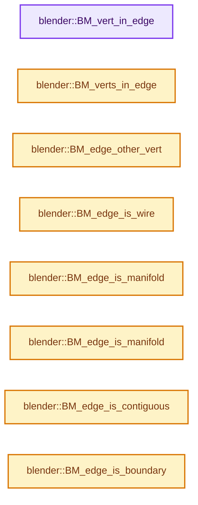
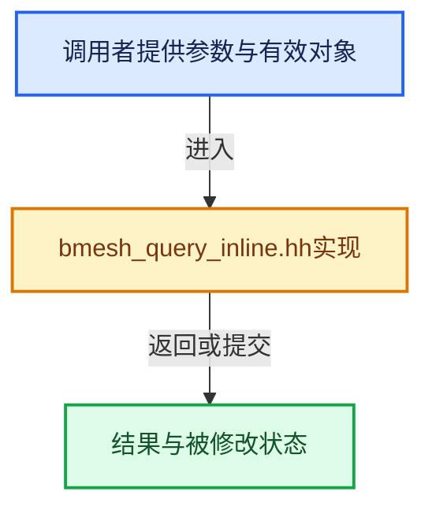

# 实现依赖专题：source/blender/bmesh/intern/bmesh_query_inline.hh

[方向导航](README.md) · [符号索引](../%E7%AC%A6%E5%8F%B7%E4%BE%9D%E8%B5%96%E4%B8%8E%E5%AE%9E%E7%8E%B0%E7%B4%A2%E5%BC%95.md)

本专题从正文实际调用进入，集中保存共享实现。函数有稳定锚点，可从调用处直接跳到对应完整函数；递归与互相调用通过回链组织。

## 本文件的实现关系






## 完整成员与函数实现

<a id="f-bca1d91adf4264fd"></a>

### `blender::BM_vert_in_edge`

实现位置：[source/blender/bmesh/intern/bmesh_query_inline.hh](../../../../../source/blender/bmesh/intern/bmesh_query_inline.hh) · L24—L27。

接口参数：

- `const BMEdge *e`
- `const BMVert *v`

**教学注释版**

<!-- annotated:90485052201885 -->

```cpp
    bool BM_vert_in_edge(const BMEdge *e, const BMVert *v)
{
  return (ELEM(v, e->v1, e->v2));
}
```

<details>
<summary>核对原始源码：source/blender/bmesh/intern/bmesh_query_inline.hh · L24—L27</summary>

<!-- original:90485052201885:source/blender/bmesh/intern/bmesh_query_inline.hh:24:27 -->

```cpp
    bool BM_vert_in_edge(const BMEdge *e, const BMVert *v)
{
  return (ELEM(v, e->v1, e->v2));
}
```

</details>

**结果出口**

- `return (ELEM(v, e->v1, e->v2));`

**继续追踪实现**

- `ELEM` → [ELEM · L88](%E4%BE%9D%E8%B5%96-GHOST_utildefines-34b996.md#m-d28724a15928)；[ELEM · L135](../01-%E5%9F%BA%E7%A1%80%E5%AE%B9%E5%99%A8%E4%B8%8E%E7%8E%B0%E4%BB%A3CPP/%E4%BE%9D%E8%B5%96-BLI_utildefines-293a0a.md#m-d6572de7cae0)。宏定义由构建条件选择。

<a id="f-e6ce763f14e1e526"></a>

### `blender::BM_verts_in_edge`

实现位置：[source/blender/bmesh/intern/bmesh_query_inline.hh](../../../../../source/blender/bmesh/intern/bmesh_query_inline.hh) · L43—L46。

接口参数：

- `const BMVert *v1`
- `const BMVert *v2`
- `const BMEdge *e`

**教学注释版**

<!-- annotated:125dc91635046d -->

```cpp
    bool BM_verts_in_edge(const BMVert *v1, const BMVert *v2, const BMEdge *e)
{
  return ((e->v1 == v1 && e->v2 == v2) || (e->v1 == v2 && e->v2 == v1));
}
```

<details>
<summary>核对原始源码：source/blender/bmesh/intern/bmesh_query_inline.hh · L43—L46</summary>

<!-- original:125dc91635046d:source/blender/bmesh/intern/bmesh_query_inline.hh:43:46 -->

```cpp
    bool BM_verts_in_edge(const BMVert *v1, const BMVert *v2, const BMEdge *e)
{
  return ((e->v1 == v1 && e->v2 == v2) || (e->v1 == v2 && e->v2 == v1));
}
```

</details>

**结果出口**

- `return ((e->v1 == v1 && e->v2 == v2) || (e->v1 == v2 && e->v2 == v1));`

**继续追踪实现**

本实现没有需要继续展开的显式调用；检查返回表达式、对象转换和调用者前置条件。

<a id="f-464fb9614b23d180"></a>

### `blender::BM_edge_other_vert`

实现位置：[source/blender/bmesh/intern/bmesh_query_inline.hh](../../../../../source/blender/bmesh/intern/bmesh_query_inline.hh) · L52—L62。

接口参数：

- `BMEdge *e`
- `const BMVert *v`

**教学注释版**

<!-- annotated:03ff52824f2a71 -->

```cpp
ATTR_WARN_UNUSED_RESULT ATTR_NONNULL(1, 2) BLI_INLINE BMVert *BM_edge_other_vert(BMEdge *e,
                                                                                 const BMVert *v)
{
  if (e->v1 == v) {
    return e->v2;
  }
  if (e->v2 == v) {
    return e->v1;
  }
  return nullptr;
}
```

<details>
<summary>核对原始源码：source/blender/bmesh/intern/bmesh_query_inline.hh · L52—L62</summary>

<!-- original:03ff52824f2a71:source/blender/bmesh/intern/bmesh_query_inline.hh:52:62 -->

```cpp
ATTR_WARN_UNUSED_RESULT ATTR_NONNULL(1, 2) BLI_INLINE BMVert *BM_edge_other_vert(BMEdge *e,
                                                                                 const BMVert *v)
{
  if (e->v1 == v) {
    return e->v2;
  }
  if (e->v2 == v) {
    return e->v1;
  }
  return nullptr;
}
```

</details>

**结果出口**

- `return e->v2;`
- `return e->v1;`
- `return nullptr;`

**继续追踪实现**

本实现没有需要继续展开的显式调用；检查返回表达式、对象转换和调用者前置条件。

<a id="f-8171635700fdb320"></a>

### `blender::BM_edge_is_wire`

实现位置：[source/blender/bmesh/intern/bmesh_query_inline.hh](../../../../../source/blender/bmesh/intern/bmesh_query_inline.hh) · L68—L71。

接口参数：

- `const BMEdge *e`

**教学注释版**

<!-- annotated:b4993a0e20fbcb -->

```cpp
ATTR_WARN_UNUSED_RESULT ATTR_NONNULL(1) BLI_INLINE bool BM_edge_is_wire(const BMEdge *e)
{
  return (e->l == nullptr);
}
```

<details>
<summary>核对原始源码：source/blender/bmesh/intern/bmesh_query_inline.hh · L68—L71</summary>

<!-- original:b4993a0e20fbcb:source/blender/bmesh/intern/bmesh_query_inline.hh:68:71 -->

```cpp
ATTR_WARN_UNUSED_RESULT ATTR_NONNULL(1) BLI_INLINE bool BM_edge_is_wire(const BMEdge *e)
{
  return (e->l == nullptr);
}
```

</details>

**结果出口**

- `return (e->l == nullptr);`

**继续追踪实现**

本实现没有需要继续展开的显式调用；检查返回表达式、对象转换和调用者前置条件。

<a id="f-4944cfa861683f59"></a>

### `blender::BM_edge_is_manifold`

实现位置：[source/blender/bmesh/intern/bmesh_query_inline.hh](../../../../../source/blender/bmesh/intern/bmesh_query_inline.hh) · L79—L84。

接口参数：

- `const BMEdge *e`

**教学注释版**

<!-- annotated:84752fb88898a5 -->

```cpp
ATTR_WARN_UNUSED_RESULT ATTR_NONNULL(1) BLI_INLINE bool BM_edge_is_manifold(const BMEdge *e)
{
  const BMLoop *l = e->l;
  return (l && (l->radial_next != l) &&        /* not 0 or 1 face users */
          (l->radial_next->radial_next == l)); /* 2 face users */
}
```

<details>
<summary>核对原始源码：source/blender/bmesh/intern/bmesh_query_inline.hh · L79—L84</summary>

<!-- original:84752fb88898a5:source/blender/bmesh/intern/bmesh_query_inline.hh:79:84 -->

```cpp
ATTR_WARN_UNUSED_RESULT ATTR_NONNULL(1) BLI_INLINE bool BM_edge_is_manifold(const BMEdge *e)
{
  const BMLoop *l = e->l;
  return (l && (l->radial_next != l) &&        /* not 0 or 1 face users */
          (l->radial_next->radial_next == l)); /* 2 face users */
}
```

</details>

**结果出口**

- `return (l && (l->radial_next != l) &&        /* not 0 or 1 face users */`

**继续追踪实现**

本实现没有需要继续展开的显式调用；检查返回表达式、对象转换和调用者前置条件。

<a id="f-f07686548bcc2440"></a>

### `blender::BM_edge_is_manifold`

实现位置：[source/blender/bmesh/intern/bmesh_query_inline.hh](../../../../../source/blender/bmesh/intern/bmesh_query_inline.hh) · L86—L89。

接口参数：

- `BMEdge *e`

**教学注释版**

<!-- annotated:4dd8c70d04eb9d -->

```cpp
BLI_INLINE int BM_edge_is_manifold(BMEdge *e)
{
  return (BM_edge_face_count(e) == 2);
}
```

<details>
<summary>核对原始源码：source/blender/bmesh/intern/bmesh_query_inline.hh · L86—L89</summary>

<!-- original:4dd8c70d04eb9d:source/blender/bmesh/intern/bmesh_query_inline.hh:86:89 -->

```cpp
BLI_INLINE int BM_edge_is_manifold(BMEdge *e)
{
  return (BM_edge_face_count(e) == 2);
}
```

</details>

**结果出口**

- `return (BM_edge_face_count(e) == 2);`

**继续追踪实现**

- `BM_edge_face_count` → [blender::BM_edge_face_count · L641](%E4%BE%9D%E8%B5%96-bmesh_query-b0f8d6.md#f-761ee7a093256f30)。

<a id="f-58967a5b1ddd71cb"></a>

### `blender::BM_edge_is_contiguous`

实现位置：[source/blender/bmesh/intern/bmesh_query_inline.hh](../../../../../source/blender/bmesh/intern/bmesh_query_inline.hh) · L96—L103。

接口参数：

- `const BMEdge *e`

**教学注释版**

<!-- annotated:c24c97954b8f5b -->

```cpp
ATTR_WARN_UNUSED_RESULT ATTR_NONNULL(1) BLI_INLINE bool BM_edge_is_contiguous(const BMEdge *e)
{
  const BMLoop *l = e->l;
  const BMLoop *l_other;
  return (l && ((l_other = l->radial_next) != l) && /* not 0 or 1 face users */
          (l_other->radial_next == l) &&            /* 2 face users */
          (l_other->v != l->v));
}
```

<details>
<summary>核对原始源码：source/blender/bmesh/intern/bmesh_query_inline.hh · L96—L103</summary>

<!-- original:c24c97954b8f5b:source/blender/bmesh/intern/bmesh_query_inline.hh:96:103 -->

```cpp
ATTR_WARN_UNUSED_RESULT ATTR_NONNULL(1) BLI_INLINE bool BM_edge_is_contiguous(const BMEdge *e)
{
  const BMLoop *l = e->l;
  const BMLoop *l_other;
  return (l && ((l_other = l->radial_next) != l) && /* not 0 or 1 face users */
          (l_other->radial_next == l) &&            /* 2 face users */
          (l_other->v != l->v));
}
```

</details>

**结果出口**

- `return (l && ((l_other = l->radial_next) != l) && /* not 0 or 1 face users */`

**继续追踪实现**

本实现没有需要继续展开的显式调用；检查返回表达式、对象转换和调用者前置条件。

<a id="f-9626087cfab8be44"></a>

### `blender::BM_edge_is_boundary`

实现位置：[source/blender/bmesh/intern/bmesh_query_inline.hh](../../../../../source/blender/bmesh/intern/bmesh_query_inline.hh) · L111—L115。

接口参数：

- `const BMEdge *e`

**教学注释版**

<!-- annotated:44a2d1010a6a2f -->

```cpp
ATTR_WARN_UNUSED_RESULT ATTR_NONNULL(1) BLI_INLINE bool BM_edge_is_boundary(const BMEdge *e)
{
  const BMLoop *l = e->l;
  return (l && (l->radial_next == l));
}
```

<details>
<summary>核对原始源码：source/blender/bmesh/intern/bmesh_query_inline.hh · L111—L115</summary>

<!-- original:44a2d1010a6a2f:source/blender/bmesh/intern/bmesh_query_inline.hh:111:115 -->

```cpp
ATTR_WARN_UNUSED_RESULT ATTR_NONNULL(1) BLI_INLINE bool BM_edge_is_boundary(const BMEdge *e)
{
  const BMLoop *l = e->l;
  return (l && (l->radial_next == l));
}
```

</details>

**结果出口**

- `return (l && (l->radial_next == l));`

**继续追踪实现**

本实现没有需要继续展开的显式调用；检查返回表达式、对象转换和调用者前置条件。

<a id="f-2fee18c217b38784"></a>

### `blender::BM_edge_is_boundary`

实现位置：[source/blender/bmesh/intern/bmesh_query_inline.hh](../../../../../source/blender/bmesh/intern/bmesh_query_inline.hh) · L117—L120。

接口参数：

- `BMEdge *e`

**教学注释版**

<!-- annotated:ad483a3c4eb8db -->

```cpp
BLI_INLINE int BM_edge_is_boundary(BMEdge *e)
{
  return (BM_edge_face_count(e) == 1);
}
```

<details>
<summary>核对原始源码：source/blender/bmesh/intern/bmesh_query_inline.hh · L117—L120</summary>

<!-- original:ad483a3c4eb8db:source/blender/bmesh/intern/bmesh_query_inline.hh:117:120 -->

```cpp
BLI_INLINE int BM_edge_is_boundary(BMEdge *e)
{
  return (BM_edge_face_count(e) == 1);
}
```

</details>

**结果出口**

- `return (BM_edge_face_count(e) == 1);`

**继续追踪实现**

- `BM_edge_face_count` → [blender::BM_edge_face_count · L641](%E4%BE%9D%E8%B5%96-bmesh_query-b0f8d6.md#f-761ee7a093256f30)。

<a id="f-62894948dd4628b0"></a>

### `blender::BM_loop_is_adjacent`

实现位置：[source/blender/bmesh/intern/bmesh_query_inline.hh](../../../../../source/blender/bmesh/intern/bmesh_query_inline.hh) · L127—L132。

接口参数：

- `const BMLoop *l_a`
- `const BMLoop *l_b`

**教学注释版**

<!-- annotated:36c6cda85c9b5e -->

```cpp
    bool BM_loop_is_adjacent(const BMLoop *l_a, const BMLoop *l_b)
{
  BLI_assert(l_a->f == l_b->f);
  BLI_assert(l_a != l_b);
  return (ELEM(l_b, l_a->next, l_a->prev));
}
```

<details>
<summary>核对原始源码：source/blender/bmesh/intern/bmesh_query_inline.hh · L127—L132</summary>

<!-- original:36c6cda85c9b5e:source/blender/bmesh/intern/bmesh_query_inline.hh:127:132 -->

```cpp
    bool BM_loop_is_adjacent(const BMLoop *l_a, const BMLoop *l_b)
{
  BLI_assert(l_a->f == l_b->f);
  BLI_assert(l_a != l_b);
  return (ELEM(l_b, l_a->next, l_a->prev));
}
```

</details>

**结果出口**

- `return (ELEM(l_b, l_a->next, l_a->prev));`

**继续追踪实现**

- `BLI_assert` → [BLI_assert · L48](../01-%E5%9F%BA%E7%A1%80%E5%AE%B9%E5%99%A8%E4%B8%8E%E7%8E%B0%E4%BB%A3CPP/%E4%BE%9D%E8%B5%96-BLI_assert-cc98e8.md#m-57a88495704d)；[BLI_assert · L63](../01-%E5%9F%BA%E7%A1%80%E5%AE%B9%E5%99%A8%E4%B8%8E%E7%8E%B0%E4%BB%A3CPP/%E4%BE%9D%E8%B5%96-BLI_assert-cc98e8.md#m-d07050020cb5)。宏定义由构建条件选择。
- `ELEM` → [ELEM · L88](%E4%BE%9D%E8%B5%96-GHOST_utildefines-34b996.md#m-d28724a15928)；[ELEM · L135](../01-%E5%9F%BA%E7%A1%80%E5%AE%B9%E5%99%A8%E4%B8%8E%E7%8E%B0%E4%BB%A3CPP/%E4%BE%9D%E8%B5%96-BLI_utildefines-293a0a.md#m-d6572de7cae0)。宏定义由构建条件选择。
