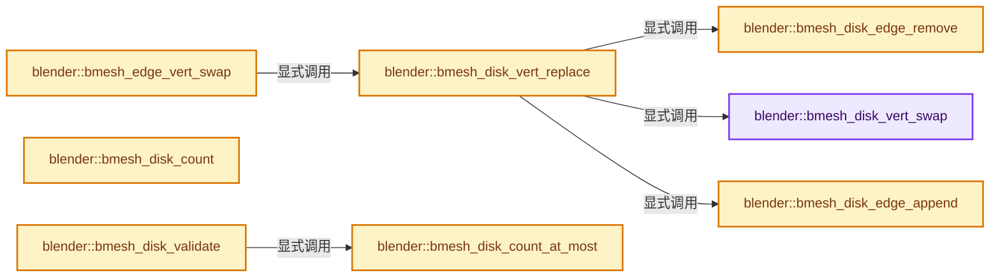

# 实现依赖专题：source/blender/bmesh/intern/bmesh_structure.cc

[方向导航](README.md) · [符号索引](../%E7%AC%A6%E5%8F%B7%E4%BE%9D%E8%B5%96%E4%B8%8E%E5%AE%9E%E7%8E%B0%E7%B4%A2%E5%BC%95.md)

本专题从正文实际调用进入，集中保存共享实现。函数有稳定锚点，可从调用处直接跳到对应完整函数；递归与互相调用通过回链组织。

## 本文件的实现关系




## 完整成员与函数实现

<a id="f-7bf8a816208da9a1"></a>

### `blender::bmesh_disk_vert_swap`

实现位置：[source/blender/bmesh/intern/bmesh_structure.cc](../../../../../source/blender/bmesh/intern/bmesh_structure.cc) · L22—L35。

接口参数：

- `BMEdge *e`
- `BMVert *v_dst`
- `BMVert *v_src`

**教学注释版**

<!-- annotated:356290b0f7a89f -->

```cpp
void bmesh_disk_vert_swap(BMEdge *e, BMVert *v_dst, BMVert *v_src)
{
  if (e->v1 == v_src) {
    e->v1 = v_dst;
    e->v1_disk_link.next = e->v1_disk_link.prev = nullptr;
  }
  else if (e->v2 == v_src) {
    e->v2 = v_dst;
    e->v2_disk_link.next = e->v2_disk_link.prev = nullptr;
  }
  else {
    BLI_assert(0);
  }
}
```

<details>
<summary>核对原始源码：source/blender/bmesh/intern/bmesh_structure.cc · L22—L35</summary>

<!-- original:356290b0f7a89f:source/blender/bmesh/intern/bmesh_structure.cc:22:35 -->

```cpp
void bmesh_disk_vert_swap(BMEdge *e, BMVert *v_dst, BMVert *v_src)
{
  if (e->v1 == v_src) {
    e->v1 = v_dst;
    e->v1_disk_link.next = e->v1_disk_link.prev = nullptr;
  }
  else if (e->v2 == v_src) {
    e->v2 = v_dst;
    e->v2_disk_link.next = e->v2_disk_link.prev = nullptr;
  }
  else {
    BLI_assert(0);
  }
}
```

</details>

**沿实际写入检查状态**

- `e->v1 = v_dst;`
- `e->v1_disk_link.next = e->v1_disk_link.prev = nullptr;`
- `e->v2 = v_dst;`
- `e->v2_disk_link.next = e->v2_disk_link.prev = nullptr;`

**继续追踪实现**

- `BLI_assert` → [BLI_assert · L48](../01-%E5%9F%BA%E7%A1%80%E5%AE%B9%E5%99%A8%E4%B8%8E%E7%8E%B0%E4%BB%A3CPP/%E4%BE%9D%E8%B5%96-BLI_assert-cc98e8.md#m-57a88495704d)；[BLI_assert · L63](../01-%E5%9F%BA%E7%A1%80%E5%AE%B9%E5%99%A8%E4%B8%8E%E7%8E%B0%E4%BB%A3CPP/%E4%BE%9D%E8%B5%96-BLI_assert-cc98e8.md#m-d07050020cb5)。宏定义由构建条件选择。

<a id="f-21640c6bb6f08395"></a>

### `blender::bmesh_edge_vert_swap`

实现位置：[source/blender/bmesh/intern/bmesh_structure.cc](../../../../../source/blender/bmesh/intern/bmesh_structure.cc) · L37—L58。

接口参数：

- `BMEdge *e`
- `BMVert *v_dst`
- `BMVert *v_src`

**教学注释版**

<!-- annotated:2a3552dc62279d -->

```cpp
void bmesh_edge_vert_swap(BMEdge *e, BMVert *v_dst, BMVert *v_src)
{
  /* swap out loops */
  if (e->l) {
    BMLoop *l_iter, *l_first;
    l_iter = l_first = e->l;
    do {
      if (l_iter->v == v_src) {
        l_iter->v = v_dst;
      }
      else if (l_iter->next->v == v_src) {
        l_iter->next->v = v_dst;
      }
      else {
        BLI_assert(l_iter->prev->v != v_src);
      }
    } while ((l_iter = l_iter->radial_next) != l_first);
  }

  /* swap out edges */
  bmesh_disk_vert_replace(e, v_dst, v_src);
}
```

<details>
<summary>核对原始源码：source/blender/bmesh/intern/bmesh_structure.cc · L37—L58</summary>

<!-- original:2a3552dc62279d:source/blender/bmesh/intern/bmesh_structure.cc:37:58 -->

```cpp
void bmesh_edge_vert_swap(BMEdge *e, BMVert *v_dst, BMVert *v_src)
{
  /* swap out loops */
  if (e->l) {
    BMLoop *l_iter, *l_first;
    l_iter = l_first = e->l;
    do {
      if (l_iter->v == v_src) {
        l_iter->v = v_dst;
      }
      else if (l_iter->next->v == v_src) {
        l_iter->next->v = v_dst;
      }
      else {
        BLI_assert(l_iter->prev->v != v_src);
      }
    } while ((l_iter = l_iter->radial_next) != l_first);
  }

  /* swap out edges */
  bmesh_disk_vert_replace(e, v_dst, v_src);
}
```

</details>

**沿实际写入检查状态**

- `l_iter = l_first = e->l;`
- `l_iter->v = v_dst;`
- `l_iter->next->v = v_dst;`

**继续追踪实现**

- `BLI_assert` → [BLI_assert · L48](../01-%E5%9F%BA%E7%A1%80%E5%AE%B9%E5%99%A8%E4%B8%8E%E7%8E%B0%E4%BB%A3CPP/%E4%BE%9D%E8%B5%96-BLI_assert-cc98e8.md#m-57a88495704d)；[BLI_assert · L63](../01-%E5%9F%BA%E7%A1%80%E5%AE%B9%E5%99%A8%E4%B8%8E%E7%8E%B0%E4%BB%A3CPP/%E4%BE%9D%E8%B5%96-BLI_assert-cc98e8.md#m-d07050020cb5)。宏定义由构建条件选择。
- `bmesh_disk_vert_replace` → [blender::bmesh_disk_vert_replace · L60](%E4%BE%9D%E8%B5%96-bmesh_structure-8ade17.md#f-08b21b7ee223d22f)。

<a id="f-08b21b7ee223d22f"></a>

### `blender::bmesh_disk_vert_replace`

实现位置：[source/blender/bmesh/intern/bmesh_structure.cc](../../../../../source/blender/bmesh/intern/bmesh_structure.cc) · L60—L67。

接口参数：

- `BMEdge *e`
- `BMVert *v_dst`
- `BMVert *v_src`

**教学注释版**

<!-- annotated:d4ded3baeefab3 -->

```cpp
void bmesh_disk_vert_replace(BMEdge *e, BMVert *v_dst, BMVert *v_src)
{
  BLI_assert(e->v1 == v_src || e->v2 == v_src);
  bmesh_disk_edge_remove(e, v_src);      /* Remove `e` from `v_src` disk cycle. */
  bmesh_disk_vert_swap(e, v_dst, v_src); /* Swap out `v_src` for `v_dst` in `e`. */
  bmesh_disk_edge_append(e, v_dst);      /* Add `e` to `v_dst` disk cycle. */
  BLI_assert(e->v1 != e->v2);
}
```

<details>
<summary>核对原始源码：source/blender/bmesh/intern/bmesh_structure.cc · L60—L67</summary>

<!-- original:d4ded3baeefab3:source/blender/bmesh/intern/bmesh_structure.cc:60:67 -->

```cpp
void bmesh_disk_vert_replace(BMEdge *e, BMVert *v_dst, BMVert *v_src)
{
  BLI_assert(e->v1 == v_src || e->v2 == v_src);
  bmesh_disk_edge_remove(e, v_src);      /* Remove `e` from `v_src` disk cycle. */
  bmesh_disk_vert_swap(e, v_dst, v_src); /* Swap out `v_src` for `v_dst` in `e`. */
  bmesh_disk_edge_append(e, v_dst);      /* Add `e` to `v_dst` disk cycle. */
  BLI_assert(e->v1 != e->v2);
}
```

</details>

**继续追踪实现**

- `BLI_assert` → [BLI_assert · L48](../01-%E5%9F%BA%E7%A1%80%E5%AE%B9%E5%99%A8%E4%B8%8E%E7%8E%B0%E4%BB%A3CPP/%E4%BE%9D%E8%B5%96-BLI_assert-cc98e8.md#m-57a88495704d)；[BLI_assert · L63](../01-%E5%9F%BA%E7%A1%80%E5%AE%B9%E5%99%A8%E4%B8%8E%E7%8E%B0%E4%BB%A3CPP/%E4%BE%9D%E8%B5%96-BLI_assert-cc98e8.md#m-d07050020cb5)。宏定义由构建条件选择。
- `bmesh_disk_edge_remove` → [blender::bmesh_disk_edge_remove · L164](%E4%BE%9D%E8%B5%96-bmesh_structure-8ade17.md#f-6fa586215b636ffb)。
- `bmesh_disk_vert_swap` → [blender::bmesh_disk_vert_swap · L22](%E4%BE%9D%E8%B5%96-bmesh_structure-8ade17.md#f-7bf8a816208da9a1)。
- `bmesh_disk_edge_append` → [blender::bmesh_disk_edge_append · L139](%E4%BE%9D%E8%B5%96-bmesh_structure-8ade17.md#f-96e6ddb6b5274a71)。

<a id="f-96e6ddb6b5274a71"></a>

### `blender::bmesh_disk_edge_append`

实现位置：[source/blender/bmesh/intern/bmesh_structure.cc](../../../../../source/blender/bmesh/intern/bmesh_structure.cc) · L139—L162。

接口参数：

- `BMEdge *e`
- `BMVert *v`

**教学注释版**

<!-- annotated:1b23b6aa643f9c -->

```cpp
void bmesh_disk_edge_append(BMEdge *e, BMVert *v)
{
  if (!v->e) {
    BMDiskLink *dl1 = bmesh_disk_edge_link_from_vert(e, v);

    v->e = e;
    dl1->next = dl1->prev = e;
  }
  else {
    BMDiskLink *dl1, *dl2, *dl3;

    dl1 = bmesh_disk_edge_link_from_vert(e, v);
    dl2 = bmesh_disk_edge_link_from_vert(v->e, v);
    dl3 = dl2->prev ? bmesh_disk_edge_link_from_vert(dl2->prev, v) : nullptr;

    dl1->next = v->e;
    dl1->prev = dl2->prev;

    dl2->prev = e;
    if (dl3) {
      dl3->next = e;
    }
  }
}
```

<details>
<summary>核对原始源码：source/blender/bmesh/intern/bmesh_structure.cc · L139—L162</summary>

<!-- original:1b23b6aa643f9c:source/blender/bmesh/intern/bmesh_structure.cc:139:162 -->

```cpp
void bmesh_disk_edge_append(BMEdge *e, BMVert *v)
{
  if (!v->e) {
    BMDiskLink *dl1 = bmesh_disk_edge_link_from_vert(e, v);

    v->e = e;
    dl1->next = dl1->prev = e;
  }
  else {
    BMDiskLink *dl1, *dl2, *dl3;

    dl1 = bmesh_disk_edge_link_from_vert(e, v);
    dl2 = bmesh_disk_edge_link_from_vert(v->e, v);
    dl3 = dl2->prev ? bmesh_disk_edge_link_from_vert(dl2->prev, v) : nullptr;

    dl1->next = v->e;
    dl1->prev = dl2->prev;

    dl2->prev = e;
    if (dl3) {
      dl3->next = e;
    }
  }
}
```

</details>

**沿实际写入检查状态**

- `v->e = e;`
- `dl1->next = dl1->prev = e;`
- `dl1 = bmesh_disk_edge_link_from_vert(e, v);`
- `dl2 = bmesh_disk_edge_link_from_vert(v->e, v);`
- `dl3 = dl2->prev ? bmesh_disk_edge_link_from_vert(dl2->prev, v) : nullptr;`
- `dl1->next = v->e;`
- `dl1->prev = dl2->prev;`
- `dl2->prev = e;`
- `dl3->next = e;`

**继续追踪实现**

- `bmesh_disk_edge_link_from_vert` → [blender::bmesh_disk_edge_link_from_vert · L22](%E4%BE%9D%E8%B5%96-bmesh_structure_inline-3e4d59.md#f-544b7a8feb97f3ce)。

<a id="f-6fa586215b636ffb"></a>

### `blender::bmesh_disk_edge_remove`

实现位置：[source/blender/bmesh/intern/bmesh_structure.cc](../../../../../source/blender/bmesh/intern/bmesh_structure.cc) · L164—L184。

接口参数：

- `BMEdge *e`
- `BMVert *v`

**教学注释版**

<!-- annotated:630c81085b2abc -->

```cpp
void bmesh_disk_edge_remove(BMEdge *e, BMVert *v)
{
  BMDiskLink *dl1, *dl2;

  dl1 = bmesh_disk_edge_link_from_vert(e, v);
  if (dl1->prev) {
    dl2 = bmesh_disk_edge_link_from_vert(dl1->prev, v);
    dl2->next = dl1->next;
  }

  if (dl1->next) {
    dl2 = bmesh_disk_edge_link_from_vert(dl1->next, v);
    dl2->prev = dl1->prev;
  }

  if (v->e == e) {
    v->e = (e != dl1->next) ? dl1->next : nullptr;
  }

  dl1->next = dl1->prev = nullptr;
}
```

<details>
<summary>核对原始源码：source/blender/bmesh/intern/bmesh_structure.cc · L164—L184</summary>

<!-- original:630c81085b2abc:source/blender/bmesh/intern/bmesh_structure.cc:164:184 -->

```cpp
void bmesh_disk_edge_remove(BMEdge *e, BMVert *v)
{
  BMDiskLink *dl1, *dl2;

  dl1 = bmesh_disk_edge_link_from_vert(e, v);
  if (dl1->prev) {
    dl2 = bmesh_disk_edge_link_from_vert(dl1->prev, v);
    dl2->next = dl1->next;
  }

  if (dl1->next) {
    dl2 = bmesh_disk_edge_link_from_vert(dl1->next, v);
    dl2->prev = dl1->prev;
  }

  if (v->e == e) {
    v->e = (e != dl1->next) ? dl1->next : nullptr;
  }

  dl1->next = dl1->prev = nullptr;
}
```

</details>

**沿实际写入检查状态**

- `dl1 = bmesh_disk_edge_link_from_vert(e, v);`
- `dl2 = bmesh_disk_edge_link_from_vert(dl1->prev, v);`
- `dl2->next = dl1->next;`
- `dl2 = bmesh_disk_edge_link_from_vert(dl1->next, v);`
- `dl2->prev = dl1->prev;`
- `v->e = (e != dl1->next) ? dl1->next : nullptr;`
- `dl1->next = dl1->prev = nullptr;`

**继续追踪实现**

- `bmesh_disk_edge_link_from_vert` → [blender::bmesh_disk_edge_link_from_vert · L22](%E4%BE%9D%E8%B5%96-bmesh_structure_inline-3e4d59.md#f-544b7a8feb97f3ce)。

<a id="f-a9996c5c854d54c2"></a>

### `blender::bmesh_disk_count`

实现位置：[source/blender/bmesh/intern/bmesh_structure.cc](../../../../../source/blender/bmesh/intern/bmesh_structure.cc) · L202—L213。

接口参数：

- `const BMVert *v`

**教学注释版**

<!-- annotated:0f4fefb4afe5d7 -->

```cpp
int bmesh_disk_count(const BMVert *v)
{
  int count = 0;
  if (v->e) {
    BMEdge *e_first, *e_iter;
    e_iter = e_first = v->e;
    do {
      count++;
    } while ((e_iter = bmesh_disk_edge_next(e_iter, v)) != e_first);
  }
  return count;
}
```

<details>
<summary>核对原始源码：source/blender/bmesh/intern/bmesh_structure.cc · L202—L213</summary>

<!-- original:0f4fefb4afe5d7:source/blender/bmesh/intern/bmesh_structure.cc:202:213 -->

```cpp
int bmesh_disk_count(const BMVert *v)
{
  int count = 0;
  if (v->e) {
    BMEdge *e_first, *e_iter;
    e_iter = e_first = v->e;
    do {
      count++;
    } while ((e_iter = bmesh_disk_edge_next(e_iter, v)) != e_first);
  }
  return count;
}
```

</details>

**沿实际写入检查状态**

- `e_iter = e_first = v->e;`

**结果出口**

- `return count;`

**继续追踪实现**

- `bmesh_disk_edge_next` → [blender::bmesh_disk_edge_next · L59](%E4%BE%9D%E8%B5%96-bmesh_structure_inline-3e4d59.md#f-bde0a66632cf5785)。

<a id="f-6b353d00b07957a2"></a>

### `blender::bmesh_disk_count_at_most`

实现位置：[source/blender/bmesh/intern/bmesh_structure.cc](../../../../../source/blender/bmesh/intern/bmesh_structure.cc) · L215—L229。

接口参数：

- `const BMVert *v`
- `const int count_max`

**教学注释版**

<!-- annotated:9a72166e11c78d -->

```cpp
int bmesh_disk_count_at_most(const BMVert *v, const int count_max)
{
  int count = 0;
  if (v->e) {
    BMEdge *e_first, *e_iter;
    e_iter = e_first = v->e;
    do {
      count++;
      if (count == count_max) {
        break;
      }
    } while ((e_iter = bmesh_disk_edge_next(e_iter, v)) != e_first);
  }
  return count;
}
```

<details>
<summary>核对原始源码：source/blender/bmesh/intern/bmesh_structure.cc · L215—L229</summary>

<!-- original:9a72166e11c78d:source/blender/bmesh/intern/bmesh_structure.cc:215:229 -->

```cpp
int bmesh_disk_count_at_most(const BMVert *v, const int count_max)
{
  int count = 0;
  if (v->e) {
    BMEdge *e_first, *e_iter;
    e_iter = e_first = v->e;
    do {
      count++;
      if (count == count_max) {
        break;
      }
    } while ((e_iter = bmesh_disk_edge_next(e_iter, v)) != e_first);
  }
  return count;
}
```

</details>

**沿实际写入检查状态**

- `e_iter = e_first = v->e;`

**结果出口**

- `return count;`

**继续追踪实现**

- `bmesh_disk_edge_next` → [blender::bmesh_disk_edge_next · L59](%E4%BE%9D%E8%B5%96-bmesh_structure_inline-3e4d59.md#f-bde0a66632cf5785)。

<a id="f-1abc0f5ad98b5e04"></a>

### `blender::bmesh_disk_validate`

实现位置：[source/blender/bmesh/intern/bmesh_structure.cc](../../../../../source/blender/bmesh/intern/bmesh_structure.cc) · L231—L250。

接口参数：

- `int len`
- `BMEdge *e`
- `BMVert *v`

**教学注释版**

<!-- annotated:c098c41ea4b535 -->

```cpp
bool bmesh_disk_validate(int len, BMEdge *e, BMVert *v)
{
  BMEdge *e_iter;

  if (!BM_vert_in_edge(e, v)) {
    return false;
  }
  if (len == 0 || bmesh_disk_count_at_most(v, len + 1) != len) {
    return false;
  }

  e_iter = e;
  do {
    if (len != 1 && bmesh_disk_edge_prev(e_iter, v) == e_iter) {
      return false;
    }
  } while ((e_iter = bmesh_disk_edge_next(e_iter, v)) != e);

  return true;
}
```

<details>
<summary>核对原始源码：source/blender/bmesh/intern/bmesh_structure.cc · L231—L250</summary>

<!-- original:c098c41ea4b535:source/blender/bmesh/intern/bmesh_structure.cc:231:250 -->

```cpp
bool bmesh_disk_validate(int len, BMEdge *e, BMVert *v)
{
  BMEdge *e_iter;

  if (!BM_vert_in_edge(e, v)) {
    return false;
  }
  if (len == 0 || bmesh_disk_count_at_most(v, len + 1) != len) {
    return false;
  }

  e_iter = e;
  do {
    if (len != 1 && bmesh_disk_edge_prev(e_iter, v) == e_iter) {
      return false;
    }
  } while ((e_iter = bmesh_disk_edge_next(e_iter, v)) != e);

  return true;
}
```

</details>

**沿实际写入检查状态**

- `e_iter = e;`

**结果出口**

- `return false;`
- `return true;`

**继续追踪实现**

- `BM_vert_in_edge` → [blender::BM_vert_in_edge · L24](%E4%BE%9D%E8%B5%96-bmesh_query_inline-c93392.md#f-bca1d91adf4264fd)。
- `bmesh_disk_count_at_most` → [blender::bmesh_disk_count_at_most · L215](%E4%BE%9D%E8%B5%96-bmesh_structure-8ade17.md#f-6b353d00b07957a2)。
- `bmesh_disk_edge_prev` → [blender::bmesh_disk_edge_prev · L65](%E4%BE%9D%E8%B5%96-bmesh_structure_inline-3e4d59.md#f-b56ec887166168a1)。
- `bmesh_disk_edge_next` → [blender::bmesh_disk_edge_next · L59](%E4%BE%9D%E8%B5%96-bmesh_structure_inline-3e4d59.md#f-bde0a66632cf5785)。

<a id="f-2a30bde02ae96ee2"></a>

### `blender::bmesh_disk_faceloop_find_first`

实现位置：[source/blender/bmesh/intern/bmesh_structure.cc](../../../../../source/blender/bmesh/intern/bmesh_structure.cc) · L302—L311。

接口参数：

- `const BMEdge *e`
- `const BMVert *v`

**教学注释版**

<!-- annotated:ad733e35fcdb74 -->

```cpp
BMLoop *bmesh_disk_faceloop_find_first(const BMEdge *e, const BMVert *v)
{
  const BMEdge *e_iter = e;
  do {
    if (e_iter->l != nullptr) {
      return (e_iter->l->v == v) ? e_iter->l : e_iter->l->next;
    }
  } while ((e_iter = bmesh_disk_edge_next(e_iter, v)) != e);
  return nullptr;
}
```

<details>
<summary>核对原始源码：source/blender/bmesh/intern/bmesh_structure.cc · L302—L311</summary>

<!-- original:ad733e35fcdb74:source/blender/bmesh/intern/bmesh_structure.cc:302:311 -->

```cpp
BMLoop *bmesh_disk_faceloop_find_first(const BMEdge *e, const BMVert *v)
{
  const BMEdge *e_iter = e;
  do {
    if (e_iter->l != nullptr) {
      return (e_iter->l->v == v) ? e_iter->l : e_iter->l->next;
    }
  } while ((e_iter = bmesh_disk_edge_next(e_iter, v)) != e);
  return nullptr;
}
```

</details>

**结果出口**

- `return (e_iter->l->v == v) ? e_iter->l : e_iter->l->next;`
- `return nullptr;`

**继续追踪实现**

- `bmesh_disk_edge_next` → [blender::bmesh_disk_edge_next · L59](%E4%BE%9D%E8%B5%96-bmesh_structure_inline-3e4d59.md#f-bde0a66632cf5785)。

<a id="f-3de9e962ecf94a22"></a>

### `blender::bmesh_radial_validate`

实现位置：[source/blender/bmesh/intern/bmesh_structure.cc](../../../../../source/blender/bmesh/intern/bmesh_structure.cc) · L344—L375。

接口参数：

- `int radlen`
- `BMLoop *l`

**教学注释版**

<!-- annotated:83cb0301b3f729 -->

```cpp
bool bmesh_radial_validate(int radlen, BMLoop *l)
{
  BMLoop *l_iter = l;
  int i = 0;

  if (bmesh_radial_length(l) != radlen) {
    return false;
  }

  do {
    if (!l_iter) [[unlikely]] {
      BMESH_ASSERT(0);
      return false;
    }

    if (l_iter->e != l->e) {
      return false;
    }
    if (!ELEM(l_iter->v, l->e->v1, l->e->v2)) {
      return false;
    }

    if (i > BM_LOOP_RADIAL_MAX) [[unlikely]] {
      BMESH_ASSERT(0);
      return false;
    }

    i++;
  } while ((l_iter = l_iter->radial_next) != l);

  return true;
}
```

<details>
<summary>核对原始源码：source/blender/bmesh/intern/bmesh_structure.cc · L344—L375</summary>

<!-- original:83cb0301b3f729:source/blender/bmesh/intern/bmesh_structure.cc:344:375 -->

```cpp
bool bmesh_radial_validate(int radlen, BMLoop *l)
{
  BMLoop *l_iter = l;
  int i = 0;

  if (bmesh_radial_length(l) != radlen) {
    return false;
  }

  do {
    if (!l_iter) [[unlikely]] {
      BMESH_ASSERT(0);
      return false;
    }

    if (l_iter->e != l->e) {
      return false;
    }
    if (!ELEM(l_iter->v, l->e->v1, l->e->v2)) {
      return false;
    }

    if (i > BM_LOOP_RADIAL_MAX) [[unlikely]] {
      BMESH_ASSERT(0);
      return false;
    }

    i++;
  } while ((l_iter = l_iter->radial_next) != l);

  return true;
}
```

</details>

**结果出口**

- `return false;`
- `return true;`

**继续追踪实现**

- `bmesh_radial_length` → [blender::bmesh_radial_length · L468](%E4%BE%9D%E8%B5%96-bmesh_structure-8ade17.md#f-d31f9774509d1374)。
- `BMESH_ASSERT` → [BMESH_ASSERT · L86](%E4%BE%9D%E8%B5%96-bmesh_error-8056e3.md#m-00685b9e20fb)。宏定义由构建条件选择。
- `ELEM` → [ELEM · L88](%E4%BE%9D%E8%B5%96-GHOST_utildefines-34b996.md#m-d28724a15928)；[ELEM · L135](../01-%E5%9F%BA%E7%A1%80%E5%AE%B9%E5%99%A8%E4%B8%8E%E7%8E%B0%E4%BB%A3CPP/%E4%BE%9D%E8%B5%96-BLI_utildefines-293a0a.md#m-d6572de7cae0)。宏定义由构建条件选择。

<a id="f-34ebfdf5d6f96bc4"></a>

### `blender::bmesh_radial_loop_append`

实现位置：[source/blender/bmesh/intern/bmesh_structure.cc](../../../../../source/blender/bmesh/intern/bmesh_structure.cc) · L377—L399。

接口参数：

- `BMEdge *e`
- `BMLoop *l`

**教学注释版**

<!-- annotated:66fe410dae160b -->

```cpp
void bmesh_radial_loop_append(BMEdge *e, BMLoop *l)
{
  if (e->l == nullptr) {
    e->l = l;
    l->radial_next = l->radial_prev = l;
  }
  else {
    l->radial_prev = e->l;
    l->radial_next = e->l->radial_next;

    e->l->radial_next->radial_prev = l;
    e->l->radial_next = l;

    e->l = l;
  }

  if (l->e && l->e != e) [[unlikely]] {
    /* l is already in a radial cycle for a different edge */
    BMESH_ASSERT(0);
  }

  l->e = e;
}
```

<details>
<summary>核对原始源码：source/blender/bmesh/intern/bmesh_structure.cc · L377—L399</summary>

<!-- original:66fe410dae160b:source/blender/bmesh/intern/bmesh_structure.cc:377:399 -->

```cpp
void bmesh_radial_loop_append(BMEdge *e, BMLoop *l)
{
  if (e->l == nullptr) {
    e->l = l;
    l->radial_next = l->radial_prev = l;
  }
  else {
    l->radial_prev = e->l;
    l->radial_next = e->l->radial_next;

    e->l->radial_next->radial_prev = l;
    e->l->radial_next = l;

    e->l = l;
  }

  if (l->e && l->e != e) [[unlikely]] {
    /* l is already in a radial cycle for a different edge */
    BMESH_ASSERT(0);
  }

  l->e = e;
}
```

</details>

**沿实际写入检查状态**

- `e->l = l;`
- `l->radial_next = l->radial_prev = l;`
- `l->radial_prev = e->l;`
- `l->radial_next = e->l->radial_next;`
- `e->l->radial_next->radial_prev = l;`
- `e->l->radial_next = l;`
- `l->e = e;`

**继续追踪实现**

- `BMESH_ASSERT` → [BMESH_ASSERT · L86](%E4%BE%9D%E8%B5%96-bmesh_error-8056e3.md#m-00685b9e20fb)。宏定义由构建条件选择。

<a id="f-ab35ad05468f6a4c"></a>

### `blender::bmesh_radial_loop_remove`

实现位置：[source/blender/bmesh/intern/bmesh_structure.cc](../../../../../source/blender/bmesh/intern/bmesh_structure.cc) · L401—L429。

接口参数：

- `BMEdge *e`
- `BMLoop *l`

**教学注释版**

<!-- annotated:85337ac0177a6c -->

```cpp
void bmesh_radial_loop_remove(BMEdge *e, BMLoop *l)
{
  /* if e is non-nullptr, l must be in the radial cycle of e */
  if (e != l->e) [[unlikely]] {
    BMESH_ASSERT(0);
  }

  if (l->radial_next != l) {
    if (l == e->l) {
      e->l = l->radial_next;
    }

    l->radial_next->radial_prev = l->radial_prev;
    l->radial_prev->radial_next = l->radial_next;
  }
  else {
    if (l == e->l) {
      e->l = nullptr;
    }
    else {
      BMESH_ASSERT(0);
    }
  }

  /* l is no longer in a radial cycle; empty the links
   * to the cycle and the link back to an edge */
  l->radial_next = l->radial_prev = nullptr;
  l->e = nullptr;
}
```

<details>
<summary>核对原始源码：source/blender/bmesh/intern/bmesh_structure.cc · L401—L429</summary>

<!-- original:85337ac0177a6c:source/blender/bmesh/intern/bmesh_structure.cc:401:429 -->

```cpp
void bmesh_radial_loop_remove(BMEdge *e, BMLoop *l)
{
  /* if e is non-nullptr, l must be in the radial cycle of e */
  if (e != l->e) [[unlikely]] {
    BMESH_ASSERT(0);
  }

  if (l->radial_next != l) {
    if (l == e->l) {
      e->l = l->radial_next;
    }

    l->radial_next->radial_prev = l->radial_prev;
    l->radial_prev->radial_next = l->radial_next;
  }
  else {
    if (l == e->l) {
      e->l = nullptr;
    }
    else {
      BMESH_ASSERT(0);
    }
  }

  /* l is no longer in a radial cycle; empty the links
   * to the cycle and the link back to an edge */
  l->radial_next = l->radial_prev = nullptr;
  l->e = nullptr;
}
```

</details>

**沿实际写入检查状态**

- `e->l = l->radial_next;`
- `l->radial_next->radial_prev = l->radial_prev;`
- `l->radial_prev->radial_next = l->radial_next;`
- `e->l = nullptr;`
- `l->radial_next = l->radial_prev = nullptr;`
- `l->e = nullptr;`

**继续追踪实现**

- `BMESH_ASSERT` → [BMESH_ASSERT · L86](%E4%BE%9D%E8%B5%96-bmesh_error-8056e3.md#m-00685b9e20fb)。宏定义由构建条件选择。

<a id="f-d19c3746a4c8a8a4"></a>

### `blender::bmesh_radial_loop_unlink`

实现位置：[source/blender/bmesh/intern/bmesh_structure.cc](../../../../../source/blender/bmesh/intern/bmesh_structure.cc) · L431—L442。

接口参数：

- `BMLoop *l`

**教学注释版**

<!-- annotated:b3c20a967954d3 -->

```cpp
void bmesh_radial_loop_unlink(BMLoop *l)
{
  if (l->radial_next != l) {
    l->radial_next->radial_prev = l->radial_prev;
    l->radial_prev->radial_next = l->radial_next;
  }

  /* l is no longer in a radial cycle; empty the links
   * to the cycle and the link back to an edge */
  l->radial_next = l->radial_prev = nullptr;
  l->e = nullptr;
}
```

<details>
<summary>核对原始源码：source/blender/bmesh/intern/bmesh_structure.cc · L431—L442</summary>

<!-- original:b3c20a967954d3:source/blender/bmesh/intern/bmesh_structure.cc:431:442 -->

```cpp
void bmesh_radial_loop_unlink(BMLoop *l)
{
  if (l->radial_next != l) {
    l->radial_next->radial_prev = l->radial_prev;
    l->radial_prev->radial_next = l->radial_next;
  }

  /* l is no longer in a radial cycle; empty the links
   * to the cycle and the link back to an edge */
  l->radial_next = l->radial_prev = nullptr;
  l->e = nullptr;
}
```

</details>

**沿实际写入检查状态**

- `l->radial_next->radial_prev = l->radial_prev;`
- `l->radial_prev->radial_next = l->radial_next;`
- `l->radial_next = l->radial_prev = nullptr;`
- `l->e = nullptr;`

**继续追踪实现**

本实现没有需要继续展开的显式调用；检查返回表达式、对象转换和调用者前置条件。

<a id="f-d31f9774509d1374"></a>

### `blender::bmesh_radial_length`

实现位置：[source/blender/bmesh/intern/bmesh_structure.cc](../../../../../source/blender/bmesh/intern/bmesh_structure.cc) · L468—L492。

接口参数：

- `const BMLoop *l`

**教学注释版**

<!-- annotated:25575b68324767 -->

```cpp
int bmesh_radial_length(const BMLoop *l)
{
  const BMLoop *l_iter = l;
  int i = 0;

  if (!l) {
    return 0;
  }

  do {
    if (!l_iter) [[unlikely]] {
      /* Radial cycle is broken (not a circular loop). */
      BMESH_ASSERT(0);
      return 0;
    }

    i++;
    if (i >= BM_LOOP_RADIAL_MAX) [[unlikely]] {
      BMESH_ASSERT(0);
      return -1;
    }
  } while ((l_iter = l_iter->radial_next) != l);

  return i;
}
```

<details>
<summary>核对原始源码：source/blender/bmesh/intern/bmesh_structure.cc · L468—L492</summary>

<!-- original:25575b68324767:source/blender/bmesh/intern/bmesh_structure.cc:468:492 -->

```cpp
int bmesh_radial_length(const BMLoop *l)
{
  const BMLoop *l_iter = l;
  int i = 0;

  if (!l) {
    return 0;
  }

  do {
    if (!l_iter) [[unlikely]] {
      /* Radial cycle is broken (not a circular loop). */
      BMESH_ASSERT(0);
      return 0;
    }

    i++;
    if (i >= BM_LOOP_RADIAL_MAX) [[unlikely]] {
      BMESH_ASSERT(0);
      return -1;
    }
  } while ((l_iter = l_iter->radial_next) != l);

  return i;
}
```

</details>

**结果出口**

- `return 0;`
- `return -1;`
- `return i;`

**继续追踪实现**

- `BMESH_ASSERT` → [BMESH_ASSERT · L86](%E4%BE%9D%E8%B5%96-bmesh_error-8056e3.md#m-00685b9e20fb)。宏定义由构建条件选择。

<a id="f-30500669740e8748"></a>

### `blender::bmesh_loop_validate`

实现位置：[source/blender/bmesh/intern/bmesh_structure.cc](../../../../../source/blender/bmesh/intern/bmesh_structure.cc) · L538—L571。

接口参数：

- `BMFace *f`

**教学注释版**

<!-- annotated:c333a112a0c749 -->

```cpp
bool bmesh_loop_validate(BMFace *f)
{
  int i;
  int len = f->len;
  BMLoop *l_iter, *l_first;

  l_first = BM_FACE_FIRST_LOOP(f);

  if (l_first == nullptr) {
    return false;
  }

  /* Validate that the face loop cycle is the length specified by f->len */
  for (i = 1, l_iter = l_first->next; i < len; i++, l_iter = l_iter->next) {
    if ((l_iter->f != f) || (l_iter == l_first)) {
      return false;
    }
  }
  if (l_iter != l_first) {
    return false;
  }

  /* Validate the loop->prev links also form a cycle of length f->len */
  for (i = 1, l_iter = l_first->prev; i < len; i++, l_iter = l_iter->prev) {
    if (l_iter == l_first) {
      return false;
    }
  }
  if (l_iter != l_first) {
    return false;
  }

  return true;
}
```

<details>
<summary>核对原始源码：source/blender/bmesh/intern/bmesh_structure.cc · L538—L571</summary>

<!-- original:c333a112a0c749:source/blender/bmesh/intern/bmesh_structure.cc:538:571 -->

```cpp
bool bmesh_loop_validate(BMFace *f)
{
  int i;
  int len = f->len;
  BMLoop *l_iter, *l_first;

  l_first = BM_FACE_FIRST_LOOP(f);

  if (l_first == nullptr) {
    return false;
  }

  /* Validate that the face loop cycle is the length specified by f->len */
  for (i = 1, l_iter = l_first->next; i < len; i++, l_iter = l_iter->next) {
    if ((l_iter->f != f) || (l_iter == l_first)) {
      return false;
    }
  }
  if (l_iter != l_first) {
    return false;
  }

  /* Validate the loop->prev links also form a cycle of length f->len */
  for (i = 1, l_iter = l_first->prev; i < len; i++, l_iter = l_iter->prev) {
    if (l_iter == l_first) {
      return false;
    }
  }
  if (l_iter != l_first) {
    return false;
  }

  return true;
}
```

</details>

**沿实际写入检查状态**

- `l_first = BM_FACE_FIRST_LOOP(f);`

**结果出口**

- `return false;`
- `return true;`

**继续追踪实现**

- `BM_FACE_FIRST_LOOP` → [BM_FACE_FIRST_LOOP · L697](%E4%BE%9D%E8%B5%96-bmesh_class-4cf146.md#m-c7e10ffb38e6)；[BM_FACE_FIRST_LOOP · L699](%E4%BE%9D%E8%B5%96-bmesh_class-4cf146.md#m-76a054cc4770)。宏定义由构建条件选择。
