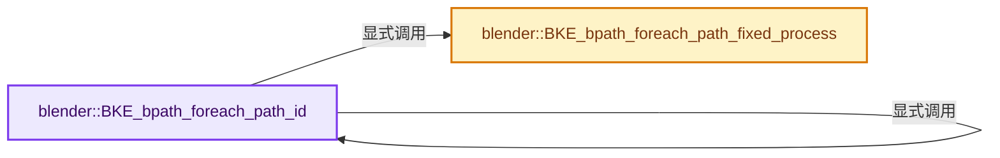
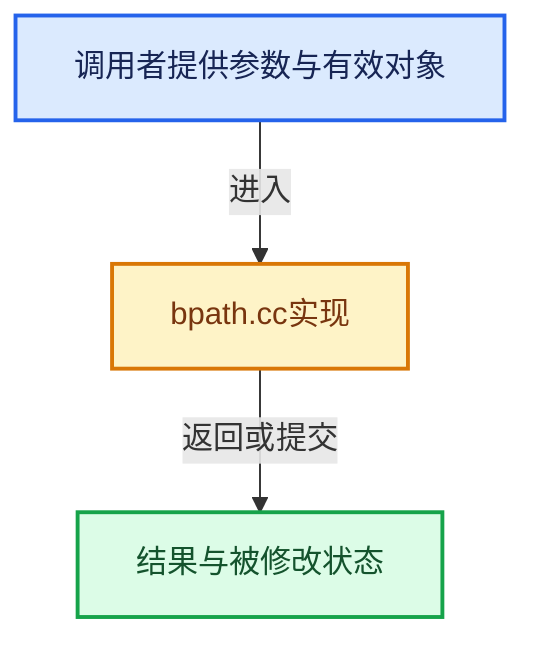

# 实现依赖专题：source/blender/blenkernel/intern/bpath.cc

[方向导航](README.md) · [符号索引](../%E7%AC%A6%E5%8F%B7%E4%BE%9D%E8%B5%96%E4%B8%8E%E5%AE%9E%E7%8E%B0%E7%B4%A2%E5%BC%95.md)

本专题从正文实际调用进入，集中保存共享实现。函数有稳定锚点，可从调用处直接跳到对应完整函数；递归与互相调用通过回链组织。

## 本文件的实现关系






## 完整成员与函数实现

<a id="f-34da3ab32199f808"></a>

### `blender::BKE_bpath_foreach_path_id`

实现位置：[source/blender/blenkernel/intern/bpath.cc](../../../../../source/blender/blenkernel/intern/bpath.cc) · L77—L119。

接口参数：

- `BPathForeachPathData *bpath_data`
- `ID *id`

**教学注释版**

<!-- annotated:15940b13569066 -->

```cpp
void BKE_bpath_foreach_path_id(BPathForeachPathData *bpath_data, ID *id)
{
  const eBPathForeachFlag flag = bpath_data->flag;
  const char *absbase = (flag & BKE_BPATH_FOREACH_PATH_ABSOLUTE) ?
                            ID_BLEND_PATH(bpath_data->bmain, id) :
                            nullptr;
  bpath_data->absolute_base_path = absbase;
  bpath_data->owner_id = id;
  bpath_data->is_path_modified = false;
  bpath_data->is_expanded = false;
  bpath_data->is_cache = false;
  bpath_data->is_readonly = false;

  if ((flag & BKE_BPATH_FOREACH_PATH_SKIP_LINKED) && ID_IS_LINKED(id)) {
    return;
  }

  if (id->library_weak_reference != nullptr &&
      (flag & BKE_BPATH_TRAVERSE_SKIP_WEAK_REFERENCES) == 0)
  {
    BKE_bpath_foreach_path_fixed_process(bpath_data,
                                         id->library_weak_reference->library_filepath,
                                         sizeof(id->library_weak_reference->library_filepath));
  }

  bNodeTree *embedded_node_tree = bke::node_tree_from_id(id);
  if (embedded_node_tree != nullptr) {
    BKE_bpath_foreach_path_id(bpath_data, &embedded_node_tree->id);
  }

  const IDTypeInfo *id_type = BKE_idtype_get_info_from_id(id);

  BLI_assert(id_type != nullptr);
  if (id_type == nullptr || id_type->foreach_path == nullptr) {
    return;
  }

  id_type->foreach_path(id, bpath_data);

  if (bpath_data->is_path_modified) {
    DEG_id_tag_update(id, ID_RECALC_SOURCE | ID_RECALC_SYNC_TO_EVAL);
  }
}
```

<details>
<summary>核对原始源码：source/blender/blenkernel/intern/bpath.cc · L77—L119</summary>

<!-- original:15940b13569066:source/blender/blenkernel/intern/bpath.cc:77:119 -->

```cpp
void BKE_bpath_foreach_path_id(BPathForeachPathData *bpath_data, ID *id)
{
  const eBPathForeachFlag flag = bpath_data->flag;
  const char *absbase = (flag & BKE_BPATH_FOREACH_PATH_ABSOLUTE) ?
                            ID_BLEND_PATH(bpath_data->bmain, id) :
                            nullptr;
  bpath_data->absolute_base_path = absbase;
  bpath_data->owner_id = id;
  bpath_data->is_path_modified = false;
  bpath_data->is_expanded = false;
  bpath_data->is_cache = false;
  bpath_data->is_readonly = false;

  if ((flag & BKE_BPATH_FOREACH_PATH_SKIP_LINKED) && ID_IS_LINKED(id)) {
    return;
  }

  if (id->library_weak_reference != nullptr &&
      (flag & BKE_BPATH_TRAVERSE_SKIP_WEAK_REFERENCES) == 0)
  {
    BKE_bpath_foreach_path_fixed_process(bpath_data,
                                         id->library_weak_reference->library_filepath,
                                         sizeof(id->library_weak_reference->library_filepath));
  }

  bNodeTree *embedded_node_tree = bke::node_tree_from_id(id);
  if (embedded_node_tree != nullptr) {
    BKE_bpath_foreach_path_id(bpath_data, &embedded_node_tree->id);
  }

  const IDTypeInfo *id_type = BKE_idtype_get_info_from_id(id);

  BLI_assert(id_type != nullptr);
  if (id_type == nullptr || id_type->foreach_path == nullptr) {
    return;
  }

  id_type->foreach_path(id, bpath_data);

  if (bpath_data->is_path_modified) {
    DEG_id_tag_update(id, ID_RECALC_SOURCE | ID_RECALC_SYNC_TO_EVAL);
  }
}
```

</details>

**沿实际写入检查状态**

- `bpath_data->absolute_base_path = absbase;`
- `bpath_data->owner_id = id;`
- `bpath_data->is_path_modified = false;`
- `bpath_data->is_expanded = false;`
- `bpath_data->is_cache = false;`
- `bpath_data->is_readonly = false;`

**继续追踪实现**

- `ID_BLEND_PATH` → [ID_BLEND_PATH · L688](%E4%BE%9D%E8%B5%96-DNA_ID-3eb091.md#m-c69d4e48d3fd)。宏定义由构建条件选择。
- `ID_IS_LINKED` → [ID_IS_LINKED · L697](%E4%BE%9D%E8%B5%96-DNA_ID-3eb091.md#m-7e1e1e9b20e6)。宏定义由构建条件选择。
- `BKE_bpath_foreach_path_fixed_process` → [blender::BKE_bpath_foreach_path_fixed_process · L130](%E4%BE%9D%E8%B5%96-bpath-8b7c95.md#f-4bb257dc829a7935)。
- `bke::node_tree_from_id` → [blender::bke::node_tree_from_id · L5337](%E4%BE%9D%E8%B5%96-node-89d753.md#f-9bb7511df53d8493)。
- `BKE_bpath_foreach_path_id` → [blender::BKE_bpath_foreach_path_id · L77](%E4%BE%9D%E8%B5%96-bpath-8b7c95.md#f-34da3ab32199f808)。
- `BKE_idtype_get_info_from_id` → [blender::BKE_idtype_get_info_from_id · L232](%E4%BE%9D%E8%B5%96-idtype-cbba99.md#f-9b31985f4ea4750d)。
- `BLI_assert` → [BLI_assert · L48](../01-%E5%9F%BA%E7%A1%80%E5%AE%B9%E5%99%A8%E4%B8%8E%E7%8E%B0%E4%BB%A3CPP/%E4%BE%9D%E8%B5%96-BLI_assert-cc98e8.md#m-57a88495704d)；[BLI_assert · L63](../01-%E5%9F%BA%E7%A1%80%E5%AE%B9%E5%99%A8%E4%B8%8E%E7%8E%B0%E4%BB%A3CPP/%E4%BE%9D%E8%B5%96-BLI_assert-cc98e8.md#m-d07050020cb5)。宏定义由构建条件选择。
- `id_type->foreach_path` → [调用协议](../%E6%A8%A1%E6%9D%BF%E5%AE%8F%E4%B8%8E%E5%8A%A8%E6%80%81%E5%88%86%E6%B4%BE%E5%8D%8F%E8%AE%AE.md)：由接收对象具体类型或运行时策略提供实现。调用位置L114。
- `DEG_id_tag_update` → [blender::DEG_id_tag_update · L844](../11-Depsgraph%E4%B8%8E%E5%B9%B6%E8%A1%8C%E4%BB%BB%E5%8A%A1%E7%B3%BB%E7%BB%9F/%E4%BE%9D%E8%B5%96-depsgraph_tag-d8b3c7.md#f-62d2949dd168bb81)。

<a id="f-4bb257dc829a7935"></a>

### `blender::BKE_bpath_foreach_path_fixed_process`

实现位置：[source/blender/blenkernel/intern/bpath.cc](../../../../../source/blender/blenkernel/intern/bpath.cc) · L130—L159。

接口参数：

- `BPathForeachPathData *bpath_data`
- `char *path`
- `size_t path_maxncpy`

**教学注释版**

<!-- annotated:80444a4354898b -->

```cpp
bool BKE_bpath_foreach_path_fixed_process(BPathForeachPathData *bpath_data,
                                          char *path,
                                          size_t path_maxncpy)
{
  const char *absolute_base_path = bpath_data->absolute_base_path;

  char path_src_buf[FILE_MAX];
  const char *path_src;
  char path_dst[FILE_MAX];

  if (absolute_base_path) {
    STRNCPY(path_src_buf, path);
    BLI_path_abs(path_src_buf, absolute_base_path);
    path_src = path_src_buf;
  }
  else {
    path_src = path;
  }

  /* so functions can check old value */
  STRNCPY(path_dst, path);

  if (bpath_data->callback_function(bpath_data, path_dst, sizeof(path_dst), path_src)) {
    BLI_strncpy(path, path_dst, path_maxncpy);
    bpath_data->is_path_modified = true;
    return true;
  }

  return false;
}
```

<details>
<summary>核对原始源码：source/blender/blenkernel/intern/bpath.cc · L130—L159</summary>

<!-- original:80444a4354898b:source/blender/blenkernel/intern/bpath.cc:130:159 -->

```cpp
bool BKE_bpath_foreach_path_fixed_process(BPathForeachPathData *bpath_data,
                                          char *path,
                                          size_t path_maxncpy)
{
  const char *absolute_base_path = bpath_data->absolute_base_path;

  char path_src_buf[FILE_MAX];
  const char *path_src;
  char path_dst[FILE_MAX];

  if (absolute_base_path) {
    STRNCPY(path_src_buf, path);
    BLI_path_abs(path_src_buf, absolute_base_path);
    path_src = path_src_buf;
  }
  else {
    path_src = path;
  }

  /* so functions can check old value */
  STRNCPY(path_dst, path);

  if (bpath_data->callback_function(bpath_data, path_dst, sizeof(path_dst), path_src)) {
    BLI_strncpy(path, path_dst, path_maxncpy);
    bpath_data->is_path_modified = true;
    return true;
  }

  return false;
}
```

</details>

**沿实际写入检查状态**

- `path_src = path_src_buf;`
- `path_src = path;`
- `bpath_data->is_path_modified = true;`

**结果出口**

- `return true;`
- `return false;`

**继续追踪实现**

- `STRNCPY` → [blender::STRNCPY · L690](../01-%E5%9F%BA%E7%A1%80%E5%AE%B9%E5%99%A8%E4%B8%8E%E7%8E%B0%E4%BB%A3CPP/%E4%BE%9D%E8%B5%96-BLI_string-b43058.md#f-6b2d861724026be6)。
- `BLI_path_abs` → [BLI_path_abs · L1164](../01-%E5%9F%BA%E7%A1%80%E5%AE%B9%E5%99%A8%E4%B8%8E%E7%8E%B0%E4%BB%A3CPP/%E4%BE%9D%E8%B5%96-path_utils-b4d26a.md#f-002380948c1caeb6)。
- `bpath_data->callback_function` → [调用协议](../%E6%A8%A1%E6%9D%BF%E5%AE%8F%E4%B8%8E%E5%8A%A8%E6%80%81%E5%88%86%E6%B4%BE%E5%8D%8F%E8%AE%AE.md)：由接收对象具体类型或运行时策略提供实现。调用位置L152。
- `BLI_strncpy` → [blender::BLI_strncpy · L70](../01-%E5%9F%BA%E7%A1%80%E5%AE%B9%E5%99%A8%E4%B8%8E%E7%8E%B0%E4%BB%A3CPP/%E4%BE%9D%E8%B5%96-string-1d986f.md#f-6324147b0d116da1)。
