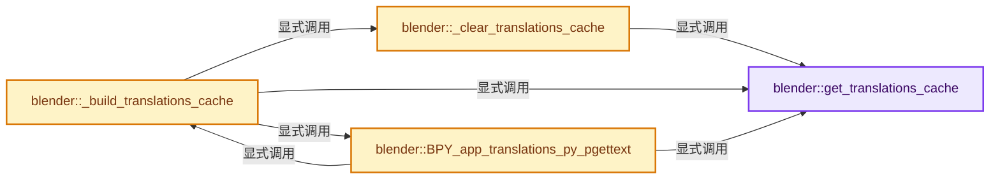
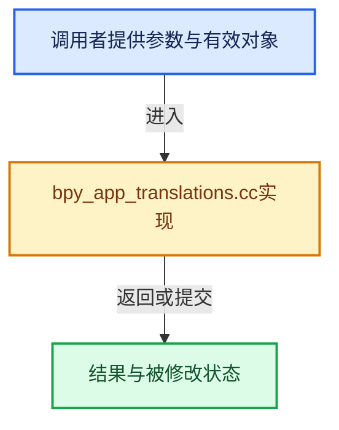

# 实现依赖专题：source/blender/python/intern/bpy_app_translations.cc

[方向导航](README.md) · [符号索引](../%E7%AC%A6%E5%8F%B7%E4%BE%9D%E8%B5%96%E4%B8%8E%E5%AE%9E%E7%8E%B0%E7%B4%A2%E5%BC%95.md)

本专题从正文实际调用进入，集中保存共享实现。函数有稳定锚点，可从调用处直接跳到对应完整函数；递归与互相调用通过回链组织。

## 本文件的实现关系






## 完整成员与函数实现

<a id="f-476e9698d6493f60"></a>

### `blender::get_translations_cache`

实现位置：[source/blender/python/intern/bpy_app_translations.cc](../../../../../source/blender/python/intern/bpy_app_translations.cc) · L120—L124。

**教学注释版**

<!-- annotated:8a79795d7c5d29 -->

```cpp
static std::unique_ptr<Map<MessageKey, std::string>> &get_translations_cache()
{
  static std::unique_ptr<Map<MessageKey, std::string>> translations;
  return translations;
}
```

<details>
<summary>核对原始源码：source/blender/python/intern/bpy_app_translations.cc · L120—L124</summary>

<!-- original:8a79795d7c5d29:source/blender/python/intern/bpy_app_translations.cc:120:124 -->

```cpp
static std::unique_ptr<Map<MessageKey, std::string>> &get_translations_cache()
{
  static std::unique_ptr<Map<MessageKey, std::string>> translations;
  return translations;
}
```

</details>

**结果出口**

- `return translations;`

**继续追踪实现**

本实现没有需要继续展开的显式调用；检查返回表达式、对象转换和调用者前置条件。

<a id="f-e169f07409c2fd24"></a>

### `blender::_clear_translations_cache`

实现位置：[source/blender/python/intern/bpy_app_translations.cc](../../../../../source/blender/python/intern/bpy_app_translations.cc) · L126—L129。

**教学注释版**

<!-- annotated:528f37256e2b3c -->

```cpp
static void _clear_translations_cache()
{
  get_translations_cache().reset();
}
```

<details>
<summary>核对原始源码：source/blender/python/intern/bpy_app_translations.cc · L126—L129</summary>

<!-- original:528f37256e2b3c:source/blender/python/intern/bpy_app_translations.cc:126:129 -->

```cpp
static void _clear_translations_cache()
{
  get_translations_cache().reset();
}
```

</details>

**继续追踪实现**

- `get_translations_cache().reset` → [调用协议](../%E6%A8%A1%E6%9D%BF%E5%AE%8F%E4%B8%8E%E5%8A%A8%E6%80%81%E5%88%86%E6%B4%BE%E5%8D%8F%E8%AE%AE.md)：接收对象类型依赖auto、返回值或模板实例；不按同名猜测目标。调用位置L128。
- `get_translations_cache` → [blender::get_translations_cache · L120](%E4%BE%9D%E8%B5%96-bpy_app_translations-0c44e6.md#f-476e9698d6493f60)。

<a id="f-97d35648c1bd04e0"></a>

### `blender::_build_translations_cache`

实现位置：[source/blender/python/intern/bpy_app_translations.cc](../../../../../source/blender/python/intern/bpy_app_translations.cc) · L131—L255。

接口参数：

- `PyObject *py_messages`
- `const char *locale`

**教学注释版**

<!-- annotated:f302faddb08970 -->

```cpp
static void _build_translations_cache(PyObject *py_messages, const char *locale)
{
  PyObject *uuid, *uuid_dict;
  Py_ssize_t pos = 0;
  char *language = nullptr, *language_country = nullptr, *language_variant = nullptr;

  /* For each py dict, we'll search for full locale, then language+country, then language+variant,
   * then only language keys... */
  BLT_lang_locale_explode(
      locale, &language, nullptr, nullptr, &language_country, &language_variant);

  /* Clear the cached #Map if needed, and create a new one. */
  _clear_translations_cache();
  // [讲解] std::make_unique<Map<MessageKey, std::string>>：创建独占拥有的对象，拥有关系可移动，get返回的借用指针不自动延长寿命。
  get_translations_cache() = std::make_unique<Map<MessageKey, std::string>>();

  /* Iterate over all Python dictionaries. */
  while (PyDict_Next(py_messages, &pos, &uuid, &uuid_dict)) {
    PyObject *lang_dict;

#  if 0
    PyObject_Print(uuid_dict, stdout, 0);
    printf("\n");
#  endif

    /* Try to get first complete locale, then language+country,
     * then language+variant, then only language. */
    lang_dict = PyDict_GetItemString(uuid_dict, locale);
    if (!lang_dict && language_country) {
      lang_dict = PyDict_GetItemString(uuid_dict, language_country);
      locale = language_country;
    }
    if (!lang_dict && language_variant) {
      lang_dict = PyDict_GetItemString(uuid_dict, language_variant);
      locale = language_variant;
    }
    if (!lang_dict && language) {
      lang_dict = PyDict_GetItemString(uuid_dict, language);
      locale = language;
    }

    if (lang_dict) {
      PyObject *pykey, *trans;
      Py_ssize_t ppos = 0;

      if (!PyDict_Check(lang_dict)) {
        printf("WARNING! In translations' dict of \"");
        PyObject_Print(uuid, stdout, Py_PRINT_RAW);
        printf("\":\n");
        printf(
            "    Each language key must have a dictionary as value, \"%s\" is not valid, "
            "skipping: ",
            locale);
        PyObject_Print(lang_dict, stdout, Py_PRINT_RAW);
        printf("\n");
        continue;
      }

      /* Iterate over all translations of the found language dict and populate our cache. */
      while (PyDict_Next(lang_dict, &ppos, &pykey, &trans)) {
        const char *msgctxt = nullptr, *msgid = nullptr;
        bool invalid_key = false;

        if ((PyTuple_CheckExact(pykey) == false) || (PyTuple_GET_SIZE(pykey) != 2)) {
          invalid_key = true;
        }
        else {
          PyObject *tmp = PyTuple_GET_ITEM(pykey, 0);
          if (tmp == Py_None) {
            msgctxt = BLT_I18NCONTEXT_DEFAULT_BPYRNA;
          }
          else if (PyUnicode_Check(tmp)) {
            msgctxt = PyUnicode_AsUTF8(tmp);
          }
          else {
            invalid_key = true;
          }

          tmp = PyTuple_GET_ITEM(pykey, 1);
          if (PyUnicode_Check(tmp)) {
            msgid = PyUnicode_AsUTF8(tmp);
          }
          else {
            invalid_key = true;
          }
        }

        if (invalid_key) {
          printf("WARNING! In translations' dict of \"");
          PyObject_Print(uuid, stdout, Py_PRINT_RAW);
          printf("\", %s language:\n", locale);
          printf(
              "    Keys must be tuples of (msgctxt [string or None], msgid [string]), "
              "this one is not valid, skipping: ");
          PyObject_Print(pykey, stdout, Py_PRINT_RAW);
          printf("\n");
          continue;
        }
        if (PyUnicode_Check(trans) == false) {
          printf("WARNING! In translations' dict of \"");
          PyObject_Print(uuid, stdout, Py_PRINT_RAW);
          printf("\":\n");
          printf("    Values must be strings, this one is not valid, skipping: ");
          PyObject_Print(trans, stdout, Py_PRINT_RAW);
          printf("\n");
          continue;
        }

        /* Do not overwrite existing keys! */
        if (!BPY_app_translations_py_pgettext(msgctxt, msgid).has_value()) {
          MessageKey key;
          key.context = BLT_is_default_context(msgctxt) ? BLT_I18NCONTEXT_DEFAULT_BPYRNA : msgctxt;
          key.str = msgid;
          Py_ssize_t trans_str_len;
          const char *trans_str = PyUnicode_AsUTF8AndSize(trans, &trans_str_len);
          get_translations_cache()->add(key, std::string(trans_str, trans_str_len));
        }
      }
    }
  }

  /* Clean up! */
  MEM_SAFE_DELETE(language);
  MEM_SAFE_DELETE(language_country);
  MEM_SAFE_DELETE(language_variant);
}
```

<details>
<summary>核对原始源码：source/blender/python/intern/bpy_app_translations.cc · L131—L255</summary>

<!-- original:f302faddb08970:source/blender/python/intern/bpy_app_translations.cc:131:255 -->

```cpp
static void _build_translations_cache(PyObject *py_messages, const char *locale)
{
  PyObject *uuid, *uuid_dict;
  Py_ssize_t pos = 0;
  char *language = nullptr, *language_country = nullptr, *language_variant = nullptr;

  /* For each py dict, we'll search for full locale, then language+country, then language+variant,
   * then only language keys... */
  BLT_lang_locale_explode(
      locale, &language, nullptr, nullptr, &language_country, &language_variant);

  /* Clear the cached #Map if needed, and create a new one. */
  _clear_translations_cache();
  get_translations_cache() = std::make_unique<Map<MessageKey, std::string>>();

  /* Iterate over all Python dictionaries. */
  while (PyDict_Next(py_messages, &pos, &uuid, &uuid_dict)) {
    PyObject *lang_dict;

#  if 0
    PyObject_Print(uuid_dict, stdout, 0);
    printf("\n");
#  endif

    /* Try to get first complete locale, then language+country,
     * then language+variant, then only language. */
    lang_dict = PyDict_GetItemString(uuid_dict, locale);
    if (!lang_dict && language_country) {
      lang_dict = PyDict_GetItemString(uuid_dict, language_country);
      locale = language_country;
    }
    if (!lang_dict && language_variant) {
      lang_dict = PyDict_GetItemString(uuid_dict, language_variant);
      locale = language_variant;
    }
    if (!lang_dict && language) {
      lang_dict = PyDict_GetItemString(uuid_dict, language);
      locale = language;
    }

    if (lang_dict) {
      PyObject *pykey, *trans;
      Py_ssize_t ppos = 0;

      if (!PyDict_Check(lang_dict)) {
        printf("WARNING! In translations' dict of \"");
        PyObject_Print(uuid, stdout, Py_PRINT_RAW);
        printf("\":\n");
        printf(
            "    Each language key must have a dictionary as value, \"%s\" is not valid, "
            "skipping: ",
            locale);
        PyObject_Print(lang_dict, stdout, Py_PRINT_RAW);
        printf("\n");
        continue;
      }

      /* Iterate over all translations of the found language dict and populate our cache. */
      while (PyDict_Next(lang_dict, &ppos, &pykey, &trans)) {
        const char *msgctxt = nullptr, *msgid = nullptr;
        bool invalid_key = false;

        if ((PyTuple_CheckExact(pykey) == false) || (PyTuple_GET_SIZE(pykey) != 2)) {
          invalid_key = true;
        }
        else {
          PyObject *tmp = PyTuple_GET_ITEM(pykey, 0);
          if (tmp == Py_None) {
            msgctxt = BLT_I18NCONTEXT_DEFAULT_BPYRNA;
          }
          else if (PyUnicode_Check(tmp)) {
            msgctxt = PyUnicode_AsUTF8(tmp);
          }
          else {
            invalid_key = true;
          }

          tmp = PyTuple_GET_ITEM(pykey, 1);
          if (PyUnicode_Check(tmp)) {
            msgid = PyUnicode_AsUTF8(tmp);
          }
          else {
            invalid_key = true;
          }
        }

        if (invalid_key) {
          printf("WARNING! In translations' dict of \"");
          PyObject_Print(uuid, stdout, Py_PRINT_RAW);
          printf("\", %s language:\n", locale);
          printf(
              "    Keys must be tuples of (msgctxt [string or None], msgid [string]), "
              "this one is not valid, skipping: ");
          PyObject_Print(pykey, stdout, Py_PRINT_RAW);
          printf("\n");
          continue;
        }
        if (PyUnicode_Check(trans) == false) {
          printf("WARNING! In translations' dict of \"");
          PyObject_Print(uuid, stdout, Py_PRINT_RAW);
          printf("\":\n");
          printf("    Values must be strings, this one is not valid, skipping: ");
          PyObject_Print(trans, stdout, Py_PRINT_RAW);
          printf("\n");
          continue;
        }

        /* Do not overwrite existing keys! */
        if (!BPY_app_translations_py_pgettext(msgctxt, msgid).has_value()) {
          MessageKey key;
          key.context = BLT_is_default_context(msgctxt) ? BLT_I18NCONTEXT_DEFAULT_BPYRNA : msgctxt;
          key.str = msgid;
          Py_ssize_t trans_str_len;
          const char *trans_str = PyUnicode_AsUTF8AndSize(trans, &trans_str_len);
          get_translations_cache()->add(key, std::string(trans_str, trans_str_len));
        }
      }
    }
  }

  /* Clean up! */
  MEM_SAFE_DELETE(language);
  MEM_SAFE_DELETE(language_country);
  MEM_SAFE_DELETE(language_variant);
}
```

</details>

**沿实际写入检查状态**

- `lang_dict = PyDict_GetItemString(uuid_dict, locale);`
- `lang_dict = PyDict_GetItemString(uuid_dict, language_country);`
- `locale = language_country;`
- `lang_dict = PyDict_GetItemString(uuid_dict, language_variant);`
- `locale = language_variant;`
- `lang_dict = PyDict_GetItemString(uuid_dict, language);`
- `locale = language;`
- `invalid_key = true;`
- `msgctxt = BLT_I18NCONTEXT_DEFAULT_BPYRNA;`
- `msgctxt = PyUnicode_AsUTF8(tmp);`
- `tmp = PyTuple_GET_ITEM(pykey, 1);`
- `msgid = PyUnicode_AsUTF8(tmp);`
- `key.context = BLT_is_default_context(msgctxt) ? BLT_I18NCONTEXT_DEFAULT_BPYRNA : msgctxt;`
- `key.str = msgid;`

**继续追踪实现**

- `BLT_lang_locale_explode` → [blender::BLT_lang_locale_explode · L288](%E4%BE%9D%E8%B5%96-blt_lang-97bb72.md#f-86c4d52104024086)。
- `_clear_translations_cache` → [blender::_clear_translations_cache · L126](%E4%BE%9D%E8%B5%96-bpy_app_translations-0c44e6.md#f-e169f07409c2fd24)。
- `get_translations_cache` → [blender::get_translations_cache · L120](%E4%BE%9D%E8%B5%96-bpy_app_translations-0c44e6.md#f-476e9698d6493f60)。
- `std::make_unique<Map<MessageKey, std::string>>` → [外部契约](https://eel.is/c++draft/unique.ptr.create)：创建独占拥有的对象，拥有关系可移动，get返回的借用指针不自动延长寿命。
- `PyDict_Next` → [调用协议](../%E6%A8%A1%E6%9D%BF%E5%AE%8F%E4%B8%8E%E5%8A%A8%E6%80%81%E5%88%86%E6%B4%BE%E5%8D%8F%E8%AE%AE.md)：配置相关检测或外部运行时接口。调用位置L147。
- `PyObject_Print` → [调用协议](../%E6%A8%A1%E6%9D%BF%E5%AE%8F%E4%B8%8E%E5%8A%A8%E6%80%81%E5%88%86%E6%B4%BE%E5%8D%8F%E8%AE%AE.md)：配置相关检测或外部运行时接口。调用位置L151。
- `printf` → [外部契约](https://eel.is/c++draft/)：这个边界按实际表达式及所属类型核对参数、返回值、寿命与失败行为。这里提供接口入口，不声称已解释该第三方版本的内部实现。
- `PyDict_GetItemString` → [调用协议](../%E6%A8%A1%E6%9D%BF%E5%AE%8F%E4%B8%8E%E5%8A%A8%E6%80%81%E5%88%86%E6%B4%BE%E5%8D%8F%E8%AE%AE.md)：配置相关检测或外部运行时接口。调用位置L157。
- `PyDict_Check` → [调用协议](../%E6%A8%A1%E6%9D%BF%E5%AE%8F%E4%B8%8E%E5%8A%A8%E6%80%81%E5%88%86%E6%B4%BE%E5%8D%8F%E8%AE%AE.md)：配置相关检测或外部运行时接口。调用位置L175。
- `PyTuple_CheckExact` → [调用协议](../%E6%A8%A1%E6%9D%BF%E5%AE%8F%E4%B8%8E%E5%8A%A8%E6%80%81%E5%88%86%E6%B4%BE%E5%8D%8F%E8%AE%AE.md)：配置相关检测或外部运行时接口。调用位置L193。
- `PyTuple_GET_SIZE` → [调用协议](../%E6%A8%A1%E6%9D%BF%E5%AE%8F%E4%B8%8E%E5%8A%A8%E6%80%81%E5%88%86%E6%B4%BE%E5%8D%8F%E8%AE%AE.md)：配置相关检测或外部运行时接口。调用位置L193。
- `PyTuple_GET_ITEM` → [调用协议](../%E6%A8%A1%E6%9D%BF%E5%AE%8F%E4%B8%8E%E5%8A%A8%E6%80%81%E5%88%86%E6%B4%BE%E5%8D%8F%E8%AE%AE.md)：配置相关检测或外部运行时接口。调用位置L197。
- `PyUnicode_Check` → [调用协议](../%E6%A8%A1%E6%9D%BF%E5%AE%8F%E4%B8%8E%E5%8A%A8%E6%80%81%E5%88%86%E6%B4%BE%E5%8D%8F%E8%AE%AE.md)：配置相关检测或外部运行时接口。调用位置L201。
- `PyUnicode_AsUTF8` → [调用协议](../%E6%A8%A1%E6%9D%BF%E5%AE%8F%E4%B8%8E%E5%8A%A8%E6%80%81%E5%88%86%E6%B4%BE%E5%8D%8F%E8%AE%AE.md)：配置相关检测或外部运行时接口。调用位置L202。
- `BPY_app_translations_py_pgettext(msgctxt, msgid).has_value` → [调用协议](../%E6%A8%A1%E6%9D%BF%E5%AE%8F%E4%B8%8E%E5%8A%A8%E6%80%81%E5%88%86%E6%B4%BE%E5%8D%8F%E8%AE%AE.md)：接收对象类型依赖auto、返回值或模板实例；不按同名猜测目标。调用位置L239。
- `BPY_app_translations_py_pgettext` → [blender::BPY_app_translations_py_pgettext · L257](%E4%BE%9D%E8%B5%96-bpy_app_translations-0c44e6.md#f-22b0db23474823d2)。
- `BLT_is_default_context` → [blender::BLT_is_default_context · L31](%E4%BE%9D%E8%B5%96-blt_translation-6aa72a.md#f-0933e0b106b3f0b4)。
- `PyUnicode_AsUTF8AndSize` → [调用协议](../%E6%A8%A1%E6%9D%BF%E5%AE%8F%E4%B8%8E%E5%8A%A8%E6%80%81%E5%88%86%E6%B4%BE%E5%8D%8F%E8%AE%AE.md)：配置相关检测或外部运行时接口。调用位置L244。
- `get_translations_cache()->add` → [调用协议](../%E6%A8%A1%E6%9D%BF%E5%AE%8F%E4%B8%8E%E5%8A%A8%E6%80%81%E5%88%86%E6%B4%BE%E5%8D%8F%E8%AE%AE.md)：接收对象类型依赖auto、返回值或模板实例；不按同名猜测目标。调用位置L245。
- `std::string` → [外部契约](https://eel.is/c++draft/)：这个边界按实际表达式及所属类型核对参数、返回值、寿命与失败行为。这里提供接口入口，不声称已解释该第三方版本的内部实现。
- `MEM_SAFE_DELETE` → [MEM_SAFE_DELETE · L436](../03-%E5%86%85%E5%AD%98%E5%88%86%E9%85%8D%E4%B8%8E%E8%BF%90%E8%A1%8C%E6%97%B6%E7%B1%BB%E5%9E%8B/%E4%BE%9D%E8%B5%96-MEM_guardedalloc-b54eca.md#m-eadb3bc5b902)。宏定义由构建条件选择。

<a id="f-22b0db23474823d2"></a>

### `blender::BPY_app_translations_py_pgettext`

实现位置：[source/blender/python/intern/bpy_app_translations.cc](../../../../../source/blender/python/intern/bpy_app_translations.cc) · L257—L295。

接口参数：

- `const StringRef msgctxt`
- `const StringRef msgid`

**教学注释版**

<!-- annotated:919733b68f1e7e -->

```cpp
std::optional<StringRefNull> BPY_app_translations_py_pgettext(const StringRef msgctxt,
                                                              const StringRef msgid)
{
#  define STATIC_LOCALE_SIZE 32 /* Should be more than enough! */

  static char locale[STATIC_LOCALE_SIZE] = "";
  const char *tmp;

  /* Just in case, should never happen! */
  if (!_translations) {
    return std::nullopt;
  }

  tmp = BLT_lang_get();
  if (!STREQ(tmp, locale) || !get_translations_cache()) {
    /* This function may be called from C (i.e. outside of python interpreter 'context'). */
    PyGILState_STATE _py_state = PyGILState_Ensure();

    STRNCPY_UTF8(locale, tmp);

    /* Locale changed or cache does not exist, refresh the whole cache! */
    _build_translations_cache(_translations->py_messages, locale);

    PyGILState_Release(_py_state);
  }

  /* And now, simply create the key (context, messageid) and find it in the cached dict! */
  MessageKeyRef key;
  key.context = BLT_is_default_context(msgctxt) ? BLT_I18NCONTEXT_DEFAULT_BPYRNA : msgctxt;
  key.str = msgid;

  const std::string *result = get_translations_cache()->lookup_ptr_as(key);
  if (!result) {
    return std::nullopt;
  }
  return *result;

#  undef STATIC_LOCALE_SIZE
}
```

<details>
<summary>核对原始源码：source/blender/python/intern/bpy_app_translations.cc · L257—L295</summary>

<!-- original:919733b68f1e7e:source/blender/python/intern/bpy_app_translations.cc:257:295 -->

```cpp
std::optional<StringRefNull> BPY_app_translations_py_pgettext(const StringRef msgctxt,
                                                              const StringRef msgid)
{
#  define STATIC_LOCALE_SIZE 32 /* Should be more than enough! */

  static char locale[STATIC_LOCALE_SIZE] = "";
  const char *tmp;

  /* Just in case, should never happen! */
  if (!_translations) {
    return std::nullopt;
  }

  tmp = BLT_lang_get();
  if (!STREQ(tmp, locale) || !get_translations_cache()) {
    /* This function may be called from C (i.e. outside of python interpreter 'context'). */
    PyGILState_STATE _py_state = PyGILState_Ensure();

    STRNCPY_UTF8(locale, tmp);

    /* Locale changed or cache does not exist, refresh the whole cache! */
    _build_translations_cache(_translations->py_messages, locale);

    PyGILState_Release(_py_state);
  }

  /* And now, simply create the key (context, messageid) and find it in the cached dict! */
  MessageKeyRef key;
  key.context = BLT_is_default_context(msgctxt) ? BLT_I18NCONTEXT_DEFAULT_BPYRNA : msgctxt;
  key.str = msgid;

  const std::string *result = get_translations_cache()->lookup_ptr_as(key);
  if (!result) {
    return std::nullopt;
  }
  return *result;

#  undef STATIC_LOCALE_SIZE
}
```

</details>

**沿实际写入检查状态**

- `tmp = BLT_lang_get();`
- `key.context = BLT_is_default_context(msgctxt) ? BLT_I18NCONTEXT_DEFAULT_BPYRNA : msgctxt;`
- `key.str = msgid;`

**结果出口**

- `return std::nullopt;`
- `return *result;`

**继续追踪实现**

- `BLT_lang_get` → [blender::BLT_lang_get · L268](%E4%BE%9D%E8%B5%96-blt_lang-97bb72.md#f-c6d2921bf6a5ccff)。
- `STREQ` → [STREQ · L112](%E4%BE%9D%E8%B5%96-GHOST_utildefines-34b996.md#m-9549fb6aafd2)；[STREQ · L451](../01-%E5%9F%BA%E7%A1%80%E5%AE%B9%E5%99%A8%E4%B8%8E%E7%8E%B0%E4%BB%A3CPP/%E4%BE%9D%E8%B5%96-BLI_utildefines-293a0a.md#m-c7b745bcfad2)；[STREQ · L55](%E4%BE%9D%E8%B5%96-clog-a0bec8.md#m-96e78f386894)。宏定义由构建条件选择。
- `get_translations_cache` → [blender::get_translations_cache · L120](%E4%BE%9D%E8%B5%96-bpy_app_translations-0c44e6.md#f-476e9698d6493f60)。
- `PyGILState_Ensure` → [调用协议](../%E6%A8%A1%E6%9D%BF%E5%AE%8F%E4%B8%8E%E5%8A%A8%E6%80%81%E5%88%86%E6%B4%BE%E5%8D%8F%E8%AE%AE.md)：配置相关检测或外部运行时接口。调用位置L273。
- `STRNCPY_UTF8` → [STRNCPY_UTF8 · L335](../01-%E5%9F%BA%E7%A1%80%E5%AE%B9%E5%99%A8%E4%B8%8E%E7%8E%B0%E4%BB%A3CPP/%E4%BE%9D%E8%B5%96-BLI_string_utf8-bcc961.md#m-222967f0ab6a)。宏定义由构建条件选择。
- `_build_translations_cache` → [blender::_build_translations_cache · L131](%E4%BE%9D%E8%B5%96-bpy_app_translations-0c44e6.md#f-97d35648c1bd04e0)。
- `PyGILState_Release` → [调用协议](../%E6%A8%A1%E6%9D%BF%E5%AE%8F%E4%B8%8E%E5%8A%A8%E6%80%81%E5%88%86%E6%B4%BE%E5%8D%8F%E8%AE%AE.md)：配置相关检测或外部运行时接口。调用位置L280。
- `BLT_is_default_context` → [blender::BLT_is_default_context · L31](%E4%BE%9D%E8%B5%96-blt_translation-6aa72a.md#f-0933e0b106b3f0b4)。
- `get_translations_cache()->lookup_ptr_as` → [调用协议](../%E6%A8%A1%E6%9D%BF%E5%AE%8F%E4%B8%8E%E5%8A%A8%E6%80%81%E5%88%86%E6%B4%BE%E5%8D%8F%E8%AE%AE.md)：接收对象类型依赖auto、返回值或模板实例；不按同名猜测目标。调用位置L288。
