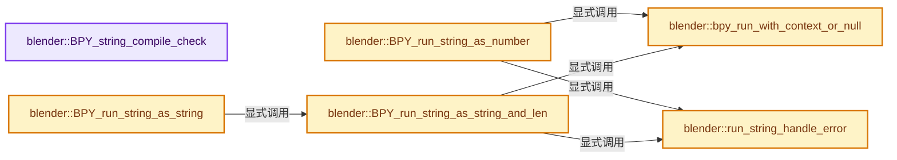

# 实现依赖专题：source/blender/python/intern/bpy_interface_run.cc

[方向导航](README.md) · [符号索引](../%E7%AC%A6%E5%8F%B7%E4%BE%9D%E8%B5%96%E4%B8%8E%E5%AE%9E%E7%8E%B0%E7%B4%A2%E5%BC%95.md)

本专题从正文实际调用进入，集中保存共享实现。函数有稳定锚点，可从调用处直接跳到对应完整函数；递归与互相调用通过回链组织。

## 本文件的实现关系




## 完整成员与函数实现

<a id="f-601baf4936781061"></a>

### `blender::BPY_string_compile_check`

实现位置：[source/blender/python/intern/bpy_interface_run.cc](../../../../../source/blender/python/intern/bpy_interface_run.cc) · L254—L270。

接口参数：

- `const char *expr`

**教学注释版**

<!-- annotated:a7bad57cde8651 -->

```cpp
bool BPY_string_compile_check(const char *expr)
{
  if (!expr || expr[0] == '\0') {
    return true;
  }
  PyGILState_STATE gilstate = PyGILState_Ensure();
  bool success = false;
  if (PyObject *retval = Py_CompileString(expr, "<expression>", Py_eval_input)) {
    Py_DECREF(retval);
    success = true;
  }
  else {
    PyErr_Clear();
  }
  PyGILState_Release(gilstate);
  return success;
}
```

<details>
<summary>核对原始源码：source/blender/python/intern/bpy_interface_run.cc · L254—L270</summary>

<!-- original:a7bad57cde8651:source/blender/python/intern/bpy_interface_run.cc:254:270 -->

```cpp
bool BPY_string_compile_check(const char *expr)
{
  if (!expr || expr[0] == '\0') {
    return true;
  }
  PyGILState_STATE gilstate = PyGILState_Ensure();
  bool success = false;
  if (PyObject *retval = Py_CompileString(expr, "<expression>", Py_eval_input)) {
    Py_DECREF(retval);
    success = true;
  }
  else {
    PyErr_Clear();
  }
  PyGILState_Release(gilstate);
  return success;
}
```

</details>

**沿实际写入检查状态**

- `success = true;`

**结果出口**

- `return true;`
- `return success;`

**继续追踪实现**

- `PyGILState_Ensure` → [调用协议](../%E6%A8%A1%E6%9D%BF%E5%AE%8F%E4%B8%8E%E5%8A%A8%E6%80%81%E5%88%86%E6%B4%BE%E5%8D%8F%E8%AE%AE.md)：配置相关检测或外部运行时接口。调用位置L259。
- `Py_CompileString` → [调用协议](../%E6%A8%A1%E6%9D%BF%E5%AE%8F%E4%B8%8E%E5%8A%A8%E6%80%81%E5%88%86%E6%B4%BE%E5%8D%8F%E8%AE%AE.md)：配置相关检测或外部运行时接口。调用位置L261。
- `Py_DECREF` → [调用协议](../%E6%A8%A1%E6%9D%BF%E5%AE%8F%E4%B8%8E%E5%8A%A8%E6%80%81%E5%88%86%E6%B4%BE%E5%8D%8F%E8%AE%AE.md)：配置相关检测或外部运行时接口。调用位置L262。
- `PyErr_Clear` → [调用协议](../%E6%A8%A1%E6%9D%BF%E5%AE%8F%E4%B8%8E%E5%8A%A8%E6%80%81%E5%88%86%E6%B4%BE%E5%8D%8F%E8%AE%AE.md)：配置相关检测或外部运行时接口。调用位置L266。
- `PyGILState_Release` → [调用协议](../%E6%A8%A1%E6%9D%BF%E5%AE%8F%E4%B8%8E%E5%8A%A8%E6%80%81%E5%88%86%E6%B4%BE%E5%8D%8F%E8%AE%AE.md)：配置相关检测或外部运行时接口。调用位置L268。

<a id="f-9cdf729dfd3a3e03"></a>

### `blender::bpy_run_with_context_or_null`

实现位置：[source/blender/python/intern/bpy_interface_run.cc](../../../../../source/blender/python/intern/bpy_interface_run.cc) · L276—L289。

接口参数：

- `bContext *C`
- `FunctionRef<void()> fn`

**教学注释版**

<!-- annotated:80df1b8053c7af -->

```cpp
static void bpy_run_with_context_or_null(bContext *C, FunctionRef<void()> fn)
{
  bContext *C_prev = BPY_context_get();
  PyGILState_STATE gilstate;
  const bool context_set = bpy_context_set_allow_null(C, &gilstate);

  fn();

  /* Failure to restore `C_prev` may leave it null, see #160604. */
  if (context_set && (C != C_prev)) {
    BPY_context_update(C_prev);
  }
  bpy_context_clear(C, &gilstate);
}
```

<details>
<summary>核对原始源码：source/blender/python/intern/bpy_interface_run.cc · L276—L289</summary>

<!-- original:80df1b8053c7af:source/blender/python/intern/bpy_interface_run.cc:276:289 -->

```cpp
static void bpy_run_with_context_or_null(bContext *C, FunctionRef<void()> fn)
{
  bContext *C_prev = BPY_context_get();
  PyGILState_STATE gilstate;
  const bool context_set = bpy_context_set_allow_null(C, &gilstate);

  fn();

  /* Failure to restore `C_prev` may leave it null, see #160604. */
  if (context_set && (C != C_prev)) {
    BPY_context_update(C_prev);
  }
  bpy_context_clear(C, &gilstate);
}
```

</details>

**继续追踪实现**

- `BPY_context_get` → [blender::BPY_context_get · L292](%E4%BE%9D%E8%B5%96-bpy_interface-b3b9e6.md#f-a74fd220750c1e54)。
- `bpy_context_set_allow_null` → [blender::bpy_context_set_allow_null · L170](%E4%BE%9D%E8%B5%96-bpy_interface-b3b9e6.md#f-6fde7eecee5f8784)。
- `fn` → [调用协议](../%E6%A8%A1%E6%9D%BF%E5%AE%8F%E4%B8%8E%E5%8A%A8%E6%80%81%E5%88%86%E6%B4%BE%E5%8D%8F%E8%AE%AE.md)：局部可调用对象，须结合其初始化与捕获环境。调用位置L282。
- `BPY_context_update` → [blender::BPY_context_update · L106](%E4%BE%9D%E8%B5%96-bpy_interface-b3b9e6.md#f-d8e935cb55009740)。
- `bpy_context_clear` → [blender::bpy_context_clear · L175](%E4%BE%9D%E8%B5%96-bpy_interface-b3b9e6.md#f-77cc53ad69e3e6c5)。

<a id="f-f7488be08f7a14e7"></a>

### `blender::run_string_handle_error`

实现位置：[source/blender/python/intern/bpy_interface_run.cc](../../../../../source/blender/python/intern/bpy_interface_run.cc) · L489—L531。

接口参数：

- `BPy_RunErrInfo *err_info`

**教学注释版**

<!-- annotated:50c1e18fcf6904 -->

```cpp
static void run_string_handle_error(BPy_RunErrInfo *err_info)
{
  BLI_assert(PyErr_Occurred());

  if (err_info == nullptr) {
    PyErr_Print();
    return;
  }

  /* Signal to do nothing. */
  if (!(err_info->reports || err_info->r_string)) {
    PyErr_Clear();
    return;
  }

  PyObject *py_err_str = err_info->use_single_line_error ? PyC_ExceptionBuffer_Simple() :
                                                           PyC_ExceptionBuffer();
  const char *err_str = PyUnicode_AsUTF8(py_err_str);
  PyErr_Clear();

  if (err_info->reports != nullptr) {
    if (err_info->report_prefix) {
      BKE_reportf(err_info->reports, RPT_ERROR, "%s: %s", err_info->report_prefix, err_str);
    }
    else {
      BKE_report(err_info->reports, RPT_ERROR, err_str);
    }
  }

  /* Print the reports if they were not printed already. */
  if ((err_info->reports == nullptr) || !BKE_reports_print_test(err_info->reports, RPT_ERROR)) {
    if (err_info->report_prefix) {
      fprintf(stderr, "%s: ", err_info->report_prefix);
    }
    fprintf(stderr, "%s\n", err_str);
  }

  if (err_info->r_string != nullptr) {
    *err_info->r_string = BLI_strdup(err_str);
  }

  Py_XDECREF(py_err_str);
}
```

<details>
<summary>核对原始源码：source/blender/python/intern/bpy_interface_run.cc · L489—L531</summary>

<!-- original:50c1e18fcf6904:source/blender/python/intern/bpy_interface_run.cc:489:531 -->

```cpp
static void run_string_handle_error(BPy_RunErrInfo *err_info)
{
  BLI_assert(PyErr_Occurred());

  if (err_info == nullptr) {
    PyErr_Print();
    return;
  }

  /* Signal to do nothing. */
  if (!(err_info->reports || err_info->r_string)) {
    PyErr_Clear();
    return;
  }

  PyObject *py_err_str = err_info->use_single_line_error ? PyC_ExceptionBuffer_Simple() :
                                                           PyC_ExceptionBuffer();
  const char *err_str = PyUnicode_AsUTF8(py_err_str);
  PyErr_Clear();

  if (err_info->reports != nullptr) {
    if (err_info->report_prefix) {
      BKE_reportf(err_info->reports, RPT_ERROR, "%s: %s", err_info->report_prefix, err_str);
    }
    else {
      BKE_report(err_info->reports, RPT_ERROR, err_str);
    }
  }

  /* Print the reports if they were not printed already. */
  if ((err_info->reports == nullptr) || !BKE_reports_print_test(err_info->reports, RPT_ERROR)) {
    if (err_info->report_prefix) {
      fprintf(stderr, "%s: ", err_info->report_prefix);
    }
    fprintf(stderr, "%s\n", err_str);
  }

  if (err_info->r_string != nullptr) {
    *err_info->r_string = BLI_strdup(err_str);
  }

  Py_XDECREF(py_err_str);
}
```

</details>

**继续追踪实现**

- `BLI_assert` → [BLI_assert · L48](../01-%E5%9F%BA%E7%A1%80%E5%AE%B9%E5%99%A8%E4%B8%8E%E7%8E%B0%E4%BB%A3CPP/%E4%BE%9D%E8%B5%96-BLI_assert-cc98e8.md#m-57a88495704d)；[BLI_assert · L63](../01-%E5%9F%BA%E7%A1%80%E5%AE%B9%E5%99%A8%E4%B8%8E%E7%8E%B0%E4%BB%A3CPP/%E4%BE%9D%E8%B5%96-BLI_assert-cc98e8.md#m-d07050020cb5)。宏定义由构建条件选择。
- `PyErr_Occurred` → [调用协议](../%E6%A8%A1%E6%9D%BF%E5%AE%8F%E4%B8%8E%E5%8A%A8%E6%80%81%E5%88%86%E6%B4%BE%E5%8D%8F%E8%AE%AE.md)：配置相关检测或外部运行时接口。调用位置L491。
- `PyErr_Print` → [调用协议](../%E6%A8%A1%E6%9D%BF%E5%AE%8F%E4%B8%8E%E5%8A%A8%E6%80%81%E5%88%86%E6%B4%BE%E5%8D%8F%E8%AE%AE.md)：配置相关检测或外部运行时接口。调用位置L494。
- `PyErr_Clear` → [调用协议](../%E6%A8%A1%E6%9D%BF%E5%AE%8F%E4%B8%8E%E5%8A%A8%E6%80%81%E5%88%86%E6%B4%BE%E5%8D%8F%E8%AE%AE.md)：配置相关检测或外部运行时接口。调用位置L500。
- `PyC_ExceptionBuffer_Simple` → [blender::PyC_ExceptionBuffer_Simple · L1078](%E4%BE%9D%E8%B5%96-py_capi_utils-35fe47.md#f-a109dcf19cd59f37)。
- `PyC_ExceptionBuffer` → [blender::PyC_ExceptionBuffer · L1018](%E4%BE%9D%E8%B5%96-py_capi_utils-35fe47.md#f-1dd24fc34c6b4978)。
- `PyUnicode_AsUTF8` → [调用协议](../%E6%A8%A1%E6%9D%BF%E5%AE%8F%E4%B8%8E%E5%8A%A8%E6%80%81%E5%88%86%E6%B4%BE%E5%8D%8F%E8%AE%AE.md)：配置相关检测或外部运行时接口。调用位置L506。
- `BKE_reportf` → [blender::BKE_reportf · L191](%E4%BE%9D%E8%B5%96-report-f916fd.md#f-e776fc632ffb42b3)。
- `BKE_report` → [blender::BKE_report · L162](%E4%BE%9D%E8%B5%96-report-f916fd.md#f-56816f68adfe537b)。
- `BKE_reports_print_test` → [blender::BKE_reports_print_test · L336](%E4%BE%9D%E8%B5%96-report-f916fd.md#f-e1a1f6c915f8fd3f)。
- `fprintf` → [外部契约](https://eel.is/c++draft/)：这个边界按实际表达式及所属类型核对参数、返回值、寿命与失败行为。这里提供接口入口，不声称已解释该第三方版本的内部实现。
- `BLI_strdup` → [blender::BLI_strdup · L43](../01-%E5%9F%BA%E7%A1%80%E5%AE%B9%E5%99%A8%E4%B8%8E%E7%8E%B0%E4%BB%A3CPP/%E4%BE%9D%E8%B5%96-string-1d986f.md#f-7e6d5c696c20c0e1)。
- `Py_XDECREF` → [调用协议](../%E6%A8%A1%E6%9D%BF%E5%AE%8F%E4%B8%8E%E5%8A%A8%E6%80%81%E5%88%86%E6%B4%BE%E5%8D%8F%E8%AE%AE.md)：配置相关检测或外部运行时接口。调用位置L530。

<a id="f-18aaf6ea1496ba0b"></a>

### `blender::BPY_run_string_as_number`

实现位置：[source/blender/python/intern/bpy_interface_run.cc](../../../../../source/blender/python/intern/bpy_interface_run.cc) · L533—L555。

接口参数：

- `bContext *C`
- `const char *imports[]`
- `const char *expr`
- `BPy_RunErrInfo *err_info`
- `double *r_value`

**教学注释版**

<!-- annotated:2eaa0a1585de5f -->

```cpp
bool BPY_run_string_as_number(bContext *C,
                              const char *imports[],
                              const char *expr,
                              BPy_RunErrInfo *err_info,
                              double *r_value)
{
  bool ok = true;

  if (expr[0] == '\0') {
    *r_value = 0.0;
    return ok;
  }

  bpy_run_with_context_or_null(C, [&]() {
    ok = PyC_RunString_AsNumber(imports, expr, "<expr as number>", r_value);

    if (ok == false) {
      run_string_handle_error(err_info);
    }
  });

  return ok;
}
```

<details>
<summary>核对原始源码：source/blender/python/intern/bpy_interface_run.cc · L533—L555</summary>

<!-- original:2eaa0a1585de5f:source/blender/python/intern/bpy_interface_run.cc:533:555 -->

```cpp
bool BPY_run_string_as_number(bContext *C,
                              const char *imports[],
                              const char *expr,
                              BPy_RunErrInfo *err_info,
                              double *r_value)
{
  bool ok = true;

  if (expr[0] == '\0') {
    *r_value = 0.0;
    return ok;
  }

  bpy_run_with_context_or_null(C, [&]() {
    ok = PyC_RunString_AsNumber(imports, expr, "<expr as number>", r_value);

    if (ok == false) {
      run_string_handle_error(err_info);
    }
  });

  return ok;
}
```

</details>

**沿实际写入检查状态**

- `ok = PyC_RunString_AsNumber(imports, expr, "<expr as number>", r_value);`

**结果出口**

- `return ok;`

**继续追踪实现**

- `bpy_run_with_context_or_null` → [blender::bpy_run_with_context_or_null · L276](%E4%BE%9D%E8%B5%96-bpy_interface_run-b959e2.md#f-9cdf729dfd3a3e03)。
- `PyC_RunString_AsNumber` → [blender::PyC_RunString_AsNumber · L1661](%E4%BE%9D%E8%B5%96-py_capi_utils-35fe47.md#f-73a625344415fd99)。
- `run_string_handle_error` → [blender::run_string_handle_error · L489](%E4%BE%9D%E8%B5%96-bpy_interface_run-b959e2.md#f-f7488be08f7a14e7)。

<a id="f-37d1a499e67cad8c"></a>

### `blender::BPY_run_string_as_string_and_len`

实现位置：[source/blender/python/intern/bpy_interface_run.cc](../../../../../source/blender/python/intern/bpy_interface_run.cc) · L557—L580。

接口参数：

- `bContext *C`
- `const char *imports[]`
- `const char *expr`
- `BPy_RunErrInfo *err_info`
- `char **r_value`
- `size_t *r_value_len`

**教学注释版**

<!-- annotated:45d3773c9b2c14 -->

```cpp
bool BPY_run_string_as_string_and_len(bContext *C,
                                      const char *imports[],
                                      const char *expr,
                                      BPy_RunErrInfo *err_info,
                                      char **r_value,
                                      size_t *r_value_len)
{
  bool ok = true;

  if (expr[0] == '\0') {
    *r_value = nullptr;
    return ok;
  }

  bpy_run_with_context_or_null(C, [&]() {
    ok = PyC_RunString_AsStringAndSize(imports, expr, "<expr as str>", r_value, r_value_len);

    if (ok == false) {
      run_string_handle_error(err_info);
    }
  });

  return ok;
}
```

<details>
<summary>核对原始源码：source/blender/python/intern/bpy_interface_run.cc · L557—L580</summary>

<!-- original:45d3773c9b2c14:source/blender/python/intern/bpy_interface_run.cc:557:580 -->

```cpp
bool BPY_run_string_as_string_and_len(bContext *C,
                                      const char *imports[],
                                      const char *expr,
                                      BPy_RunErrInfo *err_info,
                                      char **r_value,
                                      size_t *r_value_len)
{
  bool ok = true;

  if (expr[0] == '\0') {
    *r_value = nullptr;
    return ok;
  }

  bpy_run_with_context_or_null(C, [&]() {
    ok = PyC_RunString_AsStringAndSize(imports, expr, "<expr as str>", r_value, r_value_len);

    if (ok == false) {
      run_string_handle_error(err_info);
    }
  });

  return ok;
}
```

</details>

**沿实际写入检查状态**

- `ok = PyC_RunString_AsStringAndSize(imports, expr, "<expr as str>", r_value, r_value_len);`

**结果出口**

- `return ok;`

**继续追踪实现**

- `bpy_run_with_context_or_null` → [blender::bpy_run_with_context_or_null · L276](%E4%BE%9D%E8%B5%96-bpy_interface_run-b959e2.md#f-9cdf729dfd3a3e03)。
- `PyC_RunString_AsStringAndSize` → [blender::PyC_RunString_AsStringAndSize · L1732](%E4%BE%9D%E8%B5%96-py_capi_utils-35fe47.md#f-c5dfc36350235dea)。
- `run_string_handle_error` → [blender::run_string_handle_error · L489](%E4%BE%9D%E8%B5%96-bpy_interface_run-b959e2.md#f-f7488be08f7a14e7)。

<a id="f-c265cbc2f618f621"></a>

### `blender::BPY_run_string_as_string`

实现位置：[source/blender/python/intern/bpy_interface_run.cc](../../../../../source/blender/python/intern/bpy_interface_run.cc) · L582—L587。

接口参数：

- `bContext *C`
- `const char *imports[]`
- `const char *expr`
- `BPy_RunErrInfo *err_info`
- `char **r_value`

**教学注释版**

<!-- annotated:8be7c73ebb4a52 -->

```cpp
bool BPY_run_string_as_string(
    bContext *C, const char *imports[], const char *expr, BPy_RunErrInfo *err_info, char **r_value)
{
  size_t value_dummy_len;
  return BPY_run_string_as_string_and_len(C, imports, expr, err_info, r_value, &value_dummy_len);
}
```

<details>
<summary>核对原始源码：source/blender/python/intern/bpy_interface_run.cc · L582—L587</summary>

<!-- original:8be7c73ebb4a52:source/blender/python/intern/bpy_interface_run.cc:582:587 -->

```cpp
bool BPY_run_string_as_string(
    bContext *C, const char *imports[], const char *expr, BPy_RunErrInfo *err_info, char **r_value)
{
  size_t value_dummy_len;
  return BPY_run_string_as_string_and_len(C, imports, expr, err_info, r_value, &value_dummy_len);
}
```

</details>

**结果出口**

- `return BPY_run_string_as_string_and_len(C, imports, expr, err_info, r_value, &value_dummy_len);`

**继续追踪实现**

- `BPY_run_string_as_string_and_len` → [blender::BPY_run_string_as_string_and_len · L557](%E4%BE%9D%E8%B5%96-bpy_interface_run-b959e2.md#f-37d1a499e67cad8c)。
