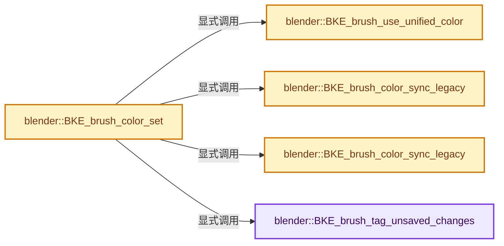
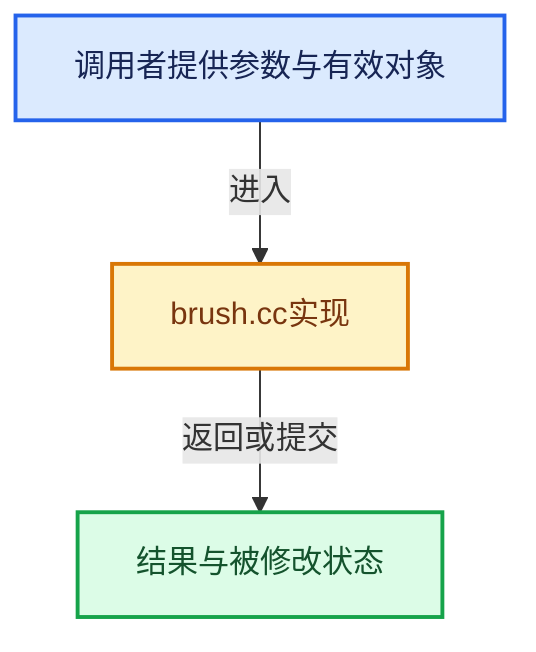

# 实现依赖专题：source/blender/blenkernel/intern/brush.cc

[方向导航](README.md) · [符号索引](../%E7%AC%A6%E5%8F%B7%E4%BE%9D%E8%B5%96%E4%B8%8E%E5%AE%9E%E7%8E%B0%E7%B4%A2%E5%BC%95.md)

本专题从正文实际调用进入，集中保存共享实现。函数有稳定锚点，可从调用处直接跳到对应完整函数；递归与互相调用通过回链组织。

## 本文件的实现关系






## 完整成员与函数实现

<a id="f-fa9014fa1a675f1b"></a>

### `blender::BKE_brush_tag_unsaved_changes`

实现位置：[source/blender/blenkernel/intern/brush.cc](../../../../../source/blender/blenkernel/intern/brush.cc) · L843—L848。

接口参数：

- `Brush *brush`

**教学注释版**

<!-- annotated:8e06e4470e69b3 -->

```cpp
void BKE_brush_tag_unsaved_changes(Brush *brush)
{
  if (brush && ID_IS_LINKED(brush)) {
    brush->has_unsaved_changes = true;
  }
}
```

<details>
<summary>核对原始源码：source/blender/blenkernel/intern/brush.cc · L843—L848</summary>

<!-- original:8e06e4470e69b3:source/blender/blenkernel/intern/brush.cc:843:848 -->

```cpp
void BKE_brush_tag_unsaved_changes(Brush *brush)
{
  if (brush && ID_IS_LINKED(brush)) {
    brush->has_unsaved_changes = true;
  }
}
```

</details>

**沿实际写入检查状态**

- `brush->has_unsaved_changes = true;`

**继续追踪实现**

- `ID_IS_LINKED` → [ID_IS_LINKED · L697](%E4%BE%9D%E8%B5%96-DNA_ID-3eb091.md#m-7e1e1e9b20e6)。宏定义由构建条件选择。

<a id="f-44eea529f911f99c"></a>

### `blender::BKE_brush_use_unified_color`

实现位置：[source/blender/blenkernel/intern/brush.cc](../../../../../source/blender/blenkernel/intern/brush.cc) · L1242—L1251。

接口参数：

- `const Paint *`
- `const Brush *brush`

**教学注释版**

<!-- annotated:e66812277ff862 -->

```cpp
bool BKE_brush_use_unified_color(const Paint * /*paint*/, const Brush *brush)
{
  /* In the case of having no active brush (e.g. for non-brush tools), default to the scene level
   * settings */
  if (!brush) {
    return true;
  }

  return brush->unified_paint_flags & BRUSH_USE_UNIFIED_PAINT_COLOR;
}
```

<details>
<summary>核对原始源码：source/blender/blenkernel/intern/brush.cc · L1242—L1251</summary>

<!-- original:e66812277ff862:source/blender/blenkernel/intern/brush.cc:1242:1251 -->

```cpp
bool BKE_brush_use_unified_color(const Paint * /*paint*/, const Brush *brush)
{
  /* In the case of having no active brush (e.g. for non-brush tools), default to the scene level
   * settings */
  if (!brush) {
    return true;
  }

  return brush->unified_paint_flags & BRUSH_USE_UNIFIED_PAINT_COLOR;
}
```

</details>

**结果出口**

- `return true;`
- `return brush->unified_paint_flags & BRUSH_USE_UNIFIED_PAINT_COLOR;`

**继续追踪实现**

本实现没有需要继续展开的显式调用；检查返回表达式、对象转换和调用者前置条件。

<a id="f-edf67cc55d00293b"></a>

### `blender::BKE_brush_color_set`

实现位置：[source/blender/blenkernel/intern/brush.cc](../../../../../source/blender/blenkernel/intern/brush.cc) · L1305—L1317。

接口参数：

- `Paint *paint`
- `Brush *brush`
- `const float3 &color`

**教学注释版**

<!-- annotated:caf4d4cc856c8b -->

```cpp
void BKE_brush_color_set(Paint *paint, Brush *brush, const float3 &color)
{
  if (BKE_brush_use_unified_color(paint, brush)) {
    UnifiedPaintSettings *ups = &paint->unified_paint_settings;
    copy_v3_v3(ups->color, color);
    BKE_brush_color_sync_legacy(ups);
  }
  else {
    copy_v3_v3(brush->color, color);
    BKE_brush_tag_unsaved_changes(brush);
    BKE_brush_color_sync_legacy(brush);
  }
}
```

<details>
<summary>核对原始源码：source/blender/blenkernel/intern/brush.cc · L1305—L1317</summary>

<!-- original:caf4d4cc856c8b:source/blender/blenkernel/intern/brush.cc:1305:1317 -->

```cpp
void BKE_brush_color_set(Paint *paint, Brush *brush, const float3 &color)
{
  if (BKE_brush_use_unified_color(paint, brush)) {
    UnifiedPaintSettings *ups = &paint->unified_paint_settings;
    copy_v3_v3(ups->color, color);
    BKE_brush_color_sync_legacy(ups);
  }
  else {
    copy_v3_v3(brush->color, color);
    BKE_brush_tag_unsaved_changes(brush);
    BKE_brush_color_sync_legacy(brush);
  }
}
```

</details>

**继续追踪实现**

- `BKE_brush_use_unified_color` → [blender::BKE_brush_use_unified_color · L1242](%E4%BE%9D%E8%B5%96-brush-7c0efe.md#f-44eea529f911f99c)。
- `copy_v3_v3` → [blender::copy_v3_v3 · L47](../12-%E7%A9%BA%E9%97%B4%E6%95%B0%E6%8D%AE%E7%BB%93%E6%9E%84%E4%B8%8E%E5%87%A0%E4%BD%95%E7%AE%97%E6%B3%95/%E4%BE%9D%E8%B5%96-math_vector_inline-0c8541.md#f-037a0d5fa5060bd6)。
- `BKE_brush_color_sync_legacy` → [blender::BKE_brush_color_sync_legacy · L1319](%E4%BE%9D%E8%B5%96-brush-7c0efe.md#f-07adc036909146f0)；[blender::BKE_brush_color_sync_legacy · L1326](%E4%BE%9D%E8%B5%96-brush-7c0efe.md#f-9be999d0529e225d)。同名重载需按实参类型选择。
- `BKE_brush_tag_unsaved_changes` → [blender::BKE_brush_tag_unsaved_changes · L843](%E4%BE%9D%E8%B5%96-brush-7c0efe.md#f-fa9014fa1a675f1b)。

<a id="f-07adc036909146f0"></a>

### `blender::BKE_brush_color_sync_legacy`

实现位置：[source/blender/blenkernel/intern/brush.cc](../../../../../source/blender/blenkernel/intern/brush.cc) · L1319—L1324。

接口参数：

- `Brush *brush`

**教学注释版**

<!-- annotated:b4b7bc9d7d549b -->

```cpp
void BKE_brush_color_sync_legacy(Brush *brush)
{
  /* For forward compatibility. */
  linearrgb_to_srgb_v3_v3(brush->rgb, brush->color);
  linearrgb_to_srgb_v3_v3(brush->secondary_rgb, brush->secondary_color);
}
```

<details>
<summary>核对原始源码：source/blender/blenkernel/intern/brush.cc · L1319—L1324</summary>

<!-- original:b4b7bc9d7d549b:source/blender/blenkernel/intern/brush.cc:1319:1324 -->

```cpp
void BKE_brush_color_sync_legacy(Brush *brush)
{
  /* For forward compatibility. */
  linearrgb_to_srgb_v3_v3(brush->rgb, brush->color);
  linearrgb_to_srgb_v3_v3(brush->secondary_rgb, brush->secondary_color);
}
```

</details>

**继续追踪实现**

- `linearrgb_to_srgb_v3_v3` → [blender::linearrgb_to_srgb_v3_v3 · L644](../12-%E7%A9%BA%E9%97%B4%E6%95%B0%E6%8D%AE%E7%BB%93%E6%9E%84%E4%B8%8E%E5%87%A0%E4%BD%95%E7%AE%97%E6%B3%95/%E4%BE%9D%E8%B5%96-math_color-98507f.md#f-9d7c5f410b641e3a)；[blender::linearrgb_to_srgb_v3_v3 · L792](../12-%E7%A9%BA%E9%97%B4%E6%95%B0%E6%8D%AE%E7%BB%93%E6%9E%84%E4%B8%8E%E5%87%A0%E4%BD%95%E7%AE%97%E6%B3%95/%E4%BE%9D%E8%B5%96-math_color-98507f.md#f-b52b246673840133)。同名重载需按实参类型选择。

<a id="f-9be999d0529e225d"></a>

### `blender::BKE_brush_color_sync_legacy`

实现位置：[source/blender/blenkernel/intern/brush.cc](../../../../../source/blender/blenkernel/intern/brush.cc) · L1326—L1331。

接口参数：

- `UnifiedPaintSettings *ups`

**教学注释版**

<!-- annotated:05c39d744493bd -->

```cpp
void BKE_brush_color_sync_legacy(UnifiedPaintSettings *ups)
{
  /* For forward compatibility. */
  linearrgb_to_srgb_v3_v3(ups->rgb, ups->color);
  linearrgb_to_srgb_v3_v3(ups->secondary_rgb, ups->secondary_color);
}
```

<details>
<summary>核对原始源码：source/blender/blenkernel/intern/brush.cc · L1326—L1331</summary>

<!-- original:05c39d744493bd:source/blender/blenkernel/intern/brush.cc:1326:1331 -->

```cpp
void BKE_brush_color_sync_legacy(UnifiedPaintSettings *ups)
{
  /* For forward compatibility. */
  linearrgb_to_srgb_v3_v3(ups->rgb, ups->color);
  linearrgb_to_srgb_v3_v3(ups->secondary_rgb, ups->secondary_color);
}
```

</details>

**继续追踪实现**

- `linearrgb_to_srgb_v3_v3` → [blender::linearrgb_to_srgb_v3_v3 · L644](../12-%E7%A9%BA%E9%97%B4%E6%95%B0%E6%8D%AE%E7%BB%93%E6%9E%84%E4%B8%8E%E5%87%A0%E4%BD%95%E7%AE%97%E6%B3%95/%E4%BE%9D%E8%B5%96-math_color-98507f.md#f-9d7c5f410b641e3a)；[blender::linearrgb_to_srgb_v3_v3 · L792](../12-%E7%A9%BA%E9%97%B4%E6%95%B0%E6%8D%AE%E7%BB%93%E6%9E%84%E4%B8%8E%E5%87%A0%E4%BD%95%E7%AE%97%E6%B3%95/%E4%BE%9D%E8%B5%96-math_color-98507f.md#f-b52b246673840133)。同名重载需按实参类型选择。
