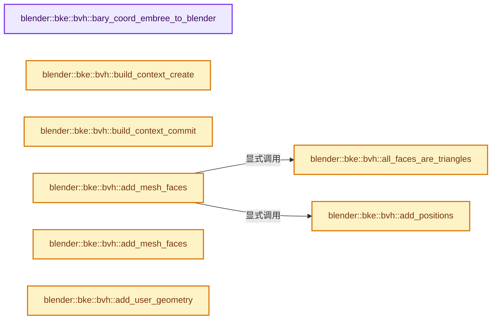
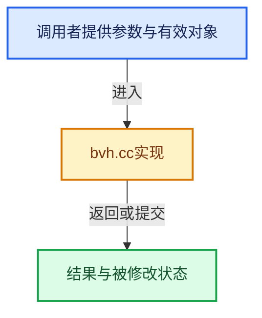

# 实现依赖专题：source/blender/blenkernel/intern/bvh.cc

[方向导航](README.md) · [符号索引](../%E7%AC%A6%E5%8F%B7%E4%BE%9D%E8%B5%96%E4%B8%8E%E5%AE%9E%E7%8E%B0%E7%B4%A2%E5%BC%95.md)

本专题从正文实际调用进入，集中保存共享实现。函数有稳定锚点，可从调用处直接跳到对应完整函数；递归与互相调用通过回链组织。

## 本文件的实现关系






## 完整成员与函数实现

<a id="f-e397d2407a99ed76"></a>

### `blender::bke::bvh::bary_coord_embree_to_blender`

实现位置：[source/blender/blenkernel/intern/bvh.cc](../../../../../source/blender/blenkernel/intern/bvh.cc) · L96—L99。

接口参数：

- `const float u`
- `const float v`

**教学注释版**

<!-- annotated:6402ea06021c8b -->

```cpp
static float3 bary_coord_embree_to_blender(const float u, const float v)
{
  return float3(1.0f - u - v, u, v);
}
```

<details>
<summary>核对原始源码：source/blender/blenkernel/intern/bvh.cc · L96—L99</summary>

<!-- original:6402ea06021c8b:source/blender/blenkernel/intern/bvh.cc:96:99 -->

```cpp
static float3 bary_coord_embree_to_blender(const float u, const float v)
{
  return float3(1.0f - u - v, u, v);
}
```

</details>

**结果出口**

- `return float3(1.0f - u - v, u, v);`

**继续追踪实现**

- `float3` → [float3 · L641](%E4%BE%9D%E8%B5%96-smaa-b67bc2.md#m-0ea8254cfdb4)。宏定义由构建条件选择。

<a id="f-49a263070490513f"></a>

### `blender::bke::bvh::build_context_create`

实现位置：[source/blender/blenkernel/intern/bvh.cc](../../../../../source/blender/blenkernel/intern/bvh.cc) · L112—L126。

**教学注释版**

<!-- annotated:4be8452fcb8650 -->

```cpp
static BvhBuildContext build_context_create()
{
  RTCDevice device = rtcNewDevice("verbose=0");
  rtcSetDeviceErrorFunction(device, rtc_error_func, nullptr);
  rtcSetDeviceMemoryMonitorFunction(device, rtc_memory_monitor_func, nullptr);

  RTCScene scene = rtcNewScene(device);
  const RTCSceneFlags scene_flags = RTCSceneFlags(RTC_SCENE_FLAG_ROBUST |
                                                  RTC_SCENE_FLAG_FILTER_FUNCTION_IN_ARGUMENTS);
  rtcSetSceneFlags(scene, scene_flags);
  const RTCBuildQuality build_quality = RTC_BUILD_QUALITY_MEDIUM;
  rtcSetSceneBuildQuality(scene, build_quality);

  return BvhBuildContext{device, scene, build_quality};
}
```

<details>
<summary>核对原始源码：source/blender/blenkernel/intern/bvh.cc · L112—L126</summary>

<!-- original:4be8452fcb8650:source/blender/blenkernel/intern/bvh.cc:112:126 -->

```cpp
static BvhBuildContext build_context_create()
{
  RTCDevice device = rtcNewDevice("verbose=0");
  rtcSetDeviceErrorFunction(device, rtc_error_func, nullptr);
  rtcSetDeviceMemoryMonitorFunction(device, rtc_memory_monitor_func, nullptr);

  RTCScene scene = rtcNewScene(device);
  const RTCSceneFlags scene_flags = RTCSceneFlags(RTC_SCENE_FLAG_ROBUST |
                                                  RTC_SCENE_FLAG_FILTER_FUNCTION_IN_ARGUMENTS);
  rtcSetSceneFlags(scene, scene_flags);
  const RTCBuildQuality build_quality = RTC_BUILD_QUALITY_MEDIUM;
  rtcSetSceneBuildQuality(scene, build_quality);

  return BvhBuildContext{device, scene, build_quality};
}
```

</details>

**结果出口**

- `return BvhBuildContext{device, scene, build_quality};`

**继续追踪实现**

- `rtcNewDevice` → [调用协议](../%E6%A8%A1%E6%9D%BF%E5%AE%8F%E4%B8%8E%E5%8A%A8%E6%80%81%E5%88%86%E6%B4%BE%E5%8D%8F%E8%AE%AE.md)：函数指针、局部可调用对象或未展开的宏；必须结合调用者环境。调用位置L114。
- `rtcSetDeviceErrorFunction` → [调用协议](../%E6%A8%A1%E6%9D%BF%E5%AE%8F%E4%B8%8E%E5%8A%A8%E6%80%81%E5%88%86%E6%B4%BE%E5%8D%8F%E8%AE%AE.md)：函数指针、局部可调用对象或未展开的宏；必须结合调用者环境。调用位置L115。
- `rtcSetDeviceMemoryMonitorFunction` → [调用协议](../%E6%A8%A1%E6%9D%BF%E5%AE%8F%E4%B8%8E%E5%8A%A8%E6%80%81%E5%88%86%E6%B4%BE%E5%8D%8F%E8%AE%AE.md)：函数指针、局部可调用对象或未展开的宏；必须结合调用者环境。调用位置L116。
- `rtcNewScene` → [调用协议](../%E6%A8%A1%E6%9D%BF%E5%AE%8F%E4%B8%8E%E5%8A%A8%E6%80%81%E5%88%86%E6%B4%BE%E5%8D%8F%E8%AE%AE.md)：函数指针、局部可调用对象或未展开的宏；必须结合调用者环境。调用位置L118。
- `RTCSceneFlags` → [调用协议](../%E6%A8%A1%E6%9D%BF%E5%AE%8F%E4%B8%8E%E5%8A%A8%E6%80%81%E5%88%86%E6%B4%BE%E5%8D%8F%E8%AE%AE.md)：函数指针、局部可调用对象或未展开的宏；必须结合调用者环境。调用位置L119。
- `rtcSetSceneFlags` → [调用协议](../%E6%A8%A1%E6%9D%BF%E5%AE%8F%E4%B8%8E%E5%8A%A8%E6%80%81%E5%88%86%E6%B4%BE%E5%8D%8F%E8%AE%AE.md)：函数指针、局部可调用对象或未展开的宏；必须结合调用者环境。调用位置L121。
- `rtcSetSceneBuildQuality` → [调用协议](../%E6%A8%A1%E6%9D%BF%E5%AE%8F%E4%B8%8E%E5%8A%A8%E6%80%81%E5%88%86%E6%B4%BE%E5%8D%8F%E8%AE%AE.md)：函数指针、局部可调用对象或未展开的宏；必须结合调用者环境。调用位置L123。

<a id="f-f6c4d61ce7e7c94e"></a>

### `blender::bke::bvh::build_context_commit`

实现位置：[source/blender/blenkernel/intern/bvh.cc](../../../../../source/blender/blenkernel/intern/bvh.cc) · L128—L132。

接口参数：

- `const BvhBuildContext &ctx`

**教学注释版**

<!-- annotated:eb87b94c3a7b39 -->

```cpp
static void build_context_commit(const BvhBuildContext &ctx)
{
  rtcSetSceneProgressMonitorFunction(ctx.scene, rtc_progress_func, nullptr);
  rtcCommitScene(ctx.scene);
}
```

<details>
<summary>核对原始源码：source/blender/blenkernel/intern/bvh.cc · L128—L132</summary>

<!-- original:eb87b94c3a7b39:source/blender/blenkernel/intern/bvh.cc:128:132 -->

```cpp
static void build_context_commit(const BvhBuildContext &ctx)
{
  rtcSetSceneProgressMonitorFunction(ctx.scene, rtc_progress_func, nullptr);
  rtcCommitScene(ctx.scene);
}
```

</details>

**继续追踪实现**

- `rtcSetSceneProgressMonitorFunction` → [调用协议](../%E6%A8%A1%E6%9D%BF%E5%AE%8F%E4%B8%8E%E5%8A%A8%E6%80%81%E5%88%86%E6%B4%BE%E5%8D%8F%E8%AE%AE.md)：函数指针、局部可调用对象或未展开的宏；必须结合调用者环境。调用位置L130。
- `rtcCommitScene` → [调用协议](../%E6%A8%A1%E6%9D%BF%E5%AE%8F%E4%B8%8E%E5%8A%A8%E6%80%81%E5%88%86%E6%B4%BE%E5%8D%8F%E8%AE%AE.md)：函数指针、局部可调用对象或未展开的宏；必须结合调用者环境。调用位置L131。

<a id="f-a1c583a4bf8136bf"></a>

### `blender::bke::bvh::all_faces_are_triangles`

实现位置：[source/blender/blenkernel/intern/bvh.cc](../../../../../source/blender/blenkernel/intern/bvh.cc) · L134—L137。

接口参数：

- `const Mesh &mesh`

**教学注释版**

<!-- annotated:843b0f5cf93eb2 -->

```cpp
static bool all_faces_are_triangles(const Mesh &mesh)
{
  return mesh.corners_num == mesh.faces_num * 3;
}
```

<details>
<summary>核对原始源码：source/blender/blenkernel/intern/bvh.cc · L134—L137</summary>

<!-- original:843b0f5cf93eb2:source/blender/blenkernel/intern/bvh.cc:134:137 -->

```cpp
static bool all_faces_are_triangles(const Mesh &mesh)
{
  return mesh.corners_num == mesh.faces_num * 3;
}
```

</details>

**结果出口**

- `return mesh.corners_num == mesh.faces_num * 3;`

**继续追踪实现**

本实现没有需要继续展开的显式调用；检查返回表达式、对象转换和调用者前置条件。

<a id="f-2bd95255542f0b9c"></a>

### `blender::bke::bvh::add_positions`

实现位置：[source/blender/blenkernel/intern/bvh.cc](../../../../../source/blender/blenkernel/intern/bvh.cc) · L139—L146。

接口参数：

- `const Span<float3> positions`
- `RTCGeometry geom_id`

**教学注释版**

<!-- annotated:27be2b7aa632c4 -->

```cpp
static void add_positions(const Span<float3> positions, RTCGeometry geom_id)
{
  /* Unfortunately #rtcSetSharedGeometryBuffer cannot be used here because Embree must load past
   * the end of the buffer for SIMD loads. */
  float3 *positions_ptr = static_cast<float3 *>(rtcSetNewGeometryBuffer(
      // [讲解] positions.size：查询视图长度或生成对应有效索引区间。
      geom_id, RTC_BUFFER_TYPE_VERTEX, 0, RTC_FORMAT_FLOAT3, sizeof(float3), positions.size()));
  // [讲解] positions.data：返回借用范围的地址。
  std::copy_n(positions.data(), positions.size(), positions_ptr);
}
```

<details>
<summary>核对原始源码：source/blender/blenkernel/intern/bvh.cc · L139—L146</summary>

<!-- original:27be2b7aa632c4:source/blender/blenkernel/intern/bvh.cc:139:146 -->

```cpp
static void add_positions(const Span<float3> positions, RTCGeometry geom_id)
{
  /* Unfortunately #rtcSetSharedGeometryBuffer cannot be used here because Embree must load past
   * the end of the buffer for SIMD loads. */
  float3 *positions_ptr = static_cast<float3 *>(rtcSetNewGeometryBuffer(
      geom_id, RTC_BUFFER_TYPE_VERTEX, 0, RTC_FORMAT_FLOAT3, sizeof(float3), positions.size()));
  std::copy_n(positions.data(), positions.size(), positions_ptr);
}
```

</details>

**继续追踪实现**

- `rtcSetNewGeometryBuffer` → [调用协议](../%E6%A8%A1%E6%9D%BF%E5%AE%8F%E4%B8%8E%E5%8A%A8%E6%80%81%E5%88%86%E6%B4%BE%E5%8D%8F%E8%AE%AE.md)：函数指针、局部可调用对象或未展开的宏；必须结合调用者环境。调用位置L143。
- `positions.size` → [blender::Span::size · L256](../01-%E5%9F%BA%E7%A1%80%E5%AE%B9%E5%99%A8%E4%B8%8E%E7%8E%B0%E4%BB%A3CPP/05-Span%E5%8F%AA%E8%AF%BB%E8%BF%9E%E7%BB%AD%E8%A7%86%E5%9B%BE.md#f-5f80fa006089c998)。
- `std::copy_n` → [外部契约](https://eel.is/c++draft/)：这个边界按实际表达式及所属类型核对参数、返回值、寿命与失败行为。这里提供接口入口，不声称已解释该第三方版本的内部实现。
- `positions.data` → [blender::Span::data · L219](../01-%E5%9F%BA%E7%A1%80%E5%AE%B9%E5%99%A8%E4%B8%8E%E7%8E%B0%E4%BB%A3CPP/05-Span%E5%8F%AA%E8%AF%BB%E8%BF%9E%E7%BB%AD%E8%A7%86%E5%9B%BE.md#f-10c5889198935800)。

<a id="f-c2526293a191ba1b"></a>

### `blender::bke::bvh::add_mesh_faces`

实现位置：[source/blender/blenkernel/intern/bvh.cc](../../../../../source/blender/blenkernel/intern/bvh.cc) · L148—L177。

接口参数：

- `const BvhBuildContext &ctx`
- `const int id`
- `const Mesh &mesh`

**教学注释版**

<!-- annotated:3e44c58247a0e6 -->

```cpp
static void add_mesh_faces(const BvhBuildContext &ctx, const int id, const Mesh &mesh)
{
  RTCGeometry geom_id = rtcNewGeometry(ctx.device, RTC_GEOMETRY_TYPE_TRIANGLE);
  rtcSetGeometryBuildQuality(geom_id, ctx.build_quality);

  const Span<float3> positions = mesh.vert_positions();
  const Span<int> corner_verts = mesh.corner_verts();
  if (all_faces_are_triangles(mesh)) {
    rtcSetSharedGeometryBuffer(geom_id,
                               RTC_BUFFER_TYPE_INDEX,
                               0,
                               RTC_FORMAT_UINT3,
                               // [讲解] corner_verts.data：返回借用范围的地址。
                               corner_verts.data(),
                               0,
                               sizeof(int3),
                               // [讲解] corner_verts.cast<int3>：按类型与布局约束重新解释视图。
                               corner_verts.cast<int3>().size());
  }
  else {
    const Span<int3> corner_tris = mesh.corner_tris();
    uint3 *rtc_indices = static_cast<uint3 *>(rtcSetNewGeometryBuffer(
        // [讲解] corner_tris.size：查询视图长度或生成对应有效索引区间。
        geom_id, RTC_BUFFER_TYPE_INDEX, 0, RTC_FORMAT_UINT3, sizeof(int3), corner_tris.size()));
    mesh::vert_tris_from_corner_tris(
        corner_verts, corner_tris, MutableSpan(rtc_indices, corner_tris.size()).cast<int3>());
  }
  add_positions(positions, geom_id);

  rtcCommitGeometry(geom_id);
  rtcAttachGeometryByID(ctx.scene, geom_id, id);
  rtcReleaseGeometry(geom_id);
}
```

<details>
<summary>核对原始源码：source/blender/blenkernel/intern/bvh.cc · L148—L177</summary>

<!-- original:3e44c58247a0e6:source/blender/blenkernel/intern/bvh.cc:148:177 -->

```cpp
static void add_mesh_faces(const BvhBuildContext &ctx, const int id, const Mesh &mesh)
{
  RTCGeometry geom_id = rtcNewGeometry(ctx.device, RTC_GEOMETRY_TYPE_TRIANGLE);
  rtcSetGeometryBuildQuality(geom_id, ctx.build_quality);

  const Span<float3> positions = mesh.vert_positions();
  const Span<int> corner_verts = mesh.corner_verts();
  if (all_faces_are_triangles(mesh)) {
    rtcSetSharedGeometryBuffer(geom_id,
                               RTC_BUFFER_TYPE_INDEX,
                               0,
                               RTC_FORMAT_UINT3,
                               corner_verts.data(),
                               0,
                               sizeof(int3),
                               corner_verts.cast<int3>().size());
  }
  else {
    const Span<int3> corner_tris = mesh.corner_tris();
    uint3 *rtc_indices = static_cast<uint3 *>(rtcSetNewGeometryBuffer(
        geom_id, RTC_BUFFER_TYPE_INDEX, 0, RTC_FORMAT_UINT3, sizeof(int3), corner_tris.size()));
    mesh::vert_tris_from_corner_tris(
        corner_verts, corner_tris, MutableSpan(rtc_indices, corner_tris.size()).cast<int3>());
  }
  add_positions(positions, geom_id);

  rtcCommitGeometry(geom_id);
  rtcAttachGeometryByID(ctx.scene, geom_id, id);
  rtcReleaseGeometry(geom_id);
}
```

</details>

**继续追踪实现**

- `rtcNewGeometry` → [调用协议](../%E6%A8%A1%E6%9D%BF%E5%AE%8F%E4%B8%8E%E5%8A%A8%E6%80%81%E5%88%86%E6%B4%BE%E5%8D%8F%E8%AE%AE.md)：函数指针、局部可调用对象或未展开的宏；必须结合调用者环境。调用位置L150。
- `rtcSetGeometryBuildQuality` → [调用协议](../%E6%A8%A1%E6%9D%BF%E5%AE%8F%E4%B8%8E%E5%8A%A8%E6%80%81%E5%88%86%E6%B4%BE%E5%8D%8F%E8%AE%AE.md)：函数指针、局部可调用对象或未展开的宏；必须结合调用者环境。调用位置L151。
- `mesh.vert_positions` → [Mesh::vert_positions · L1193](03-MPoly%E8%BF%81%E7%A7%BB%E4%B8%8E%E5%85%BC%E5%AE%B9.md#f-ae4177e5c5f2b371)。
- `mesh.corner_verts` → [Mesh::corner_verts · L1238](03-MPoly%E8%BF%81%E7%A7%BB%E4%B8%8E%E5%85%BC%E5%AE%B9.md#f-a59c61f583b64bc4)。
- `all_faces_are_triangles` → [blender::bke::bvh::all_faces_are_triangles · L134](%E4%BE%9D%E8%B5%96-bvh-718c1e.md#f-a1c583a4bf8136bf)。
- `rtcSetSharedGeometryBuffer` → [调用协议](../%E6%A8%A1%E6%9D%BF%E5%AE%8F%E4%B8%8E%E5%8A%A8%E6%80%81%E5%88%86%E6%B4%BE%E5%8D%8F%E8%AE%AE.md)：函数指针、局部可调用对象或未展开的宏；必须结合调用者环境。调用位置L156。
- `corner_verts.data` → [blender::Span::data · L219](../01-%E5%9F%BA%E7%A1%80%E5%AE%B9%E5%99%A8%E4%B8%8E%E7%8E%B0%E4%BB%A3CPP/05-Span%E5%8F%AA%E8%AF%BB%E8%BF%9E%E7%BB%AD%E8%A7%86%E5%9B%BE.md#f-10c5889198935800)。
- `corner_verts.cast<int3>().size` → [调用协议](../%E6%A8%A1%E6%9D%BF%E5%AE%8F%E4%B8%8E%E5%8A%A8%E6%80%81%E5%88%86%E6%B4%BE%E5%8D%8F%E8%AE%AE.md)：接收对象类型依赖auto、返回值或模板实例；不按同名猜测目标。调用位置L163。
- `corner_verts.cast<int3>` → [blender::Span::cast · L422](../01-%E5%9F%BA%E7%A1%80%E5%AE%B9%E5%99%A8%E4%B8%8E%E7%8E%B0%E4%BB%A3CPP/05-Span%E5%8F%AA%E8%AF%BB%E8%BF%9E%E7%BB%AD%E8%A7%86%E5%9B%BE.md#f-e082d823028af8f6)。
- `mesh.corner_tris` → [blender::Mesh::corner_tris · L264](../06-%E9%9A%90%E5%BC%8F%E5%85%B1%E4%BA%AB%E4%B8%8E%E7%BC%93%E5%AD%98%E7%B3%BB%E7%BB%9F/10-%E5%B1%80%E9%83%A8%E6%9B%B4%E6%96%B0%E4%B8%8E%E5%A4%B1%E6%95%88%E4%BF%AE%E5%A4%8D.md#f-9bb421790000fc20)。
- `rtcSetNewGeometryBuffer` → [调用协议](../%E6%A8%A1%E6%9D%BF%E5%AE%8F%E4%B8%8E%E5%8A%A8%E6%80%81%E5%88%86%E6%B4%BE%E5%8D%8F%E8%AE%AE.md)：函数指针、局部可调用对象或未展开的宏；必须结合调用者环境。调用位置L167。
- `corner_tris.size` → [blender::Span::size · L256](../01-%E5%9F%BA%E7%A1%80%E5%AE%B9%E5%99%A8%E4%B8%8E%E7%8E%B0%E4%BB%A3CPP/05-Span%E5%8F%AA%E8%AF%BB%E8%BF%9E%E7%BB%AD%E8%A7%86%E5%9B%BE.md#f-5f80fa006089c998)。
- `mesh::vert_tris_from_corner_tris` → [blender::bke::mesh::vert_tris_from_corner_tris · L238](%E4%BE%9D%E8%B5%96-mesh_tessellate-a0d323.md#f-148011c2040a8b1e)。
- `MutableSpan(rtc_indices, corner_tris.size()).cast<int3>` → [调用协议](../%E6%A8%A1%E6%9D%BF%E5%AE%8F%E4%B8%8E%E5%8A%A8%E6%80%81%E5%88%86%E6%B4%BE%E5%8D%8F%E8%AE%AE.md)：接收对象类型依赖auto、返回值或模板实例；不按同名猜测目标。调用位置L170。
- `MutableSpan` → [blender::MutableSpan::MutableSpan · L462](../01-%E5%9F%BA%E7%A1%80%E5%AE%B9%E5%99%A8%E4%B8%8E%E7%8E%B0%E4%BB%A3CPP/06-MutableSpan%E5%8F%AF%E5%86%99%E8%A7%86%E5%9B%BE.md#f-0f07034aaffc3384)；[blender::MutableSpan::MutableSpan · L464](../01-%E5%9F%BA%E7%A1%80%E5%AE%B9%E5%99%A8%E4%B8%8E%E7%8E%B0%E4%BB%A3CPP/06-MutableSpan%E5%8F%AF%E5%86%99%E8%A7%86%E5%9B%BE.md#f-39977234ad0ce192)；[blender::MutableSpan::MutableSpan · L466](../01-%E5%9F%BA%E7%A1%80%E5%AE%B9%E5%99%A8%E4%B8%8E%E7%8E%B0%E4%BB%A3CPP/06-MutableSpan%E5%8F%AF%E5%86%99%E8%A7%86%E5%9B%BE.md#f-ee249b5042dd38aa)；[blender::MutableSpan::MutableSpan · L468](../01-%E5%9F%BA%E7%A1%80%E5%AE%B9%E5%99%A8%E4%B8%8E%E7%8E%B0%E4%BB%A3CPP/06-MutableSpan%E5%8F%AF%E5%86%99%E8%A7%86%E5%9B%BE.md#f-479c5f85921e531f)；[blender::MutableSpan::MutableSpan · L477](../01-%E5%9F%BA%E7%A1%80%E5%AE%B9%E5%99%A8%E4%B8%8E%E7%8E%B0%E4%BB%A3CPP/06-MutableSpan%E5%8F%AF%E5%86%99%E8%A7%86%E5%9B%BE.md#f-afcce5325e6f19e0)。同名重载需按实参类型选择。
- `add_positions` → [blender::bke::bvh::add_positions · L139](%E4%BE%9D%E8%B5%96-bvh-718c1e.md#f-2bd95255542f0b9c)。
- `rtcCommitGeometry` → [调用协议](../%E6%A8%A1%E6%9D%BF%E5%AE%8F%E4%B8%8E%E5%8A%A8%E6%80%81%E5%88%86%E6%B4%BE%E5%8D%8F%E8%AE%AE.md)：函数指针、局部可调用对象或未展开的宏；必须结合调用者环境。调用位置L174。
- `rtcAttachGeometryByID` → [调用协议](../%E6%A8%A1%E6%9D%BF%E5%AE%8F%E4%B8%8E%E5%8A%A8%E6%80%81%E5%88%86%E6%B4%BE%E5%8D%8F%E8%AE%AE.md)：函数指针、局部可调用对象或未展开的宏；必须结合调用者环境。调用位置L175。
- `rtcReleaseGeometry` → [调用协议](../%E6%A8%A1%E6%9D%BF%E5%AE%8F%E4%B8%8E%E5%8A%A8%E6%80%81%E5%88%86%E6%B4%BE%E5%8D%8F%E8%AE%AE.md)：函数指针、局部可调用对象或未展开的宏；必须结合调用者环境。调用位置L176。

<a id="f-9a104055f17a6a61"></a>

### `blender::bke::bvh::add_mesh_faces`

实现位置：[source/blender/blenkernel/intern/bvh.cc](../../../../../source/blender/blenkernel/intern/bvh.cc) · L179—L252。

接口参数：

- `const BvhBuildContext &ctx`
- `Vector<Array<int, 0>, 1> &index_map_by_geom`
- `const int id`
- `const Mesh &mesh`
- `const IndexMask &face_mask`
- `const bool map_global_indices`

**教学注释版**

<!-- annotated:ce99db10206323 -->

```cpp
static void add_mesh_faces(const BvhBuildContext &ctx,
                           Vector<Array<int, 0>, 1> &index_map_by_geom,
                           const int id,
                           const Mesh &mesh,
                           const IndexMask &face_mask,
                           const bool map_global_indices)
{
  RTCGeometry geom_id = rtcNewGeometry(ctx.device, RTC_GEOMETRY_TYPE_TRIANGLE);
  rtcSetGeometryBuildQuality(geom_id, ctx.build_quality);

  const Span<float3> positions = mesh.vert_positions();
  const OffsetIndices faces = mesh.faces();
  const Span<int> corner_verts = mesh.corner_verts();
  const Span<int3> corner_tris = mesh.corner_tris();
  /* Use #int instead of the default #int64_t for internal indices. */
  VectorSet<int,
            128,
            DefaultProbingStrategy,
            DefaultHash<int>,
            DefaultEquality<int>,
            SimpleVectorSetSlot<int, int>,
            GuardedAllocator>
      used_verts;
  // [讲解] used_verts.reserve：重新组织槽位或准备容量。
  used_verts.reserve(faces.size());
  face_mask.foreach_index(
      // [讲解] corner_verts.slice：建立原连续范围的子视图。
      [&](const int face) { used_verts.add_multiple(corner_verts.slice(faces[face])); });

  Array<int, 128> masked_face_offset_data(face_mask.size() + 1);
  const OffsetIndices<int> mask_faces = offset_indices::gather_selected_offsets(
      faces, face_mask, masked_face_offset_data);

  const int tris_num = poly_to_tri_count(face_mask.size(), mask_faces.total_size());

  Array<int, 0> global_index_map;
  if (map_global_indices) {
    // [讲解] global_index_map.reinitialize：以新长度重建数组。
    global_index_map.reinitialize(tris_num);
    face_mask.foreach_index_optimized<int>(
        [&](const int face, const int pos) {
          const IndexRange src_tris = mesh::face_triangles_range(faces, face);
          const IndexRange dst_tris = mesh::face_triangles_range(mask_faces, pos);
          for (const int i : src_tris.index_range()) {
            global_index_map[dst_tris[i]] = src_tris[i];
          }
        },
        exec_mode::grain_size(1024));
  }
  // [讲解] index_map_by_geom.append：在尾部建立新元素，必要时先扩大存储。
  index_map_by_geom.append(std::move(global_index_map));

  uint3 *rtc_indices = static_cast<uint3 *>(rtcSetNewGeometryBuffer(
      geom_id, RTC_BUFFER_TYPE_INDEX, 0, RTC_FORMAT_UINT3, sizeof(int3), tris_num));
  face_mask.foreach_index_optimized<int>(
      [&](const int face, const int pos) {
        const IndexRange src_tris = mesh::face_triangles_range(faces, face);
        const IndexRange dst_tris = mesh::face_triangles_range(mask_faces, pos);
        for (const int i : src_tris.index_range()) {
          const int3 &tri = corner_tris[src_tris[i]];
          rtc_indices[dst_tris[i]] = uint3(used_verts.index_of(corner_verts[tri[0]]),
                                           used_verts.index_of(corner_verts[tri[1]]),
                                           used_verts.index_of(corner_verts[tri[2]]));
        }
      },
      exec_mode::grain_size(1024));

  /* If #rtcSetSharedGeometryBuffer could be used, remapping to avoid copying unnecessary
   * vertex positions could be unnecessary. Sharing the buffer currently doesn't work because
   * Embree must load past the end of the buffer for SIMD loads. */
  float3 *positions_ptr = static_cast<float3 *>(rtcSetNewGeometryBuffer(
      // [讲解] used_verts.size：查询活项数量或键是否存在。
      geom_id, RTC_BUFFER_TYPE_VERTEX, 0, RTC_FORMAT_FLOAT3, sizeof(float3), used_verts.size()));
  array_utils::gather<float3>(positions, used_verts.as_span(), {positions_ptr, used_verts.size()});

  rtcCommitGeometry(geom_id);
  rtcAttachGeometryByID(ctx.scene, geom_id, id);
  rtcReleaseGeometry(geom_id);
}
```

<details>
<summary>核对原始源码：source/blender/blenkernel/intern/bvh.cc · L179—L252</summary>

<!-- original:ce99db10206323:source/blender/blenkernel/intern/bvh.cc:179:252 -->

```cpp
static void add_mesh_faces(const BvhBuildContext &ctx,
                           Vector<Array<int, 0>, 1> &index_map_by_geom,
                           const int id,
                           const Mesh &mesh,
                           const IndexMask &face_mask,
                           const bool map_global_indices)
{
  RTCGeometry geom_id = rtcNewGeometry(ctx.device, RTC_GEOMETRY_TYPE_TRIANGLE);
  rtcSetGeometryBuildQuality(geom_id, ctx.build_quality);

  const Span<float3> positions = mesh.vert_positions();
  const OffsetIndices faces = mesh.faces();
  const Span<int> corner_verts = mesh.corner_verts();
  const Span<int3> corner_tris = mesh.corner_tris();
  /* Use #int instead of the default #int64_t for internal indices. */
  VectorSet<int,
            128,
            DefaultProbingStrategy,
            DefaultHash<int>,
            DefaultEquality<int>,
            SimpleVectorSetSlot<int, int>,
            GuardedAllocator>
      used_verts;
  used_verts.reserve(faces.size());
  face_mask.foreach_index(
      [&](const int face) { used_verts.add_multiple(corner_verts.slice(faces[face])); });

  Array<int, 128> masked_face_offset_data(face_mask.size() + 1);
  const OffsetIndices<int> mask_faces = offset_indices::gather_selected_offsets(
      faces, face_mask, masked_face_offset_data);

  const int tris_num = poly_to_tri_count(face_mask.size(), mask_faces.total_size());

  Array<int, 0> global_index_map;
  if (map_global_indices) {
    global_index_map.reinitialize(tris_num);
    face_mask.foreach_index_optimized<int>(
        [&](const int face, const int pos) {
          const IndexRange src_tris = mesh::face_triangles_range(faces, face);
          const IndexRange dst_tris = mesh::face_triangles_range(mask_faces, pos);
          for (const int i : src_tris.index_range()) {
            global_index_map[dst_tris[i]] = src_tris[i];
          }
        },
        exec_mode::grain_size(1024));
  }
  index_map_by_geom.append(std::move(global_index_map));

  uint3 *rtc_indices = static_cast<uint3 *>(rtcSetNewGeometryBuffer(
      geom_id, RTC_BUFFER_TYPE_INDEX, 0, RTC_FORMAT_UINT3, sizeof(int3), tris_num));
  face_mask.foreach_index_optimized<int>(
      [&](const int face, const int pos) {
        const IndexRange src_tris = mesh::face_triangles_range(faces, face);
        const IndexRange dst_tris = mesh::face_triangles_range(mask_faces, pos);
        for (const int i : src_tris.index_range()) {
          const int3 &tri = corner_tris[src_tris[i]];
          rtc_indices[dst_tris[i]] = uint3(used_verts.index_of(corner_verts[tri[0]]),
                                           used_verts.index_of(corner_verts[tri[1]]),
                                           used_verts.index_of(corner_verts[tri[2]]));
        }
      },
      exec_mode::grain_size(1024));

  /* If #rtcSetSharedGeometryBuffer could be used, remapping to avoid copying unnecessary
   * vertex positions could be unnecessary. Sharing the buffer currently doesn't work because
   * Embree must load past the end of the buffer for SIMD loads. */
  float3 *positions_ptr = static_cast<float3 *>(rtcSetNewGeometryBuffer(
      geom_id, RTC_BUFFER_TYPE_VERTEX, 0, RTC_FORMAT_FLOAT3, sizeof(float3), used_verts.size()));
  array_utils::gather<float3>(positions, used_verts.as_span(), {positions_ptr, used_verts.size()});

  rtcCommitGeometry(geom_id);
  rtcAttachGeometryByID(ctx.scene, geom_id, id);
  rtcReleaseGeometry(geom_id);
}
```

</details>

**沿实际写入检查状态**

- `global_index_map[dst_tris[i]] = src_tris[i];`
- `rtc_indices[dst_tris[i]] = uint3(used_verts.index_of(corner_verts[tri[0]]),`

**继续追踪实现**

- `rtcNewGeometry` → [调用协议](../%E6%A8%A1%E6%9D%BF%E5%AE%8F%E4%B8%8E%E5%8A%A8%E6%80%81%E5%88%86%E6%B4%BE%E5%8D%8F%E8%AE%AE.md)：函数指针、局部可调用对象或未展开的宏；必须结合调用者环境。调用位置L186。
- `rtcSetGeometryBuildQuality` → [调用协议](../%E6%A8%A1%E6%9D%BF%E5%AE%8F%E4%B8%8E%E5%8A%A8%E6%80%81%E5%88%86%E6%B4%BE%E5%8D%8F%E8%AE%AE.md)：函数指针、局部可调用对象或未展开的宏；必须结合调用者环境。调用位置L187。
- `mesh.vert_positions` → [Mesh::vert_positions · L1193](03-MPoly%E8%BF%81%E7%A7%BB%E4%B8%8E%E5%85%BC%E5%AE%B9.md#f-ae4177e5c5f2b371)。
- `mesh.faces` → [Mesh::faces · L1217](03-MPoly%E8%BF%81%E7%A7%BB%E4%B8%8E%E5%85%BC%E5%AE%B9.md#f-ea444760154e17b2)。
- `mesh.corner_verts` → [Mesh::corner_verts · L1238](03-MPoly%E8%BF%81%E7%A7%BB%E4%B8%8E%E5%85%BC%E5%AE%B9.md#f-a59c61f583b64bc4)。
- `mesh.corner_tris` → [blender::Mesh::corner_tris · L264](../06-%E9%9A%90%E5%BC%8F%E5%85%B1%E4%BA%AB%E4%B8%8E%E7%BC%93%E5%AD%98%E7%B3%BB%E7%BB%9F/10-%E5%B1%80%E9%83%A8%E6%9B%B4%E6%96%B0%E4%B8%8E%E5%A4%B1%E6%95%88%E4%BF%AE%E5%A4%8D.md#f-9bb421790000fc20)。
- `used_verts.reserve` → [blender::VectorSet::reserve · L660](../01-%E5%9F%BA%E7%A1%80%E5%AE%B9%E5%99%A8%E4%B8%8E%E7%8E%B0%E4%BB%A3CPP/14-VectorSet%E7%A8%B3%E5%AE%9A%E7%B4%A2%E5%BC%95%E4%B8%8E%E5%8E%BB%E9%87%8D.md#f-2315ad23ca588c20)。
- `faces.size` → [blender::offset_indices::OffsetIndices::size · L67](02-OffsetIndices%E5%AE%8C%E6%95%B4%E6%8E%A5%E5%8F%A3.md#f-e238abc62ed42abd)。
- `face_mask.foreach_index` → [blender::index_mask::IndexMask::foreach_index · L855](../04-%E8%99%9A%E6%8B%9F%E6%95%B0%E7%BB%84%E4%B8%8E%E7%B4%A2%E5%BC%95%E9%80%89%E6%8B%A9/09-%E5%88%86%E6%AE%B5%E5%AD%98%E5%82%A8%E4%B8%8E%E9%81%8D%E5%8E%86.md#f-cd6cd317e2e2812c)。
- `used_verts.add_multiple` → [blender::VectorSet::add_multiple · L394](../01-%E5%9F%BA%E7%A1%80%E5%AE%B9%E5%99%A8%E4%B8%8E%E7%8E%B0%E4%BB%A3CPP/14-VectorSet%E7%A8%B3%E5%AE%9A%E7%B4%A2%E5%BC%95%E4%B8%8E%E5%8E%BB%E9%87%8D.md#f-911e364c3013b35e)。
- `corner_verts.slice` → [blender::Span::slice · L141](../01-%E5%9F%BA%E7%A1%80%E5%AE%B9%E5%99%A8%E4%B8%8E%E7%8E%B0%E4%BB%A3CPP/05-Span%E5%8F%AA%E8%AF%BB%E8%BF%9E%E7%BB%AD%E8%A7%86%E5%9B%BE.md#f-380a0e8fdcbd53cc)；[blender::Span::slice · L149](../01-%E5%9F%BA%E7%A1%80%E5%AE%B9%E5%99%A8%E4%B8%8E%E7%8E%B0%E4%BB%A3CPP/05-Span%E5%8F%AA%E8%AF%BB%E8%BF%9E%E7%BB%AD%E8%A7%86%E5%9B%BE.md#f-9b9c15e78dd54eec)。同名重载需按实参类型选择。
- `face_mask.size` → [blender::index_mask::IndexMask::size · L743](../04-%E8%99%9A%E6%8B%9F%E6%95%B0%E7%BB%84%E4%B8%8E%E7%B4%A2%E5%BC%95%E9%80%89%E6%8B%A9/09-%E5%88%86%E6%AE%B5%E5%AD%98%E5%82%A8%E4%B8%8E%E9%81%8D%E5%8E%86.md#f-0163b32abc9a0d9c)。
- `offset_indices::gather_selected_offsets` → [blender::offset_indices::gather_selected_offsets · L135](05-%E9%82%BB%E6%8E%A5%E5%85%B3%E7%B3%BB%E4%B8%8E%E5%89%8D%E7%BC%80%E5%92%8C.md#f-db58dc5f33a70276)；[blender::offset_indices::gather_selected_offsets · L152](05-%E9%82%BB%E6%8E%A5%E5%85%B3%E7%B3%BB%E4%B8%8E%E5%89%8D%E7%BC%80%E5%92%8C.md#f-81774b7fe5ae69aa)；[blender::offset_indices::gather_selected_offsets · L182](02-OffsetIndices%E5%AE%8C%E6%95%B4%E6%8E%A5%E5%8F%A3.md#f-7114c46ef264d80b)；[blender::offset_indices::gather_selected_offsets · L192](02-OffsetIndices%E5%AE%8C%E6%95%B4%E6%8E%A5%E5%8F%A3.md#f-25cd4510af788ad9)。同名重载需按实参类型选择。
- `poly_to_tri_count` → [调用协议](../%E6%A8%A1%E6%9D%BF%E5%AE%8F%E4%B8%8E%E5%8A%A8%E6%80%81%E5%88%86%E6%B4%BE%E5%8D%8F%E8%AE%AE.md)：函数指针、局部可调用对象或未展开的宏；必须结合调用者环境。调用位置L210。
- `mask_faces.total_size` → [blender::offset_indices::OffsetIndices::total_size · L58](02-OffsetIndices%E5%AE%8C%E6%95%B4%E6%8E%A5%E5%8F%A3.md#f-c111ffdac7a19248)。
- `global_index_map.reinitialize` → [blender::Array::reinitialize · L430](../01-%E5%9F%BA%E7%A1%80%E5%AE%B9%E5%99%A8%E4%B8%8E%E7%8E%B0%E4%BB%A3CPP/08-Array%E5%A4%8D%E5%88%B6%E7%A7%BB%E5%8A%A8%E4%B8%8E%E9%94%80%E6%AF%81.md#f-3414f619e246b688)。
- `face_mask.foreach_index_optimized<int>` → [blender::index_mask::IndexMask::foreach_index_optimized · L937](../04-%E8%99%9A%E6%8B%9F%E6%95%B0%E7%BB%84%E4%B8%8E%E7%B4%A2%E5%BC%95%E9%80%89%E6%8B%A9/12-%E9%87%8D%E6%9E%84%E5%8E%86%E5%8F%B2%E4%B8%8E%E5%9F%BA%E5%87%86%E7%BB%83%E4%B9%A0.md#f-a2c3e7876407eaaf)。
- `mesh::face_triangles_range` → [blender::bke::mesh::face_triangles_range · L359](01-Mesh%E9%A1%B6%E7%82%B9%E8%BE%B9%E9%9D%A2%E8%A7%92%E7%82%B9.md#f-029966d2ab83c686)。
- `src_tris.index_range` → [blender::IndexRange::index_range · L161](../01-%E5%9F%BA%E7%A1%80%E5%AE%B9%E5%99%A8%E4%B8%8E%E7%8E%B0%E4%BB%A3CPP/04-IndexRange%E8%BF%9E%E7%BB%AD%E6%95%B4%E6%95%B0%E5%8C%BA%E9%97%B4.md#f-fd83072b4b81bce5)。
- `exec_mode::grain_size` → [blender::exec_mode::grain_size · L79](../01-%E5%9F%BA%E7%A1%80%E5%AE%B9%E5%99%A8%E4%B8%8E%E7%8E%B0%E4%BB%A3CPP/%E4%BE%9D%E8%B5%96-BLI_execution_mode-1528fb.md#f-0b4fc2f9fa6e66e7)。
- `index_map_by_geom.append` → [blender::Vector::append · L498](../01-%E5%9F%BA%E7%A1%80%E5%AE%B9%E5%99%A8%E4%B8%8E%E7%8E%B0%E4%BB%A3CPP/11-Vector%E6%8F%92%E5%85%A5%E5%88%A0%E9%99%A4%E4%B8%8E%E9%87%8D%E6%8E%92.md#f-5bde268a69e443ec)；[blender::Vector::append · L502](../01-%E5%9F%BA%E7%A1%80%E5%AE%B9%E5%99%A8%E4%B8%8E%E7%8E%B0%E4%BB%A3CPP/11-Vector%E6%8F%92%E5%85%A5%E5%88%A0%E9%99%A4%E4%B8%8E%E9%87%8D%E6%8E%92.md#f-591e0b15e6308532)。同名重载需按实参类型选择。
- `std::move` → [外部契约](https://eel.is/c++draft/utility.forward)：把表达式转换成可供移动重载选择的值类别；不保证真的移动，不结束源对象寿命，对const值可能选择复制。
- `rtcSetNewGeometryBuffer` → [调用协议](../%E6%A8%A1%E6%9D%BF%E5%AE%8F%E4%B8%8E%E5%8A%A8%E6%80%81%E5%88%86%E6%B4%BE%E5%8D%8F%E8%AE%AE.md)：函数指针、局部可调用对象或未展开的宏；必须结合调用者环境。调用位置L227。
- `uint3` → [packed_uint3::uint3 · L54](%E4%BE%9D%E8%B5%96-types_uint3-654ef1.md#f-54e21cc96f356e94)。
- `used_verts.index_of` → [blender::VectorSet::index_of · L479](../01-%E5%9F%BA%E7%A1%80%E5%AE%B9%E5%99%A8%E4%B8%8E%E7%8E%B0%E4%BB%A3CPP/14-VectorSet%E7%A8%B3%E5%AE%9A%E7%B4%A2%E5%BC%95%E4%B8%8E%E5%8E%BB%E9%87%8D.md#f-cdcdb1260c0182b5)。
- `used_verts.size` → [blender::VectorSet::size · L611](../01-%E5%9F%BA%E7%A1%80%E5%AE%B9%E5%99%A8%E4%B8%8E%E7%8E%B0%E4%BB%A3CPP/14-VectorSet%E7%A8%B3%E5%AE%9A%E7%B4%A2%E5%BC%95%E4%B8%8E%E5%8E%BB%E9%87%8D.md#f-f42667f4f31e3349)。
- `array_utils::gather<float3>` → [blender::array_utils::gather · L187](../01-%E5%9F%BA%E7%A1%80%E5%AE%B9%E5%99%A8%E4%B8%8E%E7%8E%B0%E4%BB%A3CPP/20-%E5%AE%B9%E5%99%A8%E9%80%89%E6%8B%A9%E4%B8%8E%E7%8B%AC%E7%AB%8B%E5%AE%9E%E7%8E%B0.md#f-1760adec5858a42f)；[blender::array_utils::gather · L209](../01-%E5%9F%BA%E7%A1%80%E5%AE%B9%E5%99%A8%E4%B8%8E%E7%8E%B0%E4%BB%A3CPP/20-%E5%AE%B9%E5%99%A8%E9%80%89%E6%8B%A9%E4%B8%8E%E7%8B%AC%E7%AB%8B%E5%AE%9E%E7%8E%B0.md#f-a9f65820788454bf)；[blender::array_utils::gather · L225](../01-%E5%9F%BA%E7%A1%80%E5%AE%B9%E5%99%A8%E4%B8%8E%E7%8E%B0%E4%BB%A3CPP/20-%E5%AE%B9%E5%99%A8%E9%80%89%E6%8B%A9%E4%B8%8E%E7%8B%AC%E7%AB%8B%E5%AE%9E%E7%8E%B0.md#f-279764b4196f0b63)；[blender::array_utils::gather · L237](../01-%E5%9F%BA%E7%A1%80%E5%AE%B9%E5%99%A8%E4%B8%8E%E7%8E%B0%E4%BB%A3CPP/20-%E5%AE%B9%E5%99%A8%E9%80%89%E6%8B%A9%E4%B8%8E%E7%8B%AC%E7%AB%8B%E5%AE%9E%E7%8E%B0.md#f-e310fd489b49341b)；[blender::array_utils::gather · L268](../01-%E5%9F%BA%E7%A1%80%E5%AE%B9%E5%99%A8%E4%B8%8E%E7%8E%B0%E4%BB%A3CPP/20-%E5%AE%B9%E5%99%A8%E9%80%89%E6%8B%A9%E4%B8%8E%E7%8B%AC%E7%AB%8B%E5%AE%9E%E7%8E%B0.md#f-7b21c29791903615)；[blender::array_utils::gather · L63](../01-%E5%9F%BA%E7%A1%80%E5%AE%B9%E5%99%A8%E4%B8%8E%E7%8E%B0%E4%BB%A3CPP/%E4%BE%9D%E8%B5%96-array_utils-cbb70f.md#f-5c2b501b03ddbb1f)；[blender::array_utils::gather · L82](../01-%E5%9F%BA%E7%A1%80%E5%AE%B9%E5%99%A8%E4%B8%8E%E7%8E%B0%E4%BB%A3CPP/%E4%BE%9D%E8%B5%96-array_utils-cbb70f.md#f-ea4dd9e673fe81e4)。同名重载需按实参类型选择。
- `used_verts.as_span` → [blender::VectorSet::as_span · L326](../01-%E5%9F%BA%E7%A1%80%E5%AE%B9%E5%99%A8%E4%B8%8E%E7%8E%B0%E4%BB%A3CPP/14-VectorSet%E7%A8%B3%E5%AE%9A%E7%B4%A2%E5%BC%95%E4%B8%8E%E5%8E%BB%E9%87%8D.md#f-76ed81b1cfbe99ad)。
- `rtcCommitGeometry` → [调用协议](../%E6%A8%A1%E6%9D%BF%E5%AE%8F%E4%B8%8E%E5%8A%A8%E6%80%81%E5%88%86%E6%B4%BE%E5%8D%8F%E8%AE%AE.md)：函数指针、局部可调用对象或未展开的宏；必须结合调用者环境。调用位置L249。
- `rtcAttachGeometryByID` → [调用协议](../%E6%A8%A1%E6%9D%BF%E5%AE%8F%E4%B8%8E%E5%8A%A8%E6%80%81%E5%88%86%E6%B4%BE%E5%8D%8F%E8%AE%AE.md)：函数指针、局部可调用对象或未展开的宏；必须结合调用者环境。调用位置L250。
- `rtcReleaseGeometry` → [调用协议](../%E6%A8%A1%E6%9D%BF%E5%AE%8F%E4%B8%8E%E5%8A%A8%E6%80%81%E5%88%86%E6%B4%BE%E5%8D%8F%E8%AE%AE.md)：函数指针、局部可调用对象或未展开的宏；必须结合调用者环境。调用位置L251。

<a id="f-1a15ae27dbc487d8"></a>

### `blender::bke::bvh::add_user_geometry`

实现位置：[source/blender/blenkernel/intern/bvh.cc](../../../../../source/blender/blenkernel/intern/bvh.cc) · L287—L302。

接口参数：

- `const BvhBuildContext &ctx`
- `const int id`
- `const int elements_num`
- `const Tree::UserGeometryData &user_data`
- `const RTCBoundsFunction bounds_func`

**教学注释版**

<!-- annotated:b2370ea9f5e1a6 -->

```cpp
static void add_user_geometry(const BvhBuildContext &ctx,
                              const int id,
                              const int elements_num,
                              const Tree::UserGeometryData &user_data,
                              const RTCBoundsFunction bounds_func)
{
  RTCGeometry geom_id = rtcNewGeometry(ctx.device, RTC_GEOMETRY_TYPE_USER);
  rtcSetGeometryBuildQuality(geom_id, ctx.build_quality);
  rtcSetGeometryUserPrimitiveCount(geom_id, uint32_t(elements_num));
  rtcSetGeometryUserData(geom_id, const_cast<Tree::UserGeometryData *>(&user_data));
  rtcSetGeometryBoundsFunction(geom_id, bounds_func, nullptr);

  rtcCommitGeometry(geom_id);
  rtcAttachGeometryByID(ctx.scene, geom_id, id);
  rtcReleaseGeometry(geom_id);
}
```

<details>
<summary>核对原始源码：source/blender/blenkernel/intern/bvh.cc · L287—L302</summary>

<!-- original:b2370ea9f5e1a6:source/blender/blenkernel/intern/bvh.cc:287:302 -->

```cpp
static void add_user_geometry(const BvhBuildContext &ctx,
                              const int id,
                              const int elements_num,
                              const Tree::UserGeometryData &user_data,
                              const RTCBoundsFunction bounds_func)
{
  RTCGeometry geom_id = rtcNewGeometry(ctx.device, RTC_GEOMETRY_TYPE_USER);
  rtcSetGeometryBuildQuality(geom_id, ctx.build_quality);
  rtcSetGeometryUserPrimitiveCount(geom_id, uint32_t(elements_num));
  rtcSetGeometryUserData(geom_id, const_cast<Tree::UserGeometryData *>(&user_data));
  rtcSetGeometryBoundsFunction(geom_id, bounds_func, nullptr);

  rtcCommitGeometry(geom_id);
  rtcAttachGeometryByID(ctx.scene, geom_id, id);
  rtcReleaseGeometry(geom_id);
}
```

</details>

**继续追踪实现**

- `rtcNewGeometry` → [调用协议](../%E6%A8%A1%E6%9D%BF%E5%AE%8F%E4%B8%8E%E5%8A%A8%E6%80%81%E5%88%86%E6%B4%BE%E5%8D%8F%E8%AE%AE.md)：函数指针、局部可调用对象或未展开的宏；必须结合调用者环境。调用位置L293。
- `rtcSetGeometryBuildQuality` → [调用协议](../%E6%A8%A1%E6%9D%BF%E5%AE%8F%E4%B8%8E%E5%8A%A8%E6%80%81%E5%88%86%E6%B4%BE%E5%8D%8F%E8%AE%AE.md)：函数指针、局部可调用对象或未展开的宏；必须结合调用者环境。调用位置L294。
- `rtcSetGeometryUserPrimitiveCount` → [调用协议](../%E6%A8%A1%E6%9D%BF%E5%AE%8F%E4%B8%8E%E5%8A%A8%E6%80%81%E5%88%86%E6%B4%BE%E5%8D%8F%E8%AE%AE.md)：函数指针、局部可调用对象或未展开的宏；必须结合调用者环境。调用位置L295。
- `rtcSetGeometryUserData` → [调用协议](../%E6%A8%A1%E6%9D%BF%E5%AE%8F%E4%B8%8E%E5%8A%A8%E6%80%81%E5%88%86%E6%B4%BE%E5%8D%8F%E8%AE%AE.md)：函数指针、局部可调用对象或未展开的宏；必须结合调用者环境。调用位置L296。
- `rtcSetGeometryBoundsFunction` → [调用协议](../%E6%A8%A1%E6%9D%BF%E5%AE%8F%E4%B8%8E%E5%8A%A8%E6%80%81%E5%88%86%E6%B4%BE%E5%8D%8F%E8%AE%AE.md)：函数指针、局部可调用对象或未展开的宏；必须结合调用者环境。调用位置L297。
- `rtcCommitGeometry` → [调用协议](../%E6%A8%A1%E6%9D%BF%E5%AE%8F%E4%B8%8E%E5%8A%A8%E6%80%81%E5%88%86%E6%B4%BE%E5%8D%8F%E8%AE%AE.md)：函数指针、局部可调用对象或未展开的宏；必须结合调用者环境。调用位置L299。
- `rtcAttachGeometryByID` → [调用协议](../%E6%A8%A1%E6%9D%BF%E5%AE%8F%E4%B8%8E%E5%8A%A8%E6%80%81%E5%88%86%E6%B4%BE%E5%8D%8F%E8%AE%AE.md)：函数指针、局部可调用对象或未展开的宏；必须结合调用者环境。调用位置L300。
- `rtcReleaseGeometry` → [调用协议](../%E6%A8%A1%E6%9D%BF%E5%AE%8F%E4%B8%8E%E5%8A%A8%E6%80%81%E5%88%86%E6%B4%BE%E5%8D%8F%E8%AE%AE.md)：函数指针、局部可调用对象或未展开的宏；必须结合调用者环境。调用位置L301。

<a id="f-08bdeab148b390cd"></a>

### `blender::bke::bvh::fallback_mesh_data`

实现位置：[source/blender/blenkernel/intern/bvh.cc](../../../../../source/blender/blenkernel/intern/bvh.cc) · L317—L321。

接口参数：

- `const Tree::FallbackTree &fallback_tree`

**教学注释版**

<!-- annotated:2d97bf776c8dfa -->

```cpp
static BVHTreeFromMesh *fallback_mesh_data(const Tree::FallbackTree &fallback_tree)
{
  const MeshFallbackTree &mesh_tree = static_cast<const MeshFallbackTree &>(fallback_tree);
  return const_cast<BVHTreeFromMesh *>(&mesh_tree.bvh_from_mesh);
}
```

<details>
<summary>核对原始源码：source/blender/blenkernel/intern/bvh.cc · L317—L321</summary>

<!-- original:2d97bf776c8dfa:source/blender/blenkernel/intern/bvh.cc:317:321 -->

```cpp
static BVHTreeFromMesh *fallback_mesh_data(const Tree::FallbackTree &fallback_tree)
{
  const MeshFallbackTree &mesh_tree = static_cast<const MeshFallbackTree &>(fallback_tree);
  return const_cast<BVHTreeFromMesh *>(&mesh_tree.bvh_from_mesh);
}
```

</details>

**结果出口**

- `return const_cast<BVHTreeFromMesh *>(&mesh_tree.bvh_from_mesh);`

**继续追踪实现**

本实现没有需要继续展开的显式调用；检查返回表达式、对象转换和调用者前置条件。

<a id="f-44f7595eaae5699e"></a>

### `blender::bke::bvh::Tree::from_single_mesh`

实现位置：[source/blender/blenkernel/intern/bvh.cc](../../../../../source/blender/blenkernel/intern/bvh.cc) · L352—L375。

接口参数：

- `const Mesh &mesh`

**教学注释版**

<!-- annotated:92fce58cf0706a -->

```cpp
Tree Tree::from_single_mesh(const Mesh &mesh)
{
  Tree tree;
#ifdef WITH_EMBREE
  const BvhBuildContext ctx = build_context_create();
  tree.rtc_device_ = ctx.device;
  tree.rtc_scene_ = ctx.scene;

  add_mesh_faces(ctx, 0, mesh);
  tree.index_map_by_geom_.append({});

  build_context_commit(ctx);
#else  /* WITH_EMBREE */
  // [讲解] std::make_unique<MeshFallbackTree>：创建独占拥有的对象，拥有关系可移动，get返回的借用指针不自动延长寿命。
  tree.fallback_tree_ = std::make_unique<MeshFallbackTree>(
      bvhtree_from_mesh_corner_tris_ex(mesh.vert_positions(),
                                       mesh.faces(),
                                       mesh.corner_verts(),
                                       mesh.corner_tris(),
                                       IndexMask(mesh.faces_num),
                                       true));
#endif /* WITH_EMBREE */

  return tree;
}
```

<details>
<summary>核对原始源码：source/blender/blenkernel/intern/bvh.cc · L352—L375</summary>

<!-- original:92fce58cf0706a:source/blender/blenkernel/intern/bvh.cc:352:375 -->

```cpp
Tree Tree::from_single_mesh(const Mesh &mesh)
{
  Tree tree;
#ifdef WITH_EMBREE
  const BvhBuildContext ctx = build_context_create();
  tree.rtc_device_ = ctx.device;
  tree.rtc_scene_ = ctx.scene;

  add_mesh_faces(ctx, 0, mesh);
  tree.index_map_by_geom_.append({});

  build_context_commit(ctx);
#else  /* WITH_EMBREE */
  tree.fallback_tree_ = std::make_unique<MeshFallbackTree>(
      bvhtree_from_mesh_corner_tris_ex(mesh.vert_positions(),
                                       mesh.faces(),
                                       mesh.corner_verts(),
                                       mesh.corner_tris(),
                                       IndexMask(mesh.faces_num),
                                       true));
#endif /* WITH_EMBREE */

  return tree;
}
```

</details>

**沿实际写入检查状态**

- `tree.rtc_device_ = ctx.device;`
- `tree.rtc_scene_ = ctx.scene;`
- `tree.fallback_tree_ = std::make_unique<MeshFallbackTree>(`

**结果出口**

- `return tree;`

**继续追踪实现**

- `build_context_create` → [blender::bke::bvh::build_context_create · L112](%E4%BE%9D%E8%B5%96-bvh-718c1e.md#f-49a263070490513f)。
- `add_mesh_faces` → [blender::bke::bvh::add_mesh_faces · L148](%E4%BE%9D%E8%B5%96-bvh-718c1e.md#f-c2526293a191ba1b)；[blender::bke::bvh::add_mesh_faces · L179](%E4%BE%9D%E8%B5%96-bvh-718c1e.md#f-9a104055f17a6a61)。同名重载需按实参类型选择。
- `tree.index_map_by_geom_.append` → [调用协议](../%E6%A8%A1%E6%9D%BF%E5%AE%8F%E4%B8%8E%E5%8A%A8%E6%80%81%E5%88%86%E6%B4%BE%E5%8D%8F%E8%AE%AE.md)：接收对象类型依赖auto、返回值或模板实例；不按同名猜测目标。调用位置L361。
- `build_context_commit` → [blender::bke::bvh::build_context_commit · L128](%E4%BE%9D%E8%B5%96-bvh-718c1e.md#f-f6c4d61ce7e7c94e)。
- `std::make_unique<MeshFallbackTree>` → [外部契约](https://eel.is/c++draft/unique.ptr.create)：创建独占拥有的对象，拥有关系可移动，get返回的借用指针不自动延长寿命。
- `bvhtree_from_mesh_corner_tris_ex` → [blender::bke::bvhtree_from_mesh_corner_tris_ex · L562](../06-%E9%9A%90%E5%BC%8F%E5%85%B1%E4%BA%AB%E4%B8%8E%E7%BC%93%E5%AD%98%E7%B3%BB%E7%BB%9F/09-BVH%E5%85%B1%E4%BA%AB%E4%B8%8E%E8%BF%90%E8%A1%8C%E6%97%B6%E6%95%B0%E6%8D%AE.md#f-85e4392d08db9a08)。
- `mesh.vert_positions` → [Mesh::vert_positions · L1193](03-MPoly%E8%BF%81%E7%A7%BB%E4%B8%8E%E5%85%BC%E5%AE%B9.md#f-ae4177e5c5f2b371)。
- `mesh.faces` → [Mesh::faces · L1217](03-MPoly%E8%BF%81%E7%A7%BB%E4%B8%8E%E5%85%BC%E5%AE%B9.md#f-ea444760154e17b2)。
- `mesh.corner_verts` → [Mesh::corner_verts · L1238](03-MPoly%E8%BF%81%E7%A7%BB%E4%B8%8E%E5%85%BC%E5%AE%B9.md#f-a59c61f583b64bc4)。
- `mesh.corner_tris` → [blender::Mesh::corner_tris · L264](../06-%E9%9A%90%E5%BC%8F%E5%85%B1%E4%BA%AB%E4%B8%8E%E7%BC%93%E5%AD%98%E7%B3%BB%E7%BB%9F/10-%E5%B1%80%E9%83%A8%E6%9B%B4%E6%96%B0%E4%B8%8E%E5%A4%B1%E6%95%88%E4%BF%AE%E5%A4%8D.md#f-9bb421790000fc20)。
- `IndexMask` → [blender::index_mask::IndexMask::IndexMask · L704](../04-%E8%99%9A%E6%8B%9F%E6%95%B0%E7%BB%84%E4%B8%8E%E7%B4%A2%E5%BC%95%E9%80%89%E6%8B%A9/09-%E5%88%86%E6%AE%B5%E5%AD%98%E5%82%A8%E4%B8%8E%E9%81%8D%E5%8E%86.md#f-8c95440e4c5fec78)；[blender::index_mask::IndexMask::IndexMask · L709](../04-%E8%99%9A%E6%8B%9F%E6%95%B0%E7%BB%84%E4%B8%8E%E7%B4%A2%E5%BC%95%E9%80%89%E6%8B%A9/09-%E5%88%86%E6%AE%B5%E5%AD%98%E5%82%A8%E4%B8%8E%E9%81%8D%E5%8E%86.md#f-fdd9dc18868bc0cd)；[blender::index_mask::IndexMask::IndexMask · L722](../04-%E8%99%9A%E6%8B%9F%E6%95%B0%E7%BB%84%E4%B8%8E%E7%B4%A2%E5%BC%95%E9%80%89%E6%8B%A9/09-%E5%88%86%E6%AE%B5%E5%AD%98%E5%82%A8%E4%B8%8E%E9%81%8D%E5%8E%86.md#f-4b32f3ba3de66d05)。同名重载需按实参类型选择。

<a id="f-6accda10578b9189"></a>

### `blender::bke::bvh::global_index_map_create`

实现位置：[source/blender/blenkernel/intern/bvh.cc](../../../../../source/blender/blenkernel/intern/bvh.cc) · L379—L387。

接口参数：

- `const IndexMask &mask`
- `const int elements_num`

**教学注释版**

<!-- annotated:b278096a865336 -->

```cpp
static Array<int, 0> global_index_map_create(const IndexMask &mask, const int elements_num)
{
  Array<int, 0> index_map;
  if (mask.size() != elements_num) {
    // [讲解] index_map.reinitialize：以新长度重建数组。
    index_map.reinitialize(mask.size());
    mask.to_indices<int>(index_map);
  }
  return index_map;
}
```

<details>
<summary>核对原始源码：source/blender/blenkernel/intern/bvh.cc · L379—L387</summary>

<!-- original:b278096a865336:source/blender/blenkernel/intern/bvh.cc:379:387 -->

```cpp
static Array<int, 0> global_index_map_create(const IndexMask &mask, const int elements_num)
{
  Array<int, 0> index_map;
  if (mask.size() != elements_num) {
    index_map.reinitialize(mask.size());
    mask.to_indices<int>(index_map);
  }
  return index_map;
}
```

</details>

**结果出口**

- `return index_map;`

**继续追踪实现**

- `mask.size` → [blender::index_mask::IndexMask::size · L743](../04-%E8%99%9A%E6%8B%9F%E6%95%B0%E7%BB%84%E4%B8%8E%E7%B4%A2%E5%BC%95%E9%80%89%E6%8B%A9/09-%E5%88%86%E6%AE%B5%E5%AD%98%E5%82%A8%E4%B8%8E%E9%81%8D%E5%8E%86.md#f-0163b32abc9a0d9c)。
- `index_map.reinitialize` → [blender::Array::reinitialize · L430](../01-%E5%9F%BA%E7%A1%80%E5%AE%B9%E5%99%A8%E4%B8%8E%E7%8E%B0%E4%BB%A3CPP/08-Array%E5%A4%8D%E5%88%B6%E7%A7%BB%E5%8A%A8%E4%B8%8E%E9%94%80%E6%AF%81.md#f-3414f619e246b688)。
- `mask.to_indices<int>` → [blender::index_mask::IndexMask::to_indices · L1129](../04-%E8%99%9A%E6%8B%9F%E6%95%B0%E7%BB%84%E4%B8%8E%E7%B4%A2%E5%BC%95%E9%80%89%E6%8B%A9/12-%E9%87%8D%E6%9E%84%E5%8E%86%E5%8F%B2%E4%B8%8E%E5%9F%BA%E5%87%86%E7%BB%83%E4%B9%A0.md#f-9821e0729f14f866)；[blender::index_mask::IndexMask::to_indices · L766](../04-%E8%99%9A%E6%8B%9F%E6%95%B0%E7%BB%84%E4%B8%8E%E7%B4%A2%E5%BC%95%E9%80%89%E6%8B%A9/10-IndexMask%E6%9E%84%E5%BB%BA%E4%B8%8E%E5%B9%B6%E8%A1%8C.md#f-7d2f4148b6937424)。同名重载需按实参类型选择。

<a id="f-f582c23cfd1cfc7e"></a>

### `blender::bke::bvh::Tree::from_points`

实现位置：[source/blender/blenkernel/intern/bvh.cc](../../../../../source/blender/blenkernel/intern/bvh.cc) · L391—L413。

接口参数：

- `const Span<float3> positions`
- `const IndexMask &mask`

**教学注释版**

<!-- annotated:ec6efe08aceb6a -->

```cpp
Tree Tree::from_points(const Span<float3> positions, const IndexMask &mask)
{
  Tree tree;
  tree.elem_type_ = ElemType::Points;
#ifdef WITH_EMBREE
  const BvhBuildContext ctx = build_context_create();
  tree.rtc_device_ = ctx.device;
  tree.rtc_scene_ = ctx.scene;

  // [讲解] positions.size：查询视图长度或生成对应有效索引区间。
  tree.index_map_by_geom_.append(global_index_map_create(mask, positions.size()));
  // [讲解] std::make_unique<UserGeometryData>：创建独占拥有的对象，拥有关系可移动，get返回的借用指针不自动延长寿命。
  tree.user_data_by_geom_.append(std::make_unique<UserGeometryData>(
      UserGeometryData{positions, {}, tree.index_map_by_geom_.last()}));

  add_user_geometry(ctx, 0, mask.size(), *tree.user_data_by_geom_.last(), points_bounds_func);

  build_context_commit(ctx);
#else  /* WITH_EMBREE */
  tree.fallback_tree_ = std::make_unique<MeshFallbackTree>(
      bvhtree_from_mesh_verts_ex(positions, mask));
#endif /* WITH_EMBREE */

  return tree;
}
```

<details>
<summary>核对原始源码：source/blender/blenkernel/intern/bvh.cc · L391—L413</summary>

<!-- original:ec6efe08aceb6a:source/blender/blenkernel/intern/bvh.cc:391:413 -->

```cpp
Tree Tree::from_points(const Span<float3> positions, const IndexMask &mask)
{
  Tree tree;
  tree.elem_type_ = ElemType::Points;
#ifdef WITH_EMBREE
  const BvhBuildContext ctx = build_context_create();
  tree.rtc_device_ = ctx.device;
  tree.rtc_scene_ = ctx.scene;

  tree.index_map_by_geom_.append(global_index_map_create(mask, positions.size()));
  tree.user_data_by_geom_.append(std::make_unique<UserGeometryData>(
      UserGeometryData{positions, {}, tree.index_map_by_geom_.last()}));

  add_user_geometry(ctx, 0, mask.size(), *tree.user_data_by_geom_.last(), points_bounds_func);

  build_context_commit(ctx);
#else  /* WITH_EMBREE */
  tree.fallback_tree_ = std::make_unique<MeshFallbackTree>(
      bvhtree_from_mesh_verts_ex(positions, mask));
#endif /* WITH_EMBREE */

  return tree;
}
```

</details>

**沿实际写入检查状态**

- `tree.elem_type_ = ElemType::Points;`
- `tree.rtc_device_ = ctx.device;`
- `tree.rtc_scene_ = ctx.scene;`
- `tree.fallback_tree_ = std::make_unique<MeshFallbackTree>(`

**结果出口**

- `return tree;`

**继续追踪实现**

- `build_context_create` → [blender::bke::bvh::build_context_create · L112](%E4%BE%9D%E8%B5%96-bvh-718c1e.md#f-49a263070490513f)。
- `tree.index_map_by_geom_.append` → [调用协议](../%E6%A8%A1%E6%9D%BF%E5%AE%8F%E4%B8%8E%E5%8A%A8%E6%80%81%E5%88%86%E6%B4%BE%E5%8D%8F%E8%AE%AE.md)：接收对象类型依赖auto、返回值或模板实例；不按同名猜测目标。调用位置L400。
- `global_index_map_create` → [blender::bke::bvh::global_index_map_create · L379](%E4%BE%9D%E8%B5%96-bvh-718c1e.md#f-6accda10578b9189)。
- `positions.size` → [blender::Span::size · L256](../01-%E5%9F%BA%E7%A1%80%E5%AE%B9%E5%99%A8%E4%B8%8E%E7%8E%B0%E4%BB%A3CPP/05-Span%E5%8F%AA%E8%AF%BB%E8%BF%9E%E7%BB%AD%E8%A7%86%E5%9B%BE.md#f-5f80fa006089c998)。
- `tree.user_data_by_geom_.append` → [调用协议](../%E6%A8%A1%E6%9D%BF%E5%AE%8F%E4%B8%8E%E5%8A%A8%E6%80%81%E5%88%86%E6%B4%BE%E5%8D%8F%E8%AE%AE.md)：接收对象类型依赖auto、返回值或模板实例；不按同名猜测目标。调用位置L401。
- `std::make_unique<UserGeometryData>` → [外部契约](https://eel.is/c++draft/unique.ptr.create)：创建独占拥有的对象，拥有关系可移动，get返回的借用指针不自动延长寿命。
- `tree.index_map_by_geom_.last` → [调用协议](../%E6%A8%A1%E6%9D%BF%E5%AE%8F%E4%B8%8E%E5%8A%A8%E6%80%81%E5%88%86%E6%B4%BE%E5%8D%8F%E8%AE%AE.md)：接收对象类型依赖auto、返回值或模板实例；不按同名猜测目标。调用位置L402。
- `add_user_geometry` → [blender::bke::bvh::add_user_geometry · L287](%E4%BE%9D%E8%B5%96-bvh-718c1e.md#f-1a15ae27dbc487d8)。
- `mask.size` → [blender::index_mask::IndexMask::size · L743](../04-%E8%99%9A%E6%8B%9F%E6%95%B0%E7%BB%84%E4%B8%8E%E7%B4%A2%E5%BC%95%E9%80%89%E6%8B%A9/09-%E5%88%86%E6%AE%B5%E5%AD%98%E5%82%A8%E4%B8%8E%E9%81%8D%E5%8E%86.md#f-0163b32abc9a0d9c)。
- `tree.user_data_by_geom_.last` → [调用协议](../%E6%A8%A1%E6%9D%BF%E5%AE%8F%E4%B8%8E%E5%8A%A8%E6%80%81%E5%88%86%E6%B4%BE%E5%8D%8F%E8%AE%AE.md)：接收对象类型依赖auto、返回值或模板实例；不按同名猜测目标。调用位置L404。
- `build_context_commit` → [blender::bke::bvh::build_context_commit · L128](%E4%BE%9D%E8%B5%96-bvh-718c1e.md#f-f6c4d61ce7e7c94e)。
- `std::make_unique<MeshFallbackTree>` → [外部契约](https://eel.is/c++draft/unique.ptr.create)：创建独占拥有的对象，拥有关系可移动，get返回的借用指针不自动延长寿命。
- `bvhtree_from_mesh_verts_ex` → [blender::bke::bvhtree_from_mesh_verts_ex · L452](../06-%E9%9A%90%E5%BC%8F%E5%85%B1%E4%BA%AB%E4%B8%8E%E7%BC%93%E5%AD%98%E7%B3%BB%E7%BB%9F/09-BVH%E5%85%B1%E4%BA%AB%E4%B8%8E%E8%BF%90%E8%A1%8C%E6%97%B6%E6%95%B0%E6%8D%AE.md#f-f4843cfc58ef5787)。

<a id="f-8f554f5d0f5ee0f1"></a>

### `blender::bke::bvh::Tree::from_edges`

实现位置：[source/blender/blenkernel/intern/bvh.cc](../../../../../source/blender/blenkernel/intern/bvh.cc) · L415—L437。

接口参数：

- `const Span<float3> positions`
- `const Span<int2> edges`
- `const IndexMask &mask`

**教学注释版**

<!-- annotated:d206124093d4f4 -->

```cpp
Tree Tree::from_edges(const Span<float3> positions, const Span<int2> edges, const IndexMask &mask)
{
  Tree tree;
  tree.elem_type_ = ElemType::Edges;
#ifdef WITH_EMBREE
  const BvhBuildContext ctx = build_context_create();
  tree.rtc_device_ = ctx.device;
  tree.rtc_scene_ = ctx.scene;

  // [讲解] edges.size：查询视图长度或生成对应有效索引区间。
  tree.index_map_by_geom_.append(global_index_map_create(mask, edges.size()));
  // [讲解] std::make_unique<UserGeometryData>：创建独占拥有的对象，拥有关系可移动，get返回的借用指针不自动延长寿命。
  tree.user_data_by_geom_.append(std::make_unique<UserGeometryData>(
      UserGeometryData{positions, edges, tree.index_map_by_geom_.last()}));

  add_user_geometry(ctx, 0, mask.size(), *tree.user_data_by_geom_.last(), edges_bounds_func);

  build_context_commit(ctx);
#else  /* WITH_EMBREE */
  tree.fallback_tree_ = std::make_unique<MeshFallbackTree>(
      bvhtree_from_mesh_edges_ex(positions, edges, mask));
#endif /* WITH_EMBREE */

  return tree;
}
```

<details>
<summary>核对原始源码：source/blender/blenkernel/intern/bvh.cc · L415—L437</summary>

<!-- original:d206124093d4f4:source/blender/blenkernel/intern/bvh.cc:415:437 -->

```cpp
Tree Tree::from_edges(const Span<float3> positions, const Span<int2> edges, const IndexMask &mask)
{
  Tree tree;
  tree.elem_type_ = ElemType::Edges;
#ifdef WITH_EMBREE
  const BvhBuildContext ctx = build_context_create();
  tree.rtc_device_ = ctx.device;
  tree.rtc_scene_ = ctx.scene;

  tree.index_map_by_geom_.append(global_index_map_create(mask, edges.size()));
  tree.user_data_by_geom_.append(std::make_unique<UserGeometryData>(
      UserGeometryData{positions, edges, tree.index_map_by_geom_.last()}));

  add_user_geometry(ctx, 0, mask.size(), *tree.user_data_by_geom_.last(), edges_bounds_func);

  build_context_commit(ctx);
#else  /* WITH_EMBREE */
  tree.fallback_tree_ = std::make_unique<MeshFallbackTree>(
      bvhtree_from_mesh_edges_ex(positions, edges, mask));
#endif /* WITH_EMBREE */

  return tree;
}
```

</details>

**沿实际写入检查状态**

- `tree.elem_type_ = ElemType::Edges;`
- `tree.rtc_device_ = ctx.device;`
- `tree.rtc_scene_ = ctx.scene;`
- `tree.fallback_tree_ = std::make_unique<MeshFallbackTree>(`

**结果出口**

- `return tree;`

**继续追踪实现**

- `build_context_create` → [blender::bke::bvh::build_context_create · L112](%E4%BE%9D%E8%B5%96-bvh-718c1e.md#f-49a263070490513f)。
- `tree.index_map_by_geom_.append` → [调用协议](../%E6%A8%A1%E6%9D%BF%E5%AE%8F%E4%B8%8E%E5%8A%A8%E6%80%81%E5%88%86%E6%B4%BE%E5%8D%8F%E8%AE%AE.md)：接收对象类型依赖auto、返回值或模板实例；不按同名猜测目标。调用位置L424。
- `global_index_map_create` → [blender::bke::bvh::global_index_map_create · L379](%E4%BE%9D%E8%B5%96-bvh-718c1e.md#f-6accda10578b9189)。
- `edges.size` → [blender::Span::size · L256](../01-%E5%9F%BA%E7%A1%80%E5%AE%B9%E5%99%A8%E4%B8%8E%E7%8E%B0%E4%BB%A3CPP/05-Span%E5%8F%AA%E8%AF%BB%E8%BF%9E%E7%BB%AD%E8%A7%86%E5%9B%BE.md#f-5f80fa006089c998)。
- `tree.user_data_by_geom_.append` → [调用协议](../%E6%A8%A1%E6%9D%BF%E5%AE%8F%E4%B8%8E%E5%8A%A8%E6%80%81%E5%88%86%E6%B4%BE%E5%8D%8F%E8%AE%AE.md)：接收对象类型依赖auto、返回值或模板实例；不按同名猜测目标。调用位置L425。
- `std::make_unique<UserGeometryData>` → [外部契约](https://eel.is/c++draft/unique.ptr.create)：创建独占拥有的对象，拥有关系可移动，get返回的借用指针不自动延长寿命。
- `tree.index_map_by_geom_.last` → [调用协议](../%E6%A8%A1%E6%9D%BF%E5%AE%8F%E4%B8%8E%E5%8A%A8%E6%80%81%E5%88%86%E6%B4%BE%E5%8D%8F%E8%AE%AE.md)：接收对象类型依赖auto、返回值或模板实例；不按同名猜测目标。调用位置L426。
- `add_user_geometry` → [blender::bke::bvh::add_user_geometry · L287](%E4%BE%9D%E8%B5%96-bvh-718c1e.md#f-1a15ae27dbc487d8)。
- `mask.size` → [blender::index_mask::IndexMask::size · L743](../04-%E8%99%9A%E6%8B%9F%E6%95%B0%E7%BB%84%E4%B8%8E%E7%B4%A2%E5%BC%95%E9%80%89%E6%8B%A9/09-%E5%88%86%E6%AE%B5%E5%AD%98%E5%82%A8%E4%B8%8E%E9%81%8D%E5%8E%86.md#f-0163b32abc9a0d9c)。
- `tree.user_data_by_geom_.last` → [调用协议](../%E6%A8%A1%E6%9D%BF%E5%AE%8F%E4%B8%8E%E5%8A%A8%E6%80%81%E5%88%86%E6%B4%BE%E5%8D%8F%E8%AE%AE.md)：接收对象类型依赖auto、返回值或模板实例；不按同名猜测目标。调用位置L428。
- `build_context_commit` → [blender::bke::bvh::build_context_commit · L128](%E4%BE%9D%E8%B5%96-bvh-718c1e.md#f-f6c4d61ce7e7c94e)。
- `std::make_unique<MeshFallbackTree>` → [外部契约](https://eel.is/c++draft/unique.ptr.create)：创建独占拥有的对象，拥有关系可移动，get返回的借用指针不自动延长寿命。
- `bvhtree_from_mesh_edges_ex` → [blender::bke::bvhtree_from_mesh_edges_ex · L477](../06-%E9%9A%90%E5%BC%8F%E5%85%B1%E4%BA%AB%E4%B8%8E%E7%BC%93%E5%AD%98%E7%B3%BB%E7%BB%9F/09-BVH%E5%85%B1%E4%BA%AB%E4%B8%8E%E8%BF%90%E8%A1%8C%E6%97%B6%E6%95%B0%E6%8D%AE.md#f-37dad6d5408bf18f)。

<a id="f-3d9dda9e8ce06a34"></a>

### `blender::bke::bvh::Tree::ray_intersect`

实现位置：[source/blender/blenkernel/intern/bvh.cc](../../../../../source/blender/blenkernel/intern/bvh.cc) · L439—L499。

接口参数：

- `const Ray &ray`

**教学注释版**

<!-- annotated:07e790e90fcfd4 -->

```cpp
std::optional<RayHit> Tree::ray_intersect(const Ray &ray) const
{
  BLI_assert(elem_type_ == ElemType::Tris);
#ifdef WITH_EMBREE
  RTCRayHit rtc_hit;
  rtc_hit.ray.org_x = ray.origin.x;
  rtc_hit.ray.org_y = ray.origin.y;
  rtc_hit.ray.org_z = ray.origin.z;
  rtc_hit.ray.dir_x = ray.direction.x;
  rtc_hit.ray.dir_y = ray.direction.y;
  rtc_hit.ray.dir_z = ray.direction.z;
  /* TODO: BLI_kdopbvh fallback does not support a minimum distance. */
  rtc_hit.ray.tnear = 0.0f;
  rtc_hit.ray.tfar = ray.dist_max;
  rtc_hit.ray.time = 0.0f;
  rtc_hit.ray.mask = 0xffffffff;
  rtc_hit.hit.geomID = RTC_INVALID_GEOMETRY_ID;
  rtc_hit.hit.instID[0] = RTC_INVALID_GEOMETRY_ID;
  rtcIntersect1(rtc_scene_, &rtc_hit);
  if (rtc_hit.hit.geomID == RTC_INVALID_GEOMETRY_ID ||
      rtc_hit.hit.primID == RTC_INVALID_GEOMETRY_ID)
  {
    return std::nullopt;
  }

  RayHit hit;
  hit.normal = float3(rtc_hit.hit.Ng_x, rtc_hit.hit.Ng_y, rtc_hit.hit.Ng_z);
  hit.bary_coord = bary_coord_embree_to_blender(rtc_hit.hit.u, rtc_hit.hit.v);
  hit.index = rtc_hit.hit.primID;
  if (!index_map_by_geom_[rtc_hit.hit.geomID].is_empty()) {
    hit.index = index_map_by_geom_[rtc_hit.hit.geomID][hit.index];
  }
  hit.distance = rtc_hit.ray.tfar;
  return hit;
#else /* WITH_EMBREE */
  BVHTreeFromMesh *data = fallback_mesh_data(*this->fallback_tree_);
  if (!data->tree) {
    return std::nullopt;
  }

  BVHTreeRayHit bvh_hit;
  bvh_hit.index = -1;
  bvh_hit.dist = ray.dist_max;
  BLI_bvhtree_ray_cast(
      data->tree, ray.origin, ray.direction, 0.0f, &bvh_hit, data->raycast_callback, data);
  if (bvh_hit.index == -1) {
    return std::nullopt;
  }

  RayHit hit;
  hit.normal = float3(bvh_hit.no);
  hit.index = bvh_hit.index;
  hit.distance = bvh_hit.dist;
  hit.bary_coord = bke::mesh_surface_sample::compute_bary_coord_in_triangle(
      data->vert_positions,
      data->corner_verts,
      data->corner_tris[bvh_hit.index],
      hit.position(ray));
  return hit;
#endif
}
```

<details>
<summary>核对原始源码：source/blender/blenkernel/intern/bvh.cc · L439—L499</summary>

<!-- original:07e790e90fcfd4:source/blender/blenkernel/intern/bvh.cc:439:499 -->

```cpp
std::optional<RayHit> Tree::ray_intersect(const Ray &ray) const
{
  BLI_assert(elem_type_ == ElemType::Tris);
#ifdef WITH_EMBREE
  RTCRayHit rtc_hit;
  rtc_hit.ray.org_x = ray.origin.x;
  rtc_hit.ray.org_y = ray.origin.y;
  rtc_hit.ray.org_z = ray.origin.z;
  rtc_hit.ray.dir_x = ray.direction.x;
  rtc_hit.ray.dir_y = ray.direction.y;
  rtc_hit.ray.dir_z = ray.direction.z;
  /* TODO: BLI_kdopbvh fallback does not support a minimum distance. */
  rtc_hit.ray.tnear = 0.0f;
  rtc_hit.ray.tfar = ray.dist_max;
  rtc_hit.ray.time = 0.0f;
  rtc_hit.ray.mask = 0xffffffff;
  rtc_hit.hit.geomID = RTC_INVALID_GEOMETRY_ID;
  rtc_hit.hit.instID[0] = RTC_INVALID_GEOMETRY_ID;
  rtcIntersect1(rtc_scene_, &rtc_hit);
  if (rtc_hit.hit.geomID == RTC_INVALID_GEOMETRY_ID ||
      rtc_hit.hit.primID == RTC_INVALID_GEOMETRY_ID)
  {
    return std::nullopt;
  }

  RayHit hit;
  hit.normal = float3(rtc_hit.hit.Ng_x, rtc_hit.hit.Ng_y, rtc_hit.hit.Ng_z);
  hit.bary_coord = bary_coord_embree_to_blender(rtc_hit.hit.u, rtc_hit.hit.v);
  hit.index = rtc_hit.hit.primID;
  if (!index_map_by_geom_[rtc_hit.hit.geomID].is_empty()) {
    hit.index = index_map_by_geom_[rtc_hit.hit.geomID][hit.index];
  }
  hit.distance = rtc_hit.ray.tfar;
  return hit;
#else /* WITH_EMBREE */
  BVHTreeFromMesh *data = fallback_mesh_data(*this->fallback_tree_);
  if (!data->tree) {
    return std::nullopt;
  }

  BVHTreeRayHit bvh_hit;
  bvh_hit.index = -1;
  bvh_hit.dist = ray.dist_max;
  BLI_bvhtree_ray_cast(
      data->tree, ray.origin, ray.direction, 0.0f, &bvh_hit, data->raycast_callback, data);
  if (bvh_hit.index == -1) {
    return std::nullopt;
  }

  RayHit hit;
  hit.normal = float3(bvh_hit.no);
  hit.index = bvh_hit.index;
  hit.distance = bvh_hit.dist;
  hit.bary_coord = bke::mesh_surface_sample::compute_bary_coord_in_triangle(
      data->vert_positions,
      data->corner_verts,
      data->corner_tris[bvh_hit.index],
      hit.position(ray));
  return hit;
#endif
}
```

</details>

**沿实际写入检查状态**

- `rtc_hit.ray.org_x = ray.origin.x;`
- `rtc_hit.ray.org_y = ray.origin.y;`
- `rtc_hit.ray.org_z = ray.origin.z;`
- `rtc_hit.ray.dir_x = ray.direction.x;`
- `rtc_hit.ray.dir_y = ray.direction.y;`
- `rtc_hit.ray.dir_z = ray.direction.z;`
- `rtc_hit.ray.tnear = 0.0f;`
- `rtc_hit.ray.tfar = ray.dist_max;`
- `rtc_hit.ray.time = 0.0f;`
- `rtc_hit.ray.mask = 0xffffffff;`
- `rtc_hit.hit.geomID = RTC_INVALID_GEOMETRY_ID;`
- `rtc_hit.hit.instID[0] = RTC_INVALID_GEOMETRY_ID;`
- `hit.normal = float3(rtc_hit.hit.Ng_x, rtc_hit.hit.Ng_y, rtc_hit.hit.Ng_z);`
- `hit.bary_coord = bary_coord_embree_to_blender(rtc_hit.hit.u, rtc_hit.hit.v);`
- `hit.index = rtc_hit.hit.primID;`
- `hit.index = index_map_by_geom_[rtc_hit.hit.geomID][hit.index];`
- `hit.distance = rtc_hit.ray.tfar;`
- `bvh_hit.index = -1;`
- `bvh_hit.dist = ray.dist_max;`
- `hit.normal = float3(bvh_hit.no);`
- `hit.index = bvh_hit.index;`
- `hit.distance = bvh_hit.dist;`
- `hit.bary_coord = bke::mesh_surface_sample::compute_bary_coord_in_triangle(`

**结果出口**

- `return std::nullopt;`
- `return hit;`

**继续追踪实现**

- `BLI_assert` → [BLI_assert · L48](../01-%E5%9F%BA%E7%A1%80%E5%AE%B9%E5%99%A8%E4%B8%8E%E7%8E%B0%E4%BB%A3CPP/%E4%BE%9D%E8%B5%96-BLI_assert-cc98e8.md#m-57a88495704d)；[BLI_assert · L63](../01-%E5%9F%BA%E7%A1%80%E5%AE%B9%E5%99%A8%E4%B8%8E%E7%8E%B0%E4%BB%A3CPP/%E4%BE%9D%E8%B5%96-BLI_assert-cc98e8.md#m-d07050020cb5)。宏定义由构建条件选择。
- `rtcIntersect1` → [调用协议](../%E6%A8%A1%E6%9D%BF%E5%AE%8F%E4%B8%8E%E5%8A%A8%E6%80%81%E5%88%86%E6%B4%BE%E5%8D%8F%E8%AE%AE.md)：函数指针、局部可调用对象或未展开的宏；必须结合调用者环境。调用位置L457。
- `float3` → [float3 · L641](%E4%BE%9D%E8%B5%96-smaa-b67bc2.md#m-0ea8254cfdb4)。宏定义由构建条件选择。
- `bary_coord_embree_to_blender` → [blender::bke::bvh::bary_coord_embree_to_blender · L96](%E4%BE%9D%E8%B5%96-bvh-718c1e.md#f-e397d2407a99ed76)。
- `index_map_by_geom_[rtc_hit.hit.geomID].is_empty` → [调用协议](../%E6%A8%A1%E6%9D%BF%E5%AE%8F%E4%B8%8E%E5%8A%A8%E6%80%81%E5%88%86%E6%B4%BE%E5%8D%8F%E8%AE%AE.md)：接收对象类型依赖auto、返回值或模板实例；不按同名猜测目标。调用位置L468。
- `fallback_mesh_data` → [blender::bke::bvh::fallback_mesh_data · L317](%E4%BE%9D%E8%B5%96-bvh-718c1e.md#f-08bdeab148b390cd)。
- `BLI_bvhtree_ray_cast` → [blender::BLI_bvhtree_ray_cast · L2024](../12-%E7%A9%BA%E9%97%B4%E6%95%B0%E6%8D%AE%E7%BB%93%E6%9E%84%E4%B8%8E%E5%87%A0%E4%BD%95%E7%AE%97%E6%B3%95/%E4%BE%9D%E8%B5%96-BLI_kdopbvh-9f4bb8.md#f-08a730292e373fbd)。
- `bke::mesh_surface_sample::compute_bary_coord_in_triangle` → [blender::bke::mesh_surface_sample::compute_bary_coord_in_triangle · L340](%E4%BE%9D%E8%B5%96-mesh_sample-68a358.md#f-1fd0d60fb57c63d1)。
- `hit.position` → [blender::bke::bvh::RayHit::position · L51](%E4%BE%9D%E8%B5%96-BKE_bvh-c100f7.md#f-72168d963f7c2421)。

<a id="f-b93306af3017419b"></a>

### `blender::bke::bvh::Tree::closest_point`

实现位置：[source/blender/blenkernel/intern/bvh.cc](../../../../../source/blender/blenkernel/intern/bvh.cc) · L709—L760。

接口参数：

- `const float3 &point`
- `const float radius`

**教学注释版**

<!-- annotated:0671c396e2e563 -->

```cpp
std::optional<ClosestPointResult> Tree::closest_point(const float3 &point,
                                                      const float radius) const
{
#ifdef WITH_EMBREE
  RTCPointQuery query{};
  query.x = point.x;
  query.y = point.y;
  query.z = point.z;
  query.time = 0.0f;
  query.radius = radius;
  RTCPointQueryContext context{};
  rtcInitPointQueryContext(&context);
  ClosestPointResult result;
  ClosestPointUserData user_data(this->rtc_scene_, elem_type_, result, radius * radius);
  if (!rtcPointQuery(this->rtc_scene_, &query, &context, closest_point_fn, &user_data)) {
    return std::nullopt;
  }
  if (!index_map_by_geom_[result.geomID].is_empty()) {
    result.index = index_map_by_geom_[result.geomID][result.index];
  }
  return result;
#else /* WITH_EMBREE */
  BVHTreeFromMesh *data = fallback_mesh_data(*this->fallback_tree_);
  if (!data->tree) {
    return std::nullopt;
  }

  BVHTreeNearest nearest;
  nearest.index = -1;
  nearest.dist_sq = radius * radius;
  BLI_bvhtree_find_nearest(data->tree, point, &nearest, data->nearest_callback, data);
  if (nearest.index == -1) {
    return std::nullopt;
  }

  ClosestPointResult result;
  result.position = float3(nearest.co);
  if (elem_type_ == ElemType::Tris) {
    result.bary_coord = bke::mesh_surface_sample::compute_bary_coord_in_triangle(
        data->vert_positions,
        data->corner_verts,
        data->corner_tris[nearest.index],
        result.position);
  }
  else {
    result.bary_coord = float3(0.0f);
  }
  result.index = nearest.index;
  result.geomID = 0;
  return result;
#endif
}
```

<details>
<summary>核对原始源码：source/blender/blenkernel/intern/bvh.cc · L709—L760</summary>

<!-- original:0671c396e2e563:source/blender/blenkernel/intern/bvh.cc:709:760 -->

```cpp
std::optional<ClosestPointResult> Tree::closest_point(const float3 &point,
                                                      const float radius) const
{
#ifdef WITH_EMBREE
  RTCPointQuery query{};
  query.x = point.x;
  query.y = point.y;
  query.z = point.z;
  query.time = 0.0f;
  query.radius = radius;
  RTCPointQueryContext context{};
  rtcInitPointQueryContext(&context);
  ClosestPointResult result;
  ClosestPointUserData user_data(this->rtc_scene_, elem_type_, result, radius * radius);
  if (!rtcPointQuery(this->rtc_scene_, &query, &context, closest_point_fn, &user_data)) {
    return std::nullopt;
  }
  if (!index_map_by_geom_[result.geomID].is_empty()) {
    result.index = index_map_by_geom_[result.geomID][result.index];
  }
  return result;
#else /* WITH_EMBREE */
  BVHTreeFromMesh *data = fallback_mesh_data(*this->fallback_tree_);
  if (!data->tree) {
    return std::nullopt;
  }

  BVHTreeNearest nearest;
  nearest.index = -1;
  nearest.dist_sq = radius * radius;
  BLI_bvhtree_find_nearest(data->tree, point, &nearest, data->nearest_callback, data);
  if (nearest.index == -1) {
    return std::nullopt;
  }

  ClosestPointResult result;
  result.position = float3(nearest.co);
  if (elem_type_ == ElemType::Tris) {
    result.bary_coord = bke::mesh_surface_sample::compute_bary_coord_in_triangle(
        data->vert_positions,
        data->corner_verts,
        data->corner_tris[nearest.index],
        result.position);
  }
  else {
    result.bary_coord = float3(0.0f);
  }
  result.index = nearest.index;
  result.geomID = 0;
  return result;
#endif
}
```

</details>

**沿实际写入检查状态**

- `query.x = point.x;`
- `query.y = point.y;`
- `query.z = point.z;`
- `query.time = 0.0f;`
- `query.radius = radius;`
- `result.index = index_map_by_geom_[result.geomID][result.index];`
- `nearest.index = -1;`
- `nearest.dist_sq = radius * radius;`
- `result.position = float3(nearest.co);`
- `result.bary_coord = bke::mesh_surface_sample::compute_bary_coord_in_triangle(`
- `result.bary_coord = float3(0.0f);`
- `result.index = nearest.index;`
- `result.geomID = 0;`

**结果出口**

- `return std::nullopt;`
- `return result;`

**继续追踪实现**

- `rtcInitPointQueryContext` → [调用协议](../%E6%A8%A1%E6%9D%BF%E5%AE%8F%E4%B8%8E%E5%8A%A8%E6%80%81%E5%88%86%E6%B4%BE%E5%8D%8F%E8%AE%AE.md)：函数指针、局部可调用对象或未展开的宏；必须结合调用者环境。调用位置L720。
- `rtcPointQuery` → [调用协议](../%E6%A8%A1%E6%9D%BF%E5%AE%8F%E4%B8%8E%E5%8A%A8%E6%80%81%E5%88%86%E6%B4%BE%E5%8D%8F%E8%AE%AE.md)：函数指针、局部可调用对象或未展开的宏；必须结合调用者环境。调用位置L723。
- `index_map_by_geom_[result.geomID].is_empty` → [调用协议](../%E6%A8%A1%E6%9D%BF%E5%AE%8F%E4%B8%8E%E5%8A%A8%E6%80%81%E5%88%86%E6%B4%BE%E5%8D%8F%E8%AE%AE.md)：接收对象类型依赖auto、返回值或模板实例；不按同名猜测目标。调用位置L726。
- `fallback_mesh_data` → [blender::bke::bvh::fallback_mesh_data · L317](%E4%BE%9D%E8%B5%96-bvh-718c1e.md#f-08bdeab148b390cd)。
- `BLI_bvhtree_find_nearest` → [blender::BLI_bvhtree_find_nearest · L1702](../12-%E7%A9%BA%E9%97%B4%E6%95%B0%E6%8D%AE%E7%BB%93%E6%9E%84%E4%B8%8E%E5%87%A0%E4%BD%95%E7%AE%97%E6%B3%95/%E4%BE%9D%E8%B5%96-BLI_kdopbvh-9f4bb8.md#f-2f91a6b71b29b922)。
- `float3` → [float3 · L641](%E4%BE%9D%E8%B5%96-smaa-b67bc2.md#m-0ea8254cfdb4)。宏定义由构建条件选择。
- `bke::mesh_surface_sample::compute_bary_coord_in_triangle` → [blender::bke::mesh_surface_sample::compute_bary_coord_in_triangle · L340](%E4%BE%9D%E8%B5%96-mesh_sample-68a358.md#f-1fd0d60fb57c63d1)。
