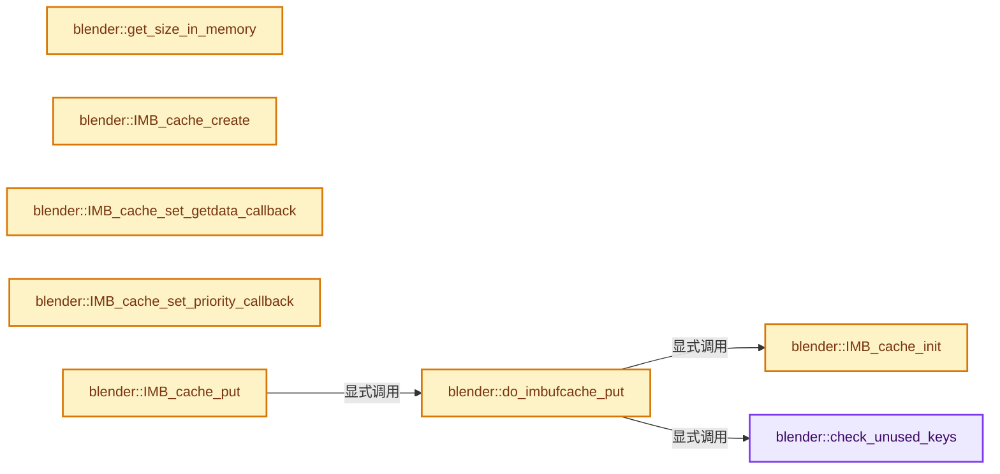
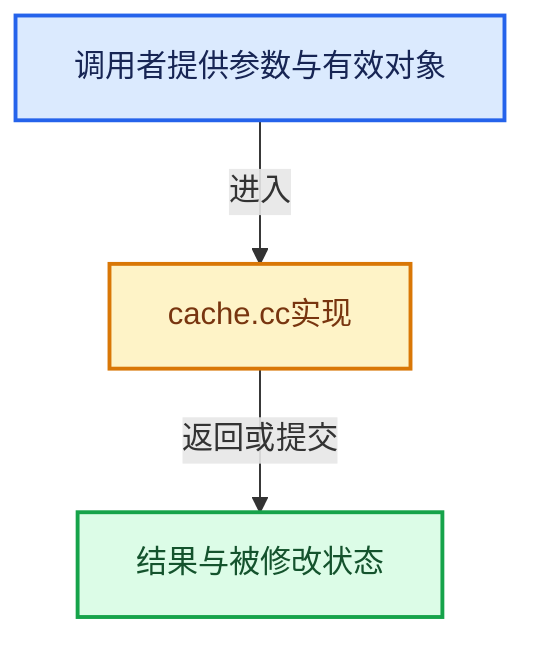

# 实现依赖专题：source/blender/imbuf/intern/cache.cc

[方向导航](README.md) · [符号索引](../%E7%AC%A6%E5%8F%B7%E4%BE%9D%E8%B5%96%E4%B8%8E%E5%AE%9E%E7%8E%B0%E7%B4%A2%E5%BC%95.md)

本专题从正文实际调用进入，集中保存共享实现。函数有稳定锚点，可从调用处直接跳到对应完整函数；递归与互相调用通过回链组织。

## 本文件的实现关系






<a id="m-c44ded774075"></a>

## 宏 `PRINT`

<!-- annotated:307f8311960d8b -->

```cpp
#    define PRINT(format, args...) printf(format, ##args)
#  else
```

<details>
<summary>核对原始源码：source/blender/imbuf/intern/cache.cc · L31—L32</summary>

<!-- original:307f8311960d8b:source/blender/imbuf/intern/cache.cc:31:32 -->

```cpp
#    define PRINT(format, args...) printf(format, ##args)
#  else
```

</details>

宏在预处理阶段展开，参数替换、重复求值和条件编译应直接从该定义检查。与普通函数不同，宏不会自动提供参数类型检查；构建配置选择哪个定义需结合外围条件。

<a id="m-ce37395d5975"></a>

## 宏 `PRINT`

<!-- annotated:b1eb23256a810d -->

```cpp
#    define PRINT(format, ...) printf(__VA_ARGS__)
#  endif
```

<details>
<summary>核对原始源码：source/blender/imbuf/intern/cache.cc · L33—L34</summary>

<!-- original:b1eb23256a810d:source/blender/imbuf/intern/cache.cc:33:34 -->

```cpp
#    define PRINT(format, ...) printf(__VA_ARGS__)
#  endif
```

</details>

宏在预处理阶段展开，参数替换、重复求值和条件编译应直接从该定义检查。与普通函数不同，宏不会自动提供参数类型检查；构建配置选择哪个定义需结合外围条件。

<a id="m-a4ad7dfb5c37"></a>

## 宏 `PRINT`

<!-- annotated:46fe4fb35f3d13 -->

```cpp
#  define PRINT(format, ...)
#endif
```

<details>
<summary>核对原始源码：source/blender/imbuf/intern/cache.cc · L36—L37</summary>

<!-- original:46fe4fb35f3d13:source/blender/imbuf/intern/cache.cc:36:37 -->

```cpp
#  define PRINT(format, ...)
#endif
```

</details>

宏在预处理阶段展开，参数替换、重复求值和条件编译应直接从该定义检查。与普通函数不同，宏不会自动提供参数类型检查；构建配置选择哪个定义需结合外围条件。

## 完整成员与函数实现

<a id="f-5bb3cddb588f1b0f"></a>

### `blender::check_unused_keys`

实现位置：[source/blender/imbuf/intern/cache.cc](../../../../../source/blender/imbuf/intern/cache.cc) · L133—L163。

接口参数：

- `ImBufCache *cache`

**教学注释版**

<!-- annotated:3bd0eb1ad02a21 -->

```cpp
static void check_unused_keys(ImBufCache *cache)
{
  GHashIterator gh_iter;

  BLI_ghashIterator_init(&gh_iter, cache->hash);

  while (!BLI_ghashIterator_done(&gh_iter)) {
    const ImBufCacheKey *key = static_cast<const ImBufCacheKey *>(
        BLI_ghashIterator_getKey(&gh_iter));
    const ImBufCacheItem *item = static_cast<const ImBufCacheItem *>(
        BLI_ghashIterator_getValue(&gh_iter));

    BLI_ghashIterator_step(&gh_iter);

    if (item->added_empty) {
      /* Don't remove entries that have been added empty. Those indicate that the image couldn't be
       * loaded correctly. */
      continue;
    }

    bool remove = !item->ibuf;

    if (remove) {
      PRINT("%s: cache '%s' remove item %p without buffer\n", __func__, cache->name, item);
    }

    if (remove) {
      BLI_ghash_remove(cache->hash, key, imbufcache_keyfree, imbufcache_valfree);
    }
  }
}
```

<details>
<summary>核对原始源码：source/blender/imbuf/intern/cache.cc · L133—L163</summary>

<!-- original:3bd0eb1ad02a21:source/blender/imbuf/intern/cache.cc:133:163 -->

```cpp
static void check_unused_keys(ImBufCache *cache)
{
  GHashIterator gh_iter;

  BLI_ghashIterator_init(&gh_iter, cache->hash);

  while (!BLI_ghashIterator_done(&gh_iter)) {
    const ImBufCacheKey *key = static_cast<const ImBufCacheKey *>(
        BLI_ghashIterator_getKey(&gh_iter));
    const ImBufCacheItem *item = static_cast<const ImBufCacheItem *>(
        BLI_ghashIterator_getValue(&gh_iter));

    BLI_ghashIterator_step(&gh_iter);

    if (item->added_empty) {
      /* Don't remove entries that have been added empty. Those indicate that the image couldn't be
       * loaded correctly. */
      continue;
    }

    bool remove = !item->ibuf;

    if (remove) {
      PRINT("%s: cache '%s' remove item %p without buffer\n", __func__, cache->name, item);
    }

    if (remove) {
      BLI_ghash_remove(cache->hash, key, imbufcache_keyfree, imbufcache_valfree);
    }
  }
}
```

</details>

**继续追踪实现**

- `BLI_ghashIterator_init` → [blender::BLI_ghashIterator_init · L901](../02-%E5%93%88%E5%B8%8C%E8%A1%A8%E4%B8%8E%E5%85%B3%E8%81%94%E6%95%B0%E6%8D%AE%E7%BB%93%E6%9E%84/%E4%BE%9D%E8%B5%96-BLI_ghash-ceaea0.md#f-3b5ee4c6e4b99a5b)。
- `BLI_ghashIterator_done` → [blender::BLI_ghashIterator_done · L309](../02-%E5%93%88%E5%B8%8C%E8%A1%A8%E4%B8%8E%E5%85%B3%E8%81%94%E6%95%B0%E6%8D%AE%E7%BB%93%E6%9E%84/%E4%BE%9D%E8%B5%96-BLI_ghash-8a027a.md#f-5b202d49c701166b)。
- `BLI_ghashIterator_getKey` → [blender::BLI_ghashIterator_getKey · L297](../02-%E5%93%88%E5%B8%8C%E8%A1%A8%E4%B8%8E%E5%85%B3%E8%81%94%E6%95%B0%E6%8D%AE%E7%BB%93%E6%9E%84/%E4%BE%9D%E8%B5%96-BLI_ghash-8a027a.md#f-83e8a92cfae5b1bd)。
- `BLI_ghashIterator_getValue` → [blender::BLI_ghashIterator_getValue · L301](../02-%E5%93%88%E5%B8%8C%E8%A1%A8%E4%B8%8E%E5%85%B3%E8%81%94%E6%95%B0%E6%8D%AE%E7%BB%93%E6%9E%84/%E4%BE%9D%E8%B5%96-BLI_ghash-8a027a.md#f-cf2b3d00d2f5258a)。
- `BLI_ghashIterator_step` → [blender::BLI_ghashIterator_step · L917](../02-%E5%93%88%E5%B8%8C%E8%A1%A8%E4%B8%8E%E5%85%B3%E8%81%94%E6%95%B0%E6%8D%AE%E7%BB%93%E6%9E%84/%E4%BE%9D%E8%B5%96-BLI_ghash-ceaea0.md#f-aabffa4cfcbcb140)。
- `PRINT` → [PRINT · L31](%E4%BE%9D%E8%B5%96-cache-3c473c.md#m-c44ded774075)；[PRINT · L33](%E4%BE%9D%E8%B5%96-cache-3c473c.md#m-ce37395d5975)；[PRINT · L36](%E4%BE%9D%E8%B5%96-cache-3c473c.md#m-a4ad7dfb5c37)。宏定义由构建条件选择。
- `BLI_ghash_remove` → [blender::BLI_ghash_remove · L792](../02-%E5%93%88%E5%B8%8C%E8%A1%A8%E4%B8%8E%E5%85%B3%E8%81%94%E6%95%B0%E6%8D%AE%E7%BB%93%E6%9E%84/%E4%BE%9D%E8%B5%96-BLI_ghash-ceaea0.md#f-055d583b61662552)。

<a id="f-a9307b2f0d69f250"></a>

### `blender::get_size_in_memory`

实现位置：[source/blender/imbuf/intern/cache.cc](../../../../../source/blender/imbuf/intern/cache.cc) · L193—L201。

接口参数：

- `ImBuf *ibuf`

**教学注释版**

<!-- annotated:55b58d07dac78a -->

```cpp
static size_t get_size_in_memory(ImBuf *ibuf)
{
  /* Keep textures in the memory to avoid constant file reload on viewport update. */
  if (ibuf->userflags & IB_PERSISTENT) {
    return 0;
  }

  return IMB_get_size_in_memory(ibuf);
}
```

<details>
<summary>核对原始源码：source/blender/imbuf/intern/cache.cc · L193—L201</summary>

<!-- original:55b58d07dac78a:source/blender/imbuf/intern/cache.cc:193:201 -->

```cpp
static size_t get_size_in_memory(ImBuf *ibuf)
{
  /* Keep textures in the memory to avoid constant file reload on viewport update. */
  if (ibuf->userflags & IB_PERSISTENT) {
    return 0;
  }

  return IMB_get_size_in_memory(ibuf);
}
```

</details>

**结果出口**

- `return 0;`
- `return IMB_get_size_in_memory(ibuf);`

**继续追踪实现**

- `IMB_get_size_in_memory` → [blender::IMB_get_size_in_memory · L463](%E4%BE%9D%E8%B5%96-allocimbuf-bc68dd.md#f-39106aa8d0bd716f)。

<a id="f-b0b0371c06ddf8c3"></a>

### `blender::IMB_cache_init`

实现位置：[source/blender/imbuf/intern/cache.cc](../../../../../source/blender/imbuf/intern/cache.cc) · L254—L260。

**教学注释版**

<!-- annotated:1b1dde54bb7c87 -->

```cpp
void IMB_cache_init()
{
  limitor = new_MEM_CacheLimiter(imbufcache_destructor, get_item_size);

  MEM_CacheLimiter_ItemPriority_Func_set(limitor, get_item_priority);
  MEM_CacheLimiter_ItemDestroyable_Func_set(limitor, get_item_destroyable);
}
```

<details>
<summary>核对原始源码：source/blender/imbuf/intern/cache.cc · L254—L260</summary>

<!-- original:1b1dde54bb7c87:source/blender/imbuf/intern/cache.cc:254:260 -->

```cpp
void IMB_cache_init()
{
  limitor = new_MEM_CacheLimiter(imbufcache_destructor, get_item_size);

  MEM_CacheLimiter_ItemPriority_Func_set(limitor, get_item_priority);
  MEM_CacheLimiter_ItemDestroyable_Func_set(limitor, get_item_destroyable);
}
```

</details>

**沿实际写入检查状态**

- `limitor = new_MEM_CacheLimiter(imbufcache_destructor, get_item_size);`

**继续追踪实现**

- `new_MEM_CacheLimiter` → [new_MEM_CacheLimiter · L152](%E4%BE%9D%E8%B5%96-MEM_CacheLimiterC-Api-008d33.md#f-63f7889c2d3316d2)。
- `MEM_CacheLimiter_ItemPriority_Func_set` → [MEM_CacheLimiter_ItemPriority_Func_set · L203](%E4%BE%9D%E8%B5%96-MEM_CacheLimiterC-Api-008d33.md#f-fe03099eca12b9c2)。
- `MEM_CacheLimiter_ItemDestroyable_Func_set` → [MEM_CacheLimiter_ItemDestroyable_Func_set · L209](%E4%BE%9D%E8%B5%96-MEM_CacheLimiterC-Api-008d33.md#f-399b81a8d75c2b89)。

<a id="f-7ad544796ea1c23b"></a>

### `blender::IMB_cache_create`

实现位置：[source/blender/imbuf/intern/cache.cc](../../../../../source/blender/imbuf/intern/cache.cc) · L270—L292。

接口参数：

- `const char *name`
- `int keysize`
- `GHashHashFP hashfp`
- `GHashCmpFP cmpfp`

**教学注释版**

<!-- annotated:98fffc32930b79 -->

```cpp
ImBufCache *IMB_cache_create(const char *name, int keysize, GHashHashFP hashfp, GHashCmpFP cmpfp)
{
  ImBufCache *cache;

  PRINT("%s: cache '%s' create\n", __func__, name);

  cache = MEM_new_zeroed<ImBufCache>("ImBufCache");

  STRNCPY(cache->name, name);

  cache->keys_pool = BLI_mempool_create(sizeof(ImBufCacheKey), 0, 64, BLI_MEMPOOL_NOP);
  cache->items_pool = BLI_mempool_create(sizeof(ImBufCacheItem), 0, 64, BLI_MEMPOOL_NOP);
  cache->userkeys_pool = BLI_mempool_create(keysize, 0, 64, BLI_MEMPOOL_NOP);
  cache->hash = BLI_ghash_new(
      imbufcache_hashhash, imbufcache_hashcmp, "MovieClip ImBuf cache hash");

  cache->keysize = keysize;
  cache->hashfp = hashfp;
  cache->cmpfp = cmpfp;
  cache->proxy = -1;

  return cache;
}
```

<details>
<summary>核对原始源码：source/blender/imbuf/intern/cache.cc · L270—L292</summary>

<!-- original:98fffc32930b79:source/blender/imbuf/intern/cache.cc:270:292 -->

```cpp
ImBufCache *IMB_cache_create(const char *name, int keysize, GHashHashFP hashfp, GHashCmpFP cmpfp)
{
  ImBufCache *cache;

  PRINT("%s: cache '%s' create\n", __func__, name);

  cache = MEM_new_zeroed<ImBufCache>("ImBufCache");

  STRNCPY(cache->name, name);

  cache->keys_pool = BLI_mempool_create(sizeof(ImBufCacheKey), 0, 64, BLI_MEMPOOL_NOP);
  cache->items_pool = BLI_mempool_create(sizeof(ImBufCacheItem), 0, 64, BLI_MEMPOOL_NOP);
  cache->userkeys_pool = BLI_mempool_create(keysize, 0, 64, BLI_MEMPOOL_NOP);
  cache->hash = BLI_ghash_new(
      imbufcache_hashhash, imbufcache_hashcmp, "MovieClip ImBuf cache hash");

  cache->keysize = keysize;
  cache->hashfp = hashfp;
  cache->cmpfp = cmpfp;
  cache->proxy = -1;

  return cache;
}
```

</details>

**沿实际写入检查状态**

- `cache = MEM_new_zeroed<ImBufCache>("ImBufCache");`
- `cache->keys_pool = BLI_mempool_create(sizeof(ImBufCacheKey), 0, 64, BLI_MEMPOOL_NOP);`
- `cache->items_pool = BLI_mempool_create(sizeof(ImBufCacheItem), 0, 64, BLI_MEMPOOL_NOP);`
- `cache->userkeys_pool = BLI_mempool_create(keysize, 0, 64, BLI_MEMPOOL_NOP);`
- `cache->hash = BLI_ghash_new(`
- `cache->keysize = keysize;`
- `cache->hashfp = hashfp;`
- `cache->cmpfp = cmpfp;`
- `cache->proxy = -1;`

**结果出口**

- `return cache;`

**继续追踪实现**

- `PRINT` → [PRINT · L31](%E4%BE%9D%E8%B5%96-cache-3c473c.md#m-c44ded774075)；[PRINT · L33](%E4%BE%9D%E8%B5%96-cache-3c473c.md#m-ce37395d5975)；[PRINT · L36](%E4%BE%9D%E8%B5%96-cache-3c473c.md#m-a4ad7dfb5c37)。宏定义由构建条件选择。
- `MEM_new_zeroed<ImBufCache>` → [MEM_new_zeroed · L550](../03-%E5%86%85%E5%AD%98%E5%88%86%E9%85%8D%E4%B8%8E%E8%BF%90%E8%A1%8C%E6%97%B6%E7%B1%BB%E5%9E%8B/%E4%BE%9D%E8%B5%96-MEM_guardedalloc-b54eca.md#f-eeb1e2a7f57dd231)；[MEM_new_zeroed · L114](../03-%E5%86%85%E5%AD%98%E5%88%86%E9%85%8D%E4%B8%8E%E8%BF%90%E8%A1%8C%E6%97%B6%E7%B1%BB%E5%9E%8B/%E4%BE%9D%E8%B5%96-mallocn-afdcd4.md#f-e04cf01c64c8b180)。同名重载需按实参类型选择。
- `STRNCPY` → [blender::STRNCPY · L690](../01-%E5%9F%BA%E7%A1%80%E5%AE%B9%E5%99%A8%E4%B8%8E%E7%8E%B0%E4%BB%A3CPP/%E4%BE%9D%E8%B5%96-BLI_string-b43058.md#f-6b2d861724026be6)。
- `BLI_mempool_create` → [blender::BLI_mempool_create · L320](../01-%E5%9F%BA%E7%A1%80%E5%AE%B9%E5%99%A8%E4%B8%8E%E7%8E%B0%E4%BB%A3CPP/%E4%BE%9D%E8%B5%96-BLI_mempool-991442.md#f-90a2c14d1b30f9cf)。
- `BLI_ghash_new` → [blender::BLI_ghash_new · L690](../02-%E5%93%88%E5%B8%8C%E8%A1%A8%E4%B8%8E%E5%85%B3%E8%81%94%E6%95%B0%E6%8D%AE%E7%BB%93%E6%9E%84/%E4%BE%9D%E8%B5%96-BLI_ghash-ceaea0.md#f-0c5878692f40fa70)。

<a id="f-e4978a2cf11af5d0"></a>

### `blender::IMB_cache_set_getdata_callback`

实现位置：[source/blender/imbuf/intern/cache.cc](../../../../../source/blender/imbuf/intern/cache.cc) · L294—L297。

接口参数：

- `ImBufCache *cache`
- `ImBufCacheGetKeyDataFP getdatafp`

**教学注释版**

<!-- annotated:e7f4cb5a5ecccc -->

```cpp
void IMB_cache_set_getdata_callback(ImBufCache *cache, ImBufCacheGetKeyDataFP getdatafp)
{
  cache->getdatafp = getdatafp;
}
```

<details>
<summary>核对原始源码：source/blender/imbuf/intern/cache.cc · L294—L297</summary>

<!-- original:e7f4cb5a5ecccc:source/blender/imbuf/intern/cache.cc:294:297 -->

```cpp
void IMB_cache_set_getdata_callback(ImBufCache *cache, ImBufCacheGetKeyDataFP getdatafp)
{
  cache->getdatafp = getdatafp;
}
```

</details>

**沿实际写入检查状态**

- `cache->getdatafp = getdatafp;`

**继续追踪实现**

本实现没有需要继续展开的显式调用；检查返回表达式、对象转换和调用者前置条件。

<a id="f-daf01a9145cbdafb"></a>

### `blender::IMB_cache_set_priority_callback`

实现位置：[source/blender/imbuf/intern/cache.cc](../../../../../source/blender/imbuf/intern/cache.cc) · L299—L309。

接口参数：

- `ImBufCache *cache`
- `ImBufCacheGetPriorityDataFP getprioritydatafp`
- `ImBufCacheGetItemPriorityFP getitempriorityfp`
- `ImBufCachePriorityDeleterFP prioritydeleterfp`

**教学注释版**

<!-- annotated:2d477ece1974ad -->

```cpp
void IMB_cache_set_priority_callback(ImBufCache *cache,
                                     ImBufCacheGetPriorityDataFP getprioritydatafp,
                                     ImBufCacheGetItemPriorityFP getitempriorityfp,
                                     ImBufCachePriorityDeleterFP prioritydeleterfp)
{
  cache->last_userkey = MEM_new_uninitialized(cache->keysize, "movie cache last user key");

  cache->getprioritydatafp = getprioritydatafp;
  cache->getitempriorityfp = getitempriorityfp;
  cache->prioritydeleterfp = prioritydeleterfp;
}
```

<details>
<summary>核对原始源码：source/blender/imbuf/intern/cache.cc · L299—L309</summary>

<!-- original:2d477ece1974ad:source/blender/imbuf/intern/cache.cc:299:309 -->

```cpp
void IMB_cache_set_priority_callback(ImBufCache *cache,
                                     ImBufCacheGetPriorityDataFP getprioritydatafp,
                                     ImBufCacheGetItemPriorityFP getitempriorityfp,
                                     ImBufCachePriorityDeleterFP prioritydeleterfp)
{
  cache->last_userkey = MEM_new_uninitialized(cache->keysize, "movie cache last user key");

  cache->getprioritydatafp = getprioritydatafp;
  cache->getitempriorityfp = getitempriorityfp;
  cache->prioritydeleterfp = prioritydeleterfp;
}
```

</details>

**沿实际写入检查状态**

- `cache->last_userkey = MEM_new_uninitialized(cache->keysize, "movie cache last user key");`
- `cache->getprioritydatafp = getprioritydatafp;`
- `cache->getitempriorityfp = getitempriorityfp;`
- `cache->prioritydeleterfp = prioritydeleterfp;`

**继续追踪实现**

- `MEM_new_uninitialized` → [MEM_new_uninitialized · L590](../03-%E5%86%85%E5%AD%98%E5%88%86%E9%85%8D%E4%B8%8E%E8%BF%90%E8%A1%8C%E6%97%B6%E7%B1%BB%E5%9E%8B/%E4%BE%9D%E8%B5%96-MEM_guardedalloc-b54eca.md#f-c773b2e5b8fe70e4)；[MEM_new_uninitialized · L124](../03-%E5%86%85%E5%AD%98%E5%88%86%E9%85%8D%E4%B8%8E%E8%BF%90%E8%A1%8C%E6%97%B6%E7%B1%BB%E5%9E%8B/%E4%BE%9D%E8%B5%96-mallocn-afdcd4.md#f-28a7e00a1e67f699)。同名重载需按实参类型选择。

<a id="f-8bde009d9a0ea060"></a>

### `blender::do_imbufcache_put`

实现位置：[source/blender/imbuf/intern/cache.cc](../../../../../source/blender/imbuf/intern/cache.cc) · L311—L367。

接口参数：

- `ImBufCache *cache`
- `void *userkey`
- `ImBuf *ibuf`
- `bool need_lock`

**教学注释版**

<!-- annotated:8a3a4eb8ade8cd -->

```cpp
static void do_imbufcache_put(ImBufCache *cache, void *userkey, ImBuf *ibuf, bool need_lock)
{
  ImBufCacheKey *key;
  ImBufCacheItem *item;

  if (!limitor) {
    IMB_cache_init();
  }

  if (ibuf != nullptr) {
    IMB_refImBuf(ibuf);
  }

  key = static_cast<ImBufCacheKey *>(BLI_mempool_alloc(cache->keys_pool));
  key->cache_owner = cache;
  key->userkey = BLI_mempool_alloc(cache->userkeys_pool);
  // [讲解] memcpy：复制字节，源与目标不应重叠。类型生命周期、对齐和可复制表示须由调用者证明，不是任意对象的复制构造。
  memcpy(key->userkey, userkey, cache->keysize);

  item = static_cast<ImBufCacheItem *>(BLI_mempool_alloc(cache->items_pool));

  PRINT("%s: cache '%s' put %p, item %p\n", __func__, cache->name, ibuf, item);

  item->ibuf = ibuf;
  item->cache_owner = cache;
  item->c_handle = nullptr;
  item->priority_data = nullptr;
  item->added_empty = ibuf == nullptr;

  if (cache->getprioritydatafp) {
    item->priority_data = cache->getprioritydatafp(userkey);
  }

  BLI_ghash_reinsert(cache->hash, key, item, imbufcache_keyfree, imbufcache_valfree);

  if (cache->last_userkey) {
    memcpy(cache->last_userkey, userkey, cache->keysize);
  }

  if (need_lock) {
    limitor_lock.lock();
  }

  item->c_handle = MEM_CacheLimiter_insert(limitor, item);

  MEM_CacheLimiter_ref(item->c_handle);
  MEM_CacheLimiter_enforce_limits(limitor);
  MEM_CacheLimiter_unref(item->c_handle);

  if (need_lock) {
    limitor_lock.unlock();
  }

  /* cache limiter can't remove unused keys which points to destroyed values */
  check_unused_keys(cache);

  MEM_SAFE_DELETE(cache->points);
}
```

<details>
<summary>核对原始源码：source/blender/imbuf/intern/cache.cc · L311—L367</summary>

<!-- original:8a3a4eb8ade8cd:source/blender/imbuf/intern/cache.cc:311:367 -->

```cpp
static void do_imbufcache_put(ImBufCache *cache, void *userkey, ImBuf *ibuf, bool need_lock)
{
  ImBufCacheKey *key;
  ImBufCacheItem *item;

  if (!limitor) {
    IMB_cache_init();
  }

  if (ibuf != nullptr) {
    IMB_refImBuf(ibuf);
  }

  key = static_cast<ImBufCacheKey *>(BLI_mempool_alloc(cache->keys_pool));
  key->cache_owner = cache;
  key->userkey = BLI_mempool_alloc(cache->userkeys_pool);
  memcpy(key->userkey, userkey, cache->keysize);

  item = static_cast<ImBufCacheItem *>(BLI_mempool_alloc(cache->items_pool));

  PRINT("%s: cache '%s' put %p, item %p\n", __func__, cache->name, ibuf, item);

  item->ibuf = ibuf;
  item->cache_owner = cache;
  item->c_handle = nullptr;
  item->priority_data = nullptr;
  item->added_empty = ibuf == nullptr;

  if (cache->getprioritydatafp) {
    item->priority_data = cache->getprioritydatafp(userkey);
  }

  BLI_ghash_reinsert(cache->hash, key, item, imbufcache_keyfree, imbufcache_valfree);

  if (cache->last_userkey) {
    memcpy(cache->last_userkey, userkey, cache->keysize);
  }

  if (need_lock) {
    limitor_lock.lock();
  }

  item->c_handle = MEM_CacheLimiter_insert(limitor, item);

  MEM_CacheLimiter_ref(item->c_handle);
  MEM_CacheLimiter_enforce_limits(limitor);
  MEM_CacheLimiter_unref(item->c_handle);

  if (need_lock) {
    limitor_lock.unlock();
  }

  /* cache limiter can't remove unused keys which points to destroyed values */
  check_unused_keys(cache);

  MEM_SAFE_DELETE(cache->points);
}
```

</details>

**沿实际写入检查状态**

- `key = static_cast<ImBufCacheKey *>(BLI_mempool_alloc(cache->keys_pool));`
- `key->cache_owner = cache;`
- `key->userkey = BLI_mempool_alloc(cache->userkeys_pool);`
- `item = static_cast<ImBufCacheItem *>(BLI_mempool_alloc(cache->items_pool));`
- `item->ibuf = ibuf;`
- `item->cache_owner = cache;`
- `item->c_handle = nullptr;`
- `item->priority_data = nullptr;`
- `item->added_empty = ibuf == nullptr;`
- `item->priority_data = cache->getprioritydatafp(userkey);`
- `item->c_handle = MEM_CacheLimiter_insert(limitor, item);`

**继续追踪实现**

- `IMB_cache_init` → [blender::IMB_cache_init · L254](%E4%BE%9D%E8%B5%96-cache-3c473c.md#f-b0b0371c06ddf8c3)。
- `IMB_refImBuf` → [blender::IMB_refImBuf · L163](%E4%BE%9D%E8%B5%96-allocimbuf-bc68dd.md#f-0992820200fb6836)。
- `BLI_mempool_alloc` → [blender::BLI_mempool_alloc · L387](../01-%E5%9F%BA%E7%A1%80%E5%AE%B9%E5%99%A8%E4%B8%8E%E7%8E%B0%E4%BB%A3CPP/%E4%BE%9D%E8%B5%96-BLI_mempool-991442.md#f-2e4ccb76db23671b)；[blender::BLI_mempool_alloc · L33](../01-%E5%9F%BA%E7%A1%80%E5%AE%B9%E5%99%A8%E4%B8%8E%E7%8E%B0%E4%BB%A3CPP/%E4%BE%9D%E8%B5%96-BLI_mempool-4b5fa7.md#f-3a0a9f741b9d9972)。同名重载需按实参类型选择。
- `memcpy` → [外部契约](https://eel.is/c++draft/cstring.syn)：复制字节，源与目标不应重叠。类型生命周期、对齐和可复制表示须由调用者证明，不是任意对象的复制构造。
- `PRINT` → [PRINT · L31](%E4%BE%9D%E8%B5%96-cache-3c473c.md#m-c44ded774075)；[PRINT · L33](%E4%BE%9D%E8%B5%96-cache-3c473c.md#m-ce37395d5975)；[PRINT · L36](%E4%BE%9D%E8%B5%96-cache-3c473c.md#m-a4ad7dfb5c37)。宏定义由构建条件选择。
- `cache->getprioritydatafp` → [调用协议](../%E6%A8%A1%E6%9D%BF%E5%AE%8F%E4%B8%8E%E5%8A%A8%E6%80%81%E5%88%86%E6%B4%BE%E5%8D%8F%E8%AE%AE.md)：由接收对象具体类型或运行时策略提供实现。调用位置L340。
- `BLI_ghash_reinsert` → [blender::BLI_ghash_reinsert · L716](../02-%E5%93%88%E5%B8%8C%E8%A1%A8%E4%B8%8E%E5%85%B3%E8%81%94%E6%95%B0%E6%8D%AE%E7%BB%93%E6%9E%84/%E4%BE%9D%E8%B5%96-BLI_ghash-ceaea0.md#f-7a1f504f3baf5923)。
- `limitor_lock.lock` → [调用协议](../%E6%A8%A1%E6%9D%BF%E5%AE%8F%E4%B8%8E%E5%8A%A8%E6%80%81%E5%88%86%E6%B4%BE%E5%8D%8F%E8%AE%AE.md)：接收对象类型依赖auto、返回值或模板实例；不按同名猜测目标。调用位置L350。
- `MEM_CacheLimiter_insert` → [MEM_CacheLimiter_insert · L163](%E4%BE%9D%E8%B5%96-MEM_CacheLimiterC-Api-008d33.md#f-771146d8821c540f)。
- `MEM_CacheLimiter_ref` → [MEM_CacheLimiter_ref · L183](%E4%BE%9D%E8%B5%96-MEM_CacheLimiterC-Api-008d33.md#f-47a4ed4213786173)。
- `MEM_CacheLimiter_enforce_limits` → [MEM_CacheLimiter_enforce_limits · L168](%E4%BE%9D%E8%B5%96-MEM_CacheLimiterC-Api-008d33.md#f-d11700c6aeb6b522)。
- `MEM_CacheLimiter_unref` → [MEM_CacheLimiter_unref · L188](%E4%BE%9D%E8%B5%96-MEM_CacheLimiterC-Api-008d33.md#f-b0dae1b6bb187812)。
- `limitor_lock.unlock` → [调用协议](../%E6%A8%A1%E6%9D%BF%E5%AE%8F%E4%B8%8E%E5%8A%A8%E6%80%81%E5%88%86%E6%B4%BE%E5%8D%8F%E8%AE%AE.md)：接收对象类型依赖auto、返回值或模板实例；不按同名猜测目标。调用位置L360。
- `check_unused_keys` → [blender::check_unused_keys · L133](%E4%BE%9D%E8%B5%96-cache-3c473c.md#f-5bb3cddb588f1b0f)。
- `MEM_SAFE_DELETE` → [MEM_SAFE_DELETE · L436](../03-%E5%86%85%E5%AD%98%E5%88%86%E9%85%8D%E4%B8%8E%E8%BF%90%E8%A1%8C%E6%97%B6%E7%B1%BB%E5%9E%8B/%E4%BE%9D%E8%B5%96-MEM_guardedalloc-b54eca.md#m-eadb3bc5b902)。宏定义由构建条件选择。

<a id="f-35b68f6e49743575"></a>

### `blender::IMB_cache_put`

实现位置：[source/blender/imbuf/intern/cache.cc](../../../../../source/blender/imbuf/intern/cache.cc) · L369—L372。

接口参数：

- `ImBufCache *cache`
- `void *userkey`
- `ImBuf *ibuf`

**教学注释版**

<!-- annotated:02f9bd24916efb -->

```cpp
void IMB_cache_put(ImBufCache *cache, void *userkey, ImBuf *ibuf)
{
  do_imbufcache_put(cache, userkey, ibuf, true);
}
```

<details>
<summary>核对原始源码：source/blender/imbuf/intern/cache.cc · L369—L372</summary>

<!-- original:02f9bd24916efb:source/blender/imbuf/intern/cache.cc:369:372 -->

```cpp
void IMB_cache_put(ImBufCache *cache, void *userkey, ImBuf *ibuf)
{
  do_imbufcache_put(cache, userkey, ibuf, true);
}
```

</details>

**继续追踪实现**

- `do_imbufcache_put` → [blender::do_imbufcache_put · L311](%E4%BE%9D%E8%B5%96-cache-3c473c.md#f-8bde009d9a0ea060)。

<a id="f-318c4ac20342cdae"></a>

### `blender::IMB_cache_put_if_possible`

实现位置：[source/blender/imbuf/intern/cache.cc](../../../../../source/blender/imbuf/intern/cache.cc) · L374—L393。

接口参数：

- `ImBufCache *cache`
- `void *userkey`
- `ImBuf *ibuf`

**教学注释版**

<!-- annotated:594826d697ba1b -->

```cpp
bool IMB_cache_put_if_possible(ImBufCache *cache, void *userkey, ImBuf *ibuf)
{
  size_t mem_in_use, mem_limit, elem_size;
  bool result = false;

  elem_size = (ibuf == nullptr) ? 0 : get_size_in_memory(ibuf);
  mem_limit = MEM_CacheLimiter_get_maximum();

  limitor_lock.lock();
  mem_in_use = MEM_CacheLimiter_get_memory_in_use(limitor);

  if (mem_in_use + elem_size <= mem_limit) {
    do_imbufcache_put(cache, userkey, ibuf, false);
    result = true;
  }

  limitor_lock.unlock();

  return result;
}
```

<details>
<summary>核对原始源码：source/blender/imbuf/intern/cache.cc · L374—L393</summary>

<!-- original:594826d697ba1b:source/blender/imbuf/intern/cache.cc:374:393 -->

```cpp
bool IMB_cache_put_if_possible(ImBufCache *cache, void *userkey, ImBuf *ibuf)
{
  size_t mem_in_use, mem_limit, elem_size;
  bool result = false;

  elem_size = (ibuf == nullptr) ? 0 : get_size_in_memory(ibuf);
  mem_limit = MEM_CacheLimiter_get_maximum();

  limitor_lock.lock();
  mem_in_use = MEM_CacheLimiter_get_memory_in_use(limitor);

  if (mem_in_use + elem_size <= mem_limit) {
    do_imbufcache_put(cache, userkey, ibuf, false);
    result = true;
  }

  limitor_lock.unlock();

  return result;
}
```

</details>

**沿实际写入检查状态**

- `elem_size = (ibuf == nullptr) ? 0 : get_size_in_memory(ibuf);`
- `mem_limit = MEM_CacheLimiter_get_maximum();`
- `mem_in_use = MEM_CacheLimiter_get_memory_in_use(limitor);`
- `result = true;`

**结果出口**

- `return result;`

**继续追踪实现**

- `get_size_in_memory` → [blender::get_size_in_memory · L193](%E4%BE%9D%E8%B5%96-cache-3c473c.md#f-a9307b2f0d69f250)。
- `MEM_CacheLimiter_get_maximum` → [MEM_CacheLimiter_get_maximum · L28](%E4%BE%9D%E8%B5%96-MEM_CacheLimiterC-Api-008d33.md#f-7ef72f453ed06110)。
- `limitor_lock.lock` → [调用协议](../%E6%A8%A1%E6%9D%BF%E5%AE%8F%E4%B8%8E%E5%8A%A8%E6%80%81%E5%88%86%E6%B4%BE%E5%8D%8F%E8%AE%AE.md)：接收对象类型依赖auto、返回值或模板实例；不按同名猜测目标。调用位置L382。
- `MEM_CacheLimiter_get_memory_in_use` → [MEM_CacheLimiter_get_memory_in_use · L215](%E4%BE%9D%E8%B5%96-MEM_CacheLimiterC-Api-008d33.md#f-00024c3082fd2ac7)。
- `do_imbufcache_put` → [blender::do_imbufcache_put · L311](%E4%BE%9D%E8%B5%96-cache-3c473c.md#f-8bde009d9a0ea060)。
- `limitor_lock.unlock` → [调用协议](../%E6%A8%A1%E6%9D%BF%E5%AE%8F%E4%B8%8E%E5%8A%A8%E6%80%81%E5%88%86%E6%B4%BE%E5%8D%8F%E8%AE%AE.md)：接收对象类型依赖auto、返回值或模板实例；不按同名猜测目标。调用位置L390。

<a id="f-c355b1e652a4c84e"></a>

### `blender::IMB_cache_remove`

实现位置：[source/blender/imbuf/intern/cache.cc](../../../../../source/blender/imbuf/intern/cache.cc) · L395—L401。

接口参数：

- `ImBufCache *cache`
- `void *userkey`

**教学注释版**

<!-- annotated:b6b4b77407da5d -->

```cpp
void IMB_cache_remove(ImBufCache *cache, void *userkey)
{
  ImBufCacheKey key;
  key.cache_owner = cache;
  key.userkey = userkey;
  BLI_ghash_remove(cache->hash, &key, imbufcache_keyfree, imbufcache_valfree);
}
```

<details>
<summary>核对原始源码：source/blender/imbuf/intern/cache.cc · L395—L401</summary>

<!-- original:b6b4b77407da5d:source/blender/imbuf/intern/cache.cc:395:401 -->

```cpp
void IMB_cache_remove(ImBufCache *cache, void *userkey)
{
  ImBufCacheKey key;
  key.cache_owner = cache;
  key.userkey = userkey;
  BLI_ghash_remove(cache->hash, &key, imbufcache_keyfree, imbufcache_valfree);
}
```

</details>

**沿实际写入检查状态**

- `key.cache_owner = cache;`
- `key.userkey = userkey;`

**继续追踪实现**

- `BLI_ghash_remove` → [blender::BLI_ghash_remove · L792](../02-%E5%93%88%E5%B8%8C%E8%A1%A8%E4%B8%8E%E5%85%B3%E8%81%94%E6%95%B0%E6%8D%AE%E7%BB%93%E6%9E%84/%E4%BE%9D%E8%B5%96-BLI_ghash-ceaea0.md#f-055d583b61662552)。

<a id="f-f8167da094e536a4"></a>

### `blender::IMB_cache_get`

实现位置：[source/blender/imbuf/intern/cache.cc](../../../../../source/blender/imbuf/intern/cache.cc) · L403—L432。

接口参数：

- `ImBufCache *cache`
- `void *userkey`
- `bool *r_is_cached_empty`

**教学注释版**

<!-- annotated:b4393c6fa3886f -->

```cpp
ImBuf *IMB_cache_get(ImBufCache *cache, void *userkey, bool *r_is_cached_empty)
{
  ImBufCacheKey key;
  ImBufCacheItem *item;

  key.cache_owner = cache;
  key.userkey = userkey;
  item = static_cast<ImBufCacheItem *>(BLI_ghash_lookup(cache->hash, &key));

  if (r_is_cached_empty) {
    *r_is_cached_empty = false;
  }

  if (item) {
    if (item->ibuf) {
      std::lock_guard lock(limitor_lock);
      /* Check again, the condition might have changed before we acquired the lock. */
      if (item->ibuf) {
        MEM_CacheLimiter_touch(item->c_handle);
        IMB_refImBuf(item->ibuf);
        return item->ibuf;
      }
    }
    if (r_is_cached_empty && item->added_empty) {
      *r_is_cached_empty = true;
    }
  }

  return nullptr;
}
```

<details>
<summary>核对原始源码：source/blender/imbuf/intern/cache.cc · L403—L432</summary>

<!-- original:b4393c6fa3886f:source/blender/imbuf/intern/cache.cc:403:432 -->

```cpp
ImBuf *IMB_cache_get(ImBufCache *cache, void *userkey, bool *r_is_cached_empty)
{
  ImBufCacheKey key;
  ImBufCacheItem *item;

  key.cache_owner = cache;
  key.userkey = userkey;
  item = static_cast<ImBufCacheItem *>(BLI_ghash_lookup(cache->hash, &key));

  if (r_is_cached_empty) {
    *r_is_cached_empty = false;
  }

  if (item) {
    if (item->ibuf) {
      std::lock_guard lock(limitor_lock);
      /* Check again, the condition might have changed before we acquired the lock. */
      if (item->ibuf) {
        MEM_CacheLimiter_touch(item->c_handle);
        IMB_refImBuf(item->ibuf);
        return item->ibuf;
      }
    }
    if (r_is_cached_empty && item->added_empty) {
      *r_is_cached_empty = true;
    }
  }

  return nullptr;
}
```

</details>

**沿实际写入检查状态**

- `key.cache_owner = cache;`
- `key.userkey = userkey;`
- `item = static_cast<ImBufCacheItem *>(BLI_ghash_lookup(cache->hash, &key));`

**结果出口**

- `return item->ibuf;`
- `return nullptr;`

**继续追踪实现**

- `BLI_ghash_lookup` → [blender::BLI_ghash_lookup · L735](../02-%E5%93%88%E5%B8%8C%E8%A1%A8%E4%B8%8E%E5%85%B3%E8%81%94%E6%95%B0%E6%8D%AE%E7%BB%93%E6%9E%84/%E4%BE%9D%E8%B5%96-BLI_ghash-ceaea0.md#f-8937b91445541501)。
- `MEM_CacheLimiter_touch` → [MEM_CacheLimiter_touch · L178](%E4%BE%9D%E8%B5%96-MEM_CacheLimiterC-Api-008d33.md#f-3ed8d260c72fe88e)。
- `IMB_refImBuf` → [blender::IMB_refImBuf · L163](%E4%BE%9D%E8%B5%96-allocimbuf-bc68dd.md#f-0992820200fb6836)。

<a id="f-51d00e69121ba8f2"></a>

### `blender::IMB_cache_free`

实现位置：[source/blender/imbuf/intern/cache.cc](../../../../../source/blender/imbuf/intern/cache.cc) · L446—L465。

接口参数：

- `ImBufCache *cache`

**教学注释版**

<!-- annotated:9208f78889903a -->

```cpp
void IMB_cache_free(ImBufCache *cache)
{
  PRINT("%s: cache '%s' free\n", __func__, cache->name);

  BLI_ghash_free(cache->hash, imbufcache_keyfree, imbufcache_valfree);

  BLI_mempool_destroy(cache->keys_pool);
  BLI_mempool_destroy(cache->items_pool);
  BLI_mempool_destroy(cache->userkeys_pool);

  if (cache->points) {
    MEM_delete(cache->points);
  }

  if (cache->last_userkey) {
    // [讲解] MEM_delete_void：以原始存储释放约定调用当前后端。
    MEM_delete_void(cache->last_userkey);
  }

  MEM_delete(cache);
}
```

<details>
<summary>核对原始源码：source/blender/imbuf/intern/cache.cc · L446—L465</summary>

<!-- original:9208f78889903a:source/blender/imbuf/intern/cache.cc:446:465 -->

```cpp
void IMB_cache_free(ImBufCache *cache)
{
  PRINT("%s: cache '%s' free\n", __func__, cache->name);

  BLI_ghash_free(cache->hash, imbufcache_keyfree, imbufcache_valfree);

  BLI_mempool_destroy(cache->keys_pool);
  BLI_mempool_destroy(cache->items_pool);
  BLI_mempool_destroy(cache->userkeys_pool);

  if (cache->points) {
    MEM_delete(cache->points);
  }

  if (cache->last_userkey) {
    MEM_delete_void(cache->last_userkey);
  }

  MEM_delete(cache);
}
```

</details>

**继续追踪实现**

- `PRINT` → [PRINT · L31](%E4%BE%9D%E8%B5%96-cache-3c473c.md#m-c44ded774075)；[PRINT · L33](%E4%BE%9D%E8%B5%96-cache-3c473c.md#m-ce37395d5975)；[PRINT · L36](%E4%BE%9D%E8%B5%96-cache-3c473c.md#m-a4ad7dfb5c37)。宏定义由构建条件选择。
- `BLI_ghash_free` → [blender::BLI_ghash_free · L866](../02-%E5%93%88%E5%B8%8C%E8%A1%A8%E4%B8%8E%E5%85%B3%E8%81%94%E6%95%B0%E6%8D%AE%E7%BB%93%E6%9E%84/%E4%BE%9D%E8%B5%96-BLI_ghash-ceaea0.md#f-ab6fda2cc049587d)。
- `BLI_mempool_destroy` → [blender::BLI_mempool_destroy · L844](../01-%E5%9F%BA%E7%A1%80%E5%AE%B9%E5%99%A8%E4%B8%8E%E7%8E%B0%E4%BB%A3CPP/%E4%BE%9D%E8%B5%96-BLI_mempool-991442.md#f-6f09741326791f2d)。
- `MEM_delete` → [MEM_delete · L400](../03-%E5%86%85%E5%AD%98%E5%88%86%E9%85%8D%E4%B8%8E%E8%BF%90%E8%A1%8C%E6%97%B6%E7%B1%BB%E5%9E%8B/%E4%BE%9D%E8%B5%96-MEM_guardedalloc-b54eca.md#f-9049ffdd1682887c)。
- `MEM_delete_void` → [MEM_delete_void · L647](../03-%E5%86%85%E5%AD%98%E5%88%86%E9%85%8D%E4%B8%8E%E8%BF%90%E8%A1%8C%E6%97%B6%E7%B1%BB%E5%9E%8B/%E4%BE%9D%E8%B5%96-MEM_guardedalloc-b54eca.md#f-642896c7c62ff8b9)；[MEM_delete_void · L109](../03-%E5%86%85%E5%AD%98%E5%88%86%E9%85%8D%E4%B8%8E%E8%BF%90%E8%A1%8C%E6%97%B6%E7%B1%BB%E5%9E%8B/%E4%BE%9D%E8%B5%96-mallocn-afdcd4.md#f-9a07b26421f2bee6)。同名重载需按实参类型选择。

<a id="f-9718cf089fc36265"></a>

### `blender::IMB_cacheIter_new`

实现位置：[source/blender/imbuf/intern/cache.cc](../../../../../source/blender/imbuf/intern/cache.cc) · L577—L585。

接口参数：

- `ImBufCache *cache`

**教学注释版**

<!-- annotated:ae86e5dd7d51e2 -->

```cpp
ImBufCacheIter *IMB_cacheIter_new(ImBufCache *cache)
{
  GHashIterator *iter;

  check_unused_keys(cache);
  iter = BLI_ghashIterator_new(cache->hash);

  return reinterpret_cast<ImBufCacheIter *>(iter);
}
```

<details>
<summary>核对原始源码：source/blender/imbuf/intern/cache.cc · L577—L585</summary>

<!-- original:ae86e5dd7d51e2:source/blender/imbuf/intern/cache.cc:577:585 -->

```cpp
ImBufCacheIter *IMB_cacheIter_new(ImBufCache *cache)
{
  GHashIterator *iter;

  check_unused_keys(cache);
  iter = BLI_ghashIterator_new(cache->hash);

  return reinterpret_cast<ImBufCacheIter *>(iter);
}
```

</details>

**沿实际写入检查状态**

- `iter = BLI_ghashIterator_new(cache->hash);`

**结果出口**

- `return reinterpret_cast<ImBufCacheIter *>(iter);`

**继续追踪实现**

- `check_unused_keys` → [blender::check_unused_keys · L133](%E4%BE%9D%E8%B5%96-cache-3c473c.md#f-5bb3cddb588f1b0f)。
- `BLI_ghashIterator_new` → [blender::BLI_ghashIterator_new · L894](../02-%E5%93%88%E5%B8%8C%E8%A1%A8%E4%B8%8E%E5%85%B3%E8%81%94%E6%95%B0%E6%8D%AE%E7%BB%93%E6%9E%84/%E4%BE%9D%E8%B5%96-BLI_ghash-ceaea0.md#f-abfdf8d9ba700915)。

<a id="f-576db1a38537be68"></a>

### `blender::IMB_cacheIter_free`

实现位置：[source/blender/imbuf/intern/cache.cc](../../../../../source/blender/imbuf/intern/cache.cc) · L587—L590。

接口参数：

- `ImBufCacheIter *iter`

**教学注释版**

<!-- annotated:1d35b7bfaf97f7 -->

```cpp
void IMB_cacheIter_free(ImBufCacheIter *iter)
{
  BLI_ghashIterator_free(reinterpret_cast<GHashIterator *>(iter));
}
```

<details>
<summary>核对原始源码：source/blender/imbuf/intern/cache.cc · L587—L590</summary>

<!-- original:1d35b7bfaf97f7:source/blender/imbuf/intern/cache.cc:587:590 -->

```cpp
void IMB_cacheIter_free(ImBufCacheIter *iter)
{
  BLI_ghashIterator_free(reinterpret_cast<GHashIterator *>(iter));
}
```

</details>

**继续追踪实现**

- `BLI_ghashIterator_free` → [blender::BLI_ghashIterator_free · L931](../02-%E5%93%88%E5%B8%8C%E8%A1%A8%E4%B8%8E%E5%85%B3%E8%81%94%E6%95%B0%E6%8D%AE%E7%BB%93%E6%9E%84/%E4%BE%9D%E8%B5%96-BLI_ghash-ceaea0.md#f-5549974f308d08bb)。

<a id="f-bc1cdab0db1ebde1"></a>

### `blender::IMB_cacheIter_done`

实现位置：[source/blender/imbuf/intern/cache.cc](../../../../../source/blender/imbuf/intern/cache.cc) · L592—L595。

接口参数：

- `ImBufCacheIter *iter`

**教学注释版**

<!-- annotated:9c05365da81a9a -->

```cpp
bool IMB_cacheIter_done(ImBufCacheIter *iter)
{
  return BLI_ghashIterator_done(reinterpret_cast<GHashIterator *>(iter));
}
```

<details>
<summary>核对原始源码：source/blender/imbuf/intern/cache.cc · L592—L595</summary>

<!-- original:9c05365da81a9a:source/blender/imbuf/intern/cache.cc:592:595 -->

```cpp
bool IMB_cacheIter_done(ImBufCacheIter *iter)
{
  return BLI_ghashIterator_done(reinterpret_cast<GHashIterator *>(iter));
}
```

</details>

**结果出口**

- `return BLI_ghashIterator_done(reinterpret_cast<GHashIterator *>(iter));`

**继续追踪实现**

- `BLI_ghashIterator_done` → [blender::BLI_ghashIterator_done · L309](../02-%E5%93%88%E5%B8%8C%E8%A1%A8%E4%B8%8E%E5%85%B3%E8%81%94%E6%95%B0%E6%8D%AE%E7%BB%93%E6%9E%84/%E4%BE%9D%E8%B5%96-BLI_ghash-8a027a.md#f-5b202d49c701166b)。

<a id="f-dc0069cc419bbf95"></a>

### `blender::IMB_cacheIter_step`

实现位置：[source/blender/imbuf/intern/cache.cc](../../../../../source/blender/imbuf/intern/cache.cc) · L597—L600。

接口参数：

- `ImBufCacheIter *iter`

**教学注释版**

<!-- annotated:9a09d5b6b96f3c -->

```cpp
void IMB_cacheIter_step(ImBufCacheIter *iter)
{
  BLI_ghashIterator_step(reinterpret_cast<GHashIterator *>(iter));
}
```

<details>
<summary>核对原始源码：source/blender/imbuf/intern/cache.cc · L597—L600</summary>

<!-- original:9a09d5b6b96f3c:source/blender/imbuf/intern/cache.cc:597:600 -->

```cpp
void IMB_cacheIter_step(ImBufCacheIter *iter)
{
  BLI_ghashIterator_step(reinterpret_cast<GHashIterator *>(iter));
}
```

</details>

**继续追踪实现**

- `BLI_ghashIterator_step` → [blender::BLI_ghashIterator_step · L917](../02-%E5%93%88%E5%B8%8C%E8%A1%A8%E4%B8%8E%E5%85%B3%E8%81%94%E6%95%B0%E6%8D%AE%E7%BB%93%E6%9E%84/%E4%BE%9D%E8%B5%96-BLI_ghash-ceaea0.md#f-aabffa4cfcbcb140)。

<a id="f-c00940f2fb657b8c"></a>

### `blender::IMB_cacheIter_getImBuf`

实现位置：[source/blender/imbuf/intern/cache.cc](../../../../../source/blender/imbuf/intern/cache.cc) · L602—L607。

接口参数：

- `ImBufCacheIter *iter`

**教学注释版**

<!-- annotated:1fd95e146aeb70 -->

```cpp
ImBuf *IMB_cacheIter_getImBuf(ImBufCacheIter *iter)
{
  ImBufCacheItem *item = static_cast<ImBufCacheItem *>(
      BLI_ghashIterator_getValue(reinterpret_cast<GHashIterator *>(iter)));
  return item->ibuf;
}
```

<details>
<summary>核对原始源码：source/blender/imbuf/intern/cache.cc · L602—L607</summary>

<!-- original:1fd95e146aeb70:source/blender/imbuf/intern/cache.cc:602:607 -->

```cpp
ImBuf *IMB_cacheIter_getImBuf(ImBufCacheIter *iter)
{
  ImBufCacheItem *item = static_cast<ImBufCacheItem *>(
      BLI_ghashIterator_getValue(reinterpret_cast<GHashIterator *>(iter)));
  return item->ibuf;
}
```

</details>

**结果出口**

- `return item->ibuf;`

**继续追踪实现**

- `BLI_ghashIterator_getValue` → [blender::BLI_ghashIterator_getValue · L301](../02-%E5%93%88%E5%B8%8C%E8%A1%A8%E4%B8%8E%E5%85%B3%E8%81%94%E6%95%B0%E6%8D%AE%E7%BB%93%E6%9E%84/%E4%BE%9D%E8%B5%96-BLI_ghash-8a027a.md#f-cf2b3d00d2f5258a)。

<a id="f-db21111318d822cc"></a>

### `blender::IMB_cacheIter_getUserKey`

实现位置：[source/blender/imbuf/intern/cache.cc](../../../../../source/blender/imbuf/intern/cache.cc) · L609—L614。

接口参数：

- `ImBufCacheIter *iter`

**教学注释版**

<!-- annotated:d1bc15c0b54b7f -->

```cpp
void *IMB_cacheIter_getUserKey(ImBufCacheIter *iter)
{
  ImBufCacheKey *key = static_cast<ImBufCacheKey *>(
      BLI_ghashIterator_getKey(reinterpret_cast<GHashIterator *>(iter)));
  return key->userkey;
}
```

<details>
<summary>核对原始源码：source/blender/imbuf/intern/cache.cc · L609—L614</summary>

<!-- original:d1bc15c0b54b7f:source/blender/imbuf/intern/cache.cc:609:614 -->

```cpp
void *IMB_cacheIter_getUserKey(ImBufCacheIter *iter)
{
  ImBufCacheKey *key = static_cast<ImBufCacheKey *>(
      BLI_ghashIterator_getKey(reinterpret_cast<GHashIterator *>(iter)));
  return key->userkey;
}
```

</details>

**结果出口**

- `return key->userkey;`

**继续追踪实现**

- `BLI_ghashIterator_getKey` → [blender::BLI_ghashIterator_getKey · L297](../02-%E5%93%88%E5%B8%8C%E8%A1%A8%E4%B8%8E%E5%85%B3%E8%81%94%E6%95%B0%E6%8D%AE%E7%BB%93%E6%9E%84/%E4%BE%9D%E8%B5%96-BLI_ghash-8a027a.md#f-83e8a92cfae5b1bd)。
