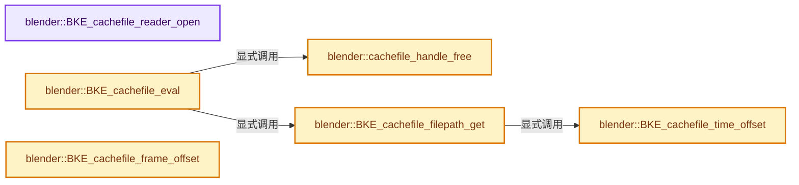
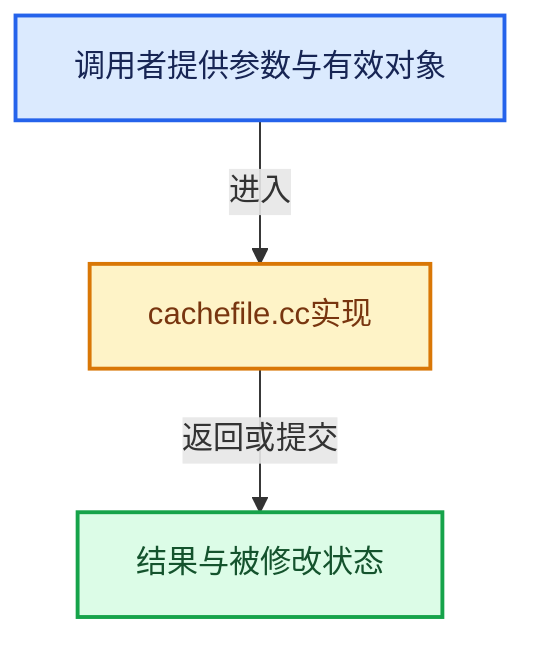

# 实现依赖专题：source/blender/blenkernel/intern/cachefile.cc

[方向导航](README.md) · [符号索引](../%E7%AC%A6%E5%8F%B7%E4%BE%9D%E8%B5%96%E4%B8%8E%E5%AE%9E%E7%8E%B0%E7%B4%A2%E5%BC%95.md)

本专题从正文实际调用进入，集中保存共享实现。函数有稳定锚点，可从调用处直接跳到对应完整函数；递归与互相调用通过回链组织。

## 本文件的实现关系






## 完整成员与函数实现

<a id="f-7bce03a86b4bbd1b"></a>

### `blender::BKE_cachefile_reader_open`

实现位置：[source/blender/blenkernel/intern/cachefile.cc](../../../../../source/blender/blenkernel/intern/cachefile.cc) · L161—L209。

接口参数：

- `CacheFile *cache_file`
- `CacheReader **reader`
- `Object *object`
- `const char *object_path`

**教学注释版**

<!-- annotated:5aa9a5f84a1b65 -->

```cpp
void BKE_cachefile_reader_open(CacheFile *cache_file,
                               CacheReader **reader,
                               Object *object,
                               const char *object_path)
{
#if defined(WITH_ALEMBIC) || defined(WITH_USD)

  BLI_assert(cache_file->id.tag & ID_TAG_COPIED_ON_EVAL);

  if (cache_file->handle == nullptr) {
    return;
  }

  switch (cache_file->type) {
    case CACHEFILE_TYPE_ALEMBIC:
#  ifdef WITH_ALEMBIC
      /* Open Alembic cache reader. */
      *reader = CacheReader_open_alembic_object(
          cache_file->handle, *reader, object, object_path, cache_file->is_sequence);
#  endif
      break;
    case CACHEFILE_TYPE_USD:
#  ifdef WITH_USD
      /* Open USD cache reader. */
      *reader = io::usd::CacheReader_open_usd_object(
          cache_file->handle, *reader, object, object_path);
#  endif
      break;
    case CACHE_FILE_TYPE_INVALID:
      break;
  }

  /* Multiple modifiers and constraints can call this function concurrently. */
  std::lock_guard lock(cache_mutex);
  if (*reader) {
    /* Register in set so we can free it when the cache file changes. */
    if (cache_file->handle_readers == nullptr) {
      cache_file->handle_readers = MEM_new<CacheFileHandleReaderSet>("CacheFile.handle_readers");
    }
    cache_file->handle_readers->add(reader);
  }
  else if (cache_file->handle_readers) {
    /* Remove in case CacheReader_open_alembic_object free the existing reader. */
    cache_file->handle_readers->remove(reader);
  }
#else
  UNUSED_VARS(cache_file, reader, object, object_path);
#endif
}
```

<details>
<summary>核对原始源码：source/blender/blenkernel/intern/cachefile.cc · L161—L209</summary>

<!-- original:5aa9a5f84a1b65:source/blender/blenkernel/intern/cachefile.cc:161:209 -->

```cpp
void BKE_cachefile_reader_open(CacheFile *cache_file,
                               CacheReader **reader,
                               Object *object,
                               const char *object_path)
{
#if defined(WITH_ALEMBIC) || defined(WITH_USD)

  BLI_assert(cache_file->id.tag & ID_TAG_COPIED_ON_EVAL);

  if (cache_file->handle == nullptr) {
    return;
  }

  switch (cache_file->type) {
    case CACHEFILE_TYPE_ALEMBIC:
#  ifdef WITH_ALEMBIC
      /* Open Alembic cache reader. */
      *reader = CacheReader_open_alembic_object(
          cache_file->handle, *reader, object, object_path, cache_file->is_sequence);
#  endif
      break;
    case CACHEFILE_TYPE_USD:
#  ifdef WITH_USD
      /* Open USD cache reader. */
      *reader = io::usd::CacheReader_open_usd_object(
          cache_file->handle, *reader, object, object_path);
#  endif
      break;
    case CACHE_FILE_TYPE_INVALID:
      break;
  }

  /* Multiple modifiers and constraints can call this function concurrently. */
  std::lock_guard lock(cache_mutex);
  if (*reader) {
    /* Register in set so we can free it when the cache file changes. */
    if (cache_file->handle_readers == nullptr) {
      cache_file->handle_readers = MEM_new<CacheFileHandleReaderSet>("CacheFile.handle_readers");
    }
    cache_file->handle_readers->add(reader);
  }
  else if (cache_file->handle_readers) {
    /* Remove in case CacheReader_open_alembic_object free the existing reader. */
    cache_file->handle_readers->remove(reader);
  }
#else
  UNUSED_VARS(cache_file, reader, object, object_path);
#endif
}
```

</details>

**沿实际写入检查状态**

- `cache_file->handle_readers = MEM_new<CacheFileHandleReaderSet>("CacheFile.handle_readers");`

**继续追踪实现**

- `BLI_assert` → [BLI_assert · L48](../01-%E5%9F%BA%E7%A1%80%E5%AE%B9%E5%99%A8%E4%B8%8E%E7%8E%B0%E4%BB%A3CPP/%E4%BE%9D%E8%B5%96-BLI_assert-cc98e8.md#m-57a88495704d)；[BLI_assert · L63](../01-%E5%9F%BA%E7%A1%80%E5%AE%B9%E5%99%A8%E4%B8%8E%E7%8E%B0%E4%BB%A3CPP/%E4%BE%9D%E8%B5%96-BLI_assert-cc98e8.md#m-d07050020cb5)。宏定义由构建条件选择。
- `CacheReader_open_alembic_object` → [blender::CacheReader_open_alembic_object · L952](%E4%BE%9D%E8%B5%96-alembic_capi-a7fbc5.md#f-f0d03d3199c08042)。
- `io::usd::CacheReader_open_usd_object` → [blender::io::usd::CacheReader_open_usd_object · L560](%E4%BE%9D%E8%B5%96-usd_capi_import-bd2588.md#f-c9e29d9a5ada4ad8)。
- `MEM_new<CacheFileHandleReaderSet>` → [MEM_new · L351](../03-%E5%86%85%E5%AD%98%E5%88%86%E9%85%8D%E4%B8%8E%E8%BF%90%E8%A1%8C%E6%97%B6%E7%B1%BB%E5%9E%8B/%E4%BE%9D%E8%B5%96-MEM_guardedalloc-b54eca.md#f-115f9b6784f89912)。
- `cache_file->handle_readers->add` → [调用协议](../%E6%A8%A1%E6%9D%BF%E5%AE%8F%E4%B8%8E%E5%8A%A8%E6%80%81%E5%88%86%E6%B4%BE%E5%8D%8F%E8%AE%AE.md)：接收对象类型依赖auto、返回值或模板实例；不按同名猜测目标。调用位置L200。
- `cache_file->handle_readers->remove` → [调用协议](../%E6%A8%A1%E6%9D%BF%E5%AE%8F%E4%B8%8E%E5%8A%A8%E6%80%81%E5%88%86%E6%B4%BE%E5%8D%8F%E8%AE%AE.md)：接收对象类型依赖auto、返回值或模板实例；不按同名猜测目标。调用位置L204。
- `UNUSED_VARS` → [UNUSED_VARS · L522](../01-%E5%9F%BA%E7%A1%80%E5%AE%B9%E5%99%A8%E4%B8%8E%E7%8E%B0%E4%BB%A3CPP/%E4%BE%9D%E8%B5%96-BLI_utildefines-293a0a.md#m-013582537634)；[UNUSED_VARS · L41](%E4%BE%9D%E8%B5%96-GPU_shader_shared_utils-0adda3.md#m-05d9d7a33da0)；[UNUSED_VARS · L62](%E4%BE%9D%E8%B5%96-GPU_shader_shared_utils-0adda3.md#m-e12c683a4aca)。宏定义由构建条件选择。

<a id="f-7a69ebe4b1e8efb6"></a>

### `blender::cachefile_handle_free`

实现位置：[source/blender/blenkernel/intern/cachefile.cc](../../../../../source/blender/blenkernel/intern/cachefile.cc) · L248—L308。

接口参数：

- `CacheFile *cache_file`

**教学注释版**

<!-- annotated:219d1a36ac3532 -->

```cpp
static void cachefile_handle_free(CacheFile *cache_file)
{
#if defined(WITH_ALEMBIC) || defined(WITH_USD)

  /* Free readers in all modifiers and constraints that use the handle, before
   * we free the handle itself. */
  {
    std::lock_guard lock(cache_mutex);
    if (cache_file->handle_readers) {
      for (CacheReader **reader : *cache_file->handle_readers) {
        if (*reader != nullptr) {
          switch (cache_file->type) {
            case CACHEFILE_TYPE_ALEMBIC:
#  ifdef WITH_ALEMBIC
              ABC_CacheReader_free(*reader);
#  endif
              break;
            case CACHEFILE_TYPE_USD:
#  ifdef WITH_USD
              io::usd::USD_CacheReader_free(*reader);
#  endif
              break;
            case CACHE_FILE_TYPE_INVALID:
              break;
          }

          *reader = nullptr;
        }
      }

      MEM_delete(cache_file->handle_readers);
      cache_file->handle_readers = nullptr;
    }
  }

  /* Free handle. */
  if (cache_file->handle) {

    switch (cache_file->type) {
      case CACHEFILE_TYPE_ALEMBIC:
#  ifdef WITH_ALEMBIC
        ABC_free_handle(cache_file->handle);
#  endif
        break;
      case CACHEFILE_TYPE_USD:
#  ifdef WITH_USD
        io::usd::USD_free_handle(cache_file->handle);
#  endif
        break;
      case CACHE_FILE_TYPE_INVALID:
        break;
    }

    cache_file->handle = nullptr;
  }

  cache_file->handle_filepath[0] = '\0';
#else
  UNUSED_VARS(cache_file);
#endif
}
```

<details>
<summary>核对原始源码：source/blender/blenkernel/intern/cachefile.cc · L248—L308</summary>

<!-- original:219d1a36ac3532:source/blender/blenkernel/intern/cachefile.cc:248:308 -->

```cpp
static void cachefile_handle_free(CacheFile *cache_file)
{
#if defined(WITH_ALEMBIC) || defined(WITH_USD)

  /* Free readers in all modifiers and constraints that use the handle, before
   * we free the handle itself. */
  {
    std::lock_guard lock(cache_mutex);
    if (cache_file->handle_readers) {
      for (CacheReader **reader : *cache_file->handle_readers) {
        if (*reader != nullptr) {
          switch (cache_file->type) {
            case CACHEFILE_TYPE_ALEMBIC:
#  ifdef WITH_ALEMBIC
              ABC_CacheReader_free(*reader);
#  endif
              break;
            case CACHEFILE_TYPE_USD:
#  ifdef WITH_USD
              io::usd::USD_CacheReader_free(*reader);
#  endif
              break;
            case CACHE_FILE_TYPE_INVALID:
              break;
          }

          *reader = nullptr;
        }
      }

      MEM_delete(cache_file->handle_readers);
      cache_file->handle_readers = nullptr;
    }
  }

  /* Free handle. */
  if (cache_file->handle) {

    switch (cache_file->type) {
      case CACHEFILE_TYPE_ALEMBIC:
#  ifdef WITH_ALEMBIC
        ABC_free_handle(cache_file->handle);
#  endif
        break;
      case CACHEFILE_TYPE_USD:
#  ifdef WITH_USD
        io::usd::USD_free_handle(cache_file->handle);
#  endif
        break;
      case CACHE_FILE_TYPE_INVALID:
        break;
    }

    cache_file->handle = nullptr;
  }

  cache_file->handle_filepath[0] = '\0';
#else
  UNUSED_VARS(cache_file);
#endif
}
```

</details>

**沿实际写入检查状态**

- `cache_file->handle_readers = nullptr;`
- `cache_file->handle = nullptr;`
- `cache_file->handle_filepath[0] = '\0';`

**继续追踪实现**

- `ABC_CacheReader_free` → [blender::ABC_CacheReader_free · L942](%E4%BE%9D%E8%B5%96-alembic_capi-a7fbc5.md#f-c09d00d31fd7bc58)。
- `io::usd::USD_CacheReader_free` → [blender::io::usd::USD_CacheReader_free · L602](%E4%BE%9D%E8%B5%96-usd_capi_import-bd2588.md#f-198527c32004edf6)。
- `MEM_delete` → [MEM_delete · L400](../03-%E5%86%85%E5%AD%98%E5%88%86%E9%85%8D%E4%B8%8E%E8%BF%90%E8%A1%8C%E6%97%B6%E7%B1%BB%E5%9E%8B/%E4%BE%9D%E8%B5%96-MEM_guardedalloc-b54eca.md#f-9049ffdd1682887c)。
- `ABC_free_handle` → [blender::ABC_free_handle · L215](%E4%BE%9D%E8%B5%96-alembic_capi-a7fbc5.md#f-c536f388969f0280)。
- `io::usd::USD_free_handle` → [blender::io::usd::USD_free_handle · L633](%E4%BE%9D%E8%B5%96-usd_capi_import-bd2588.md#f-6951e83175e47135)。
- `UNUSED_VARS` → [UNUSED_VARS · L522](../01-%E5%9F%BA%E7%A1%80%E5%AE%B9%E5%99%A8%E4%B8%8E%E7%8E%B0%E4%BB%A3CPP/%E4%BE%9D%E8%B5%96-BLI_utildefines-293a0a.md#m-013582537634)；[UNUSED_VARS · L41](%E4%BE%9D%E8%B5%96-GPU_shader_shared_utils-0adda3.md#m-05d9d7a33da0)；[UNUSED_VARS · L62](%E4%BE%9D%E8%B5%96-GPU_shader_shared_utils-0adda3.md#m-e12c683a4aca)。宏定义由构建条件选择。

<a id="f-08d56389179c86e7"></a>

### `blender::BKE_cachefile_eval`

实现位置：[source/blender/blenkernel/intern/cachefile.cc](../../../../../source/blender/blenkernel/intern/cachefile.cc) · L328—L368。

接口参数：

- `Main *bmain`
- `Depsgraph *depsgraph`
- `CacheFile *cache_file`

**教学注释版**

<!-- annotated:3f2e2026ada3c5 -->

```cpp
void BKE_cachefile_eval(Main *bmain, Depsgraph *depsgraph, CacheFile *cache_file)
{
  BLI_assert(cache_file->id.tag & ID_TAG_COPIED_ON_EVAL);

  /* Compute filepath. */
  char filepath[FILE_MAX];
  if (!BKE_cachefile_filepath_get(bmain, depsgraph, cache_file, filepath)) {
    return;
  }

  /* Test if filepath change or if we can keep the existing handle. */
  if (STREQ(cache_file->handle_filepath, filepath)) {
    return;
  }

  cachefile_handle_free(cache_file);
  cache_file->object_paths.free_no_destruct();

#ifdef WITH_ALEMBIC
  if (BLI_path_extension_check_glob(filepath, "*.abc")) {
    cache_file->type = CACHEFILE_TYPE_ALEMBIC;
    cache_file->handle = ABC_create_handle(
        bmain, filepath, cache_file->layers.first(), &cache_file->object_paths);
    STRNCPY(cache_file->handle_filepath, filepath);
  }
#endif
#ifdef WITH_USD
  if (BLI_path_extension_check_glob(filepath, "*.usd;*.usda;*.usdc;*.usdz")) {
    cache_file->type = CACHEFILE_TYPE_USD;
    cache_file->handle = io::usd::USD_create_handle(bmain, filepath, &cache_file->object_paths);
    STRNCPY(cache_file->handle_filepath, filepath);
  }
#endif

  if (DEG_is_active(depsgraph)) {
    /* Flush object paths back to original data-block for UI. */
    CacheFile *cache_file_orig = DEG_get_original(cache_file);
    cache_file_orig->object_paths.free_no_destruct();
    BLI_duplicatelist(&cache_file_orig->object_paths, &cache_file->object_paths);
  }
}
```

<details>
<summary>核对原始源码：source/blender/blenkernel/intern/cachefile.cc · L328—L368</summary>

<!-- original:3f2e2026ada3c5:source/blender/blenkernel/intern/cachefile.cc:328:368 -->

```cpp
void BKE_cachefile_eval(Main *bmain, Depsgraph *depsgraph, CacheFile *cache_file)
{
  BLI_assert(cache_file->id.tag & ID_TAG_COPIED_ON_EVAL);

  /* Compute filepath. */
  char filepath[FILE_MAX];
  if (!BKE_cachefile_filepath_get(bmain, depsgraph, cache_file, filepath)) {
    return;
  }

  /* Test if filepath change or if we can keep the existing handle. */
  if (STREQ(cache_file->handle_filepath, filepath)) {
    return;
  }

  cachefile_handle_free(cache_file);
  cache_file->object_paths.free_no_destruct();

#ifdef WITH_ALEMBIC
  if (BLI_path_extension_check_glob(filepath, "*.abc")) {
    cache_file->type = CACHEFILE_TYPE_ALEMBIC;
    cache_file->handle = ABC_create_handle(
        bmain, filepath, cache_file->layers.first(), &cache_file->object_paths);
    STRNCPY(cache_file->handle_filepath, filepath);
  }
#endif
#ifdef WITH_USD
  if (BLI_path_extension_check_glob(filepath, "*.usd;*.usda;*.usdc;*.usdz")) {
    cache_file->type = CACHEFILE_TYPE_USD;
    cache_file->handle = io::usd::USD_create_handle(bmain, filepath, &cache_file->object_paths);
    STRNCPY(cache_file->handle_filepath, filepath);
  }
#endif

  if (DEG_is_active(depsgraph)) {
    /* Flush object paths back to original data-block for UI. */
    CacheFile *cache_file_orig = DEG_get_original(cache_file);
    cache_file_orig->object_paths.free_no_destruct();
    BLI_duplicatelist(&cache_file_orig->object_paths, &cache_file->object_paths);
  }
}
```

</details>

**沿实际写入检查状态**

- `cache_file->type = CACHEFILE_TYPE_ALEMBIC;`
- `cache_file->handle = ABC_create_handle(`
- `cache_file->type = CACHEFILE_TYPE_USD;`
- `cache_file->handle = io::usd::USD_create_handle(bmain, filepath, &cache_file->object_paths);`

**继续追踪实现**

- `BLI_assert` → [BLI_assert · L48](../01-%E5%9F%BA%E7%A1%80%E5%AE%B9%E5%99%A8%E4%B8%8E%E7%8E%B0%E4%BB%A3CPP/%E4%BE%9D%E8%B5%96-BLI_assert-cc98e8.md#m-57a88495704d)；[BLI_assert · L63](../01-%E5%9F%BA%E7%A1%80%E5%AE%B9%E5%99%A8%E4%B8%8E%E7%8E%B0%E4%BB%A3CPP/%E4%BE%9D%E8%B5%96-BLI_assert-cc98e8.md#m-d07050020cb5)。宏定义由构建条件选择。
- `BKE_cachefile_filepath_get` → [blender::BKE_cachefile_filepath_get · L370](%E4%BE%9D%E8%B5%96-cachefile-fec8cc.md#f-2dfd538d11889628)。
- `STREQ` → [STREQ · L112](%E4%BE%9D%E8%B5%96-GHOST_utildefines-34b996.md#m-9549fb6aafd2)；[STREQ · L451](../01-%E5%9F%BA%E7%A1%80%E5%AE%B9%E5%99%A8%E4%B8%8E%E7%8E%B0%E4%BB%A3CPP/%E4%BE%9D%E8%B5%96-BLI_utildefines-293a0a.md#m-c7b745bcfad2)；[STREQ · L55](%E4%BE%9D%E8%B5%96-clog-a0bec8.md#m-96e78f386894)。宏定义由构建条件选择。
- `cachefile_handle_free` → [blender::cachefile_handle_free · L248](%E4%BE%9D%E8%B5%96-cachefile-fec8cc.md#f-7a69ebe4b1e8efb6)。
- `cache_file->object_paths.free_no_destruct` → [调用协议](../%E6%A8%A1%E6%9D%BF%E5%AE%8F%E4%B8%8E%E5%8A%A8%E6%80%81%E5%88%86%E6%B4%BE%E5%8D%8F%E8%AE%AE.md)：接收对象类型依赖auto、返回值或模板实例；不按同名猜测目标。调用位置L344。
- `BLI_path_extension_check_glob` → [BLI_path_extension_check_glob · L1520](../01-%E5%9F%BA%E7%A1%80%E5%AE%B9%E5%99%A8%E4%B8%8E%E7%8E%B0%E4%BB%A3CPP/%E4%BE%9D%E8%B5%96-path_utils-b4d26a.md#f-0c5b9f6d51702d62)。
- `ABC_create_handle` → [blender::ABC_create_handle · L179](%E4%BE%9D%E8%B5%96-alembic_capi-a7fbc5.md#f-489ddf17640b32ae)。
- `cache_file->layers.first` → [调用协议](../%E6%A8%A1%E6%9D%BF%E5%AE%8F%E4%B8%8E%E5%8A%A8%E6%80%81%E5%88%86%E6%B4%BE%E5%8D%8F%E8%AE%AE.md)：接收对象类型依赖auto、返回值或模板实例；不按同名猜测目标。调用位置L350。
- `STRNCPY` → [blender::STRNCPY · L690](../01-%E5%9F%BA%E7%A1%80%E5%AE%B9%E5%99%A8%E4%B8%8E%E7%8E%B0%E4%BB%A3CPP/%E4%BE%9D%E8%B5%96-BLI_string-b43058.md#f-6b2d861724026be6)。
- `io::usd::USD_create_handle` → [blender::io::usd::USD_create_handle · L612](%E4%BE%9D%E8%B5%96-usd_capi_import-bd2588.md#f-0c6acbc29a773a34)。
- `DEG_is_active` → [blender::DEG_is_active · L324](../11-Depsgraph%E4%B8%8E%E5%B9%B6%E8%A1%8C%E4%BB%BB%E5%8A%A1%E7%B3%BB%E7%BB%9F/%E4%BE%9D%E8%B5%96-depsgraph-177fcb.md#f-d561ff15ce03c64a)。
- `DEG_get_original` → [blender::DEG_get_original · L128](../11-Depsgraph%E4%B8%8E%E5%B9%B6%E8%A1%8C%E4%BB%BB%E5%8A%A1%E7%B3%BB%E7%BB%9F/%E4%BE%9D%E8%B5%96-DEG_depsgraph_query-db0d31.md#f-79782eab82a92d86)；[blender::DEG_get_original · L134](../11-Depsgraph%E4%B8%8E%E5%B9%B6%E8%A1%8C%E4%BB%BB%E5%8A%A1%E7%B3%BB%E7%BB%9F/%E4%BE%9D%E8%B5%96-DEG_depsgraph_query-db0d31.md#f-c032f06e9ef8f0cb)。同名重载需按实参类型选择。
- `cache_file_orig->object_paths.free_no_destruct` → [调用协议](../%E6%A8%A1%E6%9D%BF%E5%AE%8F%E4%B8%8E%E5%8A%A8%E6%80%81%E5%88%86%E6%B4%BE%E5%8D%8F%E8%AE%AE.md)：接收对象类型依赖auto、返回值或模板实例；不按同名猜测目标。调用位置L365。
- `BLI_duplicatelist` → [blender::BLI_duplicatelist · L834](../01-%E5%9F%BA%E7%A1%80%E5%AE%B9%E5%99%A8%E4%B8%8E%E7%8E%B0%E4%BB%A3CPP/%E4%BE%9D%E8%B5%96-listbase-2816d9.md#f-d840cb64a1b265dc)。

<a id="f-2dfd538d11889628"></a>

### `blender::BKE_cachefile_filepath_get`

实现位置：[source/blender/blenkernel/intern/cachefile.cc](../../../../../source/blender/blenkernel/intern/cachefile.cc) · L370—L397。

接口参数：

- `const Main *bmain`
- `const Depsgraph *depsgraph`
- `const CacheFile *cache_file`
- `char r_filepath[FILE_MAX]`

**教学注释版**

<!-- annotated:64b0b244d1d1bc -->

```cpp
bool BKE_cachefile_filepath_get(const Main *bmain,
                                const Depsgraph *depsgraph,
                                const CacheFile *cache_file,
                                char r_filepath[FILE_MAX])
{
  BLI_strncpy(r_filepath, cache_file->filepath, FILE_MAX);
  BLI_path_abs(r_filepath, ID_BLEND_PATH(bmain, &cache_file->id));

  int fframe;
  int frame_len;

  if (cache_file->is_sequence && BLI_path_frame_get(r_filepath, &fframe, &frame_len)) {
    Scene *scene = DEG_get_evaluated_scene(depsgraph);
    const float ctime = BKE_scene_ctime_get(scene);
    const double fps = double(scene->r.frs_sec) / double(scene->r.frs_sec_base);
    const int frame = int(BKE_cachefile_time_offset(cache_file, double(ctime), fps));

    char ext[32];
    BLI_path_frame_strip(r_filepath, ext, sizeof(ext));
    BLI_path_frame(r_filepath, FILE_MAX, frame, frame_len);
    BLI_path_extension_ensure(r_filepath, FILE_MAX, ext);

    /* TODO(kevin): store sequence range? */
    return BLI_exists(r_filepath);
  }

  return true;
}
```

<details>
<summary>核对原始源码：source/blender/blenkernel/intern/cachefile.cc · L370—L397</summary>

<!-- original:64b0b244d1d1bc:source/blender/blenkernel/intern/cachefile.cc:370:397 -->

```cpp
bool BKE_cachefile_filepath_get(const Main *bmain,
                                const Depsgraph *depsgraph,
                                const CacheFile *cache_file,
                                char r_filepath[FILE_MAX])
{
  BLI_strncpy(r_filepath, cache_file->filepath, FILE_MAX);
  BLI_path_abs(r_filepath, ID_BLEND_PATH(bmain, &cache_file->id));

  int fframe;
  int frame_len;

  if (cache_file->is_sequence && BLI_path_frame_get(r_filepath, &fframe, &frame_len)) {
    Scene *scene = DEG_get_evaluated_scene(depsgraph);
    const float ctime = BKE_scene_ctime_get(scene);
    const double fps = double(scene->r.frs_sec) / double(scene->r.frs_sec_base);
    const int frame = int(BKE_cachefile_time_offset(cache_file, double(ctime), fps));

    char ext[32];
    BLI_path_frame_strip(r_filepath, ext, sizeof(ext));
    BLI_path_frame(r_filepath, FILE_MAX, frame, frame_len);
    BLI_path_extension_ensure(r_filepath, FILE_MAX, ext);

    /* TODO(kevin): store sequence range? */
    return BLI_exists(r_filepath);
  }

  return true;
}
```

</details>

**结果出口**

- `return BLI_exists(r_filepath);`
- `return true;`

**继续追踪实现**

- `BLI_strncpy` → [blender::BLI_strncpy · L70](../01-%E5%9F%BA%E7%A1%80%E5%AE%B9%E5%99%A8%E4%B8%8E%E7%8E%B0%E4%BB%A3CPP/%E4%BE%9D%E8%B5%96-string-1d986f.md#f-6324147b0d116da1)。
- `BLI_path_abs` → [BLI_path_abs · L1164](../01-%E5%9F%BA%E7%A1%80%E5%AE%B9%E5%99%A8%E4%B8%8E%E7%8E%B0%E4%BB%A3CPP/%E4%BE%9D%E8%B5%96-path_utils-b4d26a.md#f-002380948c1caeb6)。
- `ID_BLEND_PATH` → [ID_BLEND_PATH · L688](%E4%BE%9D%E8%B5%96-DNA_ID-3eb091.md#m-c69d4e48d3fd)。宏定义由构建条件选择。
- `BLI_path_frame_get` → [BLI_path_frame_get · L1039](../01-%E5%9F%BA%E7%A1%80%E5%AE%B9%E5%99%A8%E4%B8%8E%E7%8E%B0%E4%BB%A3CPP/%E4%BE%9D%E8%B5%96-path_utils-b4d26a.md#f-37c0762bcf95f919)。
- `DEG_get_evaluated_scene` → [blender::DEG_get_evaluated_scene · L212](../11-Depsgraph%E4%B8%8E%E5%B9%B6%E8%A1%8C%E4%BB%BB%E5%8A%A1%E7%B3%BB%E7%BB%9F/%E4%BE%9D%E8%B5%96-depsgraph_query-e8b1e4.md#f-be7729d26a71d3fd)。
- `BKE_scene_ctime_get` → [blender::BKE_scene_ctime_get · L2591](%E4%BE%9D%E8%B5%96-scene-94f43c.md#f-5e28483f19a62bf5)。
- `BKE_cachefile_time_offset` → [blender::BKE_cachefile_time_offset · L399](%E4%BE%9D%E8%B5%96-cachefile-fec8cc.md#f-979c509e93ed0f10)。
- `BLI_path_frame_strip` → [BLI_path_frame_strip · L1075](../01-%E5%9F%BA%E7%A1%80%E5%AE%B9%E5%99%A8%E4%B8%8E%E7%8E%B0%E4%BB%A3CPP/%E4%BE%9D%E8%B5%96-path_utils-b4d26a.md#f-7bf09c39891f1b39)。
- `BLI_path_frame` → [BLI_path_frame · L999](../01-%E5%9F%BA%E7%A1%80%E5%AE%B9%E5%99%A8%E4%B8%8E%E7%8E%B0%E4%BB%A3CPP/%E4%BE%9D%E8%B5%96-path_utils-b4d26a.md#f-86ecc33491f04e49)。
- `BLI_path_extension_ensure` → [BLI_path_extension_ensure · L1596](../01-%E5%9F%BA%E7%A1%80%E5%AE%B9%E5%99%A8%E4%B8%8E%E7%8E%B0%E4%BB%A3CPP/%E4%BE%9D%E8%B5%96-path_utils-b4d26a.md#f-8253818a36b0a79e)。
- `BLI_exists` → [blender::BLI_exists · L404](../01-%E5%9F%BA%E7%A1%80%E5%AE%B9%E5%99%A8%E4%B8%8E%E7%8E%B0%E4%BB%A3CPP/%E4%BE%9D%E8%B5%96-storage-bda15e.md#f-a84afb14d0277334)。

<a id="f-979c509e93ed0f10"></a>

### `blender::BKE_cachefile_time_offset`

实现位置：[source/blender/blenkernel/intern/cachefile.cc](../../../../../source/blender/blenkernel/intern/cachefile.cc) · L399—L404。

接口参数：

- `const CacheFile *cache_file`
- `const double time`
- `const double fps`

**教学注释版**

<!-- annotated:a0f4d0a7d356dd -->

```cpp
double BKE_cachefile_time_offset(const CacheFile *cache_file, const double time, const double fps)
{
  const double time_offset = double(cache_file->frame_offset) / fps;
  const double frame = (cache_file->override_frame ? double(cache_file->frame) : time);
  return cache_file->is_sequence ? frame : frame / fps - time_offset;
}
```

<details>
<summary>核对原始源码：source/blender/blenkernel/intern/cachefile.cc · L399—L404</summary>

<!-- original:a0f4d0a7d356dd:source/blender/blenkernel/intern/cachefile.cc:399:404 -->

```cpp
double BKE_cachefile_time_offset(const CacheFile *cache_file, const double time, const double fps)
{
  const double time_offset = double(cache_file->frame_offset) / fps;
  const double frame = (cache_file->override_frame ? double(cache_file->frame) : time);
  return cache_file->is_sequence ? frame : frame / fps - time_offset;
}
```

</details>

**结果出口**

- `return cache_file->is_sequence ? frame : frame / fps - time_offset;`

**继续追踪实现**

本实现没有需要继续展开的显式调用；检查返回表达式、对象转换和调用者前置条件。

<a id="f-0272712dda09c300"></a>

### `blender::BKE_cachefile_frame_offset`

实现位置：[source/blender/blenkernel/intern/cachefile.cc](../../../../../source/blender/blenkernel/intern/cachefile.cc) · L406—L411。

接口参数：

- `const CacheFile *cache_file`
- `const double time`

**教学注释版**

<!-- annotated:219a803fee1280 -->

```cpp
double BKE_cachefile_frame_offset(const CacheFile *cache_file, const double time)
{
  const double time_offset = double(cache_file->frame_offset);
  const double frame = cache_file->override_frame ? double(cache_file->frame) : time;
  return cache_file->is_sequence ? frame : frame - time_offset;
}
```

<details>
<summary>核对原始源码：source/blender/blenkernel/intern/cachefile.cc · L406—L411</summary>

<!-- original:219a803fee1280:source/blender/blenkernel/intern/cachefile.cc:406:411 -->

```cpp
double BKE_cachefile_frame_offset(const CacheFile *cache_file, const double time)
{
  const double time_offset = double(cache_file->frame_offset);
  const double frame = cache_file->override_frame ? double(cache_file->frame) : time;
  return cache_file->is_sequence ? frame : frame - time_offset;
}
```

</details>

**结果出口**

- `return cache_file->is_sequence ? frame : frame - time_offset;`

**继续追踪实现**

本实现没有需要继续展开的显式调用；检查返回表达式、对象转换和调用者前置条件。
