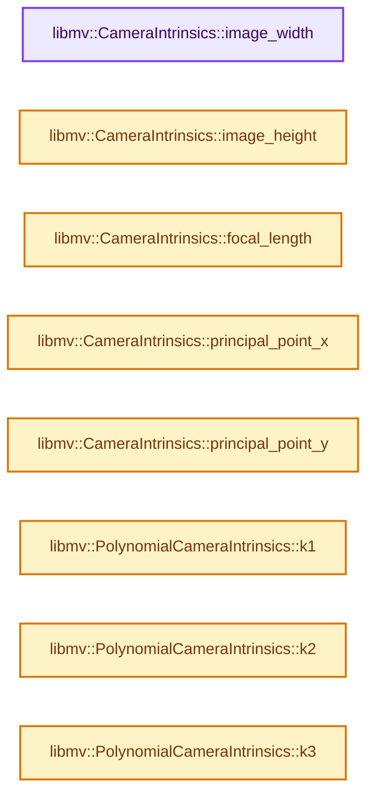

# 实现依赖专题：intern/libmv/libmv/simple_pipeline/camera_intrinsics.h

[方向导航](README.md) · [符号索引](../%E7%AC%A6%E5%8F%B7%E4%BE%9D%E8%B5%96%E4%B8%8E%E5%AE%9E%E7%8E%B0%E7%B4%A2%E5%BC%95.md)

本专题从正文实际调用进入，集中保存共享实现。函数有稳定锚点，可从调用处直接跳到对应完整函数；递归与互相调用通过回链组织。

## 本文件的实现关系




## 完整成员与函数实现

<a id="f-72161d5ccbba0f97"></a>

### `libmv::CameraIntrinsics::image_width`

实现位置：[intern/libmv/libmv/simple_pipeline/camera_intrinsics.h](../../../../../intern/libmv/libmv/simple_pipeline/camera_intrinsics.h) · L132—L132。

**教学注释版**

<!-- annotated:34b5182dbfcbcf -->

```cpp
  int image_width() const { return image_width_; }
```

<details>
<summary>核对原始源码：intern/libmv/libmv/simple_pipeline/camera_intrinsics.h · L132—L132</summary>

<!-- original:34b5182dbfcbcf:intern/libmv/libmv/simple_pipeline/camera_intrinsics.h:132:132 -->

```cpp
  int image_width() const { return image_width_; }
```

</details>

**继续追踪实现**

本实现没有需要继续展开的显式调用；检查返回表达式、对象转换和调用者前置条件。

<a id="f-3f5afd22cce49642"></a>

### `libmv::CameraIntrinsics::image_height`

实现位置：[intern/libmv/libmv/simple_pipeline/camera_intrinsics.h](../../../../../intern/libmv/libmv/simple_pipeline/camera_intrinsics.h) · L133—L133。

**教学注释版**

<!-- annotated:146c7a4fd6cd9c -->

```cpp
  int image_height() const { return image_height_; }
```

<details>
<summary>核对原始源码：intern/libmv/libmv/simple_pipeline/camera_intrinsics.h · L133—L133</summary>

<!-- original:146c7a4fd6cd9c:intern/libmv/libmv/simple_pipeline/camera_intrinsics.h:133:133 -->

```cpp
  int image_height() const { return image_height_; }
```

</details>

**继续追踪实现**

本实现没有需要继续展开的显式调用；检查返回表达式、对象转换和调用者前置条件。

<a id="f-0a1c91d56c7796be"></a>

### `libmv::CameraIntrinsics::focal_length`

实现位置：[intern/libmv/libmv/simple_pipeline/camera_intrinsics.h](../../../../../intern/libmv/libmv/simple_pipeline/camera_intrinsics.h) · L137—L137。

**教学注释版**

<!-- annotated:2685317ea64e1e -->

```cpp
  double focal_length() const { return K_(0, 0); }
```

<details>
<summary>核对原始源码：intern/libmv/libmv/simple_pipeline/camera_intrinsics.h · L137—L137</summary>

<!-- original:2685317ea64e1e:intern/libmv/libmv/simple_pipeline/camera_intrinsics.h:137:137 -->

```cpp
  double focal_length() const { return K_(0, 0); }
```

</details>

**继续追踪实现**

- `K_` → [调用协议](../%E6%A8%A1%E6%9D%BF%E5%AE%8F%E4%B8%8E%E5%8A%A8%E6%80%81%E5%88%86%E6%B4%BE%E5%8D%8F%E8%AE%AE.md)：函数指针、局部可调用对象或未展开的宏；必须结合调用者环境。调用位置L137。

<a id="f-7a573baf37c99b18"></a>

### `libmv::CameraIntrinsics::principal_point_x`

实现位置：[intern/libmv/libmv/simple_pipeline/camera_intrinsics.h](../../../../../intern/libmv/libmv/simple_pipeline/camera_intrinsics.h) · L141—L141。

**教学注释版**

<!-- annotated:20aa698cd5eca7 -->

```cpp
  double principal_point_x() const { return K_(0, 2); }
```

<details>
<summary>核对原始源码：intern/libmv/libmv/simple_pipeline/camera_intrinsics.h · L141—L141</summary>

<!-- original:20aa698cd5eca7:intern/libmv/libmv/simple_pipeline/camera_intrinsics.h:141:141 -->

```cpp
  double principal_point_x() const { return K_(0, 2); }
```

</details>

**继续追踪实现**

- `K_` → [调用协议](../%E6%A8%A1%E6%9D%BF%E5%AE%8F%E4%B8%8E%E5%8A%A8%E6%80%81%E5%88%86%E6%B4%BE%E5%8D%8F%E8%AE%AE.md)：函数指针、局部可调用对象或未展开的宏；必须结合调用者环境。调用位置L141。

<a id="f-437ee6bc22873080"></a>

### `libmv::CameraIntrinsics::principal_point_y`

实现位置：[intern/libmv/libmv/simple_pipeline/camera_intrinsics.h](../../../../../intern/libmv/libmv/simple_pipeline/camera_intrinsics.h) · L142—L142。

**教学注释版**

<!-- annotated:bcc6789337383e -->

```cpp
  double principal_point_y() const { return K_(1, 2); }
```

<details>
<summary>核对原始源码：intern/libmv/libmv/simple_pipeline/camera_intrinsics.h · L142—L142</summary>

<!-- original:bcc6789337383e:intern/libmv/libmv/simple_pipeline/camera_intrinsics.h:142:142 -->

```cpp
  double principal_point_y() const { return K_(1, 2); }
```

</details>

**继续追踪实现**

- `K_` → [调用协议](../%E6%A8%A1%E6%9D%BF%E5%AE%8F%E4%B8%8E%E5%8A%A8%E6%80%81%E5%88%86%E6%B4%BE%E5%8D%8F%E8%AE%AE.md)：函数指针、局部可调用对象或未展开的宏；必须结合调用者环境。调用位置L142。

<a id="f-bbb1586ad1cf7431"></a>

### `libmv::PolynomialCameraIntrinsics::k1`

实现位置：[intern/libmv/libmv/simple_pipeline/camera_intrinsics.h](../../../../../intern/libmv/libmv/simple_pipeline/camera_intrinsics.h) · L290—L290。

**教学注释版**

<!-- annotated:51337907bacc8a -->

```cpp
  double k1() const { return parameters_[OFFSET_K1]; }
```

<details>
<summary>核对原始源码：intern/libmv/libmv/simple_pipeline/camera_intrinsics.h · L290—L290</summary>

<!-- original:51337907bacc8a:intern/libmv/libmv/simple_pipeline/camera_intrinsics.h:290:290 -->

```cpp
  double k1() const { return parameters_[OFFSET_K1]; }
```

</details>

**继续追踪实现**

本实现没有需要继续展开的显式调用；检查返回表达式、对象转换和调用者前置条件。

<a id="f-b0380448a6c9a92c"></a>

### `libmv::PolynomialCameraIntrinsics::k2`

实现位置：[intern/libmv/libmv/simple_pipeline/camera_intrinsics.h](../../../../../intern/libmv/libmv/simple_pipeline/camera_intrinsics.h) · L291—L291。

**教学注释版**

<!-- annotated:61024e89359e90 -->

```cpp
  double k2() const { return parameters_[OFFSET_K2]; }
```

<details>
<summary>核对原始源码：intern/libmv/libmv/simple_pipeline/camera_intrinsics.h · L291—L291</summary>

<!-- original:61024e89359e90:intern/libmv/libmv/simple_pipeline/camera_intrinsics.h:291:291 -->

```cpp
  double k2() const { return parameters_[OFFSET_K2]; }
```

</details>

**继续追踪实现**

本实现没有需要继续展开的显式调用；检查返回表达式、对象转换和调用者前置条件。

<a id="f-836d924e6bd2b8ae"></a>

### `libmv::PolynomialCameraIntrinsics::k3`

实现位置：[intern/libmv/libmv/simple_pipeline/camera_intrinsics.h](../../../../../intern/libmv/libmv/simple_pipeline/camera_intrinsics.h) · L292—L292。

**教学注释版**

<!-- annotated:e00ac04bb94bc5 -->

```cpp
  double k3() const { return parameters_[OFFSET_K3]; }
```

<details>
<summary>核对原始源码：intern/libmv/libmv/simple_pipeline/camera_intrinsics.h · L292—L292</summary>

<!-- original:e00ac04bb94bc5:intern/libmv/libmv/simple_pipeline/camera_intrinsics.h:292:292 -->

```cpp
  double k3() const { return parameters_[OFFSET_K3]; }
```

</details>

**继续追踪实现**

本实现没有需要继续展开的显式调用；检查返回表达式、对象转换和调用者前置条件。

<a id="f-b9b5710c569a6bb2"></a>

### `libmv::DivisionCameraIntrinsics::k1`

实现位置：[intern/libmv/libmv/simple_pipeline/camera_intrinsics.h](../../../../../intern/libmv/libmv/simple_pipeline/camera_intrinsics.h) · L352—L352。

**教学注释版**

<!-- annotated:d9396b37fa7386 -->

```cpp
  double k1() const { return parameters_[OFFSET_K1]; }
```

<details>
<summary>核对原始源码：intern/libmv/libmv/simple_pipeline/camera_intrinsics.h · L352—L352</summary>

<!-- original:d9396b37fa7386:intern/libmv/libmv/simple_pipeline/camera_intrinsics.h:352:352 -->

```cpp
  double k1() const { return parameters_[OFFSET_K1]; }
```

</details>

**继续追踪实现**

本实现没有需要继续展开的显式调用；检查返回表达式、对象转换和调用者前置条件。

<a id="f-6c343e0bc734e748"></a>

### `libmv::DivisionCameraIntrinsics::k2`

实现位置：[intern/libmv/libmv/simple_pipeline/camera_intrinsics.h](../../../../../intern/libmv/libmv/simple_pipeline/camera_intrinsics.h) · L353—L353。

**教学注释版**

<!-- annotated:a180e588af2ad6 -->

```cpp
  double k2() const { return parameters_[OFFSET_K2]; }
```

<details>
<summary>核对原始源码：intern/libmv/libmv/simple_pipeline/camera_intrinsics.h · L353—L353</summary>

<!-- original:a180e588af2ad6:intern/libmv/libmv/simple_pipeline/camera_intrinsics.h:353:353 -->

```cpp
  double k2() const { return parameters_[OFFSET_K2]; }
```

</details>

**继续追踪实现**

本实现没有需要继续展开的显式调用；检查返回表达式、对象转换和调用者前置条件。

<a id="f-b416910a9577ffe4"></a>

### `libmv::NukeCameraIntrinsics::k1`

实现位置：[intern/libmv/libmv/simple_pipeline/camera_intrinsics.h](../../../../../intern/libmv/libmv/simple_pipeline/camera_intrinsics.h) · L407—L407。

**教学注释版**

<!-- annotated:853aa6611f2231 -->

```cpp
  double k1() const { return parameters_[OFFSET_K1]; }
```

<details>
<summary>核对原始源码：intern/libmv/libmv/simple_pipeline/camera_intrinsics.h · L407—L407</summary>

<!-- original:853aa6611f2231:intern/libmv/libmv/simple_pipeline/camera_intrinsics.h:407:407 -->

```cpp
  double k1() const { return parameters_[OFFSET_K1]; }
```

</details>

**继续追踪实现**

本实现没有需要继续展开的显式调用；检查返回表达式、对象转换和调用者前置条件。

<a id="f-072a4e8671f4ccb8"></a>

### `libmv::NukeCameraIntrinsics::k2`

实现位置：[intern/libmv/libmv/simple_pipeline/camera_intrinsics.h](../../../../../intern/libmv/libmv/simple_pipeline/camera_intrinsics.h) · L408—L408。

**教学注释版**

<!-- annotated:eaaca0ae0a76b6 -->

```cpp
  double k2() const { return parameters_[OFFSET_K2]; }
```

<details>
<summary>核对原始源码：intern/libmv/libmv/simple_pipeline/camera_intrinsics.h · L408—L408</summary>

<!-- original:eaaca0ae0a76b6:intern/libmv/libmv/simple_pipeline/camera_intrinsics.h:408:408 -->

```cpp
  double k2() const { return parameters_[OFFSET_K2]; }
```

</details>

**继续追踪实现**

本实现没有需要继续展开的显式调用；检查返回表达式、对象转换和调用者前置条件。

<a id="f-f698b0ad36d091af"></a>

### `libmv::NukeCameraIntrinsics::p1`

实现位置：[intern/libmv/libmv/simple_pipeline/camera_intrinsics.h](../../../../../intern/libmv/libmv/simple_pipeline/camera_intrinsics.h) · L409—L409。

**教学注释版**

<!-- annotated:55513aeb6a4036 -->

```cpp
  double p1() const { return parameters_[OFFSET_P1]; }
```

<details>
<summary>核对原始源码：intern/libmv/libmv/simple_pipeline/camera_intrinsics.h · L409—L409</summary>

<!-- original:55513aeb6a4036:intern/libmv/libmv/simple_pipeline/camera_intrinsics.h:409:409 -->

```cpp
  double p1() const { return parameters_[OFFSET_P1]; }
```

</details>

**继续追踪实现**

本实现没有需要继续展开的显式调用；检查返回表达式、对象转换和调用者前置条件。

<a id="f-9a52f95a17dbff50"></a>

### `libmv::NukeCameraIntrinsics::p2`

实现位置：[intern/libmv/libmv/simple_pipeline/camera_intrinsics.h](../../../../../intern/libmv/libmv/simple_pipeline/camera_intrinsics.h) · L410—L410。

**教学注释版**

<!-- annotated:961280cc08555f -->

```cpp
  double p2() const { return parameters_[OFFSET_P2]; }
```

<details>
<summary>核对原始源码：intern/libmv/libmv/simple_pipeline/camera_intrinsics.h · L410—L410</summary>

<!-- original:961280cc08555f:intern/libmv/libmv/simple_pipeline/camera_intrinsics.h:410:410 -->

```cpp
  double p2() const { return parameters_[OFFSET_P2]; }
```

</details>

**继续追踪实现**

本实现没有需要继续展开的显式调用；检查返回表达式、对象转换和调用者前置条件。

<a id="f-503d98db23b5f97c"></a>

### `libmv::BrownCameraIntrinsics::k1`

实现位置：[intern/libmv/libmv/simple_pipeline/camera_intrinsics.h](../../../../../intern/libmv/libmv/simple_pipeline/camera_intrinsics.h) · L469—L469。

**教学注释版**

<!-- annotated:c2a2526ecce7d7 -->

```cpp
  double k1() const { return parameters_[OFFSET_K1]; }
```

<details>
<summary>核对原始源码：intern/libmv/libmv/simple_pipeline/camera_intrinsics.h · L469—L469</summary>

<!-- original:c2a2526ecce7d7:intern/libmv/libmv/simple_pipeline/camera_intrinsics.h:469:469 -->

```cpp
  double k1() const { return parameters_[OFFSET_K1]; }
```

</details>

**继续追踪实现**

本实现没有需要继续展开的显式调用；检查返回表达式、对象转换和调用者前置条件。

<a id="f-f282887c83a8ec8c"></a>

### `libmv::BrownCameraIntrinsics::k2`

实现位置：[intern/libmv/libmv/simple_pipeline/camera_intrinsics.h](../../../../../intern/libmv/libmv/simple_pipeline/camera_intrinsics.h) · L470—L470。

**教学注释版**

<!-- annotated:a525323eea9fab -->

```cpp
  double k2() const { return parameters_[OFFSET_K2]; }
```

<details>
<summary>核对原始源码：intern/libmv/libmv/simple_pipeline/camera_intrinsics.h · L470—L470</summary>

<!-- original:a525323eea9fab:intern/libmv/libmv/simple_pipeline/camera_intrinsics.h:470:470 -->

```cpp
  double k2() const { return parameters_[OFFSET_K2]; }
```

</details>

**继续追踪实现**

本实现没有需要继续展开的显式调用；检查返回表达式、对象转换和调用者前置条件。

<a id="f-e8c892a41e3b0411"></a>

### `libmv::BrownCameraIntrinsics::k3`

实现位置：[intern/libmv/libmv/simple_pipeline/camera_intrinsics.h](../../../../../intern/libmv/libmv/simple_pipeline/camera_intrinsics.h) · L471—L471。

**教学注释版**

<!-- annotated:0050d31c4172ed -->

```cpp
  double k3() const { return parameters_[OFFSET_K3]; }
```

<details>
<summary>核对原始源码：intern/libmv/libmv/simple_pipeline/camera_intrinsics.h · L471—L471</summary>

<!-- original:0050d31c4172ed:intern/libmv/libmv/simple_pipeline/camera_intrinsics.h:471:471 -->

```cpp
  double k3() const { return parameters_[OFFSET_K3]; }
```

</details>

**继续追踪实现**

本实现没有需要继续展开的显式调用；检查返回表达式、对象转换和调用者前置条件。

<a id="f-dc45379517797db2"></a>

### `libmv::BrownCameraIntrinsics::k4`

实现位置：[intern/libmv/libmv/simple_pipeline/camera_intrinsics.h](../../../../../intern/libmv/libmv/simple_pipeline/camera_intrinsics.h) · L472—L472。

**教学注释版**

<!-- annotated:e8070b41373682 -->

```cpp
  double k4() const { return parameters_[OFFSET_K4]; }
```

<details>
<summary>核对原始源码：intern/libmv/libmv/simple_pipeline/camera_intrinsics.h · L472—L472</summary>

<!-- original:e8070b41373682:intern/libmv/libmv/simple_pipeline/camera_intrinsics.h:472:472 -->

```cpp
  double k4() const { return parameters_[OFFSET_K4]; }
```

</details>

**继续追踪实现**

本实现没有需要继续展开的显式调用；检查返回表达式、对象转换和调用者前置条件。

<a id="f-6fb9dd787a3c32bc"></a>

### `libmv::BrownCameraIntrinsics::p1`

实现位置：[intern/libmv/libmv/simple_pipeline/camera_intrinsics.h](../../../../../intern/libmv/libmv/simple_pipeline/camera_intrinsics.h) · L473—L473。

**教学注释版**

<!-- annotated:046b33cf6701a7 -->

```cpp
  double p1() const { return parameters_[OFFSET_P1]; }
```

<details>
<summary>核对原始源码：intern/libmv/libmv/simple_pipeline/camera_intrinsics.h · L473—L473</summary>

<!-- original:046b33cf6701a7:intern/libmv/libmv/simple_pipeline/camera_intrinsics.h:473:473 -->

```cpp
  double p1() const { return parameters_[OFFSET_P1]; }
```

</details>

**继续追踪实现**

本实现没有需要继续展开的显式调用；检查返回表达式、对象转换和调用者前置条件。

<a id="f-5bc0778cc32cce1c"></a>

### `libmv::BrownCameraIntrinsics::p2`

实现位置：[intern/libmv/libmv/simple_pipeline/camera_intrinsics.h](../../../../../intern/libmv/libmv/simple_pipeline/camera_intrinsics.h) · L474—L474。

**教学注释版**

<!-- annotated:aa02a135223511 -->

```cpp
  double p2() const { return parameters_[OFFSET_P2]; }
```

<details>
<summary>核对原始源码：intern/libmv/libmv/simple_pipeline/camera_intrinsics.h · L474—L474</summary>

<!-- original:aa02a135223511:intern/libmv/libmv/simple_pipeline/camera_intrinsics.h:474:474 -->

```cpp
  double p2() const { return parameters_[OFFSET_P2]; }
```

</details>

**继续追踪实现**

本实现没有需要继续展开的显式调用；检查返回表达式、对象转换和调用者前置条件。
