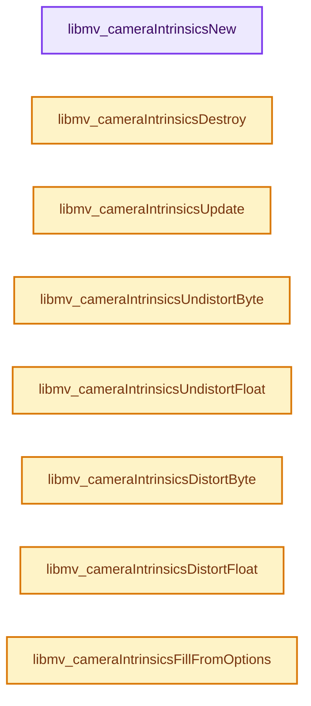

# 实现依赖专题：intern/libmv/intern/camera_intrinsics.cc

[方向导航](README.md) · [符号索引](../%E7%AC%A6%E5%8F%B7%E4%BE%9D%E8%B5%96%E4%B8%8E%E5%AE%9E%E7%8E%B0%E7%B4%A2%E5%BC%95.md)

本专题从正文实际调用进入，集中保存共享实现。函数有稳定锚点，可从调用处直接跳到对应完整函数；递归与互相调用通过回链组织。

## 本文件的实现关系




## 完整成员与函数实现

<a id="f-0a362709aea18b2f"></a>

### `libmv_cameraIntrinsicsNew`

实现位置：[intern/libmv/intern/camera_intrinsics.cc](../../../../../intern/libmv/intern/camera_intrinsics.cc) · L15—L20。

接口参数：

- `const libmv_CameraIntrinsicsOptions* libmv_camera_intrinsics_options`

**教学注释版**

<!-- annotated:c6eb510dcf4ab7 -->

```cpp
libmv_CameraIntrinsics* libmv_cameraIntrinsicsNew(
    const libmv_CameraIntrinsicsOptions* libmv_camera_intrinsics_options) {
  CameraIntrinsics* camera_intrinsics =
      libmv_cameraIntrinsicsCreateFromOptions(libmv_camera_intrinsics_options);
  return (libmv_CameraIntrinsics*)camera_intrinsics;
}
```

<details>
<summary>核对原始源码：intern/libmv/intern/camera_intrinsics.cc · L15—L20</summary>

<!-- original:c6eb510dcf4ab7:intern/libmv/intern/camera_intrinsics.cc:15:20 -->

```cpp
libmv_CameraIntrinsics* libmv_cameraIntrinsicsNew(
    const libmv_CameraIntrinsicsOptions* libmv_camera_intrinsics_options) {
  CameraIntrinsics* camera_intrinsics =
      libmv_cameraIntrinsicsCreateFromOptions(libmv_camera_intrinsics_options);
  return (libmv_CameraIntrinsics*)camera_intrinsics;
}
```

</details>

**结果出口**

- `return (libmv_CameraIntrinsics*)camera_intrinsics;`

**继续追踪实现**

- `libmv_cameraIntrinsicsCreateFromOptions` → [libmv_cameraIntrinsicsCreateFromOptions · L392](%E4%BE%9D%E8%B5%96-camera_intrinsics-1694e4.md#f-b955fdc26591a976)。

<a id="f-74efd8aefde933a3"></a>

### `libmv_cameraIntrinsicsDestroy`

实现位置：[intern/libmv/intern/camera_intrinsics.cc](../../../../../intern/libmv/intern/camera_intrinsics.cc) · L61—L63。

接口参数：

- `libmv_CameraIntrinsics* libmv_intrinsics`

**教学注释版**

<!-- annotated:110c9cbaf53c09 -->

```cpp
void libmv_cameraIntrinsicsDestroy(libmv_CameraIntrinsics* libmv_intrinsics) {
  LIBMV_OBJECT_DELETE(libmv_intrinsics, CameraIntrinsics);
}
```

<details>
<summary>核对原始源码：intern/libmv/intern/camera_intrinsics.cc · L61—L63</summary>

<!-- original:110c9cbaf53c09:intern/libmv/intern/camera_intrinsics.cc:61:63 -->

```cpp
void libmv_cameraIntrinsicsDestroy(libmv_CameraIntrinsics* libmv_intrinsics) {
  LIBMV_OBJECT_DELETE(libmv_intrinsics, CameraIntrinsics);
}
```

</details>

**继续追踪实现**

- `LIBMV_OBJECT_DELETE` → [LIBMV_OBJECT_DELETE · L22](%E4%BE%9D%E8%B5%96-utildefines-f77ca8.md#m-f64e543e498b)；[LIBMV_OBJECT_DELETE · L43](%E4%BE%9D%E8%B5%96-utildefines-f77ca8.md#m-632c2fcd50ed)。宏定义由构建条件选择。

<a id="f-facccdfb33b55ea3"></a>

### `libmv_cameraIntrinsicsUpdate`

实现位置：[intern/libmv/intern/camera_intrinsics.cc](../../../../../intern/libmv/intern/camera_intrinsics.cc) · L65—L181。

接口参数：

- `const libmv_CameraIntrinsicsOptions* libmv_camera_intrinsics_options`
- `libmv_CameraIntrinsics* libmv_intrinsics`

**教学注释版**

<!-- annotated:5500865c596ffb -->

```cpp
void libmv_cameraIntrinsicsUpdate(
    const libmv_CameraIntrinsicsOptions* libmv_camera_intrinsics_options,
    libmv_CameraIntrinsics* libmv_intrinsics) {
  CameraIntrinsics* camera_intrinsics = (CameraIntrinsics*)libmv_intrinsics;

  double focal_length = libmv_camera_intrinsics_options->focal_length;
  double principal_x = libmv_camera_intrinsics_options->principal_point_x;
  double principal_y = libmv_camera_intrinsics_options->principal_point_y;
  int image_width = libmv_camera_intrinsics_options->image_width;
  int image_height = libmv_camera_intrinsics_options->image_height;

  /* Try avoid unnecessary updates, so pre-computed distortion grids
   * are not freed. */

  if (camera_intrinsics->focal_length() != focal_length) {
    camera_intrinsics->SetFocalLength(focal_length, focal_length);
  }

  if (camera_intrinsics->principal_point_x() != principal_x ||
      camera_intrinsics->principal_point_y() != principal_y) {
    camera_intrinsics->SetPrincipalPoint(principal_x, principal_y);
  }

  if (camera_intrinsics->image_width() != image_width ||
      camera_intrinsics->image_height() != image_height) {
    camera_intrinsics->SetImageSize(image_width, image_height);
  }

  switch (libmv_camera_intrinsics_options->distortion_model) {
    case LIBMV_DISTORTION_MODEL_POLYNOMIAL: {
      // [讲解] assert：检查开发者预期条件，配置可能关闭；不承担完整输入处理或自动修复。
      assert(camera_intrinsics->GetDistortionModelType() ==
             libmv::DISTORTION_MODEL_POLYNOMIAL);

      PolynomialCameraIntrinsics* polynomial_intrinsics =
          (PolynomialCameraIntrinsics*)camera_intrinsics;

      double k1 = libmv_camera_intrinsics_options->polynomial_k1;
      double k2 = libmv_camera_intrinsics_options->polynomial_k2;
      double k3 = libmv_camera_intrinsics_options->polynomial_k3;

      if (polynomial_intrinsics->k1() != k1 ||
          polynomial_intrinsics->k2() != k2 ||
          polynomial_intrinsics->k3() != k3) {
        polynomial_intrinsics->SetRadialDistortion(k1, k2, k3);
      }
      break;
    }

    case LIBMV_DISTORTION_MODEL_DIVISION: {
      assert(camera_intrinsics->GetDistortionModelType() ==
             libmv::DISTORTION_MODEL_DIVISION);

      DivisionCameraIntrinsics* division_intrinsics =
          (DivisionCameraIntrinsics*)camera_intrinsics;

      double k1 = libmv_camera_intrinsics_options->division_k1;
      double k2 = libmv_camera_intrinsics_options->division_k2;

      if (division_intrinsics->k1() != k1 || division_intrinsics->k2() != k2) {
        division_intrinsics->SetDistortion(k1, k2);
      }

      break;
    }

    case LIBMV_DISTORTION_MODEL_NUKE: {
      assert(camera_intrinsics->GetDistortionModelType() ==
             libmv::DISTORTION_MODEL_NUKE);

      NukeCameraIntrinsics* nuke_intrinsics =
          (NukeCameraIntrinsics*)camera_intrinsics;

      double k1 = libmv_camera_intrinsics_options->nuke_k1;
      double k2 = libmv_camera_intrinsics_options->nuke_k2;

      if (nuke_intrinsics->k1() != k1 || nuke_intrinsics->k2() != k2) {
        nuke_intrinsics->SetRadialDistortion(k1, k2);
      }

      double p1 = libmv_camera_intrinsics_options->nuke_p1;
      double p2 = libmv_camera_intrinsics_options->nuke_p2;

      if (nuke_intrinsics->p1() != p1 || nuke_intrinsics->p2() != p2) {
        nuke_intrinsics->SetTangentialDistortion(p1, p2);
      }
      break;
    }

    case LIBMV_DISTORTION_MODEL_BROWN: {
      assert(camera_intrinsics->GetDistortionModelType() ==
             libmv::DISTORTION_MODEL_BROWN);

      BrownCameraIntrinsics* brown_intrinsics =
          (BrownCameraIntrinsics*)camera_intrinsics;

      double k1 = libmv_camera_intrinsics_options->brown_k1;
      double k2 = libmv_camera_intrinsics_options->brown_k2;
      double k3 = libmv_camera_intrinsics_options->brown_k3;
      double k4 = libmv_camera_intrinsics_options->brown_k4;

      if (brown_intrinsics->k1() != k1 || brown_intrinsics->k2() != k2 ||
          brown_intrinsics->k3() != k3 || brown_intrinsics->k4() != k4) {
        brown_intrinsics->SetRadialDistortion(k1, k2, k3, k4);
      }

      double p1 = libmv_camera_intrinsics_options->brown_p1;
      double p2 = libmv_camera_intrinsics_options->brown_p2;

      if (brown_intrinsics->p1() != p1 || brown_intrinsics->p2() != p2) {
        brown_intrinsics->SetTangentialDistortion(p1, p2);
      }
      break;
    }

    default: assert(!"Unknown distortion model");
  }
}
```

<details>
<summary>核对原始源码：intern/libmv/intern/camera_intrinsics.cc · L65—L181</summary>

<!-- original:5500865c596ffb:intern/libmv/intern/camera_intrinsics.cc:65:181 -->

```cpp
void libmv_cameraIntrinsicsUpdate(
    const libmv_CameraIntrinsicsOptions* libmv_camera_intrinsics_options,
    libmv_CameraIntrinsics* libmv_intrinsics) {
  CameraIntrinsics* camera_intrinsics = (CameraIntrinsics*)libmv_intrinsics;

  double focal_length = libmv_camera_intrinsics_options->focal_length;
  double principal_x = libmv_camera_intrinsics_options->principal_point_x;
  double principal_y = libmv_camera_intrinsics_options->principal_point_y;
  int image_width = libmv_camera_intrinsics_options->image_width;
  int image_height = libmv_camera_intrinsics_options->image_height;

  /* Try avoid unnecessary updates, so pre-computed distortion grids
   * are not freed. */

  if (camera_intrinsics->focal_length() != focal_length) {
    camera_intrinsics->SetFocalLength(focal_length, focal_length);
  }

  if (camera_intrinsics->principal_point_x() != principal_x ||
      camera_intrinsics->principal_point_y() != principal_y) {
    camera_intrinsics->SetPrincipalPoint(principal_x, principal_y);
  }

  if (camera_intrinsics->image_width() != image_width ||
      camera_intrinsics->image_height() != image_height) {
    camera_intrinsics->SetImageSize(image_width, image_height);
  }

  switch (libmv_camera_intrinsics_options->distortion_model) {
    case LIBMV_DISTORTION_MODEL_POLYNOMIAL: {
      assert(camera_intrinsics->GetDistortionModelType() ==
             libmv::DISTORTION_MODEL_POLYNOMIAL);

      PolynomialCameraIntrinsics* polynomial_intrinsics =
          (PolynomialCameraIntrinsics*)camera_intrinsics;

      double k1 = libmv_camera_intrinsics_options->polynomial_k1;
      double k2 = libmv_camera_intrinsics_options->polynomial_k2;
      double k3 = libmv_camera_intrinsics_options->polynomial_k3;

      if (polynomial_intrinsics->k1() != k1 ||
          polynomial_intrinsics->k2() != k2 ||
          polynomial_intrinsics->k3() != k3) {
        polynomial_intrinsics->SetRadialDistortion(k1, k2, k3);
      }
      break;
    }

    case LIBMV_DISTORTION_MODEL_DIVISION: {
      assert(camera_intrinsics->GetDistortionModelType() ==
             libmv::DISTORTION_MODEL_DIVISION);

      DivisionCameraIntrinsics* division_intrinsics =
          (DivisionCameraIntrinsics*)camera_intrinsics;

      double k1 = libmv_camera_intrinsics_options->division_k1;
      double k2 = libmv_camera_intrinsics_options->division_k2;

      if (division_intrinsics->k1() != k1 || division_intrinsics->k2() != k2) {
        division_intrinsics->SetDistortion(k1, k2);
      }

      break;
    }

    case LIBMV_DISTORTION_MODEL_NUKE: {
      assert(camera_intrinsics->GetDistortionModelType() ==
             libmv::DISTORTION_MODEL_NUKE);

      NukeCameraIntrinsics* nuke_intrinsics =
          (NukeCameraIntrinsics*)camera_intrinsics;

      double k1 = libmv_camera_intrinsics_options->nuke_k1;
      double k2 = libmv_camera_intrinsics_options->nuke_k2;

      if (nuke_intrinsics->k1() != k1 || nuke_intrinsics->k2() != k2) {
        nuke_intrinsics->SetRadialDistortion(k1, k2);
      }

      double p1 = libmv_camera_intrinsics_options->nuke_p1;
      double p2 = libmv_camera_intrinsics_options->nuke_p2;

      if (nuke_intrinsics->p1() != p1 || nuke_intrinsics->p2() != p2) {
        nuke_intrinsics->SetTangentialDistortion(p1, p2);
      }
      break;
    }

    case LIBMV_DISTORTION_MODEL_BROWN: {
      assert(camera_intrinsics->GetDistortionModelType() ==
             libmv::DISTORTION_MODEL_BROWN);

      BrownCameraIntrinsics* brown_intrinsics =
          (BrownCameraIntrinsics*)camera_intrinsics;

      double k1 = libmv_camera_intrinsics_options->brown_k1;
      double k2 = libmv_camera_intrinsics_options->brown_k2;
      double k3 = libmv_camera_intrinsics_options->brown_k3;
      double k4 = libmv_camera_intrinsics_options->brown_k4;

      if (brown_intrinsics->k1() != k1 || brown_intrinsics->k2() != k2 ||
          brown_intrinsics->k3() != k3 || brown_intrinsics->k4() != k4) {
        brown_intrinsics->SetRadialDistortion(k1, k2, k3, k4);
      }

      double p1 = libmv_camera_intrinsics_options->brown_p1;
      double p2 = libmv_camera_intrinsics_options->brown_p2;

      if (brown_intrinsics->p1() != p1 || brown_intrinsics->p2() != p2) {
        brown_intrinsics->SetTangentialDistortion(p1, p2);
      }
      break;
    }

    default: assert(!"Unknown distortion model");
  }
}
```

</details>

**继续追踪实现**

- `camera_intrinsics->focal_length` → [libmv::CameraIntrinsics::focal_length · L137](%E4%BE%9D%E8%B5%96-camera_intrinsics-06d2db.md#f-0a1c91d56c7796be)。
- `camera_intrinsics->SetFocalLength` → [libmv::CameraIntrinsics::SetFocalLength · L83](%E4%BE%9D%E8%B5%96-camera_intrinsics-bf941a.md#f-f1bc40841b10f325)。
- `camera_intrinsics->principal_point_x` → [libmv::CameraIntrinsics::principal_point_x · L141](%E4%BE%9D%E8%B5%96-camera_intrinsics-06d2db.md#f-7a573baf37c99b18)。
- `camera_intrinsics->principal_point_y` → [libmv::CameraIntrinsics::principal_point_y · L142](%E4%BE%9D%E8%B5%96-camera_intrinsics-06d2db.md#f-437ee6bc22873080)。
- `camera_intrinsics->SetPrincipalPoint` → [libmv::CameraIntrinsics::SetPrincipalPoint · L90](%E4%BE%9D%E8%B5%96-camera_intrinsics-bf941a.md#f-71af64e9a6c60d6a)。
- `camera_intrinsics->image_width` → [libmv::CameraIntrinsics::image_width · L132](%E4%BE%9D%E8%B5%96-camera_intrinsics-06d2db.md#f-72161d5ccbba0f97)。
- `camera_intrinsics->image_height` → [libmv::CameraIntrinsics::image_height · L133](%E4%BE%9D%E8%B5%96-camera_intrinsics-06d2db.md#f-3f5afd22cce49642)。
- `camera_intrinsics->SetImageSize` → [libmv::CameraIntrinsics::SetImageSize · L70](%E4%BE%9D%E8%B5%96-camera_intrinsics-bf941a.md#f-e729f415915175ac)。
- `assert` → [外部契约](https://eel.is/c++draft/assertions)：检查开发者预期条件，配置可能关闭；不承担完整输入处理或自动修复。
- `camera_intrinsics->GetDistortionModelType` → [调用协议](../%E6%A8%A1%E6%9D%BF%E5%AE%8F%E4%B8%8E%E5%8A%A8%E6%80%81%E5%88%86%E6%B4%BE%E5%8D%8F%E8%AE%AE.md)：由接收对象具体类型或运行时策略提供实现。调用位置L95。
- `polynomial_intrinsics->k1` → [libmv::PolynomialCameraIntrinsics::k1 · L290](%E4%BE%9D%E8%B5%96-camera_intrinsics-06d2db.md#f-bbb1586ad1cf7431)。
- `polynomial_intrinsics->k2` → [libmv::PolynomialCameraIntrinsics::k2 · L291](%E4%BE%9D%E8%B5%96-camera_intrinsics-06d2db.md#f-b0380448a6c9a92c)。
- `polynomial_intrinsics->k3` → [libmv::PolynomialCameraIntrinsics::k3 · L292](%E4%BE%9D%E8%B5%96-camera_intrinsics-06d2db.md#f-836d924e6bd2b8ae)。
- `polynomial_intrinsics->SetRadialDistortion` → [libmv::PolynomialCameraIntrinsics::SetRadialDistortion · L146](%E4%BE%9D%E8%B5%96-camera_intrinsics-bf941a.md#f-14556dde7e4d58dd)。
- `division_intrinsics->k1` → [libmv::DivisionCameraIntrinsics::k1 · L352](%E4%BE%9D%E8%B5%96-camera_intrinsics-06d2db.md#f-b9b5710c569a6bb2)。
- `division_intrinsics->k2` → [libmv::DivisionCameraIntrinsics::k2 · L353](%E4%BE%9D%E8%B5%96-camera_intrinsics-06d2db.md#f-6c343e0bc734e748)。
- `division_intrinsics->SetDistortion` → [libmv::DivisionCameraIntrinsics::SetDistortion · L234](%E4%BE%9D%E8%B5%96-camera_intrinsics-bf941a.md#f-bf9e3091ab330bda)。
- `nuke_intrinsics->k1` → [libmv::NukeCameraIntrinsics::k1 · L407](%E4%BE%9D%E8%B5%96-camera_intrinsics-06d2db.md#f-b416910a9577ffe4)。
- `nuke_intrinsics->k2` → [libmv::NukeCameraIntrinsics::k2 · L408](%E4%BE%9D%E8%B5%96-camera_intrinsics-06d2db.md#f-072a4e8671f4ccb8)。
- `nuke_intrinsics->SetRadialDistortion` → [libmv::NukeCameraIntrinsics::SetRadialDistortion · L299](%E4%BE%9D%E8%B5%96-camera_intrinsics-bf941a.md#f-682dd1208d971872)。
- `nuke_intrinsics->p1` → [libmv::NukeCameraIntrinsics::p1 · L409](%E4%BE%9D%E8%B5%96-camera_intrinsics-06d2db.md#f-f698b0ad36d091af)。
- `nuke_intrinsics->p2` → [libmv::NukeCameraIntrinsics::p2 · L410](%E4%BE%9D%E8%B5%96-camera_intrinsics-06d2db.md#f-9a52f95a17dbff50)。
- `nuke_intrinsics->SetTangentialDistortion` → [libmv::NukeCameraIntrinsics::SetTangentialDistortion · L305](%E4%BE%9D%E8%B5%96-camera_intrinsics-bf941a.md#f-e8b1723f14a8bfd8)。
- `brown_intrinsics->k1` → [libmv::BrownCameraIntrinsics::k1 · L469](%E4%BE%9D%E8%B5%96-camera_intrinsics-06d2db.md#f-503d98db23b5f97c)。
- `brown_intrinsics->k2` → [libmv::BrownCameraIntrinsics::k2 · L470](%E4%BE%9D%E8%B5%96-camera_intrinsics-06d2db.md#f-f282887c83a8ec8c)。
- `brown_intrinsics->k3` → [libmv::BrownCameraIntrinsics::k3 · L471](%E4%BE%9D%E8%B5%96-camera_intrinsics-06d2db.md#f-e8c892a41e3b0411)。
- `brown_intrinsics->k4` → [libmv::BrownCameraIntrinsics::k4 · L472](%E4%BE%9D%E8%B5%96-camera_intrinsics-06d2db.md#f-dc45379517797db2)。
- `brown_intrinsics->SetRadialDistortion` → [libmv::BrownCameraIntrinsics::SetRadialDistortion · L381](%E4%BE%9D%E8%B5%96-camera_intrinsics-bf941a.md#f-48806bcf9304311a)。
- `brown_intrinsics->p1` → [libmv::BrownCameraIntrinsics::p1 · L473](%E4%BE%9D%E8%B5%96-camera_intrinsics-06d2db.md#f-6fb9dd787a3c32bc)。
- `brown_intrinsics->p2` → [libmv::BrownCameraIntrinsics::p2 · L474](%E4%BE%9D%E8%B5%96-camera_intrinsics-06d2db.md#f-5bc0778cc32cce1c)。
- `brown_intrinsics->SetTangentialDistortion` → [libmv::BrownCameraIntrinsics::SetTangentialDistortion · L392](%E4%BE%9D%E8%B5%96-camera_intrinsics-bf941a.md#f-28a3b4d8075d3bc2)。

<a id="f-6bba520df4aba2e4"></a>

### `libmv_cameraIntrinsicsUndistortByte`

实现位置：[intern/libmv/intern/camera_intrinsics.cc](../../../../../intern/libmv/intern/camera_intrinsics.cc) · L252—L263。

接口参数：

- `const libmv_CameraIntrinsics* libmv_intrinsics`
- `const unsigned char* source_image`
- `int width`
- `int height`
- `float overscan`
- `int channels`
- `unsigned char* destination_image`

**教学注释版**

<!-- annotated:d407f6af92de26 -->

```cpp
void libmv_cameraIntrinsicsUndistortByte(
    const libmv_CameraIntrinsics* libmv_intrinsics,
    const unsigned char* source_image,
    int width,
    int height,
    float overscan,
    int channels,
    unsigned char* destination_image) {
  CameraIntrinsics* camera_intrinsics = (CameraIntrinsics*)libmv_intrinsics;
  camera_intrinsics->UndistortBuffer(
      source_image, width, height, overscan, channels, destination_image);
}
```

<details>
<summary>核对原始源码：intern/libmv/intern/camera_intrinsics.cc · L252—L263</summary>

<!-- original:d407f6af92de26:intern/libmv/intern/camera_intrinsics.cc:252:263 -->

```cpp
void libmv_cameraIntrinsicsUndistortByte(
    const libmv_CameraIntrinsics* libmv_intrinsics,
    const unsigned char* source_image,
    int width,
    int height,
    float overscan,
    int channels,
    unsigned char* destination_image) {
  CameraIntrinsics* camera_intrinsics = (CameraIntrinsics*)libmv_intrinsics;
  camera_intrinsics->UndistortBuffer(
      source_image, width, height, overscan, channels, destination_image);
}
```

</details>

**继续追踪实现**

- `camera_intrinsics->UndistortBuffer` → [libmv::CameraIntrinsics::UndistortBuffer · L169](%E4%BE%9D%E8%B5%96-camera_intrinsics_impl-47a22e.md#f-be9995f79418e9de)。

<a id="f-711c6a7979a43a25"></a>

### `libmv_cameraIntrinsicsUndistortFloat`

实现位置：[intern/libmv/intern/camera_intrinsics.cc](../../../../../intern/libmv/intern/camera_intrinsics.cc) · L265—L276。

接口参数：

- `const libmv_CameraIntrinsics* libmv_intrinsics`
- `const float* source_image`
- `int width`
- `int height`
- `float overscan`
- `int channels`
- `float* destination_image`

**教学注释版**

<!-- annotated:e9dc8b84abf799 -->

```cpp
void libmv_cameraIntrinsicsUndistortFloat(
    const libmv_CameraIntrinsics* libmv_intrinsics,
    const float* source_image,
    int width,
    int height,
    float overscan,
    int channels,
    float* destination_image) {
  CameraIntrinsics* intrinsics = (CameraIntrinsics*)libmv_intrinsics;
  intrinsics->UndistortBuffer(
      source_image, width, height, overscan, channels, destination_image);
}
```

<details>
<summary>核对原始源码：intern/libmv/intern/camera_intrinsics.cc · L265—L276</summary>

<!-- original:e9dc8b84abf799:intern/libmv/intern/camera_intrinsics.cc:265:276 -->

```cpp
void libmv_cameraIntrinsicsUndistortFloat(
    const libmv_CameraIntrinsics* libmv_intrinsics,
    const float* source_image,
    int width,
    int height,
    float overscan,
    int channels,
    float* destination_image) {
  CameraIntrinsics* intrinsics = (CameraIntrinsics*)libmv_intrinsics;
  intrinsics->UndistortBuffer(
      source_image, width, height, overscan, channels, destination_image);
}
```

</details>

**继续追踪实现**

- `intrinsics->UndistortBuffer` → [libmv::CameraIntrinsics::UndistortBuffer · L169](%E4%BE%9D%E8%B5%96-camera_intrinsics_impl-47a22e.md#f-be9995f79418e9de)。

<a id="f-d1f0a5158191d7b9"></a>

### `libmv_cameraIntrinsicsDistortByte`

实现位置：[intern/libmv/intern/camera_intrinsics.cc](../../../../../intern/libmv/intern/camera_intrinsics.cc) · L278—L289。

接口参数：

- `const struct libmv_CameraIntrinsics* libmv_intrinsics`
- `const unsigned char* source_image`
- `int width`
- `int height`
- `float overscan`
- `int channels`
- `unsigned char* destination_image`

**教学注释版**

<!-- annotated:6ee450e57a925f -->

```cpp
void libmv_cameraIntrinsicsDistortByte(
    const struct libmv_CameraIntrinsics* libmv_intrinsics,
    const unsigned char* source_image,
    int width,
    int height,
    float overscan,
    int channels,
    unsigned char* destination_image) {
  CameraIntrinsics* intrinsics = (CameraIntrinsics*)libmv_intrinsics;
  intrinsics->DistortBuffer(
      source_image, width, height, overscan, channels, destination_image);
}
```

<details>
<summary>核对原始源码：intern/libmv/intern/camera_intrinsics.cc · L278—L289</summary>

<!-- original:6ee450e57a925f:intern/libmv/intern/camera_intrinsics.cc:278:289 -->

```cpp
void libmv_cameraIntrinsicsDistortByte(
    const struct libmv_CameraIntrinsics* libmv_intrinsics,
    const unsigned char* source_image,
    int width,
    int height,
    float overscan,
    int channels,
    unsigned char* destination_image) {
  CameraIntrinsics* intrinsics = (CameraIntrinsics*)libmv_intrinsics;
  intrinsics->DistortBuffer(
      source_image, width, height, overscan, channels, destination_image);
}
```

</details>

**继续追踪实现**

- `intrinsics->DistortBuffer` → [libmv::CameraIntrinsics::DistortBuffer · L155](%E4%BE%9D%E8%B5%96-camera_intrinsics_impl-47a22e.md#f-52eca3075a8b8f2a)。

<a id="f-f5a09612d2744d83"></a>

### `libmv_cameraIntrinsicsDistortFloat`

实现位置：[intern/libmv/intern/camera_intrinsics.cc](../../../../../intern/libmv/intern/camera_intrinsics.cc) · L291—L302。

接口参数：

- `const libmv_CameraIntrinsics* libmv_intrinsics`
- `float* source_image`
- `int width`
- `int height`
- `float overscan`
- `int channels`
- `float* destination_image`

**教学注释版**

<!-- annotated:096480fa674eb0 -->

```cpp
void libmv_cameraIntrinsicsDistortFloat(
    const libmv_CameraIntrinsics* libmv_intrinsics,
    float* source_image,
    int width,
    int height,
    float overscan,
    int channels,
    float* destination_image) {
  CameraIntrinsics* intrinsics = (CameraIntrinsics*)libmv_intrinsics;
  intrinsics->DistortBuffer(
      source_image, width, height, overscan, channels, destination_image);
}
```

<details>
<summary>核对原始源码：intern/libmv/intern/camera_intrinsics.cc · L291—L302</summary>

<!-- original:096480fa674eb0:intern/libmv/intern/camera_intrinsics.cc:291:302 -->

```cpp
void libmv_cameraIntrinsicsDistortFloat(
    const libmv_CameraIntrinsics* libmv_intrinsics,
    float* source_image,
    int width,
    int height,
    float overscan,
    int channels,
    float* destination_image) {
  CameraIntrinsics* intrinsics = (CameraIntrinsics*)libmv_intrinsics;
  intrinsics->DistortBuffer(
      source_image, width, height, overscan, channels, destination_image);
}
```

</details>

**继续追踪实现**

- `intrinsics->DistortBuffer` → [libmv::CameraIntrinsics::DistortBuffer · L155](%E4%BE%9D%E8%B5%96-camera_intrinsics_impl-47a22e.md#f-52eca3075a8b8f2a)。

<a id="f-a1d9ebe680e9483d"></a>

### `libmv_cameraIntrinsicsFillFromOptions`

实现位置：[intern/libmv/intern/camera_intrinsics.cc](../../../../../intern/libmv/intern/camera_intrinsics.cc) · L324—L390。

接口参数：

- `const libmv_CameraIntrinsicsOptions* camera_intrinsics_options`
- `CameraIntrinsics* camera_intrinsics`

**教学注释版**

<!-- annotated:5c077aef3b8324 -->

```cpp
static void libmv_cameraIntrinsicsFillFromOptions(
    const libmv_CameraIntrinsicsOptions* camera_intrinsics_options,
    CameraIntrinsics* camera_intrinsics) {
  camera_intrinsics->SetFocalLength(camera_intrinsics_options->focal_length,
                                    camera_intrinsics_options->focal_length);

  camera_intrinsics->SetPrincipalPoint(
      camera_intrinsics_options->principal_point_x,
      camera_intrinsics_options->principal_point_y);

  camera_intrinsics->SetImageSize(camera_intrinsics_options->image_width,
                                  camera_intrinsics_options->image_height);

  switch (camera_intrinsics_options->distortion_model) {
    case LIBMV_DISTORTION_MODEL_POLYNOMIAL: {
      PolynomialCameraIntrinsics* polynomial_intrinsics =
          static_cast<PolynomialCameraIntrinsics*>(camera_intrinsics);

      polynomial_intrinsics->SetRadialDistortion(
          camera_intrinsics_options->polynomial_k1,
          camera_intrinsics_options->polynomial_k2,
          camera_intrinsics_options->polynomial_k3);

      break;
    }

    case LIBMV_DISTORTION_MODEL_DIVISION: {
      DivisionCameraIntrinsics* division_intrinsics =
          static_cast<DivisionCameraIntrinsics*>(camera_intrinsics);

      division_intrinsics->SetDistortion(
          camera_intrinsics_options->division_k1,
          camera_intrinsics_options->division_k2);
      break;
    }

    case LIBMV_DISTORTION_MODEL_NUKE: {
      NukeCameraIntrinsics* nuke_intrinsics =
          static_cast<NukeCameraIntrinsics*>(camera_intrinsics);

      nuke_intrinsics->SetRadialDistortion(camera_intrinsics_options->nuke_k1,
                                           camera_intrinsics_options->nuke_k2);
      nuke_intrinsics->SetTangentialDistortion(
          camera_intrinsics_options->nuke_p1,
          camera_intrinsics_options->nuke_p2);
      break;
    }

    case LIBMV_DISTORTION_MODEL_BROWN: {
      BrownCameraIntrinsics* brown_intrinsics =
          static_cast<BrownCameraIntrinsics*>(camera_intrinsics);

      brown_intrinsics->SetRadialDistortion(
          camera_intrinsics_options->brown_k1,
          camera_intrinsics_options->brown_k2,
          camera_intrinsics_options->brown_k3,
          camera_intrinsics_options->brown_k4);
      brown_intrinsics->SetTangentialDistortion(
          camera_intrinsics_options->brown_p1,
          camera_intrinsics_options->brown_p2);

      break;
    }

    // [讲解] assert：检查开发者预期条件，配置可能关闭；不承担完整输入处理或自动修复。
    default: assert(!"Unknown distortion model");
  }
}
```

<details>
<summary>核对原始源码：intern/libmv/intern/camera_intrinsics.cc · L324—L390</summary>

<!-- original:5c077aef3b8324:intern/libmv/intern/camera_intrinsics.cc:324:390 -->

```cpp
static void libmv_cameraIntrinsicsFillFromOptions(
    const libmv_CameraIntrinsicsOptions* camera_intrinsics_options,
    CameraIntrinsics* camera_intrinsics) {
  camera_intrinsics->SetFocalLength(camera_intrinsics_options->focal_length,
                                    camera_intrinsics_options->focal_length);

  camera_intrinsics->SetPrincipalPoint(
      camera_intrinsics_options->principal_point_x,
      camera_intrinsics_options->principal_point_y);

  camera_intrinsics->SetImageSize(camera_intrinsics_options->image_width,
                                  camera_intrinsics_options->image_height);

  switch (camera_intrinsics_options->distortion_model) {
    case LIBMV_DISTORTION_MODEL_POLYNOMIAL: {
      PolynomialCameraIntrinsics* polynomial_intrinsics =
          static_cast<PolynomialCameraIntrinsics*>(camera_intrinsics);

      polynomial_intrinsics->SetRadialDistortion(
          camera_intrinsics_options->polynomial_k1,
          camera_intrinsics_options->polynomial_k2,
          camera_intrinsics_options->polynomial_k3);

      break;
    }

    case LIBMV_DISTORTION_MODEL_DIVISION: {
      DivisionCameraIntrinsics* division_intrinsics =
          static_cast<DivisionCameraIntrinsics*>(camera_intrinsics);

      division_intrinsics->SetDistortion(
          camera_intrinsics_options->division_k1,
          camera_intrinsics_options->division_k2);
      break;
    }

    case LIBMV_DISTORTION_MODEL_NUKE: {
      NukeCameraIntrinsics* nuke_intrinsics =
          static_cast<NukeCameraIntrinsics*>(camera_intrinsics);

      nuke_intrinsics->SetRadialDistortion(camera_intrinsics_options->nuke_k1,
                                           camera_intrinsics_options->nuke_k2);
      nuke_intrinsics->SetTangentialDistortion(
          camera_intrinsics_options->nuke_p1,
          camera_intrinsics_options->nuke_p2);
      break;
    }

    case LIBMV_DISTORTION_MODEL_BROWN: {
      BrownCameraIntrinsics* brown_intrinsics =
          static_cast<BrownCameraIntrinsics*>(camera_intrinsics);

      brown_intrinsics->SetRadialDistortion(
          camera_intrinsics_options->brown_k1,
          camera_intrinsics_options->brown_k2,
          camera_intrinsics_options->brown_k3,
          camera_intrinsics_options->brown_k4);
      brown_intrinsics->SetTangentialDistortion(
          camera_intrinsics_options->brown_p1,
          camera_intrinsics_options->brown_p2);

      break;
    }

    default: assert(!"Unknown distortion model");
  }
}
```

</details>

**继续追踪实现**

- `camera_intrinsics->SetFocalLength` → [libmv::CameraIntrinsics::SetFocalLength · L83](%E4%BE%9D%E8%B5%96-camera_intrinsics-bf941a.md#f-f1bc40841b10f325)。
- `camera_intrinsics->SetPrincipalPoint` → [libmv::CameraIntrinsics::SetPrincipalPoint · L90](%E4%BE%9D%E8%B5%96-camera_intrinsics-bf941a.md#f-71af64e9a6c60d6a)。
- `camera_intrinsics->SetImageSize` → [libmv::CameraIntrinsics::SetImageSize · L70](%E4%BE%9D%E8%B5%96-camera_intrinsics-bf941a.md#f-e729f415915175ac)。
- `polynomial_intrinsics->SetRadialDistortion` → [libmv::PolynomialCameraIntrinsics::SetRadialDistortion · L146](%E4%BE%9D%E8%B5%96-camera_intrinsics-bf941a.md#f-14556dde7e4d58dd)。
- `division_intrinsics->SetDistortion` → [libmv::DivisionCameraIntrinsics::SetDistortion · L234](%E4%BE%9D%E8%B5%96-camera_intrinsics-bf941a.md#f-bf9e3091ab330bda)。
- `nuke_intrinsics->SetRadialDistortion` → [libmv::NukeCameraIntrinsics::SetRadialDistortion · L299](%E4%BE%9D%E8%B5%96-camera_intrinsics-bf941a.md#f-682dd1208d971872)。
- `nuke_intrinsics->SetTangentialDistortion` → [libmv::NukeCameraIntrinsics::SetTangentialDistortion · L305](%E4%BE%9D%E8%B5%96-camera_intrinsics-bf941a.md#f-e8b1723f14a8bfd8)。
- `brown_intrinsics->SetRadialDistortion` → [libmv::BrownCameraIntrinsics::SetRadialDistortion · L381](%E4%BE%9D%E8%B5%96-camera_intrinsics-bf941a.md#f-48806bcf9304311a)。
- `brown_intrinsics->SetTangentialDistortion` → [libmv::BrownCameraIntrinsics::SetTangentialDistortion · L392](%E4%BE%9D%E8%B5%96-camera_intrinsics-bf941a.md#f-28a3b4d8075d3bc2)。
- `assert` → [外部契约](https://eel.is/c++draft/assertions)：检查开发者预期条件，配置可能关闭；不承担完整输入处理或自动修复。

<a id="f-b955fdc26591a976"></a>

### `libmv_cameraIntrinsicsCreateFromOptions`

实现位置：[intern/libmv/intern/camera_intrinsics.cc](../../../../../intern/libmv/intern/camera_intrinsics.cc) · L392—L413。

接口参数：

- `const libmv_CameraIntrinsicsOptions* camera_intrinsics_options`

**教学注释版**

<!-- annotated:f1a70a55721cf0 -->

```cpp
CameraIntrinsics* libmv_cameraIntrinsicsCreateFromOptions(
    const libmv_CameraIntrinsicsOptions* camera_intrinsics_options) {
  CameraIntrinsics* camera_intrinsics = NULL;
  switch (camera_intrinsics_options->distortion_model) {
    case LIBMV_DISTORTION_MODEL_POLYNOMIAL:
      camera_intrinsics = LIBMV_OBJECT_NEW(PolynomialCameraIntrinsics);
      break;
    case LIBMV_DISTORTION_MODEL_DIVISION:
      camera_intrinsics = LIBMV_OBJECT_NEW(DivisionCameraIntrinsics);
      break;
    case LIBMV_DISTORTION_MODEL_NUKE:
      camera_intrinsics = LIBMV_OBJECT_NEW(NukeCameraIntrinsics);
      break;
    case LIBMV_DISTORTION_MODEL_BROWN:
      camera_intrinsics = LIBMV_OBJECT_NEW(BrownCameraIntrinsics);
      break;
    // [讲解] assert：检查开发者预期条件，配置可能关闭；不承担完整输入处理或自动修复。
    default: assert(!"Unknown distortion model");
  }
  libmv_cameraIntrinsicsFillFromOptions(camera_intrinsics_options,
                                        camera_intrinsics);
  return camera_intrinsics;
}
```

<details>
<summary>核对原始源码：intern/libmv/intern/camera_intrinsics.cc · L392—L413</summary>

<!-- original:f1a70a55721cf0:intern/libmv/intern/camera_intrinsics.cc:392:413 -->

```cpp
CameraIntrinsics* libmv_cameraIntrinsicsCreateFromOptions(
    const libmv_CameraIntrinsicsOptions* camera_intrinsics_options) {
  CameraIntrinsics* camera_intrinsics = NULL;
  switch (camera_intrinsics_options->distortion_model) {
    case LIBMV_DISTORTION_MODEL_POLYNOMIAL:
      camera_intrinsics = LIBMV_OBJECT_NEW(PolynomialCameraIntrinsics);
      break;
    case LIBMV_DISTORTION_MODEL_DIVISION:
      camera_intrinsics = LIBMV_OBJECT_NEW(DivisionCameraIntrinsics);
      break;
    case LIBMV_DISTORTION_MODEL_NUKE:
      camera_intrinsics = LIBMV_OBJECT_NEW(NukeCameraIntrinsics);
      break;
    case LIBMV_DISTORTION_MODEL_BROWN:
      camera_intrinsics = LIBMV_OBJECT_NEW(BrownCameraIntrinsics);
      break;
    default: assert(!"Unknown distortion model");
  }
  libmv_cameraIntrinsicsFillFromOptions(camera_intrinsics_options,
                                        camera_intrinsics);
  return camera_intrinsics;
}
```

</details>

**沿实际写入检查状态**

- `camera_intrinsics = LIBMV_OBJECT_NEW(PolynomialCameraIntrinsics);`
- `camera_intrinsics = LIBMV_OBJECT_NEW(DivisionCameraIntrinsics);`
- `camera_intrinsics = LIBMV_OBJECT_NEW(NukeCameraIntrinsics);`
- `camera_intrinsics = LIBMV_OBJECT_NEW(BrownCameraIntrinsics);`

**结果出口**

- `return camera_intrinsics;`

**继续追踪实现**

- `LIBMV_OBJECT_NEW` → [LIBMV_OBJECT_NEW · L16](%E4%BE%9D%E8%B5%96-utildefines-f77ca8.md#m-79e10878b5b6)；[LIBMV_OBJECT_NEW · L19](%E4%BE%9D%E8%B5%96-utildefines-f77ca8.md#m-84c9b47d1d53)；[LIBMV_OBJECT_NEW · L37](%E4%BE%9D%E8%B5%96-utildefines-f77ca8.md#m-5843c69b6dd0)；[LIBMV_OBJECT_NEW · L40](%E4%BE%9D%E8%B5%96-utildefines-f77ca8.md#m-26726e7dfcf9)。宏定义由构建条件选择。
- `assert` → [外部契约](https://eel.is/c++draft/assertions)：检查开发者预期条件，配置可能关闭；不承担完整输入处理或自动修复。
- `libmv_cameraIntrinsicsFillFromOptions` → [libmv_cameraIntrinsicsFillFromOptions · L324](%E4%BE%9D%E8%B5%96-camera_intrinsics-1694e4.md#f-a1d9ebe680e9483d)。
