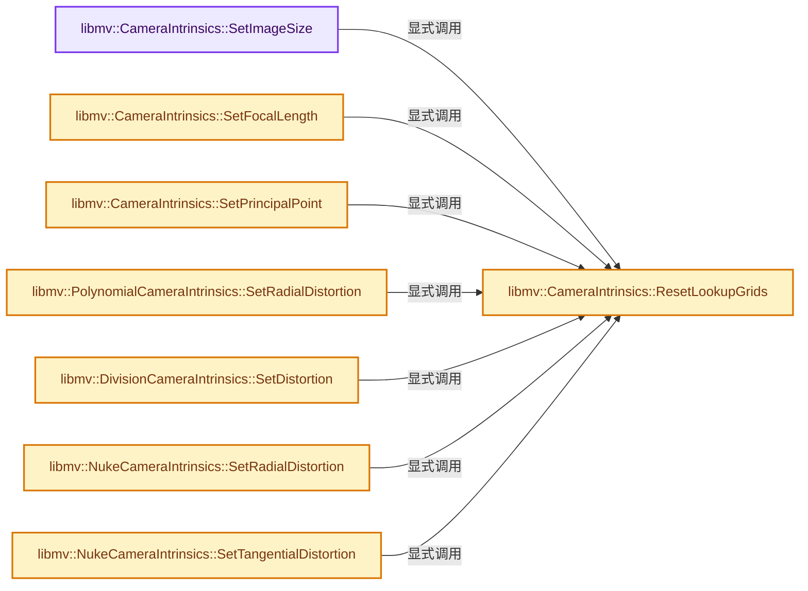

# 实现依赖专题：intern/libmv/libmv/simple_pipeline/camera_intrinsics.cc

[方向导航](README.md) · [符号索引](../%E7%AC%A6%E5%8F%B7%E4%BE%9D%E8%B5%96%E4%B8%8E%E5%AE%9E%E7%8E%B0%E7%B4%A2%E5%BC%95.md)

本专题从正文实际调用进入，集中保存共享实现。函数有稳定锚点，可从调用处直接跳到对应完整函数；递归与互相调用通过回链组织。

## 本文件的实现关系




## 完整成员与函数实现

<a id="f-e729f415915175ac"></a>

### `libmv::CameraIntrinsics::SetImageSize`

实现位置：[intern/libmv/libmv/simple_pipeline/camera_intrinsics.cc](../../../../../intern/libmv/libmv/simple_pipeline/camera_intrinsics.cc) · L70—L74。

接口参数：

- `int width`
- `int height`

**教学注释版**

<!-- annotated:13124db5a2303d -->

```cpp
void CameraIntrinsics::SetImageSize(int width, int height) {
  image_width_ = width;
  image_height_ = height;
  ResetLookupGrids();
}
```

<details>
<summary>核对原始源码：intern/libmv/libmv/simple_pipeline/camera_intrinsics.cc · L70—L74</summary>

<!-- original:13124db5a2303d:intern/libmv/libmv/simple_pipeline/camera_intrinsics.cc:70:74 -->

```cpp
void CameraIntrinsics::SetImageSize(int width, int height) {
  image_width_ = width;
  image_height_ = height;
  ResetLookupGrids();
}
```

</details>

**沿实际写入检查状态**

- `image_width_ = width;`
- `image_height_ = height;`

**继续追踪实现**

- `ResetLookupGrids` → [libmv::CameraIntrinsics::ResetLookupGrids · L113](%E4%BE%9D%E8%B5%96-camera_intrinsics-bf941a.md#f-64abadb3326a3253)。

<a id="f-f1bc40841b10f325"></a>

### `libmv::CameraIntrinsics::SetFocalLength`

实现位置：[intern/libmv/libmv/simple_pipeline/camera_intrinsics.cc](../../../../../intern/libmv/libmv/simple_pipeline/camera_intrinsics.cc) · L83—L87。

接口参数：

- `double focal_x`
- `double focal_y`

**教学注释版**

<!-- annotated:45c45b91ac31de -->

```cpp
void CameraIntrinsics::SetFocalLength(double focal_x, double focal_y) {
  K_(0, 0) = focal_x;
  K_(1, 1) = focal_y;
  ResetLookupGrids();
}
```

<details>
<summary>核对原始源码：intern/libmv/libmv/simple_pipeline/camera_intrinsics.cc · L83—L87</summary>

<!-- original:45c45b91ac31de:intern/libmv/libmv/simple_pipeline/camera_intrinsics.cc:83:87 -->

```cpp
void CameraIntrinsics::SetFocalLength(double focal_x, double focal_y) {
  K_(0, 0) = focal_x;
  K_(1, 1) = focal_y;
  ResetLookupGrids();
}
```

</details>

**继续追踪实现**

- `K_` → [调用协议](../%E6%A8%A1%E6%9D%BF%E5%AE%8F%E4%B8%8E%E5%8A%A8%E6%80%81%E5%88%86%E6%B4%BE%E5%8D%8F%E8%AE%AE.md)：函数指针、局部可调用对象或未展开的宏；必须结合调用者环境。调用位置L84。
- `ResetLookupGrids` → [libmv::CameraIntrinsics::ResetLookupGrids · L113](%E4%BE%9D%E8%B5%96-camera_intrinsics-bf941a.md#f-64abadb3326a3253)。

<a id="f-71af64e9a6c60d6a"></a>

### `libmv::CameraIntrinsics::SetPrincipalPoint`

实现位置：[intern/libmv/libmv/simple_pipeline/camera_intrinsics.cc](../../../../../intern/libmv/libmv/simple_pipeline/camera_intrinsics.cc) · L90—L94。

接口参数：

- `double cx`
- `double cy`

**教学注释版**

<!-- annotated:d21b0e32626a1a -->

```cpp
void CameraIntrinsics::SetPrincipalPoint(double cx, double cy) {
  K_(0, 2) = cx;
  K_(1, 2) = cy;
  ResetLookupGrids();
}
```

<details>
<summary>核对原始源码：intern/libmv/libmv/simple_pipeline/camera_intrinsics.cc · L90—L94</summary>

<!-- original:d21b0e32626a1a:intern/libmv/libmv/simple_pipeline/camera_intrinsics.cc:90:94 -->

```cpp
void CameraIntrinsics::SetPrincipalPoint(double cx, double cy) {
  K_(0, 2) = cx;
  K_(1, 2) = cy;
  ResetLookupGrids();
}
```

</details>

**继续追踪实现**

- `K_` → [调用协议](../%E6%A8%A1%E6%9D%BF%E5%AE%8F%E4%B8%8E%E5%8A%A8%E6%80%81%E5%88%86%E6%B4%BE%E5%8D%8F%E8%AE%AE.md)：函数指针、局部可调用对象或未展开的宏；必须结合调用者环境。调用位置L91。
- `ResetLookupGrids` → [libmv::CameraIntrinsics::ResetLookupGrids · L113](%E4%BE%9D%E8%B5%96-camera_intrinsics-bf941a.md#f-64abadb3326a3253)。

<a id="f-64abadb3326a3253"></a>

### `libmv::CameraIntrinsics::ResetLookupGrids`

实现位置：[intern/libmv/libmv/simple_pipeline/camera_intrinsics.cc](../../../../../intern/libmv/libmv/simple_pipeline/camera_intrinsics.cc) · L113—L116。

**教学注释版**

<!-- annotated:5f5cbcab94d0c8 -->

```cpp
void CameraIntrinsics::ResetLookupGrids() {
  distort_.Reset();
  undistort_.Reset();
}
```

<details>
<summary>核对原始源码：intern/libmv/libmv/simple_pipeline/camera_intrinsics.cc · L113—L116</summary>

<!-- original:5f5cbcab94d0c8:intern/libmv/libmv/simple_pipeline/camera_intrinsics.cc:113:116 -->

```cpp
void CameraIntrinsics::ResetLookupGrids() {
  distort_.Reset();
  undistort_.Reset();
}
```

</details>

**继续追踪实现**

- `distort_.Reset` → [调用协议](../%E6%A8%A1%E6%9D%BF%E5%AE%8F%E4%B8%8E%E5%8A%A8%E6%80%81%E5%88%86%E6%B4%BE%E5%8D%8F%E8%AE%AE.md)：接收对象类型依赖auto、返回值或模板实例；不按同名猜测目标。调用位置L114。
- `undistort_.Reset` → [调用协议](../%E6%A8%A1%E6%9D%BF%E5%AE%8F%E4%B8%8E%E5%8A%A8%E6%80%81%E5%88%86%E6%B4%BE%E5%8D%8F%E8%AE%AE.md)：接收对象类型依赖auto、返回值或模板实例；不按同名猜测目标。调用位置L115。

<a id="f-14556dde7e4d58dd"></a>

### `libmv::PolynomialCameraIntrinsics::SetRadialDistortion`

实现位置：[intern/libmv/libmv/simple_pipeline/camera_intrinsics.cc](../../../../../intern/libmv/libmv/simple_pipeline/camera_intrinsics.cc) · L146—L153。

接口参数：

- `double k1`
- `double k2`
- `double k3`

**教学注释版**

<!-- annotated:c363cc0bd04ecb -->

```cpp
void PolynomialCameraIntrinsics::SetRadialDistortion(double k1,
                                                     double k2,
                                                     double k3) {
  parameters_[OFFSET_K1] = k1;
  parameters_[OFFSET_K2] = k2;
  parameters_[OFFSET_K3] = k3;
  ResetLookupGrids();
}
```

<details>
<summary>核对原始源码：intern/libmv/libmv/simple_pipeline/camera_intrinsics.cc · L146—L153</summary>

<!-- original:c363cc0bd04ecb:intern/libmv/libmv/simple_pipeline/camera_intrinsics.cc:146:153 -->

```cpp
void PolynomialCameraIntrinsics::SetRadialDistortion(double k1,
                                                     double k2,
                                                     double k3) {
  parameters_[OFFSET_K1] = k1;
  parameters_[OFFSET_K2] = k2;
  parameters_[OFFSET_K3] = k3;
  ResetLookupGrids();
}
```

</details>

**沿实际写入检查状态**

- `parameters_[OFFSET_K1] = k1;`
- `parameters_[OFFSET_K2] = k2;`
- `parameters_[OFFSET_K3] = k3;`

**继续追踪实现**

- `ResetLookupGrids` → [libmv::CameraIntrinsics::ResetLookupGrids · L113](%E4%BE%9D%E8%B5%96-camera_intrinsics-bf941a.md#f-64abadb3326a3253)。

<a id="f-bf9e3091ab330bda"></a>

### `libmv::DivisionCameraIntrinsics::SetDistortion`

实现位置：[intern/libmv/libmv/simple_pipeline/camera_intrinsics.cc](../../../../../intern/libmv/libmv/simple_pipeline/camera_intrinsics.cc) · L234—L238。

接口参数：

- `double k1`
- `double k2`

**教学注释版**

<!-- annotated:0889b3b9adc801 -->

```cpp
void DivisionCameraIntrinsics::SetDistortion(double k1, double k2) {
  parameters_[OFFSET_K1] = k1;
  parameters_[OFFSET_K2] = k2;
  ResetLookupGrids();
}
```

<details>
<summary>核对原始源码：intern/libmv/libmv/simple_pipeline/camera_intrinsics.cc · L234—L238</summary>

<!-- original:0889b3b9adc801:intern/libmv/libmv/simple_pipeline/camera_intrinsics.cc:234:238 -->

```cpp
void DivisionCameraIntrinsics::SetDistortion(double k1, double k2) {
  parameters_[OFFSET_K1] = k1;
  parameters_[OFFSET_K2] = k2;
  ResetLookupGrids();
}
```

</details>

**沿实际写入检查状态**

- `parameters_[OFFSET_K1] = k1;`
- `parameters_[OFFSET_K2] = k2;`

**继续追踪实现**

- `ResetLookupGrids` → [libmv::CameraIntrinsics::ResetLookupGrids · L113](%E4%BE%9D%E8%B5%96-camera_intrinsics-bf941a.md#f-64abadb3326a3253)。

<a id="f-682dd1208d971872"></a>

### `libmv::NukeCameraIntrinsics::SetRadialDistortion`

实现位置：[intern/libmv/libmv/simple_pipeline/camera_intrinsics.cc](../../../../../intern/libmv/libmv/simple_pipeline/camera_intrinsics.cc) · L299—L303。

接口参数：

- `double k1`
- `double k2`

**教学注释版**

<!-- annotated:dc4ad2d1dc27fa -->

```cpp
void NukeCameraIntrinsics::SetRadialDistortion(double k1, double k2) {
  parameters_[OFFSET_K1] = k1;
  parameters_[OFFSET_K2] = k2;
  ResetLookupGrids();
}
```

<details>
<summary>核对原始源码：intern/libmv/libmv/simple_pipeline/camera_intrinsics.cc · L299—L303</summary>

<!-- original:dc4ad2d1dc27fa:intern/libmv/libmv/simple_pipeline/camera_intrinsics.cc:299:303 -->

```cpp
void NukeCameraIntrinsics::SetRadialDistortion(double k1, double k2) {
  parameters_[OFFSET_K1] = k1;
  parameters_[OFFSET_K2] = k2;
  ResetLookupGrids();
}
```

</details>

**沿实际写入检查状态**

- `parameters_[OFFSET_K1] = k1;`
- `parameters_[OFFSET_K2] = k2;`

**继续追踪实现**

- `ResetLookupGrids` → [libmv::CameraIntrinsics::ResetLookupGrids · L113](%E4%BE%9D%E8%B5%96-camera_intrinsics-bf941a.md#f-64abadb3326a3253)。

<a id="f-e8b1723f14a8bfd8"></a>

### `libmv::NukeCameraIntrinsics::SetTangentialDistortion`

实现位置：[intern/libmv/libmv/simple_pipeline/camera_intrinsics.cc](../../../../../intern/libmv/libmv/simple_pipeline/camera_intrinsics.cc) · L305—L309。

接口参数：

- `double p1`
- `double p2`

**教学注释版**

<!-- annotated:25964aeadd1af1 -->

```cpp
void NukeCameraIntrinsics::SetTangentialDistortion(double p1, double p2) {
  parameters_[OFFSET_P1] = p1;
  parameters_[OFFSET_P2] = p2;
  ResetLookupGrids();
}
```

<details>
<summary>核对原始源码：intern/libmv/libmv/simple_pipeline/camera_intrinsics.cc · L305—L309</summary>

<!-- original:25964aeadd1af1:intern/libmv/libmv/simple_pipeline/camera_intrinsics.cc:305:309 -->

```cpp
void NukeCameraIntrinsics::SetTangentialDistortion(double p1, double p2) {
  parameters_[OFFSET_P1] = p1;
  parameters_[OFFSET_P2] = p2;
  ResetLookupGrids();
}
```

</details>

**沿实际写入检查状态**

- `parameters_[OFFSET_P1] = p1;`
- `parameters_[OFFSET_P2] = p2;`

**继续追踪实现**

- `ResetLookupGrids` → [libmv::CameraIntrinsics::ResetLookupGrids · L113](%E4%BE%9D%E8%B5%96-camera_intrinsics-bf941a.md#f-64abadb3326a3253)。

<a id="f-48806bcf9304311a"></a>

### `libmv::BrownCameraIntrinsics::SetRadialDistortion`

实现位置：[intern/libmv/libmv/simple_pipeline/camera_intrinsics.cc](../../../../../intern/libmv/libmv/simple_pipeline/camera_intrinsics.cc) · L381—L390。

接口参数：

- `double k1`
- `double k2`
- `double k3`
- `double k4`

**教学注释版**

<!-- annotated:451a09d378b6aa -->

```cpp
void BrownCameraIntrinsics::SetRadialDistortion(double k1,
                                                double k2,
                                                double k3,
                                                double k4) {
  parameters_[OFFSET_K1] = k1;
  parameters_[OFFSET_K2] = k2;
  parameters_[OFFSET_K3] = k3;
  parameters_[OFFSET_K4] = k4;
  ResetLookupGrids();
}
```

<details>
<summary>核对原始源码：intern/libmv/libmv/simple_pipeline/camera_intrinsics.cc · L381—L390</summary>

<!-- original:451a09d378b6aa:intern/libmv/libmv/simple_pipeline/camera_intrinsics.cc:381:390 -->

```cpp
void BrownCameraIntrinsics::SetRadialDistortion(double k1,
                                                double k2,
                                                double k3,
                                                double k4) {
  parameters_[OFFSET_K1] = k1;
  parameters_[OFFSET_K2] = k2;
  parameters_[OFFSET_K3] = k3;
  parameters_[OFFSET_K4] = k4;
  ResetLookupGrids();
}
```

</details>

**沿实际写入检查状态**

- `parameters_[OFFSET_K1] = k1;`
- `parameters_[OFFSET_K2] = k2;`
- `parameters_[OFFSET_K3] = k3;`
- `parameters_[OFFSET_K4] = k4;`

**继续追踪实现**

- `ResetLookupGrids` → [libmv::CameraIntrinsics::ResetLookupGrids · L113](%E4%BE%9D%E8%B5%96-camera_intrinsics-bf941a.md#f-64abadb3326a3253)。

<a id="f-28a3b4d8075d3bc2"></a>

### `libmv::BrownCameraIntrinsics::SetTangentialDistortion`

实现位置：[intern/libmv/libmv/simple_pipeline/camera_intrinsics.cc](../../../../../intern/libmv/libmv/simple_pipeline/camera_intrinsics.cc) · L392—L396。

接口参数：

- `double p1`
- `double p2`

**教学注释版**

<!-- annotated:dcb9bc436c395c -->

```cpp
void BrownCameraIntrinsics::SetTangentialDistortion(double p1, double p2) {
  parameters_[OFFSET_P1] = p1;
  parameters_[OFFSET_P2] = p2;
  ResetLookupGrids();
}
```

<details>
<summary>核对原始源码：intern/libmv/libmv/simple_pipeline/camera_intrinsics.cc · L392—L396</summary>

<!-- original:dcb9bc436c395c:intern/libmv/libmv/simple_pipeline/camera_intrinsics.cc:392:396 -->

```cpp
void BrownCameraIntrinsics::SetTangentialDistortion(double p1, double p2) {
  parameters_[OFFSET_P1] = p1;
  parameters_[OFFSET_P2] = p2;
  ResetLookupGrids();
}
```

</details>

**沿实际写入检查状态**

- `parameters_[OFFSET_P1] = p1;`
- `parameters_[OFFSET_P2] = p2;`

**继续追踪实现**

- `ResetLookupGrids` → [libmv::CameraIntrinsics::ResetLookupGrids · L113](%E4%BE%9D%E8%B5%96-camera_intrinsics-bf941a.md#f-64abadb3326a3253)。
