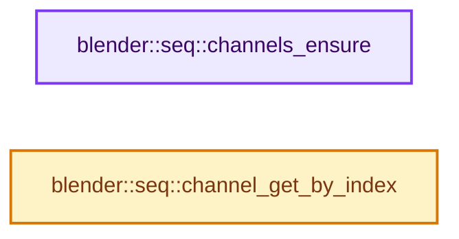
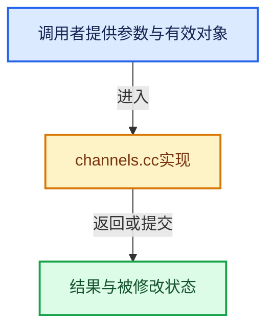

# 实现依赖专题：source/blender/sequencer/intern/channels.cc

[方向导航](README.md) · [符号索引](../%E7%AC%A6%E5%8F%B7%E4%BE%9D%E8%B5%96%E4%B8%8E%E5%AE%9E%E7%8E%B0%E7%B4%A2%E5%BC%95.md)

本专题从正文实际调用进入，集中保存共享实现。函数有稳定锚点，可从调用处直接跳到对应完整函数；递归与互相调用通过回链组织。

## 本文件的实现关系






## 完整成员与函数实现

<a id="f-eee04a6cad17ce75"></a>

### `blender::seq::channels_ensure`

实现位置：[source/blender/sequencer/intern/channels.cc](../../../../../source/blender/sequencer/intern/channels.cc) · L31—L40。

接口参数：

- `ListBaseT<SeqTimelineChannel> *channels`

**教学注释版**

<!-- annotated:750595eb936a22 -->

```cpp
void channels_ensure(ListBaseT<SeqTimelineChannel> *channels)
{
  /* Allocate channels. Channel 0 is never used, but allocated to prevent off by 1 issues. */
  for (int i = 0; i < MAX_CHANNELS + 1; i++) {
    SeqTimelineChannel *channel = MEM_new<SeqTimelineChannel>("seq timeline channel");
    SNPRINTF_UTF8(channel->name, DATA_("Channel %d"), i);
    channel->index = i;
    BLI_addtail(channels, channel);
  }
}
```

<details>
<summary>核对原始源码：source/blender/sequencer/intern/channels.cc · L31—L40</summary>

<!-- original:750595eb936a22:source/blender/sequencer/intern/channels.cc:31:40 -->

```cpp
void channels_ensure(ListBaseT<SeqTimelineChannel> *channels)
{
  /* Allocate channels. Channel 0 is never used, but allocated to prevent off by 1 issues. */
  for (int i = 0; i < MAX_CHANNELS + 1; i++) {
    SeqTimelineChannel *channel = MEM_new<SeqTimelineChannel>("seq timeline channel");
    SNPRINTF_UTF8(channel->name, DATA_("Channel %d"), i);
    channel->index = i;
    BLI_addtail(channels, channel);
  }
}
```

</details>

**沿实际写入检查状态**

- `channel->index = i;`

**继续追踪实现**

- `MEM_new<SeqTimelineChannel>` → [MEM_new · L351](../03-%E5%86%85%E5%AD%98%E5%88%86%E9%85%8D%E4%B8%8E%E8%BF%90%E8%A1%8C%E6%97%B6%E7%B1%BB%E5%9E%8B/%E4%BE%9D%E8%B5%96-MEM_guardedalloc-b54eca.md#f-115f9b6784f89912)。
- `SNPRINTF_UTF8` → [SNPRINTF_UTF8 · L340](../01-%E5%9F%BA%E7%A1%80%E5%AE%B9%E5%99%A8%E4%B8%8E%E7%8E%B0%E4%BB%A3CPP/%E4%BE%9D%E8%B5%96-BLI_string_utf8-bcc961.md#m-5e57d7a30c64)。宏定义由构建条件选择。
- `DATA_` → [DATA_ · L52](%E4%BE%9D%E8%B5%96-BLT_translation-c89e58.md#m-178736083f83)。宏定义由构建条件选择。
- `BLI_addtail` → [blender::BLI_addtail · L118](../01-%E5%9F%BA%E7%A1%80%E5%AE%B9%E5%99%A8%E4%B8%8E%E7%8E%B0%E4%BB%A3CPP/%E4%BE%9D%E8%B5%96-listbase-2816d9.md#f-4fb027713fa3115b)。

<a id="f-540303343bf1f1bf"></a>

### `blender::seq::channel_get_by_index`

实现位置：[source/blender/sequencer/intern/channels.cc](../../../../../source/blender/sequencer/intern/channels.cc) · L59—L63。

接口参数：

- `const ListBaseT<SeqTimelineChannel> *channels`
- `const int channel_index`

**教学注释版**

<!-- annotated:d85e3a557e560a -->

```cpp
SeqTimelineChannel *channel_get_by_index(const ListBaseT<SeqTimelineChannel> *channels,
                                         const int channel_index)
{
  return static_cast<SeqTimelineChannel *>(BLI_findlink(channels, channel_index));
}
```

<details>
<summary>核对原始源码：source/blender/sequencer/intern/channels.cc · L59—L63</summary>

<!-- original:d85e3a557e560a:source/blender/sequencer/intern/channels.cc:59:63 -->

```cpp
SeqTimelineChannel *channel_get_by_index(const ListBaseT<SeqTimelineChannel> *channels,
                                         const int channel_index)
{
  return static_cast<SeqTimelineChannel *>(BLI_findlink(channels, channel_index));
}
```

</details>

**结果出口**

- `return static_cast<SeqTimelineChannel *>(BLI_findlink(channels, channel_index));`

**继续追踪实现**

- `BLI_findlink` → [blender::BLI_findlink · L541](../01-%E5%9F%BA%E7%A1%80%E5%AE%B9%E5%99%A8%E4%B8%8E%E7%8E%B0%E4%BB%A3CPP/%E4%BE%9D%E8%B5%96-listbase-2816d9.md#f-6d3fd65974b4e808)。
