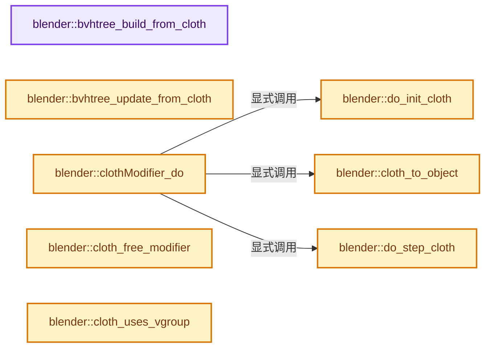
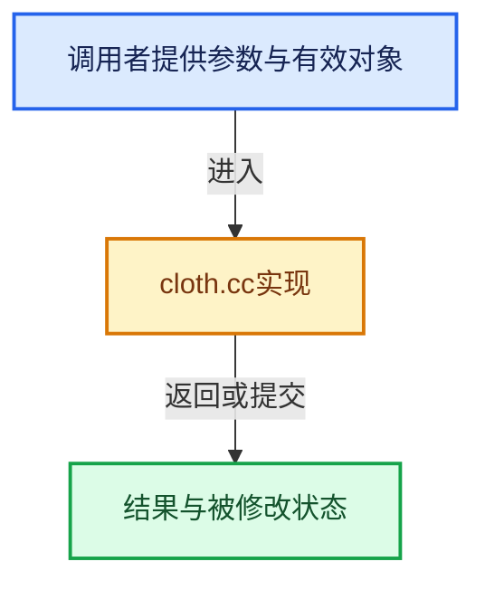

# 实现依赖专题：source/blender/blenkernel/intern/cloth.cc

[方向导航](README.md) · [符号索引](../%E7%AC%A6%E5%8F%B7%E4%BE%9D%E8%B5%96%E4%B8%8E%E5%AE%9E%E7%8E%B0%E7%B4%A2%E5%BC%95.md)

本专题从正文实际调用进入，集中保存共享实现。函数有稳定锚点，可从调用处直接跳到对应完整函数；递归与互相调用通过回链组织。

## 本文件的实现关系






## 完整成员与函数实现

<a id="f-1f852eca8bf6b9b6"></a>

### `blender::bvhtree_build_from_cloth`

实现位置：[source/blender/blenkernel/intern/cloth.cc](../../../../../source/blender/blenkernel/intern/cloth.cc) · L69—L121。

接口参数：

- `ClothModifierData *clmd`
- `float epsilon`

**教学注释版**

<!-- annotated:1db0508fe84c0a -->

```cpp
static BVHTree *bvhtree_build_from_cloth(ClothModifierData *clmd, float epsilon)
{
  if (!clmd) {
    return nullptr;
  }

  Cloth *cloth = clmd->clothObject;

  if (!cloth) {
    return nullptr;
  }

  ClothVertex *verts = cloth->verts;
  const int3 *vert_tris = cloth->vert_tris;

  /* in the moment, return zero if no faces there */
  if (!cloth->primitive_num) {
    return nullptr;
  }

  /* Create quad-tree with k=26. */
  BVHTree *bvhtree = BLI_bvhtree_new(cloth->primitive_num, epsilon, 4, 26);

  /* fill tree */
  if (clmd->hairdata == nullptr) {
    for (int i = 0; i < cloth->primitive_num; i++) {
      float co[3][3];

      copy_v3_v3(co[0], verts[vert_tris[i][0]].xold);
      copy_v3_v3(co[1], verts[vert_tris[i][1]].xold);
      copy_v3_v3(co[2], verts[vert_tris[i][2]].xold);

      BLI_bvhtree_insert(bvhtree, i, co[0], 3);
    }
  }
  else {
    const int2 *edges = cloth->edges;

    for (int i = 0; i < cloth->primitive_num; i++) {
      float co[2][3];

      copy_v3_v3(co[0], verts[edges[i][0]].xold);
      copy_v3_v3(co[1], verts[edges[i][1]].xold);

      BLI_bvhtree_insert(bvhtree, i, co[0], 2);
    }
  }

  /* balance tree */
  BLI_bvhtree_balance(bvhtree);

  return bvhtree;
}
```

<details>
<summary>核对原始源码：source/blender/blenkernel/intern/cloth.cc · L69—L121</summary>

<!-- original:1db0508fe84c0a:source/blender/blenkernel/intern/cloth.cc:69:121 -->

```cpp
static BVHTree *bvhtree_build_from_cloth(ClothModifierData *clmd, float epsilon)
{
  if (!clmd) {
    return nullptr;
  }

  Cloth *cloth = clmd->clothObject;

  if (!cloth) {
    return nullptr;
  }

  ClothVertex *verts = cloth->verts;
  const int3 *vert_tris = cloth->vert_tris;

  /* in the moment, return zero if no faces there */
  if (!cloth->primitive_num) {
    return nullptr;
  }

  /* Create quad-tree with k=26. */
  BVHTree *bvhtree = BLI_bvhtree_new(cloth->primitive_num, epsilon, 4, 26);

  /* fill tree */
  if (clmd->hairdata == nullptr) {
    for (int i = 0; i < cloth->primitive_num; i++) {
      float co[3][3];

      copy_v3_v3(co[0], verts[vert_tris[i][0]].xold);
      copy_v3_v3(co[1], verts[vert_tris[i][1]].xold);
      copy_v3_v3(co[2], verts[vert_tris[i][2]].xold);

      BLI_bvhtree_insert(bvhtree, i, co[0], 3);
    }
  }
  else {
    const int2 *edges = cloth->edges;

    for (int i = 0; i < cloth->primitive_num; i++) {
      float co[2][3];

      copy_v3_v3(co[0], verts[edges[i][0]].xold);
      copy_v3_v3(co[1], verts[edges[i][1]].xold);

      BLI_bvhtree_insert(bvhtree, i, co[0], 2);
    }
  }

  /* balance tree */
  BLI_bvhtree_balance(bvhtree);

  return bvhtree;
}
```

</details>

**结果出口**

- `return nullptr;`
- `return bvhtree;`

**继续追踪实现**

- `BLI_bvhtree_new` → [blender::BLI_bvhtree_new · L864](../12-%E7%A9%BA%E9%97%B4%E6%95%B0%E6%8D%AE%E7%BB%93%E6%9E%84%E4%B8%8E%E5%87%A0%E4%BD%95%E7%AE%97%E6%B3%95/%E4%BE%9D%E8%B5%96-BLI_kdopbvh-9f4bb8.md#f-4ec9d64950b835b8)。
- `copy_v3_v3` → [blender::copy_v3_v3 · L47](../12-%E7%A9%BA%E9%97%B4%E6%95%B0%E6%8D%AE%E7%BB%93%E6%9E%84%E4%B8%8E%E5%87%A0%E4%BD%95%E7%AE%97%E6%B3%95/%E4%BE%9D%E8%B5%96-math_vector_inline-0c8541.md#f-037a0d5fa5060bd6)。
- `BLI_bvhtree_insert` → [blender::BLI_bvhtree_insert · L988](../12-%E7%A9%BA%E9%97%B4%E6%95%B0%E6%8D%AE%E7%BB%93%E6%9E%84%E4%B8%8E%E5%87%A0%E4%BD%95%E7%AE%97%E6%B3%95/%E4%BE%9D%E8%B5%96-BLI_kdopbvh-9f4bb8.md#f-00e2c6f8e338e6a0)。
- `BLI_bvhtree_balance` → [blender::BLI_bvhtree_balance · L946](../12-%E7%A9%BA%E9%97%B4%E6%95%B0%E6%8D%AE%E7%BB%93%E6%9E%84%E4%B8%8E%E5%87%A0%E4%BD%95%E7%AE%97%E6%B3%95/%E4%BE%9D%E8%B5%96-BLI_kdopbvh-9f4bb8.md#f-623c82143d96130e)。

<a id="f-2e9e7c48a89e2ebf"></a>

### `blender::bvhtree_update_from_cloth`

实现位置：[source/blender/blenkernel/intern/cloth.cc](../../../../../source/blender/blenkernel/intern/cloth.cc) · L123—L200。

接口参数：

- `ClothModifierData *clmd`
- `bool moving`
- `bool self`

**教学注释版**

<!-- annotated:23267552085ca4 -->

```cpp
void bvhtree_update_from_cloth(ClothModifierData *clmd, bool moving, bool self)
{
  uint i = 0;
  Cloth *cloth = clmd->clothObject;
  BVHTree *bvhtree;
  ClothVertex *verts = cloth->verts;

  BLI_assert(!(clmd->hairdata != nullptr && self));

  if (self) {
    bvhtree = cloth->bvhselftree;
  }
  else {
    bvhtree = cloth->bvhtree;
  }

  if (!bvhtree) {
    return;
  }

  const int3 *vert_tris = cloth->vert_tris;

  /* update vertex position in bvh tree */
  if (clmd->hairdata == nullptr) {
    if (verts && vert_tris) {
      for (i = 0; i < cloth->primitive_num; i++) {
        float co[3][3], co_moving[3][3];
        bool ret;

        /* copy new locations into array */
        if (moving) {
          copy_v3_v3(co[0], verts[vert_tris[i][0]].txold);
          copy_v3_v3(co[1], verts[vert_tris[i][1]].txold);
          copy_v3_v3(co[2], verts[vert_tris[i][2]].txold);

          /* update moving positions */
          copy_v3_v3(co_moving[0], verts[vert_tris[i][0]].tx);
          copy_v3_v3(co_moving[1], verts[vert_tris[i][1]].tx);
          copy_v3_v3(co_moving[2], verts[vert_tris[i][2]].tx);

          ret = BLI_bvhtree_update_node(bvhtree, i, co[0], co_moving[0], 3);
        }
        else {
          copy_v3_v3(co[0], verts[vert_tris[i][0]].tx);
          copy_v3_v3(co[1], verts[vert_tris[i][1]].tx);
          copy_v3_v3(co[2], verts[vert_tris[i][2]].tx);

          ret = BLI_bvhtree_update_node(bvhtree, i, co[0], nullptr, 3);
        }

        /* check if tree is already full */
        if (ret == false) {
          break;
        }
      }

      BLI_bvhtree_update_tree(bvhtree);
    }
  }
  else {
    if (verts) {
      const int2 *edges = reinterpret_cast<const int2 *>(cloth->edges);

      for (i = 0; i < cloth->primitive_num; i++) {
        float co[2][3];

        copy_v3_v3(co[0], verts[edges[i][0]].tx);
        copy_v3_v3(co[1], verts[edges[i][1]].tx);

        if (!BLI_bvhtree_update_node(bvhtree, i, co[0], nullptr, 2)) {
          break;
        }
      }

      BLI_bvhtree_update_tree(bvhtree);
    }
  }
}
```

<details>
<summary>核对原始源码：source/blender/blenkernel/intern/cloth.cc · L123—L200</summary>

<!-- original:23267552085ca4:source/blender/blenkernel/intern/cloth.cc:123:200 -->

```cpp
void bvhtree_update_from_cloth(ClothModifierData *clmd, bool moving, bool self)
{
  uint i = 0;
  Cloth *cloth = clmd->clothObject;
  BVHTree *bvhtree;
  ClothVertex *verts = cloth->verts;

  BLI_assert(!(clmd->hairdata != nullptr && self));

  if (self) {
    bvhtree = cloth->bvhselftree;
  }
  else {
    bvhtree = cloth->bvhtree;
  }

  if (!bvhtree) {
    return;
  }

  const int3 *vert_tris = cloth->vert_tris;

  /* update vertex position in bvh tree */
  if (clmd->hairdata == nullptr) {
    if (verts && vert_tris) {
      for (i = 0; i < cloth->primitive_num; i++) {
        float co[3][3], co_moving[3][3];
        bool ret;

        /* copy new locations into array */
        if (moving) {
          copy_v3_v3(co[0], verts[vert_tris[i][0]].txold);
          copy_v3_v3(co[1], verts[vert_tris[i][1]].txold);
          copy_v3_v3(co[2], verts[vert_tris[i][2]].txold);

          /* update moving positions */
          copy_v3_v3(co_moving[0], verts[vert_tris[i][0]].tx);
          copy_v3_v3(co_moving[1], verts[vert_tris[i][1]].tx);
          copy_v3_v3(co_moving[2], verts[vert_tris[i][2]].tx);

          ret = BLI_bvhtree_update_node(bvhtree, i, co[0], co_moving[0], 3);
        }
        else {
          copy_v3_v3(co[0], verts[vert_tris[i][0]].tx);
          copy_v3_v3(co[1], verts[vert_tris[i][1]].tx);
          copy_v3_v3(co[2], verts[vert_tris[i][2]].tx);

          ret = BLI_bvhtree_update_node(bvhtree, i, co[0], nullptr, 3);
        }

        /* check if tree is already full */
        if (ret == false) {
          break;
        }
      }

      BLI_bvhtree_update_tree(bvhtree);
    }
  }
  else {
    if (verts) {
      const int2 *edges = reinterpret_cast<const int2 *>(cloth->edges);

      for (i = 0; i < cloth->primitive_num; i++) {
        float co[2][3];

        copy_v3_v3(co[0], verts[edges[i][0]].tx);
        copy_v3_v3(co[1], verts[edges[i][1]].tx);

        if (!BLI_bvhtree_update_node(bvhtree, i, co[0], nullptr, 2)) {
          break;
        }
      }

      BLI_bvhtree_update_tree(bvhtree);
    }
  }
}
```

</details>

**沿实际写入检查状态**

- `bvhtree = cloth->bvhselftree;`
- `bvhtree = cloth->bvhtree;`
- `ret = BLI_bvhtree_update_node(bvhtree, i, co[0], co_moving[0], 3);`
- `ret = BLI_bvhtree_update_node(bvhtree, i, co[0], nullptr, 3);`

**继续追踪实现**

- `BLI_assert` → [BLI_assert · L48](../01-%E5%9F%BA%E7%A1%80%E5%AE%B9%E5%99%A8%E4%B8%8E%E7%8E%B0%E4%BB%A3CPP/%E4%BE%9D%E8%B5%96-BLI_assert-cc98e8.md#m-57a88495704d)；[BLI_assert · L63](../01-%E5%9F%BA%E7%A1%80%E5%AE%B9%E5%99%A8%E4%B8%8E%E7%8E%B0%E4%BB%A3CPP/%E4%BE%9D%E8%B5%96-BLI_assert-cc98e8.md#m-d07050020cb5)。宏定义由构建条件选择。
- `copy_v3_v3` → [blender::copy_v3_v3 · L47](../12-%E7%A9%BA%E9%97%B4%E6%95%B0%E6%8D%AE%E7%BB%93%E6%9E%84%E4%B8%8E%E5%87%A0%E4%BD%95%E7%AE%97%E6%B3%95/%E4%BE%9D%E8%B5%96-math_vector_inline-0c8541.md#f-037a0d5fa5060bd6)。
- `BLI_bvhtree_update_node` → [blender::BLI_bvhtree_update_node · L1006](../12-%E7%A9%BA%E9%97%B4%E6%95%B0%E6%8D%AE%E7%BB%93%E6%9E%84%E4%B8%8E%E5%87%A0%E4%BD%95%E7%AE%97%E6%B3%95/%E4%BE%9D%E8%B5%96-BLI_kdopbvh-9f4bb8.md#f-36b2cffb3b48085c)。
- `BLI_bvhtree_update_tree` → [blender::BLI_bvhtree_update_tree · L1030](../12-%E7%A9%BA%E9%97%B4%E6%95%B0%E6%8D%AE%E7%BB%93%E6%9E%84%E4%B8%8E%E5%87%A0%E4%BD%95%E7%AE%97%E6%B3%95/%E4%BE%9D%E8%B5%96-BLI_kdopbvh-9f4bb8.md#f-e564c1b3665cdaf2)。

<a id="f-340f0f3c8d269035"></a>

### `blender::do_init_cloth`

实现位置：[source/blender/blenkernel/intern/cloth.cc](../../../../../source/blender/blenkernel/intern/cloth.cc) · L222—L256。

接口参数：

- `Object *ob`
- `ClothModifierData *clmd`
- `const Mesh *result`
- `int framenr`

**教学注释版**

<!-- annotated:1456e3d1f9fdb6 -->

```cpp
static bool do_init_cloth(Object *ob, ClothModifierData *clmd, const Mesh *result, int framenr)
{
  PointCache *cache;

  cache = clmd->point_cache;

  /* initialize simulation data if it didn't exist already */
  if (clmd->clothObject == nullptr) {
    if (!cloth_from_object(ob, clmd, result, framenr, 1)) {
      BKE_ptcache_invalidate(cache);
      BKE_modifier_set_error(ob, &(clmd->modifier), "Cannot initialize cloth");
      return false;
    }

    if (clmd->clothObject == nullptr) {
      BKE_ptcache_invalidate(cache);
      BKE_modifier_set_error(ob, &(clmd->modifier), "Null cloth object");
      return false;
    }

    SIM_cloth_solver_set_positions(clmd);

    ClothSimSettings *parms = clmd->sim_parms;
    if (parms->flags & CLOTH_SIMSETTINGS_FLAG_PRESSURE &&
        !(parms->flags & CLOTH_SIMSETTINGS_FLAG_PRESSURE_VOL))
    {
      SIM_cloth_solver_set_volume(clmd);
    }

    clmd->clothObject->last_frame = MINFRAME - 1;
    clmd->sim_parms->dt = 1.0f / clmd->sim_parms->stepsPerFrame;
  }

  return true;
}
```

<details>
<summary>核对原始源码：source/blender/blenkernel/intern/cloth.cc · L222—L256</summary>

<!-- original:1456e3d1f9fdb6:source/blender/blenkernel/intern/cloth.cc:222:256 -->

```cpp
static bool do_init_cloth(Object *ob, ClothModifierData *clmd, const Mesh *result, int framenr)
{
  PointCache *cache;

  cache = clmd->point_cache;

  /* initialize simulation data if it didn't exist already */
  if (clmd->clothObject == nullptr) {
    if (!cloth_from_object(ob, clmd, result, framenr, 1)) {
      BKE_ptcache_invalidate(cache);
      BKE_modifier_set_error(ob, &(clmd->modifier), "Cannot initialize cloth");
      return false;
    }

    if (clmd->clothObject == nullptr) {
      BKE_ptcache_invalidate(cache);
      BKE_modifier_set_error(ob, &(clmd->modifier), "Null cloth object");
      return false;
    }

    SIM_cloth_solver_set_positions(clmd);

    ClothSimSettings *parms = clmd->sim_parms;
    if (parms->flags & CLOTH_SIMSETTINGS_FLAG_PRESSURE &&
        !(parms->flags & CLOTH_SIMSETTINGS_FLAG_PRESSURE_VOL))
    {
      SIM_cloth_solver_set_volume(clmd);
    }

    clmd->clothObject->last_frame = MINFRAME - 1;
    clmd->sim_parms->dt = 1.0f / clmd->sim_parms->stepsPerFrame;
  }

  return true;
}
```

</details>

**沿实际写入检查状态**

- `cache = clmd->point_cache;`
- `clmd->clothObject->last_frame = MINFRAME - 1;`
- `clmd->sim_parms->dt = 1.0f / clmd->sim_parms->stepsPerFrame;`

**结果出口**

- `return false;`
- `return true;`

**继续追踪实现**

- `cloth_from_object` → [blender::cloth_from_object · L721](%E4%BE%9D%E8%B5%96-cloth-91d9f7.md#f-8aa9d60713551ae5)。
- `BKE_ptcache_invalidate` → [blender::BKE_ptcache_invalidate · L3729](%E4%BE%9D%E8%B5%96-pointcache-0bc3be.md#f-7b5878cf2f669a8d)。
- `BKE_modifier_set_error` → [blender::BKE_modifier_set_error · L416](%E4%BE%9D%E8%B5%96-modifier-ab0273.md#f-6241829f21c08456)。
- `SIM_cloth_solver_set_positions` → [blender::SIM_cloth_solver_set_positions · L219](%E4%BE%9D%E8%B5%96-SIM_mass_spring-63efc8.md#f-decff8c76a8d65f1)。
- `SIM_cloth_solver_set_volume` → [blender::SIM_cloth_solver_set_volume · L240](%E4%BE%9D%E8%B5%96-SIM_mass_spring-63efc8.md#f-6d55313a77cb465c)。

<a id="f-d7e034637c856342"></a>

### `blender::do_step_cloth`

实现位置：[source/blender/blenkernel/intern/cloth.cc](../../../../../source/blender/blenkernel/intern/cloth.cc) · L258—L320。

接口参数：

- `Depsgraph *depsgraph`
- `Object *ob`
- `ClothModifierData *clmd`
- `const Mesh *result`
- `int framenr`

**教学注释版**

<!-- annotated:3c848f73e32868 -->

```cpp
static int do_step_cloth(
    Depsgraph *depsgraph, Object *ob, ClothModifierData *clmd, const Mesh *result, int framenr)
{
  /* simulate 1 frame forward */
  ClothVertex *verts = nullptr;
  Cloth *cloth;
  ListBaseT<EffectorCache> *effectors = nullptr;
  uint i = 0;
  int ret = 0;
  bool vert_mass_changed = false;

  cloth = clmd->clothObject;
  verts = cloth->verts;
  const Span<float3> positions = result->vert_positions();
  vert_mass_changed = verts->mass != clmd->sim_parms->mass;

  /* force any pinned verts to their constrained location. */
  for (i = 0; i < clmd->clothObject->mvert_num; i++, verts++) {
    /* save the previous position. */
    copy_v3_v3(verts->xold, verts->xconst);
    copy_v3_v3(verts->txold, verts->x);

    /* Get the current position. */
    copy_v3_v3(verts->xconst, positions[i]);
    mul_m4_v3(ob->object_to_world().ptr(), verts->xconst);

    if (vert_mass_changed) {
      verts->mass = clmd->sim_parms->mass;
      SIM_mass_spring_set_implicit_vertex_mass(cloth->implicit, i, verts->mass);
    }
  }

  effectors = BKE_effectors_create(
      depsgraph, ob, nullptr, clmd->sim_parms->effector_weights, false);

  if (clmd->sim_parms->flags & CLOTH_SIMSETTINGS_FLAG_DYNAMIC_BASEMESH) {
    cloth_update_verts(ob, clmd, result);
  }

  /* Support for dynamic vertex groups, changing from frame to frame */
  cloth_apply_vgroup(clmd, result);

  if ((clmd->sim_parms->flags & CLOTH_SIMSETTINGS_FLAG_DYNAMIC_BASEMESH) ||
      (clmd->sim_parms->vgroup_shrink > 0) || (clmd->sim_parms->shrink_min != 0.0f))
  {
    cloth_update_spring_lengths(clmd, result);
  }

  cloth_update_springs(clmd);

  // TIMEIT_START(cloth_step)

  /* call the solver. */
  ret = SIM_cloth_solve(depsgraph, ob, framenr, clmd, effectors);

  // TIMEIT_END(cloth_step)

  BKE_effectors_free(effectors);

  // printf ( "%f\n", ( float ) tval() );

  return ret;
}
```

<details>
<summary>核对原始源码：source/blender/blenkernel/intern/cloth.cc · L258—L320</summary>

<!-- original:3c848f73e32868:source/blender/blenkernel/intern/cloth.cc:258:320 -->

```cpp
static int do_step_cloth(
    Depsgraph *depsgraph, Object *ob, ClothModifierData *clmd, const Mesh *result, int framenr)
{
  /* simulate 1 frame forward */
  ClothVertex *verts = nullptr;
  Cloth *cloth;
  ListBaseT<EffectorCache> *effectors = nullptr;
  uint i = 0;
  int ret = 0;
  bool vert_mass_changed = false;

  cloth = clmd->clothObject;
  verts = cloth->verts;
  const Span<float3> positions = result->vert_positions();
  vert_mass_changed = verts->mass != clmd->sim_parms->mass;

  /* force any pinned verts to their constrained location. */
  for (i = 0; i < clmd->clothObject->mvert_num; i++, verts++) {
    /* save the previous position. */
    copy_v3_v3(verts->xold, verts->xconst);
    copy_v3_v3(verts->txold, verts->x);

    /* Get the current position. */
    copy_v3_v3(verts->xconst, positions[i]);
    mul_m4_v3(ob->object_to_world().ptr(), verts->xconst);

    if (vert_mass_changed) {
      verts->mass = clmd->sim_parms->mass;
      SIM_mass_spring_set_implicit_vertex_mass(cloth->implicit, i, verts->mass);
    }
  }

  effectors = BKE_effectors_create(
      depsgraph, ob, nullptr, clmd->sim_parms->effector_weights, false);

  if (clmd->sim_parms->flags & CLOTH_SIMSETTINGS_FLAG_DYNAMIC_BASEMESH) {
    cloth_update_verts(ob, clmd, result);
  }

  /* Support for dynamic vertex groups, changing from frame to frame */
  cloth_apply_vgroup(clmd, result);

  if ((clmd->sim_parms->flags & CLOTH_SIMSETTINGS_FLAG_DYNAMIC_BASEMESH) ||
      (clmd->sim_parms->vgroup_shrink > 0) || (clmd->sim_parms->shrink_min != 0.0f))
  {
    cloth_update_spring_lengths(clmd, result);
  }

  cloth_update_springs(clmd);

  // TIMEIT_START(cloth_step)

  /* call the solver. */
  ret = SIM_cloth_solve(depsgraph, ob, framenr, clmd, effectors);

  // TIMEIT_END(cloth_step)

  BKE_effectors_free(effectors);

  // printf ( "%f\n", ( float ) tval() );

  return ret;
}
```

</details>

**沿实际写入检查状态**

- `cloth = clmd->clothObject;`
- `verts = cloth->verts;`
- `vert_mass_changed = verts->mass != clmd->sim_parms->mass;`
- `verts->mass = clmd->sim_parms->mass;`
- `effectors = BKE_effectors_create(`
- `ret = SIM_cloth_solve(depsgraph, ob, framenr, clmd, effectors);`

**结果出口**

- `return ret;`

**继续追踪实现**

- `result->vert_positions` → [Mesh::vert_positions · L1193](03-MPoly%E8%BF%81%E7%A7%BB%E4%B8%8E%E5%85%BC%E5%AE%B9.md#f-ae4177e5c5f2b371)。
- `copy_v3_v3` → [blender::copy_v3_v3 · L47](../12-%E7%A9%BA%E9%97%B4%E6%95%B0%E6%8D%AE%E7%BB%93%E6%9E%84%E4%B8%8E%E5%87%A0%E4%BD%95%E7%AE%97%E6%B3%95/%E4%BE%9D%E8%B5%96-math_vector_inline-0c8541.md#f-037a0d5fa5060bd6)。
- `mul_m4_v3` → [blender::mul_m4_v3 · L677](../12-%E7%A9%BA%E9%97%B4%E6%95%B0%E6%8D%AE%E7%BB%93%E6%9E%84%E4%B8%8E%E5%87%A0%E4%BD%95%E7%AE%97%E6%B3%95/%E4%BE%9D%E8%B5%96-math_matrix_c-004123.md#f-14a8c267710d47a3)。
- `ob->object_to_world().ptr` → [调用协议](../%E6%A8%A1%E6%9D%BF%E5%AE%8F%E4%B8%8E%E5%8A%A8%E6%80%81%E5%88%86%E6%B4%BE%E5%8D%8F%E8%AE%AE.md)：接收对象类型依赖auto、返回值或模板实例；不按同名猜测目标。调用位置L282。
- `ob->object_to_world` → [blender::Object::object_to_world · L5761](%E4%BE%9D%E8%B5%96-object-843689.md#f-12fc20026327d50c)。
- `SIM_mass_spring_set_implicit_vertex_mass` → [blender::SIM_mass_spring_set_implicit_vertex_mass · L204](%E4%BE%9D%E8%B5%96-SIM_mass_spring-63efc8.md#f-314f70eebe0122fb)。
- `BKE_effectors_create` → [blender::BKE_effectors_create · L316](%E4%BE%9D%E8%B5%96-effect-9eb97f.md#f-a898c2a45455f9c7)。
- `cloth_update_verts` → [blender::cloth_update_verts · L1161](%E4%BE%9D%E8%B5%96-cloth-91d9f7.md#f-423f58659f9fe4d3)。
- `cloth_apply_vgroup` → [blender::cloth_apply_vgroup · L614](%E4%BE%9D%E8%B5%96-cloth-91d9f7.md#f-c166e80fcd728f67)。
- `cloth_update_spring_lengths` → [blender::cloth_update_spring_lengths · L1191](%E4%BE%9D%E8%B5%96-cloth-91d9f7.md#f-aeeb5596132dfbbc)。
- `cloth_update_springs` → [blender::cloth_update_springs · L1090](%E4%BE%9D%E8%B5%96-cloth-91d9f7.md#f-fdfd897df46b6631)。
- `SIM_cloth_solve` → [blender::SIM_cloth_solve · L1258](%E4%BE%9D%E8%B5%96-SIM_mass_spring-63efc8.md#f-d776b4c3f5055e59)。
- `BKE_effectors_free` → [blender::BKE_effectors_free · L371](%E4%BE%9D%E8%B5%96-effect-9eb97f.md#f-f2d6b72c063db590)。

<a id="f-187ebaf7bab8982f"></a>

### `blender::clothModifier_do`

实现位置：[source/blender/blenkernel/intern/cloth.cc](../../../../../source/blender/blenkernel/intern/cloth.cc) · L327—L437。

接口参数：

- `ClothModifierData *clmd`
- `Depsgraph *depsgraph`
- `Scene *scene`
- `Object *ob`
- `const Mesh *mesh`
- `float (*vertexCos)[3]`

**教学注释版**

<!-- annotated:e41304016f818f -->

```cpp
void clothModifier_do(ClothModifierData *clmd,
                      Depsgraph *depsgraph,
                      Scene *scene,
                      Object *ob,
                      const Mesh *mesh,
                      float (*vertexCos)[3])
{
  PointCache *cache;
  PTCacheID pid;
  float timescale;
  int framenr, startframe, endframe;
  int cache_result;

  framenr = DEG_get_ctime(depsgraph);
  cache = clmd->point_cache;

  BKE_ptcache_id_from_cloth(&pid, ob, clmd);
  BKE_ptcache_id_time(&pid, scene, framenr, &startframe, &endframe, &timescale);
  clmd->sim_parms->timescale = timescale * clmd->sim_parms->time_scale;

  if (clmd->sim_parms->reset ||
      (clmd->clothObject && mesh->verts_num != clmd->clothObject->mvert_num))
  {
    clmd->sim_parms->reset = 0;
    cache->flag |= PTCACHE_OUTDATED;
    BKE_ptcache_id_reset(scene, &pid, PTCACHE_RESET_OUTDATED);
    BKE_ptcache_validate(cache, 0);
    cache->last_exact = 0;
    cache->flag &= ~PTCACHE_REDO_NEEDED;
  }

  /* simulation is only active during a specific period */
  if (framenr < startframe) {
    BKE_ptcache_invalidate(cache);
    return;
  }
  // [讲解] std::min：按比较关系选取较小值；截断范围时还需先满足非负和可表示范围，min本身不会证明边界安全。
  framenr = std::min(framenr, endframe);

  /* initialize simulation data if it didn't exist already */
  if (!do_init_cloth(ob, clmd, mesh, framenr)) {
    return;
  }

  if (framenr == startframe) {
    BKE_ptcache_id_reset(scene, &pid, PTCACHE_RESET_OUTDATED);
    do_init_cloth(ob, clmd, mesh, framenr);
    BKE_ptcache_validate(cache, framenr);
    cache->flag &= ~PTCACHE_REDO_NEEDED;
    clmd->clothObject->last_frame = framenr;
    return;
  }

  /* Since implicit sharing is introduced, mesh data can be moved to other places.
   * Therefore some fields in simulation data need to be updated accordingly */
  clmd->clothObject->edges = mesh->edges().data();

  /* try to read from cache */
  bool can_simulate = (framenr == clmd->clothObject->last_frame + 1) &&
                      !(cache->flag & PTCACHE_BAKED);

  cache_result = BKE_ptcache_read(&pid, float(framenr) + scene->r.subframe, can_simulate);

  if (cache_result == PTCACHE_READ_EXACT || cache_result == PTCACHE_READ_INTERPOLATED ||
      (!can_simulate && cache_result == PTCACHE_READ_OLD))
  {
    SIM_cloth_solver_set_positions(clmd);
    cloth_to_object(ob, clmd, vertexCos);

    BKE_ptcache_validate(cache, framenr);

    if (cache_result == PTCACHE_READ_INTERPOLATED && cache->flag & PTCACHE_REDO_NEEDED) {
      BKE_ptcache_write(&pid, framenr);
    }

    clmd->clothObject->last_frame = framenr;

    return;
  }
  if (cache_result == PTCACHE_READ_OLD) {
    SIM_cloth_solver_set_positions(clmd);
  }
  else if (
      /* 2.4x disabled lib, but this can be used in some cases, testing further - campbell */
      /*ob->id.lib ||*/ (cache->flag & PTCACHE_BAKED))
  {
    /* if baked and nothing in cache, do nothing */
    BKE_ptcache_invalidate(cache);
    return;
  }

  /* if on second frame, write cache for first frame */
  if (cache->simframe == startframe && (cache->flag & PTCACHE_OUTDATED || cache->last_exact == 0))
  {
    BKE_ptcache_write(&pid, startframe);
  }

  clmd->sim_parms->timescale *= framenr - cache->simframe;

  /* do simulation */
  BKE_ptcache_validate(cache, framenr);

  if (!do_step_cloth(depsgraph, ob, clmd, mesh, framenr)) {
    BKE_ptcache_invalidate(cache);
  }
  else {
    BKE_ptcache_write(&pid, framenr);
  }

  cloth_to_object(ob, clmd, vertexCos);
  clmd->clothObject->last_frame = framenr;
}
```

<details>
<summary>核对原始源码：source/blender/blenkernel/intern/cloth.cc · L327—L437</summary>

<!-- original:e41304016f818f:source/blender/blenkernel/intern/cloth.cc:327:437 -->

```cpp
void clothModifier_do(ClothModifierData *clmd,
                      Depsgraph *depsgraph,
                      Scene *scene,
                      Object *ob,
                      const Mesh *mesh,
                      float (*vertexCos)[3])
{
  PointCache *cache;
  PTCacheID pid;
  float timescale;
  int framenr, startframe, endframe;
  int cache_result;

  framenr = DEG_get_ctime(depsgraph);
  cache = clmd->point_cache;

  BKE_ptcache_id_from_cloth(&pid, ob, clmd);
  BKE_ptcache_id_time(&pid, scene, framenr, &startframe, &endframe, &timescale);
  clmd->sim_parms->timescale = timescale * clmd->sim_parms->time_scale;

  if (clmd->sim_parms->reset ||
      (clmd->clothObject && mesh->verts_num != clmd->clothObject->mvert_num))
  {
    clmd->sim_parms->reset = 0;
    cache->flag |= PTCACHE_OUTDATED;
    BKE_ptcache_id_reset(scene, &pid, PTCACHE_RESET_OUTDATED);
    BKE_ptcache_validate(cache, 0);
    cache->last_exact = 0;
    cache->flag &= ~PTCACHE_REDO_NEEDED;
  }

  /* simulation is only active during a specific period */
  if (framenr < startframe) {
    BKE_ptcache_invalidate(cache);
    return;
  }
  framenr = std::min(framenr, endframe);

  /* initialize simulation data if it didn't exist already */
  if (!do_init_cloth(ob, clmd, mesh, framenr)) {
    return;
  }

  if (framenr == startframe) {
    BKE_ptcache_id_reset(scene, &pid, PTCACHE_RESET_OUTDATED);
    do_init_cloth(ob, clmd, mesh, framenr);
    BKE_ptcache_validate(cache, framenr);
    cache->flag &= ~PTCACHE_REDO_NEEDED;
    clmd->clothObject->last_frame = framenr;
    return;
  }

  /* Since implicit sharing is introduced, mesh data can be moved to other places.
   * Therefore some fields in simulation data need to be updated accordingly */
  clmd->clothObject->edges = mesh->edges().data();

  /* try to read from cache */
  bool can_simulate = (framenr == clmd->clothObject->last_frame + 1) &&
                      !(cache->flag & PTCACHE_BAKED);

  cache_result = BKE_ptcache_read(&pid, float(framenr) + scene->r.subframe, can_simulate);

  if (cache_result == PTCACHE_READ_EXACT || cache_result == PTCACHE_READ_INTERPOLATED ||
      (!can_simulate && cache_result == PTCACHE_READ_OLD))
  {
    SIM_cloth_solver_set_positions(clmd);
    cloth_to_object(ob, clmd, vertexCos);

    BKE_ptcache_validate(cache, framenr);

    if (cache_result == PTCACHE_READ_INTERPOLATED && cache->flag & PTCACHE_REDO_NEEDED) {
      BKE_ptcache_write(&pid, framenr);
    }

    clmd->clothObject->last_frame = framenr;

    return;
  }
  if (cache_result == PTCACHE_READ_OLD) {
    SIM_cloth_solver_set_positions(clmd);
  }
  else if (
      /* 2.4x disabled lib, but this can be used in some cases, testing further - campbell */
      /*ob->id.lib ||*/ (cache->flag & PTCACHE_BAKED))
  {
    /* if baked and nothing in cache, do nothing */
    BKE_ptcache_invalidate(cache);
    return;
  }

  /* if on second frame, write cache for first frame */
  if (cache->simframe == startframe && (cache->flag & PTCACHE_OUTDATED || cache->last_exact == 0))
  {
    BKE_ptcache_write(&pid, startframe);
  }

  clmd->sim_parms->timescale *= framenr - cache->simframe;

  /* do simulation */
  BKE_ptcache_validate(cache, framenr);

  if (!do_step_cloth(depsgraph, ob, clmd, mesh, framenr)) {
    BKE_ptcache_invalidate(cache);
  }
  else {
    BKE_ptcache_write(&pid, framenr);
  }

  cloth_to_object(ob, clmd, vertexCos);
  clmd->clothObject->last_frame = framenr;
}
```

</details>

**沿实际写入检查状态**

- `framenr = DEG_get_ctime(depsgraph);`
- `cache = clmd->point_cache;`
- `clmd->sim_parms->timescale = timescale * clmd->sim_parms->time_scale;`
- `clmd->sim_parms->reset = 0;`
- `cache->flag |= PTCACHE_OUTDATED;`
- `cache->last_exact = 0;`
- `cache->flag &= ~PTCACHE_REDO_NEEDED;`
- `framenr = std::min(framenr, endframe);`
- `clmd->clothObject->last_frame = framenr;`
- `clmd->clothObject->edges = mesh->edges().data();`
- `cache_result = BKE_ptcache_read(&pid, float(framenr) + scene->r.subframe, can_simulate);`
- `clmd->sim_parms->timescale *= framenr - cache->simframe;`

**继续追踪实现**

- `DEG_get_ctime` → [blender::DEG_get_ctime · L105](../11-Depsgraph%E4%B8%8E%E5%B9%B6%E8%A1%8C%E4%BB%BB%E5%8A%A1%E7%B3%BB%E7%BB%9F/%E4%BE%9D%E8%B5%96-depsgraph_query-e8b1e4.md#f-156dee0918a22f2f)。
- `BKE_ptcache_id_from_cloth` → [blender::BKE_ptcache_id_from_cloth · L970](%E4%BE%9D%E8%B5%96-pointcache-0bc3be.md#f-6c8ae24c1e0e4971)。
- `BKE_ptcache_id_time` → [blender::BKE_ptcache_id_time · L2705](%E4%BE%9D%E8%B5%96-pointcache-0bc3be.md#f-e331db2530c7f490)。
- `BKE_ptcache_id_reset` → [blender::BKE_ptcache_id_reset · L2802](%E4%BE%9D%E8%B5%96-pointcache-0bc3be.md#f-4d5cd8885ad535e3)。
- `BKE_ptcache_validate` → [blender::BKE_ptcache_validate · L3722](%E4%BE%9D%E8%B5%96-pointcache-0bc3be.md#f-f906f26c794a2885)。
- `BKE_ptcache_invalidate` → [blender::BKE_ptcache_invalidate · L3729](%E4%BE%9D%E8%B5%96-pointcache-0bc3be.md#f-7b5878cf2f669a8d)。
- `std::min` → [外部契约](https://eel.is/c++draft/alg.min.max)：按比较关系选取较小值；截断范围时还需先满足非负和可表示范围，min本身不会证明边界安全。
- `do_init_cloth` → [blender::do_init_cloth · L222](%E4%BE%9D%E8%B5%96-cloth-91d9f7.md#f-340f0f3c8d269035)。
- `mesh->edges().data` → [调用协议](../%E6%A8%A1%E6%9D%BF%E5%AE%8F%E4%B8%8E%E5%8A%A8%E6%80%81%E5%88%86%E6%B4%BE%E5%8D%8F%E8%AE%AE.md)：接收对象类型依赖auto、返回值或模板实例；不按同名猜测目标。调用位置L381。
- `mesh->edges` → [Mesh::edges · L1205](03-MPoly%E8%BF%81%E7%A7%BB%E4%B8%8E%E5%85%BC%E5%AE%B9.md#f-7232f6756b674d12)。
- `BKE_ptcache_read` → [blender::BKE_ptcache_read · L2210](%E4%BE%9D%E8%B5%96-pointcache-0bc3be.md#f-aed4ca8933fce7ea)。
- `SIM_cloth_solver_set_positions` → [blender::SIM_cloth_solver_set_positions · L219](%E4%BE%9D%E8%B5%96-SIM_mass_spring-63efc8.md#f-decff8c76a8d65f1)。
- `cloth_to_object` → [blender::cloth_to_object · L583](%E4%BE%9D%E8%B5%96-cloth-91d9f7.md#f-528bbb1e4ce74b64)。
- `BKE_ptcache_write` → [blender::BKE_ptcache_write · L2470](%E4%BE%9D%E8%B5%96-pointcache-0bc3be.md#f-93dac1fa06b96892)。
- `do_step_cloth` → [blender::do_step_cloth · L258](%E4%BE%9D%E8%B5%96-cloth-91d9f7.md#f-d7e034637c856342)。

<a id="f-c962ffece4b9f1c4"></a>

### `blender::cloth_free_modifier`

实现位置：[source/blender/blenkernel/intern/cloth.cc](../../../../../source/blender/blenkernel/intern/cloth.cc) · L445—L504。

接口参数：

- `ClothModifierData *clmd`

**教学注释版**

<!-- annotated:333260061499ad -->

```cpp
void cloth_free_modifier(ClothModifierData *clmd)
{
  Cloth *cloth = nullptr;

  if (!clmd) {
    return;
  }

  cloth = clmd->clothObject;

  if (cloth) {
    SIM_cloth_solver_free(clmd);

    /* Free the verts. */
    MEM_SAFE_DELETE(cloth->verts);
    cloth->mvert_num = 0;

    /* Free the springs. */
    if (cloth->springs != nullptr) {
      LinkNode *search = cloth->springs;
      while (search) {
        ClothSpring *spring = static_cast<ClothSpring *>(search->link);

        MEM_SAFE_DELETE(spring->pa);
        MEM_SAFE_DELETE(spring->pb);

        MEM_delete(spring);
        search = search->next;
      }
      BLI_linklist_free(cloth->springs, nullptr);

      cloth->springs = nullptr;
    }

    cloth->springs = nullptr;
    cloth->numsprings = 0;

    /* free BVH collision tree */
    if (cloth->bvhtree) {
      BLI_bvhtree_free(cloth->bvhtree);
    }

    if (cloth->bvhselftree && cloth->bvhselftree != cloth->bvhtree) {
      BLI_bvhtree_free(cloth->bvhselftree);
    }

    /* we save our faces for collision objects */
    if (cloth->vert_tris) {
      MEM_delete(cloth->vert_tris);
    }

#if 0
    if (clmd->clothObject->facemarks) {
      MEM_delete(clmd->clothObject->facemarks);
    }
#endif
    MEM_delete(cloth);
    clmd->clothObject = nullptr;
  }
}
```

<details>
<summary>核对原始源码：source/blender/blenkernel/intern/cloth.cc · L445—L504</summary>

<!-- original:333260061499ad:source/blender/blenkernel/intern/cloth.cc:445:504 -->

```cpp
void cloth_free_modifier(ClothModifierData *clmd)
{
  Cloth *cloth = nullptr;

  if (!clmd) {
    return;
  }

  cloth = clmd->clothObject;

  if (cloth) {
    SIM_cloth_solver_free(clmd);

    /* Free the verts. */
    MEM_SAFE_DELETE(cloth->verts);
    cloth->mvert_num = 0;

    /* Free the springs. */
    if (cloth->springs != nullptr) {
      LinkNode *search = cloth->springs;
      while (search) {
        ClothSpring *spring = static_cast<ClothSpring *>(search->link);

        MEM_SAFE_DELETE(spring->pa);
        MEM_SAFE_DELETE(spring->pb);

        MEM_delete(spring);
        search = search->next;
      }
      BLI_linklist_free(cloth->springs, nullptr);

      cloth->springs = nullptr;
    }

    cloth->springs = nullptr;
    cloth->numsprings = 0;

    /* free BVH collision tree */
    if (cloth->bvhtree) {
      BLI_bvhtree_free(cloth->bvhtree);
    }

    if (cloth->bvhselftree && cloth->bvhselftree != cloth->bvhtree) {
      BLI_bvhtree_free(cloth->bvhselftree);
    }

    /* we save our faces for collision objects */
    if (cloth->vert_tris) {
      MEM_delete(cloth->vert_tris);
    }

#if 0
    if (clmd->clothObject->facemarks) {
      MEM_delete(clmd->clothObject->facemarks);
    }
#endif
    MEM_delete(cloth);
    clmd->clothObject = nullptr;
  }
}
```

</details>

**沿实际写入检查状态**

- `cloth = clmd->clothObject;`
- `cloth->mvert_num = 0;`
- `search = search->next;`
- `cloth->springs = nullptr;`
- `cloth->numsprings = 0;`
- `clmd->clothObject = nullptr;`

**继续追踪实现**

- `SIM_cloth_solver_free` → [blender::SIM_cloth_solver_free · L209](%E4%BE%9D%E8%B5%96-SIM_mass_spring-63efc8.md#f-e98f3b69c0d262c2)。
- `MEM_SAFE_DELETE` → [MEM_SAFE_DELETE · L436](../03-%E5%86%85%E5%AD%98%E5%88%86%E9%85%8D%E4%B8%8E%E8%BF%90%E8%A1%8C%E6%97%B6%E7%B1%BB%E5%9E%8B/%E4%BE%9D%E8%B5%96-MEM_guardedalloc-b54eca.md#m-eadb3bc5b902)。宏定义由构建条件选择。
- `MEM_delete` → [MEM_delete · L400](../03-%E5%86%85%E5%AD%98%E5%88%86%E9%85%8D%E4%B8%8E%E8%BF%90%E8%A1%8C%E6%97%B6%E7%B1%BB%E5%9E%8B/%E4%BE%9D%E8%B5%96-MEM_guardedalloc-b54eca.md#f-9049ffdd1682887c)。
- `BLI_linklist_free` → [blender::BLI_linklist_free · L257](../01-%E5%9F%BA%E7%A1%80%E5%AE%B9%E5%99%A8%E4%B8%8E%E7%8E%B0%E4%BB%A3CPP/%E4%BE%9D%E8%B5%96-BLI_linklist-23c475.md#f-4e67a6aefc1a2276)。
- `BLI_bvhtree_free` → [blender::BLI_bvhtree_free · L935](../12-%E7%A9%BA%E9%97%B4%E6%95%B0%E6%8D%AE%E7%BB%93%E6%9E%84%E4%B8%8E%E5%87%A0%E4%BD%95%E7%AE%97%E6%B3%95/%E4%BE%9D%E8%B5%96-BLI_kdopbvh-9f4bb8.md#f-7dcbdb0a7d2476fe)。

<a id="f-528bbb1e4ce74b64"></a>

### `blender::cloth_to_object`

实现位置：[source/blender/blenkernel/intern/cloth.cc](../../../../../source/blender/blenkernel/intern/cloth.cc) · L583—L597。

接口参数：

- `Object *ob`
- `ClothModifierData *clmd`
- `float (*vertexCos)[3]`

**教学注释版**

<!-- annotated:ccca8be18e8a90 -->

```cpp
static void cloth_to_object(Object *ob, ClothModifierData *clmd, float (*vertexCos)[3])
{
  uint i = 0;
  Cloth *cloth = clmd->clothObject;

  if (clmd->clothObject) {
    /* Inverse matrix is not up to date. */
    invert_m4_m4(ob->runtime->world_to_object.ptr(), ob->object_to_world().ptr());

    for (i = 0; i < cloth->mvert_num; i++) {
      copy_v3_v3(vertexCos[i], cloth->verts[i].x);
      mul_m4_v3(ob->world_to_object().ptr(), vertexCos[i]); /* cloth is in global coords */
    }
  }
}
```

<details>
<summary>核对原始源码：source/blender/blenkernel/intern/cloth.cc · L583—L597</summary>

<!-- original:ccca8be18e8a90:source/blender/blenkernel/intern/cloth.cc:583:597 -->

```cpp
static void cloth_to_object(Object *ob, ClothModifierData *clmd, float (*vertexCos)[3])
{
  uint i = 0;
  Cloth *cloth = clmd->clothObject;

  if (clmd->clothObject) {
    /* Inverse matrix is not up to date. */
    invert_m4_m4(ob->runtime->world_to_object.ptr(), ob->object_to_world().ptr());

    for (i = 0; i < cloth->mvert_num; i++) {
      copy_v3_v3(vertexCos[i], cloth->verts[i].x);
      mul_m4_v3(ob->world_to_object().ptr(), vertexCos[i]); /* cloth is in global coords */
    }
  }
}
```

</details>

**继续追踪实现**

- `invert_m4_m4` → [blender::invert_m4_m4 · L1150](../12-%E7%A9%BA%E9%97%B4%E6%95%B0%E6%8D%AE%E7%BB%93%E6%9E%84%E4%B8%8E%E5%87%A0%E4%BD%95%E7%AE%97%E6%B3%95/%E4%BE%9D%E8%B5%96-math_matrix_c-004123.md#f-c75789f10cdd5b92)。
- `ob->runtime->world_to_object.ptr` → [调用协议](../%E6%A8%A1%E6%9D%BF%E5%AE%8F%E4%B8%8E%E5%8A%A8%E6%80%81%E5%88%86%E6%B4%BE%E5%8D%8F%E8%AE%AE.md)：接收对象类型依赖auto、返回值或模板实例；不按同名猜测目标。调用位置L590。
- `ob->object_to_world().ptr` → [调用协议](../%E6%A8%A1%E6%9D%BF%E5%AE%8F%E4%B8%8E%E5%8A%A8%E6%80%81%E5%88%86%E6%B4%BE%E5%8D%8F%E8%AE%AE.md)：接收对象类型依赖auto、返回值或模板实例；不按同名猜测目标。调用位置L590。
- `ob->object_to_world` → [blender::Object::object_to_world · L5761](%E4%BE%9D%E8%B5%96-object-843689.md#f-12fc20026327d50c)。
- `copy_v3_v3` → [blender::copy_v3_v3 · L47](../12-%E7%A9%BA%E9%97%B4%E6%95%B0%E6%8D%AE%E7%BB%93%E6%9E%84%E4%B8%8E%E5%87%A0%E4%BD%95%E7%AE%97%E6%B3%95/%E4%BE%9D%E8%B5%96-math_vector_inline-0c8541.md#f-037a0d5fa5060bd6)。
- `mul_m4_v3` → [blender::mul_m4_v3 · L677](../12-%E7%A9%BA%E9%97%B4%E6%95%B0%E6%8D%AE%E7%BB%93%E6%9E%84%E4%B8%8E%E5%87%A0%E4%BD%95%E7%AE%97%E6%B3%95/%E4%BE%9D%E8%B5%96-math_matrix_c-004123.md#f-14a8c267710d47a3)。
- `ob->world_to_object().ptr` → [调用协议](../%E6%A8%A1%E6%9D%BF%E5%AE%8F%E4%B8%8E%E5%8A%A8%E6%80%81%E5%88%86%E6%B4%BE%E5%8D%8F%E8%AE%AE.md)：接收对象类型依赖auto、返回值或模板实例；不按同名猜测目标。调用位置L594。
- `ob->world_to_object` → [blender::Object::world_to_object · L5766](%E4%BE%9D%E8%B5%96-object-843689.md#f-dd4d8d55d6195233)。

<a id="f-ecde1d0a422584e4"></a>

### `blender::cloth_uses_vgroup`

实现位置：[source/blender/blenkernel/intern/cloth.cc](../../../../../source/blender/blenkernel/intern/cloth.cc) · L599—L609。

接口参数：

- `ClothModifierData *clmd`

**教学注释版**

<!-- annotated:8085460c15ec57 -->

```cpp
int cloth_uses_vgroup(ClothModifierData *clmd)
{
  return (((clmd->coll_parms->flags & CLOTH_COLLSETTINGS_FLAG_SELF) &&
           (clmd->coll_parms->vgroup_selfcol > 0)) ||
          ((clmd->coll_parms->flags & CLOTH_COLLSETTINGS_FLAG_ENABLED) &&
           (clmd->coll_parms->vgroup_objcol > 0)) ||
          (clmd->sim_parms->vgroup_pressure > 0) || (clmd->sim_parms->vgroup_struct > 0) ||
          (clmd->sim_parms->vgroup_bend > 0) || (clmd->sim_parms->vgroup_shrink > 0) ||
          (clmd->sim_parms->vgroup_intern > 0) || (clmd->sim_parms->vgroup_mass > 0) ||
          (clmd->sim_parms->vgroup_shear > 0));
}
```

<details>
<summary>核对原始源码：source/blender/blenkernel/intern/cloth.cc · L599—L609</summary>

<!-- original:8085460c15ec57:source/blender/blenkernel/intern/cloth.cc:599:609 -->

```cpp
int cloth_uses_vgroup(ClothModifierData *clmd)
{
  return (((clmd->coll_parms->flags & CLOTH_COLLSETTINGS_FLAG_SELF) &&
           (clmd->coll_parms->vgroup_selfcol > 0)) ||
          ((clmd->coll_parms->flags & CLOTH_COLLSETTINGS_FLAG_ENABLED) &&
           (clmd->coll_parms->vgroup_objcol > 0)) ||
          (clmd->sim_parms->vgroup_pressure > 0) || (clmd->sim_parms->vgroup_struct > 0) ||
          (clmd->sim_parms->vgroup_bend > 0) || (clmd->sim_parms->vgroup_shrink > 0) ||
          (clmd->sim_parms->vgroup_intern > 0) || (clmd->sim_parms->vgroup_mass > 0) ||
          (clmd->sim_parms->vgroup_shear > 0));
}
```

</details>

**结果出口**

- `return (((clmd->coll_parms->flags & CLOTH_COLLSETTINGS_FLAG_SELF) &&`

**继续追踪实现**

本实现没有需要继续展开的显式调用；检查返回表达式、对象转换和调用者前置条件。

<a id="f-c166e80fcd728f67"></a>

### `blender::cloth_apply_vgroup`

实现位置：[source/blender/blenkernel/intern/cloth.cc](../../../../../source/blender/blenkernel/intern/cloth.cc) · L614—L705。

接口参数：

- `ClothModifierData *clmd`
- `const Mesh *mesh`

**教学注释版**

<!-- annotated:7e8c08186e8fe5 -->

```cpp
static void cloth_apply_vgroup(ClothModifierData *clmd, const Mesh *mesh)
{
  if (!clmd || !mesh) {
    return;
  }

  int mvert_num = mesh->verts_num;

  ClothVertex *verts = clmd->clothObject->verts;

  const Span<MDeformVert> dverts = mesh->deform_verts();

  if (cloth_uses_vgroup(clmd)) {
    for (int i = 0; i < mvert_num; i++, verts++) {

      /* Reset Goal values to standard */
      if (clmd->sim_parms->vgroup_mass > 0) {
        verts->goal = clmd->sim_parms->defgoal;
      }
      else {
        verts->goal = 0.0f;
      }

      /* Compute base cloth shrink weight */
      verts->shrink_factor = 0.0f;

      /* Reset vertex flags */
      verts->flags &= ~(CLOTH_VERT_FLAG_PINNED | CLOTH_VERT_FLAG_NOSELFCOLL |
                        CLOTH_VERT_FLAG_NOOBJCOLL);

      // [讲解] dverts.is_empty：查询视图长度或生成对应有效索引区间。
      if (!dverts.is_empty()) {
        const MDeformVert *dvert = &dverts[i];
        for (int j = 0; j < dvert->totweight; j++) {
          if (dvert->dw[j].def_nr == (clmd->sim_parms->vgroup_mass - 1)) {
            verts->goal = dvert->dw[j].weight;

            // goalfac = 1.0f; /* UNUSED */

            /* Kicking goal factor to simplify things...who uses that anyway? */
            // ABS (clmd->sim_parms->maxgoal - clmd->sim_parms->mingoal);

            verts->goal = pow4f(verts->goal);
            if (verts->goal >= SOFTGOALSNAP) {
              verts->flags |= CLOTH_VERT_FLAG_PINNED;
            }
          }

          if (dvert->dw[j].def_nr == (clmd->sim_parms->vgroup_struct - 1)) {
            verts->struct_stiff = dvert->dw[j].weight;
          }

          if (dvert->dw[j].def_nr == (clmd->sim_parms->vgroup_shear - 1)) {
            verts->shear_stiff = dvert->dw[j].weight;
          }

          if (dvert->dw[j].def_nr == (clmd->sim_parms->vgroup_bend - 1)) {
            verts->bend_stiff = dvert->dw[j].weight;
          }

          if (dvert->dw[j].def_nr == (clmd->coll_parms->vgroup_selfcol - 1)) {
            if (dvert->dw[j].weight > 0.0f) {
              verts->flags |= CLOTH_VERT_FLAG_NOSELFCOLL;
            }
          }

          if (dvert->dw[j].def_nr == (clmd->coll_parms->vgroup_objcol - 1)) {
            if (dvert->dw[j].weight > 0.0f) {
              verts->flags |= CLOTH_VERT_FLAG_NOOBJCOLL;
            }
          }

          if (dvert->dw[j].def_nr == (clmd->sim_parms->vgroup_shrink - 1)) {
            /* Used for linear interpolation between min and max
             * shrink factor based on weight. */
            verts->shrink_factor = dvert->dw[j].weight;
          }

          if (dvert->dw[j].def_nr == (clmd->sim_parms->vgroup_intern - 1)) {
            /* Used to define the stiffness weight on the internal spring connected to this vertex.
             */
            verts->internal_stiff = dvert->dw[j].weight;
          }

          if (dvert->dw[j].def_nr == (clmd->sim_parms->vgroup_pressure - 1)) {
            /* Used to define how much the pressure settings should affect the given vertex. */
            verts->pressure_factor = dvert->dw[j].weight;
          }
        }
      }
    }
  }
}
```

<details>
<summary>核对原始源码：source/blender/blenkernel/intern/cloth.cc · L614—L705</summary>

<!-- original:7e8c08186e8fe5:source/blender/blenkernel/intern/cloth.cc:614:705 -->

```cpp
static void cloth_apply_vgroup(ClothModifierData *clmd, const Mesh *mesh)
{
  if (!clmd || !mesh) {
    return;
  }

  int mvert_num = mesh->verts_num;

  ClothVertex *verts = clmd->clothObject->verts;

  const Span<MDeformVert> dverts = mesh->deform_verts();

  if (cloth_uses_vgroup(clmd)) {
    for (int i = 0; i < mvert_num; i++, verts++) {

      /* Reset Goal values to standard */
      if (clmd->sim_parms->vgroup_mass > 0) {
        verts->goal = clmd->sim_parms->defgoal;
      }
      else {
        verts->goal = 0.0f;
      }

      /* Compute base cloth shrink weight */
      verts->shrink_factor = 0.0f;

      /* Reset vertex flags */
      verts->flags &= ~(CLOTH_VERT_FLAG_PINNED | CLOTH_VERT_FLAG_NOSELFCOLL |
                        CLOTH_VERT_FLAG_NOOBJCOLL);

      if (!dverts.is_empty()) {
        const MDeformVert *dvert = &dverts[i];
        for (int j = 0; j < dvert->totweight; j++) {
          if (dvert->dw[j].def_nr == (clmd->sim_parms->vgroup_mass - 1)) {
            verts->goal = dvert->dw[j].weight;

            // goalfac = 1.0f; /* UNUSED */

            /* Kicking goal factor to simplify things...who uses that anyway? */
            // ABS (clmd->sim_parms->maxgoal - clmd->sim_parms->mingoal);

            verts->goal = pow4f(verts->goal);
            if (verts->goal >= SOFTGOALSNAP) {
              verts->flags |= CLOTH_VERT_FLAG_PINNED;
            }
          }

          if (dvert->dw[j].def_nr == (clmd->sim_parms->vgroup_struct - 1)) {
            verts->struct_stiff = dvert->dw[j].weight;
          }

          if (dvert->dw[j].def_nr == (clmd->sim_parms->vgroup_shear - 1)) {
            verts->shear_stiff = dvert->dw[j].weight;
          }

          if (dvert->dw[j].def_nr == (clmd->sim_parms->vgroup_bend - 1)) {
            verts->bend_stiff = dvert->dw[j].weight;
          }

          if (dvert->dw[j].def_nr == (clmd->coll_parms->vgroup_selfcol - 1)) {
            if (dvert->dw[j].weight > 0.0f) {
              verts->flags |= CLOTH_VERT_FLAG_NOSELFCOLL;
            }
          }

          if (dvert->dw[j].def_nr == (clmd->coll_parms->vgroup_objcol - 1)) {
            if (dvert->dw[j].weight > 0.0f) {
              verts->flags |= CLOTH_VERT_FLAG_NOOBJCOLL;
            }
          }

          if (dvert->dw[j].def_nr == (clmd->sim_parms->vgroup_shrink - 1)) {
            /* Used for linear interpolation between min and max
             * shrink factor based on weight. */
            verts->shrink_factor = dvert->dw[j].weight;
          }

          if (dvert->dw[j].def_nr == (clmd->sim_parms->vgroup_intern - 1)) {
            /* Used to define the stiffness weight on the internal spring connected to this vertex.
             */
            verts->internal_stiff = dvert->dw[j].weight;
          }

          if (dvert->dw[j].def_nr == (clmd->sim_parms->vgroup_pressure - 1)) {
            /* Used to define how much the pressure settings should affect the given vertex. */
            verts->pressure_factor = dvert->dw[j].weight;
          }
        }
      }
    }
  }
}
```

</details>

**沿实际写入检查状态**

- `verts->goal = clmd->sim_parms->defgoal;`
- `verts->goal = 0.0f;`
- `verts->shrink_factor = 0.0f;`
- `verts->flags &= ~(CLOTH_VERT_FLAG_PINNED | CLOTH_VERT_FLAG_NOSELFCOLL |`
- `verts->goal = dvert->dw[j].weight;`
- `verts->goal = pow4f(verts->goal);`
- `verts->flags |= CLOTH_VERT_FLAG_PINNED;`
- `verts->struct_stiff = dvert->dw[j].weight;`
- `verts->shear_stiff = dvert->dw[j].weight;`
- `verts->bend_stiff = dvert->dw[j].weight;`
- `verts->flags |= CLOTH_VERT_FLAG_NOSELFCOLL;`
- `verts->flags |= CLOTH_VERT_FLAG_NOOBJCOLL;`
- `verts->shrink_factor = dvert->dw[j].weight;`
- `verts->internal_stiff = dvert->dw[j].weight;`
- `verts->pressure_factor = dvert->dw[j].weight;`

**继续追踪实现**

- `mesh->deform_verts` → [Mesh::deform_verts · L1266](03-MPoly%E8%BF%81%E7%A7%BB%E4%B8%8E%E5%85%BC%E5%AE%B9.md#f-4c0433aad24aa301)。
- `cloth_uses_vgroup` → [blender::cloth_uses_vgroup · L599](%E4%BE%9D%E8%B5%96-cloth-91d9f7.md#f-ecde1d0a422584e4)。
- `dverts.is_empty` → [blender::Span::is_empty · L264](../01-%E5%9F%BA%E7%A1%80%E5%AE%B9%E5%99%A8%E4%B8%8E%E7%8E%B0%E4%BB%A3CPP/05-Span%E5%8F%AA%E8%AF%BB%E8%BF%9E%E7%BB%AD%E8%A7%86%E5%9B%BE.md#f-8cc1d7ba8feb50e6)。
- `pow4f` → [blender::pow4f · L38](../12-%E7%A9%BA%E9%97%B4%E6%95%B0%E6%8D%AE%E7%BB%93%E6%9E%84%E4%B8%8E%E5%87%A0%E4%BD%95%E7%AE%97%E6%B3%95/%E4%BE%9D%E8%B5%96-math_base_inline-546b00.md#f-cb70d56b08a5793b)。

<a id="f-46219ff5ef573eca"></a>

### `blender::cloth_shrink_factor`

实现位置：[source/blender/blenkernel/intern/cloth.cc](../../../../../source/blender/blenkernel/intern/cloth.cc) · L707—L719。

接口参数：

- `ClothModifierData *clmd`
- `ClothVertex *verts`
- `int i1`
- `int i2`

**教学注释版**

<!-- annotated:5e5006b5b5c142 -->

```cpp
static float cloth_shrink_factor(ClothModifierData *clmd, ClothVertex *verts, int i1, int i2)
{
  /* Linear interpolation between min and max shrink factor based on weight. */
  float base = 1.0f - clmd->sim_parms->shrink_min;
  float shrink_factor_delta = clmd->sim_parms->shrink_min - clmd->sim_parms->shrink_max;

  float k1 = base + shrink_factor_delta * verts[i1].shrink_factor;
  float k2 = base + shrink_factor_delta * verts[i2].shrink_factor;

  /* Use geometrical mean to average two factors since it behaves better
   * for diagonals when a rectangle transforms into a trapezoid. */
  return sqrtf(k1 * k2);
}
```

<details>
<summary>核对原始源码：source/blender/blenkernel/intern/cloth.cc · L707—L719</summary>

<!-- original:5e5006b5b5c142:source/blender/blenkernel/intern/cloth.cc:707:719 -->

```cpp
static float cloth_shrink_factor(ClothModifierData *clmd, ClothVertex *verts, int i1, int i2)
{
  /* Linear interpolation between min and max shrink factor based on weight. */
  float base = 1.0f - clmd->sim_parms->shrink_min;
  float shrink_factor_delta = clmd->sim_parms->shrink_min - clmd->sim_parms->shrink_max;

  float k1 = base + shrink_factor_delta * verts[i1].shrink_factor;
  float k2 = base + shrink_factor_delta * verts[i2].shrink_factor;

  /* Use geometrical mean to average two factors since it behaves better
   * for diagonals when a rectangle transforms into a trapezoid. */
  return sqrtf(k1 * k2);
}
```

</details>

**结果出口**

- `return sqrtf(k1 * k2);`

**继续追踪实现**

- `sqrtf` → [外部契约](https://eel.is/c++draft/)：这个边界按实际表达式及所属类型核对参数、返回值、寿命与失败行为。这里提供接口入口，不声称已解释该第三方版本的内部实现。

<a id="f-8aa9d60713551ae5"></a>

### `blender::cloth_from_object`

实现位置：[source/blender/blenkernel/intern/cloth.cc](../../../../../source/blender/blenkernel/intern/cloth.cc) · L721—L837。

接口参数：

- `Object *ob`
- `ClothModifierData *clmd`
- `const Mesh *mesh`
- `float`
- `int first`

**教学注释版**

<!-- annotated:a9ee7911150bd9 -->

```cpp
static bool cloth_from_object(
    Object *ob, ClothModifierData *clmd, const Mesh *mesh, float /*framenr*/, int first)
{
  int i = 0;
  ClothVertex *verts = nullptr;
  const float (*shapekey_rest)[3] = nullptr;
  const float tnull[3] = {0, 0, 0};

  /* If we have a clothObject, free it. */
  if (clmd->clothObject != nullptr) {
    cloth_free_modifier(clmd);
    if (G.debug & G_DEBUG_SIMDATA) {
      printf("cloth_free_modifier cloth_from_object\n");
    }
  }

  /* Allocate a new cloth object. */
  clmd->clothObject = MEM_new<Cloth>(__func__);
  if (clmd->clothObject) {
    clmd->clothObject->old_solver_type = 255;
  }
  else {
    BKE_modifier_set_error(ob, &(clmd->modifier), "Out of memory on allocating cloth object");
    return false;
  }

  /* mesh input objects need Mesh */
  if (!mesh) {
    return false;
  }

  cloth_from_mesh(clmd, ob, mesh);

  /* create springs */
  clmd->clothObject->springs = nullptr;
  clmd->clothObject->numsprings = -1;

  if (clmd->sim_parms->shapekey_rest &&
      !(clmd->sim_parms->flags & CLOTH_SIMSETTINGS_FLAG_DYNAMIC_BASEMESH))
  {
    shapekey_rest = static_cast<const float (*)[3]>(
        CustomData_get_layer(&mesh->vert_data, CD_CLOTH_ORCO));
  }

  const Span<float3> positions = mesh->vert_positions();

  verts = clmd->clothObject->verts;

  /* set initial values */
  for (i = 0; i < mesh->verts_num; i++, verts++) {
    if (first) {
      copy_v3_v3(verts->x, positions[i]);

      mul_m4_v3(ob->object_to_world().ptr(), verts->x);

      if (shapekey_rest) {
        copy_v3_v3(verts->xrest, shapekey_rest[i]);
        mul_m4_v3(ob->object_to_world().ptr(), verts->xrest);
      }
      else {
        copy_v3_v3(verts->xrest, verts->x);
      }
    }

    /* no GUI interface yet */
    verts->mass = clmd->sim_parms->mass;
    verts->impulse_count = 0;

    if (clmd->sim_parms->vgroup_mass > 0) {
      verts->goal = clmd->sim_parms->defgoal;
    }
    else {
      verts->goal = 0.0f;
    }

    verts->shrink_factor = 0.0f;

    verts->flags = 0;
    copy_v3_v3(verts->xold, verts->x);
    copy_v3_v3(verts->xconst, verts->x);
    copy_v3_v3(verts->txold, verts->x);
    copy_v3_v3(verts->tx, verts->x);
    mul_v3_fl(verts->v, 0.0f);

    verts->impulse_count = 0;
    copy_v3_v3(verts->impulse, tnull);
  }

  /* apply / set vertex groups */
  /* has to be happen before springs are build! */
  cloth_apply_vgroup(clmd, mesh);

  if (!cloth_build_springs(clmd, mesh)) {
    cloth_free_modifier(clmd);
    BKE_modifier_set_error(ob, &(clmd->modifier), "Cannot build springs");
    return false;
  }

  /* init our solver */
  SIM_cloth_solver_init(ob, clmd);

  if (!first) {
    SIM_cloth_solver_set_positions(clmd);
  }

  clmd->clothObject->bvhtree = bvhtree_build_from_cloth(clmd, clmd->coll_parms->epsilon);

  if (compare_ff(clmd->coll_parms->selfepsilon, clmd->coll_parms->epsilon, 1e-6f)) {
    /* Share the BVH tree if the epsilon is the same. */
    clmd->clothObject->bvhselftree = clmd->clothObject->bvhtree;
  }
  else {
    clmd->clothObject->bvhselftree = bvhtree_build_from_cloth(clmd, clmd->coll_parms->selfepsilon);
  }

  return true;
}
```

<details>
<summary>核对原始源码：source/blender/blenkernel/intern/cloth.cc · L721—L837</summary>

<!-- original:a9ee7911150bd9:source/blender/blenkernel/intern/cloth.cc:721:837 -->

```cpp
static bool cloth_from_object(
    Object *ob, ClothModifierData *clmd, const Mesh *mesh, float /*framenr*/, int first)
{
  int i = 0;
  ClothVertex *verts = nullptr;
  const float (*shapekey_rest)[3] = nullptr;
  const float tnull[3] = {0, 0, 0};

  /* If we have a clothObject, free it. */
  if (clmd->clothObject != nullptr) {
    cloth_free_modifier(clmd);
    if (G.debug & G_DEBUG_SIMDATA) {
      printf("cloth_free_modifier cloth_from_object\n");
    }
  }

  /* Allocate a new cloth object. */
  clmd->clothObject = MEM_new<Cloth>(__func__);
  if (clmd->clothObject) {
    clmd->clothObject->old_solver_type = 255;
  }
  else {
    BKE_modifier_set_error(ob, &(clmd->modifier), "Out of memory on allocating cloth object");
    return false;
  }

  /* mesh input objects need Mesh */
  if (!mesh) {
    return false;
  }

  cloth_from_mesh(clmd, ob, mesh);

  /* create springs */
  clmd->clothObject->springs = nullptr;
  clmd->clothObject->numsprings = -1;

  if (clmd->sim_parms->shapekey_rest &&
      !(clmd->sim_parms->flags & CLOTH_SIMSETTINGS_FLAG_DYNAMIC_BASEMESH))
  {
    shapekey_rest = static_cast<const float (*)[3]>(
        CustomData_get_layer(&mesh->vert_data, CD_CLOTH_ORCO));
  }

  const Span<float3> positions = mesh->vert_positions();

  verts = clmd->clothObject->verts;

  /* set initial values */
  for (i = 0; i < mesh->verts_num; i++, verts++) {
    if (first) {
      copy_v3_v3(verts->x, positions[i]);

      mul_m4_v3(ob->object_to_world().ptr(), verts->x);

      if (shapekey_rest) {
        copy_v3_v3(verts->xrest, shapekey_rest[i]);
        mul_m4_v3(ob->object_to_world().ptr(), verts->xrest);
      }
      else {
        copy_v3_v3(verts->xrest, verts->x);
      }
    }

    /* no GUI interface yet */
    verts->mass = clmd->sim_parms->mass;
    verts->impulse_count = 0;

    if (clmd->sim_parms->vgroup_mass > 0) {
      verts->goal = clmd->sim_parms->defgoal;
    }
    else {
      verts->goal = 0.0f;
    }

    verts->shrink_factor = 0.0f;

    verts->flags = 0;
    copy_v3_v3(verts->xold, verts->x);
    copy_v3_v3(verts->xconst, verts->x);
    copy_v3_v3(verts->txold, verts->x);
    copy_v3_v3(verts->tx, verts->x);
    mul_v3_fl(verts->v, 0.0f);

    verts->impulse_count = 0;
    copy_v3_v3(verts->impulse, tnull);
  }

  /* apply / set vertex groups */
  /* has to be happen before springs are build! */
  cloth_apply_vgroup(clmd, mesh);

  if (!cloth_build_springs(clmd, mesh)) {
    cloth_free_modifier(clmd);
    BKE_modifier_set_error(ob, &(clmd->modifier), "Cannot build springs");
    return false;
  }

  /* init our solver */
  SIM_cloth_solver_init(ob, clmd);

  if (!first) {
    SIM_cloth_solver_set_positions(clmd);
  }

  clmd->clothObject->bvhtree = bvhtree_build_from_cloth(clmd, clmd->coll_parms->epsilon);

  if (compare_ff(clmd->coll_parms->selfepsilon, clmd->coll_parms->epsilon, 1e-6f)) {
    /* Share the BVH tree if the epsilon is the same. */
    clmd->clothObject->bvhselftree = clmd->clothObject->bvhtree;
  }
  else {
    clmd->clothObject->bvhselftree = bvhtree_build_from_cloth(clmd, clmd->coll_parms->selfepsilon);
  }

  return true;
}
```

</details>

**沿实际写入检查状态**

- `clmd->clothObject = MEM_new<Cloth>(__func__);`
- `clmd->clothObject->old_solver_type = 255;`
- `clmd->clothObject->springs = nullptr;`
- `clmd->clothObject->numsprings = -1;`
- `shapekey_rest = static_cast<const float (*)[3]>(`
- `verts = clmd->clothObject->verts;`
- `verts->mass = clmd->sim_parms->mass;`
- `verts->impulse_count = 0;`
- `verts->goal = clmd->sim_parms->defgoal;`
- `verts->goal = 0.0f;`
- `verts->shrink_factor = 0.0f;`
- `verts->flags = 0;`
- `clmd->clothObject->bvhtree = bvhtree_build_from_cloth(clmd, clmd->coll_parms->epsilon);`
- `clmd->clothObject->bvhselftree = clmd->clothObject->bvhtree;`
- `clmd->clothObject->bvhselftree = bvhtree_build_from_cloth(clmd, clmd->coll_parms->selfepsilon);`

**结果出口**

- `return false;`
- `return true;`

**继续追踪实现**

- `cloth_free_modifier` → [blender::cloth_free_modifier · L445](%E4%BE%9D%E8%B5%96-cloth-91d9f7.md#f-c962ffece4b9f1c4)。
- `printf` → [外部契约](https://eel.is/c++draft/)：这个边界按实际表达式及所属类型核对参数、返回值、寿命与失败行为。这里提供接口入口，不声称已解释该第三方版本的内部实现。
- `MEM_new<Cloth>` → [MEM_new · L351](../03-%E5%86%85%E5%AD%98%E5%88%86%E9%85%8D%E4%B8%8E%E8%BF%90%E8%A1%8C%E6%97%B6%E7%B1%BB%E5%9E%8B/%E4%BE%9D%E8%B5%96-MEM_guardedalloc-b54eca.md#f-115f9b6784f89912)。
- `BKE_modifier_set_error` → [blender::BKE_modifier_set_error · L416](%E4%BE%9D%E8%B5%96-modifier-ab0273.md#f-6241829f21c08456)。
- `cloth_from_mesh` → [blender::cloth_from_mesh · L839](%E4%BE%9D%E8%B5%96-cloth-91d9f7.md#f-b262d23fb35595e4)。
- `CustomData_get_layer` → [blender::CustomData_get_layer · L3308](%E4%BE%9D%E8%B5%96-customdata-2eef81.md#f-add1273f3ef3e57b)。
- `mesh->vert_positions` → [Mesh::vert_positions · L1193](03-MPoly%E8%BF%81%E7%A7%BB%E4%B8%8E%E5%85%BC%E5%AE%B9.md#f-ae4177e5c5f2b371)。
- `copy_v3_v3` → [blender::copy_v3_v3 · L47](../12-%E7%A9%BA%E9%97%B4%E6%95%B0%E6%8D%AE%E7%BB%93%E6%9E%84%E4%B8%8E%E5%87%A0%E4%BD%95%E7%AE%97%E6%B3%95/%E4%BE%9D%E8%B5%96-math_vector_inline-0c8541.md#f-037a0d5fa5060bd6)。
- `mul_m4_v3` → [blender::mul_m4_v3 · L677](../12-%E7%A9%BA%E9%97%B4%E6%95%B0%E6%8D%AE%E7%BB%93%E6%9E%84%E4%B8%8E%E5%87%A0%E4%BD%95%E7%AE%97%E6%B3%95/%E4%BE%9D%E8%B5%96-math_matrix_c-004123.md#f-14a8c267710d47a3)。
- `ob->object_to_world().ptr` → [调用协议](../%E6%A8%A1%E6%9D%BF%E5%AE%8F%E4%B8%8E%E5%8A%A8%E6%80%81%E5%88%86%E6%B4%BE%E5%8D%8F%E8%AE%AE.md)：接收对象类型依赖auto、返回值或模板实例；不按同名猜测目标。调用位置L774。
- `ob->object_to_world` → [blender::Object::object_to_world · L5761](%E4%BE%9D%E8%B5%96-object-843689.md#f-12fc20026327d50c)。
- `mul_v3_fl` → [blender::mul_v3_fl · L414](../12-%E7%A9%BA%E9%97%B4%E6%95%B0%E6%8D%AE%E7%BB%93%E6%9E%84%E4%B8%8E%E5%87%A0%E4%BD%95%E7%AE%97%E6%B3%95/%E4%BE%9D%E8%B5%96-math_vector_inline-0c8541.md#f-00165156a06d1224)。
- `cloth_apply_vgroup` → [blender::cloth_apply_vgroup · L614](%E4%BE%9D%E8%B5%96-cloth-91d9f7.md#f-c166e80fcd728f67)。
- `cloth_build_springs` → [blender::cloth_build_springs · L1463](%E4%BE%9D%E8%B5%96-cloth-91d9f7.md#f-cb74d300620a5896)。
- `SIM_cloth_solver_init` → [blender::SIM_cloth_solver_init · L182](%E4%BE%9D%E8%B5%96-SIM_mass_spring-63efc8.md#f-2b7b94b1b15b6b03)。
- `SIM_cloth_solver_set_positions` → [blender::SIM_cloth_solver_set_positions · L219](%E4%BE%9D%E8%B5%96-SIM_mass_spring-63efc8.md#f-decff8c76a8d65f1)。
- `bvhtree_build_from_cloth` → [blender::bvhtree_build_from_cloth · L69](%E4%BE%9D%E8%B5%96-cloth-91d9f7.md#f-1f852eca8bf6b9b6)。
- `compare_ff` → [blender::compare_ff · L416](../12-%E7%A9%BA%E9%97%B4%E6%95%B0%E6%8D%AE%E7%BB%93%E6%9E%84%E4%B8%8E%E5%87%A0%E4%BD%95%E7%AE%97%E6%B3%95/%E4%BE%9D%E8%B5%96-math_base_inline-546b00.md#f-05969a4cd4cc634f)。

<a id="f-b262d23fb35595e4"></a>

### `blender::cloth_from_mesh`

实现位置：[source/blender/blenkernel/intern/cloth.cc](../../../../../source/blender/blenkernel/intern/cloth.cc) · L839—L881。

接口参数：

- `ClothModifierData *clmd`
- `const Object *ob`
- `const Mesh *mesh`

**教学注释版**

<!-- annotated:f0a63be4e192ed -->

```cpp
static void cloth_from_mesh(ClothModifierData *clmd, const Object *ob, const Mesh *mesh)
{
  const Span<int> corner_verts = mesh->corner_verts();
  const Span<int3> corner_tris = mesh->corner_tris();
  const uint mvert_num = mesh->verts_num;

  /* Allocate our vertices. */
  clmd->clothObject->mvert_num = mvert_num;
  clmd->clothObject->verts = MEM_new_array_zeroed<ClothVertex>(clmd->clothObject->mvert_num,
                                                               __func__);
  if (clmd->clothObject->verts == nullptr) {
    cloth_free_modifier(clmd);
    BKE_modifier_set_error(ob, &(clmd->modifier), "Out of memory on allocating vertices");
    return;
  }

  /* save face information */
  if (clmd->hairdata == nullptr) {
    // [讲解] corner_tris.size：查询视图长度或生成对应有效索引区间。
    clmd->clothObject->primitive_num = corner_tris.size();
  }
  else {
    clmd->clothObject->primitive_num = mesh->edges_num;
  }

  clmd->clothObject->vert_tris = MEM_new_array_uninitialized<int3>(size_t(corner_tris.size()),
                                                                   __func__);
  if (clmd->clothObject->vert_tris == nullptr) {
    cloth_free_modifier(clmd);
    BKE_modifier_set_error(ob, &(clmd->modifier), "Out of memory on allocating triangles");
    return;
  }
  bke::mesh::vert_tris_from_corner_tris(
      corner_verts, corner_tris, {clmd->clothObject->vert_tris, corner_tris.size()});

  clmd->clothObject->edges = mesh->edges().data();

  /* Free the springs since they can't be correct if the vertices
   * changed.
   */
  if (clmd->clothObject->springs != nullptr) {
    MEM_delete(clmd->clothObject->springs);
  }
}
```

<details>
<summary>核对原始源码：source/blender/blenkernel/intern/cloth.cc · L839—L881</summary>

<!-- original:f0a63be4e192ed:source/blender/blenkernel/intern/cloth.cc:839:881 -->

```cpp
static void cloth_from_mesh(ClothModifierData *clmd, const Object *ob, const Mesh *mesh)
{
  const Span<int> corner_verts = mesh->corner_verts();
  const Span<int3> corner_tris = mesh->corner_tris();
  const uint mvert_num = mesh->verts_num;

  /* Allocate our vertices. */
  clmd->clothObject->mvert_num = mvert_num;
  clmd->clothObject->verts = MEM_new_array_zeroed<ClothVertex>(clmd->clothObject->mvert_num,
                                                               __func__);
  if (clmd->clothObject->verts == nullptr) {
    cloth_free_modifier(clmd);
    BKE_modifier_set_error(ob, &(clmd->modifier), "Out of memory on allocating vertices");
    return;
  }

  /* save face information */
  if (clmd->hairdata == nullptr) {
    clmd->clothObject->primitive_num = corner_tris.size();
  }
  else {
    clmd->clothObject->primitive_num = mesh->edges_num;
  }

  clmd->clothObject->vert_tris = MEM_new_array_uninitialized<int3>(size_t(corner_tris.size()),
                                                                   __func__);
  if (clmd->clothObject->vert_tris == nullptr) {
    cloth_free_modifier(clmd);
    BKE_modifier_set_error(ob, &(clmd->modifier), "Out of memory on allocating triangles");
    return;
  }
  bke::mesh::vert_tris_from_corner_tris(
      corner_verts, corner_tris, {clmd->clothObject->vert_tris, corner_tris.size()});

  clmd->clothObject->edges = mesh->edges().data();

  /* Free the springs since they can't be correct if the vertices
   * changed.
   */
  if (clmd->clothObject->springs != nullptr) {
    MEM_delete(clmd->clothObject->springs);
  }
}
```

</details>

**沿实际写入检查状态**

- `clmd->clothObject->mvert_num = mvert_num;`
- `clmd->clothObject->verts = MEM_new_array_zeroed<ClothVertex>(clmd->clothObject->mvert_num,`
- `clmd->clothObject->primitive_num = corner_tris.size();`
- `clmd->clothObject->primitive_num = mesh->edges_num;`
- `clmd->clothObject->vert_tris = MEM_new_array_uninitialized<int3>(size_t(corner_tris.size()),`
- `clmd->clothObject->edges = mesh->edges().data();`

**继续追踪实现**

- `mesh->corner_verts` → [Mesh::corner_verts · L1238](03-MPoly%E8%BF%81%E7%A7%BB%E4%B8%8E%E5%85%BC%E5%AE%B9.md#f-a59c61f583b64bc4)。
- `mesh->corner_tris` → [blender::Mesh::corner_tris · L264](../06-%E9%9A%90%E5%BC%8F%E5%85%B1%E4%BA%AB%E4%B8%8E%E7%BC%93%E5%AD%98%E7%B3%BB%E7%BB%9F/10-%E5%B1%80%E9%83%A8%E6%9B%B4%E6%96%B0%E4%B8%8E%E5%A4%B1%E6%95%88%E4%BF%AE%E5%A4%8D.md#f-9bb421790000fc20)。
- `MEM_new_array_zeroed<ClothVertex>` → [MEM_new_array_zeroed · L566](../03-%E5%86%85%E5%AD%98%E5%88%86%E9%85%8D%E4%B8%8E%E8%BF%90%E8%A1%8C%E6%97%B6%E7%B1%BB%E5%9E%8B/%E4%BE%9D%E8%B5%96-MEM_guardedalloc-b54eca.md#f-3a0cf63fb5216500)；[MEM_new_array_zeroed · L119](../03-%E5%86%85%E5%AD%98%E5%88%86%E9%85%8D%E4%B8%8E%E8%BF%90%E8%A1%8C%E6%97%B6%E7%B1%BB%E5%9E%8B/%E4%BE%9D%E8%B5%96-mallocn-afdcd4.md#f-6825557da566fdbe)。同名重载需按实参类型选择。
- `cloth_free_modifier` → [blender::cloth_free_modifier · L445](%E4%BE%9D%E8%B5%96-cloth-91d9f7.md#f-c962ffece4b9f1c4)。
- `BKE_modifier_set_error` → [blender::BKE_modifier_set_error · L416](%E4%BE%9D%E8%B5%96-modifier-ab0273.md#f-6241829f21c08456)。
- `corner_tris.size` → [blender::Span::size · L256](../01-%E5%9F%BA%E7%A1%80%E5%AE%B9%E5%99%A8%E4%B8%8E%E7%8E%B0%E4%BB%A3CPP/05-Span%E5%8F%AA%E8%AF%BB%E8%BF%9E%E7%BB%AD%E8%A7%86%E5%9B%BE.md#f-5f80fa006089c998)。
- `MEM_new_array_uninitialized<int3>` → [MEM_new_array_uninitialized · L608](../03-%E5%86%85%E5%AD%98%E5%88%86%E9%85%8D%E4%B8%8E%E8%BF%90%E8%A1%8C%E6%97%B6%E7%B1%BB%E5%9E%8B/%E4%BE%9D%E8%B5%96-MEM_guardedalloc-b54eca.md#f-b7103eae8eb57b05)；[MEM_new_array_uninitialized · L129](../03-%E5%86%85%E5%AD%98%E5%88%86%E9%85%8D%E4%B8%8E%E8%BF%90%E8%A1%8C%E6%97%B6%E7%B1%BB%E5%9E%8B/%E4%BE%9D%E8%B5%96-mallocn-afdcd4.md#f-bf6ef4ddcfb6e5df)。同名重载需按实参类型选择。
- `bke::mesh::vert_tris_from_corner_tris` → [blender::bke::mesh::vert_tris_from_corner_tris · L238](%E4%BE%9D%E8%B5%96-mesh_tessellate-a0d323.md#f-148011c2040a8b1e)。
- `mesh->edges().data` → [调用协议](../%E6%A8%A1%E6%9D%BF%E5%AE%8F%E4%B8%8E%E5%8A%A8%E6%80%81%E5%88%86%E6%B4%BE%E5%8D%8F%E8%AE%AE.md)：接收对象类型依赖auto、返回值或模板实例；不按同名猜测目标。调用位置L873。
- `mesh->edges` → [Mesh::edges · L1205](03-MPoly%E8%BF%81%E7%A7%BB%E4%B8%8E%E5%85%BC%E5%AE%B9.md#f-7232f6756b674d12)。
- `MEM_delete` → [MEM_delete · L400](../03-%E5%86%85%E5%AD%98%E5%88%86%E9%85%8D%E4%B8%8E%E8%BF%90%E8%A1%8C%E6%97%B6%E7%B1%BB%E5%9E%8B/%E4%BE%9D%E8%B5%96-MEM_guardedalloc-b54eca.md#f-9049ffdd1682887c)。

<a id="f-a05d8ee551851bbc"></a>

### `blender::spring_verts_ordered_set`

实现位置：[source/blender/blenkernel/intern/cloth.cc](../../../../../source/blender/blenkernel/intern/cloth.cc) · L889—L899。

接口参数：

- `ClothSpring *spring`
- `int v0`
- `int v1`

**教学注释版**

<!-- annotated:a5fcb208d2ae49 -->

```cpp
BLI_INLINE void spring_verts_ordered_set(ClothSpring *spring, int v0, int v1)
{
  if (v0 < v1) {
    spring->ij = v0;
    spring->kl = v1;
  }
  else {
    spring->ij = v1;
    spring->kl = v0;
  }
}
```

<details>
<summary>核对原始源码：source/blender/blenkernel/intern/cloth.cc · L889—L899</summary>

<!-- original:a5fcb208d2ae49:source/blender/blenkernel/intern/cloth.cc:889:899 -->

```cpp
BLI_INLINE void spring_verts_ordered_set(ClothSpring *spring, int v0, int v1)
{
  if (v0 < v1) {
    spring->ij = v0;
    spring->kl = v1;
  }
  else {
    spring->ij = v1;
    spring->kl = v0;
  }
}
```

</details>

**沿实际写入检查状态**

- `spring->ij = v0;`
- `spring->kl = v1;`
- `spring->ij = v1;`
- `spring->kl = v0;`

**继续追踪实现**

本实现没有需要继续展开的显式调用；检查返回表达式、对象转换和调用者前置条件。

<a id="f-63cdfc986894653d"></a>

### `blender::cloth_free_edgelist`

实现位置：[source/blender/blenkernel/intern/cloth.cc](../../../../../source/blender/blenkernel/intern/cloth.cc) · L901—L910。

接口参数：

- `LinkNodePair *edgelist`
- `uint mvert_num`

**教学注释版**

<!-- annotated:3278adc675f819 -->

```cpp
static void cloth_free_edgelist(LinkNodePair *edgelist, uint mvert_num)
{
  if (edgelist) {
    for (uint i = 0; i < mvert_num; i++) {
      BLI_linklist_free(edgelist[i].list, nullptr);
    }

    MEM_delete(edgelist);
  }
}
```

<details>
<summary>核对原始源码：source/blender/blenkernel/intern/cloth.cc · L901—L910</summary>

<!-- original:3278adc675f819:source/blender/blenkernel/intern/cloth.cc:901:910 -->

```cpp
static void cloth_free_edgelist(LinkNodePair *edgelist, uint mvert_num)
{
  if (edgelist) {
    for (uint i = 0; i < mvert_num; i++) {
      BLI_linklist_free(edgelist[i].list, nullptr);
    }

    MEM_delete(edgelist);
  }
}
```

</details>

**继续追踪实现**

- `BLI_linklist_free` → [blender::BLI_linklist_free · L257](../01-%E5%9F%BA%E7%A1%80%E5%AE%B9%E5%99%A8%E4%B8%8E%E7%8E%B0%E4%BB%A3CPP/%E4%BE%9D%E8%B5%96-BLI_linklist-23c475.md#f-4e67a6aefc1a2276)。
- `MEM_delete` → [MEM_delete · L400](../03-%E5%86%85%E5%AD%98%E5%88%86%E9%85%8D%E4%B8%8E%E8%BF%90%E8%A1%8C%E6%97%B6%E7%B1%BB%E5%9E%8B/%E4%BE%9D%E8%B5%96-MEM_guardedalloc-b54eca.md#f-9049ffdd1682887c)。

<a id="f-2af3f425ee8e3dd9"></a>

### `blender::cloth_free_errorsprings`

实现位置：[source/blender/blenkernel/intern/cloth.cc](../../../../../source/blender/blenkernel/intern/cloth.cc) · L912—L937。

接口参数：

- `Cloth *cloth`
- `LinkNodePair *edgelist`
- `BendSpringRef *spring_ref`

**教学注释版**

<!-- annotated:89e050859b5692 -->

```cpp
static void cloth_free_errorsprings(Cloth *cloth,
                                    LinkNodePair *edgelist,
                                    BendSpringRef *spring_ref)
{
  if (cloth->springs != nullptr) {
    LinkNode *search = cloth->springs;
    while (search) {
      ClothSpring *spring = static_cast<ClothSpring *>(search->link);

      MEM_SAFE_DELETE(spring->pa);
      MEM_SAFE_DELETE(spring->pb);

      MEM_delete(spring);
      search = search->next;
    }
    BLI_linklist_free(cloth->springs, nullptr);

    cloth->springs = nullptr;
  }

  cloth_free_edgelist(edgelist, cloth->mvert_num);

  MEM_SAFE_DELETE(spring_ref);

  cloth->edgeset.clear();
}
```

<details>
<summary>核对原始源码：source/blender/blenkernel/intern/cloth.cc · L912—L937</summary>

<!-- original:89e050859b5692:source/blender/blenkernel/intern/cloth.cc:912:937 -->

```cpp
static void cloth_free_errorsprings(Cloth *cloth,
                                    LinkNodePair *edgelist,
                                    BendSpringRef *spring_ref)
{
  if (cloth->springs != nullptr) {
    LinkNode *search = cloth->springs;
    while (search) {
      ClothSpring *spring = static_cast<ClothSpring *>(search->link);

      MEM_SAFE_DELETE(spring->pa);
      MEM_SAFE_DELETE(spring->pb);

      MEM_delete(spring);
      search = search->next;
    }
    BLI_linklist_free(cloth->springs, nullptr);

    cloth->springs = nullptr;
  }

  cloth_free_edgelist(edgelist, cloth->mvert_num);

  MEM_SAFE_DELETE(spring_ref);

  cloth->edgeset.clear();
}
```

</details>

**沿实际写入检查状态**

- `search = search->next;`
- `cloth->springs = nullptr;`

**继续追踪实现**

- `MEM_SAFE_DELETE` → [MEM_SAFE_DELETE · L436](../03-%E5%86%85%E5%AD%98%E5%88%86%E9%85%8D%E4%B8%8E%E8%BF%90%E8%A1%8C%E6%97%B6%E7%B1%BB%E5%9E%8B/%E4%BE%9D%E8%B5%96-MEM_guardedalloc-b54eca.md#m-eadb3bc5b902)。宏定义由构建条件选择。
- `MEM_delete` → [MEM_delete · L400](../03-%E5%86%85%E5%AD%98%E5%88%86%E9%85%8D%E4%B8%8E%E8%BF%90%E8%A1%8C%E6%97%B6%E7%B1%BB%E5%9E%8B/%E4%BE%9D%E8%B5%96-MEM_guardedalloc-b54eca.md#f-9049ffdd1682887c)。
- `BLI_linklist_free` → [blender::BLI_linklist_free · L257](../01-%E5%9F%BA%E7%A1%80%E5%AE%B9%E5%99%A8%E4%B8%8E%E7%8E%B0%E4%BB%A3CPP/%E4%BE%9D%E8%B5%96-BLI_linklist-23c475.md#f-4e67a6aefc1a2276)。
- `cloth_free_edgelist` → [blender::cloth_free_edgelist · L901](%E4%BE%9D%E8%B5%96-cloth-91d9f7.md#f-63cdfc986894653d)。
- `cloth->edgeset.clear` → [调用协议](../%E6%A8%A1%E6%9D%BF%E5%AE%8F%E4%B8%8E%E5%8A%A8%E6%80%81%E5%88%86%E6%B4%BE%E5%8D%8F%E8%AE%AE.md)：接收对象类型依赖auto、返回值或模板实例；不按同名猜测目标。调用位置L936。

<a id="f-50f1d8da4b9db9d0"></a>

### `blender::cloth_bend_poly_dir`

实现位置：[source/blender/blenkernel/intern/cloth.cc](../../../../../source/blender/blenkernel/intern/cloth.cc) · L939—L950。

接口参数：

- `ClothVertex *verts`
- `int i`
- `int j`
- `const int *inds`
- `int len`
- `float r_dir[3]`

**教学注释版**

<!-- annotated:3511f2d5e136a0 -->

```cpp
BLI_INLINE void cloth_bend_poly_dir(
    ClothVertex *verts, int i, int j, const int *inds, int len, float r_dir[3])
{
  float cent[3] = {0};
  float fact = 1.0f / len;

  for (int x = 0; x < len; x++) {
    madd_v3_v3fl(cent, verts[inds[x]].xrest, fact);
  }

  normal_tri_v3(r_dir, verts[i].xrest, verts[j].xrest, cent);
}
```

<details>
<summary>核对原始源码：source/blender/blenkernel/intern/cloth.cc · L939—L950</summary>

<!-- original:3511f2d5e136a0:source/blender/blenkernel/intern/cloth.cc:939:950 -->

```cpp
BLI_INLINE void cloth_bend_poly_dir(
    ClothVertex *verts, int i, int j, const int *inds, int len, float r_dir[3])
{
  float cent[3] = {0};
  float fact = 1.0f / len;

  for (int x = 0; x < len; x++) {
    madd_v3_v3fl(cent, verts[inds[x]].xrest, fact);
  }

  normal_tri_v3(r_dir, verts[i].xrest, verts[j].xrest, cent);
}
```

</details>

**继续追踪实现**

- `madd_v3_v3fl` → [blender::madd_v3_v3fl · L501](../12-%E7%A9%BA%E9%97%B4%E6%95%B0%E6%8D%AE%E7%BB%93%E6%9E%84%E4%B8%8E%E5%87%A0%E4%BD%95%E7%AE%97%E6%B3%95/%E4%BE%9D%E8%B5%96-math_vector_inline-0c8541.md#f-4f81667c5d595c80)。
- `normal_tri_v3` → [blender::normal_tri_v3 · L45](../12-%E7%A9%BA%E9%97%B4%E6%95%B0%E6%8D%AE%E7%BB%93%E6%9E%84%E4%B8%8E%E5%87%A0%E4%BD%95%E7%AE%97%E6%B3%95/%E4%BE%9D%E8%B5%96-math_geom-8d91a3.md#f-f574cdfe156b33d2)。

<a id="f-e751a042c597379c"></a>

### `blender::cloth_spring_angle`

实现位置：[source/blender/blenkernel/intern/cloth.cc](../../../../../source/blender/blenkernel/intern/cloth.cc) · L952—L974。

接口参数：

- `ClothVertex *verts`
- `int i`
- `int j`
- `int *i_a`
- `int *i_b`
- `int len_a`
- `int len_b`

**教学注释版**

<!-- annotated:d2b0b404ed8be2 -->

```cpp
static float cloth_spring_angle(
    ClothVertex *verts, int i, int j, int *i_a, int *i_b, int len_a, int len_b)
{
  float dir_a[3], dir_b[3];
  float tmp[3], vec_e[3];
  float sin, cos;

  /* Poly vectors. */
  cloth_bend_poly_dir(verts, j, i, i_a, len_a, dir_a);
  cloth_bend_poly_dir(verts, i, j, i_b, len_b, dir_b);

  /* Edge vector. */
  sub_v3_v3v3(vec_e, verts[i].xrest, verts[j].xrest);
  normalize_v3(vec_e);

  /* Compute angle. */
  cos = dot_v3v3(dir_a, dir_b);

  cross_v3_v3v3(tmp, dir_a, dir_b);
  sin = dot_v3v3(tmp, vec_e);

  return atan2f(sin, cos);
}
```

<details>
<summary>核对原始源码：source/blender/blenkernel/intern/cloth.cc · L952—L974</summary>

<!-- original:d2b0b404ed8be2:source/blender/blenkernel/intern/cloth.cc:952:974 -->

```cpp
static float cloth_spring_angle(
    ClothVertex *verts, int i, int j, int *i_a, int *i_b, int len_a, int len_b)
{
  float dir_a[3], dir_b[3];
  float tmp[3], vec_e[3];
  float sin, cos;

  /* Poly vectors. */
  cloth_bend_poly_dir(verts, j, i, i_a, len_a, dir_a);
  cloth_bend_poly_dir(verts, i, j, i_b, len_b, dir_b);

  /* Edge vector. */
  sub_v3_v3v3(vec_e, verts[i].xrest, verts[j].xrest);
  normalize_v3(vec_e);

  /* Compute angle. */
  cos = dot_v3v3(dir_a, dir_b);

  cross_v3_v3v3(tmp, dir_a, dir_b);
  sin = dot_v3v3(tmp, vec_e);

  return atan2f(sin, cos);
}
```

</details>

**沿实际写入检查状态**

- `cos = dot_v3v3(dir_a, dir_b);`
- `sin = dot_v3v3(tmp, vec_e);`

**结果出口**

- `return atan2f(sin, cos);`

**继续追踪实现**

- `cloth_bend_poly_dir` → [blender::cloth_bend_poly_dir · L939](%E4%BE%9D%E8%B5%96-cloth-91d9f7.md#f-50f1d8da4b9db9d0)。
- `sub_v3_v3v3` → [blender::sub_v3_v3v3 · L360](../12-%E7%A9%BA%E9%97%B4%E6%95%B0%E6%8D%AE%E7%BB%93%E6%9E%84%E4%B8%8E%E5%87%A0%E4%BD%95%E7%AE%97%E6%B3%95/%E4%BE%9D%E8%B5%96-math_vector_inline-0c8541.md#f-23781c252db8b30c)。
- `normalize_v3` → [blender::normalize_v3 · L933](../12-%E7%A9%BA%E9%97%B4%E6%95%B0%E6%8D%AE%E7%BB%93%E6%9E%84%E4%B8%8E%E5%87%A0%E4%BD%95%E7%AE%97%E6%B3%95/%E4%BE%9D%E8%B5%96-math_vector_inline-0c8541.md#f-5f3257e657ef732c)。
- `dot_v3v3` → [blender::dot_v3v3 · L646](../12-%E7%A9%BA%E9%97%B4%E6%95%B0%E6%8D%AE%E7%BB%93%E6%9E%84%E4%B8%8E%E5%87%A0%E4%BD%95%E7%AE%97%E6%B3%95/%E4%BE%9D%E8%B5%96-math_vector_inline-0c8541.md#f-c88befa67d07591a)。
- `cross_v3_v3v3` → [blender::cross_v3_v3v3 · L690](../12-%E7%A9%BA%E9%97%B4%E6%95%B0%E6%8D%AE%E7%BB%93%E6%9E%84%E4%B8%8E%E5%87%A0%E4%BD%95%E7%AE%97%E6%B3%95/%E4%BE%9D%E8%B5%96-math_vector_inline-0c8541.md#f-ac8d04405fb5dad4)。
- `atan2f` → [atan2f · L18](%E4%BE%9D%E8%B5%96-radial_tiling_shared-98abf9.md#m-a77af3382db2)；[atan2f · L40](%E4%BE%9D%E8%B5%96-radial_tiling_shared-98abf9.md#m-cec47b2ce998)；[atan2f · L71](%E4%BE%9D%E8%B5%96-radial_tiling_shared-98abf9.md#m-bd31b1779092)；[atan2f · L22](../01-%E5%9F%BA%E7%A1%80%E5%AE%B9%E5%99%A8%E4%B8%8E%E7%8E%B0%E4%BB%A3CPP/%E4%BE%9D%E8%B5%96-radial_tiling_shared-7989a4.md#m-9b9c2a707484)；[atan2f · L44](../01-%E5%9F%BA%E7%A1%80%E5%AE%B9%E5%99%A8%E4%B8%8E%E7%8E%B0%E4%BB%A3CPP/%E4%BE%9D%E8%B5%96-radial_tiling_shared-7989a4.md#m-63f49b7d81dc)；[atan2f · L75](../01-%E5%9F%BA%E7%A1%80%E5%AE%B9%E5%99%A8%E4%B8%8E%E7%8E%B0%E4%BB%A3CPP/%E4%BE%9D%E8%B5%96-radial_tiling_shared-7989a4.md#m-4201e8b4c423)；[atan2f · L18](%E4%BE%9D%E8%B5%96-node_radial_tiling_shared-b14bc2.md#m-ec4f8238af32)；[atan2f · L40](%E4%BE%9D%E8%B5%96-node_radial_tiling_shared-b14bc2.md#m-980162d675e3)；[atan2f · L71](%E4%BE%9D%E8%B5%96-node_radial_tiling_shared-b14bc2.md#m-bcd4c102a83d)；[atan2f · L179](%E4%BE%9D%E8%B5%96-compat-56205c.md#m-5be26d38bfa7)；[atan2f · L274](%E4%BE%9D%E8%B5%96-compat-efe0e9.md#m-1b9636d3b02f)。宏定义由构建条件选择。

<a id="f-51d6511b06cc484e"></a>

### `blender::cloth_hair_update_bending_targets`

实现位置：[source/blender/blenkernel/intern/cloth.cc](../../../../../source/blender/blenkernel/intern/cloth.cc) · L976—L1032。

接口参数：

- `ClothModifierData *clmd`

**教学注释版**

<!-- annotated:2d06ec4271ea6c -->

```cpp
static void cloth_hair_update_bending_targets(ClothModifierData *clmd)
{
  Cloth *cloth = clmd->clothObject;
  LinkNode *search = nullptr;
  float hair_frame[3][3], dir_old[3], dir_new[3];
  int prev_mn; /* to find hair chains */

  if (!clmd->hairdata) {
    return;
  }

  /* XXX NOTE: we need to propagate frames from the root up,
   * but structural hair springs are stored in reverse order.
   * The bending springs however are then inserted in the same
   * order as vertices again ...
   * This messy situation can be resolved when solver data is
   * generated directly from a dedicated hair system.
   */

  prev_mn = -1;
  for (search = cloth->springs; search; search = search->next) {
    ClothSpring *spring = static_cast<ClothSpring *>(search->link);
    ClothHairData *hair_ij, *hair_kl;
    bool is_root = spring->kl != prev_mn;

    if (spring->type != CLOTH_SPRING_TYPE_BENDING_HAIR) {
      continue;
    }

    hair_ij = &clmd->hairdata[spring->ij];
    hair_kl = &clmd->hairdata[spring->kl];
    if (is_root) {
      /* initial hair frame from root orientation */
      copy_m3_m3(hair_frame, hair_ij->rot);
      /* surface normal is the initial direction,
       * parallel transport then keeps it aligned to the hair direction
       */
      copy_v3_v3(dir_new, hair_frame[2]);
    }

    copy_v3_v3(dir_old, dir_new);
    sub_v3_v3v3(dir_new, cloth->verts[spring->mn].x, cloth->verts[spring->kl].x);
    normalize_v3(dir_new);

    /* get local targets for kl/mn vertices by putting rest targets into the current frame,
     * then multiply with the rest length to get the actual goals
     */

    mul_v3_m3v3(spring->target, hair_frame, hair_kl->rest_target);
    mul_v3_fl(spring->target, spring->restlen);

    /* move frame to next hair segment */
    cloth_parallel_transport_hair_frame(hair_frame, dir_old, dir_new);

    prev_mn = spring->mn;
  }
}
```

<details>
<summary>核对原始源码：source/blender/blenkernel/intern/cloth.cc · L976—L1032</summary>

<!-- original:2d06ec4271ea6c:source/blender/blenkernel/intern/cloth.cc:976:1032 -->

```cpp
static void cloth_hair_update_bending_targets(ClothModifierData *clmd)
{
  Cloth *cloth = clmd->clothObject;
  LinkNode *search = nullptr;
  float hair_frame[3][3], dir_old[3], dir_new[3];
  int prev_mn; /* to find hair chains */

  if (!clmd->hairdata) {
    return;
  }

  /* XXX NOTE: we need to propagate frames from the root up,
   * but structural hair springs are stored in reverse order.
   * The bending springs however are then inserted in the same
   * order as vertices again ...
   * This messy situation can be resolved when solver data is
   * generated directly from a dedicated hair system.
   */

  prev_mn = -1;
  for (search = cloth->springs; search; search = search->next) {
    ClothSpring *spring = static_cast<ClothSpring *>(search->link);
    ClothHairData *hair_ij, *hair_kl;
    bool is_root = spring->kl != prev_mn;

    if (spring->type != CLOTH_SPRING_TYPE_BENDING_HAIR) {
      continue;
    }

    hair_ij = &clmd->hairdata[spring->ij];
    hair_kl = &clmd->hairdata[spring->kl];
    if (is_root) {
      /* initial hair frame from root orientation */
      copy_m3_m3(hair_frame, hair_ij->rot);
      /* surface normal is the initial direction,
       * parallel transport then keeps it aligned to the hair direction
       */
      copy_v3_v3(dir_new, hair_frame[2]);
    }

    copy_v3_v3(dir_old, dir_new);
    sub_v3_v3v3(dir_new, cloth->verts[spring->mn].x, cloth->verts[spring->kl].x);
    normalize_v3(dir_new);

    /* get local targets for kl/mn vertices by putting rest targets into the current frame,
     * then multiply with the rest length to get the actual goals
     */

    mul_v3_m3v3(spring->target, hair_frame, hair_kl->rest_target);
    mul_v3_fl(spring->target, spring->restlen);

    /* move frame to next hair segment */
    cloth_parallel_transport_hair_frame(hair_frame, dir_old, dir_new);

    prev_mn = spring->mn;
  }
}
```

</details>

**沿实际写入检查状态**

- `prev_mn = -1;`
- `hair_ij = &clmd->hairdata[spring->ij];`
- `hair_kl = &clmd->hairdata[spring->kl];`
- `prev_mn = spring->mn;`

**继续追踪实现**

- `copy_m3_m3` → [blender::copy_m3_m3 · L78](../12-%E7%A9%BA%E9%97%B4%E6%95%B0%E6%8D%AE%E7%BB%93%E6%9E%84%E4%B8%8E%E5%87%A0%E4%BD%95%E7%AE%97%E6%B3%95/%E4%BE%9D%E8%B5%96-math_matrix_c-004123.md#f-c73aa9bdf12f5c76)。
- `copy_v3_v3` → [blender::copy_v3_v3 · L47](../12-%E7%A9%BA%E9%97%B4%E6%95%B0%E6%8D%AE%E7%BB%93%E6%9E%84%E4%B8%8E%E5%87%A0%E4%BD%95%E7%AE%97%E6%B3%95/%E4%BE%9D%E8%B5%96-math_vector_inline-0c8541.md#f-037a0d5fa5060bd6)。
- `sub_v3_v3v3` → [blender::sub_v3_v3v3 · L360](../12-%E7%A9%BA%E9%97%B4%E6%95%B0%E6%8D%AE%E7%BB%93%E6%9E%84%E4%B8%8E%E5%87%A0%E4%BD%95%E7%AE%97%E6%B3%95/%E4%BE%9D%E8%B5%96-math_vector_inline-0c8541.md#f-23781c252db8b30c)。
- `normalize_v3` → [blender::normalize_v3 · L933](../12-%E7%A9%BA%E9%97%B4%E6%95%B0%E6%8D%AE%E7%BB%93%E6%9E%84%E4%B8%8E%E5%87%A0%E4%BD%95%E7%AE%97%E6%B3%95/%E4%BE%9D%E8%B5%96-math_vector_inline-0c8541.md#f-5f3257e657ef732c)。
- `mul_v3_m3v3` → [blender::mul_v3_m3v3 · L824](../12-%E7%A9%BA%E9%97%B4%E6%95%B0%E6%8D%AE%E7%BB%93%E6%9E%84%E4%B8%8E%E5%87%A0%E4%BD%95%E7%AE%97%E6%B3%95/%E4%BE%9D%E8%B5%96-math_matrix_c-004123.md#f-4cc9cde9f14287de)。
- `mul_v3_fl` → [blender::mul_v3_fl · L414](../12-%E7%A9%BA%E9%97%B4%E6%95%B0%E6%8D%AE%E7%BB%93%E6%9E%84%E4%B8%8E%E5%87%A0%E4%BD%95%E7%AE%97%E6%B3%95/%E4%BE%9D%E8%B5%96-math_vector_inline-0c8541.md#f-00165156a06d1224)。
- `cloth_parallel_transport_hair_frame` → [blender::cloth_parallel_transport_hair_frame · L1274](%E4%BE%9D%E8%B5%96-cloth-91d9f7.md#f-f54fa06ba6ca55c3)。

<a id="f-12ad8d2d413aadcd"></a>

### `blender::cloth_hair_update_bending_rest_targets`

实现位置：[source/blender/blenkernel/intern/cloth.cc](../../../../../source/blender/blenkernel/intern/cloth.cc) · L1034—L1087。

接口参数：

- `ClothModifierData *clmd`

**教学注释版**

<!-- annotated:187de5c317dfd9 -->

```cpp
static void cloth_hair_update_bending_rest_targets(ClothModifierData *clmd)
{
  Cloth *cloth = clmd->clothObject;
  LinkNode *search = nullptr;
  float hair_frame[3][3], dir_old[3], dir_new[3];
  int prev_mn; /* to find hair roots */

  if (!clmd->hairdata) {
    return;
  }

  /* XXX NOTE: we need to propagate frames from the root up,
   * but structural hair springs are stored in reverse order.
   * The bending springs however are then inserted in the same
   * order as vertices again ...
   * This messy situation can be resolved when solver data is
   * generated directly from a dedicated hair system.
   */

  prev_mn = -1;
  for (search = cloth->springs; search; search = search->next) {
    ClothSpring *spring = static_cast<ClothSpring *>(search->link);
    ClothHairData *hair_ij, *hair_kl;
    bool is_root = spring->kl != prev_mn;

    if (spring->type != CLOTH_SPRING_TYPE_BENDING_HAIR) {
      continue;
    }

    hair_ij = &clmd->hairdata[spring->ij];
    hair_kl = &clmd->hairdata[spring->kl];
    if (is_root) {
      /* initial hair frame from root orientation */
      copy_m3_m3(hair_frame, hair_ij->rot);
      /* surface normal is the initial direction,
       * parallel transport then keeps it aligned to the hair direction
       */
      copy_v3_v3(dir_new, hair_frame[2]);
    }

    copy_v3_v3(dir_old, dir_new);
    sub_v3_v3v3(dir_new, cloth->verts[spring->mn].xrest, cloth->verts[spring->kl].xrest);
    normalize_v3(dir_new);

    /* dir expressed in the hair frame defines the rest target direction */
    copy_v3_v3(hair_kl->rest_target, dir_new);
    mul_transposed_m3_v3(hair_frame, hair_kl->rest_target);

    /* move frame to next hair segment */
    cloth_parallel_transport_hair_frame(hair_frame, dir_old, dir_new);

    prev_mn = spring->mn;
  }
}
```

<details>
<summary>核对原始源码：source/blender/blenkernel/intern/cloth.cc · L1034—L1087</summary>

<!-- original:187de5c317dfd9:source/blender/blenkernel/intern/cloth.cc:1034:1087 -->

```cpp
static void cloth_hair_update_bending_rest_targets(ClothModifierData *clmd)
{
  Cloth *cloth = clmd->clothObject;
  LinkNode *search = nullptr;
  float hair_frame[3][3], dir_old[3], dir_new[3];
  int prev_mn; /* to find hair roots */

  if (!clmd->hairdata) {
    return;
  }

  /* XXX NOTE: we need to propagate frames from the root up,
   * but structural hair springs are stored in reverse order.
   * The bending springs however are then inserted in the same
   * order as vertices again ...
   * This messy situation can be resolved when solver data is
   * generated directly from a dedicated hair system.
   */

  prev_mn = -1;
  for (search = cloth->springs; search; search = search->next) {
    ClothSpring *spring = static_cast<ClothSpring *>(search->link);
    ClothHairData *hair_ij, *hair_kl;
    bool is_root = spring->kl != prev_mn;

    if (spring->type != CLOTH_SPRING_TYPE_BENDING_HAIR) {
      continue;
    }

    hair_ij = &clmd->hairdata[spring->ij];
    hair_kl = &clmd->hairdata[spring->kl];
    if (is_root) {
      /* initial hair frame from root orientation */
      copy_m3_m3(hair_frame, hair_ij->rot);
      /* surface normal is the initial direction,
       * parallel transport then keeps it aligned to the hair direction
       */
      copy_v3_v3(dir_new, hair_frame[2]);
    }

    copy_v3_v3(dir_old, dir_new);
    sub_v3_v3v3(dir_new, cloth->verts[spring->mn].xrest, cloth->verts[spring->kl].xrest);
    normalize_v3(dir_new);

    /* dir expressed in the hair frame defines the rest target direction */
    copy_v3_v3(hair_kl->rest_target, dir_new);
    mul_transposed_m3_v3(hair_frame, hair_kl->rest_target);

    /* move frame to next hair segment */
    cloth_parallel_transport_hair_frame(hair_frame, dir_old, dir_new);

    prev_mn = spring->mn;
  }
}
```

</details>

**沿实际写入检查状态**

- `prev_mn = -1;`
- `hair_ij = &clmd->hairdata[spring->ij];`
- `hair_kl = &clmd->hairdata[spring->kl];`
- `prev_mn = spring->mn;`

**继续追踪实现**

- `copy_m3_m3` → [blender::copy_m3_m3 · L78](../12-%E7%A9%BA%E9%97%B4%E6%95%B0%E6%8D%AE%E7%BB%93%E6%9E%84%E4%B8%8E%E5%87%A0%E4%BD%95%E7%AE%97%E6%B3%95/%E4%BE%9D%E8%B5%96-math_matrix_c-004123.md#f-c73aa9bdf12f5c76)。
- `copy_v3_v3` → [blender::copy_v3_v3 · L47](../12-%E7%A9%BA%E9%97%B4%E6%95%B0%E6%8D%AE%E7%BB%93%E6%9E%84%E4%B8%8E%E5%87%A0%E4%BD%95%E7%AE%97%E6%B3%95/%E4%BE%9D%E8%B5%96-math_vector_inline-0c8541.md#f-037a0d5fa5060bd6)。
- `sub_v3_v3v3` → [blender::sub_v3_v3v3 · L360](../12-%E7%A9%BA%E9%97%B4%E6%95%B0%E6%8D%AE%E7%BB%93%E6%9E%84%E4%B8%8E%E5%87%A0%E4%BD%95%E7%AE%97%E6%B3%95/%E4%BE%9D%E8%B5%96-math_vector_inline-0c8541.md#f-23781c252db8b30c)。
- `normalize_v3` → [blender::normalize_v3 · L933](../12-%E7%A9%BA%E9%97%B4%E6%95%B0%E6%8D%AE%E7%BB%93%E6%9E%84%E4%B8%8E%E5%87%A0%E4%BD%95%E7%AE%97%E6%B3%95/%E4%BE%9D%E8%B5%96-math_vector_inline-0c8541.md#f-5f3257e657ef732c)。
- `mul_transposed_m3_v3` → [blender::mul_transposed_m3_v3 · L863](../12-%E7%A9%BA%E9%97%B4%E6%95%B0%E6%8D%AE%E7%BB%93%E6%9E%84%E4%B8%8E%E5%87%A0%E4%BD%95%E7%AE%97%E6%B3%95/%E4%BE%9D%E8%B5%96-math_matrix_c-004123.md#f-269b1e75c64cf91a)。
- `cloth_parallel_transport_hair_frame` → [blender::cloth_parallel_transport_hair_frame · L1274](%E4%BE%9D%E8%B5%96-cloth-91d9f7.md#f-f54fa06ba6ca55c3)。

<a id="f-fdfd897df46b6631"></a>

### `blender::cloth_update_springs`

实现位置：[source/blender/blenkernel/intern/cloth.cc](../../../../../source/blender/blenkernel/intern/cloth.cc) · L1090—L1158。

接口参数：

- `ClothModifierData *clmd`

**教学注释版**

<!-- annotated:91c60d2d0b212d -->

```cpp
static void cloth_update_springs(ClothModifierData *clmd)
{
  Cloth *cloth = clmd->clothObject;
  LinkNode *search = nullptr;

  search = cloth->springs;
  while (search) {
    ClothSpring *spring = static_cast<ClothSpring *>(search->link);

    spring->lin_stiffness = 0.0f;

    if (clmd->sim_parms->bending_model == CLOTH_BENDING_ANGULAR) {
      if (spring->type & CLOTH_SPRING_TYPE_BENDING) {
        spring->ang_stiffness = (cloth->verts[spring->kl].bend_stiff +
                                 cloth->verts[spring->ij].bend_stiff) /
                                2.0f;
      }
    }

    if (spring->type & CLOTH_SPRING_TYPE_STRUCTURAL) {
      spring->lin_stiffness = (cloth->verts[spring->kl].struct_stiff +
                               cloth->verts[spring->ij].struct_stiff) /
                              2.0f;
    }
    else if (spring->type & CLOTH_SPRING_TYPE_SHEAR) {
      spring->lin_stiffness = (cloth->verts[spring->kl].shear_stiff +
                               cloth->verts[spring->ij].shear_stiff) /
                              2.0f;
    }
    else if (spring->type == CLOTH_SPRING_TYPE_BENDING) {
      spring->lin_stiffness = (cloth->verts[spring->kl].bend_stiff +
                               cloth->verts[spring->ij].bend_stiff) /
                              2.0f;
    }
    else if (spring->type & CLOTH_SPRING_TYPE_INTERNAL) {
      spring->lin_stiffness = (cloth->verts[spring->kl].internal_stiff +
                               cloth->verts[spring->ij].internal_stiff) /
                              2.0f;
    }
    else if (spring->type == CLOTH_SPRING_TYPE_BENDING_HAIR) {
      ClothVertex *v1 = &cloth->verts[spring->ij];
      ClothVertex *v2 = &cloth->verts[spring->kl];
      if (clmd->hairdata) {
        /* copy extra hair data to generic cloth vertices */
        v1->bend_stiff = clmd->hairdata[spring->ij].bending_stiffness;
        v2->bend_stiff = clmd->hairdata[spring->kl].bending_stiffness;
      }
      spring->lin_stiffness = (v1->bend_stiff + v2->bend_stiff) / 2.0f;
    }
    else if (spring->type == CLOTH_SPRING_TYPE_GOAL) {
      /* WARNING: Appending NEW goal springs does not work
       * because implicit solver would need reset! */

      /* Activate / Deactivate existing springs */
      if (!(cloth->verts[spring->ij].flags & CLOTH_VERT_FLAG_PINNED) &&
          (cloth->verts[spring->ij].goal > ALMOST_ZERO))
      {
        spring->flags &= ~CLOTH_SPRING_FLAG_DEACTIVATE;
      }
      else {
        spring->flags |= CLOTH_SPRING_FLAG_DEACTIVATE;
      }
    }

    search = search->next;
  }

  cloth_hair_update_bending_targets(clmd);
}
```

<details>
<summary>核对原始源码：source/blender/blenkernel/intern/cloth.cc · L1090—L1158</summary>

<!-- original:91c60d2d0b212d:source/blender/blenkernel/intern/cloth.cc:1090:1158 -->

```cpp
static void cloth_update_springs(ClothModifierData *clmd)
{
  Cloth *cloth = clmd->clothObject;
  LinkNode *search = nullptr;

  search = cloth->springs;
  while (search) {
    ClothSpring *spring = static_cast<ClothSpring *>(search->link);

    spring->lin_stiffness = 0.0f;

    if (clmd->sim_parms->bending_model == CLOTH_BENDING_ANGULAR) {
      if (spring->type & CLOTH_SPRING_TYPE_BENDING) {
        spring->ang_stiffness = (cloth->verts[spring->kl].bend_stiff +
                                 cloth->verts[spring->ij].bend_stiff) /
                                2.0f;
      }
    }

    if (spring->type & CLOTH_SPRING_TYPE_STRUCTURAL) {
      spring->lin_stiffness = (cloth->verts[spring->kl].struct_stiff +
                               cloth->verts[spring->ij].struct_stiff) /
                              2.0f;
    }
    else if (spring->type & CLOTH_SPRING_TYPE_SHEAR) {
      spring->lin_stiffness = (cloth->verts[spring->kl].shear_stiff +
                               cloth->verts[spring->ij].shear_stiff) /
                              2.0f;
    }
    else if (spring->type == CLOTH_SPRING_TYPE_BENDING) {
      spring->lin_stiffness = (cloth->verts[spring->kl].bend_stiff +
                               cloth->verts[spring->ij].bend_stiff) /
                              2.0f;
    }
    else if (spring->type & CLOTH_SPRING_TYPE_INTERNAL) {
      spring->lin_stiffness = (cloth->verts[spring->kl].internal_stiff +
                               cloth->verts[spring->ij].internal_stiff) /
                              2.0f;
    }
    else if (spring->type == CLOTH_SPRING_TYPE_BENDING_HAIR) {
      ClothVertex *v1 = &cloth->verts[spring->ij];
      ClothVertex *v2 = &cloth->verts[spring->kl];
      if (clmd->hairdata) {
        /* copy extra hair data to generic cloth vertices */
        v1->bend_stiff = clmd->hairdata[spring->ij].bending_stiffness;
        v2->bend_stiff = clmd->hairdata[spring->kl].bending_stiffness;
      }
      spring->lin_stiffness = (v1->bend_stiff + v2->bend_stiff) / 2.0f;
    }
    else if (spring->type == CLOTH_SPRING_TYPE_GOAL) {
      /* WARNING: Appending NEW goal springs does not work
       * because implicit solver would need reset! */

      /* Activate / Deactivate existing springs */
      if (!(cloth->verts[spring->ij].flags & CLOTH_VERT_FLAG_PINNED) &&
          (cloth->verts[spring->ij].goal > ALMOST_ZERO))
      {
        spring->flags &= ~CLOTH_SPRING_FLAG_DEACTIVATE;
      }
      else {
        spring->flags |= CLOTH_SPRING_FLAG_DEACTIVATE;
      }
    }

    search = search->next;
  }

  cloth_hair_update_bending_targets(clmd);
}
```

</details>

**沿实际写入检查状态**

- `search = cloth->springs;`
- `spring->lin_stiffness = 0.0f;`
- `spring->ang_stiffness = (cloth->verts[spring->kl].bend_stiff +`
- `spring->lin_stiffness = (cloth->verts[spring->kl].struct_stiff +`
- `spring->lin_stiffness = (cloth->verts[spring->kl].shear_stiff +`
- `spring->lin_stiffness = (cloth->verts[spring->kl].bend_stiff +`
- `spring->lin_stiffness = (cloth->verts[spring->kl].internal_stiff +`
- `v1->bend_stiff = clmd->hairdata[spring->ij].bending_stiffness;`
- `v2->bend_stiff = clmd->hairdata[spring->kl].bending_stiffness;`
- `spring->lin_stiffness = (v1->bend_stiff + v2->bend_stiff) / 2.0f;`
- `spring->flags &= ~CLOTH_SPRING_FLAG_DEACTIVATE;`
- `spring->flags |= CLOTH_SPRING_FLAG_DEACTIVATE;`
- `search = search->next;`

**继续追踪实现**

- `cloth_hair_update_bending_targets` → [blender::cloth_hair_update_bending_targets · L976](%E4%BE%9D%E8%B5%96-cloth-91d9f7.md#f-51d6511b06cc484e)。

<a id="f-423f58659f9fe4d3"></a>

### `blender::cloth_update_verts`

实现位置：[source/blender/blenkernel/intern/cloth.cc](../../../../../source/blender/blenkernel/intern/cloth.cc) · L1161—L1172。

接口参数：

- `Object *ob`
- `ClothModifierData *clmd`
- `const Mesh *mesh`

**教学注释版**

<!-- annotated:4bf06135909747 -->

```cpp
static void cloth_update_verts(Object *ob, ClothModifierData *clmd, const Mesh *mesh)
{
  uint i = 0;
  const Span<float3> positions = mesh->vert_positions();
  ClothVertex *verts = clmd->clothObject->verts;

  /* vertex count is already ensured to match */
  for (i = 0; i < mesh->verts_num; i++, verts++) {
    copy_v3_v3(verts->xrest, positions[i]);
    mul_m4_v3(ob->object_to_world().ptr(), verts->xrest);
  }
}
```

<details>
<summary>核对原始源码：source/blender/blenkernel/intern/cloth.cc · L1161—L1172</summary>

<!-- original:4bf06135909747:source/blender/blenkernel/intern/cloth.cc:1161:1172 -->

```cpp
static void cloth_update_verts(Object *ob, ClothModifierData *clmd, const Mesh *mesh)
{
  uint i = 0;
  const Span<float3> positions = mesh->vert_positions();
  ClothVertex *verts = clmd->clothObject->verts;

  /* vertex count is already ensured to match */
  for (i = 0; i < mesh->verts_num; i++, verts++) {
    copy_v3_v3(verts->xrest, positions[i]);
    mul_m4_v3(ob->object_to_world().ptr(), verts->xrest);
  }
}
```

</details>

**继续追踪实现**

- `mesh->vert_positions` → [Mesh::vert_positions · L1193](03-MPoly%E8%BF%81%E7%A7%BB%E4%B8%8E%E5%85%BC%E5%AE%B9.md#f-ae4177e5c5f2b371)。
- `copy_v3_v3` → [blender::copy_v3_v3 · L47](../12-%E7%A9%BA%E9%97%B4%E6%95%B0%E6%8D%AE%E7%BB%93%E6%9E%84%E4%B8%8E%E5%87%A0%E4%BD%95%E7%AE%97%E6%B3%95/%E4%BE%9D%E8%B5%96-math_vector_inline-0c8541.md#f-037a0d5fa5060bd6)。
- `mul_m4_v3` → [blender::mul_m4_v3 · L677](../12-%E7%A9%BA%E9%97%B4%E6%95%B0%E6%8D%AE%E7%BB%93%E6%9E%84%E4%B8%8E%E5%87%A0%E4%BD%95%E7%AE%97%E6%B3%95/%E4%BE%9D%E8%B5%96-math_matrix_c-004123.md#f-14a8c267710d47a3)。
- `ob->object_to_world().ptr` → [调用协议](../%E6%A8%A1%E6%9D%BF%E5%AE%8F%E4%B8%8E%E5%8A%A8%E6%80%81%E5%88%86%E6%B4%BE%E5%8D%8F%E8%AE%AE.md)：接收对象类型依赖auto、返回值或模板实例；不按同名猜测目标。调用位置L1170。
- `ob->object_to_world` → [blender::Object::object_to_world · L5761](%E4%BE%9D%E8%B5%96-object-843689.md#f-12fc20026327d50c)。

<a id="f-05d0c4145879b71f"></a>

### `blender::cloth_make_rest_mesh`

实现位置：[source/blender/blenkernel/intern/cloth.cc](../../../../../source/blender/blenkernel/intern/cloth.cc) · L1175—L1188。

接口参数：

- `ClothModifierData *clmd`
- `const Mesh *mesh`

**教学注释版**

<!-- annotated:954bdaec6b93e5 -->

```cpp
static Mesh *cloth_make_rest_mesh(ClothModifierData *clmd, const Mesh *mesh)
{
  Mesh *new_mesh = BKE_mesh_copy_for_eval(*mesh);
  ClothVertex *verts = clmd->clothObject->verts;
  MutableSpan<float3> positions = new_mesh->vert_positions_for_write();

  /* vertex count is already ensured to match */
  // [讲解] positions.index_range：查询视图长度或生成对应有效索引区间。
  for (const int i : positions.index_range()) {
    positions[i] = verts[i].xrest;
  }
  new_mesh->tag_positions_changed();

  return new_mesh;
}
```

<details>
<summary>核对原始源码：source/blender/blenkernel/intern/cloth.cc · L1175—L1188</summary>

<!-- original:954bdaec6b93e5:source/blender/blenkernel/intern/cloth.cc:1175:1188 -->

```cpp
static Mesh *cloth_make_rest_mesh(ClothModifierData *clmd, const Mesh *mesh)
{
  Mesh *new_mesh = BKE_mesh_copy_for_eval(*mesh);
  ClothVertex *verts = clmd->clothObject->verts;
  MutableSpan<float3> positions = new_mesh->vert_positions_for_write();

  /* vertex count is already ensured to match */
  for (const int i : positions.index_range()) {
    positions[i] = verts[i].xrest;
  }
  new_mesh->tag_positions_changed();

  return new_mesh;
}
```

</details>

**沿实际写入检查状态**

- `positions[i] = verts[i].xrest;`

**结果出口**

- `return new_mesh;`

**继续追踪实现**

- `BKE_mesh_copy_for_eval` → [BKE_mesh_copy_for_eval · L1577](03-MPoly%E8%BF%81%E7%A7%BB%E4%B8%8E%E5%85%BC%E5%AE%B9.md#f-32e8f0e51faecc10)。
- `new_mesh->vert_positions_for_write` → [Mesh::vert_positions_for_write · L1199](03-MPoly%E8%BF%81%E7%A7%BB%E4%B8%8E%E5%85%BC%E5%AE%B9.md#f-ae8d77205112d843)。
- `positions.index_range` → [blender::MutableSpan::index_range · L676](../01-%E5%9F%BA%E7%A1%80%E5%AE%B9%E5%99%A8%E4%B8%8E%E7%8E%B0%E4%BB%A3CPP/06-MutableSpan%E5%8F%AF%E5%86%99%E8%A7%86%E5%9B%BE.md#f-f9a9d59a69ca64b5)。
- `new_mesh->tag_positions_changed` → [blender::Mesh::tag_positions_changed · L407](../06-%E9%9A%90%E5%BC%8F%E5%85%B1%E4%BA%AB%E4%B8%8E%E7%BC%93%E5%AD%98%E7%B3%BB%E7%BB%9F/10-%E5%B1%80%E9%83%A8%E6%9B%B4%E6%96%B0%E4%B8%8E%E5%A4%B1%E6%95%88%E4%BF%AE%E5%A4%8D.md#f-90e852663d44ad53)。

<a id="f-aeeb5596132dfbbc"></a>

### `blender::cloth_update_spring_lengths`

实现位置：[source/blender/blenkernel/intern/cloth.cc](../../../../../source/blender/blenkernel/intern/cloth.cc) · L1191—L1248。

接口参数：

- `ClothModifierData *clmd`
- `const Mesh *mesh`

**教学注释版**

<!-- annotated:804b35696bc222 -->

```cpp
static void cloth_update_spring_lengths(ClothModifierData *clmd, const Mesh *mesh)
{
  Cloth *cloth = clmd->clothObject;
  LinkNode *search = cloth->springs;
  uint struct_springs = 0;
  uint i = 0;
  uint mvert_num = uint(mesh->verts_num);
  float shrink_factor;

  clmd->sim_parms->avg_spring_len = 0.0f;

  for (i = 0; i < mvert_num; i++) {
    cloth->verts[i].avg_spring_len = 0.0f;
  }

  while (search) {
    ClothSpring *spring = static_cast<ClothSpring *>(search->link);

    if (spring->type != CLOTH_SPRING_TYPE_SEWING) {
      if (spring->type & (CLOTH_SPRING_TYPE_STRUCTURAL | CLOTH_SPRING_TYPE_SHEAR |
                          CLOTH_SPRING_TYPE_BENDING | CLOTH_SPRING_TYPE_INTERNAL))
      {
        shrink_factor = cloth_shrink_factor(clmd, cloth->verts, spring->ij, spring->kl);
      }
      else {
        shrink_factor = 1.0f;
      }

      spring->restlen = len_v3v3(cloth->verts[spring->kl].xrest, cloth->verts[spring->ij].xrest) *
                        shrink_factor;

      if (spring->type & CLOTH_SPRING_TYPE_BENDING) {
        spring->restang = cloth_spring_angle(
            cloth->verts, spring->ij, spring->kl, spring->pa, spring->pb, spring->la, spring->lb);
      }
    }

    if (spring->type & CLOTH_SPRING_TYPE_STRUCTURAL) {
      clmd->sim_parms->avg_spring_len += spring->restlen;
      cloth->verts[spring->ij].avg_spring_len += spring->restlen;
      cloth->verts[spring->kl].avg_spring_len += spring->restlen;
      struct_springs++;
    }

    search = search->next;
  }

  if (struct_springs > 0) {
    clmd->sim_parms->avg_spring_len /= struct_springs;
  }

  for (i = 0; i < mvert_num; i++) {
    if (cloth->verts[i].spring_count > 0) {
      cloth->verts[i].avg_spring_len = cloth->verts[i].avg_spring_len * 0.49f /
                                       float(cloth->verts[i].spring_count);
    }
  }
}
```

<details>
<summary>核对原始源码：source/blender/blenkernel/intern/cloth.cc · L1191—L1248</summary>

<!-- original:804b35696bc222:source/blender/blenkernel/intern/cloth.cc:1191:1248 -->

```cpp
static void cloth_update_spring_lengths(ClothModifierData *clmd, const Mesh *mesh)
{
  Cloth *cloth = clmd->clothObject;
  LinkNode *search = cloth->springs;
  uint struct_springs = 0;
  uint i = 0;
  uint mvert_num = uint(mesh->verts_num);
  float shrink_factor;

  clmd->sim_parms->avg_spring_len = 0.0f;

  for (i = 0; i < mvert_num; i++) {
    cloth->verts[i].avg_spring_len = 0.0f;
  }

  while (search) {
    ClothSpring *spring = static_cast<ClothSpring *>(search->link);

    if (spring->type != CLOTH_SPRING_TYPE_SEWING) {
      if (spring->type & (CLOTH_SPRING_TYPE_STRUCTURAL | CLOTH_SPRING_TYPE_SHEAR |
                          CLOTH_SPRING_TYPE_BENDING | CLOTH_SPRING_TYPE_INTERNAL))
      {
        shrink_factor = cloth_shrink_factor(clmd, cloth->verts, spring->ij, spring->kl);
      }
      else {
        shrink_factor = 1.0f;
      }

      spring->restlen = len_v3v3(cloth->verts[spring->kl].xrest, cloth->verts[spring->ij].xrest) *
                        shrink_factor;

      if (spring->type & CLOTH_SPRING_TYPE_BENDING) {
        spring->restang = cloth_spring_angle(
            cloth->verts, spring->ij, spring->kl, spring->pa, spring->pb, spring->la, spring->lb);
      }
    }

    if (spring->type & CLOTH_SPRING_TYPE_STRUCTURAL) {
      clmd->sim_parms->avg_spring_len += spring->restlen;
      cloth->verts[spring->ij].avg_spring_len += spring->restlen;
      cloth->verts[spring->kl].avg_spring_len += spring->restlen;
      struct_springs++;
    }

    search = search->next;
  }

  if (struct_springs > 0) {
    clmd->sim_parms->avg_spring_len /= struct_springs;
  }

  for (i = 0; i < mvert_num; i++) {
    if (cloth->verts[i].spring_count > 0) {
      cloth->verts[i].avg_spring_len = cloth->verts[i].avg_spring_len * 0.49f /
                                       float(cloth->verts[i].spring_count);
    }
  }
}
```

</details>

**沿实际写入检查状态**

- `clmd->sim_parms->avg_spring_len = 0.0f;`
- `cloth->verts[i].avg_spring_len = 0.0f;`
- `shrink_factor = cloth_shrink_factor(clmd, cloth->verts, spring->ij, spring->kl);`
- `shrink_factor = 1.0f;`
- `spring->restlen = len_v3v3(cloth->verts[spring->kl].xrest, cloth->verts[spring->ij].xrest) *`
- `spring->restang = cloth_spring_angle(`
- `clmd->sim_parms->avg_spring_len += spring->restlen;`
- `cloth->verts[spring->ij].avg_spring_len += spring->restlen;`
- `cloth->verts[spring->kl].avg_spring_len += spring->restlen;`
- `search = search->next;`
- `cloth->verts[i].avg_spring_len = cloth->verts[i].avg_spring_len * 0.49f /`

**继续追踪实现**

- `cloth_shrink_factor` → [blender::cloth_shrink_factor · L707](%E4%BE%9D%E8%B5%96-cloth-91d9f7.md#f-46219ff5ef573eca)。
- `len_v3v3` → [blender::len_v3v3 · L826](../12-%E7%A9%BA%E9%97%B4%E6%95%B0%E6%8D%AE%E7%BB%93%E6%9E%84%E4%B8%8E%E5%87%A0%E4%BD%95%E7%AE%97%E6%B3%95/%E4%BE%9D%E8%B5%96-math_vector_inline-0c8541.md#f-c873370566848169)。
- `cloth_spring_angle` → [blender::cloth_spring_angle · L952](%E4%BE%9D%E8%B5%96-cloth-91d9f7.md#f-e751a042c597379c)。

<a id="f-f54fa06ba6ca55c3"></a>

### `blender::cloth_parallel_transport_hair_frame`

实现位置：[source/blender/blenkernel/intern/cloth.cc](../../../../../source/blender/blenkernel/intern/cloth.cc) · L1274—L1285。

接口参数：

- `float mat[3][3]`
- `const float dir_old[3]`
- `const float dir_new[3]`

**教学注释版**

<!-- annotated:3b9868b0296fb5 -->

```cpp
void cloth_parallel_transport_hair_frame(float mat[3][3],
                                         const float dir_old[3],
                                         const float dir_new[3])
{
  float rot[3][3];

  /* rotation between segments */
  rotation_between_vecs_to_mat3(rot, dir_old, dir_new);

  /* rotate the frame */
  mul_m3_m3m3(mat, rot, mat);
}
```

<details>
<summary>核对原始源码：source/blender/blenkernel/intern/cloth.cc · L1274—L1285</summary>

<!-- original:3b9868b0296fb5:source/blender/blenkernel/intern/cloth.cc:1274:1285 -->

```cpp
void cloth_parallel_transport_hair_frame(float mat[3][3],
                                         const float dir_old[3],
                                         const float dir_new[3])
{
  float rot[3][3];

  /* rotation between segments */
  rotation_between_vecs_to_mat3(rot, dir_old, dir_new);

  /* rotate the frame */
  mul_m3_m3m3(mat, rot, mat);
}
```

</details>

**继续追踪实现**

- `rotation_between_vecs_to_mat3` → [blender::rotation_between_vecs_to_mat3 · L493](../12-%E7%A9%BA%E9%97%B4%E6%95%B0%E6%8D%AE%E7%BB%93%E6%9E%84%E4%B8%8E%E5%87%A0%E4%BD%95%E7%AE%97%E6%B3%95/%E4%BE%9D%E8%B5%96-math_rotation_c-8e57f4.md#f-1fe616353bac360c)。
- `mul_m3_m3m3` → [blender::mul_m3_m3m3 · L319](../12-%E7%A9%BA%E9%97%B4%E6%95%B0%E6%8D%AE%E7%BB%93%E6%9E%84%E4%B8%8E%E5%87%A0%E4%BD%95%E7%AE%97%E6%B3%95/%E4%BE%9D%E8%B5%96-math_matrix_c-004123.md#f-a94832ebc0ebc84d)。

<a id="f-95657d6505bbee32"></a>

### `blender::cloth_add_shear_bend_spring`

实现位置：[source/blender/blenkernel/intern/cloth.cc](../../../../../source/blender/blenkernel/intern/cloth.cc) · L1288—L1368。

接口参数：

- `ClothModifierData *clmd`
- `LinkNodePair *edgelist`
- `const Span<int> corner_verts`
- `const OffsetIndices<int> faces`
- `int i`
- `int j`
- `int k`

**教学注释版**

<!-- annotated:a905e1346906a0 -->

```cpp
static bool cloth_add_shear_bend_spring(ClothModifierData *clmd,
                                        LinkNodePair *edgelist,
                                        const Span<int> corner_verts,
                                        const OffsetIndices<int> faces,
                                        int i,
                                        int j,
                                        int k)
{
  Cloth *cloth = clmd->clothObject;
  ClothSpring *spring;
  const int *tmp_corner;
  float shrink_factor;
  int x, y;

  /* Combined shear/bend properties. */
  spring = MEM_new_zeroed<ClothSpring>("cloth spring");

  if (!spring) {
    return false;
  }

  spring_verts_ordered_set(spring, corner_verts[faces[i][j]], corner_verts[faces[i][k]]);

  shrink_factor = cloth_shrink_factor(clmd, cloth->verts, spring->ij, spring->kl);
  spring->restlen = len_v3v3(cloth->verts[spring->kl].xrest, cloth->verts[spring->ij].xrest) *
                    shrink_factor;
  spring->type |= CLOTH_SPRING_TYPE_SHEAR;
  spring->lin_stiffness = (cloth->verts[spring->kl].shear_stiff +
                           cloth->verts[spring->ij].shear_stiff) /
                          2.0f;

  if (edgelist) {
    BLI_linklist_append(&edgelist[spring->ij], spring);
    BLI_linklist_append(&edgelist[spring->kl], spring);
  }

  /* Bending specific properties. */
  if (clmd->sim_parms->bending_model == CLOTH_BENDING_ANGULAR) {
    spring->type |= CLOTH_SPRING_TYPE_BENDING;

    spring->la = k - j + 1;
    spring->lb = faces[i].size() - k + j + 1;

    spring->pa = MEM_new_array_uninitialized<int>(size_t(spring->la), "spring poly");
    if (!spring->pa) {
      return false;
    }

    spring->pb = MEM_new_array_uninitialized<int>(size_t(spring->lb), "spring poly");
    if (!spring->pb) {
      return false;
    }

    tmp_corner = &corner_verts[faces[i].start()];

    for (x = 0; x < spring->la; x++) {
      spring->pa[x] = tmp_corner[j + x];
    }

    for (x = 0; x <= j; x++) {
      spring->pb[x] = tmp_corner[x];
    }

    for (y = k; y < faces[i].size(); x++, y++) {
      spring->pb[x] = tmp_corner[y];
    }

    spring->mn = -1;

    spring->restang = cloth_spring_angle(
        cloth->verts, spring->ij, spring->kl, spring->pa, spring->pb, spring->la, spring->lb);

    spring->ang_stiffness = (cloth->verts[spring->ij].bend_stiff +
                             cloth->verts[spring->kl].bend_stiff) /
                            2.0f;
  }

  BLI_linklist_prepend(&cloth->springs, spring);

  return true;
}
```

<details>
<summary>核对原始源码：source/blender/blenkernel/intern/cloth.cc · L1288—L1368</summary>

<!-- original:a905e1346906a0:source/blender/blenkernel/intern/cloth.cc:1288:1368 -->

```cpp
static bool cloth_add_shear_bend_spring(ClothModifierData *clmd,
                                        LinkNodePair *edgelist,
                                        const Span<int> corner_verts,
                                        const OffsetIndices<int> faces,
                                        int i,
                                        int j,
                                        int k)
{
  Cloth *cloth = clmd->clothObject;
  ClothSpring *spring;
  const int *tmp_corner;
  float shrink_factor;
  int x, y;

  /* Combined shear/bend properties. */
  spring = MEM_new_zeroed<ClothSpring>("cloth spring");

  if (!spring) {
    return false;
  }

  spring_verts_ordered_set(spring, corner_verts[faces[i][j]], corner_verts[faces[i][k]]);

  shrink_factor = cloth_shrink_factor(clmd, cloth->verts, spring->ij, spring->kl);
  spring->restlen = len_v3v3(cloth->verts[spring->kl].xrest, cloth->verts[spring->ij].xrest) *
                    shrink_factor;
  spring->type |= CLOTH_SPRING_TYPE_SHEAR;
  spring->lin_stiffness = (cloth->verts[spring->kl].shear_stiff +
                           cloth->verts[spring->ij].shear_stiff) /
                          2.0f;

  if (edgelist) {
    BLI_linklist_append(&edgelist[spring->ij], spring);
    BLI_linklist_append(&edgelist[spring->kl], spring);
  }

  /* Bending specific properties. */
  if (clmd->sim_parms->bending_model == CLOTH_BENDING_ANGULAR) {
    spring->type |= CLOTH_SPRING_TYPE_BENDING;

    spring->la = k - j + 1;
    spring->lb = faces[i].size() - k + j + 1;

    spring->pa = MEM_new_array_uninitialized<int>(size_t(spring->la), "spring poly");
    if (!spring->pa) {
      return false;
    }

    spring->pb = MEM_new_array_uninitialized<int>(size_t(spring->lb), "spring poly");
    if (!spring->pb) {
      return false;
    }

    tmp_corner = &corner_verts[faces[i].start()];

    for (x = 0; x < spring->la; x++) {
      spring->pa[x] = tmp_corner[j + x];
    }

    for (x = 0; x <= j; x++) {
      spring->pb[x] = tmp_corner[x];
    }

    for (y = k; y < faces[i].size(); x++, y++) {
      spring->pb[x] = tmp_corner[y];
    }

    spring->mn = -1;

    spring->restang = cloth_spring_angle(
        cloth->verts, spring->ij, spring->kl, spring->pa, spring->pb, spring->la, spring->lb);

    spring->ang_stiffness = (cloth->verts[spring->ij].bend_stiff +
                             cloth->verts[spring->kl].bend_stiff) /
                            2.0f;
  }

  BLI_linklist_prepend(&cloth->springs, spring);

  return true;
}
```

</details>

**沿实际写入检查状态**

- `spring = MEM_new_zeroed<ClothSpring>("cloth spring");`
- `shrink_factor = cloth_shrink_factor(clmd, cloth->verts, spring->ij, spring->kl);`
- `spring->restlen = len_v3v3(cloth->verts[spring->kl].xrest, cloth->verts[spring->ij].xrest) *`
- `spring->type |= CLOTH_SPRING_TYPE_SHEAR;`
- `spring->lin_stiffness = (cloth->verts[spring->kl].shear_stiff +`
- `spring->type |= CLOTH_SPRING_TYPE_BENDING;`
- `spring->la = k - j + 1;`
- `spring->lb = faces[i].size() - k + j + 1;`
- `spring->pa = MEM_new_array_uninitialized<int>(size_t(spring->la), "spring poly");`
- `spring->pb = MEM_new_array_uninitialized<int>(size_t(spring->lb), "spring poly");`
- `tmp_corner = &corner_verts[faces[i].start()];`
- `spring->pa[x] = tmp_corner[j + x];`
- `spring->pb[x] = tmp_corner[x];`
- `spring->pb[x] = tmp_corner[y];`
- `spring->mn = -1;`
- `spring->restang = cloth_spring_angle(`
- `spring->ang_stiffness = (cloth->verts[spring->ij].bend_stiff +`

**结果出口**

- `return false;`
- `return true;`

**继续追踪实现**

- `MEM_new_zeroed<ClothSpring>` → [MEM_new_zeroed · L550](../03-%E5%86%85%E5%AD%98%E5%88%86%E9%85%8D%E4%B8%8E%E8%BF%90%E8%A1%8C%E6%97%B6%E7%B1%BB%E5%9E%8B/%E4%BE%9D%E8%B5%96-MEM_guardedalloc-b54eca.md#f-eeb1e2a7f57dd231)；[MEM_new_zeroed · L114](../03-%E5%86%85%E5%AD%98%E5%88%86%E9%85%8D%E4%B8%8E%E8%BF%90%E8%A1%8C%E6%97%B6%E7%B1%BB%E5%9E%8B/%E4%BE%9D%E8%B5%96-mallocn-afdcd4.md#f-e04cf01c64c8b180)。同名重载需按实参类型选择。
- `spring_verts_ordered_set` → [blender::spring_verts_ordered_set · L889](%E4%BE%9D%E8%B5%96-cloth-91d9f7.md#f-a05d8ee551851bbc)。
- `cloth_shrink_factor` → [blender::cloth_shrink_factor · L707](%E4%BE%9D%E8%B5%96-cloth-91d9f7.md#f-46219ff5ef573eca)。
- `len_v3v3` → [blender::len_v3v3 · L826](../12-%E7%A9%BA%E9%97%B4%E6%95%B0%E6%8D%AE%E7%BB%93%E6%9E%84%E4%B8%8E%E5%87%A0%E4%BD%95%E7%AE%97%E6%B3%95/%E4%BE%9D%E8%B5%96-math_vector_inline-0c8541.md#f-c873370566848169)。
- `BLI_linklist_append` → [blender::BLI_linklist_append · L198](../01-%E5%9F%BA%E7%A1%80%E5%AE%B9%E5%99%A8%E4%B8%8E%E7%8E%B0%E4%BB%A3CPP/%E4%BE%9D%E8%B5%96-BLI_linklist-23c475.md#f-27635d32899a8402)。
- `faces[i].size` → [调用协议](../%E6%A8%A1%E6%9D%BF%E5%AE%8F%E4%B8%8E%E5%8A%A8%E6%80%81%E5%88%86%E6%B4%BE%E5%8D%8F%E8%AE%AE.md)：接收对象类型依赖auto、返回值或模板实例；不按同名猜测目标。调用位置L1329。
- `MEM_new_array_uninitialized<int>` → [MEM_new_array_uninitialized · L608](../03-%E5%86%85%E5%AD%98%E5%88%86%E9%85%8D%E4%B8%8E%E8%BF%90%E8%A1%8C%E6%97%B6%E7%B1%BB%E5%9E%8B/%E4%BE%9D%E8%B5%96-MEM_guardedalloc-b54eca.md#f-b7103eae8eb57b05)；[MEM_new_array_uninitialized · L129](../03-%E5%86%85%E5%AD%98%E5%88%86%E9%85%8D%E4%B8%8E%E8%BF%90%E8%A1%8C%E6%97%B6%E7%B1%BB%E5%9E%8B/%E4%BE%9D%E8%B5%96-mallocn-afdcd4.md#f-bf6ef4ddcfb6e5df)。同名重载需按实参类型选择。
- `faces[i].start` → [调用协议](../%E6%A8%A1%E6%9D%BF%E5%AE%8F%E4%B8%8E%E5%8A%A8%E6%80%81%E5%88%86%E6%B4%BE%E5%8D%8F%E8%AE%AE.md)：接收对象类型依赖auto、返回值或模板实例；不按同名猜测目标。调用位置L1341。
- `cloth_spring_angle` → [blender::cloth_spring_angle · L952](%E4%BE%9D%E8%B5%96-cloth-91d9f7.md#f-e751a042c597379c)。
- `BLI_linklist_prepend` → [blender::BLI_linklist_prepend · L163](../01-%E5%9F%BA%E7%A1%80%E5%AE%B9%E5%99%A8%E4%B8%8E%E7%8E%B0%E4%BB%A3CPP/%E4%BE%9D%E8%B5%96-BLI_linklist-23c475.md#f-b35d8489bdf7cbce)。

<a id="f-daa7df37bdfa9ed6"></a>

### `blender::cloth_bend_set_poly_vert_array`

实现位置：[source/blender/blenkernel/intern/cloth.cc](../../../../../source/blender/blenkernel/intern/cloth.cc) · L1370—L1385。

接口参数：

- `int **poly`
- `int len`
- `const int *corner_verts`

**教学注释版**

<!-- annotated:e6148d47c676c7 -->

```cpp
BLI_INLINE bool cloth_bend_set_poly_vert_array(int **poly, int len, const int *corner_verts)
{
  int *p = MEM_new_array_uninitialized<int>(size_t(len), "spring poly");

  if (!p) {
    return false;
  }

  for (int i = 0; i < len; i++) {
    p[i] = corner_verts[i];
  }

  *poly = p;

  return true;
}
```

<details>
<summary>核对原始源码：source/blender/blenkernel/intern/cloth.cc · L1370—L1385</summary>

<!-- original:e6148d47c676c7:source/blender/blenkernel/intern/cloth.cc:1370:1385 -->

```cpp
BLI_INLINE bool cloth_bend_set_poly_vert_array(int **poly, int len, const int *corner_verts)
{
  int *p = MEM_new_array_uninitialized<int>(size_t(len), "spring poly");

  if (!p) {
    return false;
  }

  for (int i = 0; i < len; i++) {
    p[i] = corner_verts[i];
  }

  *poly = p;

  return true;
}
```

</details>

**沿实际写入检查状态**

- `p[i] = corner_verts[i];`

**结果出口**

- `return false;`
- `return true;`

**继续追踪实现**

- `MEM_new_array_uninitialized<int>` → [MEM_new_array_uninitialized · L608](../03-%E5%86%85%E5%AD%98%E5%88%86%E9%85%8D%E4%B8%8E%E8%BF%90%E8%A1%8C%E6%97%B6%E7%B1%BB%E5%9E%8B/%E4%BE%9D%E8%B5%96-MEM_guardedalloc-b54eca.md#f-b7103eae8eb57b05)；[MEM_new_array_uninitialized · L129](../03-%E5%86%85%E5%AD%98%E5%88%86%E9%85%8D%E4%B8%8E%E8%BF%90%E8%A1%8C%E6%97%B6%E7%B1%BB%E5%9E%8B/%E4%BE%9D%E8%B5%96-mallocn-afdcd4.md#f-bf6ef4ddcfb6e5df)。同名重载需按实参类型选择。

<a id="f-76984e589162b4bb"></a>

### `blender::find_internal_spring_target_vertex`

实现位置：[source/blender/blenkernel/intern/cloth.cc](../../../../../source/blender/blenkernel/intern/cloth.cc) · L1387—L1461。

接口参数：

- `const bke::bvh::Tree &treedata`
- `const Span<float3> vert_positions`
- `const Span<int> corner_verts`
- `const Span<int3> corner_tris`
- `const Span<float3> vert_normals`
- `uint v_idx`
- `RNG *rng`
- `float max_length`
- `float max_diversion`
- `bool check_normal`
- `int *r_tar_v_idx`

**教学注释版**

<!-- annotated:abf2ab89b777ab -->

```cpp
static bool find_internal_spring_target_vertex(const bke::bvh::Tree &treedata,
                                               const Span<float3> vert_positions,
                                               const Span<int> corner_verts,
                                               const Span<int3> corner_tris,
                                               const Span<float3> vert_normals,
                                               uint v_idx,
                                               RNG *rng,
                                               float max_length,
                                               float max_diversion,
                                               bool check_normal,
                                               int *r_tar_v_idx)
{
  float co[3], no[3], new_co[3];

  copy_v3_v3(co, vert_positions[v_idx]);
  negate_v3_v3(no, vert_normals[v_idx]);

  float vec_len = sin(max_diversion);
  float offset[3];

  offset[0] = 0.5f - BLI_rng_get_float(rng);
  offset[1] = 0.5f - BLI_rng_get_float(rng);
  offset[2] = 0.5f - BLI_rng_get_float(rng);

  normalize_v3(offset);
  mul_v3_fl(offset, vec_len);
  add_v3_v3(no, offset);
  normalize_v3(no);

  /* Nudge the start point so we do not hit it with the ray. */
  copy_v3_v3(new_co, no);
  mul_v3_fl(new_co, FLT_EPSILON);
  add_v3_v3(new_co, co);

  if (max_length == 0.0f) {
    max_length = FLT_MAX;
  }

  const bke::bvh::Ray ray(new_co, no, max_length);
  const std::optional<bke::bvh::RayHit> rayhit = treedata.ray_intersect(ray);
  if (!rayhit) {
    return false;
  }

  int vert_idx = -1;

  if (rayhit->distance <= max_length) {
    if (check_normal && dot_v3v3(math::normalize(rayhit->normal), no) < 0.0f) {
      /* We hit a point that points in the same direction as our starting point. */
      return false;
    }

    float min_len = FLT_MAX;
    const int3 &tri = corner_tris[rayhit->index];

    for (int i = 0; i < 3; i++) {
      int tmp_vert_idx = corner_verts[tri[i]];
      if (tmp_vert_idx == v_idx) {
        /* We managed to hit ourselves. */
        return false;
      }

      float len = len_v3v3(co, rayhit->position(ray));
      if (len < min_len) {
        min_len = len;
        vert_idx = tmp_vert_idx;
      }
    }

    *r_tar_v_idx = vert_idx;
    return true;
  }

  return false;
}
```

<details>
<summary>核对原始源码：source/blender/blenkernel/intern/cloth.cc · L1387—L1461</summary>

<!-- original:abf2ab89b777ab:source/blender/blenkernel/intern/cloth.cc:1387:1461 -->

```cpp
static bool find_internal_spring_target_vertex(const bke::bvh::Tree &treedata,
                                               const Span<float3> vert_positions,
                                               const Span<int> corner_verts,
                                               const Span<int3> corner_tris,
                                               const Span<float3> vert_normals,
                                               uint v_idx,
                                               RNG *rng,
                                               float max_length,
                                               float max_diversion,
                                               bool check_normal,
                                               int *r_tar_v_idx)
{
  float co[3], no[3], new_co[3];

  copy_v3_v3(co, vert_positions[v_idx]);
  negate_v3_v3(no, vert_normals[v_idx]);

  float vec_len = sin(max_diversion);
  float offset[3];

  offset[0] = 0.5f - BLI_rng_get_float(rng);
  offset[1] = 0.5f - BLI_rng_get_float(rng);
  offset[2] = 0.5f - BLI_rng_get_float(rng);

  normalize_v3(offset);
  mul_v3_fl(offset, vec_len);
  add_v3_v3(no, offset);
  normalize_v3(no);

  /* Nudge the start point so we do not hit it with the ray. */
  copy_v3_v3(new_co, no);
  mul_v3_fl(new_co, FLT_EPSILON);
  add_v3_v3(new_co, co);

  if (max_length == 0.0f) {
    max_length = FLT_MAX;
  }

  const bke::bvh::Ray ray(new_co, no, max_length);
  const std::optional<bke::bvh::RayHit> rayhit = treedata.ray_intersect(ray);
  if (!rayhit) {
    return false;
  }

  int vert_idx = -1;

  if (rayhit->distance <= max_length) {
    if (check_normal && dot_v3v3(math::normalize(rayhit->normal), no) < 0.0f) {
      /* We hit a point that points in the same direction as our starting point. */
      return false;
    }

    float min_len = FLT_MAX;
    const int3 &tri = corner_tris[rayhit->index];

    for (int i = 0; i < 3; i++) {
      int tmp_vert_idx = corner_verts[tri[i]];
      if (tmp_vert_idx == v_idx) {
        /* We managed to hit ourselves. */
        return false;
      }

      float len = len_v3v3(co, rayhit->position(ray));
      if (len < min_len) {
        min_len = len;
        vert_idx = tmp_vert_idx;
      }
    }

    *r_tar_v_idx = vert_idx;
    return true;
  }

  return false;
}
```

</details>

**沿实际写入检查状态**

- `offset[0] = 0.5f - BLI_rng_get_float(rng);`
- `offset[1] = 0.5f - BLI_rng_get_float(rng);`
- `offset[2] = 0.5f - BLI_rng_get_float(rng);`
- `max_length = FLT_MAX;`
- `min_len = len;`
- `vert_idx = tmp_vert_idx;`

**结果出口**

- `return false;`
- `return true;`

**继续追踪实现**

- `copy_v3_v3` → [blender::copy_v3_v3 · L47](../12-%E7%A9%BA%E9%97%B4%E6%95%B0%E6%8D%AE%E7%BB%93%E6%9E%84%E4%B8%8E%E5%87%A0%E4%BD%95%E7%AE%97%E6%B3%95/%E4%BE%9D%E8%B5%96-math_vector_inline-0c8541.md#f-037a0d5fa5060bd6)。
- `negate_v3_v3` → [blender::negate_v3_v3 · L578](../12-%E7%A9%BA%E9%97%B4%E6%95%B0%E6%8D%AE%E7%BB%93%E6%9E%84%E4%B8%8E%E5%87%A0%E4%BD%95%E7%AE%97%E6%B3%95/%E4%BE%9D%E8%B5%96-math_vector_inline-0c8541.md#f-b680e10c32373391)。
- `sin` → [外部契约](https://eel.is/c++draft/)：这个边界按实际表达式及所属类型核对参数、返回值、寿命与失败行为。这里提供接口入口，不声称已解释该第三方版本的内部实现。
- `BLI_rng_get_float` → [RNG::BLI_rng_get_float · L90](../01-%E5%9F%BA%E7%A1%80%E5%AE%B9%E5%99%A8%E4%B8%8E%E7%8E%B0%E4%BB%A3CPP/%E4%BE%9D%E8%B5%96-rand-171ca2.md#f-964cd94e36f95d8f)。
- `normalize_v3` → [blender::normalize_v3 · L933](../12-%E7%A9%BA%E9%97%B4%E6%95%B0%E6%8D%AE%E7%BB%93%E6%9E%84%E4%B8%8E%E5%87%A0%E4%BD%95%E7%AE%97%E6%B3%95/%E4%BE%9D%E8%B5%96-math_vector_inline-0c8541.md#f-5f3257e657ef732c)。
- `mul_v3_fl` → [blender::mul_v3_fl · L414](../12-%E7%A9%BA%E9%97%B4%E6%95%B0%E6%8D%AE%E7%BB%93%E6%9E%84%E4%B8%8E%E5%87%A0%E4%BD%95%E7%AE%97%E6%B3%95/%E4%BE%9D%E8%B5%96-math_vector_inline-0c8541.md#f-00165156a06d1224)。
- `add_v3_v3` → [blender::add_v3_v3 · L286](../12-%E7%A9%BA%E9%97%B4%E6%95%B0%E6%8D%AE%E7%BB%93%E6%9E%84%E4%B8%8E%E5%87%A0%E4%BD%95%E7%AE%97%E6%B3%95/%E4%BE%9D%E8%B5%96-math_vector_inline-0c8541.md#f-e7930c6fdefe462c)。
- `treedata.ray_intersect` → [blender::bke::bvh::Tree::ray_intersect · L439](%E4%BE%9D%E8%B5%96-bvh-718c1e.md#f-3d9dda9e8ce06a34)。
- `dot_v3v3` → [blender::dot_v3v3 · L646](../12-%E7%A9%BA%E9%97%B4%E6%95%B0%E6%8D%AE%E7%BB%93%E6%9E%84%E4%B8%8E%E5%87%A0%E4%BD%95%E7%AE%97%E6%B3%95/%E4%BE%9D%E8%B5%96-math_vector_inline-0c8541.md#f-c88befa67d07591a)。
- `math::normalize` → [blender::math::normalize · L542](../12-%E7%A9%BA%E9%97%B4%E6%95%B0%E6%8D%AE%E7%BB%93%E6%9E%84%E4%B8%8E%E5%87%A0%E4%BD%95%E7%AE%97%E6%B3%95/%E4%BE%9D%E8%B5%96-BLI_math_vector-906a87.md#f-5bea914457e11f7f)；[blender::math::normalize · L258](../12-%E7%A9%BA%E9%97%B4%E6%95%B0%E6%8D%AE%E7%BB%93%E6%9E%84%E4%B8%8E%E5%87%A0%E4%BD%95%E7%AE%97%E6%B3%95/%E4%BE%9D%E8%B5%96-BLI_math_quaternion-cf105d.md#f-5bf6b351333e4054)；[blender::math::normalize · L450](../12-%E7%A9%BA%E9%97%B4%E6%95%B0%E6%8D%AE%E7%BB%93%E6%9E%84%E4%B8%8E%E5%87%A0%E4%BD%95%E7%AE%97%E6%B3%95/%E4%BE%9D%E8%B5%96-BLI_math_quaternion-cf105d.md#f-b852cee8f0cc9b6a)；[blender::math::normalize · L745](../12-%E7%A9%BA%E9%97%B4%E6%95%B0%E6%8D%AE%E7%BB%93%E6%9E%84%E4%B8%8E%E5%87%A0%E4%BD%95%E7%AE%97%E6%B3%95/%E4%BE%9D%E8%B5%96-BLI_math_matrix-b7b2b4.md#f-2235cb6f5ec7ff18)；[blender::math::normalize · L783](../12-%E7%A9%BA%E9%97%B4%E6%95%B0%E6%8D%AE%E7%BB%93%E6%9E%84%E4%B8%8E%E5%87%A0%E4%BD%95%E7%AE%97%E6%B3%95/%E4%BE%9D%E8%B5%96-BLI_math_matrix-b7b2b4.md#f-0386bc4ee9ac7425)。同名重载需按实参类型选择。
- `len_v3v3` → [blender::len_v3v3 · L826](../12-%E7%A9%BA%E9%97%B4%E6%95%B0%E6%8D%AE%E7%BB%93%E6%9E%84%E4%B8%8E%E5%87%A0%E4%BD%95%E7%AE%97%E6%B3%95/%E4%BE%9D%E8%B5%96-math_vector_inline-0c8541.md#f-c873370566848169)。
- `rayhit->position` → [外部契约](https://eel.is/c++draft/)：这个边界按实际表达式及所属类型核对参数、返回值、寿命与失败行为。这里提供接口入口，不声称已解释该第三方版本的内部实现。

<a id="f-cb74d300620a5896"></a>

### `blender::cloth_build_springs`

实现位置：[source/blender/blenkernel/intern/cloth.cc](../../../../../source/blender/blenkernel/intern/cloth.cc) · L1463—L1915。

接口参数：

- `ClothModifierData *clmd`
- `const Mesh *mesh`

**教学注释版**

<!-- annotated:9106bc641b483e -->

```cpp
static bool cloth_build_springs(ClothModifierData *clmd, const Mesh *mesh)
{
  using namespace blender::bke;
  Cloth *cloth = clmd->clothObject;
  ClothSpring *spring = nullptr, *tspring = nullptr, *tspring2 = nullptr;
  uint struct_springs = 0, shear_springs = 0, bend_springs = 0, struct_springs_real = 0;
  uint mvert_num = uint(mesh->verts_num);
  uint numedges = uint(mesh->edges_num);
  uint numface = uint(mesh->faces_num);
  float shrink_factor;
  const Span<int2> edges = mesh->edges();
  const OffsetIndices faces = mesh->faces();
  const Span<int> corner_verts = mesh->corner_verts();
  const Span<int> corner_edges = mesh->corner_edges();
  int index2 = 0; /* our second vertex index */
  LinkNodePair *edgelist = nullptr;
  LinkNode *search = nullptr, *search2 = nullptr;
  BendSpringRef *spring_ref = nullptr;

  /* error handling */
  if (numedges == 0) {
    return false;
  }

  /* NOTE: handling ownership of springs and edgeset is quite sloppy
   * currently they are never initialized but assert just to be sure */
  BLI_assert(cloth->springs == nullptr);
  BLI_assert(cloth->edgeset.is_empty());

  cloth->springs = nullptr;

  if (clmd->sim_parms->bending_model == CLOTH_BENDING_ANGULAR) {
    spring_ref = MEM_new_array_zeroed<BendSpringRef>(numedges, __func__);

    if (!spring_ref) {
      return false;
    }
  }
  else {
    edgelist = MEM_new_array_zeroed<LinkNodePair>(mvert_num, __func__);

    if (!edgelist) {
      return false;
    }
  }

  bool use_internal_springs = (clmd->sim_parms->flags & CLOTH_SIMSETTINGS_FLAG_INTERNAL_SPRINGS);

  if (use_internal_springs && numface > 0) {
    int tar_v_idx;
    Mesh *tmp_mesh = nullptr;
    RNG *rng;

    /* If using the rest shape key, it's necessary to make a copy of the mesh. */
    if (clmd->sim_parms->shapekey_rest &&
        !(clmd->sim_parms->flags & CLOTH_SIMSETTINGS_FLAG_DYNAMIC_BASEMESH))
    {
      tmp_mesh = cloth_make_rest_mesh(clmd, mesh);
    }

    const Mesh &mesh_to_use = tmp_mesh ? *tmp_mesh : *mesh;

    Set<OrderedEdge> existing_vert_pairs;
    const bke::bvh::Tree &treedata = mesh_to_use.bvh_tris();
    rng = BLI_rng_new_srandom(0);

    const Span<float3> vert_positions = mesh_to_use.vert_positions();
    const Span<int> corner_verts = mesh_to_use.corner_verts();
    const Span<int3> corner_tris = mesh_to_use.corner_tris();
    const Span<float3> vert_normals = mesh_to_use.vert_normals();
    for (int i = 0; i < mvert_num; i++) {
      if (find_internal_spring_target_vertex(
              treedata,
              vert_positions,
              corner_verts,
              corner_tris,
              vert_normals,
              i,
              rng,
              clmd->sim_parms->internal_spring_max_length,
              clmd->sim_parms->internal_spring_max_diversion,
              (clmd->sim_parms->flags & CLOTH_SIMSETTINGS_FLAG_INTERNAL_SPRINGS_NORMAL),
              &tar_v_idx))
      {
        // [讲解] existing_vert_pairs.contains：查询活项数量或键是否存在。
        if (existing_vert_pairs.contains({i, tar_v_idx})) {
          /* We have already created a spring between these verts! */
          continue;
        }

        // [讲解] existing_vert_pairs.add：按哈希与相等关系加入键或键值。
        existing_vert_pairs.add({i, tar_v_idx});

        spring = MEM_new_zeroed<ClothSpring>("cloth spring");

        if (spring) {
          spring_verts_ordered_set(spring, i, tar_v_idx);

          shrink_factor = cloth_shrink_factor(clmd, cloth->verts, spring->ij, spring->kl);
          spring->restlen = len_v3v3(cloth->verts[spring->kl].xrest,
                                     cloth->verts[spring->ij].xrest) *
                            shrink_factor;
          spring->lin_stiffness = (cloth->verts[spring->kl].internal_stiff +
                                   cloth->verts[spring->ij].internal_stiff) /
                                  2.0f;
          spring->type = CLOTH_SPRING_TYPE_INTERNAL;

          spring->flags = 0;

          BLI_linklist_prepend(&cloth->springs, spring);

          if (spring_ref) {
            spring_ref[i].spring = spring;
          }
        }
        else {
          cloth_free_errorsprings(cloth, edgelist, spring_ref);
          if (tmp_mesh) {
            BKE_id_free(nullptr, &tmp_mesh->id);
          }
          BLI_rng_free(rng);
          return false;
        }
      }
    }
    // [讲解] existing_vert_pairs.clear：移除全部活项，并按接口决定是否归还存储。
    existing_vert_pairs.clear();
    if (tmp_mesh) {
      BKE_id_free(nullptr, &tmp_mesh->id);
    }
    BLI_rng_free(rng);
  }

  clmd->sim_parms->avg_spring_len = 0.0f;
  for (int i = 0; i < mvert_num; i++) {
    cloth->verts[i].avg_spring_len = 0.0f;
  }

  if (clmd->sim_parms->flags & CLOTH_SIMSETTINGS_FLAG_SEW) {
    /* cloth->sew_edge_graph should not exist before this */
    BLI_assert(cloth->sew_edge_graph.is_empty());
  }

  /* Structural springs. */
  // [讲解] edges.size：查询视图长度或生成对应有效索引区间。
  BitVector<> loose_edges(edges.size());
  mesh->loose_edges().to_bits(loose_edges);
  for (int i = 0; i < numedges; i++) {
    spring = MEM_new_zeroed<ClothSpring>("cloth spring");

    if (spring) {
      spring_verts_ordered_set(spring, edges[i][0], edges[i][1]);
      if (clmd->sim_parms->flags & CLOTH_SIMSETTINGS_FLAG_SEW && loose_edges[i]) {
        /* handle sewing (loose edges will be pulled together) */
        spring->restlen = 0.0f;
        spring->lin_stiffness = 1.0f;
        spring->type = CLOTH_SPRING_TYPE_SEWING;

        cloth->sew_edge_graph.add({edges[i][0], edges[i][1]});
      }
      else {
        shrink_factor = cloth_shrink_factor(clmd, cloth->verts, spring->ij, spring->kl);
        spring->restlen = len_v3v3(cloth->verts[spring->kl].xrest,
                                   cloth->verts[spring->ij].xrest) *
                          shrink_factor;
        spring->lin_stiffness = (cloth->verts[spring->kl].struct_stiff +
                                 cloth->verts[spring->ij].struct_stiff) /
                                2.0f;
        spring->type = CLOTH_SPRING_TYPE_STRUCTURAL;

        clmd->sim_parms->avg_spring_len += spring->restlen;
        cloth->verts[spring->ij].avg_spring_len += spring->restlen;
        cloth->verts[spring->kl].avg_spring_len += spring->restlen;
        cloth->verts[spring->ij].spring_count++;
        cloth->verts[spring->kl].spring_count++;
        struct_springs_real++;
      }

      spring->flags = 0;
      struct_springs++;

      BLI_linklist_prepend(&cloth->springs, spring);

      if (spring_ref) {
        spring_ref[i].spring = spring;
      }
    }
    else {
      cloth_free_errorsprings(cloth, edgelist, spring_ref);
      return false;
    }
  }

  if (struct_springs_real > 0) {
    clmd->sim_parms->avg_spring_len /= struct_springs_real;
  }

  for (int i = 0; i < mvert_num; i++) {
    if (cloth->verts[i].spring_count > 0) {
      cloth->verts[i].avg_spring_len = cloth->verts[i].avg_spring_len * 0.49f /
                                       float(cloth->verts[i].spring_count);
    }
  }

  cloth->edgeset.reserve(numedges);

  if (numface) {
    for (int i = 0; i < numface; i++) {
      /* Shear springs. */
      /* Triangle faces already have shear springs due to structural geometry. */
      if (faces[i].size() > 3) {
        for (int j = 1; j < faces[i].size() - 1; j++) {
          if (j > 1) {
            if (cloth_add_shear_bend_spring(clmd, edgelist, corner_verts, faces, i, 0, j)) {
              shear_springs++;

              if (clmd->sim_parms->bending_model == CLOTH_BENDING_ANGULAR) {
                bend_springs++;
              }
            }
            else {
              cloth_free_errorsprings(cloth, edgelist, spring_ref);
              return false;
            }
          }

          for (int k = j + 2; k < faces[i].size(); k++) {
            if (cloth_add_shear_bend_spring(clmd, edgelist, corner_verts, faces, i, j, k)) {
              shear_springs++;

              if (clmd->sim_parms->bending_model == CLOTH_BENDING_ANGULAR) {
                bend_springs++;
              }
            }
            else {
              cloth_free_errorsprings(cloth, edgelist, spring_ref);
              return false;
            }
          }
        }
      }

      /* Angular bending springs along struct springs. */
      if (clmd->sim_parms->bending_model == CLOTH_BENDING_ANGULAR) {
        for (int j = 0; j < faces[i].size(); j++) {
          const int edge_i = corner_edges[faces[i][j]];
          BendSpringRef *curr_ref = &spring_ref[edge_i];
          curr_ref->face++;

          /* First poly found for this edge, store poly index. */
          if (curr_ref->face == 1) {
            curr_ref->index = i;
          }
          /* Second poly found for this edge, add bending data. */
          else if (curr_ref->face == 2) {
            spring = curr_ref->spring;

            spring->type |= CLOTH_SPRING_TYPE_BENDING;

            spring->la = faces[curr_ref->index].size();
            spring->lb = faces[i].size();

            if (!cloth_bend_set_poly_vert_array(
                    &spring->pa, spring->la, &corner_verts[faces[curr_ref->index].start()]) ||
                !cloth_bend_set_poly_vert_array(
                    &spring->pb, spring->lb, &corner_verts[faces[i].start()]))
            {
              cloth_free_errorsprings(cloth, edgelist, spring_ref);
              return false;
            }

            spring->mn = edge_i;

            spring->restang = cloth_spring_angle(cloth->verts,
                                                 spring->ij,
                                                 spring->kl,
                                                 spring->pa,
                                                 spring->pb,
                                                 spring->la,
                                                 spring->lb);

            spring->ang_stiffness = (cloth->verts[spring->ij].bend_stiff +
                                     cloth->verts[spring->kl].bend_stiff) /
                                    2.0f;

            bend_springs++;
          }
          /* Third poly found for this edge, remove bending data. */
          else if (curr_ref->face == 3) {
            spring = curr_ref->spring;

            spring->type &= ~CLOTH_SPRING_TYPE_BENDING;
            MEM_delete(spring->pa);
            MEM_delete(spring->pb);
            spring->pa = nullptr;
            spring->pb = nullptr;

            bend_springs--;
          }
        }
      }
    }

    /* Linear bending springs. */
    if (clmd->sim_parms->bending_model == CLOTH_BENDING_LINEAR) {
      search2 = cloth->springs;

      for (int i = struct_springs; i < struct_springs + shear_springs; i++) {
        if (!search2) {
          break;
        }

        tspring2 = static_cast<ClothSpring *>(search2->link);
        search = edgelist[tspring2->kl].list;

        while (search) {
          tspring = static_cast<ClothSpring *>(search->link);
          index2 = ((tspring->ij == tspring2->kl) ? (tspring->kl) : (tspring->ij));

          /* Check for existing spring. */
          /* Check also if start-point is equal to endpoint. */
          if ((index2 != tspring2->ij) && !cloth->edgeset.contains({tspring2->ij, index2})) {
            spring = MEM_new_zeroed<ClothSpring>("cloth spring");

            if (!spring) {
              cloth_free_errorsprings(cloth, edgelist, spring_ref);
              return false;
            }

            spring_verts_ordered_set(spring, tspring2->ij, index2);
            shrink_factor = cloth_shrink_factor(clmd, cloth->verts, spring->ij, spring->kl);
            spring->restlen = len_v3v3(cloth->verts[spring->kl].xrest,
                                       cloth->verts[spring->ij].xrest) *
                              shrink_factor;
            spring->type = CLOTH_SPRING_TYPE_BENDING;
            spring->lin_stiffness = (cloth->verts[spring->kl].bend_stiff +
                                     cloth->verts[spring->ij].bend_stiff) /
                                    2.0f;
            cloth->edgeset.add({spring->ij, spring->kl});
            bend_springs++;

            BLI_linklist_prepend(&cloth->springs, spring);
          }

          search = search->next;
        }

        search2 = search2->next;
      }
    }
  }
  else if (struct_springs > 2) {
    if (G.debug_value != 1112) {
      search = cloth->springs;
      search2 = search->next;
      while (search && search2) {
        tspring = static_cast<ClothSpring *>(search->link);
        tspring2 = static_cast<ClothSpring *>(search2->link);

        if (tspring->ij == tspring2->kl) {
          spring = MEM_new_zeroed<ClothSpring>("cloth spring");

          if (!spring) {
            cloth_free_errorsprings(cloth, edgelist, spring_ref);
            return false;
          }

          spring->ij = tspring2->ij;
          spring->kl = tspring->ij;
          spring->mn = tspring->kl;
          spring->restlen = len_v3v3(cloth->verts[spring->kl].xrest,
                                     cloth->verts[spring->ij].xrest);
          spring->type = CLOTH_SPRING_TYPE_BENDING_HAIR;
          spring->lin_stiffness = (cloth->verts[spring->kl].bend_stiff +
                                   cloth->verts[spring->ij].bend_stiff) /
                                  2.0f;
          bend_springs++;

          BLI_linklist_prepend(&cloth->springs, spring);
        }

        search = search->next;
        search2 = search2->next;
      }
    }
    else {
      /* bending springs for hair strands
       * The current algorithm only goes through the edges in order of the mesh edges list
       * and makes springs between the outer vert of edges sharing a vertex. This works just
       * fine for hair, but not for user generated string meshes. This could/should be later
       * extended to work with non-ordered edges so that it can be used for general "rope
       * dynamics" without the need for the vertices or edges to be ordered through the length
       * of the strands. -jahka */
      search = cloth->springs;
      search2 = search->next;
      while (search && search2) {
        tspring = static_cast<ClothSpring *>(search->link);
        tspring2 = static_cast<ClothSpring *>(search2->link);

        if (tspring->ij == tspring2->kl) {
          spring = MEM_new_zeroed<ClothSpring>("cloth spring");

          if (!spring) {
            cloth_free_errorsprings(cloth, edgelist, spring_ref);
            return false;
          }

          spring->ij = tspring2->ij;
          spring->kl = tspring->kl;
          spring->restlen = len_v3v3(cloth->verts[spring->kl].xrest,
                                     cloth->verts[spring->ij].xrest);
          spring->type = CLOTH_SPRING_TYPE_BENDING;
          spring->lin_stiffness = (cloth->verts[spring->kl].bend_stiff +
                                   cloth->verts[spring->ij].bend_stiff) /
                                  2.0f;
          bend_springs++;

          BLI_linklist_prepend(&cloth->springs, spring);
        }

        search = search->next;
        search2 = search2->next;
      }
    }

    cloth_hair_update_bending_rest_targets(clmd);
  }

  /* NOTE: the edges may already exist so run reinsert. */

  /* Insert other near springs in `edgeset` AFTER bending springs are calculated
   * (for self-collision). */
  for (int i = 0; i < numedges; i++) { /* struct springs */
    cloth->edgeset.add({edges[i][0], edges[i][1]});
  }

  for (int i = 0; i < numface; i++) { /* edge springs */
    if (faces[i].size() == 4) {
      cloth->edgeset.add({corner_verts[faces[i].start() + 0], corner_verts[faces[i].start() + 2]});
      cloth->edgeset.add({corner_verts[faces[i].start() + 1], corner_verts[faces[i].start() + 3]});
    }
  }

  MEM_SAFE_DELETE(spring_ref);

  cloth->numsprings = struct_springs + shear_springs + bend_springs;

  cloth_free_edgelist(edgelist, mvert_num);

#if 0
  if (G.debug_value > 0) {
    printf("avg_len: %f\n", clmd->sim_parms->avg_spring_len);
  }
#endif

  return true;
}
```

<details>
<summary>核对原始源码：source/blender/blenkernel/intern/cloth.cc · L1463—L1915</summary>

<!-- original:9106bc641b483e:source/blender/blenkernel/intern/cloth.cc:1463:1915 -->

```cpp
static bool cloth_build_springs(ClothModifierData *clmd, const Mesh *mesh)
{
  using namespace blender::bke;
  Cloth *cloth = clmd->clothObject;
  ClothSpring *spring = nullptr, *tspring = nullptr, *tspring2 = nullptr;
  uint struct_springs = 0, shear_springs = 0, bend_springs = 0, struct_springs_real = 0;
  uint mvert_num = uint(mesh->verts_num);
  uint numedges = uint(mesh->edges_num);
  uint numface = uint(mesh->faces_num);
  float shrink_factor;
  const Span<int2> edges = mesh->edges();
  const OffsetIndices faces = mesh->faces();
  const Span<int> corner_verts = mesh->corner_verts();
  const Span<int> corner_edges = mesh->corner_edges();
  int index2 = 0; /* our second vertex index */
  LinkNodePair *edgelist = nullptr;
  LinkNode *search = nullptr, *search2 = nullptr;
  BendSpringRef *spring_ref = nullptr;

  /* error handling */
  if (numedges == 0) {
    return false;
  }

  /* NOTE: handling ownership of springs and edgeset is quite sloppy
   * currently they are never initialized but assert just to be sure */
  BLI_assert(cloth->springs == nullptr);
  BLI_assert(cloth->edgeset.is_empty());

  cloth->springs = nullptr;

  if (clmd->sim_parms->bending_model == CLOTH_BENDING_ANGULAR) {
    spring_ref = MEM_new_array_zeroed<BendSpringRef>(numedges, __func__);

    if (!spring_ref) {
      return false;
    }
  }
  else {
    edgelist = MEM_new_array_zeroed<LinkNodePair>(mvert_num, __func__);

    if (!edgelist) {
      return false;
    }
  }

  bool use_internal_springs = (clmd->sim_parms->flags & CLOTH_SIMSETTINGS_FLAG_INTERNAL_SPRINGS);

  if (use_internal_springs && numface > 0) {
    int tar_v_idx;
    Mesh *tmp_mesh = nullptr;
    RNG *rng;

    /* If using the rest shape key, it's necessary to make a copy of the mesh. */
    if (clmd->sim_parms->shapekey_rest &&
        !(clmd->sim_parms->flags & CLOTH_SIMSETTINGS_FLAG_DYNAMIC_BASEMESH))
    {
      tmp_mesh = cloth_make_rest_mesh(clmd, mesh);
    }

    const Mesh &mesh_to_use = tmp_mesh ? *tmp_mesh : *mesh;

    Set<OrderedEdge> existing_vert_pairs;
    const bke::bvh::Tree &treedata = mesh_to_use.bvh_tris();
    rng = BLI_rng_new_srandom(0);

    const Span<float3> vert_positions = mesh_to_use.vert_positions();
    const Span<int> corner_verts = mesh_to_use.corner_verts();
    const Span<int3> corner_tris = mesh_to_use.corner_tris();
    const Span<float3> vert_normals = mesh_to_use.vert_normals();
    for (int i = 0; i < mvert_num; i++) {
      if (find_internal_spring_target_vertex(
              treedata,
              vert_positions,
              corner_verts,
              corner_tris,
              vert_normals,
              i,
              rng,
              clmd->sim_parms->internal_spring_max_length,
              clmd->sim_parms->internal_spring_max_diversion,
              (clmd->sim_parms->flags & CLOTH_SIMSETTINGS_FLAG_INTERNAL_SPRINGS_NORMAL),
              &tar_v_idx))
      {
        if (existing_vert_pairs.contains({i, tar_v_idx})) {
          /* We have already created a spring between these verts! */
          continue;
        }

        existing_vert_pairs.add({i, tar_v_idx});

        spring = MEM_new_zeroed<ClothSpring>("cloth spring");

        if (spring) {
          spring_verts_ordered_set(spring, i, tar_v_idx);

          shrink_factor = cloth_shrink_factor(clmd, cloth->verts, spring->ij, spring->kl);
          spring->restlen = len_v3v3(cloth->verts[spring->kl].xrest,
                                     cloth->verts[spring->ij].xrest) *
                            shrink_factor;
          spring->lin_stiffness = (cloth->verts[spring->kl].internal_stiff +
                                   cloth->verts[spring->ij].internal_stiff) /
                                  2.0f;
          spring->type = CLOTH_SPRING_TYPE_INTERNAL;

          spring->flags = 0;

          BLI_linklist_prepend(&cloth->springs, spring);

          if (spring_ref) {
            spring_ref[i].spring = spring;
          }
        }
        else {
          cloth_free_errorsprings(cloth, edgelist, spring_ref);
          if (tmp_mesh) {
            BKE_id_free(nullptr, &tmp_mesh->id);
          }
          BLI_rng_free(rng);
          return false;
        }
      }
    }
    existing_vert_pairs.clear();
    if (tmp_mesh) {
      BKE_id_free(nullptr, &tmp_mesh->id);
    }
    BLI_rng_free(rng);
  }

  clmd->sim_parms->avg_spring_len = 0.0f;
  for (int i = 0; i < mvert_num; i++) {
    cloth->verts[i].avg_spring_len = 0.0f;
  }

  if (clmd->sim_parms->flags & CLOTH_SIMSETTINGS_FLAG_SEW) {
    /* cloth->sew_edge_graph should not exist before this */
    BLI_assert(cloth->sew_edge_graph.is_empty());
  }

  /* Structural springs. */
  BitVector<> loose_edges(edges.size());
  mesh->loose_edges().to_bits(loose_edges);
  for (int i = 0; i < numedges; i++) {
    spring = MEM_new_zeroed<ClothSpring>("cloth spring");

    if (spring) {
      spring_verts_ordered_set(spring, edges[i][0], edges[i][1]);
      if (clmd->sim_parms->flags & CLOTH_SIMSETTINGS_FLAG_SEW && loose_edges[i]) {
        /* handle sewing (loose edges will be pulled together) */
        spring->restlen = 0.0f;
        spring->lin_stiffness = 1.0f;
        spring->type = CLOTH_SPRING_TYPE_SEWING;

        cloth->sew_edge_graph.add({edges[i][0], edges[i][1]});
      }
      else {
        shrink_factor = cloth_shrink_factor(clmd, cloth->verts, spring->ij, spring->kl);
        spring->restlen = len_v3v3(cloth->verts[spring->kl].xrest,
                                   cloth->verts[spring->ij].xrest) *
                          shrink_factor;
        spring->lin_stiffness = (cloth->verts[spring->kl].struct_stiff +
                                 cloth->verts[spring->ij].struct_stiff) /
                                2.0f;
        spring->type = CLOTH_SPRING_TYPE_STRUCTURAL;

        clmd->sim_parms->avg_spring_len += spring->restlen;
        cloth->verts[spring->ij].avg_spring_len += spring->restlen;
        cloth->verts[spring->kl].avg_spring_len += spring->restlen;
        cloth->verts[spring->ij].spring_count++;
        cloth->verts[spring->kl].spring_count++;
        struct_springs_real++;
      }

      spring->flags = 0;
      struct_springs++;

      BLI_linklist_prepend(&cloth->springs, spring);

      if (spring_ref) {
        spring_ref[i].spring = spring;
      }
    }
    else {
      cloth_free_errorsprings(cloth, edgelist, spring_ref);
      return false;
    }
  }

  if (struct_springs_real > 0) {
    clmd->sim_parms->avg_spring_len /= struct_springs_real;
  }

  for (int i = 0; i < mvert_num; i++) {
    if (cloth->verts[i].spring_count > 0) {
      cloth->verts[i].avg_spring_len = cloth->verts[i].avg_spring_len * 0.49f /
                                       float(cloth->verts[i].spring_count);
    }
  }

  cloth->edgeset.reserve(numedges);

  if (numface) {
    for (int i = 0; i < numface; i++) {
      /* Shear springs. */
      /* Triangle faces already have shear springs due to structural geometry. */
      if (faces[i].size() > 3) {
        for (int j = 1; j < faces[i].size() - 1; j++) {
          if (j > 1) {
            if (cloth_add_shear_bend_spring(clmd, edgelist, corner_verts, faces, i, 0, j)) {
              shear_springs++;

              if (clmd->sim_parms->bending_model == CLOTH_BENDING_ANGULAR) {
                bend_springs++;
              }
            }
            else {
              cloth_free_errorsprings(cloth, edgelist, spring_ref);
              return false;
            }
          }

          for (int k = j + 2; k < faces[i].size(); k++) {
            if (cloth_add_shear_bend_spring(clmd, edgelist, corner_verts, faces, i, j, k)) {
              shear_springs++;

              if (clmd->sim_parms->bending_model == CLOTH_BENDING_ANGULAR) {
                bend_springs++;
              }
            }
            else {
              cloth_free_errorsprings(cloth, edgelist, spring_ref);
              return false;
            }
          }
        }
      }

      /* Angular bending springs along struct springs. */
      if (clmd->sim_parms->bending_model == CLOTH_BENDING_ANGULAR) {
        for (int j = 0; j < faces[i].size(); j++) {
          const int edge_i = corner_edges[faces[i][j]];
          BendSpringRef *curr_ref = &spring_ref[edge_i];
          curr_ref->face++;

          /* First poly found for this edge, store poly index. */
          if (curr_ref->face == 1) {
            curr_ref->index = i;
          }
          /* Second poly found for this edge, add bending data. */
          else if (curr_ref->face == 2) {
            spring = curr_ref->spring;

            spring->type |= CLOTH_SPRING_TYPE_BENDING;

            spring->la = faces[curr_ref->index].size();
            spring->lb = faces[i].size();

            if (!cloth_bend_set_poly_vert_array(
                    &spring->pa, spring->la, &corner_verts[faces[curr_ref->index].start()]) ||
                !cloth_bend_set_poly_vert_array(
                    &spring->pb, spring->lb, &corner_verts[faces[i].start()]))
            {
              cloth_free_errorsprings(cloth, edgelist, spring_ref);
              return false;
            }

            spring->mn = edge_i;

            spring->restang = cloth_spring_angle(cloth->verts,
                                                 spring->ij,
                                                 spring->kl,
                                                 spring->pa,
                                                 spring->pb,
                                                 spring->la,
                                                 spring->lb);

            spring->ang_stiffness = (cloth->verts[spring->ij].bend_stiff +
                                     cloth->verts[spring->kl].bend_stiff) /
                                    2.0f;

            bend_springs++;
          }
          /* Third poly found for this edge, remove bending data. */
          else if (curr_ref->face == 3) {
            spring = curr_ref->spring;

            spring->type &= ~CLOTH_SPRING_TYPE_BENDING;
            MEM_delete(spring->pa);
            MEM_delete(spring->pb);
            spring->pa = nullptr;
            spring->pb = nullptr;

            bend_springs--;
          }
        }
      }
    }

    /* Linear bending springs. */
    if (clmd->sim_parms->bending_model == CLOTH_BENDING_LINEAR) {
      search2 = cloth->springs;

      for (int i = struct_springs; i < struct_springs + shear_springs; i++) {
        if (!search2) {
          break;
        }

        tspring2 = static_cast<ClothSpring *>(search2->link);
        search = edgelist[tspring2->kl].list;

        while (search) {
          tspring = static_cast<ClothSpring *>(search->link);
          index2 = ((tspring->ij == tspring2->kl) ? (tspring->kl) : (tspring->ij));

          /* Check for existing spring. */
          /* Check also if start-point is equal to endpoint. */
          if ((index2 != tspring2->ij) && !cloth->edgeset.contains({tspring2->ij, index2})) {
            spring = MEM_new_zeroed<ClothSpring>("cloth spring");

            if (!spring) {
              cloth_free_errorsprings(cloth, edgelist, spring_ref);
              return false;
            }

            spring_verts_ordered_set(spring, tspring2->ij, index2);
            shrink_factor = cloth_shrink_factor(clmd, cloth->verts, spring->ij, spring->kl);
            spring->restlen = len_v3v3(cloth->verts[spring->kl].xrest,
                                       cloth->verts[spring->ij].xrest) *
                              shrink_factor;
            spring->type = CLOTH_SPRING_TYPE_BENDING;
            spring->lin_stiffness = (cloth->verts[spring->kl].bend_stiff +
                                     cloth->verts[spring->ij].bend_stiff) /
                                    2.0f;
            cloth->edgeset.add({spring->ij, spring->kl});
            bend_springs++;

            BLI_linklist_prepend(&cloth->springs, spring);
          }

          search = search->next;
        }

        search2 = search2->next;
      }
    }
  }
  else if (struct_springs > 2) {
    if (G.debug_value != 1112) {
      search = cloth->springs;
      search2 = search->next;
      while (search && search2) {
        tspring = static_cast<ClothSpring *>(search->link);
        tspring2 = static_cast<ClothSpring *>(search2->link);

        if (tspring->ij == tspring2->kl) {
          spring = MEM_new_zeroed<ClothSpring>("cloth spring");

          if (!spring) {
            cloth_free_errorsprings(cloth, edgelist, spring_ref);
            return false;
          }

          spring->ij = tspring2->ij;
          spring->kl = tspring->ij;
          spring->mn = tspring->kl;
          spring->restlen = len_v3v3(cloth->verts[spring->kl].xrest,
                                     cloth->verts[spring->ij].xrest);
          spring->type = CLOTH_SPRING_TYPE_BENDING_HAIR;
          spring->lin_stiffness = (cloth->verts[spring->kl].bend_stiff +
                                   cloth->verts[spring->ij].bend_stiff) /
                                  2.0f;
          bend_springs++;

          BLI_linklist_prepend(&cloth->springs, spring);
        }

        search = search->next;
        search2 = search2->next;
      }
    }
    else {
      /* bending springs for hair strands
       * The current algorithm only goes through the edges in order of the mesh edges list
       * and makes springs between the outer vert of edges sharing a vertex. This works just
       * fine for hair, but not for user generated string meshes. This could/should be later
       * extended to work with non-ordered edges so that it can be used for general "rope
       * dynamics" without the need for the vertices or edges to be ordered through the length
       * of the strands. -jahka */
      search = cloth->springs;
      search2 = search->next;
      while (search && search2) {
        tspring = static_cast<ClothSpring *>(search->link);
        tspring2 = static_cast<ClothSpring *>(search2->link);

        if (tspring->ij == tspring2->kl) {
          spring = MEM_new_zeroed<ClothSpring>("cloth spring");

          if (!spring) {
            cloth_free_errorsprings(cloth, edgelist, spring_ref);
            return false;
          }

          spring->ij = tspring2->ij;
          spring->kl = tspring->kl;
          spring->restlen = len_v3v3(cloth->verts[spring->kl].xrest,
                                     cloth->verts[spring->ij].xrest);
          spring->type = CLOTH_SPRING_TYPE_BENDING;
          spring->lin_stiffness = (cloth->verts[spring->kl].bend_stiff +
                                   cloth->verts[spring->ij].bend_stiff) /
                                  2.0f;
          bend_springs++;

          BLI_linklist_prepend(&cloth->springs, spring);
        }

        search = search->next;
        search2 = search2->next;
      }
    }

    cloth_hair_update_bending_rest_targets(clmd);
  }

  /* NOTE: the edges may already exist so run reinsert. */

  /* Insert other near springs in `edgeset` AFTER bending springs are calculated
   * (for self-collision). */
  for (int i = 0; i < numedges; i++) { /* struct springs */
    cloth->edgeset.add({edges[i][0], edges[i][1]});
  }

  for (int i = 0; i < numface; i++) { /* edge springs */
    if (faces[i].size() == 4) {
      cloth->edgeset.add({corner_verts[faces[i].start() + 0], corner_verts[faces[i].start() + 2]});
      cloth->edgeset.add({corner_verts[faces[i].start() + 1], corner_verts[faces[i].start() + 3]});
    }
  }

  MEM_SAFE_DELETE(spring_ref);

  cloth->numsprings = struct_springs + shear_springs + bend_springs;

  cloth_free_edgelist(edgelist, mvert_num);

#if 0
  if (G.debug_value > 0) {
    printf("avg_len: %f\n", clmd->sim_parms->avg_spring_len);
  }
#endif

  return true;
}
```

</details>

**沿实际写入检查状态**

- `cloth->springs = nullptr;`
- `spring_ref = MEM_new_array_zeroed<BendSpringRef>(numedges, __func__);`
- `edgelist = MEM_new_array_zeroed<LinkNodePair>(mvert_num, __func__);`
- `tmp_mesh = cloth_make_rest_mesh(clmd, mesh);`
- `rng = BLI_rng_new_srandom(0);`
- `spring = MEM_new_zeroed<ClothSpring>("cloth spring");`
- `shrink_factor = cloth_shrink_factor(clmd, cloth->verts, spring->ij, spring->kl);`
- `spring->restlen = len_v3v3(cloth->verts[spring->kl].xrest,`
- `spring->lin_stiffness = (cloth->verts[spring->kl].internal_stiff +`
- `spring->type = CLOTH_SPRING_TYPE_INTERNAL;`
- `spring->flags = 0;`
- `spring_ref[i].spring = spring;`
- `clmd->sim_parms->avg_spring_len = 0.0f;`
- `cloth->verts[i].avg_spring_len = 0.0f;`
- `spring->restlen = 0.0f;`
- `spring->lin_stiffness = 1.0f;`
- `spring->type = CLOTH_SPRING_TYPE_SEWING;`
- `spring->lin_stiffness = (cloth->verts[spring->kl].struct_stiff +`
- `spring->type = CLOTH_SPRING_TYPE_STRUCTURAL;`
- `clmd->sim_parms->avg_spring_len += spring->restlen;`
- `cloth->verts[spring->ij].avg_spring_len += spring->restlen;`
- `cloth->verts[spring->kl].avg_spring_len += spring->restlen;`
- `cloth->verts[i].avg_spring_len = cloth->verts[i].avg_spring_len * 0.49f /`
- `curr_ref->index = i;`
- `spring = curr_ref->spring;`
- `spring->type |= CLOTH_SPRING_TYPE_BENDING;`
- `spring->la = faces[curr_ref->index].size();`
- `spring->lb = faces[i].size();`
- `spring->mn = edge_i;`
- `spring->restang = cloth_spring_angle(cloth->verts,`
- `spring->ang_stiffness = (cloth->verts[spring->ij].bend_stiff +`
- `spring->type &= ~CLOTH_SPRING_TYPE_BENDING;`
- `spring->pa = nullptr;`
- `spring->pb = nullptr;`
- `search2 = cloth->springs;`
- `tspring2 = static_cast<ClothSpring *>(search2->link);`
- `search = edgelist[tspring2->kl].list;`
- `tspring = static_cast<ClothSpring *>(search->link);`
- `index2 = ((tspring->ij == tspring2->kl) ? (tspring->kl) : (tspring->ij));`
- `spring->type = CLOTH_SPRING_TYPE_BENDING;`
- `spring->lin_stiffness = (cloth->verts[spring->kl].bend_stiff +`
- `search = search->next;`
- `search2 = search2->next;`
- `search = cloth->springs;`
- `search2 = search->next;`
- `spring->ij = tspring2->ij;`
- `spring->kl = tspring->ij;`
- `spring->mn = tspring->kl;`
- `spring->type = CLOTH_SPRING_TYPE_BENDING_HAIR;`
- `spring->kl = tspring->kl;`
- `cloth->numsprings = struct_springs + shear_springs + bend_springs;`

**结果出口**

- `return false;`
- `return true;`

**继续追踪实现**

- `mesh->edges` → [Mesh::edges · L1205](03-MPoly%E8%BF%81%E7%A7%BB%E4%B8%8E%E5%85%BC%E5%AE%B9.md#f-7232f6756b674d12)。
- `mesh->faces` → [Mesh::faces · L1217](03-MPoly%E8%BF%81%E7%A7%BB%E4%B8%8E%E5%85%BC%E5%AE%B9.md#f-ea444760154e17b2)。
- `mesh->corner_verts` → [Mesh::corner_verts · L1238](03-MPoly%E8%BF%81%E7%A7%BB%E4%B8%8E%E5%85%BC%E5%AE%B9.md#f-a59c61f583b64bc4)。
- `mesh->corner_edges` → [Mesh::corner_edges · L1252](03-MPoly%E8%BF%81%E7%A7%BB%E4%B8%8E%E5%85%BC%E5%AE%B9.md#f-687b790868e7f257)。
- `BLI_assert` → [BLI_assert · L48](../01-%E5%9F%BA%E7%A1%80%E5%AE%B9%E5%99%A8%E4%B8%8E%E7%8E%B0%E4%BB%A3CPP/%E4%BE%9D%E8%B5%96-BLI_assert-cc98e8.md#m-57a88495704d)；[BLI_assert · L63](../01-%E5%9F%BA%E7%A1%80%E5%AE%B9%E5%99%A8%E4%B8%8E%E7%8E%B0%E4%BB%A3CPP/%E4%BE%9D%E8%B5%96-BLI_assert-cc98e8.md#m-d07050020cb5)。宏定义由构建条件选择。
- `cloth->edgeset.is_empty` → [调用协议](../%E6%A8%A1%E6%9D%BF%E5%AE%8F%E4%B8%8E%E5%8A%A8%E6%80%81%E5%88%86%E6%B4%BE%E5%8D%8F%E8%AE%AE.md)：接收对象类型依赖auto、返回值或模板实例；不按同名猜测目标。调用位置L1490。
- `MEM_new_array_zeroed<BendSpringRef>` → [MEM_new_array_zeroed · L566](../03-%E5%86%85%E5%AD%98%E5%88%86%E9%85%8D%E4%B8%8E%E8%BF%90%E8%A1%8C%E6%97%B6%E7%B1%BB%E5%9E%8B/%E4%BE%9D%E8%B5%96-MEM_guardedalloc-b54eca.md#f-3a0cf63fb5216500)；[MEM_new_array_zeroed · L119](../03-%E5%86%85%E5%AD%98%E5%88%86%E9%85%8D%E4%B8%8E%E8%BF%90%E8%A1%8C%E6%97%B6%E7%B1%BB%E5%9E%8B/%E4%BE%9D%E8%B5%96-mallocn-afdcd4.md#f-6825557da566fdbe)。同名重载需按实参类型选择。
- `MEM_new_array_zeroed<LinkNodePair>` → [MEM_new_array_zeroed · L566](../03-%E5%86%85%E5%AD%98%E5%88%86%E9%85%8D%E4%B8%8E%E8%BF%90%E8%A1%8C%E6%97%B6%E7%B1%BB%E5%9E%8B/%E4%BE%9D%E8%B5%96-MEM_guardedalloc-b54eca.md#f-3a0cf63fb5216500)；[MEM_new_array_zeroed · L119](../03-%E5%86%85%E5%AD%98%E5%88%86%E9%85%8D%E4%B8%8E%E8%BF%90%E8%A1%8C%E6%97%B6%E7%B1%BB%E5%9E%8B/%E4%BE%9D%E8%B5%96-mallocn-afdcd4.md#f-6825557da566fdbe)。同名重载需按实参类型选择。
- `cloth_make_rest_mesh` → [blender::cloth_make_rest_mesh · L1175](%E4%BE%9D%E8%B5%96-cloth-91d9f7.md#f-05d0c4145879b71f)。
- `mesh_to_use.bvh_tris` → [blender::Mesh::bvh_tris · L786](../06-%E9%9A%90%E5%BC%8F%E5%85%B1%E4%BA%AB%E4%B8%8E%E7%BC%93%E5%AD%98%E7%B3%BB%E7%BB%9F/09-BVH%E5%85%B1%E4%BA%AB%E4%B8%8E%E8%BF%90%E8%A1%8C%E6%97%B6%E6%95%B0%E6%8D%AE.md#f-22c52773bbb2366e)。
- `BLI_rng_new_srandom` → [RNG::BLI_rng_new_srandom · L48](../01-%E5%9F%BA%E7%A1%80%E5%AE%B9%E5%99%A8%E4%B8%8E%E7%8E%B0%E4%BB%A3CPP/%E4%BE%9D%E8%B5%96-rand-171ca2.md#f-61072c8c2d17d98d)。
- `mesh_to_use.vert_positions` → [Mesh::vert_positions · L1193](03-MPoly%E8%BF%81%E7%A7%BB%E4%B8%8E%E5%85%BC%E5%AE%B9.md#f-ae4177e5c5f2b371)。
- `mesh_to_use.corner_verts` → [Mesh::corner_verts · L1238](03-MPoly%E8%BF%81%E7%A7%BB%E4%B8%8E%E5%85%BC%E5%AE%B9.md#f-a59c61f583b64bc4)。
- `mesh_to_use.corner_tris` → [blender::Mesh::corner_tris · L264](../06-%E9%9A%90%E5%BC%8F%E5%85%B1%E4%BA%AB%E4%B8%8E%E7%BC%93%E5%AD%98%E7%B3%BB%E7%BB%9F/10-%E5%B1%80%E9%83%A8%E6%9B%B4%E6%96%B0%E4%B8%8E%E5%A4%B1%E6%95%88%E4%BF%AE%E5%A4%8D.md#f-9bb421790000fc20)。
- `mesh_to_use.vert_normals` → [blender::Mesh::vert_normals · L349](../06-%E9%9A%90%E5%BC%8F%E5%85%B1%E4%BA%AB%E4%B8%8E%E7%BC%93%E5%AD%98%E7%B3%BB%E7%BB%9F/08-%E6%B3%95%E7%BA%BF%E7%BC%93%E5%AD%98%E7%9A%84%E7%9C%9F%E5%AE%9E%E4%BE%9D%E8%B5%96.md#f-e9a9d50dc8e15fba)。
- `find_internal_spring_target_vertex` → [blender::find_internal_spring_target_vertex · L1387](%E4%BE%9D%E8%B5%96-cloth-91d9f7.md#f-76984e589162b4bb)。
- `existing_vert_pairs.contains` → [blender::Set::contains · L310](../02-%E5%93%88%E5%B8%8C%E8%A1%A8%E4%B8%8E%E5%85%B3%E8%81%94%E6%95%B0%E6%8D%AE%E7%BB%93%E6%9E%84/08-Set%E4%B8%8E%E9%9B%86%E5%90%88%E8%AF%AD%E4%B9%89.md#f-af7099799494350e)。
- `existing_vert_pairs.add` → [blender::Set::add · L248](../02-%E5%93%88%E5%B8%8C%E8%A1%A8%E4%B8%8E%E5%85%B3%E8%81%94%E6%95%B0%E6%8D%AE%E7%BB%93%E6%9E%84/08-Set%E4%B8%8E%E9%9B%86%E5%90%88%E8%AF%AD%E4%B9%89.md#f-c7498809c2327fba)；[blender::Set::add · L252](../02-%E5%93%88%E5%B8%8C%E8%A1%A8%E4%B8%8E%E5%85%B3%E8%81%94%E6%95%B0%E6%8D%AE%E7%BB%93%E6%9E%84/08-Set%E4%B8%8E%E9%9B%86%E5%90%88%E8%AF%AD%E4%B9%89.md#f-e3ac8d1c52c03c2b)。同名重载需按实参类型选择。
- `MEM_new_zeroed<ClothSpring>` → [MEM_new_zeroed · L550](../03-%E5%86%85%E5%AD%98%E5%88%86%E9%85%8D%E4%B8%8E%E8%BF%90%E8%A1%8C%E6%97%B6%E7%B1%BB%E5%9E%8B/%E4%BE%9D%E8%B5%96-MEM_guardedalloc-b54eca.md#f-eeb1e2a7f57dd231)；[MEM_new_zeroed · L114](../03-%E5%86%85%E5%AD%98%E5%88%86%E9%85%8D%E4%B8%8E%E8%BF%90%E8%A1%8C%E6%97%B6%E7%B1%BB%E5%9E%8B/%E4%BE%9D%E8%B5%96-mallocn-afdcd4.md#f-e04cf01c64c8b180)。同名重载需按实参类型选择。
- `spring_verts_ordered_set` → [blender::spring_verts_ordered_set · L889](%E4%BE%9D%E8%B5%96-cloth-91d9f7.md#f-a05d8ee551851bbc)。
- `cloth_shrink_factor` → [blender::cloth_shrink_factor · L707](%E4%BE%9D%E8%B5%96-cloth-91d9f7.md#f-46219ff5ef573eca)。
- `len_v3v3` → [blender::len_v3v3 · L826](../12-%E7%A9%BA%E9%97%B4%E6%95%B0%E6%8D%AE%E7%BB%93%E6%9E%84%E4%B8%8E%E5%87%A0%E4%BD%95%E7%AE%97%E6%B3%95/%E4%BE%9D%E8%B5%96-math_vector_inline-0c8541.md#f-c873370566848169)。
- `BLI_linklist_prepend` → [blender::BLI_linklist_prepend · L163](../01-%E5%9F%BA%E7%A1%80%E5%AE%B9%E5%99%A8%E4%B8%8E%E7%8E%B0%E4%BB%A3CPP/%E4%BE%9D%E8%B5%96-BLI_linklist-23c475.md#f-b35d8489bdf7cbce)。
- `cloth_free_errorsprings` → [blender::cloth_free_errorsprings · L912](%E4%BE%9D%E8%B5%96-cloth-91d9f7.md#f-2af3f425ee8e3dd9)。
- `BKE_id_free` → [blender::BKE_id_free · L224](%E4%BE%9D%E8%B5%96-lib_id_delete-0cb33f.md#f-28ed02c41d0f2d5b)。
- `BLI_rng_free` → [RNG::BLI_rng_free · L55](../01-%E5%9F%BA%E7%A1%80%E5%AE%B9%E5%99%A8%E4%B8%8E%E7%8E%B0%E4%BB%A3CPP/%E4%BE%9D%E8%B5%96-rand-171ca2.md#f-366aa1dd842611e9)。
- `existing_vert_pairs.clear` → [blender::Set::clear · L570](../02-%E5%93%88%E5%B8%8C%E8%A1%A8%E4%B8%8E%E5%85%B3%E8%81%94%E6%95%B0%E6%8D%AE%E7%BB%93%E6%9E%84/08-Set%E4%B8%8E%E9%9B%86%E5%90%88%E8%AF%AD%E4%B9%89.md#f-ca1071f7960a58f0)。
- `cloth->sew_edge_graph.is_empty` → [调用协议](../%E6%A8%A1%E6%9D%BF%E5%AE%8F%E4%B8%8E%E5%8A%A8%E6%80%81%E5%88%86%E6%B4%BE%E5%8D%8F%E8%AE%AE.md)：接收对象类型依赖auto、返回值或模板实例；不按同名猜测目标。调用位置L1600。
- `edges.size` → [blender::Span::size · L256](../01-%E5%9F%BA%E7%A1%80%E5%AE%B9%E5%99%A8%E4%B8%8E%E7%8E%B0%E4%BB%A3CPP/05-Span%E5%8F%AA%E8%AF%BB%E8%BF%9E%E7%BB%AD%E8%A7%86%E5%9B%BE.md#f-5f80fa006089c998)。
- `mesh->loose_edges().to_bits` → [调用协议](../%E6%A8%A1%E6%9D%BF%E5%AE%8F%E4%B8%8E%E5%8A%A8%E6%80%81%E5%88%86%E6%B4%BE%E5%8D%8F%E8%AE%AE.md)：接收对象类型依赖auto、返回值或模板实例；不按同名猜测目标。调用位置L1605。
- `mesh->loose_edges` → [blender::Mesh::loose_edges · L194](../06-%E9%9A%90%E5%BC%8F%E5%85%B1%E4%BA%AB%E4%B8%8E%E7%BC%93%E5%AD%98%E7%B3%BB%E7%BB%9F/10-%E5%B1%80%E9%83%A8%E6%9B%B4%E6%96%B0%E4%B8%8E%E5%A4%B1%E6%95%88%E4%BF%AE%E5%A4%8D.md#f-80e2cb4f8c0f449d)。
- `cloth->sew_edge_graph.add` → [调用协议](../%E6%A8%A1%E6%9D%BF%E5%AE%8F%E4%B8%8E%E5%8A%A8%E6%80%81%E5%88%86%E6%B4%BE%E5%8D%8F%E8%AE%AE.md)：接收对象类型依赖auto、返回值或模板实例；不按同名猜测目标。调用位置L1617。
- `cloth->edgeset.reserve` → [调用协议](../%E6%A8%A1%E6%9D%BF%E5%AE%8F%E4%B8%8E%E5%8A%A8%E6%80%81%E5%88%86%E6%B4%BE%E5%8D%8F%E8%AE%AE.md)：接收对象类型依赖auto、返回值或模板实例；不按同名猜测目标。调用位置L1663。
- `faces[i].size` → [调用协议](../%E6%A8%A1%E6%9D%BF%E5%AE%8F%E4%B8%8E%E5%8A%A8%E6%80%81%E5%88%86%E6%B4%BE%E5%8D%8F%E8%AE%AE.md)：接收对象类型依赖auto、返回值或模板实例；不按同名猜测目标。调用位置L1669。
- `cloth_add_shear_bend_spring` → [blender::cloth_add_shear_bend_spring · L1288](%E4%BE%9D%E8%B5%96-cloth-91d9f7.md#f-95657d6505bbee32)。
- `faces[curr_ref->index].size` → [调用协议](../%E6%A8%A1%E6%9D%BF%E5%AE%8F%E4%B8%8E%E5%8A%A8%E6%80%81%E5%88%86%E6%B4%BE%E5%8D%8F%E8%AE%AE.md)：接收对象类型依赖auto、返回值或模板实例；不按同名猜测目标。调用位置L1718。
- `cloth_bend_set_poly_vert_array` → [blender::cloth_bend_set_poly_vert_array · L1370](%E4%BE%9D%E8%B5%96-cloth-91d9f7.md#f-daa7df37bdfa9ed6)。
- `faces[curr_ref->index].start` → [调用协议](../%E6%A8%A1%E6%9D%BF%E5%AE%8F%E4%B8%8E%E5%8A%A8%E6%80%81%E5%88%86%E6%B4%BE%E5%8D%8F%E8%AE%AE.md)：接收对象类型依赖auto、返回值或模板实例；不按同名猜测目标。调用位置L1722。
- `faces[i].start` → [调用协议](../%E6%A8%A1%E6%9D%BF%E5%AE%8F%E4%B8%8E%E5%8A%A8%E6%80%81%E5%88%86%E6%B4%BE%E5%8D%8F%E8%AE%AE.md)：接收对象类型依赖auto、返回值或模板实例；不按同名猜测目标。调用位置L1724。
- `cloth_spring_angle` → [blender::cloth_spring_angle · L952](%E4%BE%9D%E8%B5%96-cloth-91d9f7.md#f-e751a042c597379c)。
- `MEM_delete` → [MEM_delete · L400](../03-%E5%86%85%E5%AD%98%E5%88%86%E9%85%8D%E4%B8%8E%E8%BF%90%E8%A1%8C%E6%97%B6%E7%B1%BB%E5%9E%8B/%E4%BE%9D%E8%B5%96-MEM_guardedalloc-b54eca.md#f-9049ffdd1682887c)。
- `cloth->edgeset.contains` → [调用协议](../%E6%A8%A1%E6%9D%BF%E5%AE%8F%E4%B8%8E%E5%8A%A8%E6%80%81%E5%88%86%E6%B4%BE%E5%8D%8F%E8%AE%AE.md)：接收对象类型依赖auto、返回值或模板实例；不按同名猜测目标。调用位置L1780。
- `cloth->edgeset.add` → [调用协议](../%E6%A8%A1%E6%9D%BF%E5%AE%8F%E4%B8%8E%E5%8A%A8%E6%80%81%E5%88%86%E6%B4%BE%E5%8D%8F%E8%AE%AE.md)：接收对象类型依赖auto、返回值或模板实例；不按同名猜测目标。调用位置L1797。
- `cloth_hair_update_bending_rest_targets` → [blender::cloth_hair_update_bending_rest_targets · L1034](%E4%BE%9D%E8%B5%96-cloth-91d9f7.md#f-12ad8d2d413aadcd)。
- `MEM_SAFE_DELETE` → [MEM_SAFE_DELETE · L436](../03-%E5%86%85%E5%AD%98%E5%88%86%E9%85%8D%E4%B8%8E%E8%BF%90%E8%A1%8C%E6%97%B6%E7%B1%BB%E5%9E%8B/%E4%BE%9D%E8%B5%96-MEM_guardedalloc-b54eca.md#m-eadb3bc5b902)。宏定义由构建条件选择。
- `cloth_free_edgelist` → [blender::cloth_free_edgelist · L901](%E4%BE%9D%E8%B5%96-cloth-91d9f7.md#f-63cdfc986894653d)。
- `printf` → [外部契约](https://eel.is/c++draft/)：这个边界按实际表达式及所属类型核对参数、返回值、寿命与失败行为。这里提供接口入口，不声称已解释该第三方版本的内部实现。
