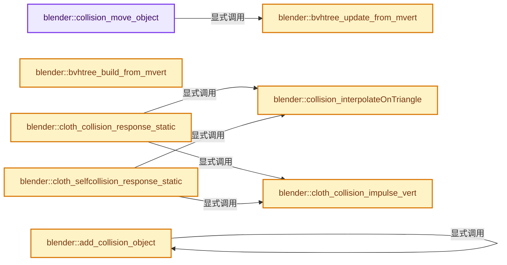
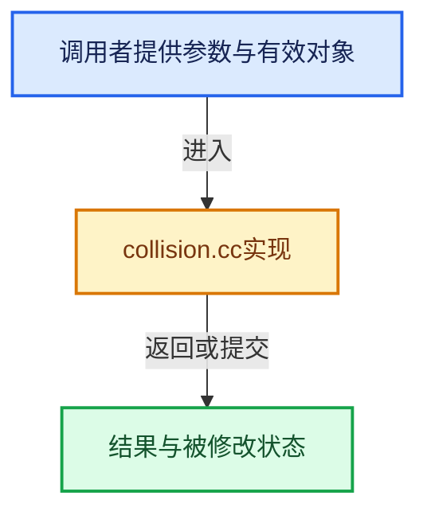

# 实现依赖专题：source/blender/blenkernel/intern/collision.cc

[方向导航](README.md) · [符号索引](../%E7%AC%A6%E5%8F%B7%E4%BE%9D%E8%B5%96%E4%B8%8E%E5%AE%9E%E7%8E%B0%E7%B4%A2%E5%BC%95.md)

本专题从正文实际调用进入，集中保存共享实现。函数有稳定锚点，可从调用处直接跳到对应完整函数；递归与互相调用通过回链组织。

## 本文件的实现关系






## 完整成员与函数实现

<a id="f-5a6a3754f98afe80"></a>

### `blender::collision_move_object`

实现位置：[source/blender/blenkernel/intern/collision.cc](../../../../../source/blender/blenkernel/intern/collision.cc) · L62—L90。

接口参数：

- `CollisionModifierData *collmd`
- `const float step`
- `const float prevstep`
- `const bool moving_bvh`

**教学注释版**

<!-- annotated:8243f9b8688b3f -->

```cpp
void collision_move_object(CollisionModifierData *collmd,
                           const float step,
                           const float prevstep,
                           const bool moving_bvh)
{
  uint i = 0;

  /* the collider doesn't move this frame */
  if (collmd->is_static) {
    for (i = 0; i < collmd->mvert_num; i++) {
      zero_v3(collmd->current_v[i]);
    }

    return;
  }

  for (i = 0; i < collmd->mvert_num; i++) {
    interp_v3_v3v3(collmd->current_x[i], collmd->x[i], collmd->xnew[i], prevstep);
    interp_v3_v3v3(collmd->current_xnew[i], collmd->x[i], collmd->xnew[i], step);
    sub_v3_v3v3(collmd->current_v[i], collmd->current_xnew[i], collmd->current_x[i]);
  }

  bvhtree_update_from_mvert(collmd->bvhtree,
                            collmd->current_xnew,
                            collmd->current_x,
                            reinterpret_cast<const int3 *>(collmd->vert_tris),
                            collmd->tri_num,
                            moving_bvh);
}
```

<details>
<summary>核对原始源码：source/blender/blenkernel/intern/collision.cc · L62—L90</summary>

<!-- original:8243f9b8688b3f:source/blender/blenkernel/intern/collision.cc:62:90 -->

```cpp
void collision_move_object(CollisionModifierData *collmd,
                           const float step,
                           const float prevstep,
                           const bool moving_bvh)
{
  uint i = 0;

  /* the collider doesn't move this frame */
  if (collmd->is_static) {
    for (i = 0; i < collmd->mvert_num; i++) {
      zero_v3(collmd->current_v[i]);
    }

    return;
  }

  for (i = 0; i < collmd->mvert_num; i++) {
    interp_v3_v3v3(collmd->current_x[i], collmd->x[i], collmd->xnew[i], prevstep);
    interp_v3_v3v3(collmd->current_xnew[i], collmd->x[i], collmd->xnew[i], step);
    sub_v3_v3v3(collmd->current_v[i], collmd->current_xnew[i], collmd->current_x[i]);
  }

  bvhtree_update_from_mvert(collmd->bvhtree,
                            collmd->current_xnew,
                            collmd->current_x,
                            reinterpret_cast<const int3 *>(collmd->vert_tris),
                            collmd->tri_num,
                            moving_bvh);
}
```

</details>

**继续追踪实现**

- `zero_v3` → [blender::zero_v3 · L26](../12-%E7%A9%BA%E9%97%B4%E6%95%B0%E6%8D%AE%E7%BB%93%E6%9E%84%E4%B8%8E%E5%87%A0%E4%BD%95%E7%AE%97%E6%B3%95/%E4%BE%9D%E8%B5%96-math_vector_inline-0c8541.md#f-13235b08fdecb098)。
- `interp_v3_v3v3` → [blender::interp_v3_v3v3 · L41](../12-%E7%A9%BA%E9%97%B4%E6%95%B0%E6%8D%AE%E7%BB%93%E6%9E%84%E4%B8%8E%E5%87%A0%E4%BD%95%E7%AE%97%E6%B3%95/%E4%BE%9D%E8%B5%96-math_vector-5f35fa.md#f-18251c70c00824d7)。
- `sub_v3_v3v3` → [blender::sub_v3_v3v3 · L360](../12-%E7%A9%BA%E9%97%B4%E6%95%B0%E6%8D%AE%E7%BB%93%E6%9E%84%E4%B8%8E%E5%87%A0%E4%BD%95%E7%AE%97%E6%B3%95/%E4%BE%9D%E8%B5%96-math_vector_inline-0c8541.md#f-23781c252db8b30c)。
- `bvhtree_update_from_mvert` → [blender::bvhtree_update_from_mvert · L116](%E4%BE%9D%E8%B5%96-collision-f2e5c0.md#f-6ac2b21f6e781ee3)。

<a id="f-22a69c1c8a174747"></a>

### `blender::bvhtree_build_from_mvert`

实现位置：[source/blender/blenkernel/intern/collision.cc](../../../../../source/blender/blenkernel/intern/collision.cc) · L92—L114。

接口参数：

- `const float (*positions)[3]`
- `const int3 *vert_tris`
- `int tri_num`
- `float epsilon`

**教学注释版**

<!-- annotated:196b1d16e916a0 -->

```cpp
BVHTree *bvhtree_build_from_mvert(const float (*positions)[3],
                                  const int3 *vert_tris,
                                  int tri_num,
                                  float epsilon)
{
  BVHTree *tree = BLI_bvhtree_new(tri_num, epsilon, 4, 26);

  /* fill tree */
  for (int i = 0; i < tri_num; i++) {
    float co[3][3];

    copy_v3_v3(co[0], positions[vert_tris[i][0]]);
    copy_v3_v3(co[1], positions[vert_tris[i][1]]);
    copy_v3_v3(co[2], positions[vert_tris[i][2]]);

    BLI_bvhtree_insert(tree, i, co[0], 3);
  }

  /* balance tree */
  BLI_bvhtree_balance(tree);

  return tree;
}
```

<details>
<summary>核对原始源码：source/blender/blenkernel/intern/collision.cc · L92—L114</summary>

<!-- original:196b1d16e916a0:source/blender/blenkernel/intern/collision.cc:92:114 -->

```cpp
BVHTree *bvhtree_build_from_mvert(const float (*positions)[3],
                                  const int3 *vert_tris,
                                  int tri_num,
                                  float epsilon)
{
  BVHTree *tree = BLI_bvhtree_new(tri_num, epsilon, 4, 26);

  /* fill tree */
  for (int i = 0; i < tri_num; i++) {
    float co[3][3];

    copy_v3_v3(co[0], positions[vert_tris[i][0]]);
    copy_v3_v3(co[1], positions[vert_tris[i][1]]);
    copy_v3_v3(co[2], positions[vert_tris[i][2]]);

    BLI_bvhtree_insert(tree, i, co[0], 3);
  }

  /* balance tree */
  BLI_bvhtree_balance(tree);

  return tree;
}
```

</details>

**结果出口**

- `return tree;`

**继续追踪实现**

- `BLI_bvhtree_new` → [blender::BLI_bvhtree_new · L864](../12-%E7%A9%BA%E9%97%B4%E6%95%B0%E6%8D%AE%E7%BB%93%E6%9E%84%E4%B8%8E%E5%87%A0%E4%BD%95%E7%AE%97%E6%B3%95/%E4%BE%9D%E8%B5%96-BLI_kdopbvh-9f4bb8.md#f-4ec9d64950b835b8)。
- `copy_v3_v3` → [blender::copy_v3_v3 · L47](../12-%E7%A9%BA%E9%97%B4%E6%95%B0%E6%8D%AE%E7%BB%93%E6%9E%84%E4%B8%8E%E5%87%A0%E4%BD%95%E7%AE%97%E6%B3%95/%E4%BE%9D%E8%B5%96-math_vector_inline-0c8541.md#f-037a0d5fa5060bd6)。
- `BLI_bvhtree_insert` → [blender::BLI_bvhtree_insert · L988](../12-%E7%A9%BA%E9%97%B4%E6%95%B0%E6%8D%AE%E7%BB%93%E6%9E%84%E4%B8%8E%E5%87%A0%E4%BD%95%E7%AE%97%E6%B3%95/%E4%BE%9D%E8%B5%96-BLI_kdopbvh-9f4bb8.md#f-00e2c6f8e338e6a0)。
- `BLI_bvhtree_balance` → [blender::BLI_bvhtree_balance · L946](../12-%E7%A9%BA%E9%97%B4%E6%95%B0%E6%8D%AE%E7%BB%93%E6%9E%84%E4%B8%8E%E5%87%A0%E4%BD%95%E7%AE%97%E6%B3%95/%E4%BE%9D%E8%B5%96-BLI_kdopbvh-9f4bb8.md#f-623c82143d96130e)。

<a id="f-6ac2b21f6e781ee3"></a>

### `blender::bvhtree_update_from_mvert`

实现位置：[source/blender/blenkernel/intern/collision.cc](../../../../../source/blender/blenkernel/intern/collision.cc) · L116—L161。

接口参数：

- `BVHTree *bvhtree`
- `const float (*positions)[3]`
- `const float (*positions_moving)[3]`
- `const int3 *vert_tris`
- `int tri_num`
- `bool moving`

**教学注释版**

<!-- annotated:d8e22d14dc02be -->

```cpp
void bvhtree_update_from_mvert(BVHTree *bvhtree,
                               const float (*positions)[3],
                               const float (*positions_moving)[3],
                               const int3 *vert_tris,
                               int tri_num,
                               bool moving)
{

  if ((bvhtree == nullptr) || (positions == nullptr)) {
    return;
  }

  if (positions_moving == nullptr) {
    moving = false;
  }

  for (int i = 0; i < tri_num; i++) {
    float co[3][3];
    bool ret;

    copy_v3_v3(co[0], positions[vert_tris[i][0]]);
    copy_v3_v3(co[1], positions[vert_tris[i][1]]);
    copy_v3_v3(co[2], positions[vert_tris[i][2]]);

    /* copy new locations into array */
    if (moving) {
      float co_moving[3][3];
      /* update moving positions */
      copy_v3_v3(co_moving[0], positions_moving[vert_tris[i][0]]);
      copy_v3_v3(co_moving[1], positions_moving[vert_tris[i][1]]);
      copy_v3_v3(co_moving[2], positions_moving[vert_tris[i][2]]);

      ret = BLI_bvhtree_update_node(bvhtree, i, &co[0][0], &co_moving[0][0], 3);
    }
    else {
      ret = BLI_bvhtree_update_node(bvhtree, i, &co[0][0], nullptr, 3);
    }

    /* check if tree is already full */
    if (ret == false) {
      break;
    }
  }

  BLI_bvhtree_update_tree(bvhtree);
}
```

<details>
<summary>核对原始源码：source/blender/blenkernel/intern/collision.cc · L116—L161</summary>

<!-- original:d8e22d14dc02be:source/blender/blenkernel/intern/collision.cc:116:161 -->

```cpp
void bvhtree_update_from_mvert(BVHTree *bvhtree,
                               const float (*positions)[3],
                               const float (*positions_moving)[3],
                               const int3 *vert_tris,
                               int tri_num,
                               bool moving)
{

  if ((bvhtree == nullptr) || (positions == nullptr)) {
    return;
  }

  if (positions_moving == nullptr) {
    moving = false;
  }

  for (int i = 0; i < tri_num; i++) {
    float co[3][3];
    bool ret;

    copy_v3_v3(co[0], positions[vert_tris[i][0]]);
    copy_v3_v3(co[1], positions[vert_tris[i][1]]);
    copy_v3_v3(co[2], positions[vert_tris[i][2]]);

    /* copy new locations into array */
    if (moving) {
      float co_moving[3][3];
      /* update moving positions */
      copy_v3_v3(co_moving[0], positions_moving[vert_tris[i][0]]);
      copy_v3_v3(co_moving[1], positions_moving[vert_tris[i][1]]);
      copy_v3_v3(co_moving[2], positions_moving[vert_tris[i][2]]);

      ret = BLI_bvhtree_update_node(bvhtree, i, &co[0][0], &co_moving[0][0], 3);
    }
    else {
      ret = BLI_bvhtree_update_node(bvhtree, i, &co[0][0], nullptr, 3);
    }

    /* check if tree is already full */
    if (ret == false) {
      break;
    }
  }

  BLI_bvhtree_update_tree(bvhtree);
}
```

</details>

**沿实际写入检查状态**

- `moving = false;`
- `ret = BLI_bvhtree_update_node(bvhtree, i, &co[0][0], &co_moving[0][0], 3);`
- `ret = BLI_bvhtree_update_node(bvhtree, i, &co[0][0], nullptr, 3);`

**继续追踪实现**

- `copy_v3_v3` → [blender::copy_v3_v3 · L47](../12-%E7%A9%BA%E9%97%B4%E6%95%B0%E6%8D%AE%E7%BB%93%E6%9E%84%E4%B8%8E%E5%87%A0%E4%BD%95%E7%AE%97%E6%B3%95/%E4%BE%9D%E8%B5%96-math_vector_inline-0c8541.md#f-037a0d5fa5060bd6)。
- `BLI_bvhtree_update_node` → [blender::BLI_bvhtree_update_node · L1006](../12-%E7%A9%BA%E9%97%B4%E6%95%B0%E6%8D%AE%E7%BB%93%E6%9E%84%E4%B8%8E%E5%87%A0%E4%BD%95%E7%AE%97%E6%B3%95/%E4%BE%9D%E8%B5%96-BLI_kdopbvh-9f4bb8.md#f-36b2cffb3b48085c)。
- `BLI_bvhtree_update_tree` → [blender::BLI_bvhtree_update_tree · L1030](../12-%E7%A9%BA%E9%97%B4%E6%95%B0%E6%8D%AE%E7%BB%93%E6%9E%84%E4%B8%8E%E5%87%A0%E4%BD%95%E7%AE%97%E6%B3%95/%E4%BE%9D%E8%B5%96-BLI_kdopbvh-9f4bb8.md#f-e564c1b3665cdaf2)。

<a id="f-040e71c507af7084"></a>

### `blender::collision_interpolateOnTriangle`

实现位置：[source/blender/blenkernel/intern/collision.cc](../../../../../source/blender/blenkernel/intern/collision.cc) · L604—L616。

接口参数：

- `float to[3]`
- `const float v1[3]`
- `const float v2[3]`
- `const float v3[3]`
- `const double w1`
- `const double w2`
- `const double w3`

**教学注释版**

<!-- annotated:d4588ac8308b84 -->

```cpp
DO_INLINE void collision_interpolateOnTriangle(float to[3],
                                               const float v1[3],
                                               const float v2[3],
                                               const float v3[3],
                                               const double w1,
                                               const double w2,
                                               const double w3)
{
  zero_v3(to);
  VECADDMUL(to, v1, w1);
  VECADDMUL(to, v2, w2);
  VECADDMUL(to, v3, w3);
}
```

<details>
<summary>核对原始源码：source/blender/blenkernel/intern/collision.cc · L604—L616</summary>

<!-- original:d4588ac8308b84:source/blender/blenkernel/intern/collision.cc:604:616 -->

```cpp
DO_INLINE void collision_interpolateOnTriangle(float to[3],
                                               const float v1[3],
                                               const float v2[3],
                                               const float v3[3],
                                               const double w1,
                                               const double w2,
                                               const double w3)
{
  zero_v3(to);
  VECADDMUL(to, v1, w1);
  VECADDMUL(to, v2, w2);
  VECADDMUL(to, v3, w3);
}
```

</details>

**继续追踪实现**

- `zero_v3` → [blender::zero_v3 · L26](../12-%E7%A9%BA%E9%97%B4%E6%95%B0%E6%8D%AE%E7%BB%93%E6%9E%84%E4%B8%8E%E5%87%A0%E4%BD%95%E7%AE%97%E6%B3%95/%E4%BE%9D%E8%B5%96-math_vector_inline-0c8541.md#f-13235b08fdecb098)。
- `VECADDMUL` → [VECADDMUL · L178](%E4%BE%9D%E8%B5%96-BKE_cloth-7f6fa8.md#m-48ab11af3c7e)。宏定义由构建条件选择。

<a id="f-87711bcfae603da8"></a>

### `blender::cloth_collision_impulse_vert`

实现位置：[source/blender/blenkernel/intern/collision.cc](../../../../../source/blender/blenkernel/intern/collision.cc) · L618—L641。

接口参数：

- `const float clamp_sq`
- `const float impulse[3]`
- `ClothVertex *vert`

**教学注释版**

<!-- annotated:297df7ec78d582 -->

```cpp
static void cloth_collision_impulse_vert(const float clamp_sq,
                                         const float impulse[3],
                                         ClothVertex *vert)
{
  float impulse_len_sq = len_squared_v3(impulse);

  if ((clamp_sq > 0.0f) && (impulse_len_sq > clamp_sq)) {
    return;
  }

  if (fabsf(vert->impulse[0]) < fabsf(impulse[0])) {
    vert->impulse[0] = impulse[0];
  }

  if (fabsf(vert->impulse[1]) < fabsf(impulse[1])) {
    vert->impulse[1] = impulse[1];
  }

  if (fabsf(vert->impulse[2]) < fabsf(impulse[2])) {
    vert->impulse[2] = impulse[2];
  }

  vert->impulse_count++;
}
```

<details>
<summary>核对原始源码：source/blender/blenkernel/intern/collision.cc · L618—L641</summary>

<!-- original:297df7ec78d582:source/blender/blenkernel/intern/collision.cc:618:641 -->

```cpp
static void cloth_collision_impulse_vert(const float clamp_sq,
                                         const float impulse[3],
                                         ClothVertex *vert)
{
  float impulse_len_sq = len_squared_v3(impulse);

  if ((clamp_sq > 0.0f) && (impulse_len_sq > clamp_sq)) {
    return;
  }

  if (fabsf(vert->impulse[0]) < fabsf(impulse[0])) {
    vert->impulse[0] = impulse[0];
  }

  if (fabsf(vert->impulse[1]) < fabsf(impulse[1])) {
    vert->impulse[1] = impulse[1];
  }

  if (fabsf(vert->impulse[2]) < fabsf(impulse[2])) {
    vert->impulse[2] = impulse[2];
  }

  vert->impulse_count++;
}
```

</details>

**沿实际写入检查状态**

- `vert->impulse[0] = impulse[0];`
- `vert->impulse[1] = impulse[1];`
- `vert->impulse[2] = impulse[2];`

**继续追踪实现**

- `len_squared_v3` → [blender::len_squared_v3 · L724](../12-%E7%A9%BA%E9%97%B4%E6%95%B0%E6%8D%AE%E7%BB%93%E6%9E%84%E4%B8%8E%E5%87%A0%E4%BD%95%E7%AE%97%E6%B3%95/%E4%BE%9D%E8%B5%96-math_vector_inline-0c8541.md#f-089409f6f09f82ef)。
- `fabsf` → [fabsf · L21](%E4%BE%9D%E8%B5%96-radial_tiling_shared-98abf9.md#m-02cc4c69cfb3)；[fabsf · L43](%E4%BE%9D%E8%B5%96-radial_tiling_shared-98abf9.md#m-04effe61803b)；[fabsf · L74](%E4%BE%9D%E8%B5%96-radial_tiling_shared-98abf9.md#m-927dd4eba7dc)；[fabsf · L25](../01-%E5%9F%BA%E7%A1%80%E5%AE%B9%E5%99%A8%E4%B8%8E%E7%8E%B0%E4%BB%A3CPP/%E4%BE%9D%E8%B5%96-radial_tiling_shared-7989a4.md#m-8348d6b3d08f)；[fabsf · L47](../01-%E5%9F%BA%E7%A1%80%E5%AE%B9%E5%99%A8%E4%B8%8E%E7%8E%B0%E4%BB%A3CPP/%E4%BE%9D%E8%B5%96-radial_tiling_shared-7989a4.md#m-13b7e0b6d84f)；[fabsf · L78](../01-%E5%9F%BA%E7%A1%80%E5%AE%B9%E5%99%A8%E4%B8%8E%E7%8E%B0%E4%BB%A3CPP/%E4%BE%9D%E8%B5%96-radial_tiling_shared-7989a4.md#m-326c83464a0d)；[fabsf · L21](%E4%BE%9D%E8%B5%96-node_radial_tiling_shared-b14bc2.md#m-7c3ee12fc119)；[fabsf · L43](%E4%BE%9D%E8%B5%96-node_radial_tiling_shared-b14bc2.md#m-9112db0e2dd1)；[fabsf · L74](%E4%BE%9D%E8%B5%96-node_radial_tiling_shared-b14bc2.md#m-ee4e61908a6f)；[fabsf · L167](%E4%BE%9D%E8%B5%96-compat-56205c.md#m-b039ee6c1601)；[fabsf · L265](%E4%BE%9D%E8%B5%96-compat-efe0e9.md#m-6b21869e9f3f)。宏定义由构建条件选择。

<a id="f-87af3f9309e20d9e"></a>

### `blender::cloth_collision_response_static`

实现位置：[source/blender/blenkernel/intern/collision.cc](../../../../../source/blender/blenkernel/intern/collision.cc) · L643—L789。

接口参数：

- `ClothModifierData *clmd`
- `CollisionModifierData *collmd`
- `Object *collob`
- `CollPair *collpair`
- `uint collision_count`
- `const float dt`

**教学注释版**

<!-- annotated:d76f227d4da198 -->

```cpp
static int cloth_collision_response_static(ClothModifierData *clmd,
                                           CollisionModifierData *collmd,
                                           Object *collob,
                                           CollPair *collpair,
                                           uint collision_count,
                                           const float dt)
{
  int result = 0;
  Cloth *cloth = clmd->clothObject;
  const float clamp_sq = square_f(clmd->coll_parms->clamp * dt);
  const float time_multiplier = 1.0f / (clmd->sim_parms->dt * clmd->sim_parms->timescale);
  const float epsilon2 = BLI_bvhtree_get_epsilon(collmd->bvhtree);
  const float min_distance = (clmd->coll_parms->epsilon + epsilon2) * (8.0f / 9.0f);

  const bool is_hair = (clmd->hairdata != nullptr);
  for (int i = 0; i < collision_count; i++, collpair++) {
    float i1[3], i2[3], i3[3];
    float v1[3], v2[3], relativeVelocity[3];
    zero_v3(i1);
    zero_v3(i2);
    zero_v3(i3);

    /* Only handle static collisions here. */
    if (collpair->flag & (COLLISION_IN_FUTURE | COLLISION_INACTIVE)) {
      continue;
    }

    /* Compute barycentric coordinates and relative "velocity" for both collision points. */
    float w1 = collpair->aw1, w2 = collpair->aw2, w3 = collpair->aw3;
    float u1 = collpair->bw1, u2 = collpair->bw2, u3 = collpair->bw3;

    if (is_hair) {
      interp_v3_v3v3(v1, cloth->verts[collpair->ap1].tv, cloth->verts[collpair->ap2].tv, w2);
    }
    else {
      collision_interpolateOnTriangle(v1,
                                      cloth->verts[collpair->ap1].tv,
                                      cloth->verts[collpair->ap2].tv,
                                      cloth->verts[collpair->ap3].tv,
                                      w1,
                                      w2,
                                      w3);
    }

    collision_interpolateOnTriangle(v2,
                                    collmd->current_v[collpair->bp1],
                                    collmd->current_v[collpair->bp2],
                                    collmd->current_v[collpair->bp3],
                                    u1,
                                    u2,
                                    u3);

    sub_v3_v3v3(relativeVelocity, v2, v1);

    /* Calculate the normal component of the relative velocity
     * (actually only the magnitude - the direction is stored in 'normal'). */
    const float magrelVel = dot_v3v3(relativeVelocity, collpair->normal);
    const float d = min_distance - collpair->distance;

    /* If magrelVel < 0 the edges are approaching each other. */
    if (magrelVel > 0.0f) {
      /* Calculate Impulse magnitude to stop all motion in normal direction. */
      float magtangent = 0, repulse = 0;
      double impulse = 0.0;
      float vrel_t_pre[3];
      float temp[3];

      /* Calculate tangential velocity. */
      copy_v3_v3(temp, collpair->normal);
      mul_v3_fl(temp, magrelVel);
      sub_v3_v3v3(vrel_t_pre, relativeVelocity, temp);

      /* Decrease in magnitude of relative tangential velocity due to coulomb friction
       * in original formula "magrelVel" should be the
       * "change of relative velocity in normal direction". */
      magtangent = min_ff(collob->pd->pdef_cfrict * 0.01f * magrelVel, len_v3(vrel_t_pre));

      /* Apply friction impulse. */
      if (magtangent > ALMOST_ZERO) {
        normalize_v3(vrel_t_pre);

        impulse = magtangent / 1.5;

        VECADDMUL(i1, vrel_t_pre, double(w1) * impulse);
        VECADDMUL(i2, vrel_t_pre, double(w2) * impulse);

        if (!is_hair) {
          VECADDMUL(i3, vrel_t_pre, double(w3) * impulse);
        }
      }

      /* Apply velocity stopping impulse. */
      impulse = magrelVel / 1.5f;

      VECADDMUL(i1, collpair->normal, double(w1) * impulse);
      VECADDMUL(i2, collpair->normal, double(w2) * impulse);
      if (!is_hair) {
        VECADDMUL(i3, collpair->normal, double(w3) * impulse);
      }

      if ((magrelVel < 0.1f * d * time_multiplier) && (d > ALMOST_ZERO)) {
        // [讲解] std::min：按比较关系选取较小值；截断范围时还需先满足非负和可表示范围，min本身不会证明边界安全。
        repulse = std::min(d / time_multiplier, 0.1f * d * time_multiplier - magrelVel);

        /* Stay on the safe side and clamp repulse. */
        if (impulse > ALMOST_ZERO) {
          repulse = min_ff(repulse, 5.0f * impulse);
        }

        repulse = max_ff(impulse, repulse);

        impulse = repulse / 1.5f;

        VECADDMUL(i1, collpair->normal, impulse);
        VECADDMUL(i2, collpair->normal, impulse);
        if (!is_hair) {
          VECADDMUL(i3, collpair->normal, impulse);
        }
      }

      result = 1;
    }
    else if (d > ALMOST_ZERO) {
      /* Stay on the safe side and clamp repulse. */
      float repulse = d / time_multiplier;
      float impulse = repulse / 4.5f;

      VECADDMUL(i1, collpair->normal, w1 * impulse);
      VECADDMUL(i2, collpair->normal, w2 * impulse);

      if (!is_hair) {
        VECADDMUL(i3, collpair->normal, w3 * impulse);
      }

      result = 1;
    }

    if (result) {
      cloth_collision_impulse_vert(clamp_sq, i1, &cloth->verts[collpair->ap1]);
      cloth_collision_impulse_vert(clamp_sq, i2, &cloth->verts[collpair->ap2]);
      if (!is_hair) {
        cloth_collision_impulse_vert(clamp_sq, i3, &cloth->verts[collpair->ap3]);
      }
    }
  }

  return result;
}
```

<details>
<summary>核对原始源码：source/blender/blenkernel/intern/collision.cc · L643—L789</summary>

<!-- original:d76f227d4da198:source/blender/blenkernel/intern/collision.cc:643:789 -->

```cpp
static int cloth_collision_response_static(ClothModifierData *clmd,
                                           CollisionModifierData *collmd,
                                           Object *collob,
                                           CollPair *collpair,
                                           uint collision_count,
                                           const float dt)
{
  int result = 0;
  Cloth *cloth = clmd->clothObject;
  const float clamp_sq = square_f(clmd->coll_parms->clamp * dt);
  const float time_multiplier = 1.0f / (clmd->sim_parms->dt * clmd->sim_parms->timescale);
  const float epsilon2 = BLI_bvhtree_get_epsilon(collmd->bvhtree);
  const float min_distance = (clmd->coll_parms->epsilon + epsilon2) * (8.0f / 9.0f);

  const bool is_hair = (clmd->hairdata != nullptr);
  for (int i = 0; i < collision_count; i++, collpair++) {
    float i1[3], i2[3], i3[3];
    float v1[3], v2[3], relativeVelocity[3];
    zero_v3(i1);
    zero_v3(i2);
    zero_v3(i3);

    /* Only handle static collisions here. */
    if (collpair->flag & (COLLISION_IN_FUTURE | COLLISION_INACTIVE)) {
      continue;
    }

    /* Compute barycentric coordinates and relative "velocity" for both collision points. */
    float w1 = collpair->aw1, w2 = collpair->aw2, w3 = collpair->aw3;
    float u1 = collpair->bw1, u2 = collpair->bw2, u3 = collpair->bw3;

    if (is_hair) {
      interp_v3_v3v3(v1, cloth->verts[collpair->ap1].tv, cloth->verts[collpair->ap2].tv, w2);
    }
    else {
      collision_interpolateOnTriangle(v1,
                                      cloth->verts[collpair->ap1].tv,
                                      cloth->verts[collpair->ap2].tv,
                                      cloth->verts[collpair->ap3].tv,
                                      w1,
                                      w2,
                                      w3);
    }

    collision_interpolateOnTriangle(v2,
                                    collmd->current_v[collpair->bp1],
                                    collmd->current_v[collpair->bp2],
                                    collmd->current_v[collpair->bp3],
                                    u1,
                                    u2,
                                    u3);

    sub_v3_v3v3(relativeVelocity, v2, v1);

    /* Calculate the normal component of the relative velocity
     * (actually only the magnitude - the direction is stored in 'normal'). */
    const float magrelVel = dot_v3v3(relativeVelocity, collpair->normal);
    const float d = min_distance - collpair->distance;

    /* If magrelVel < 0 the edges are approaching each other. */
    if (magrelVel > 0.0f) {
      /* Calculate Impulse magnitude to stop all motion in normal direction. */
      float magtangent = 0, repulse = 0;
      double impulse = 0.0;
      float vrel_t_pre[3];
      float temp[3];

      /* Calculate tangential velocity. */
      copy_v3_v3(temp, collpair->normal);
      mul_v3_fl(temp, magrelVel);
      sub_v3_v3v3(vrel_t_pre, relativeVelocity, temp);

      /* Decrease in magnitude of relative tangential velocity due to coulomb friction
       * in original formula "magrelVel" should be the
       * "change of relative velocity in normal direction". */
      magtangent = min_ff(collob->pd->pdef_cfrict * 0.01f * magrelVel, len_v3(vrel_t_pre));

      /* Apply friction impulse. */
      if (magtangent > ALMOST_ZERO) {
        normalize_v3(vrel_t_pre);

        impulse = magtangent / 1.5;

        VECADDMUL(i1, vrel_t_pre, double(w1) * impulse);
        VECADDMUL(i2, vrel_t_pre, double(w2) * impulse);

        if (!is_hair) {
          VECADDMUL(i3, vrel_t_pre, double(w3) * impulse);
        }
      }

      /* Apply velocity stopping impulse. */
      impulse = magrelVel / 1.5f;

      VECADDMUL(i1, collpair->normal, double(w1) * impulse);
      VECADDMUL(i2, collpair->normal, double(w2) * impulse);
      if (!is_hair) {
        VECADDMUL(i3, collpair->normal, double(w3) * impulse);
      }

      if ((magrelVel < 0.1f * d * time_multiplier) && (d > ALMOST_ZERO)) {
        repulse = std::min(d / time_multiplier, 0.1f * d * time_multiplier - magrelVel);

        /* Stay on the safe side and clamp repulse. */
        if (impulse > ALMOST_ZERO) {
          repulse = min_ff(repulse, 5.0f * impulse);
        }

        repulse = max_ff(impulse, repulse);

        impulse = repulse / 1.5f;

        VECADDMUL(i1, collpair->normal, impulse);
        VECADDMUL(i2, collpair->normal, impulse);
        if (!is_hair) {
          VECADDMUL(i3, collpair->normal, impulse);
        }
      }

      result = 1;
    }
    else if (d > ALMOST_ZERO) {
      /* Stay on the safe side and clamp repulse. */
      float repulse = d / time_multiplier;
      float impulse = repulse / 4.5f;

      VECADDMUL(i1, collpair->normal, w1 * impulse);
      VECADDMUL(i2, collpair->normal, w2 * impulse);

      if (!is_hair) {
        VECADDMUL(i3, collpair->normal, w3 * impulse);
      }

      result = 1;
    }

    if (result) {
      cloth_collision_impulse_vert(clamp_sq, i1, &cloth->verts[collpair->ap1]);
      cloth_collision_impulse_vert(clamp_sq, i2, &cloth->verts[collpair->ap2]);
      if (!is_hair) {
        cloth_collision_impulse_vert(clamp_sq, i3, &cloth->verts[collpair->ap3]);
      }
    }
  }

  return result;
}
```

</details>

**沿实际写入检查状态**

- `magtangent = min_ff(collob->pd->pdef_cfrict * 0.01f * magrelVel, len_v3(vrel_t_pre));`
- `impulse = magtangent / 1.5;`
- `impulse = magrelVel / 1.5f;`
- `repulse = std::min(d / time_multiplier, 0.1f * d * time_multiplier - magrelVel);`
- `repulse = min_ff(repulse, 5.0f * impulse);`
- `repulse = max_ff(impulse, repulse);`
- `impulse = repulse / 1.5f;`
- `result = 1;`

**结果出口**

- `return result;`

**继续追踪实现**

- `square_f` → [blender::square_f · L302](../12-%E7%A9%BA%E9%97%B4%E6%95%B0%E6%8D%AE%E7%BB%93%E6%9E%84%E4%B8%8E%E5%87%A0%E4%BD%95%E7%AE%97%E6%B3%95/%E4%BE%9D%E8%B5%96-math_base_inline-546b00.md#f-30f1dde493a37e0d)。
- `BLI_bvhtree_get_epsilon` → [blender::BLI_bvhtree_get_epsilon · L1053](../12-%E7%A9%BA%E9%97%B4%E6%95%B0%E6%8D%AE%E7%BB%93%E6%9E%84%E4%B8%8E%E5%87%A0%E4%BD%95%E7%AE%97%E6%B3%95/%E4%BE%9D%E8%B5%96-BLI_kdopbvh-9f4bb8.md#f-65fb6578a78d4c5b)。
- `zero_v3` → [blender::zero_v3 · L26](../12-%E7%A9%BA%E9%97%B4%E6%95%B0%E6%8D%AE%E7%BB%93%E6%9E%84%E4%B8%8E%E5%87%A0%E4%BD%95%E7%AE%97%E6%B3%95/%E4%BE%9D%E8%B5%96-math_vector_inline-0c8541.md#f-13235b08fdecb098)。
- `interp_v3_v3v3` → [blender::interp_v3_v3v3 · L41](../12-%E7%A9%BA%E9%97%B4%E6%95%B0%E6%8D%AE%E7%BB%93%E6%9E%84%E4%B8%8E%E5%87%A0%E4%BD%95%E7%AE%97%E6%B3%95/%E4%BE%9D%E8%B5%96-math_vector-5f35fa.md#f-18251c70c00824d7)。
- `collision_interpolateOnTriangle` → [blender::collision_interpolateOnTriangle · L604](%E4%BE%9D%E8%B5%96-collision-f2e5c0.md#f-040e71c507af7084)。
- `sub_v3_v3v3` → [blender::sub_v3_v3v3 · L360](../12-%E7%A9%BA%E9%97%B4%E6%95%B0%E6%8D%AE%E7%BB%93%E6%9E%84%E4%B8%8E%E5%87%A0%E4%BD%95%E7%AE%97%E6%B3%95/%E4%BE%9D%E8%B5%96-math_vector_inline-0c8541.md#f-23781c252db8b30c)。
- `dot_v3v3` → [blender::dot_v3v3 · L646](../12-%E7%A9%BA%E9%97%B4%E6%95%B0%E6%8D%AE%E7%BB%93%E6%9E%84%E4%B8%8E%E5%87%A0%E4%BD%95%E7%AE%97%E6%B3%95/%E4%BE%9D%E8%B5%96-math_vector_inline-0c8541.md#f-c88befa67d07591a)。
- `copy_v3_v3` → [blender::copy_v3_v3 · L47](../12-%E7%A9%BA%E9%97%B4%E6%95%B0%E6%8D%AE%E7%BB%93%E6%9E%84%E4%B8%8E%E5%87%A0%E4%BD%95%E7%AE%97%E6%B3%95/%E4%BE%9D%E8%B5%96-math_vector_inline-0c8541.md#f-037a0d5fa5060bd6)。
- `mul_v3_fl` → [blender::mul_v3_fl · L414](../12-%E7%A9%BA%E9%97%B4%E6%95%B0%E6%8D%AE%E7%BB%93%E6%9E%84%E4%B8%8E%E5%87%A0%E4%BD%95%E7%AE%97%E6%B3%95/%E4%BE%9D%E8%B5%96-math_vector_inline-0c8541.md#f-00165156a06d1224)。
- `min_ff` → [blender::min_ff · L321](../12-%E7%A9%BA%E9%97%B4%E6%95%B0%E6%8D%AE%E7%BB%93%E6%9E%84%E4%B8%8E%E5%87%A0%E4%BD%95%E7%AE%97%E6%B3%95/%E4%BE%9D%E8%B5%96-math_base_inline-546b00.md#f-5b8d83d6f191be1a)。
- `len_v3` → [blender::len_v3 · L781](../12-%E7%A9%BA%E9%97%B4%E6%95%B0%E6%8D%AE%E7%BB%93%E6%9E%84%E4%B8%8E%E5%87%A0%E4%BD%95%E7%AE%97%E6%B3%95/%E4%BE%9D%E8%B5%96-math_vector_inline-0c8541.md#f-4ad88eb0aa8d70ab)。
- `normalize_v3` → [blender::normalize_v3 · L933](../12-%E7%A9%BA%E9%97%B4%E6%95%B0%E6%8D%AE%E7%BB%93%E6%9E%84%E4%B8%8E%E5%87%A0%E4%BD%95%E7%AE%97%E6%B3%95/%E4%BE%9D%E8%B5%96-math_vector_inline-0c8541.md#f-5f3257e657ef732c)。
- `VECADDMUL` → [VECADDMUL · L178](%E4%BE%9D%E8%B5%96-BKE_cloth-7f6fa8.md#m-48ab11af3c7e)。宏定义由构建条件选择。
- `std::min` → [外部契约](https://eel.is/c++draft/alg.min.max)：按比较关系选取较小值；截断范围时还需先满足非负和可表示范围，min本身不会证明边界安全。
- `max_ff` → [blender::max_ff · L325](../12-%E7%A9%BA%E9%97%B4%E6%95%B0%E6%8D%AE%E7%BB%93%E6%9E%84%E4%B8%8E%E5%87%A0%E4%BD%95%E7%AE%97%E6%B3%95/%E4%BE%9D%E8%B5%96-math_base_inline-546b00.md#f-05a351a3afd7dc2a)。
- `cloth_collision_impulse_vert` → [blender::cloth_collision_impulse_vert · L618](%E4%BE%9D%E8%B5%96-collision-f2e5c0.md#f-87711bcfae603da8)。

<a id="f-5cf4314bd2d8f61c"></a>

### `blender::cloth_selfcollision_response_static`

实现位置：[source/blender/blenkernel/intern/collision.cc](../../../../../source/blender/blenkernel/intern/collision.cc) · L791—L936。

接口参数：

- `ClothModifierData *clmd`
- `CollPair *collpair`
- `uint collision_count`
- `const float dt`

**教学注释版**

<!-- annotated:c27fdc80d405d6 -->

```cpp
static int cloth_selfcollision_response_static(ClothModifierData *clmd,
                                               CollPair *collpair,
                                               uint collision_count,
                                               const float dt)
{
  int result = 0;
  Cloth *cloth = clmd->clothObject;
  const float clamp_sq = square_f(clmd->coll_parms->self_clamp * dt);
  const float time_multiplier = 1.0f / (clmd->sim_parms->dt * clmd->sim_parms->timescale);
  const float min_distance = (2.0f * clmd->coll_parms->selfepsilon) * (8.0f / 9.0f);

  for (int i = 0; i < collision_count; i++, collpair++) {
    float ia[3][3] = {{0.0f}};
    float ib[3][3] = {{0.0f}};
    float v1[3], v2[3], relativeVelocity[3];

    /* Only handle static collisions here. */
    if (collpair->flag & (COLLISION_IN_FUTURE | COLLISION_INACTIVE)) {
      continue;
    }

    /* Retrieve barycentric coordinates for both collision points. */
    float w1 = collpair->aw1, w2 = collpair->aw2, w3 = collpair->aw3;
    float u1 = collpair->bw1, u2 = collpair->bw2, u3 = collpair->bw3;

    /* Calculate relative "velocity". */
    collision_interpolateOnTriangle(v1,
                                    cloth->verts[collpair->ap1].tv,
                                    cloth->verts[collpair->ap2].tv,
                                    cloth->verts[collpair->ap3].tv,
                                    w1,
                                    w2,
                                    w3);

    collision_interpolateOnTriangle(v2,
                                    cloth->verts[collpair->bp1].tv,
                                    cloth->verts[collpair->bp2].tv,
                                    cloth->verts[collpair->bp3].tv,
                                    u1,
                                    u2,
                                    u3);

    sub_v3_v3v3(relativeVelocity, v2, v1);

    /* Calculate the normal component of the relative velocity
     * (actually only the magnitude - the direction is stored in 'normal'). */
    const float magrelVel = dot_v3v3(relativeVelocity, collpair->normal);
    const float d = min_distance - collpair->distance;

    /* TODO: Impulses should be weighed by mass as this is self col,
     * this has to be done after mass distribution is implemented. */

    /* If magrelVel < 0 the edges are approaching each other. */
    if (magrelVel > 0.0f) {
      /* Calculate Impulse magnitude to stop all motion in normal direction. */
      float magtangent = 0, repulse = 0;
      double impulse = 0.0;
      float vrel_t_pre[3];
      float temp[3];

      /* Calculate tangential velocity. */
      copy_v3_v3(temp, collpair->normal);
      mul_v3_fl(temp, magrelVel);
      sub_v3_v3v3(vrel_t_pre, relativeVelocity, temp);

      /* Decrease in magnitude of relative tangential velocity due to coulomb friction
       * in original formula "magrelVel" should be the
       * "change of relative velocity in normal direction". */
      magtangent = min_ff(clmd->coll_parms->self_friction * 0.01f * magrelVel, len_v3(vrel_t_pre));

      /* Apply friction impulse. */
      if (magtangent > ALMOST_ZERO) {
        normalize_v3(vrel_t_pre);

        impulse = magtangent / 1.5;

        VECADDMUL(ia[0], vrel_t_pre, double(w1) * impulse);
        VECADDMUL(ia[1], vrel_t_pre, double(w2) * impulse);
        VECADDMUL(ia[2], vrel_t_pre, double(w3) * impulse);

        VECADDMUL(ib[0], vrel_t_pre, double(u1) * -impulse);
        VECADDMUL(ib[1], vrel_t_pre, double(u2) * -impulse);
        VECADDMUL(ib[2], vrel_t_pre, double(u3) * -impulse);
      }

      /* Apply velocity stopping impulse. */
      impulse = magrelVel / 3.0f;

      VECADDMUL(ia[0], collpair->normal, double(w1) * impulse);
      VECADDMUL(ia[1], collpair->normal, double(w2) * impulse);
      VECADDMUL(ia[2], collpair->normal, double(w3) * impulse);

      VECADDMUL(ib[0], collpair->normal, double(u1) * -impulse);
      VECADDMUL(ib[1], collpair->normal, double(u2) * -impulse);
      VECADDMUL(ib[2], collpair->normal, double(u3) * -impulse);

      if ((magrelVel < 0.1f * d * time_multiplier) && (d > ALMOST_ZERO)) {
        // [讲解] std::min：按比较关系选取较小值；截断范围时还需先满足非负和可表示范围，min本身不会证明边界安全。
        repulse = std::min(d / time_multiplier, 0.1f * d * time_multiplier - magrelVel);

        if (impulse > ALMOST_ZERO) {
          repulse = min_ff(repulse, 5.0 * impulse);
        }

        repulse = max_ff(impulse, repulse);
        impulse = repulse / 1.5f;

        VECADDMUL(ia[0], collpair->normal, double(w1) * impulse);
        VECADDMUL(ia[1], collpair->normal, double(w2) * impulse);
        VECADDMUL(ia[2], collpair->normal, double(w3) * impulse);

        VECADDMUL(ib[0], collpair->normal, double(u1) * -impulse);
        VECADDMUL(ib[1], collpair->normal, double(u2) * -impulse);
        VECADDMUL(ib[2], collpair->normal, double(u3) * -impulse);
      }

      result = 1;
    }
    else if (d > ALMOST_ZERO) {
      /* Stay on the safe side and clamp repulse. */
      float repulse = d * 1.0f / time_multiplier;
      float impulse = repulse / 9.0f;

      VECADDMUL(ia[0], collpair->normal, w1 * impulse);
      VECADDMUL(ia[1], collpair->normal, w2 * impulse);
      VECADDMUL(ia[2], collpair->normal, w3 * impulse);

      VECADDMUL(ib[0], collpair->normal, u1 * -impulse);
      VECADDMUL(ib[1], collpair->normal, u2 * -impulse);
      VECADDMUL(ib[2], collpair->normal, u3 * -impulse);

      result = 1;
    }

    if (result) {
      cloth_collision_impulse_vert(clamp_sq, ia[0], &cloth->verts[collpair->ap1]);
      cloth_collision_impulse_vert(clamp_sq, ia[1], &cloth->verts[collpair->ap2]);
      cloth_collision_impulse_vert(clamp_sq, ia[2], &cloth->verts[collpair->ap3]);

      cloth_collision_impulse_vert(clamp_sq, ib[0], &cloth->verts[collpair->bp1]);
      cloth_collision_impulse_vert(clamp_sq, ib[1], &cloth->verts[collpair->bp2]);
      cloth_collision_impulse_vert(clamp_sq, ib[2], &cloth->verts[collpair->bp3]);
    }
  }

  return result;
}
```

<details>
<summary>核对原始源码：source/blender/blenkernel/intern/collision.cc · L791—L936</summary>

<!-- original:c27fdc80d405d6:source/blender/blenkernel/intern/collision.cc:791:936 -->

```cpp
static int cloth_selfcollision_response_static(ClothModifierData *clmd,
                                               CollPair *collpair,
                                               uint collision_count,
                                               const float dt)
{
  int result = 0;
  Cloth *cloth = clmd->clothObject;
  const float clamp_sq = square_f(clmd->coll_parms->self_clamp * dt);
  const float time_multiplier = 1.0f / (clmd->sim_parms->dt * clmd->sim_parms->timescale);
  const float min_distance = (2.0f * clmd->coll_parms->selfepsilon) * (8.0f / 9.0f);

  for (int i = 0; i < collision_count; i++, collpair++) {
    float ia[3][3] = {{0.0f}};
    float ib[3][3] = {{0.0f}};
    float v1[3], v2[3], relativeVelocity[3];

    /* Only handle static collisions here. */
    if (collpair->flag & (COLLISION_IN_FUTURE | COLLISION_INACTIVE)) {
      continue;
    }

    /* Retrieve barycentric coordinates for both collision points. */
    float w1 = collpair->aw1, w2 = collpair->aw2, w3 = collpair->aw3;
    float u1 = collpair->bw1, u2 = collpair->bw2, u3 = collpair->bw3;

    /* Calculate relative "velocity". */
    collision_interpolateOnTriangle(v1,
                                    cloth->verts[collpair->ap1].tv,
                                    cloth->verts[collpair->ap2].tv,
                                    cloth->verts[collpair->ap3].tv,
                                    w1,
                                    w2,
                                    w3);

    collision_interpolateOnTriangle(v2,
                                    cloth->verts[collpair->bp1].tv,
                                    cloth->verts[collpair->bp2].tv,
                                    cloth->verts[collpair->bp3].tv,
                                    u1,
                                    u2,
                                    u3);

    sub_v3_v3v3(relativeVelocity, v2, v1);

    /* Calculate the normal component of the relative velocity
     * (actually only the magnitude - the direction is stored in 'normal'). */
    const float magrelVel = dot_v3v3(relativeVelocity, collpair->normal);
    const float d = min_distance - collpair->distance;

    /* TODO: Impulses should be weighed by mass as this is self col,
     * this has to be done after mass distribution is implemented. */

    /* If magrelVel < 0 the edges are approaching each other. */
    if (magrelVel > 0.0f) {
      /* Calculate Impulse magnitude to stop all motion in normal direction. */
      float magtangent = 0, repulse = 0;
      double impulse = 0.0;
      float vrel_t_pre[3];
      float temp[3];

      /* Calculate tangential velocity. */
      copy_v3_v3(temp, collpair->normal);
      mul_v3_fl(temp, magrelVel);
      sub_v3_v3v3(vrel_t_pre, relativeVelocity, temp);

      /* Decrease in magnitude of relative tangential velocity due to coulomb friction
       * in original formula "magrelVel" should be the
       * "change of relative velocity in normal direction". */
      magtangent = min_ff(clmd->coll_parms->self_friction * 0.01f * magrelVel, len_v3(vrel_t_pre));

      /* Apply friction impulse. */
      if (magtangent > ALMOST_ZERO) {
        normalize_v3(vrel_t_pre);

        impulse = magtangent / 1.5;

        VECADDMUL(ia[0], vrel_t_pre, double(w1) * impulse);
        VECADDMUL(ia[1], vrel_t_pre, double(w2) * impulse);
        VECADDMUL(ia[2], vrel_t_pre, double(w3) * impulse);

        VECADDMUL(ib[0], vrel_t_pre, double(u1) * -impulse);
        VECADDMUL(ib[1], vrel_t_pre, double(u2) * -impulse);
        VECADDMUL(ib[2], vrel_t_pre, double(u3) * -impulse);
      }

      /* Apply velocity stopping impulse. */
      impulse = magrelVel / 3.0f;

      VECADDMUL(ia[0], collpair->normal, double(w1) * impulse);
      VECADDMUL(ia[1], collpair->normal, double(w2) * impulse);
      VECADDMUL(ia[2], collpair->normal, double(w3) * impulse);

      VECADDMUL(ib[0], collpair->normal, double(u1) * -impulse);
      VECADDMUL(ib[1], collpair->normal, double(u2) * -impulse);
      VECADDMUL(ib[2], collpair->normal, double(u3) * -impulse);

      if ((magrelVel < 0.1f * d * time_multiplier) && (d > ALMOST_ZERO)) {
        repulse = std::min(d / time_multiplier, 0.1f * d * time_multiplier - magrelVel);

        if (impulse > ALMOST_ZERO) {
          repulse = min_ff(repulse, 5.0 * impulse);
        }

        repulse = max_ff(impulse, repulse);
        impulse = repulse / 1.5f;

        VECADDMUL(ia[0], collpair->normal, double(w1) * impulse);
        VECADDMUL(ia[1], collpair->normal, double(w2) * impulse);
        VECADDMUL(ia[2], collpair->normal, double(w3) * impulse);

        VECADDMUL(ib[0], collpair->normal, double(u1) * -impulse);
        VECADDMUL(ib[1], collpair->normal, double(u2) * -impulse);
        VECADDMUL(ib[2], collpair->normal, double(u3) * -impulse);
      }

      result = 1;
    }
    else if (d > ALMOST_ZERO) {
      /* Stay on the safe side and clamp repulse. */
      float repulse = d * 1.0f / time_multiplier;
      float impulse = repulse / 9.0f;

      VECADDMUL(ia[0], collpair->normal, w1 * impulse);
      VECADDMUL(ia[1], collpair->normal, w2 * impulse);
      VECADDMUL(ia[2], collpair->normal, w3 * impulse);

      VECADDMUL(ib[0], collpair->normal, u1 * -impulse);
      VECADDMUL(ib[1], collpair->normal, u2 * -impulse);
      VECADDMUL(ib[2], collpair->normal, u3 * -impulse);

      result = 1;
    }

    if (result) {
      cloth_collision_impulse_vert(clamp_sq, ia[0], &cloth->verts[collpair->ap1]);
      cloth_collision_impulse_vert(clamp_sq, ia[1], &cloth->verts[collpair->ap2]);
      cloth_collision_impulse_vert(clamp_sq, ia[2], &cloth->verts[collpair->ap3]);

      cloth_collision_impulse_vert(clamp_sq, ib[0], &cloth->verts[collpair->bp1]);
      cloth_collision_impulse_vert(clamp_sq, ib[1], &cloth->verts[collpair->bp2]);
      cloth_collision_impulse_vert(clamp_sq, ib[2], &cloth->verts[collpair->bp3]);
    }
  }

  return result;
}
```

</details>

**沿实际写入检查状态**

- `magtangent = min_ff(clmd->coll_parms->self_friction * 0.01f * magrelVel, len_v3(vrel_t_pre));`
- `impulse = magtangent / 1.5;`
- `impulse = magrelVel / 3.0f;`
- `repulse = std::min(d / time_multiplier, 0.1f * d * time_multiplier - magrelVel);`
- `repulse = min_ff(repulse, 5.0 * impulse);`
- `repulse = max_ff(impulse, repulse);`
- `impulse = repulse / 1.5f;`
- `result = 1;`

**结果出口**

- `return result;`

**继续追踪实现**

- `square_f` → [blender::square_f · L302](../12-%E7%A9%BA%E9%97%B4%E6%95%B0%E6%8D%AE%E7%BB%93%E6%9E%84%E4%B8%8E%E5%87%A0%E4%BD%95%E7%AE%97%E6%B3%95/%E4%BE%9D%E8%B5%96-math_base_inline-546b00.md#f-30f1dde493a37e0d)。
- `collision_interpolateOnTriangle` → [blender::collision_interpolateOnTriangle · L604](%E4%BE%9D%E8%B5%96-collision-f2e5c0.md#f-040e71c507af7084)。
- `sub_v3_v3v3` → [blender::sub_v3_v3v3 · L360](../12-%E7%A9%BA%E9%97%B4%E6%95%B0%E6%8D%AE%E7%BB%93%E6%9E%84%E4%B8%8E%E5%87%A0%E4%BD%95%E7%AE%97%E6%B3%95/%E4%BE%9D%E8%B5%96-math_vector_inline-0c8541.md#f-23781c252db8b30c)。
- `dot_v3v3` → [blender::dot_v3v3 · L646](../12-%E7%A9%BA%E9%97%B4%E6%95%B0%E6%8D%AE%E7%BB%93%E6%9E%84%E4%B8%8E%E5%87%A0%E4%BD%95%E7%AE%97%E6%B3%95/%E4%BE%9D%E8%B5%96-math_vector_inline-0c8541.md#f-c88befa67d07591a)。
- `copy_v3_v3` → [blender::copy_v3_v3 · L47](../12-%E7%A9%BA%E9%97%B4%E6%95%B0%E6%8D%AE%E7%BB%93%E6%9E%84%E4%B8%8E%E5%87%A0%E4%BD%95%E7%AE%97%E6%B3%95/%E4%BE%9D%E8%B5%96-math_vector_inline-0c8541.md#f-037a0d5fa5060bd6)。
- `mul_v3_fl` → [blender::mul_v3_fl · L414](../12-%E7%A9%BA%E9%97%B4%E6%95%B0%E6%8D%AE%E7%BB%93%E6%9E%84%E4%B8%8E%E5%87%A0%E4%BD%95%E7%AE%97%E6%B3%95/%E4%BE%9D%E8%B5%96-math_vector_inline-0c8541.md#f-00165156a06d1224)。
- `min_ff` → [blender::min_ff · L321](../12-%E7%A9%BA%E9%97%B4%E6%95%B0%E6%8D%AE%E7%BB%93%E6%9E%84%E4%B8%8E%E5%87%A0%E4%BD%95%E7%AE%97%E6%B3%95/%E4%BE%9D%E8%B5%96-math_base_inline-546b00.md#f-5b8d83d6f191be1a)。
- `len_v3` → [blender::len_v3 · L781](../12-%E7%A9%BA%E9%97%B4%E6%95%B0%E6%8D%AE%E7%BB%93%E6%9E%84%E4%B8%8E%E5%87%A0%E4%BD%95%E7%AE%97%E6%B3%95/%E4%BE%9D%E8%B5%96-math_vector_inline-0c8541.md#f-4ad88eb0aa8d70ab)。
- `normalize_v3` → [blender::normalize_v3 · L933](../12-%E7%A9%BA%E9%97%B4%E6%95%B0%E6%8D%AE%E7%BB%93%E6%9E%84%E4%B8%8E%E5%87%A0%E4%BD%95%E7%AE%97%E6%B3%95/%E4%BE%9D%E8%B5%96-math_vector_inline-0c8541.md#f-5f3257e657ef732c)。
- `VECADDMUL` → [VECADDMUL · L178](%E4%BE%9D%E8%B5%96-BKE_cloth-7f6fa8.md#m-48ab11af3c7e)。宏定义由构建条件选择。
- `std::min` → [外部契约](https://eel.is/c++draft/alg.min.max)：按比较关系选取较小值；截断范围时还需先满足非负和可表示范围，min本身不会证明边界安全。
- `max_ff` → [blender::max_ff · L325](../12-%E7%A9%BA%E9%97%B4%E6%95%B0%E6%8D%AE%E7%BB%93%E6%9E%84%E4%B8%8E%E5%87%A0%E4%BD%95%E7%AE%97%E6%B3%95/%E4%BE%9D%E8%B5%96-math_base_inline-546b00.md#f-05a351a3afd7dc2a)。
- `cloth_collision_impulse_vert` → [blender::cloth_collision_impulse_vert · L618](%E4%BE%9D%E8%B5%96-collision-f2e5c0.md#f-87711bcfae603da8)。

<a id="f-82ee8838b312d9d0"></a>

### `blender::add_collision_object`

实现位置：[source/blender/blenkernel/intern/collision.cc](../../../../../source/blender/blenkernel/intern/collision.cc) · L1225—L1251。

接口参数：

- `ListBaseT<CollisionRelation> *relations`
- `Object *ob`
- `int level`
- `const ModifierType modifier_type`

**教学注释版**

<!-- annotated:a9376a09e921cf -->

```cpp
static void add_collision_object(ListBaseT<CollisionRelation> *relations,
                                 Object *ob,
                                 int level,
                                 const ModifierType modifier_type)
{
  /* only get objects with collision modifier */
  ModifierData *cmd = BKE_modifiers_findby_type(ob, modifier_type);

  if (cmd) {
    CollisionRelation *relation = MEM_new_zeroed<CollisionRelation>(__func__);
    relation->ob = ob;
    BLI_addtail(relations, relation);
  }

  /* objects in dupli groups, one level only for now */
  /* TODO: this doesn't really work, we are not taking into account the
   * dupli transforms and can get objects in the list multiple times. */
  if (ob->instance_collection && level == 0) {
    Collection *collection = ob->instance_collection;

    /* add objects */
    FOREACH_COLLECTION_OBJECT_RECURSIVE_BEGIN (collection, object) {
      add_collision_object(relations, object, level + 1, modifier_type);
    }
    FOREACH_COLLECTION_OBJECT_RECURSIVE_END;
  }
}
```

<details>
<summary>核对原始源码：source/blender/blenkernel/intern/collision.cc · L1225—L1251</summary>

<!-- original:a9376a09e921cf:source/blender/blenkernel/intern/collision.cc:1225:1251 -->

```cpp
static void add_collision_object(ListBaseT<CollisionRelation> *relations,
                                 Object *ob,
                                 int level,
                                 const ModifierType modifier_type)
{
  /* only get objects with collision modifier */
  ModifierData *cmd = BKE_modifiers_findby_type(ob, modifier_type);

  if (cmd) {
    CollisionRelation *relation = MEM_new_zeroed<CollisionRelation>(__func__);
    relation->ob = ob;
    BLI_addtail(relations, relation);
  }

  /* objects in dupli groups, one level only for now */
  /* TODO: this doesn't really work, we are not taking into account the
   * dupli transforms and can get objects in the list multiple times. */
  if (ob->instance_collection && level == 0) {
    Collection *collection = ob->instance_collection;

    /* add objects */
    FOREACH_COLLECTION_OBJECT_RECURSIVE_BEGIN (collection, object) {
      add_collision_object(relations, object, level + 1, modifier_type);
    }
    FOREACH_COLLECTION_OBJECT_RECURSIVE_END;
  }
}
```

</details>

**沿实际写入检查状态**

- `relation->ob = ob;`

**继续追踪实现**

- `BKE_modifiers_findby_type` → [blender::BKE_modifiers_findby_type · L256](%E4%BE%9D%E8%B5%96-modifier-ab0273.md#f-9f6b6b9b4343d30f)。
- `MEM_new_zeroed<CollisionRelation>` → [MEM_new_zeroed · L550](../03-%E5%86%85%E5%AD%98%E5%88%86%E9%85%8D%E4%B8%8E%E8%BF%90%E8%A1%8C%E6%97%B6%E7%B1%BB%E5%9E%8B/%E4%BE%9D%E8%B5%96-MEM_guardedalloc-b54eca.md#f-eeb1e2a7f57dd231)；[MEM_new_zeroed · L114](../03-%E5%86%85%E5%AD%98%E5%88%86%E9%85%8D%E4%B8%8E%E8%BF%90%E8%A1%8C%E6%97%B6%E7%B1%BB%E5%9E%8B/%E4%BE%9D%E8%B5%96-mallocn-afdcd4.md#f-e04cf01c64c8b180)。同名重载需按实参类型选择。
- `BLI_addtail` → [blender::BLI_addtail · L118](../01-%E5%9F%BA%E7%A1%80%E5%AE%B9%E5%99%A8%E4%B8%8E%E7%8E%B0%E4%BB%A3CPP/%E4%BE%9D%E8%B5%96-listbase-2816d9.md#f-4fb027713fa3115b)。
- `add_collision_object` → [blender::add_collision_object · L1225](%E4%BE%9D%E8%B5%96-collision-f2e5c0.md#f-82ee8838b312d9d0)。

<a id="f-f57ee82d928a3a49"></a>

### `blender::BKE_collision_relations_create`

实现位置：[source/blender/blenkernel/intern/collision.cc](../../../../../source/blender/blenkernel/intern/collision.cc) · L1253—L1273。

接口参数：

- `Depsgraph *depsgraph`
- `Collection *collection`
- `uint modifier_type`

**教学注释版**

<!-- annotated:5f8b29d551e658 -->

```cpp
ListBaseT<CollisionRelation> *BKE_collision_relations_create(Depsgraph *depsgraph,
                                                             Collection *collection,
                                                             uint modifier_type)
{
  const Scene *scene = DEG_get_input_scene(depsgraph);
  ViewLayer *view_layer = DEG_get_input_view_layer(depsgraph);
  Base *base = BKE_collection_or_layer_objects(
      *DEG_get_bmain(depsgraph), scene, view_layer, collection);
  const bool for_render = (DEG_get_mode(depsgraph) == DAG_EVAL_RENDER);
  const int base_flag = (for_render) ? BASE_ENABLED_RENDER : BASE_ENABLED_VIEWPORT;

  ListBaseT<CollisionRelation> *relations = MEM_new_zeroed<ListBaseT<CollisionRelation>>(__func__);

  for (; base; base = base->next) {
    if (base->flag & base_flag) {
      add_collision_object(relations, base->object, 0, ModifierType(modifier_type));
    }
  }

  return relations;
}
```

<details>
<summary>核对原始源码：source/blender/blenkernel/intern/collision.cc · L1253—L1273</summary>

<!-- original:5f8b29d551e658:source/blender/blenkernel/intern/collision.cc:1253:1273 -->

```cpp
ListBaseT<CollisionRelation> *BKE_collision_relations_create(Depsgraph *depsgraph,
                                                             Collection *collection,
                                                             uint modifier_type)
{
  const Scene *scene = DEG_get_input_scene(depsgraph);
  ViewLayer *view_layer = DEG_get_input_view_layer(depsgraph);
  Base *base = BKE_collection_or_layer_objects(
      *DEG_get_bmain(depsgraph), scene, view_layer, collection);
  const bool for_render = (DEG_get_mode(depsgraph) == DAG_EVAL_RENDER);
  const int base_flag = (for_render) ? BASE_ENABLED_RENDER : BASE_ENABLED_VIEWPORT;

  ListBaseT<CollisionRelation> *relations = MEM_new_zeroed<ListBaseT<CollisionRelation>>(__func__);

  for (; base; base = base->next) {
    if (base->flag & base_flag) {
      add_collision_object(relations, base->object, 0, ModifierType(modifier_type));
    }
  }

  return relations;
}
```

</details>

**结果出口**

- `return relations;`

**继续追踪实现**

- `DEG_get_input_scene` → [blender::DEG_get_input_scene · L81](../11-Depsgraph%E4%B8%8E%E5%B9%B6%E8%A1%8C%E4%BB%BB%E5%8A%A1%E7%B3%BB%E7%BB%9F/%E4%BE%9D%E8%B5%96-depsgraph_query-e8b1e4.md#f-674b6004195dc1ed)。
- `DEG_get_input_view_layer` → [blender::DEG_get_input_view_layer · L87](../11-Depsgraph%E4%B8%8E%E5%B9%B6%E8%A1%8C%E4%BB%BB%E5%8A%A1%E7%B3%BB%E7%BB%9F/%E4%BE%9D%E8%B5%96-depsgraph_query-e8b1e4.md#f-ee9cdeb518197b8c)。
- `BKE_collection_or_layer_objects` → [blender::BKE_collection_or_layer_objects · L1037](%E4%BE%9D%E8%B5%96-collection-e11dcd.md#f-6cc69d7a817742df)。
- `DEG_get_bmain` → [blender::DEG_get_bmain · L93](../11-Depsgraph%E4%B8%8E%E5%B9%B6%E8%A1%8C%E4%BB%BB%E5%8A%A1%E7%B3%BB%E7%BB%9F/%E4%BE%9D%E8%B5%96-depsgraph_query-e8b1e4.md#f-9dfed3e433db8080)。
- `DEG_get_mode` → [blender::DEG_get_mode · L99](../11-Depsgraph%E4%B8%8E%E5%B9%B6%E8%A1%8C%E4%BB%BB%E5%8A%A1%E7%B3%BB%E7%BB%9F/%E4%BE%9D%E8%B5%96-depsgraph_query-e8b1e4.md#f-fa117f51322cd95c)。
- `MEM_new_zeroed<ListBaseT<CollisionRelation>>` → [MEM_new_zeroed · L550](../03-%E5%86%85%E5%AD%98%E5%88%86%E9%85%8D%E4%B8%8E%E8%BF%90%E8%A1%8C%E6%97%B6%E7%B1%BB%E5%9E%8B/%E4%BE%9D%E8%B5%96-MEM_guardedalloc-b54eca.md#f-eeb1e2a7f57dd231)；[MEM_new_zeroed · L114](../03-%E5%86%85%E5%AD%98%E5%88%86%E9%85%8D%E4%B8%8E%E8%BF%90%E8%A1%8C%E6%97%B6%E7%B1%BB%E5%9E%8B/%E4%BE%9D%E8%B5%96-mallocn-afdcd4.md#f-e04cf01c64c8b180)。同名重载需按实参类型选择。
- `add_collision_object` → [blender::add_collision_object · L1225](%E4%BE%9D%E8%B5%96-collision-f2e5c0.md#f-82ee8838b312d9d0)。
- `ModifierType` → [blender::ModifierType](%E4%BE%9D%E8%B5%96-DNA_modifier_types-56a227.md#t-319e36205f63)。

<a id="f-a9a726065f99b5ff"></a>

### `blender::BKE_collision_objects_create`

实现位置：[source/blender/blenkernel/intern/collision.cc](../../../../../source/blender/blenkernel/intern/collision.cc) · L1283—L1322。

接口参数：

- `Depsgraph *depsgraph`
- `Object *self`
- `Collection *collection`
- `uint *numcollobj`
- `uint modifier_type`

**教学注释版**

<!-- annotated:615b2e3ecfb1a4 -->

```cpp
Object **BKE_collision_objects_create(Depsgraph *depsgraph,
                                      Object *self,
                                      Collection *collection,
                                      uint *numcollobj,
                                      uint modifier_type)
{
  ListBaseT<CollisionRelation> *relations = DEG_get_collision_relations(
      depsgraph, collection, modifier_type);

  if (!relations) {
    *numcollobj = 0;
    return nullptr;
  }

  int maxnum = relations->count();
  int num = 0;
  Object **objects = MEM_new_array_zeroed<Object *>(maxnum, __func__);

  for (CollisionRelation &relation : *relations) {
    /* Get evaluated object. */
    Object *ob = DEG_get_evaluated(depsgraph, relation.ob);

    if (modifier_type == eModifierType_Collision && !(ob->pd && ob->pd->deflect)) {
      continue;
    }

    if (ob != self) {
      objects[num] = ob;
      num++;
    }
  }

  if (num == 0) {
    MEM_delete(objects);
    objects = nullptr;
  }

  *numcollobj = num;
  return objects;
}
```

<details>
<summary>核对原始源码：source/blender/blenkernel/intern/collision.cc · L1283—L1322</summary>

<!-- original:615b2e3ecfb1a4:source/blender/blenkernel/intern/collision.cc:1283:1322 -->

```cpp
Object **BKE_collision_objects_create(Depsgraph *depsgraph,
                                      Object *self,
                                      Collection *collection,
                                      uint *numcollobj,
                                      uint modifier_type)
{
  ListBaseT<CollisionRelation> *relations = DEG_get_collision_relations(
      depsgraph, collection, modifier_type);

  if (!relations) {
    *numcollobj = 0;
    return nullptr;
  }

  int maxnum = relations->count();
  int num = 0;
  Object **objects = MEM_new_array_zeroed<Object *>(maxnum, __func__);

  for (CollisionRelation &relation : *relations) {
    /* Get evaluated object. */
    Object *ob = DEG_get_evaluated(depsgraph, relation.ob);

    if (modifier_type == eModifierType_Collision && !(ob->pd && ob->pd->deflect)) {
      continue;
    }

    if (ob != self) {
      objects[num] = ob;
      num++;
    }
  }

  if (num == 0) {
    MEM_delete(objects);
    objects = nullptr;
  }

  *numcollobj = num;
  return objects;
}
```

</details>

**沿实际写入检查状态**

- `objects[num] = ob;`
- `objects = nullptr;`

**结果出口**

- `return nullptr;`
- `return objects;`

**继续追踪实现**

- `DEG_get_collision_relations` → [blender::DEG_get_collision_relations · L75](../11-Depsgraph%E4%B8%8E%E5%B9%B6%E8%A1%8C%E4%BB%BB%E5%8A%A1%E7%B3%BB%E7%BB%9F/%E4%BE%9D%E8%B5%96-depsgraph_physics-40d348.md#f-c5f4d3d4d749c22b)。
- `relations->count` → [blender::ListBaseT::count · L92](%E4%BE%9D%E8%B5%96-DNA_listBase-48dbc9.md#f-7d243d006ac4c693)。
- `MEM_new_array_zeroed<Object *>` → [MEM_new_array_zeroed · L566](../03-%E5%86%85%E5%AD%98%E5%88%86%E9%85%8D%E4%B8%8E%E8%BF%90%E8%A1%8C%E6%97%B6%E7%B1%BB%E5%9E%8B/%E4%BE%9D%E8%B5%96-MEM_guardedalloc-b54eca.md#f-3a0cf63fb5216500)；[MEM_new_array_zeroed · L119](../03-%E5%86%85%E5%AD%98%E5%88%86%E9%85%8D%E4%B8%8E%E8%BF%90%E8%A1%8C%E6%97%B6%E7%B1%BB%E5%9E%8B/%E4%BE%9D%E8%B5%96-mallocn-afdcd4.md#f-6825557da566fdbe)。同名重载需按实参类型选择。
- `DEG_get_evaluated` → [blender::DEG_get_evaluated · L106](../11-Depsgraph%E4%B8%8E%E5%B9%B6%E8%A1%8C%E4%BB%BB%E5%8A%A1%E7%B3%BB%E7%BB%9F/%E4%BE%9D%E8%B5%96-DEG_depsgraph_query-db0d31.md#f-e70143fa875363bf)；[blender::DEG_get_evaluated · L112](../11-Depsgraph%E4%B8%8E%E5%B9%B6%E8%A1%8C%E4%BB%BB%E5%8A%A1%E7%B3%BB%E7%BB%9F/%E4%BE%9D%E8%B5%96-DEG_depsgraph_query-db0d31.md#f-129df72cfb5a1bad)。同名重载需按实参类型选择。
- `MEM_delete` → [MEM_delete · L400](../03-%E5%86%85%E5%AD%98%E5%88%86%E9%85%8D%E4%B8%8E%E8%BF%90%E8%A1%8C%E6%97%B6%E7%B1%BB%E5%9E%8B/%E4%BE%9D%E8%B5%96-MEM_guardedalloc-b54eca.md#f-9049ffdd1682887c)。

<a id="f-d843032e685656ce"></a>

### `blender::BKE_collision_objects_free`

实现位置：[source/blender/blenkernel/intern/collision.cc](../../../../../source/blender/blenkernel/intern/collision.cc) · L1324—L1329。

接口参数：

- `Object **objects`

**教学注释版**

<!-- annotated:49cf26b22d8b93 -->

```cpp
void BKE_collision_objects_free(Object **objects)
{
  if (objects) {
    MEM_delete(objects);
  }
}
```

<details>
<summary>核对原始源码：source/blender/blenkernel/intern/collision.cc · L1324—L1329</summary>

<!-- original:49cf26b22d8b93:source/blender/blenkernel/intern/collision.cc:1324:1329 -->

```cpp
void BKE_collision_objects_free(Object **objects)
{
  if (objects) {
    MEM_delete(objects);
  }
}
```

</details>

**继续追踪实现**

- `MEM_delete` → [MEM_delete · L400](../03-%E5%86%85%E5%AD%98%E5%88%86%E9%85%8D%E4%B8%8E%E8%BF%90%E8%A1%8C%E6%97%B6%E7%B1%BB%E5%9E%8B/%E4%BE%9D%E8%B5%96-MEM_guardedalloc-b54eca.md#f-9049ffdd1682887c)。

<a id="f-8af9dca5f3e38132"></a>

### `blender::BKE_collider_cache_create`

实现位置：[source/blender/blenkernel/intern/collision.cc](../../../../../source/blender/blenkernel/intern/collision.cc) · L1331—L1368。

接口参数：

- `Depsgraph *depsgraph`
- `Object *self`
- `Collection *collection`

**教学注释版**

<!-- annotated:8093a8f313856e -->

```cpp
ListBaseT<ColliderCache> *BKE_collider_cache_create(Depsgraph *depsgraph,
                                                    Object *self,
                                                    Collection *collection)
{
  ListBaseT<CollisionRelation> *relations = DEG_get_collision_relations(
      depsgraph, collection, eModifierType_Collision);
  ListBaseT<ColliderCache> *cache = nullptr;

  if (!relations) {
    return nullptr;
  }

  for (CollisionRelation &relation : *relations) {
    /* Get evaluated object. */
    Object *ob = DEG_get_evaluated(depsgraph, relation.ob);

    if (ob == self) {
      continue;
    }

    CollisionModifierData *cmd = reinterpret_cast<CollisionModifierData *>(
        BKE_modifiers_findby_type(ob, eModifierType_Collision));
    if (cmd && cmd->bvhtree) {
      if (cache == nullptr) {
        cache = MEM_new_zeroed<ListBaseT<ColliderCache>>(__func__);
      }

      ColliderCache *col = MEM_new_zeroed<ColliderCache>(__func__);
      col->ob = ob;
      col->collmd = cmd;
      /* make sure collider is properly set up */
      collision_move_object(cmd, 1.0, 0.0, true);
      BLI_addtail(cache, col);
    }
  }

  return cache;
}
```

<details>
<summary>核对原始源码：source/blender/blenkernel/intern/collision.cc · L1331—L1368</summary>

<!-- original:8093a8f313856e:source/blender/blenkernel/intern/collision.cc:1331:1368 -->

```cpp
ListBaseT<ColliderCache> *BKE_collider_cache_create(Depsgraph *depsgraph,
                                                    Object *self,
                                                    Collection *collection)
{
  ListBaseT<CollisionRelation> *relations = DEG_get_collision_relations(
      depsgraph, collection, eModifierType_Collision);
  ListBaseT<ColliderCache> *cache = nullptr;

  if (!relations) {
    return nullptr;
  }

  for (CollisionRelation &relation : *relations) {
    /* Get evaluated object. */
    Object *ob = DEG_get_evaluated(depsgraph, relation.ob);

    if (ob == self) {
      continue;
    }

    CollisionModifierData *cmd = reinterpret_cast<CollisionModifierData *>(
        BKE_modifiers_findby_type(ob, eModifierType_Collision));
    if (cmd && cmd->bvhtree) {
      if (cache == nullptr) {
        cache = MEM_new_zeroed<ListBaseT<ColliderCache>>(__func__);
      }

      ColliderCache *col = MEM_new_zeroed<ColliderCache>(__func__);
      col->ob = ob;
      col->collmd = cmd;
      /* make sure collider is properly set up */
      collision_move_object(cmd, 1.0, 0.0, true);
      BLI_addtail(cache, col);
    }
  }

  return cache;
}
```

</details>

**沿实际写入检查状态**

- `cache = MEM_new_zeroed<ListBaseT<ColliderCache>>(__func__);`
- `col->ob = ob;`
- `col->collmd = cmd;`

**结果出口**

- `return nullptr;`
- `return cache;`

**继续追踪实现**

- `DEG_get_collision_relations` → [blender::DEG_get_collision_relations · L75](../11-Depsgraph%E4%B8%8E%E5%B9%B6%E8%A1%8C%E4%BB%BB%E5%8A%A1%E7%B3%BB%E7%BB%9F/%E4%BE%9D%E8%B5%96-depsgraph_physics-40d348.md#f-c5f4d3d4d749c22b)。
- `DEG_get_evaluated` → [blender::DEG_get_evaluated · L106](../11-Depsgraph%E4%B8%8E%E5%B9%B6%E8%A1%8C%E4%BB%BB%E5%8A%A1%E7%B3%BB%E7%BB%9F/%E4%BE%9D%E8%B5%96-DEG_depsgraph_query-db0d31.md#f-e70143fa875363bf)；[blender::DEG_get_evaluated · L112](../11-Depsgraph%E4%B8%8E%E5%B9%B6%E8%A1%8C%E4%BB%BB%E5%8A%A1%E7%B3%BB%E7%BB%9F/%E4%BE%9D%E8%B5%96-DEG_depsgraph_query-db0d31.md#f-129df72cfb5a1bad)。同名重载需按实参类型选择。
- `BKE_modifiers_findby_type` → [blender::BKE_modifiers_findby_type · L256](%E4%BE%9D%E8%B5%96-modifier-ab0273.md#f-9f6b6b9b4343d30f)。
- `MEM_new_zeroed<ListBaseT<ColliderCache>>` → [MEM_new_zeroed · L550](../03-%E5%86%85%E5%AD%98%E5%88%86%E9%85%8D%E4%B8%8E%E8%BF%90%E8%A1%8C%E6%97%B6%E7%B1%BB%E5%9E%8B/%E4%BE%9D%E8%B5%96-MEM_guardedalloc-b54eca.md#f-eeb1e2a7f57dd231)；[MEM_new_zeroed · L114](../03-%E5%86%85%E5%AD%98%E5%88%86%E9%85%8D%E4%B8%8E%E8%BF%90%E8%A1%8C%E6%97%B6%E7%B1%BB%E5%9E%8B/%E4%BE%9D%E8%B5%96-mallocn-afdcd4.md#f-e04cf01c64c8b180)。同名重载需按实参类型选择。
- `MEM_new_zeroed<ColliderCache>` → [MEM_new_zeroed · L550](../03-%E5%86%85%E5%AD%98%E5%88%86%E9%85%8D%E4%B8%8E%E8%BF%90%E8%A1%8C%E6%97%B6%E7%B1%BB%E5%9E%8B/%E4%BE%9D%E8%B5%96-MEM_guardedalloc-b54eca.md#f-eeb1e2a7f57dd231)；[MEM_new_zeroed · L114](../03-%E5%86%85%E5%AD%98%E5%88%86%E9%85%8D%E4%B8%8E%E8%BF%90%E8%A1%8C%E6%97%B6%E7%B1%BB%E5%9E%8B/%E4%BE%9D%E8%B5%96-mallocn-afdcd4.md#f-e04cf01c64c8b180)。同名重载需按实参类型选择。
- `collision_move_object` → [blender::collision_move_object · L62](%E4%BE%9D%E8%B5%96-collision-f2e5c0.md#f-5a6a3754f98afe80)。
- `BLI_addtail` → [blender::BLI_addtail · L118](../01-%E5%9F%BA%E7%A1%80%E5%AE%B9%E5%99%A8%E4%B8%8E%E7%8E%B0%E4%BB%A3CPP/%E4%BE%9D%E8%B5%96-listbase-2816d9.md#f-4fb027713fa3115b)。

<a id="f-6ee8f880d664b78d"></a>

### `blender::BKE_collider_cache_free`

实现位置：[source/blender/blenkernel/intern/collision.cc](../../../../../source/blender/blenkernel/intern/collision.cc) · L1370—L1377。

接口参数：

- `ListBaseT<ColliderCache> **colliders`

**教学注释版**

<!-- annotated:54a76f3cd434ae -->

```cpp
void BKE_collider_cache_free(ListBaseT<ColliderCache> **colliders)
{
  if (*colliders) {
    BLI_freelistN(*colliders);
    MEM_delete(*colliders);
    *colliders = nullptr;
  }
}
```

<details>
<summary>核对原始源码：source/blender/blenkernel/intern/collision.cc · L1370—L1377</summary>

<!-- original:54a76f3cd434ae:source/blender/blenkernel/intern/collision.cc:1370:1377 -->

```cpp
void BKE_collider_cache_free(ListBaseT<ColliderCache> **colliders)
{
  if (*colliders) {
    BLI_freelistN(*colliders);
    MEM_delete(*colliders);
    *colliders = nullptr;
  }
}
```

</details>

**继续追踪实现**

- `BLI_freelistN` → [blender::BLI_freelistN · L504](../01-%E5%9F%BA%E7%A1%80%E5%AE%B9%E5%99%A8%E4%B8%8E%E7%8E%B0%E4%BB%A3CPP/%E4%BE%9D%E8%B5%96-listbase-2816d9.md#f-c250f5cf55fbcbe4)。
- `MEM_delete` → [MEM_delete · L400](../03-%E5%86%85%E5%AD%98%E5%88%86%E9%85%8D%E4%B8%8E%E8%BF%90%E8%A1%8C%E6%97%B6%E7%B1%BB%E5%9E%8B/%E4%BE%9D%E8%B5%96-MEM_guardedalloc-b54eca.md#f-9049ffdd1682887c)。

<a id="f-e1d988388bcd95b8"></a>

### `blender::cloth_bvh_objcollisions_nearcheck`

实现位置：[source/blender/blenkernel/intern/collision.cc](../../../../../source/blender/blenkernel/intern/collision.cc) · L1379—L1406。

接口参数：

- `ClothModifierData *clmd`
- `CollisionModifierData *collmd`
- `CollPair **collisions`
- `int numresult`
- `BVHTreeOverlap *overlap`
- `bool culling`
- `bool use_normal`

**教学注释版**

<!-- annotated:827ea72bca8f57 -->

```cpp
static bool cloth_bvh_objcollisions_nearcheck(ClothModifierData *clmd,
                                              CollisionModifierData *collmd,
                                              CollPair **collisions,
                                              int numresult,
                                              BVHTreeOverlap *overlap,
                                              bool culling,
                                              bool use_normal)
{
  const bool is_hair = (clmd->hairdata != nullptr);
  *collisions = MEM_new_array_uninitialized<CollPair>(size_t(numresult), "collision array");

  ColDetectData data{};
  data.clmd = clmd;
  data.collmd = collmd;
  data.overlap = overlap;
  data.collisions = *collisions;
  data.culling = culling;
  data.use_normal = use_normal;
  data.collided = false;

  TaskParallelSettings settings;
  BLI_parallel_range_settings_defaults(&settings);
  settings.use_threading = true;
  BLI_task_parallel_range(
      0, numresult, &data, is_hair ? hair_collision : cloth_collision, &settings);

  return data.collided;
}
```

<details>
<summary>核对原始源码：source/blender/blenkernel/intern/collision.cc · L1379—L1406</summary>

<!-- original:827ea72bca8f57:source/blender/blenkernel/intern/collision.cc:1379:1406 -->

```cpp
static bool cloth_bvh_objcollisions_nearcheck(ClothModifierData *clmd,
                                              CollisionModifierData *collmd,
                                              CollPair **collisions,
                                              int numresult,
                                              BVHTreeOverlap *overlap,
                                              bool culling,
                                              bool use_normal)
{
  const bool is_hair = (clmd->hairdata != nullptr);
  *collisions = MEM_new_array_uninitialized<CollPair>(size_t(numresult), "collision array");

  ColDetectData data{};
  data.clmd = clmd;
  data.collmd = collmd;
  data.overlap = overlap;
  data.collisions = *collisions;
  data.culling = culling;
  data.use_normal = use_normal;
  data.collided = false;

  TaskParallelSettings settings;
  BLI_parallel_range_settings_defaults(&settings);
  settings.use_threading = true;
  BLI_task_parallel_range(
      0, numresult, &data, is_hair ? hair_collision : cloth_collision, &settings);

  return data.collided;
}
```

</details>

**沿实际写入检查状态**

- `data.clmd = clmd;`
- `data.collmd = collmd;`
- `data.overlap = overlap;`
- `data.collisions = *collisions;`
- `data.culling = culling;`
- `data.use_normal = use_normal;`
- `data.collided = false;`
- `settings.use_threading = true;`

**结果出口**

- `return data.collided;`

**继续追踪实现**

- `MEM_new_array_uninitialized<CollPair>` → [MEM_new_array_uninitialized · L608](../03-%E5%86%85%E5%AD%98%E5%88%86%E9%85%8D%E4%B8%8E%E8%BF%90%E8%A1%8C%E6%97%B6%E7%B1%BB%E5%9E%8B/%E4%BE%9D%E8%B5%96-MEM_guardedalloc-b54eca.md#f-b7103eae8eb57b05)；[MEM_new_array_uninitialized · L129](../03-%E5%86%85%E5%AD%98%E5%88%86%E9%85%8D%E4%B8%8E%E8%BF%90%E8%A1%8C%E6%97%B6%E7%B1%BB%E5%9E%8B/%E4%BE%9D%E8%B5%96-mallocn-afdcd4.md#f-bf6ef4ddcfb6e5df)。同名重载需按实参类型选择。
- `BLI_parallel_range_settings_defaults` → [blender::BLI_parallel_range_settings_defaults · L218](../01-%E5%9F%BA%E7%A1%80%E5%AE%B9%E5%99%A8%E4%B8%8E%E7%8E%B0%E4%BB%A3CPP/%E4%BE%9D%E8%B5%96-BLI_task_c-917a71.md#f-3858ad801a98e123)。
- `BLI_task_parallel_range` → [blender::BLI_task_parallel_range · L101](../11-Depsgraph%E4%B8%8E%E5%B9%B6%E8%A1%8C%E4%BB%BB%E5%8A%A1%E7%B3%BB%E7%BB%9F/08-%E4%BB%BB%E5%8A%A1%E9%9A%94%E7%A6%BB%E6%AD%BB%E9%94%81%E4%B8%8E%E5%AE%9E%E6%88%98.md#f-9d237d7e4e78d7e2)。

<a id="f-7494a53f35249f96"></a>

### `blender::cloth_bvh_selfcollisions_nearcheck`

实现位置：[source/blender/blenkernel/intern/collision.cc](../../../../../source/blender/blenkernel/intern/collision.cc) · L1408—L1425。

接口参数：

- `ClothModifierData *clmd`
- `CollPair *collisions`
- `int numresult`
- `BVHTreeOverlap *overlap`

**教学注释版**

<!-- annotated:47e539b2c12f96 -->

```cpp
static bool cloth_bvh_selfcollisions_nearcheck(ClothModifierData *clmd,
                                               CollPair *collisions,
                                               int numresult,
                                               BVHTreeOverlap *overlap)
{
  SelfColDetectData data{};
  data.clmd = clmd;
  data.overlap = overlap;
  data.collisions = collisions;
  data.collided = false;

  TaskParallelSettings settings;
  BLI_parallel_range_settings_defaults(&settings);
  settings.use_threading = true;
  BLI_task_parallel_range(0, numresult, &data, cloth_selfcollision, &settings);

  return data.collided;
}
```

<details>
<summary>核对原始源码：source/blender/blenkernel/intern/collision.cc · L1408—L1425</summary>

<!-- original:47e539b2c12f96:source/blender/blenkernel/intern/collision.cc:1408:1425 -->

```cpp
static bool cloth_bvh_selfcollisions_nearcheck(ClothModifierData *clmd,
                                               CollPair *collisions,
                                               int numresult,
                                               BVHTreeOverlap *overlap)
{
  SelfColDetectData data{};
  data.clmd = clmd;
  data.overlap = overlap;
  data.collisions = collisions;
  data.collided = false;

  TaskParallelSettings settings;
  BLI_parallel_range_settings_defaults(&settings);
  settings.use_threading = true;
  BLI_task_parallel_range(0, numresult, &data, cloth_selfcollision, &settings);

  return data.collided;
}
```

</details>

**沿实际写入检查状态**

- `data.clmd = clmd;`
- `data.overlap = overlap;`
- `data.collisions = collisions;`
- `data.collided = false;`
- `settings.use_threading = true;`

**结果出口**

- `return data.collided;`

**继续追踪实现**

- `BLI_parallel_range_settings_defaults` → [blender::BLI_parallel_range_settings_defaults · L218](../01-%E5%9F%BA%E7%A1%80%E5%AE%B9%E5%99%A8%E4%B8%8E%E7%8E%B0%E4%BB%A3CPP/%E4%BE%9D%E8%B5%96-BLI_task_c-917a71.md#f-3858ad801a98e123)。
- `BLI_task_parallel_range` → [blender::BLI_task_parallel_range · L101](../11-Depsgraph%E4%B8%8E%E5%B9%B6%E8%A1%8C%E4%BB%BB%E5%8A%A1%E7%B3%BB%E7%BB%9F/08-%E4%BB%BB%E5%8A%A1%E9%9A%94%E7%A6%BB%E6%AD%BB%E9%94%81%E4%B8%8E%E5%AE%9E%E6%88%98.md#f-9d237d7e4e78d7e2)。

<a id="f-80d49901fe4728a2"></a>

### `blender::cloth_bvh_objcollisions_resolve`

实现位置：[source/blender/blenkernel/intern/collision.cc](../../../../../source/blender/blenkernel/intern/collision.cc) · L1427—L1478。

接口参数：

- `ClothModifierData *clmd`
- `Object **collobjs`
- `CollPair **collisions`
- `uint *collision_counts`
- `const uint numcollobj`
- `const float dt`

**教学注释版**

<!-- annotated:dd224c67e7e4a6 -->

```cpp
static int cloth_bvh_objcollisions_resolve(ClothModifierData *clmd,
                                           Object **collobjs,
                                           CollPair **collisions,
                                           uint *collision_counts,
                                           const uint numcollobj,
                                           const float dt)
{
  Cloth *cloth = clmd->clothObject;
  int i = 0, j = 0, mvert_num = 0;
  ClothVertex *verts = nullptr;
  int ret = 0;
  int result = 0;

  mvert_num = clmd->clothObject->mvert_num;
  verts = cloth->verts;

  result = 1;

  for (j = 0; j < 2; j++) {
    result = 0;

    for (i = 0; i < numcollobj; i++) {
      Object *collob = collobjs[i];
      CollisionModifierData *collmd = reinterpret_cast<CollisionModifierData *>(
          BKE_modifiers_findby_type(collob, eModifierType_Collision));

      if (collmd->bvhtree) {
        result += cloth_collision_response_static(
            clmd, collmd, collob, collisions[i], collision_counts[i], dt);
      }
    }

    /* Apply impulses in parallel. */
    if (result) {
      for (i = 0; i < mvert_num; i++) {
        /* Calculate "velocities" (just `xnew = xold + v`; no `dt` in `v`). */
        if (verts[i].impulse_count) {
          add_v3_v3(verts[i].tv, verts[i].impulse);
          add_v3_v3(verts[i].dcvel, verts[i].impulse);
          zero_v3(verts[i].impulse);
          verts[i].impulse_count = 0;

          ret++;
        }
      }
    }
    else {
      break;
    }
  }
  return ret;
}
```

<details>
<summary>核对原始源码：source/blender/blenkernel/intern/collision.cc · L1427—L1478</summary>

<!-- original:dd224c67e7e4a6:source/blender/blenkernel/intern/collision.cc:1427:1478 -->

```cpp
static int cloth_bvh_objcollisions_resolve(ClothModifierData *clmd,
                                           Object **collobjs,
                                           CollPair **collisions,
                                           uint *collision_counts,
                                           const uint numcollobj,
                                           const float dt)
{
  Cloth *cloth = clmd->clothObject;
  int i = 0, j = 0, mvert_num = 0;
  ClothVertex *verts = nullptr;
  int ret = 0;
  int result = 0;

  mvert_num = clmd->clothObject->mvert_num;
  verts = cloth->verts;

  result = 1;

  for (j = 0; j < 2; j++) {
    result = 0;

    for (i = 0; i < numcollobj; i++) {
      Object *collob = collobjs[i];
      CollisionModifierData *collmd = reinterpret_cast<CollisionModifierData *>(
          BKE_modifiers_findby_type(collob, eModifierType_Collision));

      if (collmd->bvhtree) {
        result += cloth_collision_response_static(
            clmd, collmd, collob, collisions[i], collision_counts[i], dt);
      }
    }

    /* Apply impulses in parallel. */
    if (result) {
      for (i = 0; i < mvert_num; i++) {
        /* Calculate "velocities" (just `xnew = xold + v`; no `dt` in `v`). */
        if (verts[i].impulse_count) {
          add_v3_v3(verts[i].tv, verts[i].impulse);
          add_v3_v3(verts[i].dcvel, verts[i].impulse);
          zero_v3(verts[i].impulse);
          verts[i].impulse_count = 0;

          ret++;
        }
      }
    }
    else {
      break;
    }
  }
  return ret;
}
```

</details>

**沿实际写入检查状态**

- `mvert_num = clmd->clothObject->mvert_num;`
- `verts = cloth->verts;`
- `result = 1;`
- `result = 0;`
- `result += cloth_collision_response_static(`
- `verts[i].impulse_count = 0;`

**结果出口**

- `return ret;`

**继续追踪实现**

- `BKE_modifiers_findby_type` → [blender::BKE_modifiers_findby_type · L256](%E4%BE%9D%E8%B5%96-modifier-ab0273.md#f-9f6b6b9b4343d30f)。
- `cloth_collision_response_static` → [blender::cloth_collision_response_static · L643](%E4%BE%9D%E8%B5%96-collision-f2e5c0.md#f-87af3f9309e20d9e)。
- `add_v3_v3` → [blender::add_v3_v3 · L286](../12-%E7%A9%BA%E9%97%B4%E6%95%B0%E6%8D%AE%E7%BB%93%E6%9E%84%E4%B8%8E%E5%87%A0%E4%BD%95%E7%AE%97%E6%B3%95/%E4%BE%9D%E8%B5%96-math_vector_inline-0c8541.md#f-e7930c6fdefe462c)。
- `zero_v3` → [blender::zero_v3 · L26](../12-%E7%A9%BA%E9%97%B4%E6%95%B0%E6%8D%AE%E7%BB%93%E6%9E%84%E4%B8%8E%E5%87%A0%E4%BD%95%E7%AE%97%E6%B3%95/%E4%BE%9D%E8%B5%96-math_vector_inline-0c8541.md#f-13235b08fdecb098)。

<a id="f-a1623898f9e7fa3e"></a>

### `blender::cloth_bvh_selfcollisions_resolve`

实现位置：[source/blender/blenkernel/intern/collision.cc](../../../../../source/blender/blenkernel/intern/collision.cc) · L1480—L1519。

接口参数：

- `ClothModifierData *clmd`
- `CollPair *collisions`
- `int collision_count`
- `const float dt`

**教学注释版**

<!-- annotated:c7700013e7c09a -->

```cpp
static int cloth_bvh_selfcollisions_resolve(ClothModifierData *clmd,
                                            CollPair *collisions,
                                            int collision_count,
                                            const float dt)
{
  Cloth *cloth = clmd->clothObject;
  int i = 0, j = 0, mvert_num = 0;
  ClothVertex *verts = nullptr;
  int ret = 0;
  int result = 0;

  mvert_num = clmd->clothObject->mvert_num;
  verts = cloth->verts;

  for (j = 0; j < 2; j++) {
    result = 0;

    result += cloth_selfcollision_response_static(clmd, collisions, collision_count, dt);

    /* Apply impulses in parallel. */
    if (result) {
      for (i = 0; i < mvert_num; i++) {
        if (verts[i].impulse_count) {
          // VECADDMUL ( verts[i].tv, verts[i].impulse, 1.0f / verts[i].impulse_count );
          add_v3_v3(verts[i].tv, verts[i].impulse);
          add_v3_v3(verts[i].dcvel, verts[i].impulse);
          zero_v3(verts[i].impulse);
          verts[i].impulse_count = 0;

          ret++;
        }
      }
    }

    if (!result) {
      break;
    }
  }
  return ret;
}
```

<details>
<summary>核对原始源码：source/blender/blenkernel/intern/collision.cc · L1480—L1519</summary>

<!-- original:c7700013e7c09a:source/blender/blenkernel/intern/collision.cc:1480:1519 -->

```cpp
static int cloth_bvh_selfcollisions_resolve(ClothModifierData *clmd,
                                            CollPair *collisions,
                                            int collision_count,
                                            const float dt)
{
  Cloth *cloth = clmd->clothObject;
  int i = 0, j = 0, mvert_num = 0;
  ClothVertex *verts = nullptr;
  int ret = 0;
  int result = 0;

  mvert_num = clmd->clothObject->mvert_num;
  verts = cloth->verts;

  for (j = 0; j < 2; j++) {
    result = 0;

    result += cloth_selfcollision_response_static(clmd, collisions, collision_count, dt);

    /* Apply impulses in parallel. */
    if (result) {
      for (i = 0; i < mvert_num; i++) {
        if (verts[i].impulse_count) {
          // VECADDMUL ( verts[i].tv, verts[i].impulse, 1.0f / verts[i].impulse_count );
          add_v3_v3(verts[i].tv, verts[i].impulse);
          add_v3_v3(verts[i].dcvel, verts[i].impulse);
          zero_v3(verts[i].impulse);
          verts[i].impulse_count = 0;

          ret++;
        }
      }
    }

    if (!result) {
      break;
    }
  }
  return ret;
}
```

</details>

**沿实际写入检查状态**

- `mvert_num = clmd->clothObject->mvert_num;`
- `verts = cloth->verts;`
- `result = 0;`
- `result += cloth_selfcollision_response_static(clmd, collisions, collision_count, dt);`
- `verts[i].impulse_count = 0;`

**结果出口**

- `return ret;`

**继续追踪实现**

- `cloth_selfcollision_response_static` → [blender::cloth_selfcollision_response_static · L791](%E4%BE%9D%E8%B5%96-collision-f2e5c0.md#f-5cf4314bd2d8f61c)。
- `add_v3_v3` → [blender::add_v3_v3 · L286](../12-%E7%A9%BA%E9%97%B4%E6%95%B0%E6%8D%AE%E7%BB%93%E6%9E%84%E4%B8%8E%E5%87%A0%E4%BD%95%E7%AE%97%E6%B3%95/%E4%BE%9D%E8%B5%96-math_vector_inline-0c8541.md#f-e7930c6fdefe462c)。
- `zero_v3` → [blender::zero_v3 · L26](../12-%E7%A9%BA%E9%97%B4%E6%95%B0%E6%8D%AE%E7%BB%93%E6%9E%84%E4%B8%8E%E5%87%A0%E4%BD%95%E7%AE%97%E6%B3%95/%E4%BE%9D%E8%B5%96-math_vector_inline-0c8541.md#f-13235b08fdecb098)。

<a id="f-8941b7a81072a78c"></a>

### `blender::cloth_bvh_collision`

实现位置：[source/blender/blenkernel/intern/collision.cc](../../../../../source/blender/blenkernel/intern/collision.cc) · L1547—L1716。

接口参数：

- `Depsgraph *depsgraph`
- `Object *ob`
- `ClothModifierData *clmd`
- `float step`
- `float dt`

**教学注释版**

<!-- annotated:b127703e4f4c7b -->

```cpp
int cloth_bvh_collision(
    Depsgraph *depsgraph, Object *ob, ClothModifierData *clmd, float step, float dt)
{
  Cloth *cloth = clmd->clothObject;
  BVHTree *cloth_bvh = cloth->bvhtree;
  uint i = 0, mvert_num = 0;
  int rounds = 0;
  ClothVertex *verts = nullptr;
  int ret = 0, ret2 = 0;
  Object **collobjs = nullptr;
  uint numcollobj = 0;
  uint *coll_counts_obj = nullptr;
  BVHTreeOverlap **overlap_obj = nullptr;
  uint coll_count_self = 0;
  BVHTreeOverlap *overlap_self = nullptr;
  bool bvh_updated = false;

  if ((clmd->sim_parms->flags & CLOTH_SIMSETTINGS_FLAG_COLLOBJ) || cloth_bvh == nullptr) {
    return 0;
  }

  verts = cloth->verts;
  mvert_num = cloth->mvert_num;

  if (clmd->coll_parms->flags & CLOTH_COLLSETTINGS_FLAG_ENABLED) {
    bvhtree_update_from_cloth(clmd, false, false);
    bvh_updated = true;

    /* Enable self collision if this is a hair sim */
    const bool is_hair = (clmd->hairdata != nullptr);

    collobjs = BKE_collision_objects_create(depsgraph,
                                            is_hair ? nullptr : ob,
                                            clmd->coll_parms->group,
                                            &numcollobj,
                                            eModifierType_Collision);

    if (collobjs) {
      coll_counts_obj = MEM_new_array_zeroed<uint>(numcollobj, "CollCounts");
      overlap_obj = MEM_new_array_zeroed<BVHTreeOverlap *>(numcollobj, "BVHOverlap");

      for (i = 0; i < numcollobj; i++) {
        Object *collob = collobjs[i];
        CollisionModifierData *collmd = reinterpret_cast<CollisionModifierData *>(
            BKE_modifiers_findby_type(collob, eModifierType_Collision));

        if (!collmd->bvhtree) {
          continue;
        }

        /* Move object to position (step) in time. */
        collision_move_object(collmd, step + dt, step, false);

        overlap_obj[i] = BLI_bvhtree_overlap(cloth_bvh,
                                             collmd->bvhtree,
                                             &coll_counts_obj[i],
                                             is_hair ? nullptr : cloth_bvh_obj_overlap_cb,
                                             clmd);
      }
    }
  }

  if (clmd->coll_parms->flags & CLOTH_COLLSETTINGS_FLAG_SELF) {
    if (cloth->bvhselftree != cloth->bvhtree || !bvh_updated) {
      bvhtree_update_from_cloth(clmd, false, true);
    }

    overlap_self = BLI_bvhtree_overlap_self(
        cloth->bvhselftree, &coll_count_self, cloth_bvh_self_overlap_cb, clmd);
  }

  do {
    ret2 = 0;

    /* Object collisions. */
    if ((clmd->coll_parms->flags & CLOTH_COLLSETTINGS_FLAG_ENABLED) && collobjs) {
      CollPair **collisions;
      bool collided = false;

      collisions = MEM_new_array_zeroed<CollPair *>(numcollobj, "CollPair");

      for (i = 0; i < numcollobj; i++) {
        Object *collob = collobjs[i];
        CollisionModifierData *collmd = reinterpret_cast<CollisionModifierData *>(
            BKE_modifiers_findby_type(collob, eModifierType_Collision));

        if (!collmd->bvhtree) {
          continue;
        }

        if (coll_counts_obj[i] && overlap_obj[i]) {
          collided = cloth_bvh_objcollisions_nearcheck(
                         clmd,
                         collmd,
                         &collisions[i],
                         coll_counts_obj[i],
                         overlap_obj[i],
                         (collob->pd->flag & PFIELD_CLOTH_USE_CULLING),
                         (collob->pd->flag & PFIELD_CLOTH_USE_NORMAL)) ||
                     collided;
        }
      }

      if (collided) {
        ret += cloth_bvh_objcollisions_resolve(
            clmd, collobjs, collisions, coll_counts_obj, numcollobj, dt);
        ret2 += ret;
      }

      for (i = 0; i < numcollobj; i++) {
        MEM_SAFE_DELETE(collisions[i]);
      }

      MEM_delete(collisions);
    }

    /* Self collisions. */
    if (clmd->coll_parms->flags & CLOTH_COLLSETTINGS_FLAG_SELF) {
      CollPair *collisions = nullptr;

      verts = cloth->verts;
      mvert_num = cloth->mvert_num;

      if (cloth->bvhselftree) {
        if (coll_count_self && overlap_self) {
          collisions = MEM_new_array_uninitialized<CollPair>(coll_count_self, "collision array");

          if (cloth_bvh_selfcollisions_nearcheck(clmd, collisions, coll_count_self, overlap_self))
          {
            ret += cloth_bvh_selfcollisions_resolve(clmd, collisions, coll_count_self, dt);
            ret2 += ret;
          }
        }
      }

      MEM_SAFE_DELETE(collisions);
    }

    /* Apply all collision resolution. */
    if (ret2) {
      for (i = 0; i < mvert_num; i++) {
        if (clmd->sim_parms->vgroup_mass > 0) {
          if (verts[i].flags & CLOTH_VERT_FLAG_PINNED) {
            continue;
          }
        }

        add_v3_v3v3(verts[i].tx, verts[i].txold, verts[i].tv);
      }
    }

    rounds++;
  } while (ret2 && (clmd->coll_parms->loop_count > rounds));

  if (overlap_obj) {
    for (i = 0; i < numcollobj; i++) {
      MEM_SAFE_DELETE(overlap_obj[i]);
    }

    MEM_delete(overlap_obj);
  }

  MEM_SAFE_DELETE(coll_counts_obj);

  MEM_SAFE_DELETE(overlap_self);

  BKE_collision_objects_free(collobjs);

  // [讲解] std::min：按比较关系选取较小值；截断范围时还需先满足非负和可表示范围，min本身不会证明边界安全。
  return std::min(ret, 1);
}
```

<details>
<summary>核对原始源码：source/blender/blenkernel/intern/collision.cc · L1547—L1716</summary>

<!-- original:b127703e4f4c7b:source/blender/blenkernel/intern/collision.cc:1547:1716 -->

```cpp
int cloth_bvh_collision(
    Depsgraph *depsgraph, Object *ob, ClothModifierData *clmd, float step, float dt)
{
  Cloth *cloth = clmd->clothObject;
  BVHTree *cloth_bvh = cloth->bvhtree;
  uint i = 0, mvert_num = 0;
  int rounds = 0;
  ClothVertex *verts = nullptr;
  int ret = 0, ret2 = 0;
  Object **collobjs = nullptr;
  uint numcollobj = 0;
  uint *coll_counts_obj = nullptr;
  BVHTreeOverlap **overlap_obj = nullptr;
  uint coll_count_self = 0;
  BVHTreeOverlap *overlap_self = nullptr;
  bool bvh_updated = false;

  if ((clmd->sim_parms->flags & CLOTH_SIMSETTINGS_FLAG_COLLOBJ) || cloth_bvh == nullptr) {
    return 0;
  }

  verts = cloth->verts;
  mvert_num = cloth->mvert_num;

  if (clmd->coll_parms->flags & CLOTH_COLLSETTINGS_FLAG_ENABLED) {
    bvhtree_update_from_cloth(clmd, false, false);
    bvh_updated = true;

    /* Enable self collision if this is a hair sim */
    const bool is_hair = (clmd->hairdata != nullptr);

    collobjs = BKE_collision_objects_create(depsgraph,
                                            is_hair ? nullptr : ob,
                                            clmd->coll_parms->group,
                                            &numcollobj,
                                            eModifierType_Collision);

    if (collobjs) {
      coll_counts_obj = MEM_new_array_zeroed<uint>(numcollobj, "CollCounts");
      overlap_obj = MEM_new_array_zeroed<BVHTreeOverlap *>(numcollobj, "BVHOverlap");

      for (i = 0; i < numcollobj; i++) {
        Object *collob = collobjs[i];
        CollisionModifierData *collmd = reinterpret_cast<CollisionModifierData *>(
            BKE_modifiers_findby_type(collob, eModifierType_Collision));

        if (!collmd->bvhtree) {
          continue;
        }

        /* Move object to position (step) in time. */
        collision_move_object(collmd, step + dt, step, false);

        overlap_obj[i] = BLI_bvhtree_overlap(cloth_bvh,
                                             collmd->bvhtree,
                                             &coll_counts_obj[i],
                                             is_hair ? nullptr : cloth_bvh_obj_overlap_cb,
                                             clmd);
      }
    }
  }

  if (clmd->coll_parms->flags & CLOTH_COLLSETTINGS_FLAG_SELF) {
    if (cloth->bvhselftree != cloth->bvhtree || !bvh_updated) {
      bvhtree_update_from_cloth(clmd, false, true);
    }

    overlap_self = BLI_bvhtree_overlap_self(
        cloth->bvhselftree, &coll_count_self, cloth_bvh_self_overlap_cb, clmd);
  }

  do {
    ret2 = 0;

    /* Object collisions. */
    if ((clmd->coll_parms->flags & CLOTH_COLLSETTINGS_FLAG_ENABLED) && collobjs) {
      CollPair **collisions;
      bool collided = false;

      collisions = MEM_new_array_zeroed<CollPair *>(numcollobj, "CollPair");

      for (i = 0; i < numcollobj; i++) {
        Object *collob = collobjs[i];
        CollisionModifierData *collmd = reinterpret_cast<CollisionModifierData *>(
            BKE_modifiers_findby_type(collob, eModifierType_Collision));

        if (!collmd->bvhtree) {
          continue;
        }

        if (coll_counts_obj[i] && overlap_obj[i]) {
          collided = cloth_bvh_objcollisions_nearcheck(
                         clmd,
                         collmd,
                         &collisions[i],
                         coll_counts_obj[i],
                         overlap_obj[i],
                         (collob->pd->flag & PFIELD_CLOTH_USE_CULLING),
                         (collob->pd->flag & PFIELD_CLOTH_USE_NORMAL)) ||
                     collided;
        }
      }

      if (collided) {
        ret += cloth_bvh_objcollisions_resolve(
            clmd, collobjs, collisions, coll_counts_obj, numcollobj, dt);
        ret2 += ret;
      }

      for (i = 0; i < numcollobj; i++) {
        MEM_SAFE_DELETE(collisions[i]);
      }

      MEM_delete(collisions);
    }

    /* Self collisions. */
    if (clmd->coll_parms->flags & CLOTH_COLLSETTINGS_FLAG_SELF) {
      CollPair *collisions = nullptr;

      verts = cloth->verts;
      mvert_num = cloth->mvert_num;

      if (cloth->bvhselftree) {
        if (coll_count_self && overlap_self) {
          collisions = MEM_new_array_uninitialized<CollPair>(coll_count_self, "collision array");

          if (cloth_bvh_selfcollisions_nearcheck(clmd, collisions, coll_count_self, overlap_self))
          {
            ret += cloth_bvh_selfcollisions_resolve(clmd, collisions, coll_count_self, dt);
            ret2 += ret;
          }
        }
      }

      MEM_SAFE_DELETE(collisions);
    }

    /* Apply all collision resolution. */
    if (ret2) {
      for (i = 0; i < mvert_num; i++) {
        if (clmd->sim_parms->vgroup_mass > 0) {
          if (verts[i].flags & CLOTH_VERT_FLAG_PINNED) {
            continue;
          }
        }

        add_v3_v3v3(verts[i].tx, verts[i].txold, verts[i].tv);
      }
    }

    rounds++;
  } while (ret2 && (clmd->coll_parms->loop_count > rounds));

  if (overlap_obj) {
    for (i = 0; i < numcollobj; i++) {
      MEM_SAFE_DELETE(overlap_obj[i]);
    }

    MEM_delete(overlap_obj);
  }

  MEM_SAFE_DELETE(coll_counts_obj);

  MEM_SAFE_DELETE(overlap_self);

  BKE_collision_objects_free(collobjs);

  return std::min(ret, 1);
}
```

</details>

**沿实际写入检查状态**

- `verts = cloth->verts;`
- `mvert_num = cloth->mvert_num;`
- `bvh_updated = true;`
- `collobjs = BKE_collision_objects_create(depsgraph,`
- `coll_counts_obj = MEM_new_array_zeroed<uint>(numcollobj, "CollCounts");`
- `overlap_obj = MEM_new_array_zeroed<BVHTreeOverlap *>(numcollobj, "BVHOverlap");`
- `overlap_obj[i] = BLI_bvhtree_overlap(cloth_bvh,`
- `overlap_self = BLI_bvhtree_overlap_self(`
- `ret2 = 0;`
- `collisions = MEM_new_array_zeroed<CollPair *>(numcollobj, "CollPair");`
- `collided = cloth_bvh_objcollisions_nearcheck(`
- `ret += cloth_bvh_objcollisions_resolve(`
- `ret2 += ret;`
- `collisions = MEM_new_array_uninitialized<CollPair>(coll_count_self, "collision array");`
- `ret += cloth_bvh_selfcollisions_resolve(clmd, collisions, coll_count_self, dt);`

**结果出口**

- `return 0;`
- `return std::min(ret, 1);`

**继续追踪实现**

- `bvhtree_update_from_cloth` → [blender::bvhtree_update_from_cloth · L123](%E4%BE%9D%E8%B5%96-cloth-91d9f7.md#f-2e9e7c48a89e2ebf)。
- `BKE_collision_objects_create` → [blender::BKE_collision_objects_create · L1283](%E4%BE%9D%E8%B5%96-collision-f2e5c0.md#f-a9a726065f99b5ff)。
- `MEM_new_array_zeroed<uint>` → [MEM_new_array_zeroed · L566](../03-%E5%86%85%E5%AD%98%E5%88%86%E9%85%8D%E4%B8%8E%E8%BF%90%E8%A1%8C%E6%97%B6%E7%B1%BB%E5%9E%8B/%E4%BE%9D%E8%B5%96-MEM_guardedalloc-b54eca.md#f-3a0cf63fb5216500)；[MEM_new_array_zeroed · L119](../03-%E5%86%85%E5%AD%98%E5%88%86%E9%85%8D%E4%B8%8E%E8%BF%90%E8%A1%8C%E6%97%B6%E7%B1%BB%E5%9E%8B/%E4%BE%9D%E8%B5%96-mallocn-afdcd4.md#f-6825557da566fdbe)。同名重载需按实参类型选择。
- `MEM_new_array_zeroed<BVHTreeOverlap *>` → [MEM_new_array_zeroed · L566](../03-%E5%86%85%E5%AD%98%E5%88%86%E9%85%8D%E4%B8%8E%E8%BF%90%E8%A1%8C%E6%97%B6%E7%B1%BB%E5%9E%8B/%E4%BE%9D%E8%B5%96-MEM_guardedalloc-b54eca.md#f-3a0cf63fb5216500)；[MEM_new_array_zeroed · L119](../03-%E5%86%85%E5%AD%98%E5%88%86%E9%85%8D%E4%B8%8E%E8%BF%90%E8%A1%8C%E6%97%B6%E7%B1%BB%E5%9E%8B/%E4%BE%9D%E8%B5%96-mallocn-afdcd4.md#f-6825557da566fdbe)。同名重载需按实参类型选择。
- `BKE_modifiers_findby_type` → [blender::BKE_modifiers_findby_type · L256](%E4%BE%9D%E8%B5%96-modifier-ab0273.md#f-9f6b6b9b4343d30f)。
- `collision_move_object` → [blender::collision_move_object · L62](%E4%BE%9D%E8%B5%96-collision-f2e5c0.md#f-5a6a3754f98afe80)。
- `BLI_bvhtree_overlap` → [blender::BLI_bvhtree_overlap · L1433](../12-%E7%A9%BA%E9%97%B4%E6%95%B0%E6%8D%AE%E7%BB%93%E6%9E%84%E4%B8%8E%E5%87%A0%E4%BD%95%E7%AE%97%E6%B3%95/%E4%BE%9D%E8%B5%96-BLI_kdopbvh-9f4bb8.md#f-8728854ac8dc9a94)。
- `BLI_bvhtree_overlap_self` → [blender::BLI_bvhtree_overlap_self · L1450](../12-%E7%A9%BA%E9%97%B4%E6%95%B0%E6%8D%AE%E7%BB%93%E6%9E%84%E4%B8%8E%E5%87%A0%E4%BD%95%E7%AE%97%E6%B3%95/%E4%BE%9D%E8%B5%96-BLI_kdopbvh-9f4bb8.md#f-a7f5483ddd4149ed)。
- `MEM_new_array_zeroed<CollPair *>` → [MEM_new_array_zeroed · L566](../03-%E5%86%85%E5%AD%98%E5%88%86%E9%85%8D%E4%B8%8E%E8%BF%90%E8%A1%8C%E6%97%B6%E7%B1%BB%E5%9E%8B/%E4%BE%9D%E8%B5%96-MEM_guardedalloc-b54eca.md#f-3a0cf63fb5216500)；[MEM_new_array_zeroed · L119](../03-%E5%86%85%E5%AD%98%E5%88%86%E9%85%8D%E4%B8%8E%E8%BF%90%E8%A1%8C%E6%97%B6%E7%B1%BB%E5%9E%8B/%E4%BE%9D%E8%B5%96-mallocn-afdcd4.md#f-6825557da566fdbe)。同名重载需按实参类型选择。
- `cloth_bvh_objcollisions_nearcheck` → [blender::cloth_bvh_objcollisions_nearcheck · L1379](%E4%BE%9D%E8%B5%96-collision-f2e5c0.md#f-e1d988388bcd95b8)。
- `cloth_bvh_objcollisions_resolve` → [blender::cloth_bvh_objcollisions_resolve · L1427](%E4%BE%9D%E8%B5%96-collision-f2e5c0.md#f-80d49901fe4728a2)。
- `MEM_SAFE_DELETE` → [MEM_SAFE_DELETE · L436](../03-%E5%86%85%E5%AD%98%E5%88%86%E9%85%8D%E4%B8%8E%E8%BF%90%E8%A1%8C%E6%97%B6%E7%B1%BB%E5%9E%8B/%E4%BE%9D%E8%B5%96-MEM_guardedalloc-b54eca.md#m-eadb3bc5b902)。宏定义由构建条件选择。
- `MEM_delete` → [MEM_delete · L400](../03-%E5%86%85%E5%AD%98%E5%88%86%E9%85%8D%E4%B8%8E%E8%BF%90%E8%A1%8C%E6%97%B6%E7%B1%BB%E5%9E%8B/%E4%BE%9D%E8%B5%96-MEM_guardedalloc-b54eca.md#f-9049ffdd1682887c)。
- `MEM_new_array_uninitialized<CollPair>` → [MEM_new_array_uninitialized · L608](../03-%E5%86%85%E5%AD%98%E5%88%86%E9%85%8D%E4%B8%8E%E8%BF%90%E8%A1%8C%E6%97%B6%E7%B1%BB%E5%9E%8B/%E4%BE%9D%E8%B5%96-MEM_guardedalloc-b54eca.md#f-b7103eae8eb57b05)；[MEM_new_array_uninitialized · L129](../03-%E5%86%85%E5%AD%98%E5%88%86%E9%85%8D%E4%B8%8E%E8%BF%90%E8%A1%8C%E6%97%B6%E7%B1%BB%E5%9E%8B/%E4%BE%9D%E8%B5%96-mallocn-afdcd4.md#f-bf6ef4ddcfb6e5df)。同名重载需按实参类型选择。
- `cloth_bvh_selfcollisions_nearcheck` → [blender::cloth_bvh_selfcollisions_nearcheck · L1408](%E4%BE%9D%E8%B5%96-collision-f2e5c0.md#f-7494a53f35249f96)。
- `cloth_bvh_selfcollisions_resolve` → [blender::cloth_bvh_selfcollisions_resolve · L1480](%E4%BE%9D%E8%B5%96-collision-f2e5c0.md#f-a1623898f9e7fa3e)。
- `add_v3_v3v3` → [blender::add_v3_v3v3 · L300](../12-%E7%A9%BA%E9%97%B4%E6%95%B0%E6%8D%AE%E7%BB%93%E6%9E%84%E4%B8%8E%E5%87%A0%E4%BD%95%E7%AE%97%E6%B3%95/%E4%BE%9D%E8%B5%96-math_vector_inline-0c8541.md#f-7343b459d0d3db69)。
- `BKE_collision_objects_free` → [blender::BKE_collision_objects_free · L1324](%E4%BE%9D%E8%B5%96-collision-f2e5c0.md#f-d843032e685656ce)。
- `std::min` → [外部契约](https://eel.is/c++draft/alg.min.max)：按比较关系选取较小值；截断范围时还需先满足非负和可表示范围，min本身不会证明边界安全。
