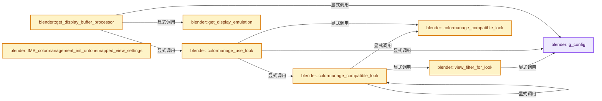

# 实现依赖专题：source/blender/imbuf/intern/colormanagement.cc

[方向导航](README.md) · [符号索引](../%E7%AC%A6%E5%8F%B7%E4%BE%9D%E8%B5%96%E4%B8%8E%E5%AE%9E%E7%8E%B0%E7%B4%A2%E5%BC%95.md)

本专题从正文实际调用进入，集中保存共享实现。函数有稳定锚点，可从调用处直接跳到对应完整函数；递归与互相调用通过回链组织。

## 本文件的实现关系




## 完整成员与函数实现

<a id="f-c9bbd157d5bef9a9"></a>

### `blender::g_config`

实现位置：[source/blender/imbuf/intern/colormanagement.cc](../../../../../source/blender/imbuf/intern/colormanagement.cc) · L93—L97。

**教学注释版**

<!-- annotated:e4c2c1f9d07fbc -->

```cpp
static std::unique_ptr<ocio::Config> &g_config()
{
  static std::unique_ptr<ocio::Config> g_config_ = nullptr;
  return g_config_;
}
```

<details>
<summary>核对原始源码：source/blender/imbuf/intern/colormanagement.cc · L93—L97</summary>

<!-- original:e4c2c1f9d07fbc:source/blender/imbuf/intern/colormanagement.cc:93:97 -->

```cpp
static std::unique_ptr<ocio::Config> &g_config()
{
  static std::unique_ptr<ocio::Config> g_config_ = nullptr;
  return g_config_;
}
```

</details>

**结果出口**

- `return g_config_;`

**继续追踪实现**

本实现没有需要继续展开的显式调用；检查返回表达式、对象转换和调用者前置条件。

<a id="f-3371cac198900504"></a>

### `blender::view_filter_for_look`

实现位置：[source/blender/imbuf/intern/colormanagement.cc](../../../../../source/blender/imbuf/intern/colormanagement.cc) · L656—L685。

接口参数：

- `StringRefNull view_name`

**教学注释版**

<!-- annotated:67fd55224fe181 -->

```cpp
static StringRef view_filter_for_look(StringRefNull view_name)
{
  if (view_name.is_empty()) {
    return StringRef();
  }

  /* First try to find any looks with the full name prefix. */
  for (const int look_index : IndexRange(g_config()->get_num_looks())) {
    const ocio::Look *look = g_config()->get_look_by_index(look_index);
    if (look->view() == view_name) {
      return view_name;
    }
  }

  /* Then try with the short name prefix. */
  const int64_t separator_offset = view_name.find(" - ");
  if (separator_offset == -1) {
    return StringRef();
  }
  StringRef view_short_name = view_name.substr(0, separator_offset);

  for (const int look_index : IndexRange(g_config()->get_num_looks())) {
    const ocio::Look *look = g_config()->get_look_by_index(look_index);
    if (look->view() == view_short_name) {
      return view_short_name;
    }
  }

  return StringRef();
}
```

<details>
<summary>核对原始源码：source/blender/imbuf/intern/colormanagement.cc · L656—L685</summary>

<!-- original:67fd55224fe181:source/blender/imbuf/intern/colormanagement.cc:656:685 -->

```cpp
static StringRef view_filter_for_look(StringRefNull view_name)
{
  if (view_name.is_empty()) {
    return StringRef();
  }

  /* First try to find any looks with the full name prefix. */
  for (const int look_index : IndexRange(g_config()->get_num_looks())) {
    const ocio::Look *look = g_config()->get_look_by_index(look_index);
    if (look->view() == view_name) {
      return view_name;
    }
  }

  /* Then try with the short name prefix. */
  const int64_t separator_offset = view_name.find(" - ");
  if (separator_offset == -1) {
    return StringRef();
  }
  StringRef view_short_name = view_name.substr(0, separator_offset);

  for (const int look_index : IndexRange(g_config()->get_num_looks())) {
    const ocio::Look *look = g_config()->get_look_by_index(look_index);
    if (look->view() == view_short_name) {
      return view_short_name;
    }
  }

  return StringRef();
}
```

</details>

**结果出口**

- `return StringRef();`
- `return view_name;`
- `return view_short_name;`

**继续追踪实现**

- `view_name.is_empty` → [blender::Bounds<T>::is_empty · L533](../12-%E7%A9%BA%E9%97%B4%E6%95%B0%E6%8D%AE%E7%BB%93%E6%9E%84%E4%B8%8E%E5%87%A0%E4%BD%95%E7%AE%97%E6%B3%95/07-Bounds%E4%B8%8EBVH%E5%AF%B9%E6%AF%94.md#f-55ac376b3d0a0944)；[blender::GVArrayCommon::is_empty · L767](../04-%E8%99%9A%E6%8B%9F%E6%95%B0%E7%BB%84%E4%B8%8E%E7%B4%A2%E5%BC%95%E9%80%89%E6%8B%A9/05-GVArray%E8%BF%90%E8%A1%8C%E6%97%B6%E7%B1%BB%E5%9E%8B.md#f-c1da602ffc5555f9)；[blender::StringRefBase::is_empty · L201](../01-%E5%9F%BA%E7%A1%80%E5%AE%B9%E5%99%A8%E4%B8%8E%E7%8E%B0%E4%BB%A3CPP/15-StringRef%E5%AD%97%E7%AC%A6%E4%B8%B2%E8%A7%86%E5%9B%BE.md#f-9f6c3d2da1cb1796)；[blender::KDTreeNew<T>::is_empty · L498](../12-%E7%A9%BA%E9%97%B4%E6%95%B0%E6%8D%AE%E7%BB%93%E6%9E%84%E4%B8%8E%E5%87%A0%E4%BD%95%E7%AE%97%E6%B3%95/05-K%E8%BF%91%E9%82%BB%E4%B8%8E%E8%8C%83%E5%9B%B4%E6%9F%A5%E8%AF%A2.md#f-67f0ff91cf00b00b)。同名重载需按实参类型选择。
- `StringRef` → [blender::StringRef::StringRef · L555](../01-%E5%9F%BA%E7%A1%80%E5%AE%B9%E5%99%A8%E4%B8%8E%E7%8E%B0%E4%BB%A3CPP/15-StringRef%E5%AD%97%E7%AC%A6%E4%B8%B2%E8%A7%86%E5%9B%BE.md#f-f6aca324a36faa7e)；[blender::StringRef::StringRef · L560](../01-%E5%9F%BA%E7%A1%80%E5%AE%B9%E5%99%A8%E4%B8%8E%E7%8E%B0%E4%BB%A3CPP/15-StringRef%E5%AD%97%E7%AC%A6%E4%B8%B2%E8%A7%86%E5%9B%BE.md#f-ab9714781ca51bac)；[blender::StringRef::StringRef · L565](../01-%E5%9F%BA%E7%A1%80%E5%AE%B9%E5%99%A8%E4%B8%8E%E7%8E%B0%E4%BB%A3CPP/15-StringRef%E5%AD%97%E7%AC%A6%E4%B8%B2%E8%A7%86%E5%9B%BE.md#f-95f0b483bbdd7739)；[blender::StringRef::StringRef · L570](../01-%E5%9F%BA%E7%A1%80%E5%AE%B9%E5%99%A8%E4%B8%8E%E7%8E%B0%E4%BB%A3CPP/15-StringRef%E5%AD%97%E7%AC%A6%E4%B8%B2%E8%A7%86%E5%9B%BE.md#f-808d05699cb33334)；[blender::StringRef::StringRef · L631](../01-%E5%9F%BA%E7%A1%80%E5%AE%B9%E5%99%A8%E4%B8%8E%E7%8E%B0%E4%BB%A3CPP/15-StringRef%E5%AD%97%E7%AC%A6%E4%B8%B2%E8%A7%86%E5%9B%BE.md#f-37788e5f3fa3b736)；[blender::StringRef::StringRef · L641](../01-%E5%9F%BA%E7%A1%80%E5%AE%B9%E5%99%A8%E4%B8%8E%E7%8E%B0%E4%BB%A3CPP/15-StringRef%E5%AD%97%E7%AC%A6%E4%B8%B2%E8%A7%86%E5%9B%BE.md#f-11abd0510fb6b926)；[blender::StringRef::StringRef · L646](../01-%E5%9F%BA%E7%A1%80%E5%AE%B9%E5%99%A8%E4%B8%8E%E7%8E%B0%E4%BB%A3CPP/15-StringRef%E5%AD%97%E7%AC%A6%E4%B8%B2%E8%A7%86%E5%9B%BE.md#f-8437dbd8a582eefd)；[blender::StringRef::StringRef · L651](../01-%E5%9F%BA%E7%A1%80%E5%AE%B9%E5%99%A8%E4%B8%8E%E7%8E%B0%E4%BB%A3CPP/15-StringRef%E5%AD%97%E7%AC%A6%E4%B8%B2%E8%A7%86%E5%9B%BE.md#f-70bcb338de0db978)。同名重载需按实参类型选择。
- `IndexRange` → [blender::IndexRange](../01-%E5%9F%BA%E7%A1%80%E5%AE%B9%E5%99%A8%E4%B8%8E%E7%8E%B0%E4%BB%A3CPP/%E4%BE%9D%E8%B5%96-BLI_index_range-7d7cc5.md#t-caa3466d6776)；[blender::gpu::shader::parser::IndexRange](%E4%BE%9D%E8%B5%96-utils-06433d.md#t-82d2bd4ea71c)；[blender::IndexRange](%E4%BE%9D%E8%B5%96-DNA_node_types-6708b9.md#t-0448cc889d39)。
- `g_config()->get_num_looks` → [调用协议](../%E6%A8%A1%E6%9D%BF%E5%AE%8F%E4%B8%8E%E5%8A%A8%E6%80%81%E5%88%86%E6%B4%BE%E5%8D%8F%E8%AE%AE.md)：接收对象类型依赖auto、返回值或模板实例；不按同名猜测目标。调用位置L663。
- `g_config` → [blender::g_config · L93](%E4%BE%9D%E8%B5%96-colormanagement-d4733d.md#f-c9bbd157d5bef9a9)。
- `g_config()->get_look_by_index` → [调用协议](../%E6%A8%A1%E6%9D%BF%E5%AE%8F%E4%B8%8E%E5%8A%A8%E6%80%81%E5%88%86%E6%B4%BE%E5%8D%8F%E8%AE%AE.md)：接收对象类型依赖auto、返回值或模板实例；不按同名猜测目标。调用位置L664。
- `look->view` → [调用协议](../%E6%A8%A1%E6%9D%BF%E5%AE%8F%E4%B8%8E%E5%8A%A8%E6%80%81%E5%88%86%E6%B4%BE%E5%8D%8F%E8%AE%AE.md)：由接收对象具体类型或运行时策略提供实现。调用位置L665。
- `view_name.find` → [blender::StringRefBase::find · L339](../01-%E5%9F%BA%E7%A1%80%E5%AE%B9%E5%99%A8%E4%B8%8E%E7%8E%B0%E4%BB%A3CPP/15-StringRef%E5%AD%97%E7%AC%A6%E4%B8%B2%E8%A7%86%E5%9B%BE.md#f-00f0ca38486d01b5)；[blender::StringRefBase::find · L345](../01-%E5%9F%BA%E7%A1%80%E5%AE%B9%E5%99%A8%E4%B8%8E%E7%8E%B0%E4%BB%A3CPP/15-StringRef%E5%AD%97%E7%AC%A6%E4%B8%B2%E8%A7%86%E5%9B%BE.md#f-824b468ce4cb47b7)。同名重载需按实参类型选择。
- `view_name.substr` → [blender::StringRefBase::substr · L303](../01-%E5%9F%BA%E7%A1%80%E5%AE%B9%E5%99%A8%E4%B8%8E%E7%8E%B0%E4%BB%A3CPP/15-StringRef%E5%AD%97%E7%AC%A6%E4%B8%B2%E8%A7%86%E5%9B%BE.md#f-cc876508a516d26d)。

<a id="f-47fd377139401033"></a>

### `blender::colormanage_compatible_look`

实现位置：[source/blender/imbuf/intern/colormanagement.cc](../../../../../source/blender/imbuf/intern/colormanagement.cc) · L687—L696。

接口参数：

- `const ocio::Look *look`
- `StringRef view_filter`

**教学注释版**

<!-- annotated:c0953c41c74ace -->

```cpp
static bool colormanage_compatible_look(const ocio::Look *look, StringRef view_filter)
{
  if (look->is_noop) {
    return true;
  }

  /* Skip looks only relevant to specific view transforms.
   * If the view transform has view-specific look ignore non-specific looks. */
  return view_filter.is_empty() ? look->view().is_empty() : look->view() == view_filter;
}
```

<details>
<summary>核对原始源码：source/blender/imbuf/intern/colormanagement.cc · L687—L696</summary>

<!-- original:c0953c41c74ace:source/blender/imbuf/intern/colormanagement.cc:687:696 -->

```cpp
static bool colormanage_compatible_look(const ocio::Look *look, StringRef view_filter)
{
  if (look->is_noop) {
    return true;
  }

  /* Skip looks only relevant to specific view transforms.
   * If the view transform has view-specific look ignore non-specific looks. */
  return view_filter.is_empty() ? look->view().is_empty() : look->view() == view_filter;
}
```

</details>

**结果出口**

- `return true;`
- `return view_filter.is_empty() ? look->view().is_empty() : look->view() == view_filter;`

**继续追踪实现**

- `view_filter.is_empty` → [blender::Bounds<T>::is_empty · L533](../12-%E7%A9%BA%E9%97%B4%E6%95%B0%E6%8D%AE%E7%BB%93%E6%9E%84%E4%B8%8E%E5%87%A0%E4%BD%95%E7%AE%97%E6%B3%95/07-Bounds%E4%B8%8EBVH%E5%AF%B9%E6%AF%94.md#f-55ac376b3d0a0944)；[blender::GVArrayCommon::is_empty · L767](../04-%E8%99%9A%E6%8B%9F%E6%95%B0%E7%BB%84%E4%B8%8E%E7%B4%A2%E5%BC%95%E9%80%89%E6%8B%A9/05-GVArray%E8%BF%90%E8%A1%8C%E6%97%B6%E7%B1%BB%E5%9E%8B.md#f-c1da602ffc5555f9)；[blender::StringRefBase::is_empty · L201](../01-%E5%9F%BA%E7%A1%80%E5%AE%B9%E5%99%A8%E4%B8%8E%E7%8E%B0%E4%BB%A3CPP/15-StringRef%E5%AD%97%E7%AC%A6%E4%B8%B2%E8%A7%86%E5%9B%BE.md#f-9f6c3d2da1cb1796)；[blender::KDTreeNew<T>::is_empty · L498](../12-%E7%A9%BA%E9%97%B4%E6%95%B0%E6%8D%AE%E7%BB%93%E6%9E%84%E4%B8%8E%E5%87%A0%E4%BD%95%E7%AE%97%E6%B3%95/05-K%E8%BF%91%E9%82%BB%E4%B8%8E%E8%8C%83%E5%9B%B4%E6%9F%A5%E8%AF%A2.md#f-67f0ff91cf00b00b)。同名重载需按实参类型选择。
- `look->view().is_empty` → [调用协议](../%E6%A8%A1%E6%9D%BF%E5%AE%8F%E4%B8%8E%E5%8A%A8%E6%80%81%E5%88%86%E6%B4%BE%E5%8D%8F%E8%AE%AE.md)：接收对象类型依赖auto、返回值或模板实例；不按同名猜测目标。调用位置L695。
- `look->view` → [调用协议](../%E6%A8%A1%E6%9D%BF%E5%AE%8F%E4%B8%8E%E5%8A%A8%E6%80%81%E5%88%86%E6%B4%BE%E5%8D%8F%E8%AE%AE.md)：由接收对象具体类型或运行时策略提供实现。调用位置L695。

<a id="f-9d6ef57483b87317"></a>

### `blender::colormanage_compatible_look`

实现位置：[source/blender/imbuf/intern/colormanagement.cc](../../../../../source/blender/imbuf/intern/colormanagement.cc) · L698—L702。

接口参数：

- `const ocio::Look *look`
- `const char *view_name`

**教学注释版**

<!-- annotated:36ab64be0cde8e -->

```cpp
static bool colormanage_compatible_look(const ocio::Look *look, const char *view_name)
{
  const StringRef view_filter = view_filter_for_look(view_name);
  return colormanage_compatible_look(look, view_filter);
}
```

<details>
<summary>核对原始源码：source/blender/imbuf/intern/colormanagement.cc · L698—L702</summary>

<!-- original:36ab64be0cde8e:source/blender/imbuf/intern/colormanagement.cc:698:702 -->

```cpp
static bool colormanage_compatible_look(const ocio::Look *look, const char *view_name)
{
  const StringRef view_filter = view_filter_for_look(view_name);
  return colormanage_compatible_look(look, view_filter);
}
```

</details>

**结果出口**

- `return colormanage_compatible_look(look, view_filter);`

**继续追踪实现**

- `view_filter_for_look` → [blender::view_filter_for_look · L656](%E4%BE%9D%E8%B5%96-colormanagement-d4733d.md#f-3371cac198900504)。
- `colormanage_compatible_look` → [blender::colormanage_compatible_look · L687](%E4%BE%9D%E8%B5%96-colormanagement-d4733d.md#f-47fd377139401033)；[blender::colormanage_compatible_look · L698](%E4%BE%9D%E8%B5%96-colormanagement-d4733d.md#f-9d6ef57483b87317)。同名重载需按实参类型选择。

<a id="f-a59761d06b4275b4"></a>

### `blender::colormanage_use_look`

实现位置：[source/blender/imbuf/intern/colormanagement.cc](../../../../../source/blender/imbuf/intern/colormanagement.cc) · L704—L708。

接口参数：

- `const char *look_name`
- `const char *view_name`

**教学注释版**

<!-- annotated:26160d6bea8ac9 -->

```cpp
static bool colormanage_use_look(const char *look_name, const char *view_name)
{
  const ocio::Look *look = g_config()->get_look_by_name(look_name);
  return (look && look->is_noop == false && colormanage_compatible_look(look, view_name));
}
```

<details>
<summary>核对原始源码：source/blender/imbuf/intern/colormanagement.cc · L704—L708</summary>

<!-- original:26160d6bea8ac9:source/blender/imbuf/intern/colormanagement.cc:704:708 -->

```cpp
static bool colormanage_use_look(const char *look_name, const char *view_name)
{
  const ocio::Look *look = g_config()->get_look_by_name(look_name);
  return (look && look->is_noop == false && colormanage_compatible_look(look, view_name));
}
```

</details>

**结果出口**

- `return (look && look->is_noop == false && colormanage_compatible_look(look, view_name));`

**继续追踪实现**

- `g_config()->get_look_by_name` → [调用协议](../%E6%A8%A1%E6%9D%BF%E5%AE%8F%E4%B8%8E%E5%8A%A8%E6%80%81%E5%88%86%E6%B4%BE%E5%8D%8F%E8%AE%AE.md)：接收对象类型依赖auto、返回值或模板实例；不按同名猜测目标。调用位置L706。
- `g_config` → [blender::g_config · L93](%E4%BE%9D%E8%B5%96-colormanagement-d4733d.md#f-c9bbd157d5bef9a9)。
- `colormanage_compatible_look` → [blender::colormanage_compatible_look · L687](%E4%BE%9D%E8%B5%96-colormanagement-d4733d.md#f-47fd377139401033)；[blender::colormanage_compatible_look · L698](%E4%BE%9D%E8%B5%96-colormanagement-d4733d.md#f-9d6ef57483b87317)。同名重载需按实参类型选择。

<a id="f-dd9c1028dc676141"></a>

### `blender::get_display_emulation`

实现位置：[source/blender/imbuf/intern/colormanagement.cc](../../../../../source/blender/imbuf/intern/colormanagement.cc) · L728—L738。

接口参数：

- `const ColorManagedDisplaySettings &display_settings`

**教学注释版**

<!-- annotated:44df2c1dd3d3e6 -->

```cpp
static bool get_display_emulation(const ColorManagedDisplaySettings &display_settings)
{
  switch (display_settings.emulation) {
    case COLORMANAGE_DISPLAY_EMULATION_OFF:
      return false;
    case COLORMANAGE_DISPLAY_EMULATION_AUTO:
      return true;
  }

  return true;
}
```

<details>
<summary>核对原始源码：source/blender/imbuf/intern/colormanagement.cc · L728—L738</summary>

<!-- original:44df2c1dd3d3e6:source/blender/imbuf/intern/colormanagement.cc:728:738 -->

```cpp
static bool get_display_emulation(const ColorManagedDisplaySettings &display_settings)
{
  switch (display_settings.emulation) {
    case COLORMANAGE_DISPLAY_EMULATION_OFF:
      return false;
    case COLORMANAGE_DISPLAY_EMULATION_AUTO:
      return true;
  }

  return true;
}
```

</details>

**结果出口**

- `return false;`
- `return true;`

**继续追踪实现**

本实现没有需要继续展开的显式调用；检查返回表达式、对象转换和调用者前置条件。

<a id="f-846a18c18fa67e3a"></a>

### `blender::get_display_buffer_processor`

实现位置：[source/blender/imbuf/intern/colormanagement.cc](../../../../../source/blender/imbuf/intern/colormanagement.cc) · L740—L774。

接口参数：

- `const ColorManagedDisplaySettings &display_settings`
- `const char *look`
- `const char *view_transform`
- `const float exposure`
- `const float gamma`
- `const float temperature`
- `const float tint`
- `const bool use_white_balance`
- `const char *from_colorspace`
- `const ColorManagedDisplaySpace target`
- `const bool inverse = false`

**教学注释版**

<!-- annotated:39b4506bde00f0 -->

```cpp
static std::shared_ptr<const ocio::CPUProcessor> get_display_buffer_processor(
    const ColorManagedDisplaySettings &display_settings,
    const char *look,
    const char *view_transform,
    const float exposure,
    const float gamma,
    const float temperature,
    const float tint,
    const bool use_white_balance,
    const char *from_colorspace,
    const ColorManagedDisplaySpace target,
    const bool inverse = false)
{
  ocio::DisplayParameters display_parameters;
  display_parameters.from_colorspace = from_colorspace;
  display_parameters.view = view_transform;
  display_parameters.display = display_settings.display_device;
  display_parameters.look = colormanage_use_look(look, view_transform) ? look : "";
  display_parameters.scale = (exposure == 0.0f) ? 1.0f : powf(2.0f, exposure);
  display_parameters.exponent = (gamma == 1.0f) ? 1.0f : 1.0f / max_ff(FLT_EPSILON, gamma);
  display_parameters.temperature = temperature;
  display_parameters.tint = tint;
  display_parameters.use_white_balance = use_white_balance;
  display_parameters.inverse = inverse;
  display_parameters.use_hdr_buffer = GPU_hdr_support();
  display_parameters.use_hdr_display = IMB_colormanagement_display_is_hdr(&display_settings,
                                                                          view_transform);
  display_parameters.is_image_output = (target == DISPLAY_SPACE_IMAGE_OUTPUT);
  display_parameters.use_display_emulation = (target == DISPLAY_SPACE_DRAW) ?
                                                 get_display_emulation(display_settings) :
                                                 false;
  display_parameters.use_scope_space = (target == DISPLAY_SPACE_SCOPE);

  return g_config()->get_display_cpu_processor(display_parameters);
}
```

<details>
<summary>核对原始源码：source/blender/imbuf/intern/colormanagement.cc · L740—L774</summary>

<!-- original:39b4506bde00f0:source/blender/imbuf/intern/colormanagement.cc:740:774 -->

```cpp
static std::shared_ptr<const ocio::CPUProcessor> get_display_buffer_processor(
    const ColorManagedDisplaySettings &display_settings,
    const char *look,
    const char *view_transform,
    const float exposure,
    const float gamma,
    const float temperature,
    const float tint,
    const bool use_white_balance,
    const char *from_colorspace,
    const ColorManagedDisplaySpace target,
    const bool inverse = false)
{
  ocio::DisplayParameters display_parameters;
  display_parameters.from_colorspace = from_colorspace;
  display_parameters.view = view_transform;
  display_parameters.display = display_settings.display_device;
  display_parameters.look = colormanage_use_look(look, view_transform) ? look : "";
  display_parameters.scale = (exposure == 0.0f) ? 1.0f : powf(2.0f, exposure);
  display_parameters.exponent = (gamma == 1.0f) ? 1.0f : 1.0f / max_ff(FLT_EPSILON, gamma);
  display_parameters.temperature = temperature;
  display_parameters.tint = tint;
  display_parameters.use_white_balance = use_white_balance;
  display_parameters.inverse = inverse;
  display_parameters.use_hdr_buffer = GPU_hdr_support();
  display_parameters.use_hdr_display = IMB_colormanagement_display_is_hdr(&display_settings,
                                                                          view_transform);
  display_parameters.is_image_output = (target == DISPLAY_SPACE_IMAGE_OUTPUT);
  display_parameters.use_display_emulation = (target == DISPLAY_SPACE_DRAW) ?
                                                 get_display_emulation(display_settings) :
                                                 false;
  display_parameters.use_scope_space = (target == DISPLAY_SPACE_SCOPE);

  return g_config()->get_display_cpu_processor(display_parameters);
}
```

</details>

**沿实际写入检查状态**

- `display_parameters.from_colorspace = from_colorspace;`
- `display_parameters.view = view_transform;`
- `display_parameters.display = display_settings.display_device;`
- `display_parameters.look = colormanage_use_look(look, view_transform) ? look : "";`
- `display_parameters.scale = (exposure == 0.0f) ? 1.0f : powf(2.0f, exposure);`
- `display_parameters.exponent = (gamma == 1.0f) ? 1.0f : 1.0f / max_ff(FLT_EPSILON, gamma);`
- `display_parameters.temperature = temperature;`
- `display_parameters.tint = tint;`
- `display_parameters.use_white_balance = use_white_balance;`
- `display_parameters.inverse = inverse;`
- `display_parameters.use_hdr_buffer = GPU_hdr_support();`
- `display_parameters.use_hdr_display = IMB_colormanagement_display_is_hdr(&display_settings,`
- `display_parameters.is_image_output = (target == DISPLAY_SPACE_IMAGE_OUTPUT);`
- `display_parameters.use_display_emulation = (target == DISPLAY_SPACE_DRAW) ?`
- `display_parameters.use_scope_space = (target == DISPLAY_SPACE_SCOPE);`

**结果出口**

- `return g_config()->get_display_cpu_processor(display_parameters);`

**继续追踪实现**

- `colormanage_use_look` → [blender::colormanage_use_look · L704](%E4%BE%9D%E8%B5%96-colormanagement-d4733d.md#f-a59761d06b4275b4)。
- `powf` → [powf · L188](%E4%BE%9D%E8%B5%96-compat-56205c.md#m-d8a2a165b5d3)；[powf · L264](%E4%BE%9D%E8%B5%96-compat-efe0e9.md#m-3de6a9230b53)；[powf · L95](%E4%BE%9D%E8%B5%96-compat-9e0a25.md#m-22a964b66221)；[powf · L93](%E4%BE%9D%E8%B5%96-compat-e9eab7.md#m-64340c9f6eb3)。宏定义由构建条件选择。
- `max_ff` → [blender::max_ff · L325](../12-%E7%A9%BA%E9%97%B4%E6%95%B0%E6%8D%AE%E7%BB%93%E6%9E%84%E4%B8%8E%E5%87%A0%E4%BD%95%E7%AE%97%E6%B3%95/%E4%BE%9D%E8%B5%96-math_base_inline-546b00.md#f-05a351a3afd7dc2a)。
- `GPU_hdr_support` → [blender::GPU_hdr_support · L162](%E4%BE%9D%E8%B5%96-gpu_capabilities-508ffd.md#f-507537451ec3f02d)。
- `IMB_colormanagement_display_is_hdr` → [blender::IMB_colormanagement_display_is_hdr · L2981](%E4%BE%9D%E8%B5%96-colormanagement-d4733d.md#f-e7d5e6a3869d1e2b)。
- `get_display_emulation` → [blender::get_display_emulation · L728](%E4%BE%9D%E8%B5%96-colormanagement-d4733d.md#f-dd9c1028dc676141)。
- `g_config()->get_display_cpu_processor` → [调用协议](../%E6%A8%A1%E6%9D%BF%E5%AE%8F%E4%B8%8E%E5%8A%A8%E6%80%81%E5%88%86%E6%B4%BE%E5%8D%8F%E8%AE%AE.md)：接收对象类型依赖auto、返回值或模板实例；不按同名猜测目标。调用位置L773。
- `g_config` → [blender::g_config · L93](%E4%BE%9D%E8%B5%96-colormanagement-d4733d.md#f-c9bbd157d5bef9a9)。

<a id="f-96e9d25078c307dc"></a>

### `blender::IMB_colormanagement_init_untonemapped_view_settings`

实现位置：[source/blender/imbuf/intern/colormanagement.cc](../../../../../source/blender/imbuf/intern/colormanagement.cc) · L776—L791。

接口参数：

- `ColorManagedViewSettings *view_settings`
- `const ColorManagedDisplaySettings *`

**教学注释版**

<!-- annotated:8672114f0e7242 -->

```cpp
void IMB_colormanagement_init_untonemapped_view_settings(
    ColorManagedViewSettings *view_settings,
    const ColorManagedDisplaySettings * /*display_settings*/)
{
  /* Empty view transform name means skip tone mapping. */
  view_settings->view_transform[0] = '\0';
  /* TODO(sergey): Find a way to safely/reliable un-hardcode this. */
  STRNCPY_UTF8(view_settings->look, "None");
  /* Initialize rest of the settings. */
  view_settings->flag = {};
  view_settings->gamma = 1.0f;
  view_settings->exposure = 0.0f;
  view_settings->temperature = 6500.0f;
  view_settings->tint = 10.0f;
  view_settings->curve_mapping = nullptr;
}
```

<details>
<summary>核对原始源码：source/blender/imbuf/intern/colormanagement.cc · L776—L791</summary>

<!-- original:8672114f0e7242:source/blender/imbuf/intern/colormanagement.cc:776:791 -->

```cpp
void IMB_colormanagement_init_untonemapped_view_settings(
    ColorManagedViewSettings *view_settings,
    const ColorManagedDisplaySettings * /*display_settings*/)
{
  /* Empty view transform name means skip tone mapping. */
  view_settings->view_transform[0] = '\0';
  /* TODO(sergey): Find a way to safely/reliable un-hardcode this. */
  STRNCPY_UTF8(view_settings->look, "None");
  /* Initialize rest of the settings. */
  view_settings->flag = {};
  view_settings->gamma = 1.0f;
  view_settings->exposure = 0.0f;
  view_settings->temperature = 6500.0f;
  view_settings->tint = 10.0f;
  view_settings->curve_mapping = nullptr;
}
```

</details>

**沿实际写入检查状态**

- `view_settings->view_transform[0] = '\0';`
- `view_settings->flag = {};`
- `view_settings->gamma = 1.0f;`
- `view_settings->exposure = 0.0f;`
- `view_settings->temperature = 6500.0f;`
- `view_settings->tint = 10.0f;`
- `view_settings->curve_mapping = nullptr;`

**继续追踪实现**

- `STRNCPY_UTF8` → [STRNCPY_UTF8 · L335](../01-%E5%9F%BA%E7%A1%80%E5%AE%B9%E5%99%A8%E4%B8%8E%E7%8E%B0%E4%BB%A3CPP/%E4%BE%9D%E8%B5%96-BLI_string_utf8-bcc961.md#m-222967f0ab6a)。宏定义由构建条件选择。

<a id="f-8b522d5089b1ebfc"></a>

### `blender::curve_mapping_apply_pixel`

实现位置：[source/blender/imbuf/intern/colormanagement.cc](../../../../../source/blender/imbuf/intern/colormanagement.cc) · L793—L807。

接口参数：

- `const CurveMapping *curve_mapping`
- `float *pixel`
- `int channels`

**教学注释版**

<!-- annotated:9e837ab14c7cb8 -->

```cpp
static void curve_mapping_apply_pixel(const CurveMapping *curve_mapping,
                                      float *pixel,
                                      int channels)
{
  if (channels == 1) {
    pixel[0] = BKE_curvemap_evaluateF(curve_mapping, curve_mapping->cm, pixel[0]);
  }
  else if (channels == 2) {
    pixel[0] = BKE_curvemap_evaluateF(curve_mapping, curve_mapping->cm, pixel[0]);
    pixel[1] = BKE_curvemap_evaluateF(curve_mapping, curve_mapping->cm, pixel[1]);
  }
  else {
    BKE_curvemapping_evaluate_premulRGBF(curve_mapping, pixel, pixel);
  }
}
```

<details>
<summary>核对原始源码：source/blender/imbuf/intern/colormanagement.cc · L793—L807</summary>

<!-- original:9e837ab14c7cb8:source/blender/imbuf/intern/colormanagement.cc:793:807 -->

```cpp
static void curve_mapping_apply_pixel(const CurveMapping *curve_mapping,
                                      float *pixel,
                                      int channels)
{
  if (channels == 1) {
    pixel[0] = BKE_curvemap_evaluateF(curve_mapping, curve_mapping->cm, pixel[0]);
  }
  else if (channels == 2) {
    pixel[0] = BKE_curvemap_evaluateF(curve_mapping, curve_mapping->cm, pixel[0]);
    pixel[1] = BKE_curvemap_evaluateF(curve_mapping, curve_mapping->cm, pixel[1]);
  }
  else {
    BKE_curvemapping_evaluate_premulRGBF(curve_mapping, pixel, pixel);
  }
}
```

</details>

**沿实际写入检查状态**

- `pixel[0] = BKE_curvemap_evaluateF(curve_mapping, curve_mapping->cm, pixel[0]);`
- `pixel[1] = BKE_curvemap_evaluateF(curve_mapping, curve_mapping->cm, pixel[1]);`

**继续追踪实现**

- `BKE_curvemap_evaluateF` → [blender::BKE_curvemap_evaluateF · L1153](%E4%BE%9D%E8%B5%96-colortools-8bc37a.md#f-772b7d5e4497d2e2)。
- `BKE_curvemapping_evaluate_premulRGBF` → [blender::BKE_curvemapping_evaluate_premulRGBF · L1299](%E4%BE%9D%E8%B5%96-colortools-8bc37a.md#f-778360ef57f03e75)。

<a id="f-3a08781cacea6624"></a>

### `blender::colormanage_imbuf_set_default_spaces`

实现位置：[source/blender/imbuf/intern/colormanagement.cc](../../../../../source/blender/imbuf/intern/colormanagement.cc) · L809—L818。

接口参数：

- `ImBuf *ibuf`

**教学注释版**

<!-- annotated:101d3491aa32bd -->

```cpp
void colormanage_imbuf_set_default_spaces(ImBuf *ibuf)
{
  /* Regression tests are allocating ImBuf. Guard against access of uninitialized color
   * management configuration. */
  /* TODO(sergey): Always allocate the fallback color management configuration for such cases? */
  if (!g_config()) {
    return;
  }
  ibuf->byte_buffer.colorspace = g_config()->get_color_space(global_role_default_byte);
}
```

<details>
<summary>核对原始源码：source/blender/imbuf/intern/colormanagement.cc · L809—L818</summary>

<!-- original:101d3491aa32bd:source/blender/imbuf/intern/colormanagement.cc:809:818 -->

```cpp
void colormanage_imbuf_set_default_spaces(ImBuf *ibuf)
{
  /* Regression tests are allocating ImBuf. Guard against access of uninitialized color
   * management configuration. */
  /* TODO(sergey): Always allocate the fallback color management configuration for such cases? */
  if (!g_config()) {
    return;
  }
  ibuf->byte_buffer.colorspace = g_config()->get_color_space(global_role_default_byte);
}
```

</details>

**沿实际写入检查状态**

- `ibuf->byte_buffer.colorspace = g_config()->get_color_space(global_role_default_byte);`

**继续追踪实现**

- `g_config` → [blender::g_config · L93](%E4%BE%9D%E8%B5%96-colormanagement-d4733d.md#f-c9bbd157d5bef9a9)。
- `g_config()->get_color_space` → [调用协议](../%E6%A8%A1%E6%9D%BF%E5%AE%8F%E4%B8%8E%E5%8A%A8%E6%80%81%E5%88%86%E6%B4%BE%E5%8D%8F%E8%AE%AE.md)：接收对象类型依赖auto、返回值或模板实例；不按同名猜测目标。调用位置L817。

<a id="f-c375acbb9d468a48"></a>

### `blender::colormanage_imbuf_make_linear`

实现位置：[source/blender/imbuf/intern/colormanagement.cc](../../../../../source/blender/imbuf/intern/colormanagement.cc) · L820—L870。

接口参数：

- `ImBuf *ibuf`
- `const char *from_colorspace`
- `const ColorManagedFileOutput output`

**教学注释版**

<!-- annotated:68390fdaffe4ee -->

```cpp
void colormanage_imbuf_make_linear(ImBuf *ibuf,
                                   const char *from_colorspace,
                                   const ColorManagedFileOutput output)
{
  const ColorSpace *colorspace = g_config()->get_color_space(from_colorspace);

  if (colorspace && colorspace->is_data()) {
    if (ibuf->float_data()) {
      ibuf->float_buffer.colorspace = colorspace;
    }
    return;
  }

  if (ibuf->float_data()) {
    const char *to_colorspace = global_role_scene_linear;
    const bool predivide = IMB_alpha_affects_rgb(ibuf);

    if (ibuf->byte_data()) {
      IMB_free_byte_pixels(ibuf);
    }

    if (output != ColorManagedFileOutput::Video) {
      const ColorSpace *image_colorspace = g_config()->get_color_space_for_hdr_image(
          from_colorspace);
      if (image_colorspace) {
        from_colorspace = image_colorspace->name().c_str();
      }
    }

    /* Clear colorspace to indicate it's scene linear. */
    ibuf->float_buffer.colorspace = nullptr;

    if (from_colorspace[0] == '\0') {
      return;
    }

    ColormanageProcessor cm_processor = ColormanageProcessor::colorspace_processor_new(
        from_colorspace, to_colorspace);
    if (cm_processor.is_noop()) {
      return;
    }

    processor_transform_apply_threaded(nullptr,
                                       ibuf->float_data_for_write(),
                                       ibuf->x,
                                       ibuf->y,
                                       ibuf->channels,
                                       &cm_processor,
                                       predivide);
  }
}
```

<details>
<summary>核对原始源码：source/blender/imbuf/intern/colormanagement.cc · L820—L870</summary>

<!-- original:68390fdaffe4ee:source/blender/imbuf/intern/colormanagement.cc:820:870 -->

```cpp
void colormanage_imbuf_make_linear(ImBuf *ibuf,
                                   const char *from_colorspace,
                                   const ColorManagedFileOutput output)
{
  const ColorSpace *colorspace = g_config()->get_color_space(from_colorspace);

  if (colorspace && colorspace->is_data()) {
    if (ibuf->float_data()) {
      ibuf->float_buffer.colorspace = colorspace;
    }
    return;
  }

  if (ibuf->float_data()) {
    const char *to_colorspace = global_role_scene_linear;
    const bool predivide = IMB_alpha_affects_rgb(ibuf);

    if (ibuf->byte_data()) {
      IMB_free_byte_pixels(ibuf);
    }

    if (output != ColorManagedFileOutput::Video) {
      const ColorSpace *image_colorspace = g_config()->get_color_space_for_hdr_image(
          from_colorspace);
      if (image_colorspace) {
        from_colorspace = image_colorspace->name().c_str();
      }
    }

    /* Clear colorspace to indicate it's scene linear. */
    ibuf->float_buffer.colorspace = nullptr;

    if (from_colorspace[0] == '\0') {
      return;
    }

    ColormanageProcessor cm_processor = ColormanageProcessor::colorspace_processor_new(
        from_colorspace, to_colorspace);
    if (cm_processor.is_noop()) {
      return;
    }

    processor_transform_apply_threaded(nullptr,
                                       ibuf->float_data_for_write(),
                                       ibuf->x,
                                       ibuf->y,
                                       ibuf->channels,
                                       &cm_processor,
                                       predivide);
  }
}
```

</details>

**沿实际写入检查状态**

- `ibuf->float_buffer.colorspace = colorspace;`
- `from_colorspace = image_colorspace->name().c_str();`
- `ibuf->float_buffer.colorspace = nullptr;`

**继续追踪实现**

- `g_config()->get_color_space` → [调用协议](../%E6%A8%A1%E6%9D%BF%E5%AE%8F%E4%B8%8E%E5%8A%A8%E6%80%81%E5%88%86%E6%B4%BE%E5%8D%8F%E8%AE%AE.md)：接收对象类型依赖auto、返回值或模板实例；不按同名猜测目标。调用位置L824。
- `g_config` → [blender::g_config · L93](%E4%BE%9D%E8%B5%96-colormanagement-d4733d.md#f-c9bbd157d5bef9a9)。
- `colorspace->is_data` → [blender::ocio::LibOCIOColorSpace::is_data · L75](%E4%BE%9D%E8%B5%96-libocio_colorspace-4e6ac5.md#f-17f8a4f0b6e70d0e)。
- `ibuf->float_data` → [blender::ImBuf::float_data · L358](%E4%BE%9D%E8%B5%96-IMB_imbuf_types-f69e60.md#f-2e52aa77544ffaee)。
- `IMB_alpha_affects_rgb` → [blender::IMB_alpha_affects_rgb · L45](%E4%BE%9D%E8%B5%96-conversion-b82337.md#f-00ee0dd9db7e6963)。
- `ibuf->byte_data` → [blender::ImBuf::byte_data · L353](%E4%BE%9D%E8%B5%96-IMB_imbuf_types-f69e60.md#f-2cdfc552156643fa)。
- `IMB_free_byte_pixels` → [blender::IMB_free_byte_pixels · L128](%E4%BE%9D%E8%B5%96-allocimbuf-bc68dd.md#f-4b7a8f53593680ab)。
- `g_config()->get_color_space_for_hdr_image` → [调用协议](../%E6%A8%A1%E6%9D%BF%E5%AE%8F%E4%B8%8E%E5%8A%A8%E6%80%81%E5%88%86%E6%B4%BE%E5%8D%8F%E8%AE%AE.md)：接收对象类型依赖auto、返回值或模板实例；不按同名猜测目标。调用位置L842。
- `image_colorspace->name().c_str` → [调用协议](../%E6%A8%A1%E6%9D%BF%E5%AE%8F%E4%B8%8E%E5%8A%A8%E6%80%81%E5%88%86%E6%B4%BE%E5%8D%8F%E8%AE%AE.md)：接收对象类型依赖auto、返回值或模板实例；不按同名猜测目标。调用位置L845。
- `image_colorspace->name` → [blender::CPPType::name · L497](../03-%E5%86%85%E5%AD%98%E5%88%86%E9%85%8D%E4%B8%8E%E8%BF%90%E8%A1%8C%E6%97%B6%E7%B1%BB%E5%9E%8B/08-CPPType%E6%9E%84%E9%80%A0%E4%B8%8E%E6%9E%90%E6%9E%84.md#f-e5ab6239f7e97c8e)；[blender::bNodeTreeInterfaceSocket::name · L760](%E4%BE%9D%E8%B5%96-node_tree_interface-893d31.md#f-17b06c8fb888e080)；[blender::bNodeTreeInterfacePanel::name · L898](%E4%BE%9D%E8%B5%96-node_tree_interface-893d31.md#f-c2125cd86d6ecd9f)。同名重载需按实参类型选择。
- `ColormanageProcessor::colorspace_processor_new` → [blender::ColormanageProcessor::colorspace_processor_new · L3924](%E4%BE%9D%E8%B5%96-colormanagement-d4733d.md#f-1f965b732987b5f3)。
- `cm_processor.is_noop` → [blender::ColormanageProcessor::is_noop · L4034](%E4%BE%9D%E8%B5%96-colormanagement-d4733d.md#f-09f6a46a346037a9)。
- `processor_transform_apply_threaded` → [blender::processor_transform_apply_threaded · L2226](%E4%BE%9D%E8%B5%96-colormanagement-d4733d.md#f-05f3a519853ba38e)。
- `ibuf->float_data_for_write` → [blender::ImBuf::float_data_for_write · L79](%E4%BE%9D%E8%B5%96-allocimbuf-bc68dd.md#f-1956ac4db88ed3eb)。

<a id="f-4a9af0b037ade70d"></a>

### `blender::colormanage_find_matching_view_name`

实现位置：[source/blender/imbuf/intern/colormanagement.cc](../../../../../source/blender/imbuf/intern/colormanagement.cc) · L920—L956。

接口参数：

- `const ocio::Display *display`
- `StringRefNull view_name`

**教学注释版**

<!-- annotated:ad70f5c303a828 -->

```cpp
static StringRefNull colormanage_find_matching_view_name(const ocio::Display *display,
                                                         StringRefNull view_name)
{
  /* Match untonemapped view conventions between Blender and ACES 2.0. */
  if (view_name == "Standard" && display->get_view_by_name("Un-tone-mapped")) {
    return "Un-tone-mapped";
  }
  if (view_name == "Un-tone-mapped" && display->get_view_by_name("Standard")) {
    return "Standard";
  }

  /* Try to find a similar name, so that we can match e.g. "ACES 2.0" and "ACES 2.0 - HDR 1000"
   * when switching between SDR and HDR displays. */
  for (const int view_index : IndexRange(display->get_num_views())) {
    const ocio::View *view = display->get_view_by_index(view_index);
    if (view->name().startswith(view_name) || view_name.startswith(view->name())) {
      return view->name();
    }
  }

  const int64_t separator_offset = view_name.find(" - ");
  if (separator_offset != -1) {
    const StringRef view_short_name = view_name.substr(0, separator_offset);
    for (const int view_index : IndexRange(display->get_num_views())) {
      const ocio::View *view = display->get_view_by_index(view_index);
      if (view->name().startswith(view_short_name)) {
        return view->name();
      }
    }
  }

  if (const ocio::View *view = display->get_default_view()) {
    return view->name();
  }

  return "";
}
```

<details>
<summary>核对原始源码：source/blender/imbuf/intern/colormanagement.cc · L920—L956</summary>

<!-- original:ad70f5c303a828:source/blender/imbuf/intern/colormanagement.cc:920:956 -->

```cpp
static StringRefNull colormanage_find_matching_view_name(const ocio::Display *display,
                                                         StringRefNull view_name)
{
  /* Match untonemapped view conventions between Blender and ACES 2.0. */
  if (view_name == "Standard" && display->get_view_by_name("Un-tone-mapped")) {
    return "Un-tone-mapped";
  }
  if (view_name == "Un-tone-mapped" && display->get_view_by_name("Standard")) {
    return "Standard";
  }

  /* Try to find a similar name, so that we can match e.g. "ACES 2.0" and "ACES 2.0 - HDR 1000"
   * when switching between SDR and HDR displays. */
  for (const int view_index : IndexRange(display->get_num_views())) {
    const ocio::View *view = display->get_view_by_index(view_index);
    if (view->name().startswith(view_name) || view_name.startswith(view->name())) {
      return view->name();
    }
  }

  const int64_t separator_offset = view_name.find(" - ");
  if (separator_offset != -1) {
    const StringRef view_short_name = view_name.substr(0, separator_offset);
    for (const int view_index : IndexRange(display->get_num_views())) {
      const ocio::View *view = display->get_view_by_index(view_index);
      if (view->name().startswith(view_short_name)) {
        return view->name();
      }
    }
  }

  if (const ocio::View *view = display->get_default_view()) {
    return view->name();
  }

  return "";
}
```

</details>

**结果出口**

- `return "Un-tone-mapped";`
- `return "Standard";`
- `return view->name();`
- `return "";`

**继续追踪实现**

- `display->get_view_by_name` → [blender::ocio::LibOCIODisplay::get_view_by_name · L233](%E4%BE%9D%E8%B5%96-libocio_display-6b3fa9.md#f-1b5c840fee9fbd77)。
- `IndexRange` → [blender::IndexRange](../01-%E5%9F%BA%E7%A1%80%E5%AE%B9%E5%99%A8%E4%B8%8E%E7%8E%B0%E4%BB%A3CPP/%E4%BE%9D%E8%B5%96-BLI_index_range-7d7cc5.md#t-caa3466d6776)；[blender::gpu::shader::parser::IndexRange](%E4%BE%9D%E8%B5%96-utils-06433d.md#t-82d2bd4ea71c)；[blender::IndexRange](%E4%BE%9D%E8%B5%96-DNA_node_types-6708b9.md#t-0448cc889d39)。
- `display->get_num_views` → [blender::ocio::LibOCIODisplay::get_num_views · L244](%E4%BE%9D%E8%B5%96-libocio_display-6b3fa9.md#f-47509fde6efb11fd)。
- `display->get_view_by_index` → [blender::ocio::LibOCIODisplay::get_view_by_index · L249](%E4%BE%9D%E8%B5%96-libocio_display-6b3fa9.md#f-6cea779e04c0d089)。
- `view->name().startswith` → [调用协议](../%E6%A8%A1%E6%9D%BF%E5%AE%8F%E4%B8%8E%E5%8A%A8%E6%80%81%E5%88%86%E6%B4%BE%E5%8D%8F%E8%AE%AE.md)：接收对象类型依赖auto、返回值或模板实例；不按同名猜测目标。调用位置L935。
- `view->name` → [blender::CPPType::name · L497](../03-%E5%86%85%E5%AD%98%E5%88%86%E9%85%8D%E4%B8%8E%E8%BF%90%E8%A1%8C%E6%97%B6%E7%B1%BB%E5%9E%8B/08-CPPType%E6%9E%84%E9%80%A0%E4%B8%8E%E6%9E%90%E6%9E%84.md#f-e5ab6239f7e97c8e)；[blender::bNodeTreeInterfaceSocket::name · L760](%E4%BE%9D%E8%B5%96-node_tree_interface-893d31.md#f-17b06c8fb888e080)；[blender::bNodeTreeInterfacePanel::name · L898](%E4%BE%9D%E8%B5%96-node_tree_interface-893d31.md#f-c2125cd86d6ecd9f)。同名重载需按实参类型选择。
- `view_name.startswith` → [blender::StringRefBase::startswith · L269](../01-%E5%9F%BA%E7%A1%80%E5%AE%B9%E5%99%A8%E4%B8%8E%E7%8E%B0%E4%BB%A3CPP/15-StringRef%E5%AD%97%E7%AC%A6%E4%B8%B2%E8%A7%86%E5%9B%BE.md#f-78237ccfe249bfa5)。
- `view_name.find` → [blender::StringRefBase::find · L339](../01-%E5%9F%BA%E7%A1%80%E5%AE%B9%E5%99%A8%E4%B8%8E%E7%8E%B0%E4%BB%A3CPP/15-StringRef%E5%AD%97%E7%AC%A6%E4%B8%B2%E8%A7%86%E5%9B%BE.md#f-00f0ca38486d01b5)；[blender::StringRefBase::find · L345](../01-%E5%9F%BA%E7%A1%80%E5%AE%B9%E5%99%A8%E4%B8%8E%E7%8E%B0%E4%BB%A3CPP/15-StringRef%E5%AD%97%E7%AC%A6%E4%B8%B2%E8%A7%86%E5%9B%BE.md#f-824b468ce4cb47b7)。同名重载需按实参类型选择。
- `view_name.substr` → [blender::StringRefBase::substr · L303](../01-%E5%9F%BA%E7%A1%80%E5%AE%B9%E5%99%A8%E4%B8%8E%E7%8E%B0%E4%BB%A3CPP/15-StringRef%E5%AD%97%E7%AC%A6%E4%B8%B2%E8%A7%86%E5%9B%BE.md#f-cc876508a516d26d)。
- `display->get_default_view` → [blender::ocio::LibOCIODisplay::get_default_view · L66](%E4%BE%9D%E8%B5%96-libocio_display-c35f90.md#f-13090a13fe750514)。

<a id="f-94a6b0d7dce8193c"></a>

### `blender::colormanage_name_to_interop_id`

实现位置：[source/blender/imbuf/intern/colormanagement.cc](../../../../../source/blender/imbuf/intern/colormanagement.cc) · L1041—L1049。

接口参数：

- `const char *name`
- `char *interop_id`

**教学注释版**

<!-- annotated:ebb3a76f5079bb -->

```cpp
static void colormanage_name_to_interop_id(const char *name, char *interop_id)
{
  /* Roles are left without an interop ID, as their color space depends on the configuration. */
  const ColorSpace *colorspace = (g_config() && name[0] && !g_config()->is_role(name)) ?
                                     g_config()->get_color_space(name) :
                                     nullptr;
  const bool is_primary = colorspace && colorspace->is_primary_interop_id();
  BLI_strncpy(interop_id, is_primary ? colorspace->interop_id().c_str() : "", MAX_COLORSPACE_NAME);
}
```

<details>
<summary>核对原始源码：source/blender/imbuf/intern/colormanagement.cc · L1041—L1049</summary>

<!-- original:ebb3a76f5079bb:source/blender/imbuf/intern/colormanagement.cc:1041:1049 -->

```cpp
static void colormanage_name_to_interop_id(const char *name, char *interop_id)
{
  /* Roles are left without an interop ID, as their color space depends on the configuration. */
  const ColorSpace *colorspace = (g_config() && name[0] && !g_config()->is_role(name)) ?
                                     g_config()->get_color_space(name) :
                                     nullptr;
  const bool is_primary = colorspace && colorspace->is_primary_interop_id();
  BLI_strncpy(interop_id, is_primary ? colorspace->interop_id().c_str() : "", MAX_COLORSPACE_NAME);
}
```

</details>

**继续追踪实现**

- `g_config` → [blender::g_config · L93](%E4%BE%9D%E8%B5%96-colormanagement-d4733d.md#f-c9bbd157d5bef9a9)。
- `g_config()->is_role` → [调用协议](../%E6%A8%A1%E6%9D%BF%E5%AE%8F%E4%B8%8E%E5%8A%A8%E6%80%81%E5%88%86%E6%B4%BE%E5%8D%8F%E8%AE%AE.md)：接收对象类型依赖auto、返回值或模板实例；不按同名猜测目标。调用位置L1044。
- `g_config()->get_color_space` → [调用协议](../%E6%A8%A1%E6%9D%BF%E5%AE%8F%E4%B8%8E%E5%8A%A8%E6%80%81%E5%88%86%E6%B4%BE%E5%8D%8F%E8%AE%AE.md)：接收对象类型依赖auto、返回值或模板实例；不按同名猜测目标。调用位置L1045。
- `colorspace->is_primary_interop_id` → [blender::ocio::LibOCIOColorSpace::is_primary_interop_id · L125](%E4%BE%9D%E8%B5%96-libocio_colorspace-6a8e62.md#f-1482edf0c671bb81)。
- `BLI_strncpy` → [blender::BLI_strncpy · L70](../01-%E5%9F%BA%E7%A1%80%E5%AE%B9%E5%99%A8%E4%B8%8E%E7%8E%B0%E4%BB%A3CPP/%E4%BE%9D%E8%B5%96-string-1d986f.md#f-6324147b0d116da1)。
- `colorspace->interop_id().c_str` → [调用协议](../%E6%A8%A1%E6%9D%BF%E5%AE%8F%E4%B8%8E%E5%8A%A8%E6%80%81%E5%88%86%E6%B4%BE%E5%8D%8F%E8%AE%AE.md)：接收对象类型依赖auto、返回值或模板实例；不按同名猜测目标。调用位置L1048。
- `colorspace->interop_id` → [blender::ocio::LibOCIOColorSpace::interop_id · L60](%E4%BE%9D%E8%B5%96-libocio_colorspace-4e6ac5.md#f-451484b1dbf39fa5)。

<a id="f-410641fedad9c517"></a>

### `blender::IMB_colormanagement_validate_settings`

实现位置：[source/blender/imbuf/intern/colormanagement.cc](../../../../../source/blender/imbuf/intern/colormanagement.cc) · L1224—L1245。

接口参数：

- `const ColorManagedDisplaySettings *display_settings`
- `ColorManagedViewSettings *view_settings`

**教学注释版**

<!-- annotated:2c1661f3708ee8 -->

```cpp
void IMB_colormanagement_validate_settings(const ColorManagedDisplaySettings *display_settings,
                                           ColorManagedViewSettings *view_settings)
{
  const ocio::Display *display = g_config()->get_display_by_name(display_settings->display_device);

  bool found = false;
  for (const int view_index : IndexRange(display->get_num_views())) {
    const ocio::View *view = display->get_view_by_index(view_index);
    if (view->name() == view_settings->view_transform) {
      found = true;
      break;
    }
  }

  if (!found) {
    StringRefNull new_view_name = colormanage_find_matching_view_name(
        display, view_settings->view_transform);
    if (!new_view_name.is_empty()) {
      STRNCPY_UTF8(view_settings->view_transform, new_view_name.c_str());
    }
  }
}
```

<details>
<summary>核对原始源码：source/blender/imbuf/intern/colormanagement.cc · L1224—L1245</summary>

<!-- original:2c1661f3708ee8:source/blender/imbuf/intern/colormanagement.cc:1224:1245 -->

```cpp
void IMB_colormanagement_validate_settings(const ColorManagedDisplaySettings *display_settings,
                                           ColorManagedViewSettings *view_settings)
{
  const ocio::Display *display = g_config()->get_display_by_name(display_settings->display_device);

  bool found = false;
  for (const int view_index : IndexRange(display->get_num_views())) {
    const ocio::View *view = display->get_view_by_index(view_index);
    if (view->name() == view_settings->view_transform) {
      found = true;
      break;
    }
  }

  if (!found) {
    StringRefNull new_view_name = colormanage_find_matching_view_name(
        display, view_settings->view_transform);
    if (!new_view_name.is_empty()) {
      STRNCPY_UTF8(view_settings->view_transform, new_view_name.c_str());
    }
  }
}
```

</details>

**沿实际写入检查状态**

- `found = true;`

**继续追踪实现**

- `g_config()->get_display_by_name` → [调用协议](../%E6%A8%A1%E6%9D%BF%E5%AE%8F%E4%B8%8E%E5%8A%A8%E6%80%81%E5%88%86%E6%B4%BE%E5%8D%8F%E8%AE%AE.md)：接收对象类型依赖auto、返回值或模板实例；不按同名猜测目标。调用位置L1227。
- `g_config` → [blender::g_config · L93](%E4%BE%9D%E8%B5%96-colormanagement-d4733d.md#f-c9bbd157d5bef9a9)。
- `IndexRange` → [blender::IndexRange](../01-%E5%9F%BA%E7%A1%80%E5%AE%B9%E5%99%A8%E4%B8%8E%E7%8E%B0%E4%BB%A3CPP/%E4%BE%9D%E8%B5%96-BLI_index_range-7d7cc5.md#t-caa3466d6776)；[blender::gpu::shader::parser::IndexRange](%E4%BE%9D%E8%B5%96-utils-06433d.md#t-82d2bd4ea71c)；[blender::IndexRange](%E4%BE%9D%E8%B5%96-DNA_node_types-6708b9.md#t-0448cc889d39)。
- `display->get_num_views` → [blender::ocio::LibOCIODisplay::get_num_views · L244](%E4%BE%9D%E8%B5%96-libocio_display-6b3fa9.md#f-47509fde6efb11fd)。
- `display->get_view_by_index` → [blender::ocio::LibOCIODisplay::get_view_by_index · L249](%E4%BE%9D%E8%B5%96-libocio_display-6b3fa9.md#f-6cea779e04c0d089)。
- `view->name` → [blender::CPPType::name · L497](../03-%E5%86%85%E5%AD%98%E5%88%86%E9%85%8D%E4%B8%8E%E8%BF%90%E8%A1%8C%E6%97%B6%E7%B1%BB%E5%9E%8B/08-CPPType%E6%9E%84%E9%80%A0%E4%B8%8E%E6%9E%90%E6%9E%84.md#f-e5ab6239f7e97c8e)；[blender::bNodeTreeInterfaceSocket::name · L760](%E4%BE%9D%E8%B5%96-node_tree_interface-893d31.md#f-17b06c8fb888e080)；[blender::bNodeTreeInterfacePanel::name · L898](%E4%BE%9D%E8%B5%96-node_tree_interface-893d31.md#f-c2125cd86d6ecd9f)。同名重载需按实参类型选择。
- `colormanage_find_matching_view_name` → [blender::colormanage_find_matching_view_name · L920](%E4%BE%9D%E8%B5%96-colormanagement-d4733d.md#f-4a9af0b037ade70d)。
- `new_view_name.is_empty` → [blender::Bounds<T>::is_empty · L533](../12-%E7%A9%BA%E9%97%B4%E6%95%B0%E6%8D%AE%E7%BB%93%E6%9E%84%E4%B8%8E%E5%87%A0%E4%BD%95%E7%AE%97%E6%B3%95/07-Bounds%E4%B8%8EBVH%E5%AF%B9%E6%AF%94.md#f-55ac376b3d0a0944)；[blender::GVArrayCommon::is_empty · L767](../04-%E8%99%9A%E6%8B%9F%E6%95%B0%E7%BB%84%E4%B8%8E%E7%B4%A2%E5%BC%95%E9%80%89%E6%8B%A9/05-GVArray%E8%BF%90%E8%A1%8C%E6%97%B6%E7%B1%BB%E5%9E%8B.md#f-c1da602ffc5555f9)；[blender::StringRefBase::is_empty · L201](../01-%E5%9F%BA%E7%A1%80%E5%AE%B9%E5%99%A8%E4%B8%8E%E7%8E%B0%E4%BB%A3CPP/15-StringRef%E5%AD%97%E7%AC%A6%E4%B8%B2%E8%A7%86%E5%9B%BE.md#f-9f6c3d2da1cb1796)；[blender::KDTreeNew<T>::is_empty · L498](../12-%E7%A9%BA%E9%97%B4%E6%95%B0%E6%8D%AE%E7%BB%93%E6%9E%84%E4%B8%8E%E5%87%A0%E4%BD%95%E7%AE%97%E6%B3%95/05-K%E8%BF%91%E9%82%BB%E4%B8%8E%E8%8C%83%E5%9B%B4%E6%9F%A5%E8%AF%A2.md#f-67f0ff91cf00b00b)。同名重载需按实参类型选择。
- `STRNCPY_UTF8` → [STRNCPY_UTF8 · L335](../01-%E5%9F%BA%E7%A1%80%E5%AE%B9%E5%99%A8%E4%B8%8E%E7%8E%B0%E4%BB%A3CPP/%E4%BE%9D%E8%B5%96-BLI_string_utf8-bcc961.md#m-222967f0ab6a)。宏定义由构建条件选择。
- `new_view_name.c_str` → [blender::StringRefNull::c_str · L544](../01-%E5%9F%BA%E7%A1%80%E5%AE%B9%E5%99%A8%E4%B8%8E%E7%8E%B0%E4%BB%A3CPP/15-StringRef%E5%AD%97%E7%AC%A6%E4%B8%B2%E8%A7%86%E5%9B%BE.md#f-4a8bbfe1e6d00757)。

<a id="f-f2cf0e85682f0fd8"></a>

### `blender::IMB_colormanagement_role_colorspace_name_get`

实现位置：[source/blender/imbuf/intern/colormanagement.cc](../../../../../source/blender/imbuf/intern/colormanagement.cc) · L1247—L1273。

接口参数：

- `int role`

**教学注释版**

<!-- annotated:d88ea84db69d24 -->

```cpp
const char *IMB_colormanagement_role_colorspace_name_get(int role)
{
  switch (role) {
    case COLOR_ROLE_DATA:
      return global_role_data;
    case COLOR_ROLE_SCENE_LINEAR:
      return global_role_scene_linear;
    case COLOR_ROLE_COLOR_PICKING:
      return global_role_color_picking;
    case COLOR_ROLE_TEXTURE_PAINTING:
      return global_role_texture_painting;
    case COLOR_ROLE_DEFAULT_SEQUENCER:
      return global_role_default_sequencer;
    case COLOR_ROLE_DEFAULT_FLOAT:
      return global_role_default_float;
    case COLOR_ROLE_DEFAULT_BYTE:
      return global_role_default_byte;
    case COLOR_ROLE_ACES_INTERCHANGE:
      return global_role_aces_interchange;
    default:
      CLOG_WARN(&LOG, "Unknown role was passed to %s", __func__);
      BLI_assert(0);
      break;
  }

  return nullptr;
}
```

<details>
<summary>核对原始源码：source/blender/imbuf/intern/colormanagement.cc · L1247—L1273</summary>

<!-- original:d88ea84db69d24:source/blender/imbuf/intern/colormanagement.cc:1247:1273 -->

```cpp
const char *IMB_colormanagement_role_colorspace_name_get(int role)
{
  switch (role) {
    case COLOR_ROLE_DATA:
      return global_role_data;
    case COLOR_ROLE_SCENE_LINEAR:
      return global_role_scene_linear;
    case COLOR_ROLE_COLOR_PICKING:
      return global_role_color_picking;
    case COLOR_ROLE_TEXTURE_PAINTING:
      return global_role_texture_painting;
    case COLOR_ROLE_DEFAULT_SEQUENCER:
      return global_role_default_sequencer;
    case COLOR_ROLE_DEFAULT_FLOAT:
      return global_role_default_float;
    case COLOR_ROLE_DEFAULT_BYTE:
      return global_role_default_byte;
    case COLOR_ROLE_ACES_INTERCHANGE:
      return global_role_aces_interchange;
    default:
      CLOG_WARN(&LOG, "Unknown role was passed to %s", __func__);
      BLI_assert(0);
      break;
  }

  return nullptr;
}
```

</details>

**结果出口**

- `return global_role_data;`
- `return global_role_scene_linear;`
- `return global_role_color_picking;`
- `return global_role_texture_painting;`
- `return global_role_default_sequencer;`
- `return global_role_default_float;`
- `return global_role_default_byte;`
- `return global_role_aces_interchange;`
- `return nullptr;`

**继续追踪实现**

- `CLOG_WARN` → [CLOG_WARN · L189](%E4%BE%9D%E8%B5%96-CLG_log-e9051b.md#m-9da21a06cdbe)。宏定义由构建条件选择。
- `BLI_assert` → [BLI_assert · L48](../01-%E5%9F%BA%E7%A1%80%E5%AE%B9%E5%99%A8%E4%B8%8E%E7%8E%B0%E4%BB%A3CPP/%E4%BE%9D%E8%B5%96-BLI_assert-cc98e8.md#m-57a88495704d)；[BLI_assert · L63](../01-%E5%9F%BA%E7%A1%80%E5%AE%B9%E5%99%A8%E4%B8%8E%E7%8E%B0%E4%BB%A3CPP/%E4%BE%9D%E8%B5%96-BLI_assert-cc98e8.md#m-d07050020cb5)。宏定义由构建条件选择。

<a id="f-3d136a349a596f82"></a>

### `blender::IMB_colormanagement_assign_float_colorspace`

实现位置：[source/blender/imbuf/intern/colormanagement.cc](../../../../../source/blender/imbuf/intern/colormanagement.cc) · L1292—L1296。

接口参数：

- `ImBuf *ibuf`
- `const char *name`

**教学注释版**

<!-- annotated:13e92d5cab7a6d -->

```cpp
void IMB_colormanagement_assign_float_colorspace(ImBuf *ibuf, const char *name)
{
  const ColorSpace *colorspace = g_config()->get_color_space(name);
  ibuf->float_buffer.colorspace = colorspace;
}
```

<details>
<summary>核对原始源码：source/blender/imbuf/intern/colormanagement.cc · L1292—L1296</summary>

<!-- original:13e92d5cab7a6d:source/blender/imbuf/intern/colormanagement.cc:1292:1296 -->

```cpp
void IMB_colormanagement_assign_float_colorspace(ImBuf *ibuf, const char *name)
{
  const ColorSpace *colorspace = g_config()->get_color_space(name);
  ibuf->float_buffer.colorspace = colorspace;
}
```

</details>

**沿实际写入检查状态**

- `ibuf->float_buffer.colorspace = colorspace;`

**继续追踪实现**

- `g_config()->get_color_space` → [调用协议](../%E6%A8%A1%E6%9D%BF%E5%AE%8F%E4%B8%8E%E5%8A%A8%E6%80%81%E5%88%86%E6%B4%BE%E5%8D%8F%E8%AE%AE.md)：接收对象类型依赖auto、返回值或模板实例；不按同名猜测目标。调用位置L1294。
- `g_config` → [blender::g_config · L93](%E4%BE%9D%E8%B5%96-colormanagement-d4733d.md#f-c9bbd157d5bef9a9)。

<a id="f-ead21d8cb3904faa"></a>

### `blender::IMB_colormanagement_assign_byte_colorspace`

实现位置：[source/blender/imbuf/intern/colormanagement.cc](../../../../../source/blender/imbuf/intern/colormanagement.cc) · L1298—L1302。

接口参数：

- `ImBuf *ibuf`
- `const char *name`

**教学注释版**

<!-- annotated:8f6c6328b6ab0d -->

```cpp
void IMB_colormanagement_assign_byte_colorspace(ImBuf *ibuf, const char *name)
{
  const ColorSpace *colorspace = g_config()->get_color_space(name);
  ibuf->byte_buffer.colorspace = colorspace;
}
```

<details>
<summary>核对原始源码：source/blender/imbuf/intern/colormanagement.cc · L1298—L1302</summary>

<!-- original:8f6c6328b6ab0d:source/blender/imbuf/intern/colormanagement.cc:1298:1302 -->

```cpp
void IMB_colormanagement_assign_byte_colorspace(ImBuf *ibuf, const char *name)
{
  const ColorSpace *colorspace = g_config()->get_color_space(name);
  ibuf->byte_buffer.colorspace = colorspace;
}
```

</details>

**沿实际写入检查状态**

- `ibuf->byte_buffer.colorspace = colorspace;`

**继续追踪实现**

- `g_config()->get_color_space` → [调用协议](../%E6%A8%A1%E6%9D%BF%E5%AE%8F%E4%B8%8E%E5%8A%A8%E6%80%81%E5%88%86%E6%B4%BE%E5%8D%8F%E8%AE%AE.md)：接收对象类型依赖auto、返回值或模板实例；不按同名猜测目标。调用位置L1300。
- `g_config` → [blender::g_config · L93](%E4%BE%9D%E8%B5%96-colormanagement-d4733d.md#f-c9bbd157d5bef9a9)。

<a id="f-011a20fe810ea0fb"></a>

### `blender::IMB_colormanagement_get_float_colorspace`

实现位置：[source/blender/imbuf/intern/colormanagement.cc](../../../../../source/blender/imbuf/intern/colormanagement.cc) · L1304—L1307。

接口参数：

- `const ImBuf *ibuf`

**教学注释版**

<!-- annotated:0e9acceded7d9f -->

```cpp
const char *IMB_colormanagement_get_float_colorspace(const ImBuf *ibuf)
{
  return ibuf->float_colorspace().name().c_str();
}
```

<details>
<summary>核对原始源码：source/blender/imbuf/intern/colormanagement.cc · L1304—L1307</summary>

<!-- original:0e9acceded7d9f:source/blender/imbuf/intern/colormanagement.cc:1304:1307 -->

```cpp
const char *IMB_colormanagement_get_float_colorspace(const ImBuf *ibuf)
{
  return ibuf->float_colorspace().name().c_str();
}
```

</details>

**结果出口**

- `return ibuf->float_colorspace().name().c_str();`

**继续追踪实现**

- `ibuf->float_colorspace().name().c_str` → [调用协议](../%E6%A8%A1%E6%9D%BF%E5%AE%8F%E4%B8%8E%E5%8A%A8%E6%80%81%E5%88%86%E6%B4%BE%E5%8D%8F%E8%AE%AE.md)：接收对象类型依赖auto、返回值或模板实例；不按同名猜测目标。调用位置L1306。
- `ibuf->float_colorspace().name` → [调用协议](../%E6%A8%A1%E6%9D%BF%E5%AE%8F%E4%B8%8E%E5%8A%A8%E6%80%81%E5%88%86%E6%B4%BE%E5%8D%8F%E8%AE%AE.md)：接收对象类型依赖auto、返回值或模板实例；不按同名猜测目标。调用位置L1306。
- `ibuf->float_colorspace` → [blender::ImBuf::float_colorspace · L108](%E4%BE%9D%E8%B5%96-allocimbuf-bc68dd.md#f-d4dceef3bdf0dd62)。

<a id="f-825849046c97131b"></a>

### `blender::IMB_colormanagement_get_byte_colorspace`

实现位置：[source/blender/imbuf/intern/colormanagement.cc](../../../../../source/blender/imbuf/intern/colormanagement.cc) · L1309—L1312。

接口参数：

- `const ImBuf *ibuf`

**教学注释版**

<!-- annotated:ce875cad8a4201 -->

```cpp
const char *IMB_colormanagement_get_byte_colorspace(const ImBuf *ibuf)
{
  return ibuf->byte_colorspace().name().c_str();
}
```

<details>
<summary>核对原始源码：source/blender/imbuf/intern/colormanagement.cc · L1309—L1312</summary>

<!-- original:ce875cad8a4201:source/blender/imbuf/intern/colormanagement.cc:1309:1312 -->

```cpp
const char *IMB_colormanagement_get_byte_colorspace(const ImBuf *ibuf)
{
  return ibuf->byte_colorspace().name().c_str();
}
```

</details>

**结果出口**

- `return ibuf->byte_colorspace().name().c_str();`

**继续追踪实现**

- `ibuf->byte_colorspace().name().c_str` → [调用协议](../%E6%A8%A1%E6%9D%BF%E5%AE%8F%E4%B8%8E%E5%8A%A8%E6%80%81%E5%88%86%E6%B4%BE%E5%8D%8F%E8%AE%AE.md)：接收对象类型依赖auto、返回值或模板实例；不按同名猜测目标。调用位置L1311。
- `ibuf->byte_colorspace().name` → [调用协议](../%E6%A8%A1%E6%9D%BF%E5%AE%8F%E4%B8%8E%E5%8A%A8%E6%80%81%E5%88%86%E6%B4%BE%E5%8D%8F%E8%AE%AE.md)：接收对象类型依赖auto、返回值或模板实例；不按同名猜测目标。调用位置L1311。
- `ibuf->byte_colorspace` → [blender::ImBuf::byte_colorspace · L98](%E4%BE%9D%E8%B5%96-allocimbuf-bc68dd.md#f-6bc1d045db6e08c0)。

<a id="f-46dc72f0961e1c59"></a>

### `blender::IMB_colormanagement_space_from_filepath_rules`

实现位置：[source/blender/imbuf/intern/colormanagement.cc](../../../../../source/blender/imbuf/intern/colormanagement.cc) · L1314—L1317。

接口参数：

- `const char *filepath`

**教学注释版**

<!-- annotated:4dcc49179b388e -->

```cpp
const char *IMB_colormanagement_space_from_filepath_rules(const char *filepath)
{
  return g_config()->get_color_space_from_filepath(filepath);
}
```

<details>
<summary>核对原始源码：source/blender/imbuf/intern/colormanagement.cc · L1314—L1317</summary>

<!-- original:4dcc49179b388e:source/blender/imbuf/intern/colormanagement.cc:1314:1317 -->

```cpp
const char *IMB_colormanagement_space_from_filepath_rules(const char *filepath)
{
  return g_config()->get_color_space_from_filepath(filepath);
}
```

</details>

**结果出口**

- `return g_config()->get_color_space_from_filepath(filepath);`

**继续追踪实现**

- `g_config()->get_color_space_from_filepath` → [调用协议](../%E6%A8%A1%E6%9D%BF%E5%AE%8F%E4%B8%8E%E5%8A%A8%E6%80%81%E5%88%86%E6%B4%BE%E5%8D%8F%E8%AE%AE.md)：接收对象类型依赖auto、返回值或模板实例；不按同名猜测目标。调用位置L1316。
- `g_config` → [blender::g_config · L93](%E4%BE%9D%E8%B5%96-colormanagement-d4733d.md#f-c9bbd157d5bef9a9)。

<a id="f-686ba14e51262834"></a>

### `blender::IMB_colormanagement_space_get_named`

实现位置：[source/blender/imbuf/intern/colormanagement.cc](../../../../../source/blender/imbuf/intern/colormanagement.cc) · L1319—L1322。

接口参数：

- `const char *name`

**教学注释版**

<!-- annotated:53cfeba09579b3 -->

```cpp
const ColorSpace *IMB_colormanagement_space_get_named(const char *name)
{
  return g_config()->get_color_space(name);
}
```

<details>
<summary>核对原始源码：source/blender/imbuf/intern/colormanagement.cc · L1319—L1322</summary>

<!-- original:53cfeba09579b3:source/blender/imbuf/intern/colormanagement.cc:1319:1322 -->

```cpp
const ColorSpace *IMB_colormanagement_space_get_named(const char *name)
{
  return g_config()->get_color_space(name);
}
```

</details>

**结果出口**

- `return g_config()->get_color_space(name);`

**继续追踪实现**

- `g_config()->get_color_space` → [调用协议](../%E6%A8%A1%E6%9D%BF%E5%AE%8F%E4%B8%8E%E5%8A%A8%E6%80%81%E5%88%86%E6%B4%BE%E5%8D%8F%E8%AE%AE.md)：接收对象类型依赖auto、返回值或模板实例；不按同名猜测目标。调用位置L1321。
- `g_config` → [blender::g_config · L93](%E4%BE%9D%E8%B5%96-colormanagement-d4733d.md#f-c9bbd157d5bef9a9)。

<a id="f-8171f67dd0b37997"></a>

### `blender::IMB_colormanagement_space_get_named`

实现位置：[source/blender/imbuf/intern/colormanagement.cc](../../../../../source/blender/imbuf/intern/colormanagement.cc) · L1323—L1326。

接口参数：

- `StringRefNull name`

**教学注释版**

<!-- annotated:f3d380985478a0 -->

```cpp
const ColorSpace *IMB_colormanagement_space_get_named(StringRefNull name)
{
  return g_config()->get_color_space(name);
}
```

<details>
<summary>核对原始源码：source/blender/imbuf/intern/colormanagement.cc · L1323—L1326</summary>

<!-- original:f3d380985478a0:source/blender/imbuf/intern/colormanagement.cc:1323:1326 -->

```cpp
const ColorSpace *IMB_colormanagement_space_get_named(StringRefNull name)
{
  return g_config()->get_color_space(name);
}
```

</details>

**结果出口**

- `return g_config()->get_color_space(name);`

**继续追踪实现**

- `g_config()->get_color_space` → [调用协议](../%E6%A8%A1%E6%9D%BF%E5%AE%8F%E4%B8%8E%E5%8A%A8%E6%80%81%E5%88%86%E6%B4%BE%E5%8D%8F%E8%AE%AE.md)：接收对象类型依赖auto、返回值或模板实例；不按同名猜测目标。调用位置L1325。
- `g_config` → [blender::g_config · L93](%E4%BE%9D%E8%B5%96-colormanagement-d4733d.md#f-c9bbd157d5bef9a9)。

<a id="f-25b377cc8f03ab18"></a>

### `blender::IMB_colormanagement_space_is_data`

实现位置：[source/blender/imbuf/intern/colormanagement.cc](../../../../../source/blender/imbuf/intern/colormanagement.cc) · L1328—L1331。

接口参数：

- `const ColorSpace *colorspace`

**教学注释版**

<!-- annotated:f01b5e99e371a0 -->

```cpp
bool IMB_colormanagement_space_is_data(const ColorSpace *colorspace)
{
  return (colorspace && colorspace->is_data());
}
```

<details>
<summary>核对原始源码：source/blender/imbuf/intern/colormanagement.cc · L1328—L1331</summary>

<!-- original:f01b5e99e371a0:source/blender/imbuf/intern/colormanagement.cc:1328:1331 -->

```cpp
bool IMB_colormanagement_space_is_data(const ColorSpace *colorspace)
{
  return (colorspace && colorspace->is_data());
}
```

</details>

**结果出口**

- `return (colorspace && colorspace->is_data());`

**继续追踪实现**

- `colorspace->is_data` → [blender::ocio::LibOCIOColorSpace::is_data · L75](%E4%BE%9D%E8%B5%96-libocio_colorspace-4e6ac5.md#f-17f8a4f0b6e70d0e)。

<a id="f-363e8d1117e4dab8"></a>

### `blender::IMB_colormanagement_space_is_scene_linear`

实现位置：[source/blender/imbuf/intern/colormanagement.cc](../../../../../source/blender/imbuf/intern/colormanagement.cc) · L1333—L1336。

接口参数：

- `const ColorSpace *colorspace`

**教学注释版**

<!-- annotated:affec213789af7 -->

```cpp
bool IMB_colormanagement_space_is_scene_linear(const ColorSpace *colorspace)
{
  return (colorspace && colorspace->is_scene_linear());
}
```

<details>
<summary>核对原始源码：source/blender/imbuf/intern/colormanagement.cc · L1333—L1336</summary>

<!-- original:affec213789af7:source/blender/imbuf/intern/colormanagement.cc:1333:1336 -->

```cpp
bool IMB_colormanagement_space_is_scene_linear(const ColorSpace *colorspace)
{
  return (colorspace && colorspace->is_scene_linear());
}
```

</details>

**结果出口**

- `return (colorspace && colorspace->is_scene_linear());`

**继续追踪实现**

- `colorspace->is_scene_linear` → [blender::ocio::LibOCIOColorSpace::is_scene_linear · L176](%E4%BE%9D%E8%B5%96-libocio_colorspace-6a8e62.md#f-a51a69568ffac009)。

<a id="f-6953c3649a88b6ce"></a>

### `blender::IMB_colormanagement_space_is_srgb`

实现位置：[source/blender/imbuf/intern/colormanagement.cc](../../../../../source/blender/imbuf/intern/colormanagement.cc) · L1338—L1341。

接口参数：

- `const ColorSpace *colorspace`

**教学注释版**

<!-- annotated:eb19b81551a812 -->

```cpp
bool IMB_colormanagement_space_is_srgb(const ColorSpace *colorspace)
{
  return (colorspace && colorspace->is_srgb());
}
```

<details>
<summary>核对原始源码：source/blender/imbuf/intern/colormanagement.cc · L1338—L1341</summary>

<!-- original:eb19b81551a812:source/blender/imbuf/intern/colormanagement.cc:1338:1341 -->

```cpp
bool IMB_colormanagement_space_is_srgb(const ColorSpace *colorspace)
{
  return (colorspace && colorspace->is_srgb());
}
```

</details>

**结果出口**

- `return (colorspace && colorspace->is_srgb());`

**继续追踪实现**

- `colorspace->is_srgb` → [blender::ocio::LibOCIOColorSpace::is_srgb · L183](%E4%BE%9D%E8%B5%96-libocio_colorspace-6a8e62.md#f-6daa5b420e3c1838)。

<a id="f-6b106b73199e6986"></a>

### `blender::IMB_colormanagement_space_is_scene_linear_srgb`

实现位置：[source/blender/imbuf/intern/colormanagement.cc](../../../../../source/blender/imbuf/intern/colormanagement.cc) · L1343—L1346。

接口参数：

- `const ColorSpace *colorspace`

**教学注释版**

<!-- annotated:99d31abefa9b60 -->

```cpp
bool IMB_colormanagement_space_is_scene_linear_srgb(const ColorSpace *colorspace)
{
  return IMB_colormanagement_space_is_srgb(colorspace) && colorspace::scene_linear_is_rec709;
}
```

<details>
<summary>核对原始源码：source/blender/imbuf/intern/colormanagement.cc · L1343—L1346</summary>

<!-- original:99d31abefa9b60:source/blender/imbuf/intern/colormanagement.cc:1343:1346 -->

```cpp
bool IMB_colormanagement_space_is_scene_linear_srgb(const ColorSpace *colorspace)
{
  return IMB_colormanagement_space_is_srgb(colorspace) && colorspace::scene_linear_is_rec709;
}
```

</details>

**结果出口**

- `return IMB_colormanagement_space_is_srgb(colorspace) && colorspace::scene_linear_is_rec709;`

**继续追踪实现**

- `IMB_colormanagement_space_is_srgb` → [blender::IMB_colormanagement_space_is_srgb · L1338](%E4%BE%9D%E8%B5%96-colormanagement-d4733d.md#f-6953c3649a88b6ce)。

<a id="f-581447ed34f42264"></a>

### `blender::IMB_colormanagement_space_name_is_data`

实现位置：[source/blender/imbuf/intern/colormanagement.cc](../../../../../source/blender/imbuf/intern/colormanagement.cc) · L1348—L1352。

接口参数：

- `const char *name`

**教学注释版**

<!-- annotated:a8cca4d2fd5c50 -->

```cpp
bool IMB_colormanagement_space_name_is_data(const char *name)
{
  const ColorSpace *colorspace = g_config()->get_color_space(name);
  return (colorspace && colorspace->is_data());
}
```

<details>
<summary>核对原始源码：source/blender/imbuf/intern/colormanagement.cc · L1348—L1352</summary>

<!-- original:a8cca4d2fd5c50:source/blender/imbuf/intern/colormanagement.cc:1348:1352 -->

```cpp
bool IMB_colormanagement_space_name_is_data(const char *name)
{
  const ColorSpace *colorspace = g_config()->get_color_space(name);
  return (colorspace && colorspace->is_data());
}
```

</details>

**结果出口**

- `return (colorspace && colorspace->is_data());`

**继续追踪实现**

- `g_config()->get_color_space` → [调用协议](../%E6%A8%A1%E6%9D%BF%E5%AE%8F%E4%B8%8E%E5%8A%A8%E6%80%81%E5%88%86%E6%B4%BE%E5%8D%8F%E8%AE%AE.md)：接收对象类型依赖auto、返回值或模板实例；不按同名猜测目标。调用位置L1350。
- `g_config` → [blender::g_config · L93](%E4%BE%9D%E8%B5%96-colormanagement-d4733d.md#f-c9bbd157d5bef9a9)。
- `colorspace->is_data` → [blender::ocio::LibOCIOColorSpace::is_data · L75](%E4%BE%9D%E8%B5%96-libocio_colorspace-4e6ac5.md#f-17f8a4f0b6e70d0e)。

<a id="f-3540ab2d85eeb753"></a>

### `blender::IMB_colormanagement_space_name_is_scene_linear`

实现位置：[source/blender/imbuf/intern/colormanagement.cc](../../../../../source/blender/imbuf/intern/colormanagement.cc) · L1354—L1358。

接口参数：

- `const char *name`

**教学注释版**

<!-- annotated:a7d899dbe107f7 -->

```cpp
bool IMB_colormanagement_space_name_is_scene_linear(const char *name)
{
  const ColorSpace *colorspace = g_config()->get_color_space(name);
  return (colorspace && IMB_colormanagement_space_is_scene_linear(colorspace));
}
```

<details>
<summary>核对原始源码：source/blender/imbuf/intern/colormanagement.cc · L1354—L1358</summary>

<!-- original:a7d899dbe107f7:source/blender/imbuf/intern/colormanagement.cc:1354:1358 -->

```cpp
bool IMB_colormanagement_space_name_is_scene_linear(const char *name)
{
  const ColorSpace *colorspace = g_config()->get_color_space(name);
  return (colorspace && IMB_colormanagement_space_is_scene_linear(colorspace));
}
```

</details>

**结果出口**

- `return (colorspace && IMB_colormanagement_space_is_scene_linear(colorspace));`

**继续追踪实现**

- `g_config()->get_color_space` → [调用协议](../%E6%A8%A1%E6%9D%BF%E5%AE%8F%E4%B8%8E%E5%8A%A8%E6%80%81%E5%88%86%E6%B4%BE%E5%8D%8F%E8%AE%AE.md)：接收对象类型依赖auto、返回值或模板实例；不按同名猜测目标。调用位置L1356。
- `g_config` → [blender::g_config · L93](%E4%BE%9D%E8%B5%96-colormanagement-d4733d.md#f-c9bbd157d5bef9a9)。
- `IMB_colormanagement_space_is_scene_linear` → [blender::IMB_colormanagement_space_is_scene_linear · L1333](%E4%BE%9D%E8%B5%96-colormanagement-d4733d.md#f-363e8d1117e4dab8)。

<a id="f-9ec10ca937628c32"></a>

### `blender::video_rec709_colorspace`

实现位置：[source/blender/imbuf/intern/colormanagement.cc](../../../../../source/blender/imbuf/intern/colormanagement.cc) · L1484—L1488。

**教学注释版**

<!-- annotated:b4140b9d3c4e43 -->

```cpp
static const ColorSpace *video_rec709_colorspace()
{
  return (global_role_video_rec709[0]) ? g_config()->get_color_space(global_role_video_rec709) :
                                         nullptr;
}
```

<details>
<summary>核对原始源码：source/blender/imbuf/intern/colormanagement.cc · L1484—L1488</summary>

<!-- original:b4140b9d3c4e43:source/blender/imbuf/intern/colormanagement.cc:1484:1488 -->

```cpp
static const ColorSpace *video_rec709_colorspace()
{
  return (global_role_video_rec709[0]) ? g_config()->get_color_space(global_role_video_rec709) :
                                         nullptr;
}
```

</details>

**结果出口**

- `return (global_role_video_rec709[0]) ? g_config()->get_color_space(global_role_video_rec709) :`

**继续追踪实现**

- `g_config()->get_color_space` → [调用协议](../%E6%A8%A1%E6%9D%BF%E5%AE%8F%E4%B8%8E%E5%8A%A8%E6%80%81%E5%88%86%E6%B4%BE%E5%8D%8F%E8%AE%AE.md)：接收对象类型依赖auto、返回值或模板实例；不按同名猜测目标。调用位置L1486。
- `g_config` → [blender::g_config · L93](%E4%BE%9D%E8%B5%96-colormanagement-d4733d.md#f-c9bbd157d5bef9a9)。

<a id="f-2ac618084b77c16d"></a>

### `blender::IMB_colormanagement_space_from_cicp`

实现位置：[source/blender/imbuf/intern/colormanagement.cc](../../../../../source/blender/imbuf/intern/colormanagement.cc) · L1635—L1691。

接口参数：

- `const int cicp[4]`
- `const ColorManagedFileOutput`

**教学注释版**

<!-- annotated:d6c61350f9d494 -->

```cpp
const ColorSpace *IMB_colormanagement_space_from_cicp(const int cicp[4],
                                                      const ColorManagedFileOutput /*output*/)
{
  StringRefNull interop_id;

  /* We don't care about matrix or range, we assume decoding handles that and we get
   * full range RGB values out. */
  if (cicp[0] == CICP_PRI_REC2020 && cicp[1] == CICP_TRC_PQ) {
    interop_id = "pq_rec2020_display";
  }
  else if (cicp[0] == CICP_PRI_REC2020 && cicp[1] == CICP_TRC_HLG) {
    interop_id = "hlg_rec2020_display";
  }
  else if (cicp[0] == CICP_PRI_P3D65 && cicp[1] == CICP_TRC_PQ) {
    interop_id = "pq_p3d65_display";
  }
  else if (cicp[0] == CICP_PRI_XYZD65 && cicp[1] == CICP_TRC_PQ) {
    interop_id = "pq_xyzd65_display";
  }
  else if (cicp[0] == CICP_PRI_XYZD65 && cicp[1] == CICP_TRC_SMPTE428) {
    interop_id = "g26_xyzd65_display";
  }
  else if (cicp[0] == CICP_PRI_REC709 && cicp[1] == CICP_TRC_G22) {
    interop_id = "g22_rec709_display";
  }
  else if (cicp[0] == CICP_PRI_REC2020 && cicp[1] == CICP_TRC_BT709) {
    interop_id = "blender:g24_rec2020_display";
  }
  else if (cicp[0] == CICP_PRI_REC709 && cicp[1] == CICP_TRC_BT709) {
    /* Ambiguous BT.709 TRC, see #video_rec709_colorspace for details. */
    return video_rec709_colorspace();
  }
  else if (cicp[0] == CICP_PRI_P3D65 && ELEM(cicp[1], CICP_TRC_SRGB, CICP_TRC_BT709)) {
    interop_id = "srgb_p3d65_display";
  }
  else if (cicp[0] == CICP_PRI_REC709 && cicp[1] == CICP_TRC_SRGB) {
    interop_id = "srgb_rec709_display";
  }
  else if (cicp[0] == CICP_PRI_REC709 && cicp[1] == CICP_TRC_LINEAR) {
    interop_id = "lin_rec709_display";
  }
  else if (cicp[0] == CICP_PRI_P3D65 && cicp[1] == CICP_TRC_LINEAR) {
    interop_id = "lin_p3d65_display";
  }
  else if (cicp[0] == CICP_PRI_REC2020 && cicp[1] == CICP_TRC_LINEAR) {
    interop_id = "lin_rec2020_display";
  }
  else if (cicp[0] == CICP_PRI_XYZD65 && cicp[1] == CICP_TRC_LINEAR) {
    interop_id = "lin_ciexyzd65_scene";
  }
  else if (cicp[0] == CICP_PRI_UNSPECIFIED && cicp[1] == CICP_TRC_UNSPECIFIED) {
    /* Read unspecified color spaces as sRGB. */
    interop_id = "srgb_rec709_display";
  }

  return interop_id.is_empty() ? nullptr : g_config()->get_color_space_by_interop_id(interop_id);
}
```

<details>
<summary>核对原始源码：source/blender/imbuf/intern/colormanagement.cc · L1635—L1691</summary>

<!-- original:d6c61350f9d494:source/blender/imbuf/intern/colormanagement.cc:1635:1691 -->

```cpp
const ColorSpace *IMB_colormanagement_space_from_cicp(const int cicp[4],
                                                      const ColorManagedFileOutput /*output*/)
{
  StringRefNull interop_id;

  /* We don't care about matrix or range, we assume decoding handles that and we get
   * full range RGB values out. */
  if (cicp[0] == CICP_PRI_REC2020 && cicp[1] == CICP_TRC_PQ) {
    interop_id = "pq_rec2020_display";
  }
  else if (cicp[0] == CICP_PRI_REC2020 && cicp[1] == CICP_TRC_HLG) {
    interop_id = "hlg_rec2020_display";
  }
  else if (cicp[0] == CICP_PRI_P3D65 && cicp[1] == CICP_TRC_PQ) {
    interop_id = "pq_p3d65_display";
  }
  else if (cicp[0] == CICP_PRI_XYZD65 && cicp[1] == CICP_TRC_PQ) {
    interop_id = "pq_xyzd65_display";
  }
  else if (cicp[0] == CICP_PRI_XYZD65 && cicp[1] == CICP_TRC_SMPTE428) {
    interop_id = "g26_xyzd65_display";
  }
  else if (cicp[0] == CICP_PRI_REC709 && cicp[1] == CICP_TRC_G22) {
    interop_id = "g22_rec709_display";
  }
  else if (cicp[0] == CICP_PRI_REC2020 && cicp[1] == CICP_TRC_BT709) {
    interop_id = "blender:g24_rec2020_display";
  }
  else if (cicp[0] == CICP_PRI_REC709 && cicp[1] == CICP_TRC_BT709) {
    /* Ambiguous BT.709 TRC, see #video_rec709_colorspace for details. */
    return video_rec709_colorspace();
  }
  else if (cicp[0] == CICP_PRI_P3D65 && ELEM(cicp[1], CICP_TRC_SRGB, CICP_TRC_BT709)) {
    interop_id = "srgb_p3d65_display";
  }
  else if (cicp[0] == CICP_PRI_REC709 && cicp[1] == CICP_TRC_SRGB) {
    interop_id = "srgb_rec709_display";
  }
  else if (cicp[0] == CICP_PRI_REC709 && cicp[1] == CICP_TRC_LINEAR) {
    interop_id = "lin_rec709_display";
  }
  else if (cicp[0] == CICP_PRI_P3D65 && cicp[1] == CICP_TRC_LINEAR) {
    interop_id = "lin_p3d65_display";
  }
  else if (cicp[0] == CICP_PRI_REC2020 && cicp[1] == CICP_TRC_LINEAR) {
    interop_id = "lin_rec2020_display";
  }
  else if (cicp[0] == CICP_PRI_XYZD65 && cicp[1] == CICP_TRC_LINEAR) {
    interop_id = "lin_ciexyzd65_scene";
  }
  else if (cicp[0] == CICP_PRI_UNSPECIFIED && cicp[1] == CICP_TRC_UNSPECIFIED) {
    /* Read unspecified color spaces as sRGB. */
    interop_id = "srgb_rec709_display";
  }

  return interop_id.is_empty() ? nullptr : g_config()->get_color_space_by_interop_id(interop_id);
}
```

</details>

**沿实际写入检查状态**

- `interop_id = "pq_rec2020_display";`
- `interop_id = "hlg_rec2020_display";`
- `interop_id = "pq_p3d65_display";`
- `interop_id = "pq_xyzd65_display";`
- `interop_id = "g26_xyzd65_display";`
- `interop_id = "g22_rec709_display";`
- `interop_id = "blender:g24_rec2020_display";`
- `interop_id = "srgb_p3d65_display";`
- `interop_id = "srgb_rec709_display";`
- `interop_id = "lin_rec709_display";`
- `interop_id = "lin_p3d65_display";`
- `interop_id = "lin_rec2020_display";`
- `interop_id = "lin_ciexyzd65_scene";`

**结果出口**

- `return video_rec709_colorspace();`
- `return interop_id.is_empty() ? nullptr : g_config()->get_color_space_by_interop_id(interop_id);`

**继续追踪实现**

- `video_rec709_colorspace` → [blender::video_rec709_colorspace · L1484](%E4%BE%9D%E8%B5%96-colormanagement-d4733d.md#f-9ec10ca937628c32)。
- `ELEM` → [ELEM · L88](%E4%BE%9D%E8%B5%96-GHOST_utildefines-34b996.md#m-d28724a15928)；[ELEM · L135](../01-%E5%9F%BA%E7%A1%80%E5%AE%B9%E5%99%A8%E4%B8%8E%E7%8E%B0%E4%BB%A3CPP/%E4%BE%9D%E8%B5%96-BLI_utildefines-293a0a.md#m-d6572de7cae0)。宏定义由构建条件选择。
- `interop_id.is_empty` → [blender::Bounds<T>::is_empty · L533](../12-%E7%A9%BA%E9%97%B4%E6%95%B0%E6%8D%AE%E7%BB%93%E6%9E%84%E4%B8%8E%E5%87%A0%E4%BD%95%E7%AE%97%E6%B3%95/07-Bounds%E4%B8%8EBVH%E5%AF%B9%E6%AF%94.md#f-55ac376b3d0a0944)；[blender::GVArrayCommon::is_empty · L767](../04-%E8%99%9A%E6%8B%9F%E6%95%B0%E7%BB%84%E4%B8%8E%E7%B4%A2%E5%BC%95%E9%80%89%E6%8B%A9/05-GVArray%E8%BF%90%E8%A1%8C%E6%97%B6%E7%B1%BB%E5%9E%8B.md#f-c1da602ffc5555f9)；[blender::StringRefBase::is_empty · L201](../01-%E5%9F%BA%E7%A1%80%E5%AE%B9%E5%99%A8%E4%B8%8E%E7%8E%B0%E4%BB%A3CPP/15-StringRef%E5%AD%97%E7%AC%A6%E4%B8%B2%E8%A7%86%E5%9B%BE.md#f-9f6c3d2da1cb1796)；[blender::KDTreeNew<T>::is_empty · L498](../12-%E7%A9%BA%E9%97%B4%E6%95%B0%E6%8D%AE%E7%BB%93%E6%9E%84%E4%B8%8E%E5%87%A0%E4%BD%95%E7%AE%97%E6%B3%95/05-K%E8%BF%91%E9%82%BB%E4%B8%8E%E8%8C%83%E5%9B%B4%E6%9F%A5%E8%AF%A2.md#f-67f0ff91cf00b00b)。同名重载需按实参类型选择。
- `g_config()->get_color_space_by_interop_id` → [调用协议](../%E6%A8%A1%E6%9D%BF%E5%AE%8F%E4%B8%8E%E5%8A%A8%E6%80%81%E5%88%86%E6%B4%BE%E5%8D%8F%E8%AE%AE.md)：接收对象类型依赖auto、返回值或模板实例；不按同名猜测目标。调用位置L1690。
- `g_config` → [blender::g_config · L93](%E4%BE%9D%E8%B5%96-colormanagement-d4733d.md#f-c9bbd157d5bef9a9)。

<a id="f-b8bd7e080e1520d5"></a>

### `blender::IMB_colormanagement_space_get_interop_id`

实现位置：[source/blender/imbuf/intern/colormanagement.cc](../../../../../source/blender/imbuf/intern/colormanagement.cc) · L1693—L1696。

接口参数：

- `const ColorSpace *colorspace`

**教学注释版**

<!-- annotated:7a79744e5f37e1 -->

```cpp
StringRefNull IMB_colormanagement_space_get_interop_id(const ColorSpace *colorspace)
{
  return colorspace->interop_id();
}
```

<details>
<summary>核对原始源码：source/blender/imbuf/intern/colormanagement.cc · L1693—L1696</summary>

<!-- original:7a79744e5f37e1:source/blender/imbuf/intern/colormanagement.cc:1693:1696 -->

```cpp
StringRefNull IMB_colormanagement_space_get_interop_id(const ColorSpace *colorspace)
{
  return colorspace->interop_id();
}
```

</details>

**结果出口**

- `return colorspace->interop_id();`

**继续追踪实现**

- `colorspace->interop_id` → [blender::ocio::LibOCIOColorSpace::interop_id · L60](%E4%BE%9D%E8%B5%96-libocio_colorspace-4e6ac5.md#f-451484b1dbf39fa5)。

<a id="f-3ee500c0a7ec7563"></a>

### `blender::IMB_colormanagement_space_from_interop_id`

实现位置：[source/blender/imbuf/intern/colormanagement.cc](../../../../../source/blender/imbuf/intern/colormanagement.cc) · L1698—L1701。

接口参数：

- `StringRefNull interop_id`

**教学注释版**

<!-- annotated:59d7eff2bd1758 -->

```cpp
const ColorSpace *IMB_colormanagement_space_from_interop_id(StringRefNull interop_id)
{
  return g_config()->get_color_space_by_interop_id(interop_id);
}
```

<details>
<summary>核对原始源码：source/blender/imbuf/intern/colormanagement.cc · L1698—L1701</summary>

<!-- original:59d7eff2bd1758:source/blender/imbuf/intern/colormanagement.cc:1698:1701 -->

```cpp
const ColorSpace *IMB_colormanagement_space_from_interop_id(StringRefNull interop_id)
{
  return g_config()->get_color_space_by_interop_id(interop_id);
}
```

</details>

**结果出口**

- `return g_config()->get_color_space_by_interop_id(interop_id);`

**继续追踪实现**

- `g_config()->get_color_space_by_interop_id` → [调用协议](../%E6%A8%A1%E6%9D%BF%E5%AE%8F%E4%B8%8E%E5%8A%A8%E6%80%81%E5%88%86%E6%B4%BE%E5%8D%8F%E8%AE%AE.md)：接收对象类型依赖auto、返回值或模板实例；不按同名猜测目标。调用位置L1700。
- `g_config` → [blender::g_config · L93](%E4%BE%9D%E8%B5%96-colormanagement-d4733d.md#f-c9bbd157d5bef9a9)。

<a id="f-7e56d5ab434ca510"></a>

### `blender::processor_transform_init_handle`

实现位置：[source/blender/imbuf/intern/colormanagement.cc](../../../../../source/blender/imbuf/intern/colormanagement.cc) · L2178—L2208。

接口参数：

- `ProcessorTransformThread *handle`
- `int start_line`
- `int tot_line`
- `ProcessorTransformInitData *init_data`

**教学注释版**

<!-- annotated:2205180866904d -->

```cpp
static void processor_transform_init_handle(ProcessorTransformThread *handle,
                                            int start_line,
                                            int tot_line,
                                            ProcessorTransformInitData *init_data)
{
  const int channels = init_data->channels;
  const int width = init_data->width;
  const bool predivide = init_data->predivide;

  const size_t offset = size_t(channels) * start_line * width;

  // [讲解] memset：填充字节，不调用T构造函数，也不保证任意类型的全零表示是合法或期望值。
  memset(handle, 0, sizeof(ProcessorTransformThread));

  handle->cm_processor = init_data->cm_processor;

  if (init_data->byte_buffer != nullptr) {
    /* TODO(serge): Offset might be different for byte and float buffers. */
    handle->byte_buffer = init_data->byte_buffer + offset;
  }
  if (init_data->float_buffer != nullptr) {
    handle->float_buffer = init_data->float_buffer + offset;
  }

  handle->width = width;

  handle->start_line = start_line;
  handle->tot_line = tot_line;

  handle->channels = channels;
  handle->predivide = predivide;
}
```

<details>
<summary>核对原始源码：source/blender/imbuf/intern/colormanagement.cc · L2178—L2208</summary>

<!-- original:2205180866904d:source/blender/imbuf/intern/colormanagement.cc:2178:2208 -->

```cpp
static void processor_transform_init_handle(ProcessorTransformThread *handle,
                                            int start_line,
                                            int tot_line,
                                            ProcessorTransformInitData *init_data)
{
  const int channels = init_data->channels;
  const int width = init_data->width;
  const bool predivide = init_data->predivide;

  const size_t offset = size_t(channels) * start_line * width;

  memset(handle, 0, sizeof(ProcessorTransformThread));

  handle->cm_processor = init_data->cm_processor;

  if (init_data->byte_buffer != nullptr) {
    /* TODO(serge): Offset might be different for byte and float buffers. */
    handle->byte_buffer = init_data->byte_buffer + offset;
  }
  if (init_data->float_buffer != nullptr) {
    handle->float_buffer = init_data->float_buffer + offset;
  }

  handle->width = width;

  handle->start_line = start_line;
  handle->tot_line = tot_line;

  handle->channels = channels;
  handle->predivide = predivide;
}
```

</details>

**沿实际写入检查状态**

- `handle->cm_processor = init_data->cm_processor;`
- `handle->byte_buffer = init_data->byte_buffer + offset;`
- `handle->float_buffer = init_data->float_buffer + offset;`
- `handle->width = width;`
- `handle->start_line = start_line;`
- `handle->tot_line = tot_line;`
- `handle->channels = channels;`
- `handle->predivide = predivide;`

**继续追踪实现**

- `memset` → [外部契约](https://eel.is/c++draft/cstring.syn)：填充字节，不调用T构造函数，也不保证任意类型的全零表示是合法或期望值。

<a id="f-69bf0d0cd5a34e5e"></a>

### `blender::do_processor_transform_thread`

实现位置：[source/blender/imbuf/intern/colormanagement.cc](../../../../../source/blender/imbuf/intern/colormanagement.cc) · L2210—L2224。

接口参数：

- `ProcessorTransformThread *handle`

**教学注释版**

<!-- annotated:55d603f8b1c36c -->

```cpp
static void do_processor_transform_thread(ProcessorTransformThread *handle)
{
  uchar *byte_buffer = handle->byte_buffer;
  float *float_buffer = handle->float_buffer;
  const int channels = handle->channels;
  const int width = handle->width;
  const int height = handle->tot_line;
  const bool predivide = handle->predivide;
  if (byte_buffer != nullptr) {
    handle->cm_processor->apply_byte(byte_buffer, width, height, channels);
  }
  if (float_buffer != nullptr) {
    handle->cm_processor->apply(float_buffer, width, height, channels, predivide);
  }
}
```

<details>
<summary>核对原始源码：source/blender/imbuf/intern/colormanagement.cc · L2210—L2224</summary>

<!-- original:55d603f8b1c36c:source/blender/imbuf/intern/colormanagement.cc:2210:2224 -->

```cpp
static void do_processor_transform_thread(ProcessorTransformThread *handle)
{
  uchar *byte_buffer = handle->byte_buffer;
  float *float_buffer = handle->float_buffer;
  const int channels = handle->channels;
  const int width = handle->width;
  const int height = handle->tot_line;
  const bool predivide = handle->predivide;
  if (byte_buffer != nullptr) {
    handle->cm_processor->apply_byte(byte_buffer, width, height, channels);
  }
  if (float_buffer != nullptr) {
    handle->cm_processor->apply(float_buffer, width, height, channels, predivide);
  }
}
```

</details>

**继续追踪实现**

- `handle->cm_processor->apply_byte` → [调用协议](../%E6%A8%A1%E6%9D%BF%E5%AE%8F%E4%B8%8E%E5%8A%A8%E6%80%81%E5%88%86%E6%B4%BE%E5%8D%8F%E8%AE%AE.md)：接收对象类型依赖auto、返回值或模板实例；不按同名猜测目标。调用位置L2219。
- `handle->cm_processor->apply` → [调用协议](../%E6%A8%A1%E6%9D%BF%E5%AE%8F%E4%B8%8E%E5%8A%A8%E6%80%81%E5%88%86%E6%B4%BE%E5%8D%8F%E8%AE%AE.md)：接收对象类型依赖auto、返回值或模板实例；不按同名猜测目标。调用位置L2222。

<a id="f-05f3a519853ba38e"></a>

### `blender::processor_transform_apply_threaded`

实现位置：[source/blender/imbuf/intern/colormanagement.cc](../../../../../source/blender/imbuf/intern/colormanagement.cc) · L2226—L2249。

接口参数：

- `uchar *byte_buffer`
- `float *float_buffer`
- `const int width`
- `const int height`
- `const int channels`
- `ColormanageProcessor *cm_processor`
- `const bool predivide`

**教学注释版**

<!-- annotated:a6b8f222d00cae -->

```cpp
static void processor_transform_apply_threaded(uchar *byte_buffer,
                                               float *float_buffer,
                                               const int width,
                                               const int height,
                                               const int channels,
                                               ColormanageProcessor *cm_processor,
                                               const bool predivide)
{
  ProcessorTransformInitData init_data;

  init_data.cm_processor = cm_processor;
  init_data.byte_buffer = byte_buffer;
  init_data.float_buffer = float_buffer;
  init_data.width = width;
  init_data.height = height;
  init_data.channels = channels;
  init_data.predivide = predivide;

  threading::parallel_for(IndexRange(height), 64, [&](const IndexRange y_range) {
    ProcessorTransformThread handle;
    // [讲解] y_range.first：读取范围两端的有效索引或值。
    processor_transform_init_handle(&handle, y_range.first(), y_range.size(), &init_data);
    do_processor_transform_thread(&handle);
  });
}
```

<details>
<summary>核对原始源码：source/blender/imbuf/intern/colormanagement.cc · L2226—L2249</summary>

<!-- original:a6b8f222d00cae:source/blender/imbuf/intern/colormanagement.cc:2226:2249 -->

```cpp
static void processor_transform_apply_threaded(uchar *byte_buffer,
                                               float *float_buffer,
                                               const int width,
                                               const int height,
                                               const int channels,
                                               ColormanageProcessor *cm_processor,
                                               const bool predivide)
{
  ProcessorTransformInitData init_data;

  init_data.cm_processor = cm_processor;
  init_data.byte_buffer = byte_buffer;
  init_data.float_buffer = float_buffer;
  init_data.width = width;
  init_data.height = height;
  init_data.channels = channels;
  init_data.predivide = predivide;

  threading::parallel_for(IndexRange(height), 64, [&](const IndexRange y_range) {
    ProcessorTransformThread handle;
    processor_transform_init_handle(&handle, y_range.first(), y_range.size(), &init_data);
    do_processor_transform_thread(&handle);
  });
}
```

</details>

**沿实际写入检查状态**

- `init_data.cm_processor = cm_processor;`
- `init_data.byte_buffer = byte_buffer;`
- `init_data.float_buffer = float_buffer;`
- `init_data.width = width;`
- `init_data.height = height;`
- `init_data.channels = channels;`
- `init_data.predivide = predivide;`

**继续追踪实现**

- `threading::parallel_for` → [blender::threading::parallel_for · L68](../11-Depsgraph%E4%B8%8E%E5%B9%B6%E8%A1%8C%E4%BB%BB%E5%8A%A1%E7%B3%BB%E7%BB%9F/07-%E4%BB%BB%E5%8A%A1%E6%B1%A0%E4%B8%8ETBB%E6%8E%A5%E5%85%A5.md#f-838294754c24426c)。
- `IndexRange` → [blender::IndexRange](../01-%E5%9F%BA%E7%A1%80%E5%AE%B9%E5%99%A8%E4%B8%8E%E7%8E%B0%E4%BB%A3CPP/%E4%BE%9D%E8%B5%96-BLI_index_range-7d7cc5.md#t-caa3466d6776)；[blender::gpu::shader::parser::IndexRange](%E4%BE%9D%E8%B5%96-utils-06433d.md#t-82d2bd4ea71c)；[blender::IndexRange](%E4%BE%9D%E8%B5%96-DNA_node_types-6708b9.md#t-0448cc889d39)。
- `processor_transform_init_handle` → [blender::processor_transform_init_handle · L2178](%E4%BE%9D%E8%B5%96-colormanagement-d4733d.md#f-7e56d5ab434ca510)。
- `y_range.first` → [blender::IndexRange::first · L204](../01-%E5%9F%BA%E7%A1%80%E5%AE%B9%E5%99%A8%E4%B8%8E%E7%8E%B0%E4%BB%A3CPP/04-IndexRange%E8%BF%9E%E7%BB%AD%E6%95%B4%E6%95%B0%E5%8C%BA%E9%97%B4.md#f-ab443c94e531befa)。
- `y_range.size` → [blender::IndexRange::size · L156](../01-%E5%9F%BA%E7%A1%80%E5%AE%B9%E5%99%A8%E4%B8%8E%E7%8E%B0%E4%BB%A3CPP/04-IndexRange%E8%BF%9E%E7%BB%AD%E6%95%B4%E6%95%B0%E5%8C%BA%E9%97%B4.md#f-05f66c3ebb2fdfec)。
- `do_processor_transform_thread` → [blender::do_processor_transform_thread · L2210](%E4%BE%9D%E8%B5%96-colormanagement-d4733d.md#f-69bf0d0cd5a34e5e)。

<a id="f-7ca97ec676219c8a"></a>

### `blender::colormanagement_transform_ex`

实现位置：[source/blender/imbuf/intern/colormanagement.cc](../../../../../source/blender/imbuf/intern/colormanagement.cc) · L2259—L2280。

接口参数：

- `uchar *byte_buffer`
- `float *float_buffer`
- `int width`
- `int height`
- `int channels`
- `const char *from_colorspace`
- `const char *to_colorspace`
- `bool predivide`

**教学注释版**

<!-- annotated:d051488ac8239a -->

```cpp
static void colormanagement_transform_ex(uchar *byte_buffer,
                                         float *float_buffer,
                                         int width,
                                         int height,
                                         int channels,
                                         const char *from_colorspace,
                                         const char *to_colorspace,
                                         bool predivide)
{
  if (from_colorspace[0] == '\0') {
    return;
  }

  ColormanageProcessor cm_processor = ColormanageProcessor::colorspace_processor_new(
      from_colorspace, to_colorspace);
  if (cm_processor.is_noop()) {
    return;
  }

  processor_transform_apply_threaded(
      byte_buffer, float_buffer, width, height, channels, &cm_processor, predivide);
}
```

<details>
<summary>核对原始源码：source/blender/imbuf/intern/colormanagement.cc · L2259—L2280</summary>

<!-- original:d051488ac8239a:source/blender/imbuf/intern/colormanagement.cc:2259:2280 -->

```cpp
static void colormanagement_transform_ex(uchar *byte_buffer,
                                         float *float_buffer,
                                         int width,
                                         int height,
                                         int channels,
                                         const char *from_colorspace,
                                         const char *to_colorspace,
                                         bool predivide)
{
  if (from_colorspace[0] == '\0') {
    return;
  }

  ColormanageProcessor cm_processor = ColormanageProcessor::colorspace_processor_new(
      from_colorspace, to_colorspace);
  if (cm_processor.is_noop()) {
    return;
  }

  processor_transform_apply_threaded(
      byte_buffer, float_buffer, width, height, channels, &cm_processor, predivide);
}
```

</details>

**继续追踪实现**

- `ColormanageProcessor::colorspace_processor_new` → [blender::ColormanageProcessor::colorspace_processor_new · L3924](%E4%BE%9D%E8%B5%96-colormanagement-d4733d.md#f-1f965b732987b5f3)。
- `cm_processor.is_noop` → [blender::ColormanageProcessor::is_noop · L4034](%E4%BE%9D%E8%B5%96-colormanagement-d4733d.md#f-09f6a46a346037a9)。
- `processor_transform_apply_threaded` → [blender::processor_transform_apply_threaded · L2226](%E4%BE%9D%E8%B5%96-colormanagement-d4733d.md#f-05f3a519853ba38e)。

<a id="f-2e676a9b77f01d7b"></a>

### `blender::IMB_colormanagement_transform_float`

实现位置：[source/blender/imbuf/intern/colormanagement.cc](../../../../../source/blender/imbuf/intern/colormanagement.cc) · L2282—L2292。

接口参数：

- `float *buffer`
- `int width`
- `int height`
- `int channels`
- `const char *from_colorspace`
- `const char *to_colorspace`
- `bool predivide`

**教学注释版**

<!-- annotated:678c9031a8ea23 -->

```cpp
void IMB_colormanagement_transform_float(float *buffer,
                                         int width,
                                         int height,
                                         int channels,
                                         const char *from_colorspace,
                                         const char *to_colorspace,
                                         bool predivide)
{
  colormanagement_transform_ex(
      nullptr, buffer, width, height, channels, from_colorspace, to_colorspace, predivide);
}
```

<details>
<summary>核对原始源码：source/blender/imbuf/intern/colormanagement.cc · L2282—L2292</summary>

<!-- original:678c9031a8ea23:source/blender/imbuf/intern/colormanagement.cc:2282:2292 -->

```cpp
void IMB_colormanagement_transform_float(float *buffer,
                                         int width,
                                         int height,
                                         int channels,
                                         const char *from_colorspace,
                                         const char *to_colorspace,
                                         bool predivide)
{
  colormanagement_transform_ex(
      nullptr, buffer, width, height, channels, from_colorspace, to_colorspace, predivide);
}
```

</details>

**继续追踪实现**

- `colormanagement_transform_ex` → [blender::colormanagement_transform_ex · L2259](%E4%BE%9D%E8%B5%96-colormanagement-d4733d.md#f-7ca97ec676219c8a)。

<a id="f-1d3d0c62921f618a"></a>

### `blender::IMB_colormanagement_colorspace_to_scene_linear_v3`

实现位置：[source/blender/imbuf/intern/colormanagement.cc](../../../../../source/blender/imbuf/intern/colormanagement.cc) · L2371—L2383。

接口参数：

- `float pixel[3]`
- `const ColorSpace *colorspace`

**教学注释版**

<!-- annotated:6316a0fc84163d -->

```cpp
void IMB_colormanagement_colorspace_to_scene_linear_v3(float pixel[3],
                                                       const ColorSpace *colorspace)
{
  if (colorspace == nullptr) { /* should never happen */
    printf("%s: perform conversion from unknown color space\n", __func__);
    return;
  }
  const ocio::CPUProcessor *processor = colorspace->get_to_scene_linear_cpu_processor();
  if (processor == nullptr) {
    return;
  }
  processor->apply_rgb(pixel);
}
```

<details>
<summary>核对原始源码：source/blender/imbuf/intern/colormanagement.cc · L2371—L2383</summary>

<!-- original:6316a0fc84163d:source/blender/imbuf/intern/colormanagement.cc:2371:2383 -->

```cpp
void IMB_colormanagement_colorspace_to_scene_linear_v3(float pixel[3],
                                                       const ColorSpace *colorspace)
{
  if (colorspace == nullptr) { /* should never happen */
    printf("%s: perform conversion from unknown color space\n", __func__);
    return;
  }
  const ocio::CPUProcessor *processor = colorspace->get_to_scene_linear_cpu_processor();
  if (processor == nullptr) {
    return;
  }
  processor->apply_rgb(pixel);
}
```

</details>

**继续追踪实现**

- `printf` → [外部契约](https://eel.is/c++draft/)：这个边界按实际表达式及所属类型核对参数、返回值、寿命与失败行为。这里提供接口入口，不声称已解释该第三方版本的内部实现。
- `colorspace->get_to_scene_linear_cpu_processor` → [调用协议](../%E6%A8%A1%E6%9D%BF%E5%AE%8F%E4%B8%8E%E5%8A%A8%E6%80%81%E5%88%86%E6%B4%BE%E5%8D%8F%E8%AE%AE.md)：由接收对象具体类型或运行时策略提供实现。调用位置L2378。
- `processor->apply_rgb` → [blender::ocio::LibOCIOCPUProcessor::apply_rgb · L22](%E4%BE%9D%E8%B5%96-libocio_cpu_processor-5b1069.md#f-914d5abe54b8d157)。

<a id="f-d6836bd504a25e4e"></a>

### `blender::IMB_colormanagement_colorspace_to_scene_linear_v4`

实现位置：[source/blender/imbuf/intern/colormanagement.cc](../../../../../source/blender/imbuf/intern/colormanagement.cc) · L2399—L2417。

接口参数：

- `float pixel[4]`
- `const bool predivide`
- `const ColorSpace *colorspace`

**教学注释版**

<!-- annotated:9aee1bf2536d6a -->

```cpp
void IMB_colormanagement_colorspace_to_scene_linear_v4(float pixel[4],
                                                       const bool predivide,
                                                       const ColorSpace *colorspace)
{
  if (colorspace == nullptr) { /* should never happen */
    printf("%s: perform conversion from unknown color space\n", __func__);
    return;
  }
  const ocio::CPUProcessor *processor = colorspace->get_to_scene_linear_cpu_processor();
  if (processor == nullptr) {
    return;
  }
  if (predivide) {
    processor->apply_rgba_predivide(pixel);
  }
  else {
    processor->apply_rgba(pixel);
  }
}
```

<details>
<summary>核对原始源码：source/blender/imbuf/intern/colormanagement.cc · L2399—L2417</summary>

<!-- original:9aee1bf2536d6a:source/blender/imbuf/intern/colormanagement.cc:2399:2417 -->

```cpp
void IMB_colormanagement_colorspace_to_scene_linear_v4(float pixel[4],
                                                       const bool predivide,
                                                       const ColorSpace *colorspace)
{
  if (colorspace == nullptr) { /* should never happen */
    printf("%s: perform conversion from unknown color space\n", __func__);
    return;
  }
  const ocio::CPUProcessor *processor = colorspace->get_to_scene_linear_cpu_processor();
  if (processor == nullptr) {
    return;
  }
  if (predivide) {
    processor->apply_rgba_predivide(pixel);
  }
  else {
    processor->apply_rgba(pixel);
  }
}
```

</details>

**继续追踪实现**

- `printf` → [外部契约](https://eel.is/c++draft/)：这个边界按实际表达式及所属类型核对参数、返回值、寿命与失败行为。这里提供接口入口，不声称已解释该第三方版本的内部实现。
- `colorspace->get_to_scene_linear_cpu_processor` → [调用协议](../%E6%A8%A1%E6%9D%BF%E5%AE%8F%E4%B8%8E%E5%8A%A8%E6%80%81%E5%88%86%E6%B4%BE%E5%8D%8F%E8%AE%AE.md)：由接收对象具体类型或运行时策略提供实现。调用位置L2407。
- `processor->apply_rgba_predivide` → [blender::ocio::LibOCIOCPUProcessor::apply_rgba_predivide · L32](%E4%BE%9D%E8%B5%96-libocio_cpu_processor-5b1069.md#f-4aaacb1b62b3d60f)。
- `processor->apply_rgba` → [blender::ocio::LibOCIOCPUProcessor::apply_rgba · L27](%E4%BE%9D%E8%B5%96-libocio_cpu_processor-5b1069.md#f-59f3be5877f4ee6e)。

<a id="f-abf895b183890396"></a>

### `blender::IMB_colormanagement_colorspace_to_scene_linear`

实现位置：[source/blender/imbuf/intern/colormanagement.cc](../../../../../source/blender/imbuf/intern/colormanagement.cc) · L2419—L2449。

接口参数：

- `float *buffer`
- `const int width`
- `const int height`
- `const int channels`
- `const ColorSpace *colorspace`
- `const bool predivide`

**教学注释版**

<!-- annotated:249bd62e4dd811 -->

```cpp
void IMB_colormanagement_colorspace_to_scene_linear(float *buffer,
                                                    const int width,
                                                    const int height,
                                                    const int channels,
                                                    const ColorSpace *colorspace,
                                                    const bool predivide)
{
  if (colorspace == nullptr) { /* should never happen */
    printf("%s: perform conversion from unknown color space\n", __func__);
    return;
  }
  const ocio::CPUProcessor *processor = colorspace->get_to_scene_linear_cpu_processor();
  if (processor == nullptr) {
    return;
  }
  ocio::PackedImage img(buffer,
                        width,
                        height,
                        channels,
                        ocio::BitDepth::BIT_DEPTH_F32,
                        sizeof(float),
                        size_t(channels) * sizeof(float),
                        size_t(channels) * sizeof(float) * width);

  if (predivide) {
    processor->apply_predivide(img);
  }
  else {
    processor->apply(img);
  }
}
```

<details>
<summary>核对原始源码：source/blender/imbuf/intern/colormanagement.cc · L2419—L2449</summary>

<!-- original:249bd62e4dd811:source/blender/imbuf/intern/colormanagement.cc:2419:2449 -->

```cpp
void IMB_colormanagement_colorspace_to_scene_linear(float *buffer,
                                                    const int width,
                                                    const int height,
                                                    const int channels,
                                                    const ColorSpace *colorspace,
                                                    const bool predivide)
{
  if (colorspace == nullptr) { /* should never happen */
    printf("%s: perform conversion from unknown color space\n", __func__);
    return;
  }
  const ocio::CPUProcessor *processor = colorspace->get_to_scene_linear_cpu_processor();
  if (processor == nullptr) {
    return;
  }
  ocio::PackedImage img(buffer,
                        width,
                        height,
                        channels,
                        ocio::BitDepth::BIT_DEPTH_F32,
                        sizeof(float),
                        size_t(channels) * sizeof(float),
                        size_t(channels) * sizeof(float) * width);

  if (predivide) {
    processor->apply_predivide(img);
  }
  else {
    processor->apply(img);
  }
}
```

</details>

**继续追踪实现**

- `printf` → [外部契约](https://eel.is/c++draft/)：这个边界按实际表达式及所属类型核对参数、返回值、寿命与失败行为。这里提供接口入口，不声称已解释该第三方版本的内部实现。
- `colorspace->get_to_scene_linear_cpu_processor` → [调用协议](../%E6%A8%A1%E6%9D%BF%E5%AE%8F%E4%B8%8E%E5%8A%A8%E6%80%81%E5%88%86%E6%B4%BE%E5%8D%8F%E8%AE%AE.md)：由接收对象具体类型或运行时策略提供实现。调用位置L2430。
- `processor->apply_predivide` → [blender::ocio::LibOCIOCPUProcessor::apply_predivide · L68](%E4%BE%9D%E8%B5%96-libocio_cpu_processor-5b1069.md#f-8d2d8d45dd65ed6f)。
- `processor->apply` → [blender::ColormanageProcessor::apply · L4115](%E4%BE%9D%E8%B5%96-colormanagement-d4733d.md#f-0aef2337986af889)。

<a id="f-691c2a51be9f2099"></a>

### `blender::IMB_colormanagement_imbuf_to_byte_texture`

实现位置：[source/blender/imbuf/intern/colormanagement.cc](../../../../../source/blender/imbuf/intern/colormanagement.cc) · L2476—L2520。

接口参数：

- `uchar *out_buffer`
- `const int offset_x`
- `const int offset_y`
- `const int width`
- `const int height`
- `const ImBuf *ibuf`
- `const bool store_premultiplied`

**教学注释版**

<!-- annotated:9e9d01773ed01c -->

```cpp
void IMB_colormanagement_imbuf_to_byte_texture(uchar *out_buffer,
                                               const int offset_x,
                                               const int offset_y,
                                               const int width,
                                               const int height,
                                               const ImBuf *ibuf,
                                               const bool store_premultiplied)
{
  /* Byte buffer storage, only for scene linear + sRGB, scene linear and data texture
   * since other color space conversions can't currently be done on the GPU. */
  BLI_assert(ibuf->byte_data());
  BLI_assert(ibuf->float_data() == nullptr);
  BLI_assert(IMB_colormanagement_space_is_scene_linear_srgb(ibuf->byte_buffer.colorspace) ||
             IMB_colormanagement_space_is_scene_linear(ibuf->byte_buffer.colorspace) ||
             IMB_colormanagement_space_is_data(ibuf->byte_buffer.colorspace));

  const uchar *in_buffer = ibuf->byte_data();
  const bool use_premultiply = IMB_alpha_affects_rgb(ibuf) && store_premultiplied;

  for (int y = 0; y < height; y++) {
    const size_t in_offset = (offset_y + y) * ibuf->x + offset_x;
    const size_t out_offset = y * width;
    const uchar *in = in_buffer + in_offset * 4;
    uchar *out = out_buffer + out_offset * 4;

    if (use_premultiply) {
      /* Premultiply only. */
      for (int x = 0; x < width; x++, in += 4, out += 4) {
        out[0] = (in[0] * in[3]) >> 8;
        out[1] = (in[1] * in[3]) >> 8;
        out[2] = (in[2] * in[3]) >> 8;
        out[3] = in[3];
      }
    }
    else {
      /* Copy only. */
      for (int x = 0; x < width; x++, in += 4, out += 4) {
        out[0] = in[0];
        out[1] = in[1];
        out[2] = in[2];
        out[3] = in[3];
      }
    }
  }
}
```

<details>
<summary>核对原始源码：source/blender/imbuf/intern/colormanagement.cc · L2476—L2520</summary>

<!-- original:9e9d01773ed01c:source/blender/imbuf/intern/colormanagement.cc:2476:2520 -->

```cpp
void IMB_colormanagement_imbuf_to_byte_texture(uchar *out_buffer,
                                               const int offset_x,
                                               const int offset_y,
                                               const int width,
                                               const int height,
                                               const ImBuf *ibuf,
                                               const bool store_premultiplied)
{
  /* Byte buffer storage, only for scene linear + sRGB, scene linear and data texture
   * since other color space conversions can't currently be done on the GPU. */
  BLI_assert(ibuf->byte_data());
  BLI_assert(ibuf->float_data() == nullptr);
  BLI_assert(IMB_colormanagement_space_is_scene_linear_srgb(ibuf->byte_buffer.colorspace) ||
             IMB_colormanagement_space_is_scene_linear(ibuf->byte_buffer.colorspace) ||
             IMB_colormanagement_space_is_data(ibuf->byte_buffer.colorspace));

  const uchar *in_buffer = ibuf->byte_data();
  const bool use_premultiply = IMB_alpha_affects_rgb(ibuf) && store_premultiplied;

  for (int y = 0; y < height; y++) {
    const size_t in_offset = (offset_y + y) * ibuf->x + offset_x;
    const size_t out_offset = y * width;
    const uchar *in = in_buffer + in_offset * 4;
    uchar *out = out_buffer + out_offset * 4;

    if (use_premultiply) {
      /* Premultiply only. */
      for (int x = 0; x < width; x++, in += 4, out += 4) {
        out[0] = (in[0] * in[3]) >> 8;
        out[1] = (in[1] * in[3]) >> 8;
        out[2] = (in[2] * in[3]) >> 8;
        out[3] = in[3];
      }
    }
    else {
      /* Copy only. */
      for (int x = 0; x < width; x++, in += 4, out += 4) {
        out[0] = in[0];
        out[1] = in[1];
        out[2] = in[2];
        out[3] = in[3];
      }
    }
  }
}
```

</details>

**沿实际写入检查状态**

- `out[0] = (in[0] * in[3]) >> 8;`
- `out[1] = (in[1] * in[3]) >> 8;`
- `out[2] = (in[2] * in[3]) >> 8;`
- `out[3] = in[3];`
- `out[0] = in[0];`
- `out[1] = in[1];`
- `out[2] = in[2];`

**继续追踪实现**

- `BLI_assert` → [BLI_assert · L48](../01-%E5%9F%BA%E7%A1%80%E5%AE%B9%E5%99%A8%E4%B8%8E%E7%8E%B0%E4%BB%A3CPP/%E4%BE%9D%E8%B5%96-BLI_assert-cc98e8.md#m-57a88495704d)；[BLI_assert · L63](../01-%E5%9F%BA%E7%A1%80%E5%AE%B9%E5%99%A8%E4%B8%8E%E7%8E%B0%E4%BB%A3CPP/%E4%BE%9D%E8%B5%96-BLI_assert-cc98e8.md#m-d07050020cb5)。宏定义由构建条件选择。
- `ibuf->byte_data` → [blender::ImBuf::byte_data · L353](%E4%BE%9D%E8%B5%96-IMB_imbuf_types-f69e60.md#f-2cdfc552156643fa)。
- `ibuf->float_data` → [blender::ImBuf::float_data · L358](%E4%BE%9D%E8%B5%96-IMB_imbuf_types-f69e60.md#f-2e52aa77544ffaee)。
- `IMB_colormanagement_space_is_scene_linear_srgb` → [blender::IMB_colormanagement_space_is_scene_linear_srgb · L1343](%E4%BE%9D%E8%B5%96-colormanagement-d4733d.md#f-6b106b73199e6986)。
- `IMB_colormanagement_space_is_scene_linear` → [blender::IMB_colormanagement_space_is_scene_linear · L1333](%E4%BE%9D%E8%B5%96-colormanagement-d4733d.md#f-363e8d1117e4dab8)。
- `IMB_colormanagement_space_is_data` → [blender::IMB_colormanagement_space_is_data · L1328](%E4%BE%9D%E8%B5%96-colormanagement-d4733d.md#f-25b377cc8f03ab18)。
- `IMB_alpha_affects_rgb` → [blender::IMB_alpha_affects_rgb · L45](%E4%BE%9D%E8%B5%96-conversion-b82337.md#f-00ee0dd9db7e6963)。

<a id="f-aa01b46d79f9d9bc"></a>

### `blender::IMB_colormanagement_imbuf_to_float_texture`

实现位置：[source/blender/imbuf/intern/colormanagement.cc](../../../../../source/blender/imbuf/intern/colormanagement.cc) · L2522—L2609。

接口参数：

- `float *out_buffer`
- `const int offset_x`
- `const int offset_y`
- `const int width`
- `const int height`
- `const ImBuf *ibuf`
- `const bool store_premultiplied`

**教学注释版**

<!-- annotated:ba17b2b5a12ac3 -->

```cpp
void IMB_colormanagement_imbuf_to_float_texture(float *out_buffer,
                                                const int offset_x,
                                                const int offset_y,
                                                const int width,
                                                const int height,
                                                const ImBuf *ibuf,
                                                const bool store_premultiplied)
{
  /* Float texture are stored in scene linear color space, with premultiplied
   * alpha depending on the image alpha mode. */
  if (ibuf->float_data()) {
    /* Float source buffer. */
    const float *in_buffer = ibuf->float_data();
    const int in_channels = ibuf->channels;
    const bool use_unpremultiply = IMB_alpha_affects_rgb(ibuf) && !store_premultiplied;

    for (int y = 0; y < height; y++) {
      const size_t in_offset = (offset_y + y) * ibuf->x + offset_x;
      const size_t out_offset = y * width;
      const float *in = in_buffer + in_offset * in_channels;
      float *out = out_buffer + out_offset * 4;

      if (in_channels == 1) {
        /* Copy single channel. */
        for (int x = 0; x < width; x++, in += 1, out += 4) {
          out[0] = in[0];
          out[1] = in[0];
          out[2] = in[0];
          out[3] = in[0];
        }
      }
      else if (in_channels == 3) {
        /* Copy RGB. */
        for (int x = 0; x < width; x++, in += 3, out += 4) {
          out[0] = in[0];
          out[1] = in[1];
          out[2] = in[2];
          out[3] = 1.0f;
        }
      }
      else if (in_channels == 4) {
        /* Copy or convert RGBA. */
        if (use_unpremultiply) {
          for (int x = 0; x < width; x++, in += 4, out += 4) {
            premul_to_straight_v4_v4(out, in);
          }
        }
        else {
          // [讲解] memcpy：复制字节，源与目标不应重叠。类型生命周期、对齐和可复制表示须由调用者证明，不是任意对象的复制构造。
          memcpy(out, in, sizeof(float[4]) * width);
        }
      }
    }
  }
  else {
    /* Byte source buffer. */
    const uchar *in_buffer = ibuf->byte_data();
    const bool use_premultiply = IMB_alpha_affects_rgb(ibuf) && store_premultiplied;

    const ocio::CPUProcessor *processor =
        (ibuf->byte_buffer.colorspace) ?
            ibuf->byte_buffer.colorspace->get_to_scene_linear_cpu_processor() :
            nullptr;

    threading::parallel_for(IndexRange(height), 128, [&](const IndexRange y_range) {
      for (const int y : y_range) {
        const size_t in_offset = (offset_y + y) * ibuf->x + offset_x;
        const size_t out_offset = y * width;
        const uchar *in = in_buffer + in_offset * 4;
        float *out = out_buffer + out_offset * 4;
        for (int x = 0; x < width; x++, in += 4, out += 4) {
          /* Convert to scene linear and premultiply. */
          float pixel[4];
          rgba_uchar_to_float(pixel, in);
          if (processor) {
            processor->apply_rgb(pixel);
          }
          else {
            srgb_to_linearrgb_v3_v3(pixel, pixel);
          }
          if (use_premultiply) {
            mul_v3_fl(pixel, pixel[3]);
          }
          copy_v4_v4(out, pixel);
        }
      }
    });
  }
}
```

<details>
<summary>核对原始源码：source/blender/imbuf/intern/colormanagement.cc · L2522—L2609</summary>

<!-- original:ba17b2b5a12ac3:source/blender/imbuf/intern/colormanagement.cc:2522:2609 -->

```cpp
void IMB_colormanagement_imbuf_to_float_texture(float *out_buffer,
                                                const int offset_x,
                                                const int offset_y,
                                                const int width,
                                                const int height,
                                                const ImBuf *ibuf,
                                                const bool store_premultiplied)
{
  /* Float texture are stored in scene linear color space, with premultiplied
   * alpha depending on the image alpha mode. */
  if (ibuf->float_data()) {
    /* Float source buffer. */
    const float *in_buffer = ibuf->float_data();
    const int in_channels = ibuf->channels;
    const bool use_unpremultiply = IMB_alpha_affects_rgb(ibuf) && !store_premultiplied;

    for (int y = 0; y < height; y++) {
      const size_t in_offset = (offset_y + y) * ibuf->x + offset_x;
      const size_t out_offset = y * width;
      const float *in = in_buffer + in_offset * in_channels;
      float *out = out_buffer + out_offset * 4;

      if (in_channels == 1) {
        /* Copy single channel. */
        for (int x = 0; x < width; x++, in += 1, out += 4) {
          out[0] = in[0];
          out[1] = in[0];
          out[2] = in[0];
          out[3] = in[0];
        }
      }
      else if (in_channels == 3) {
        /* Copy RGB. */
        for (int x = 0; x < width; x++, in += 3, out += 4) {
          out[0] = in[0];
          out[1] = in[1];
          out[2] = in[2];
          out[3] = 1.0f;
        }
      }
      else if (in_channels == 4) {
        /* Copy or convert RGBA. */
        if (use_unpremultiply) {
          for (int x = 0; x < width; x++, in += 4, out += 4) {
            premul_to_straight_v4_v4(out, in);
          }
        }
        else {
          memcpy(out, in, sizeof(float[4]) * width);
        }
      }
    }
  }
  else {
    /* Byte source buffer. */
    const uchar *in_buffer = ibuf->byte_data();
    const bool use_premultiply = IMB_alpha_affects_rgb(ibuf) && store_premultiplied;

    const ocio::CPUProcessor *processor =
        (ibuf->byte_buffer.colorspace) ?
            ibuf->byte_buffer.colorspace->get_to_scene_linear_cpu_processor() :
            nullptr;

    threading::parallel_for(IndexRange(height), 128, [&](const IndexRange y_range) {
      for (const int y : y_range) {
        const size_t in_offset = (offset_y + y) * ibuf->x + offset_x;
        const size_t out_offset = y * width;
        const uchar *in = in_buffer + in_offset * 4;
        float *out = out_buffer + out_offset * 4;
        for (int x = 0; x < width; x++, in += 4, out += 4) {
          /* Convert to scene linear and premultiply. */
          float pixel[4];
          rgba_uchar_to_float(pixel, in);
          if (processor) {
            processor->apply_rgb(pixel);
          }
          else {
            srgb_to_linearrgb_v3_v3(pixel, pixel);
          }
          if (use_premultiply) {
            mul_v3_fl(pixel, pixel[3]);
          }
          copy_v4_v4(out, pixel);
        }
      }
    });
  }
}
```

</details>

**沿实际写入检查状态**

- `out[0] = in[0];`
- `out[1] = in[0];`
- `out[2] = in[0];`
- `out[3] = in[0];`
- `out[1] = in[1];`
- `out[2] = in[2];`
- `out[3] = 1.0f;`

**继续追踪实现**

- `ibuf->float_data` → [blender::ImBuf::float_data · L358](%E4%BE%9D%E8%B5%96-IMB_imbuf_types-f69e60.md#f-2e52aa77544ffaee)。
- `IMB_alpha_affects_rgb` → [blender::IMB_alpha_affects_rgb · L45](%E4%BE%9D%E8%B5%96-conversion-b82337.md#f-00ee0dd9db7e6963)。
- `premul_to_straight_v4_v4` → [blender::premul_to_straight_v4_v4 · L283](../12-%E7%A9%BA%E9%97%B4%E6%95%B0%E6%8D%AE%E7%BB%93%E6%9E%84%E4%B8%8E%E5%87%A0%E4%BD%95%E7%AE%97%E6%B3%95/%E4%BE%9D%E8%B5%96-math_color_inline-48fb4c.md#f-04964d02dcc5cfa0)。
- `memcpy` → [外部契约](https://eel.is/c++draft/cstring.syn)：复制字节，源与目标不应重叠。类型生命周期、对齐和可复制表示须由调用者证明，不是任意对象的复制构造。
- `ibuf->byte_data` → [blender::ImBuf::byte_data · L353](%E4%BE%9D%E8%B5%96-IMB_imbuf_types-f69e60.md#f-2cdfc552156643fa)。
- `ibuf->byte_buffer.colorspace->get_to_scene_linear_cpu_processor` → [调用协议](../%E6%A8%A1%E6%9D%BF%E5%AE%8F%E4%B8%8E%E5%8A%A8%E6%80%81%E5%88%86%E6%B4%BE%E5%8D%8F%E8%AE%AE.md)：接收对象类型依赖auto、返回值或模板实例；不按同名猜测目标。调用位置L2582。
- `threading::parallel_for` → [blender::threading::parallel_for · L68](../11-Depsgraph%E4%B8%8E%E5%B9%B6%E8%A1%8C%E4%BB%BB%E5%8A%A1%E7%B3%BB%E7%BB%9F/07-%E4%BB%BB%E5%8A%A1%E6%B1%A0%E4%B8%8ETBB%E6%8E%A5%E5%85%A5.md#f-838294754c24426c)。
- `IndexRange` → [blender::IndexRange](../01-%E5%9F%BA%E7%A1%80%E5%AE%B9%E5%99%A8%E4%B8%8E%E7%8E%B0%E4%BB%A3CPP/%E4%BE%9D%E8%B5%96-BLI_index_range-7d7cc5.md#t-caa3466d6776)；[blender::gpu::shader::parser::IndexRange](%E4%BE%9D%E8%B5%96-utils-06433d.md#t-82d2bd4ea71c)；[blender::IndexRange](%E4%BE%9D%E8%B5%96-DNA_node_types-6708b9.md#t-0448cc889d39)。
- `rgba_uchar_to_float` → [blender::rgba_uchar_to_float · L137](../12-%E7%A9%BA%E9%97%B4%E6%95%B0%E6%8D%AE%E7%BB%93%E6%9E%84%E4%B8%8E%E5%87%A0%E4%BD%95%E7%AE%97%E6%B3%95/%E4%BE%9D%E8%B5%96-math_color_inline-48fb4c.md#f-889fc64cb125570e)。
- `processor->apply_rgb` → [blender::ocio::LibOCIOCPUProcessor::apply_rgb · L22](%E4%BE%9D%E8%B5%96-libocio_cpu_processor-5b1069.md#f-914d5abe54b8d157)。
- `srgb_to_linearrgb_v3_v3` → [blender::srgb_to_linearrgb_v3_v3 · L634](../12-%E7%A9%BA%E9%97%B4%E6%95%B0%E6%8D%AE%E7%BB%93%E6%9E%84%E4%B8%8E%E5%87%A0%E4%BD%95%E7%AE%97%E6%B3%95/%E4%BE%9D%E8%B5%96-math_color-98507f.md#f-726cc9f39ac13d69)；[blender::srgb_to_linearrgb_v3_v3 · L785](../12-%E7%A9%BA%E9%97%B4%E6%95%B0%E6%8D%AE%E7%BB%93%E6%9E%84%E4%B8%8E%E5%87%A0%E4%BD%95%E7%AE%97%E6%B3%95/%E4%BE%9D%E8%B5%96-math_color-98507f.md#f-6e6e32feab47a3b3)。同名重载需按实参类型选择。
- `mul_v3_fl` → [blender::mul_v3_fl · L414](../12-%E7%A9%BA%E9%97%B4%E6%95%B0%E6%8D%AE%E7%BB%93%E6%9E%84%E4%B8%8E%E5%87%A0%E4%BD%95%E7%AE%97%E6%B3%95/%E4%BE%9D%E8%B5%96-math_vector_inline-0c8541.md#f-00165156a06d1224)。
- `copy_v4_v4` → [blender::copy_v4_v4 · L54](../12-%E7%A9%BA%E9%97%B4%E6%95%B0%E6%8D%AE%E7%BB%93%E6%9E%84%E4%B8%8E%E5%87%A0%E4%BD%95%E7%AE%97%E6%B3%95/%E4%BE%9D%E8%B5%96-math_vector_inline-0c8541.md#f-0cf225fc326edf4a)。

<a id="f-5b7a638740f078db"></a>

### `blender::IMB_colormanagement_scene_linear_to_color_picking_v3`

实现位置：[source/blender/imbuf/intern/colormanagement.cc](../../../../../source/blender/imbuf/intern/colormanagement.cc) · L2611—L2638。

接口参数：

- `float color_picking[3]`
- `const float scene_linear[3]`

**教学注释版**

<!-- annotated:a0b73b126a9b64 -->

```cpp
void IMB_colormanagement_scene_linear_to_color_picking_v3(float color_picking[3],
                                                          const float scene_linear[3])
{
  if (!global_color_picking_state.cpu_processor_to && !global_color_picking_state.failed) {
    /* Create processor if none exists. */
    BLI_mutex_lock(&processor_lock);

    if (!global_color_picking_state.cpu_processor_to && !global_color_picking_state.failed) {
      std::shared_ptr<const ocio::CPUProcessor> cpu_processor = g_config()->get_cpu_processor(
          global_role_scene_linear, global_role_color_picking);

      if (cpu_processor) {
        global_color_picking_state.cpu_processor_to = cpu_processor;
      }
      else {
        global_color_picking_state.failed = true;
      }
    }

    BLI_mutex_unlock(&processor_lock);
  }

  copy_v3_v3(color_picking, scene_linear);

  if (global_color_picking_state.cpu_processor_to) {
    global_color_picking_state.cpu_processor_to->apply_rgb(color_picking);
  }
}
```

<details>
<summary>核对原始源码：source/blender/imbuf/intern/colormanagement.cc · L2611—L2638</summary>

<!-- original:a0b73b126a9b64:source/blender/imbuf/intern/colormanagement.cc:2611:2638 -->

```cpp
void IMB_colormanagement_scene_linear_to_color_picking_v3(float color_picking[3],
                                                          const float scene_linear[3])
{
  if (!global_color_picking_state.cpu_processor_to && !global_color_picking_state.failed) {
    /* Create processor if none exists. */
    BLI_mutex_lock(&processor_lock);

    if (!global_color_picking_state.cpu_processor_to && !global_color_picking_state.failed) {
      std::shared_ptr<const ocio::CPUProcessor> cpu_processor = g_config()->get_cpu_processor(
          global_role_scene_linear, global_role_color_picking);

      if (cpu_processor) {
        global_color_picking_state.cpu_processor_to = cpu_processor;
      }
      else {
        global_color_picking_state.failed = true;
      }
    }

    BLI_mutex_unlock(&processor_lock);
  }

  copy_v3_v3(color_picking, scene_linear);

  if (global_color_picking_state.cpu_processor_to) {
    global_color_picking_state.cpu_processor_to->apply_rgb(color_picking);
  }
}
```

</details>

**沿实际写入检查状态**

- `global_color_picking_state.cpu_processor_to = cpu_processor;`
- `global_color_picking_state.failed = true;`

**继续追踪实现**

- `BLI_mutex_lock` → [BLI_mutex_lock · L348](../01-%E5%9F%BA%E7%A1%80%E5%AE%B9%E5%99%A8%E4%B8%8E%E7%8E%B0%E4%BB%A3CPP/%E4%BE%9D%E8%B5%96-threads-a036bf.md#f-825ea5a7ea897c32)。
- `g_config()->get_cpu_processor` → [调用协议](../%E6%A8%A1%E6%9D%BF%E5%AE%8F%E4%B8%8E%E5%8A%A8%E6%80%81%E5%88%86%E6%B4%BE%E5%8D%8F%E8%AE%AE.md)：接收对象类型依赖auto、返回值或模板实例；不按同名猜测目标。调用位置L2619。
- `g_config` → [blender::g_config · L93](%E4%BE%9D%E8%B5%96-colormanagement-d4733d.md#f-c9bbd157d5bef9a9)。
- `BLI_mutex_unlock` → [BLI_mutex_unlock · L353](../01-%E5%9F%BA%E7%A1%80%E5%AE%B9%E5%99%A8%E4%B8%8E%E7%8E%B0%E4%BB%A3CPP/%E4%BE%9D%E8%B5%96-threads-a036bf.md#f-e8638af1addfc8a4)。
- `copy_v3_v3` → [blender::copy_v3_v3 · L47](../12-%E7%A9%BA%E9%97%B4%E6%95%B0%E6%8D%AE%E7%BB%93%E6%9E%84%E4%B8%8E%E5%87%A0%E4%BD%95%E7%AE%97%E6%B3%95/%E4%BE%9D%E8%B5%96-math_vector_inline-0c8541.md#f-037a0d5fa5060bd6)。
- `global_color_picking_state.cpu_processor_to->apply_rgb` → [调用协议](../%E6%A8%A1%E6%9D%BF%E5%AE%8F%E4%B8%8E%E5%8A%A8%E6%80%81%E5%88%86%E6%B4%BE%E5%8D%8F%E8%AE%AE.md)：接收对象类型依赖auto、返回值或模板实例；不按同名猜测目标。调用位置L2636。

<a id="f-11b1d53556d9bbd2"></a>

### `blender::IMB_colormanagement_color_picking_to_scene_linear_v3`

实现位置：[source/blender/imbuf/intern/colormanagement.cc](../../../../../source/blender/imbuf/intern/colormanagement.cc) · L2640—L2667。

接口参数：

- `float scene_linear[3]`
- `const float color_picking[3]`

**教学注释版**

<!-- annotated:9627ee970bf09d -->

```cpp
void IMB_colormanagement_color_picking_to_scene_linear_v3(float scene_linear[3],
                                                          const float color_picking[3])
{
  if (!global_color_picking_state.cpu_processor_from && !global_color_picking_state.failed) {
    /* Create processor if none exists. */
    BLI_mutex_lock(&processor_lock);

    if (!global_color_picking_state.cpu_processor_from && !global_color_picking_state.failed) {
      std::shared_ptr<const ocio::CPUProcessor> cpu_processor = g_config()->get_cpu_processor(
          global_role_color_picking, global_role_scene_linear);

      if (cpu_processor) {
        global_color_picking_state.cpu_processor_from = cpu_processor;
      }
      else {
        global_color_picking_state.failed = true;
      }
    }

    BLI_mutex_unlock(&processor_lock);
  }

  copy_v3_v3(scene_linear, color_picking);

  if (global_color_picking_state.cpu_processor_from) {
    global_color_picking_state.cpu_processor_from->apply_rgb(scene_linear);
  }
}
```

<details>
<summary>核对原始源码：source/blender/imbuf/intern/colormanagement.cc · L2640—L2667</summary>

<!-- original:9627ee970bf09d:source/blender/imbuf/intern/colormanagement.cc:2640:2667 -->

```cpp
void IMB_colormanagement_color_picking_to_scene_linear_v3(float scene_linear[3],
                                                          const float color_picking[3])
{
  if (!global_color_picking_state.cpu_processor_from && !global_color_picking_state.failed) {
    /* Create processor if none exists. */
    BLI_mutex_lock(&processor_lock);

    if (!global_color_picking_state.cpu_processor_from && !global_color_picking_state.failed) {
      std::shared_ptr<const ocio::CPUProcessor> cpu_processor = g_config()->get_cpu_processor(
          global_role_color_picking, global_role_scene_linear);

      if (cpu_processor) {
        global_color_picking_state.cpu_processor_from = cpu_processor;
      }
      else {
        global_color_picking_state.failed = true;
      }
    }

    BLI_mutex_unlock(&processor_lock);
  }

  copy_v3_v3(scene_linear, color_picking);

  if (global_color_picking_state.cpu_processor_from) {
    global_color_picking_state.cpu_processor_from->apply_rgb(scene_linear);
  }
}
```

</details>

**沿实际写入检查状态**

- `global_color_picking_state.cpu_processor_from = cpu_processor;`
- `global_color_picking_state.failed = true;`

**继续追踪实现**

- `BLI_mutex_lock` → [BLI_mutex_lock · L348](../01-%E5%9F%BA%E7%A1%80%E5%AE%B9%E5%99%A8%E4%B8%8E%E7%8E%B0%E4%BB%A3CPP/%E4%BE%9D%E8%B5%96-threads-a036bf.md#f-825ea5a7ea897c32)。
- `g_config()->get_cpu_processor` → [调用协议](../%E6%A8%A1%E6%9D%BF%E5%AE%8F%E4%B8%8E%E5%8A%A8%E6%80%81%E5%88%86%E6%B4%BE%E5%8D%8F%E8%AE%AE.md)：接收对象类型依赖auto、返回值或模板实例；不按同名猜测目标。调用位置L2648。
- `g_config` → [blender::g_config · L93](%E4%BE%9D%E8%B5%96-colormanagement-d4733d.md#f-c9bbd157d5bef9a9)。
- `BLI_mutex_unlock` → [BLI_mutex_unlock · L353](../01-%E5%9F%BA%E7%A1%80%E5%AE%B9%E5%99%A8%E4%B8%8E%E7%8E%B0%E4%BB%A3CPP/%E4%BE%9D%E8%B5%96-threads-a036bf.md#f-e8638af1addfc8a4)。
- `copy_v3_v3` → [blender::copy_v3_v3 · L47](../12-%E7%A9%BA%E9%97%B4%E6%95%B0%E6%8D%AE%E7%BB%93%E6%9E%84%E4%B8%8E%E5%87%A0%E4%BD%95%E7%AE%97%E6%B3%95/%E4%BE%9D%E8%B5%96-math_vector_inline-0c8541.md#f-037a0d5fa5060bd6)。
- `global_color_picking_state.cpu_processor_from->apply_rgb` → [调用协议](../%E6%A8%A1%E6%9D%BF%E5%AE%8F%E4%B8%8E%E5%8A%A8%E6%80%81%E5%88%86%E6%B4%BE%E5%8D%8F%E8%AE%AE.md)：接收对象类型依赖auto、返回值或模板实例；不按同名猜测目标。调用位置L2665。

<a id="f-bea456c24ae6e7fa"></a>

### `blender::IMB_colormanagement_scene_linear_to_display_buffer`

实现位置：[source/blender/imbuf/intern/colormanagement.cc](../../../../../source/blender/imbuf/intern/colormanagement.cc) · L2885—L2901。

接口参数：

- `uint8_t *display_buffer`
- `const float *linear_buffer`
- `int width`
- `int height`
- `const ColorManagedViewSettings *view_settings`
- `const ColorManagedDisplaySettings *display_settings`

**教学注释版**

<!-- annotated:cee40828c08b92 -->

```cpp
void IMB_colormanagement_scene_linear_to_display_buffer(
    uint8_t *display_buffer,
    const float *linear_buffer,
    int width,
    int height,
    const ColorManagedViewSettings *view_settings,
    const ColorManagedDisplaySettings *display_settings)
{
  ColormanageProcessor processor = ColormanageProcessor::display_processor_new(view_settings,
                                                                               display_settings);
  float *buffer = MEM_new_array_uninitialized<float>(size_t(4) * width * height,
                                                     "display transform temp buffer");
  // [讲解] memcpy：复制字节，源与目标不应重叠。类型生命周期、对齐和可复制表示须由调用者证明，不是任意对象的复制构造。
  memcpy(buffer, linear_buffer, sizeof(float) * 4 * width * height);
  processor.apply(buffer, width, height, 4, true);
  IMB_buffer_byte_from_float(display_buffer, buffer, 4, 0.0f, false, width, height, width);
  MEM_delete(buffer);
}
```

<details>
<summary>核对原始源码：source/blender/imbuf/intern/colormanagement.cc · L2885—L2901</summary>

<!-- original:cee40828c08b92:source/blender/imbuf/intern/colormanagement.cc:2885:2901 -->

```cpp
void IMB_colormanagement_scene_linear_to_display_buffer(
    uint8_t *display_buffer,
    const float *linear_buffer,
    int width,
    int height,
    const ColorManagedViewSettings *view_settings,
    const ColorManagedDisplaySettings *display_settings)
{
  ColormanageProcessor processor = ColormanageProcessor::display_processor_new(view_settings,
                                                                               display_settings);
  float *buffer = MEM_new_array_uninitialized<float>(size_t(4) * width * height,
                                                     "display transform temp buffer");
  memcpy(buffer, linear_buffer, sizeof(float) * 4 * width * height);
  processor.apply(buffer, width, height, 4, true);
  IMB_buffer_byte_from_float(display_buffer, buffer, 4, 0.0f, false, width, height, width);
  MEM_delete(buffer);
}
```

</details>

**继续追踪实现**

- `ColormanageProcessor::display_processor_new` → [blender::ColormanageProcessor::display_processor_new · L3962](%E4%BE%9D%E8%B5%96-colormanagement-d4733d.md#f-ca2f5ad58050ffd5)。
- `MEM_new_array_uninitialized<float>` → [MEM_new_array_uninitialized · L608](../03-%E5%86%85%E5%AD%98%E5%88%86%E9%85%8D%E4%B8%8E%E8%BF%90%E8%A1%8C%E6%97%B6%E7%B1%BB%E5%9E%8B/%E4%BE%9D%E8%B5%96-MEM_guardedalloc-b54eca.md#f-b7103eae8eb57b05)；[MEM_new_array_uninitialized · L129](../03-%E5%86%85%E5%AD%98%E5%88%86%E9%85%8D%E4%B8%8E%E8%BF%90%E8%A1%8C%E6%97%B6%E7%B1%BB%E5%9E%8B/%E4%BE%9D%E8%B5%96-mallocn-afdcd4.md#f-bf6ef4ddcfb6e5df)。同名重载需按实参类型选择。
- `memcpy` → [外部契约](https://eel.is/c++draft/cstring.syn)：复制字节，源与目标不应重叠。类型生命周期、对齐和可复制表示须由调用者证明，不是任意对象的复制构造。
- `processor.apply` → [blender::ColormanageProcessor::apply · L4115](%E4%BE%9D%E8%B5%96-colormanagement-d4733d.md#f-0aef2337986af889)。
- `IMB_buffer_byte_from_float` → [blender::IMB_buffer_byte_from_float · L50](%E4%BE%9D%E8%B5%96-conversion-b82337.md#f-0787585aa7922561)。
- `MEM_delete` → [MEM_delete · L400](../03-%E5%86%85%E5%AD%98%E5%88%86%E9%85%8D%E4%B8%8E%E8%BF%90%E8%A1%8C%E6%97%B6%E7%B1%BB%E5%9E%8B/%E4%BE%9D%E8%B5%96-MEM_guardedalloc-b54eca.md#f-9049ffdd1682887c)。

<a id="f-981c7eab59b6280b"></a>

### `blender::IMB_colormanagement_display_get_default_name`

实现位置：[source/blender/imbuf/intern/colormanagement.cc](../../../../../source/blender/imbuf/intern/colormanagement.cc) · L2927—L2931。

**教学注释版**

<!-- annotated:698aa9e164d4db -->

```cpp
const char *IMB_colormanagement_display_get_default_name()
{
  const ocio::Display *display = g_config()->get_default_display();
  return display->name().c_str();
}
```

<details>
<summary>核对原始源码：source/blender/imbuf/intern/colormanagement.cc · L2927—L2931</summary>

<!-- original:698aa9e164d4db:source/blender/imbuf/intern/colormanagement.cc:2927:2931 -->

```cpp
const char *IMB_colormanagement_display_get_default_name()
{
  const ocio::Display *display = g_config()->get_default_display();
  return display->name().c_str();
}
```

</details>

**结果出口**

- `return display->name().c_str();`

**继续追踪实现**

- `g_config()->get_default_display` → [调用协议](../%E6%A8%A1%E6%9D%BF%E5%AE%8F%E4%B8%8E%E5%8A%A8%E6%80%81%E5%88%86%E6%B4%BE%E5%8D%8F%E8%AE%AE.md)：接收对象类型依赖auto、返回值或模板实例；不按同名猜测目标。调用位置L2929。
- `g_config` → [blender::g_config · L93](%E4%BE%9D%E8%B5%96-colormanagement-d4733d.md#f-c9bbd157d5bef9a9)。
- `display->name().c_str` → [调用协议](../%E6%A8%A1%E6%9D%BF%E5%AE%8F%E4%B8%8E%E5%8A%A8%E6%80%81%E5%88%86%E6%B4%BE%E5%8D%8F%E8%AE%AE.md)：接收对象类型依赖auto、返回值或模板实例；不按同名猜测目标。调用位置L2930。
- `display->name` → [blender::CPPType::name · L497](../03-%E5%86%85%E5%AD%98%E5%88%86%E9%85%8D%E4%B8%8E%E8%BF%90%E8%A1%8C%E6%97%B6%E7%B1%BB%E5%9E%8B/08-CPPType%E6%9E%84%E9%80%A0%E4%B8%8E%E6%9E%90%E6%9E%84.md#f-e5ab6239f7e97c8e)；[blender::bNodeTreeInterfaceSocket::name · L760](%E4%BE%9D%E8%B5%96-node_tree_interface-893d31.md#f-17b06c8fb888e080)；[blender::bNodeTreeInterfacePanel::name · L898](%E4%BE%9D%E8%B5%96-node_tree_interface-893d31.md#f-c2125cd86d6ecd9f)。同名重载需按实参类型选择。

<a id="f-4c2af8d1c47983cb"></a>

### `blender::IMB_colormanagement_display_get_named`

实现位置：[source/blender/imbuf/intern/colormanagement.cc](../../../../../source/blender/imbuf/intern/colormanagement.cc) · L2933—L2936。

接口参数：

- `const char *name`

**教学注释版**

<!-- annotated:b360f4e0e81392 -->

```cpp
const ColorManagedDisplay *IMB_colormanagement_display_get_named(const char *name)
{
  return g_config()->get_display_by_name(name);
}
```

<details>
<summary>核对原始源码：source/blender/imbuf/intern/colormanagement.cc · L2933—L2936</summary>

<!-- original:b360f4e0e81392:source/blender/imbuf/intern/colormanagement.cc:2933:2936 -->

```cpp
const ColorManagedDisplay *IMB_colormanagement_display_get_named(const char *name)
{
  return g_config()->get_display_by_name(name);
}
```

</details>

**结果出口**

- `return g_config()->get_display_by_name(name);`

**继续追踪实现**

- `g_config()->get_display_by_name` → [调用协议](../%E6%A8%A1%E6%9D%BF%E5%AE%8F%E4%B8%8E%E5%8A%A8%E6%80%81%E5%88%86%E6%B4%BE%E5%8D%8F%E8%AE%AE.md)：接收对象类型依赖auto、返回值或模板实例；不按同名猜测目标。调用位置L2935。
- `g_config` → [blender::g_config · L93](%E4%BE%9D%E8%B5%96-colormanagement-d4733d.md#f-c9bbd157d5bef9a9)。

<a id="f-f71299b502c84054"></a>

### `blender::IMB_colormanagement_display_get_none_name`

实现位置：[source/blender/imbuf/intern/colormanagement.cc](../../../../../source/blender/imbuf/intern/colormanagement.cc) · L2938—L2944。

**教学注释版**

<!-- annotated:a60a963238bbd1 -->

```cpp
const char *IMB_colormanagement_display_get_none_name()
{
  if (g_config()->get_display_by_name("None") != nullptr) {
    return "None";
  }
  return IMB_colormanagement_display_get_default_name();
}
```

<details>
<summary>核对原始源码：source/blender/imbuf/intern/colormanagement.cc · L2938—L2944</summary>

<!-- original:a60a963238bbd1:source/blender/imbuf/intern/colormanagement.cc:2938:2944 -->

```cpp
const char *IMB_colormanagement_display_get_none_name()
{
  if (g_config()->get_display_by_name("None") != nullptr) {
    return "None";
  }
  return IMB_colormanagement_display_get_default_name();
}
```

</details>

**结果出口**

- `return "None";`
- `return IMB_colormanagement_display_get_default_name();`

**继续追踪实现**

- `g_config()->get_display_by_name` → [调用协议](../%E6%A8%A1%E6%9D%BF%E5%AE%8F%E4%B8%8E%E5%8A%A8%E6%80%81%E5%88%86%E6%B4%BE%E5%8D%8F%E8%AE%AE.md)：接收对象类型依赖auto、返回值或模板实例；不按同名猜测目标。调用位置L2940。
- `g_config` → [blender::g_config · L93](%E4%BE%9D%E8%B5%96-colormanagement-d4733d.md#f-c9bbd157d5bef9a9)。
- `IMB_colormanagement_display_get_default_name` → [blender::IMB_colormanagement_display_get_default_name · L2927](%E4%BE%9D%E8%B5%96-colormanagement-d4733d.md#f-981c7eab59b6280b)。

<a id="f-3acfa8052ce67b68"></a>

### `blender::IMB_colormanagement_display_get_default_view_transform_name`

实现位置：[source/blender/imbuf/intern/colormanagement.cc](../../../../../source/blender/imbuf/intern/colormanagement.cc) · L2946—L2954。

接口参数：

- `const ColorManagedDisplay *display`

**教学注释版**

<!-- annotated:1da2908ae98862 -->

```cpp
const char *IMB_colormanagement_display_get_default_view_transform_name(
    const ColorManagedDisplay *display)
{
  const ocio::View *default_view = display->get_default_view();
  if (!default_view) {
    return "";
  }
  return default_view->name().c_str();
}
```

<details>
<summary>核对原始源码：source/blender/imbuf/intern/colormanagement.cc · L2946—L2954</summary>

<!-- original:1da2908ae98862:source/blender/imbuf/intern/colormanagement.cc:2946:2954 -->

```cpp
const char *IMB_colormanagement_display_get_default_view_transform_name(
    const ColorManagedDisplay *display)
{
  const ocio::View *default_view = display->get_default_view();
  if (!default_view) {
    return "";
  }
  return default_view->name().c_str();
}
```

</details>

**结果出口**

- `return "";`
- `return default_view->name().c_str();`

**继续追踪实现**

- `display->get_default_view` → [blender::ocio::LibOCIODisplay::get_default_view · L66](%E4%BE%9D%E8%B5%96-libocio_display-c35f90.md#f-13090a13fe750514)。
- `default_view->name().c_str` → [调用协议](../%E6%A8%A1%E6%9D%BF%E5%AE%8F%E4%B8%8E%E5%8A%A8%E6%80%81%E5%88%86%E6%B4%BE%E5%8D%8F%E8%AE%AE.md)：接收对象类型依赖auto、返回值或模板实例；不按同名猜测目标。调用位置L2953。
- `default_view->name` → [blender::CPPType::name · L497](../03-%E5%86%85%E5%AD%98%E5%88%86%E9%85%8D%E4%B8%8E%E8%BF%90%E8%A1%8C%E6%97%B6%E7%B1%BB%E5%9E%8B/08-CPPType%E6%9E%84%E9%80%A0%E4%B8%8E%E6%9E%90%E6%9E%84.md#f-e5ab6239f7e97c8e)；[blender::bNodeTreeInterfaceSocket::name · L760](%E4%BE%9D%E8%B5%96-node_tree_interface-893d31.md#f-17b06c8fb888e080)；[blender::bNodeTreeInterfacePanel::name · L898](%E4%BE%9D%E8%B5%96-node_tree_interface-893d31.md#f-c2125cd86d6ecd9f)。同名重载需按实参类型选择。

<a id="f-5af0a05ad13c8330"></a>

### `blender::IMB_colormangement_display_get_color_space`

实现位置：[source/blender/imbuf/intern/colormanagement.cc](../../../../../source/blender/imbuf/intern/colormanagement.cc) · L2956—L2979。

接口参数：

- `const ColorManagedViewSettings *view_settings`
- `const ColorManagedDisplaySettings *display_settings`

**教学注释版**

<!-- annotated:fa0a6d496d36af -->

```cpp
const ColorSpace *IMB_colormangement_display_get_color_space(
    const ColorManagedViewSettings *view_settings,
    const ColorManagedDisplaySettings *display_settings)
{
  /* Get the colorspace that the image is in after applying this view and display
   * transform. If we are going to a display referred colorspace we can use that. */
  const ocio::Display *display = g_config()->get_display_by_name(display_settings->display_device);
  const ocio::View *view = (view_settings && display) ?
                               display->get_view_by_name(view_settings->view_transform) :
                               nullptr;
  const ColorSpace *colorspace = (view) ? view->display_colorspace() : nullptr;
  if (colorspace && colorspace->is_display_referred()) {
    return colorspace;
  }
  /* If not available, try to guess what the untonemapped view is and use its colorspace.
   * This is especially needed for v1 configs. */
  const ocio::View *untonemapped_view = (display) ? display->get_untonemapped_view() : nullptr;
  const ocio::ColorSpace *untonemapped_colorspace = (untonemapped_view) ?
                                                        g_config()->get_display_view_color_space(
                                                            display_settings->display_device,
                                                            untonemapped_view->name()) :
                                                        nullptr;
  return (untonemapped_colorspace) ? untonemapped_colorspace : colorspace;
}
```

<details>
<summary>核对原始源码：source/blender/imbuf/intern/colormanagement.cc · L2956—L2979</summary>

<!-- original:fa0a6d496d36af:source/blender/imbuf/intern/colormanagement.cc:2956:2979 -->

```cpp
const ColorSpace *IMB_colormangement_display_get_color_space(
    const ColorManagedViewSettings *view_settings,
    const ColorManagedDisplaySettings *display_settings)
{
  /* Get the colorspace that the image is in after applying this view and display
   * transform. If we are going to a display referred colorspace we can use that. */
  const ocio::Display *display = g_config()->get_display_by_name(display_settings->display_device);
  const ocio::View *view = (view_settings && display) ?
                               display->get_view_by_name(view_settings->view_transform) :
                               nullptr;
  const ColorSpace *colorspace = (view) ? view->display_colorspace() : nullptr;
  if (colorspace && colorspace->is_display_referred()) {
    return colorspace;
  }
  /* If not available, try to guess what the untonemapped view is and use its colorspace.
   * This is especially needed for v1 configs. */
  const ocio::View *untonemapped_view = (display) ? display->get_untonemapped_view() : nullptr;
  const ocio::ColorSpace *untonemapped_colorspace = (untonemapped_view) ?
                                                        g_config()->get_display_view_color_space(
                                                            display_settings->display_device,
                                                            untonemapped_view->name()) :
                                                        nullptr;
  return (untonemapped_colorspace) ? untonemapped_colorspace : colorspace;
}
```

</details>

**结果出口**

- `return colorspace;`
- `return (untonemapped_colorspace) ? untonemapped_colorspace : colorspace;`

**继续追踪实现**

- `g_config()->get_display_by_name` → [调用协议](../%E6%A8%A1%E6%9D%BF%E5%AE%8F%E4%B8%8E%E5%8A%A8%E6%80%81%E5%88%86%E6%B4%BE%E5%8D%8F%E8%AE%AE.md)：接收对象类型依赖auto、返回值或模板实例；不按同名猜测目标。调用位置L2962。
- `g_config` → [blender::g_config · L93](%E4%BE%9D%E8%B5%96-colormanagement-d4733d.md#f-c9bbd157d5bef9a9)。
- `display->get_view_by_name` → [blender::ocio::LibOCIODisplay::get_view_by_name · L233](%E4%BE%9D%E8%B5%96-libocio_display-6b3fa9.md#f-1b5c840fee9fbd77)。
- `view->display_colorspace` → [blender::ocio::LibOCIOView::display_colorspace · L83](%E4%BE%9D%E8%B5%96-libocio_view-d55126.md#f-5c32d4ab2100b4cd)。
- `colorspace->is_display_referred` → [blender::ocio::LibOCIOColorSpace::is_display_referred · L80](%E4%BE%9D%E8%B5%96-libocio_colorspace-4e6ac5.md#f-f7ed030e3188905e)。
- `display->get_untonemapped_view` → [blender::ocio::LibOCIODisplay::get_untonemapped_view · L228](%E4%BE%9D%E8%B5%96-libocio_display-6b3fa9.md#f-170ce166195bd785)。
- `g_config()->get_display_view_color_space` → [调用协议](../%E6%A8%A1%E6%9D%BF%E5%AE%8F%E4%B8%8E%E5%8A%A8%E6%80%81%E5%88%86%E6%B4%BE%E5%8D%8F%E8%AE%AE.md)：接收对象类型依赖auto、返回值或模板实例；不按同名猜测目标。调用位置L2974。
- `untonemapped_view->name` → [blender::CPPType::name · L497](../03-%E5%86%85%E5%AD%98%E5%88%86%E9%85%8D%E4%B8%8E%E8%BF%90%E8%A1%8C%E6%97%B6%E7%B1%BB%E5%9E%8B/08-CPPType%E6%9E%84%E9%80%A0%E4%B8%8E%E6%9E%90%E6%9E%84.md#f-e5ab6239f7e97c8e)；[blender::bNodeTreeInterfaceSocket::name · L760](%E4%BE%9D%E8%B5%96-node_tree_interface-893d31.md#f-17b06c8fb888e080)；[blender::bNodeTreeInterfacePanel::name · L898](%E4%BE%9D%E8%B5%96-node_tree_interface-893d31.md#f-c2125cd86d6ecd9f)。同名重载需按实参类型选择。

<a id="f-e7d5e6a3869d1e2b"></a>

### `blender::IMB_colormanagement_display_is_hdr`

实现位置：[source/blender/imbuf/intern/colormanagement.cc](../../../../../source/blender/imbuf/intern/colormanagement.cc) · L2981—L2990。

接口参数：

- `const ColorManagedDisplaySettings *display_settings`
- `const char *view_name`

**教学注释版**

<!-- annotated:ac3a8643074437 -->

```cpp
bool IMB_colormanagement_display_is_hdr(const ColorManagedDisplaySettings *display_settings,
                                        const char *view_name)
{
  const ocio::Display *display = g_config()->get_display_by_name(display_settings->display_device);
  if (display == nullptr) {
    return false;
  }
  const ocio::View *view = display->get_view_by_name(view_name);
  return (view) ? view->is_hdr() : false;
}
```

<details>
<summary>核对原始源码：source/blender/imbuf/intern/colormanagement.cc · L2981—L2990</summary>

<!-- original:ac3a8643074437:source/blender/imbuf/intern/colormanagement.cc:2981:2990 -->

```cpp
bool IMB_colormanagement_display_is_hdr(const ColorManagedDisplaySettings *display_settings,
                                        const char *view_name)
{
  const ocio::Display *display = g_config()->get_display_by_name(display_settings->display_device);
  if (display == nullptr) {
    return false;
  }
  const ocio::View *view = display->get_view_by_name(view_name);
  return (view) ? view->is_hdr() : false;
}
```

</details>

**结果出口**

- `return false;`
- `return (view) ? view->is_hdr() : false;`

**继续追踪实现**

- `g_config()->get_display_by_name` → [调用协议](../%E6%A8%A1%E6%9D%BF%E5%AE%8F%E4%B8%8E%E5%8A%A8%E6%80%81%E5%88%86%E6%B4%BE%E5%8D%8F%E8%AE%AE.md)：接收对象类型依赖auto、返回值或模板实例；不按同名猜测目标。调用位置L2984。
- `g_config` → [blender::g_config · L93](%E4%BE%9D%E8%B5%96-colormanagement-d4733d.md#f-c9bbd157d5bef9a9)。
- `display->get_view_by_name` → [blender::ocio::LibOCIODisplay::get_view_by_name · L233](%E4%BE%9D%E8%B5%96-libocio_display-6b3fa9.md#f-1b5c840fee9fbd77)。
- `view->is_hdr` → [调用协议](../%E6%A8%A1%E6%9D%BF%E5%AE%8F%E4%B8%8E%E5%8A%A8%E6%80%81%E5%88%86%E6%B4%BE%E5%8D%8F%E8%AE%AE.md)：由接收对象具体类型或运行时策略提供实现。调用位置L2989。

<a id="f-1e86e680313ad8cc"></a>

### `blender::IMB_colormanagement_view_get_raw_or_default_name`

实现位置：[source/blender/imbuf/intern/colormanagement.cc](../../../../../source/blender/imbuf/intern/colormanagement.cc) · L3081—L3103。

接口参数：

- `const char *display_name`

**教学注释版**

<!-- annotated:90a5c002f0feae -->

```cpp
const char *IMB_colormanagement_view_get_raw_or_default_name(const char *display_name)
{
  const ocio::Display *display = g_config()->get_display_by_name(display_name);
  if (!display) {
    return "";
  }

  const ocio::View *view = nullptr;

  if (!view) {
    view = display->get_view_by_name("Raw");
  }

  if (!view) {
    view = display->get_default_view();
  }

  if (!view) {
    return "";
  }

  return view->name().c_str();
}
```

<details>
<summary>核对原始源码：source/blender/imbuf/intern/colormanagement.cc · L3081—L3103</summary>

<!-- original:90a5c002f0feae:source/blender/imbuf/intern/colormanagement.cc:3081:3103 -->

```cpp
const char *IMB_colormanagement_view_get_raw_or_default_name(const char *display_name)
{
  const ocio::Display *display = g_config()->get_display_by_name(display_name);
  if (!display) {
    return "";
  }

  const ocio::View *view = nullptr;

  if (!view) {
    view = display->get_view_by_name("Raw");
  }

  if (!view) {
    view = display->get_default_view();
  }

  if (!view) {
    return "";
  }

  return view->name().c_str();
}
```

</details>

**沿实际写入检查状态**

- `view = display->get_view_by_name("Raw");`
- `view = display->get_default_view();`

**结果出口**

- `return "";`
- `return view->name().c_str();`

**继续追踪实现**

- `g_config()->get_display_by_name` → [调用协议](../%E6%A8%A1%E6%9D%BF%E5%AE%8F%E4%B8%8E%E5%8A%A8%E6%80%81%E5%88%86%E6%B4%BE%E5%8D%8F%E8%AE%AE.md)：接收对象类型依赖auto、返回值或模板实例；不按同名猜测目标。调用位置L3083。
- `g_config` → [blender::g_config · L93](%E4%BE%9D%E8%B5%96-colormanagement-d4733d.md#f-c9bbd157d5bef9a9)。
- `display->get_view_by_name` → [blender::ocio::LibOCIODisplay::get_view_by_name · L233](%E4%BE%9D%E8%B5%96-libocio_display-6b3fa9.md#f-1b5c840fee9fbd77)。
- `display->get_default_view` → [blender::ocio::LibOCIODisplay::get_default_view · L66](%E4%BE%9D%E8%B5%96-libocio_display-c35f90.md#f-13090a13fe750514)。
- `view->name().c_str` → [调用协议](../%E6%A8%A1%E6%9D%BF%E5%AE%8F%E4%B8%8E%E5%8A%A8%E6%80%81%E5%88%86%E6%B4%BE%E5%8D%8F%E8%AE%AE.md)：接收对象类型依赖auto、返回值或模板实例；不按同名猜测目标。调用位置L3102。
- `view->name` → [blender::CPPType::name · L497](../03-%E5%86%85%E5%AD%98%E5%88%86%E9%85%8D%E4%B8%8E%E8%BF%90%E8%A1%8C%E6%97%B6%E7%B1%BB%E5%9E%8B/08-CPPType%E6%9E%84%E9%80%A0%E4%B8%8E%E6%9E%90%E6%9E%84.md#f-e5ab6239f7e97c8e)；[blender::bNodeTreeInterfaceSocket::name · L760](%E4%BE%9D%E8%B5%96-node_tree_interface-893d31.md#f-17b06c8fb888e080)；[blender::bNodeTreeInterfacePanel::name · L898](%E4%BE%9D%E8%B5%96-node_tree_interface-893d31.md#f-c2125cd86d6ecd9f)。同名重载需按实参类型选择。

<a id="f-7e856bef05e86104"></a>

### `blender::colormanage_colorspace_get_named`

实现位置：[source/blender/imbuf/intern/colormanagement.cc](../../../../../source/blender/imbuf/intern/colormanagement.cc) · L3111—L3114。

接口参数：

- `const char *name`

**教学注释版**

<!-- annotated:6fe95650bfa09d -->

```cpp
const ColorSpace *colormanage_colorspace_get_named(const char *name)
{
  return g_config()->get_color_space(name);
}
```

<details>
<summary>核对原始源码：source/blender/imbuf/intern/colormanagement.cc · L3111—L3114</summary>

<!-- original:6fe95650bfa09d:source/blender/imbuf/intern/colormanagement.cc:3111:3114 -->

```cpp
const ColorSpace *colormanage_colorspace_get_named(const char *name)
{
  return g_config()->get_color_space(name);
}
```

</details>

**结果出口**

- `return g_config()->get_color_space(name);`

**继续追踪实现**

- `g_config()->get_color_space` → [调用协议](../%E6%A8%A1%E6%9D%BF%E5%AE%8F%E4%B8%8E%E5%8A%A8%E6%80%81%E5%88%86%E6%B4%BE%E5%8D%8F%E8%AE%AE.md)：接收对象类型依赖auto、返回值或模板实例；不按同名猜测目标。调用位置L3113。
- `g_config` → [blender::g_config · L93](%E4%BE%9D%E8%B5%96-colormanagement-d4733d.md#f-c9bbd157d5bef9a9)。

<a id="f-d4e235d5ff4f937f"></a>

### `blender::colormanage_colorspace_get_roled`

实现位置：[source/blender/imbuf/intern/colormanagement.cc](../../../../../source/blender/imbuf/intern/colormanagement.cc) · L3116—L3121。

接口参数：

- `const int role`

**教学注释版**

<!-- annotated:e37f6a36ad23e1 -->

```cpp
const ColorSpace *colormanage_colorspace_get_roled(const int role)
{
  const char *role_colorspace = IMB_colormanagement_role_colorspace_name_get(role);

  return colormanage_colorspace_get_named(role_colorspace);
}
```

<details>
<summary>核对原始源码：source/blender/imbuf/intern/colormanagement.cc · L3116—L3121</summary>

<!-- original:e37f6a36ad23e1:source/blender/imbuf/intern/colormanagement.cc:3116:3121 -->

```cpp
const ColorSpace *colormanage_colorspace_get_roled(const int role)
{
  const char *role_colorspace = IMB_colormanagement_role_colorspace_name_get(role);

  return colormanage_colorspace_get_named(role_colorspace);
}
```

</details>

**结果出口**

- `return colormanage_colorspace_get_named(role_colorspace);`

**继续追踪实现**

- `IMB_colormanagement_role_colorspace_name_get` → [blender::IMB_colormanagement_role_colorspace_name_get · L1247](%E4%BE%9D%E8%B5%96-colormanagement-d4733d.md#f-f2cf0e85682f0fd8)。
- `colormanage_colorspace_get_named` → [blender::colormanage_colorspace_get_named · L3111](%E4%BE%9D%E8%B5%96-colormanagement-d4733d.md#f-7e856bef05e86104)。

<a id="f-32fc2ecf4cf93fd6"></a>

### `blender::IMB_colormanagement_colorspace_get_name`

实现位置：[source/blender/imbuf/intern/colormanagement.cc](../../../../../source/blender/imbuf/intern/colormanagement.cc) · L3153—L3156。

接口参数：

- `const ColorSpace *colorspace`

**教学注释版**

<!-- annotated:a3cfb695e452f6 -->

```cpp
const char *IMB_colormanagement_colorspace_get_name(const ColorSpace *colorspace)
{
  return colorspace->name().c_str();
}
```

<details>
<summary>核对原始源码：source/blender/imbuf/intern/colormanagement.cc · L3153—L3156</summary>

<!-- original:a3cfb695e452f6:source/blender/imbuf/intern/colormanagement.cc:3153:3156 -->

```cpp
const char *IMB_colormanagement_colorspace_get_name(const ColorSpace *colorspace)
{
  return colorspace->name().c_str();
}
```

</details>

**结果出口**

- `return colorspace->name().c_str();`

**继续追踪实现**

- `colorspace->name().c_str` → [调用协议](../%E6%A8%A1%E6%9D%BF%E5%AE%8F%E4%B8%8E%E5%8A%A8%E6%80%81%E5%88%86%E6%B4%BE%E5%8D%8F%E8%AE%AE.md)：接收对象类型依赖auto、返回值或模板实例；不按同名猜测目标。调用位置L3155。
- `colorspace->name` → [blender::CPPType::name · L497](../03-%E5%86%85%E5%AD%98%E5%88%86%E9%85%8D%E4%B8%8E%E8%BF%90%E8%A1%8C%E6%97%B6%E7%B1%BB%E5%9E%8B/08-CPPType%E6%9E%84%E9%80%A0%E4%B8%8E%E6%9E%90%E6%9E%84.md#f-e5ab6239f7e97c8e)；[blender::bNodeTreeInterfaceSocket::name · L760](%E4%BE%9D%E8%B5%96-node_tree_interface-893d31.md#f-17b06c8fb888e080)；[blender::bNodeTreeInterfacePanel::name · L898](%E4%BE%9D%E8%B5%96-node_tree_interface-893d31.md#f-c2125cd86d6ecd9f)。同名重载需按实参类型选择。

<a id="f-6bd830009557a143"></a>

### `blender::IMB_colormanagement_colorspace_name_set`

实现位置：[source/blender/imbuf/intern/colormanagement.cc](../../../../../source/blender/imbuf/intern/colormanagement.cc) · L3158—L3162。

接口参数：

- `char *name`
- `char *interop_id`
- `const char *new_name`

**教学注释版**

<!-- annotated:04aae3fe99b677 -->

```cpp
void IMB_colormanagement_colorspace_name_set(char *name, char *interop_id, const char *new_name)
{
  BLI_strncpy_utf8(name, new_name, MAX_COLORSPACE_NAME);
  colormanage_name_to_interop_id(name, interop_id);
}
```

<details>
<summary>核对原始源码：source/blender/imbuf/intern/colormanagement.cc · L3158—L3162</summary>

<!-- original:04aae3fe99b677:source/blender/imbuf/intern/colormanagement.cc:3158:3162 -->

```cpp
void IMB_colormanagement_colorspace_name_set(char *name, char *interop_id, const char *new_name)
{
  BLI_strncpy_utf8(name, new_name, MAX_COLORSPACE_NAME);
  colormanage_name_to_interop_id(name, interop_id);
}
```

</details>

**继续追踪实现**

- `BLI_strncpy_utf8` → [blender::BLI_strncpy_utf8 · L404](../01-%E5%9F%BA%E7%A1%80%E5%AE%B9%E5%99%A8%E4%B8%8E%E7%8E%B0%E4%BB%A3CPP/%E4%BE%9D%E8%B5%96-string_utf8-3c62ca.md#f-ff7c5f28742085a0)。
- `colormanage_name_to_interop_id` → [blender::colormanage_name_to_interop_id · L1041](%E4%BE%9D%E8%B5%96-colormanagement-d4733d.md#f-94a6b0d7dce8193c)。

<a id="f-85d2536cb6c79b87"></a>

### `blender::IMB_colormanagement_colorspace_settings_set`

实现位置：[source/blender/imbuf/intern/colormanagement.cc](../../../../../source/blender/imbuf/intern/colormanagement.cc) · L3164—L3168。

接口参数：

- `ColorManagedColorspaceSettings *settings`
- `const char *name`

**教学注释版**

<!-- annotated:24a54d87b45d1c -->

```cpp
void IMB_colormanagement_colorspace_settings_set(ColorManagedColorspaceSettings *settings,
                                                 const char *name)
{
  IMB_colormanagement_colorspace_name_set(settings->name, settings->interop_id, name);
}
```

<details>
<summary>核对原始源码：source/blender/imbuf/intern/colormanagement.cc · L3164—L3168</summary>

<!-- original:24a54d87b45d1c:source/blender/imbuf/intern/colormanagement.cc:3164:3168 -->

```cpp
void IMB_colormanagement_colorspace_settings_set(ColorManagedColorspaceSettings *settings,
                                                 const char *name)
{
  IMB_colormanagement_colorspace_name_set(settings->name, settings->interop_id, name);
}
```

</details>

**继续追踪实现**

- `IMB_colormanagement_colorspace_name_set` → [blender::IMB_colormanagement_colorspace_name_set · L3158](%E4%BE%9D%E8%B5%96-colormanagement-d4733d.md#f-6bd830009557a143)。

<a id="f-0a6e4036567f4853"></a>

### `blender::imb_working_space_convert`

实现位置：[source/blender/imbuf/intern/colormanagement.cc](../../../../../source/blender/imbuf/intern/colormanagement.cc) · L3419—L3443。

接口参数：

- `const float3x3 &m`
- `const bool is_smaller_gamut`
- `const float3 in_rgb`

**教学注释版**

<!-- annotated:fc2ed41858f4fd -->

```cpp
static float3 imb_working_space_convert(const float3x3 &m,
                                        const bool is_smaller_gamut,
                                        const float3 in_rgb)
{
  float3 rgb = m * in_rgb;

  for (int i = 0; i < 3; i++) {
    /* Round to nicer fractions. */
    rgb[i] = 1e-5f * roundf(rgb[i] * 1e5f);
    /* Snap to 0 and 1. */
    if (fabsf(rgb[i]) < 5e-5) {
      rgb[i] = 0.0f;
    }
    else if (fabsf(1.0f - rgb[i]) < 5e-5) {
      rgb[i] = 1.0f;
    }
    /* Clamp when going to smaller gamut. We can't really distinguish
     * between HDR and out of gamut colors. */
    if (is_smaller_gamut) {
      rgb[i] = math::clamp(rgb[i], 0.0f, 1.0f);
    }
  }

  return rgb;
}
```

<details>
<summary>核对原始源码：source/blender/imbuf/intern/colormanagement.cc · L3419—L3443</summary>

<!-- original:fc2ed41858f4fd:source/blender/imbuf/intern/colormanagement.cc:3419:3443 -->

```cpp
static float3 imb_working_space_convert(const float3x3 &m,
                                        const bool is_smaller_gamut,
                                        const float3 in_rgb)
{
  float3 rgb = m * in_rgb;

  for (int i = 0; i < 3; i++) {
    /* Round to nicer fractions. */
    rgb[i] = 1e-5f * roundf(rgb[i] * 1e5f);
    /* Snap to 0 and 1. */
    if (fabsf(rgb[i]) < 5e-5) {
      rgb[i] = 0.0f;
    }
    else if (fabsf(1.0f - rgb[i]) < 5e-5) {
      rgb[i] = 1.0f;
    }
    /* Clamp when going to smaller gamut. We can't really distinguish
     * between HDR and out of gamut colors. */
    if (is_smaller_gamut) {
      rgb[i] = math::clamp(rgb[i], 0.0f, 1.0f);
    }
  }

  return rgb;
}
```

</details>

**沿实际写入检查状态**

- `rgb[i] = 1e-5f * roundf(rgb[i] * 1e5f);`
- `rgb[i] = 0.0f;`
- `rgb[i] = 1.0f;`
- `rgb[i] = math::clamp(rgb[i], 0.0f, 1.0f);`

**结果出口**

- `return rgb;`

**继续追踪实现**

- `roundf` → [roundf · L174](%E4%BE%9D%E8%B5%96-compat-56205c.md#m-bdf6eb01f4f1)；[roundf · L272](%E4%BE%9D%E8%B5%96-compat-efe0e9.md#m-97b17e1586c9)。宏定义由构建条件选择。
- `fabsf` → [fabsf · L21](%E4%BE%9D%E8%B5%96-radial_tiling_shared-98abf9.md#m-02cc4c69cfb3)；[fabsf · L43](%E4%BE%9D%E8%B5%96-radial_tiling_shared-98abf9.md#m-04effe61803b)；[fabsf · L74](%E4%BE%9D%E8%B5%96-radial_tiling_shared-98abf9.md#m-927dd4eba7dc)；[fabsf · L25](../01-%E5%9F%BA%E7%A1%80%E5%AE%B9%E5%99%A8%E4%B8%8E%E7%8E%B0%E4%BB%A3CPP/%E4%BE%9D%E8%B5%96-radial_tiling_shared-7989a4.md#m-8348d6b3d08f)；[fabsf · L47](../01-%E5%9F%BA%E7%A1%80%E5%AE%B9%E5%99%A8%E4%B8%8E%E7%8E%B0%E4%BB%A3CPP/%E4%BE%9D%E8%B5%96-radial_tiling_shared-7989a4.md#m-13b7e0b6d84f)；[fabsf · L78](../01-%E5%9F%BA%E7%A1%80%E5%AE%B9%E5%99%A8%E4%B8%8E%E7%8E%B0%E4%BB%A3CPP/%E4%BE%9D%E8%B5%96-radial_tiling_shared-7989a4.md#m-326c83464a0d)；[fabsf · L21](%E4%BE%9D%E8%B5%96-node_radial_tiling_shared-b14bc2.md#m-7c3ee12fc119)；[fabsf · L43](%E4%BE%9D%E8%B5%96-node_radial_tiling_shared-b14bc2.md#m-9112db0e2dd1)；[fabsf · L74](%E4%BE%9D%E8%B5%96-node_radial_tiling_shared-b14bc2.md#m-ee4e61908a6f)；[fabsf · L167](%E4%BE%9D%E8%B5%96-compat-56205c.md#m-b039ee6c1601)；[fabsf · L265](%E4%BE%9D%E8%B5%96-compat-efe0e9.md#m-6b21869e9f3f)。宏定义由构建条件选择。
- `math::clamp` → [blender::math::clamp · L118](../12-%E7%A9%BA%E9%97%B4%E6%95%B0%E6%8D%AE%E7%BB%93%E6%9E%84%E4%B8%8E%E5%87%A0%E4%BD%95%E7%AE%97%E6%B3%95/%E4%BE%9D%E8%B5%96-BLI_math_vector-906a87.md#f-65702e97e59fc41e)；[blender::math::clamp · L130](../12-%E7%A9%BA%E9%97%B4%E6%95%B0%E6%8D%AE%E7%BB%93%E6%9E%84%E4%B8%8E%E5%87%A0%E4%BD%95%E7%AE%97%E6%B3%95/%E4%BE%9D%E8%B5%96-BLI_math_vector-906a87.md#f-0365873940e23a11)；[blender::math::clamp · L69](../12-%E7%A9%BA%E9%97%B4%E6%95%B0%E6%8D%AE%E7%BB%93%E6%9E%84%E4%B8%8E%E5%87%A0%E4%BD%95%E7%AE%97%E6%B3%95/%E4%BE%9D%E8%B5%96-BLI_math_base-0728eb.md#f-9282cf5d06fa3723)。同名重载需按实参类型选择。

<a id="f-c22230c7adf41e88"></a>

### `blender::imb_working_space_convert`

实现位置：[source/blender/imbuf/intern/colormanagement.cc](../../../../../source/blender/imbuf/intern/colormanagement.cc) · L3445—L3452。

接口参数：

- `const float3x3 &m`
- `const bool is_smaller_gamut`
- `const ColorGeometry4f color`

**教学注释版**

<!-- annotated:65413a494e7649 -->

```cpp
static ColorGeometry4f imb_working_space_convert(const float3x3 &m,
                                                 const bool is_smaller_gamut,
                                                 const ColorGeometry4f color)
{
  const float3 in_rgb = float3(color::unpremultiply_alpha(color));
  const float3 rgb = imb_working_space_convert(m, is_smaller_gamut, in_rgb);
  return color::premultiply_alpha(ColorGeometry4f(rgb[0], rgb[1], rgb[2], color[3]));
}
```

<details>
<summary>核对原始源码：source/blender/imbuf/intern/colormanagement.cc · L3445—L3452</summary>

<!-- original:65413a494e7649:source/blender/imbuf/intern/colormanagement.cc:3445:3452 -->

```cpp
static ColorGeometry4f imb_working_space_convert(const float3x3 &m,
                                                 const bool is_smaller_gamut,
                                                 const ColorGeometry4f color)
{
  const float3 in_rgb = float3(color::unpremultiply_alpha(color));
  const float3 rgb = imb_working_space_convert(m, is_smaller_gamut, in_rgb);
  return color::premultiply_alpha(ColorGeometry4f(rgb[0], rgb[1], rgb[2], color[3]));
}
```

</details>

**结果出口**

- `return color::premultiply_alpha(ColorGeometry4f(rgb[0], rgb[1], rgb[2], color[3]));`

**继续追踪实现**

- `float3` → [float3 · L641](%E4%BE%9D%E8%B5%96-smaa-b67bc2.md#m-0ea8254cfdb4)。宏定义由构建条件选择。
- `color::unpremultiply_alpha` → [blender::color::unpremultiply_alpha · L110](../01-%E5%9F%BA%E7%A1%80%E5%AE%B9%E5%99%A8%E4%B8%8E%E7%8E%B0%E4%BB%A3CPP/%E4%BE%9D%E8%B5%96-BLI_color-328a20.md#f-9c65567863c88610)。
- `imb_working_space_convert` → [blender::imb_working_space_convert · L3419](%E4%BE%9D%E8%B5%96-colormanagement-d4733d.md#f-0a6e4036567f4853)；[blender::imb_working_space_convert · L3445](%E4%BE%9D%E8%B5%96-colormanagement-d4733d.md#f-c22230c7adf41e88)。同名重载需按实参类型选择。
- `color::premultiply_alpha` → [blender::color::premultiply_alpha · L92](../01-%E5%9F%BA%E7%A1%80%E5%AE%B9%E5%99%A8%E4%B8%8E%E7%8E%B0%E4%BB%A3CPP/%E4%BE%9D%E8%B5%96-BLI_color-328a20.md#f-9f692e7e848f8039)。
- `ColorGeometry4f` → [调用协议](../%E6%A8%A1%E6%9D%BF%E5%AE%8F%E4%B8%8E%E5%8A%A8%E6%80%81%E5%88%86%E6%B4%BE%E5%8D%8F%E8%AE%AE.md)：函数指针、局部可调用对象或未展开的宏；必须结合调用者环境。调用位置L3451。

<a id="f-82bbdbe934d68b75"></a>

### `blender::IMB_colormanagement_working_space_convert`

实现位置：[source/blender/imbuf/intern/colormanagement.cc](../../../../../source/blender/imbuf/intern/colormanagement.cc) · L3454—L3610。

接口参数：

- `Main *bmain`
- `const float3x3 &current_scene_linear_to_xyz`
- `const float3x3 &new_xyz_to_scene_linear`
- `const bool depsgraph_tag`
- `const bool linked_only`
- `const bool editable_assets_only`

**教学注释版**

<!-- annotated:1b6f13dc4558f4 -->

```cpp
void IMB_colormanagement_working_space_convert(Main *bmain,
                                               const float3x3 &current_scene_linear_to_xyz,
                                               const float3x3 &new_xyz_to_scene_linear,
                                               const bool depsgraph_tag,
                                               const bool linked_only,
                                               const bool editable_assets_only)
{
  /* If unknown, assume it's the OpenColorIO config scene linear space. */
  float3x3 bmain_scene_linear_to_xyz = math::is_zero(current_scene_linear_to_xyz) ?
                                           global_scene_linear_to_xyz_default :
                                           current_scene_linear_to_xyz;

  float3x3 M = new_xyz_to_scene_linear * bmain_scene_linear_to_xyz;

  /* Already in the same space? */
  if (math::is_equal(M, float3x3::identity(), imb_working_space_compare_threshold)) {
    return;
  }

  if (math::determinant(M) == 0.0f) {
    CLOG_ERROR(&LOG, "Working space conversion matrix is not invertible");
    return;
  }

  /* Determine if we are going to a smaller gamut and need to clamp. We prefer not to,
   * to preserve HDR colors, although they should not be common in properties. */
  bool is_smaller_gamut = false;
  for (int i = 0; i < 3; i++) {
    for (int j = 0; j < 3; j++) {
      if (M[i][j] < 0.0f) {
        is_smaller_gamut = true;
      }
    }
  }

  /* Single color. */
  const auto single = [&M, is_smaller_gamut](float rgb[3]) {
    copy_v3_v3(rgb, imb_working_space_convert(M, is_smaller_gamut, float3(rgb)));
  };

  /* Array with implicit sharing.
   *
   * We store references to all color arrays, so we can efficiently preserve implicit
   * sharing and write in place when possible. */
  struct ColorArrayInfo {
    Vector<ColorGeometry4f **> data_ptrs;
    Vector<ImplicitSharingPtr<> *> sharing_info_ptrs;
    /* Though it is unlikely, the same data array could be used among multiple geometries with
     * different domain sizes, so keep track of the maximum size among all users. */
    size_t max_size;
  };
  Map<const ImplicitSharingInfo *, ColorArrayInfo> color_array_map;

  const auto implicit_sharing_array =
      [&](ImplicitSharingPtr<> &sharing_info, ColorGeometry4f *&data, size_t size) {
        /* No data? */
        if (!sharing_info) {
          BLI_assert(size == 0);
          return;
        }
        color_array_map.add_or_modify(
            sharing_info.get(),
            [&](ColorArrayInfo *value) {
              new (value) ColorArrayInfo();
              value->data_ptrs.append(&data);
              value->sharing_info_ptrs.append(&sharing_info);
              value->max_size = size;
            },
            [&](ColorArrayInfo *value) {
              BLI_assert(data == *value->data_ptrs.last());
              value->data_ptrs.append(&data);
              value->sharing_info_ptrs.append(&sharing_info);
              // [讲解] std::max：按比较关系选取较大值。本讲解中的增长公式同时满足最低请求和几何增长；若保存返回引用，还需注意实参寿命。
              value->max_size = std::max(value->max_size, size);
            });
      };

  IDTypeForeachColorFunctionCallback fn = {single, implicit_sharing_array};

  /* Iterate over IDs and embedded IDs. No need to do it for master collections
   * though, they don't have colors. */
  /* TODO: Multithreading over IDs? */
  ID *id_iter;
  FOREACH_MAIN_ID_BEGIN (bmain, id_iter) {
    if (linked_only) {
      if (!id_iter->lib) {
        continue;
      }
    }
    if (editable_assets_only) {
      if (!(id_iter->lib && (id_iter->lib->runtime->tag & LIBRARY_ASSET_EDITABLE))) {
        continue;
      }
    }

    const IDTypeInfo *id_type = BKE_idtype_get_info_from_id(id_iter);
    if (id_type->foreach_working_space_color) {
      id_type->foreach_working_space_color(id_iter, fn);
      if (depsgraph_tag) {
        DEG_id_tag_update(id_iter, ID_RECALC_ALL);
      }
    }

    if (bNodeTree *node_tree = bke::node_tree_from_id(id_iter)) {
      const IDTypeInfo *id_type = BKE_idtype_get_info_from_id(&node_tree->id);
      if (id_type->foreach_working_space_color) {
        id_type->foreach_working_space_color(&node_tree->id, fn);
      }
    }
  }
  FOREACH_MAIN_ID_END;

  /* Handle implicit sharing arrays. */
  Vector<Map<const ImplicitSharingInfo *, ColorArrayInfo>::Item> color_array_items(
      color_array_map.items().begin(), color_array_map.items().end());

  threading::parallel_for(color_array_items.index_range(), 64, [&](const IndexRange range) {
    for (const int item_index : range) {
      const auto &item = color_array_items[item_index];

      if (item.value.data_ptrs.size() == item.key->strong_users()) {
        /* All of the users of the array data are from the main we're converting, so we can change
         * the data array in place without allocating a new version. */
        item.key->tag_ensured_mutable();
        MutableSpan<ColorGeometry4f> data(*item.value.data_ptrs.first(), item.value.max_size);
        // [讲解] data.index_range：查询视图长度或生成对应有效索引区间。
        threading::parallel_for(data.index_range(), 1024, [&](const IndexRange range) {
          for (const int64_t i : range) {
            data[i] = imb_working_space_convert(M, is_smaller_gamut, data[i]);
          }
        });
      }
      else {
        /* Somehow the data is used by something outside of the Main we're currently converting, it
         * has to be duplicated before being converted to avoid changing the original. */
        const Span<ColorGeometry4f> src_data(*item.value.data_ptrs.first(), item.value.max_size);

        auto *dst_data = MEM_new_array_uninitialized<ColorGeometry4f>(
            // [讲解] src_data.size：查询视图长度或生成对应有效索引区间。
            src_data.size(), "IMB_colormanagement_working_space_convert");
        const ImplicitSharingPtr<> sharing_ptr(implicit_sharing::info_for_mem_free(dst_data));

        threading::parallel_for(src_data.index_range(), 1024, [&](const IndexRange range) {
          for (const int64_t i : range) {
            dst_data[i] = imb_working_space_convert(M, is_smaller_gamut, src_data[i]);
          }
        });

        /* Replace the data pointer and the sharing info pointer with the new data in all of the
         * users from the main data-base. The sharing pointer assignment adds a user. */
        for (ColorGeometry4f **pointer : item.value.data_ptrs) {
          *pointer = dst_data;
        }
        for (ImplicitSharingPtr<> *pointer : item.value.sharing_info_ptrs) {
          *pointer = sharing_ptr;
        }
      }
    }
  });
}
```

<details>
<summary>核对原始源码：source/blender/imbuf/intern/colormanagement.cc · L3454—L3610</summary>

<!-- original:1b6f13dc4558f4:source/blender/imbuf/intern/colormanagement.cc:3454:3610 -->

```cpp
void IMB_colormanagement_working_space_convert(Main *bmain,
                                               const float3x3 &current_scene_linear_to_xyz,
                                               const float3x3 &new_xyz_to_scene_linear,
                                               const bool depsgraph_tag,
                                               const bool linked_only,
                                               const bool editable_assets_only)
{
  /* If unknown, assume it's the OpenColorIO config scene linear space. */
  float3x3 bmain_scene_linear_to_xyz = math::is_zero(current_scene_linear_to_xyz) ?
                                           global_scene_linear_to_xyz_default :
                                           current_scene_linear_to_xyz;

  float3x3 M = new_xyz_to_scene_linear * bmain_scene_linear_to_xyz;

  /* Already in the same space? */
  if (math::is_equal(M, float3x3::identity(), imb_working_space_compare_threshold)) {
    return;
  }

  if (math::determinant(M) == 0.0f) {
    CLOG_ERROR(&LOG, "Working space conversion matrix is not invertible");
    return;
  }

  /* Determine if we are going to a smaller gamut and need to clamp. We prefer not to,
   * to preserve HDR colors, although they should not be common in properties. */
  bool is_smaller_gamut = false;
  for (int i = 0; i < 3; i++) {
    for (int j = 0; j < 3; j++) {
      if (M[i][j] < 0.0f) {
        is_smaller_gamut = true;
      }
    }
  }

  /* Single color. */
  const auto single = [&M, is_smaller_gamut](float rgb[3]) {
    copy_v3_v3(rgb, imb_working_space_convert(M, is_smaller_gamut, float3(rgb)));
  };

  /* Array with implicit sharing.
   *
   * We store references to all color arrays, so we can efficiently preserve implicit
   * sharing and write in place when possible. */
  struct ColorArrayInfo {
    Vector<ColorGeometry4f **> data_ptrs;
    Vector<ImplicitSharingPtr<> *> sharing_info_ptrs;
    /* Though it is unlikely, the same data array could be used among multiple geometries with
     * different domain sizes, so keep track of the maximum size among all users. */
    size_t max_size;
  };
  Map<const ImplicitSharingInfo *, ColorArrayInfo> color_array_map;

  const auto implicit_sharing_array =
      [&](ImplicitSharingPtr<> &sharing_info, ColorGeometry4f *&data, size_t size) {
        /* No data? */
        if (!sharing_info) {
          BLI_assert(size == 0);
          return;
        }
        color_array_map.add_or_modify(
            sharing_info.get(),
            [&](ColorArrayInfo *value) {
              new (value) ColorArrayInfo();
              value->data_ptrs.append(&data);
              value->sharing_info_ptrs.append(&sharing_info);
              value->max_size = size;
            },
            [&](ColorArrayInfo *value) {
              BLI_assert(data == *value->data_ptrs.last());
              value->data_ptrs.append(&data);
              value->sharing_info_ptrs.append(&sharing_info);
              value->max_size = std::max(value->max_size, size);
            });
      };

  IDTypeForeachColorFunctionCallback fn = {single, implicit_sharing_array};

  /* Iterate over IDs and embedded IDs. No need to do it for master collections
   * though, they don't have colors. */
  /* TODO: Multithreading over IDs? */
  ID *id_iter;
  FOREACH_MAIN_ID_BEGIN (bmain, id_iter) {
    if (linked_only) {
      if (!id_iter->lib) {
        continue;
      }
    }
    if (editable_assets_only) {
      if (!(id_iter->lib && (id_iter->lib->runtime->tag & LIBRARY_ASSET_EDITABLE))) {
        continue;
      }
    }

    const IDTypeInfo *id_type = BKE_idtype_get_info_from_id(id_iter);
    if (id_type->foreach_working_space_color) {
      id_type->foreach_working_space_color(id_iter, fn);
      if (depsgraph_tag) {
        DEG_id_tag_update(id_iter, ID_RECALC_ALL);
      }
    }

    if (bNodeTree *node_tree = bke::node_tree_from_id(id_iter)) {
      const IDTypeInfo *id_type = BKE_idtype_get_info_from_id(&node_tree->id);
      if (id_type->foreach_working_space_color) {
        id_type->foreach_working_space_color(&node_tree->id, fn);
      }
    }
  }
  FOREACH_MAIN_ID_END;

  /* Handle implicit sharing arrays. */
  Vector<Map<const ImplicitSharingInfo *, ColorArrayInfo>::Item> color_array_items(
      color_array_map.items().begin(), color_array_map.items().end());

  threading::parallel_for(color_array_items.index_range(), 64, [&](const IndexRange range) {
    for (const int item_index : range) {
      const auto &item = color_array_items[item_index];

      if (item.value.data_ptrs.size() == item.key->strong_users()) {
        /* All of the users of the array data are from the main we're converting, so we can change
         * the data array in place without allocating a new version. */
        item.key->tag_ensured_mutable();
        MutableSpan<ColorGeometry4f> data(*item.value.data_ptrs.first(), item.value.max_size);
        threading::parallel_for(data.index_range(), 1024, [&](const IndexRange range) {
          for (const int64_t i : range) {
            data[i] = imb_working_space_convert(M, is_smaller_gamut, data[i]);
          }
        });
      }
      else {
        /* Somehow the data is used by something outside of the Main we're currently converting, it
         * has to be duplicated before being converted to avoid changing the original. */
        const Span<ColorGeometry4f> src_data(*item.value.data_ptrs.first(), item.value.max_size);

        auto *dst_data = MEM_new_array_uninitialized<ColorGeometry4f>(
            src_data.size(), "IMB_colormanagement_working_space_convert");
        const ImplicitSharingPtr<> sharing_ptr(implicit_sharing::info_for_mem_free(dst_data));

        threading::parallel_for(src_data.index_range(), 1024, [&](const IndexRange range) {
          for (const int64_t i : range) {
            dst_data[i] = imb_working_space_convert(M, is_smaller_gamut, src_data[i]);
          }
        });

        /* Replace the data pointer and the sharing info pointer with the new data in all of the
         * users from the main data-base. The sharing pointer assignment adds a user. */
        for (ColorGeometry4f **pointer : item.value.data_ptrs) {
          *pointer = dst_data;
        }
        for (ImplicitSharingPtr<> *pointer : item.value.sharing_info_ptrs) {
          *pointer = sharing_ptr;
        }
      }
    }
  });
}
```

</details>

**沿实际写入检查状态**

- `is_smaller_gamut = true;`
- `value->max_size = size;`
- `value->max_size = std::max(value->max_size, size);`
- `data[i] = imb_working_space_convert(M, is_smaller_gamut, data[i]);`
- `dst_data[i] = imb_working_space_convert(M, is_smaller_gamut, src_data[i]);`

**继续追踪实现**

- `math::is_zero` → [blender::math::is_zero · L784](../12-%E7%A9%BA%E9%97%B4%E6%95%B0%E6%8D%AE%E7%BB%93%E6%9E%84%E4%B8%8E%E5%87%A0%E4%BD%95%E7%AE%97%E6%B3%95/%E4%BE%9D%E8%B5%96-BLI_math_vector-906a87.md#f-b05b3db842a9f17e)；[blender::math::is_zero · L108](../12-%E7%A9%BA%E9%97%B4%E6%95%B0%E6%8D%AE%E7%BB%93%E6%9E%84%E4%B8%8E%E5%87%A0%E4%BD%95%E7%AE%97%E6%B3%95/%E4%BE%9D%E8%B5%96-BLI_math_quaternion-cf105d.md#f-b97bee3fbc328c0d)；[blender::math::is_zero · L593](../12-%E7%A9%BA%E9%97%B4%E6%95%B0%E6%8D%AE%E7%BB%93%E6%9E%84%E4%B8%8E%E5%87%A0%E4%BD%95%E7%AE%97%E6%B3%95/%E4%BE%9D%E8%B5%96-BLI_math_matrix-b7b2b4.md#f-b879ac524126b464)；[blender::math::is_zero · L23](../12-%E7%A9%BA%E9%97%B4%E6%95%B0%E6%8D%AE%E7%BB%93%E6%9E%84%E4%B8%8E%E5%87%A0%E4%BD%95%E7%AE%97%E6%B3%95/%E4%BE%9D%E8%B5%96-BLI_math_base-0728eb.md#f-6fdcc74ca7338838)。同名重载需按实参类型选择。
- `math::is_equal` → [blender::math::is_equal · L765](../12-%E7%A9%BA%E9%97%B4%E6%95%B0%E6%8D%AE%E7%BB%93%E6%9E%84%E4%B8%8E%E5%87%A0%E4%BD%95%E7%AE%97%E6%B3%95/%E4%BE%9D%E8%B5%96-BLI_math_vector-906a87.md#f-96ff5caf5461146e)；[blender::math::is_equal · L116](../12-%E7%A9%BA%E9%97%B4%E6%95%B0%E6%8D%AE%E7%BB%93%E6%9E%84%E4%B8%8E%E5%87%A0%E4%BD%95%E7%AE%97%E6%B3%95/%E4%BE%9D%E8%B5%96-BLI_math_quaternion-cf105d.md#f-97008e57597d3ffd)；[blender::math::is_equal · L509](../12-%E7%A9%BA%E9%97%B4%E6%95%B0%E6%8D%AE%E7%BB%93%E6%9E%84%E4%B8%8E%E5%87%A0%E4%BD%95%E7%AE%97%E6%B3%95/%E4%BE%9D%E8%B5%96-BLI_math_matrix-b7b2b4.md#f-86b4ef8483834e4e)。同名重载需按实参类型选择。
- `float3x3::identity` → [调用协议](../%E6%A8%A1%E6%9D%BF%E5%AE%8F%E4%B8%8E%E5%8A%A8%E6%80%81%E5%88%86%E6%B4%BE%E5%8D%8F%E8%AE%AE.md)：函数指针、局部可调用对象或未展开的宏；必须结合调用者环境。调用位置L3469。
- `math::determinant` → [blender::math::determinant · L131](../12-%E7%A9%BA%E9%97%B4%E6%95%B0%E6%8D%AE%E7%BB%93%E6%9E%84%E4%B8%8E%E5%87%A0%E4%BD%95%E7%AE%97%E6%B3%95/%E4%BE%9D%E8%B5%96-math_matrix-d7d8ee.md#f-f8bee3c591c62f5f)。
- `CLOG_ERROR` → [CLOG_ERROR · L188](%E4%BE%9D%E8%B5%96-CLG_log-e9051b.md#m-081575cdc8d0)。宏定义由构建条件选择。
- `copy_v3_v3` → [blender::copy_v3_v3 · L47](../12-%E7%A9%BA%E9%97%B4%E6%95%B0%E6%8D%AE%E7%BB%93%E6%9E%84%E4%B8%8E%E5%87%A0%E4%BD%95%E7%AE%97%E6%B3%95/%E4%BE%9D%E8%B5%96-math_vector_inline-0c8541.md#f-037a0d5fa5060bd6)。
- `imb_working_space_convert` → [blender::imb_working_space_convert · L3419](%E4%BE%9D%E8%B5%96-colormanagement-d4733d.md#f-0a6e4036567f4853)；[blender::imb_working_space_convert · L3445](%E4%BE%9D%E8%B5%96-colormanagement-d4733d.md#f-c22230c7adf41e88)。同名重载需按实参类型选择。
- `float3` → [float3 · L641](%E4%BE%9D%E8%B5%96-smaa-b67bc2.md#m-0ea8254cfdb4)。宏定义由构建条件选择。
- `BLI_assert` → [BLI_assert · L48](../01-%E5%9F%BA%E7%A1%80%E5%AE%B9%E5%99%A8%E4%B8%8E%E7%8E%B0%E4%BB%A3CPP/%E4%BE%9D%E8%B5%96-BLI_assert-cc98e8.md#m-57a88495704d)；[BLI_assert · L63](../01-%E5%9F%BA%E7%A1%80%E5%AE%B9%E5%99%A8%E4%B8%8E%E7%8E%B0%E4%BB%A3CPP/%E4%BE%9D%E8%B5%96-BLI_assert-cc98e8.md#m-d07050020cb5)。宏定义由构建条件选择。
- `color_array_map.add_or_modify` → [blender::Map::add_or_modify · L480](../02-%E5%93%88%E5%B8%8C%E8%A1%A8%E4%B8%8E%E5%85%B3%E8%81%94%E6%95%B0%E6%8D%AE%E7%BB%93%E6%9E%84/04-Map%E6%9F%A5%E6%89%BE%E4%B8%8E%E9%94%AE%E8%AE%BF%E9%97%AE.md#f-eb982d087ea50687)；[blender::Map::add_or_modify · L487](../02-%E5%93%88%E5%B8%8C%E8%A1%A8%E4%B8%8E%E5%85%B3%E8%81%94%E6%95%B0%E6%8D%AE%E7%BB%93%E6%9E%84/04-Map%E6%9F%A5%E6%89%BE%E4%B8%8E%E9%94%AE%E8%AE%BF%E9%97%AE.md#f-1811a186397c90d9)。同名重载需按实参类型选择。
- `sharing_info.get` → [blender::ImplicitSharingPtr::get · L111](../06-%E9%9A%90%E5%BC%8F%E5%85%B1%E4%BA%AB%E4%B8%8E%E7%BC%93%E5%AD%98%E7%B3%BB%E7%BB%9F/03-Mixin%E4%B8%8E%E5%85%B1%E4%BA%AB%E6%8C%87%E9%92%88%E5%B0%81%E8%A3%85.md#f-71f0b315cfcf8f62)。
- `value->data_ptrs.append` → [调用协议](../%E6%A8%A1%E6%9D%BF%E5%AE%8F%E4%B8%8E%E5%8A%A8%E6%80%81%E5%88%86%E6%B4%BE%E5%8D%8F%E8%AE%AE.md)：接收对象类型依赖auto、返回值或模板实例；不按同名猜测目标。调用位置L3518。
- `value->sharing_info_ptrs.append` → [调用协议](../%E6%A8%A1%E6%9D%BF%E5%AE%8F%E4%B8%8E%E5%8A%A8%E6%80%81%E5%88%86%E6%B4%BE%E5%8D%8F%E8%AE%AE.md)：接收对象类型依赖auto、返回值或模板实例；不按同名猜测目标。调用位置L3519。
- `value->data_ptrs.last` → [调用协议](../%E6%A8%A1%E6%9D%BF%E5%AE%8F%E4%B8%8E%E5%8A%A8%E6%80%81%E5%88%86%E6%B4%BE%E5%8D%8F%E8%AE%AE.md)：接收对象类型依赖auto、返回值或模板实例；不按同名猜测目标。调用位置L3523。
- `std::max` → [外部契约](https://eel.is/c++draft/alg.min.max)：按比较关系选取较大值。本讲解中的增长公式同时满足最低请求和几何增长；若保存返回引用，还需注意实参寿命。
- `BKE_idtype_get_info_from_id` → [blender::BKE_idtype_get_info_from_id · L232](%E4%BE%9D%E8%B5%96-idtype-cbba99.md#f-9b31985f4ea4750d)。
- `id_type->foreach_working_space_color` → [blender::foreach_working_space_color · L146](%E4%BE%9D%E8%B5%96-FX_shader_shadow-af05bc.md#f-82c3e51fd945490e)；[blender::foreach_working_space_color · L81](%E4%BE%9D%E8%B5%96-FX_shader_rim-dc849c.md#f-c9e285112cd74058)；[blender::foreach_working_space_color · L83](%E4%BE%9D%E8%B5%96-FX_shader_glow-fdaeee.md#f-7524f2011245db7b)；[blender::foreach_working_space_color · L75](%E4%BE%9D%E8%B5%96-FX_shader_colorize-fa3f50.md#f-805c09f98d0a8cbd)；[blender::foreach_working_space_color · L104](%E4%BE%9D%E8%B5%96-MOD_grease_pencil_tint-130b42.md#f-a4ba442341313aad)。同名重载需按实参类型选择。
- `DEG_id_tag_update` → [blender::DEG_id_tag_update · L844](../11-Depsgraph%E4%B8%8E%E5%B9%B6%E8%A1%8C%E4%BB%BB%E5%8A%A1%E7%B3%BB%E7%BB%9F/%E4%BE%9D%E8%B5%96-depsgraph_tag-d8b3c7.md#f-62d2949dd168bb81)。
- `bke::node_tree_from_id` → [blender::bke::node_tree_from_id · L5337](%E4%BE%9D%E8%B5%96-node-89d753.md#f-9bb7511df53d8493)。
- `color_array_map.items().begin` → [调用协议](../%E6%A8%A1%E6%9D%BF%E5%AE%8F%E4%B8%8E%E5%8A%A8%E6%80%81%E5%88%86%E6%B4%BE%E5%8D%8F%E8%AE%AE.md)：接收对象类型依赖auto、返回值或模板实例；不按同名猜测目标。调用位置L3567。
- `color_array_map.items` → [blender::Map::items · L902](../02-%E5%93%88%E5%B8%8C%E8%A1%A8%E4%B8%8E%E5%85%B3%E8%81%94%E6%95%B0%E6%8D%AE%E7%BB%93%E6%9E%84/06-%E5%88%A0%E9%99%A4%E5%A2%93%E7%A2%91%E4%B8%8E%E5%80%BC%E9%94%80%E6%AF%81.md#f-9ef4f6f70cba8f81)；[blender::Map::items · L913](../02-%E5%93%88%E5%B8%8C%E8%A1%A8%E4%B8%8E%E5%85%B3%E8%81%94%E6%95%B0%E6%8D%AE%E7%BB%93%E6%9E%84/06-%E5%88%A0%E9%99%A4%E5%A2%93%E7%A2%91%E4%B8%8E%E5%80%BC%E9%94%80%E6%AF%81.md#f-0a69f4e73db8973e)；[blender::Map::items · L926](../02-%E5%93%88%E5%B8%8C%E8%A1%A8%E4%B8%8E%E5%85%B3%E8%81%94%E6%95%B0%E6%8D%AE%E7%BB%93%E6%9E%84/06-%E5%88%A0%E9%99%A4%E5%A2%93%E7%A2%91%E4%B8%8E%E5%80%BC%E9%94%80%E6%AF%81.md#f-092add737130dcfb)；[blender::Map::items · L927](../02-%E5%93%88%E5%B8%8C%E8%A1%A8%E4%B8%8E%E5%85%B3%E8%81%94%E6%95%B0%E6%8D%AE%E7%BB%93%E6%9E%84/06-%E5%88%A0%E9%99%A4%E5%A2%93%E7%A2%91%E4%B8%8E%E5%80%BC%E9%94%80%E6%AF%81.md#f-4bfc999f60cdede4)。同名重载需按实参类型选择。
- `color_array_map.items().end` → [调用协议](../%E6%A8%A1%E6%9D%BF%E5%AE%8F%E4%B8%8E%E5%8A%A8%E6%80%81%E5%88%86%E6%B4%BE%E5%8D%8F%E8%AE%AE.md)：接收对象类型依赖auto、返回值或模板实例；不按同名猜测目标。调用位置L3567。
- `threading::parallel_for` → [blender::threading::parallel_for · L68](../11-Depsgraph%E4%B8%8E%E5%B9%B6%E8%A1%8C%E4%BB%BB%E5%8A%A1%E7%B3%BB%E7%BB%9F/07-%E4%BB%BB%E5%8A%A1%E6%B1%A0%E4%B8%8ETBB%E6%8E%A5%E5%85%A5.md#f-838294754c24426c)。
- `color_array_items.index_range` → [blender::Vector::index_range · L1026](../01-%E5%9F%BA%E7%A1%80%E5%AE%B9%E5%99%A8%E4%B8%8E%E7%8E%B0%E4%BB%A3CPP/12-Vector%E5%BC%82%E5%B8%B8%E5%AE%89%E5%85%A8%E4%B8%8E%E8%BE%B9%E7%95%8C.md#f-ac29cf36ef185ab9)。
- `item.value.data_ptrs.size` → [调用协议](../%E6%A8%A1%E6%9D%BF%E5%AE%8F%E4%B8%8E%E5%8A%A8%E6%80%81%E5%88%86%E6%B4%BE%E5%8D%8F%E8%AE%AE.md)：接收对象类型依赖auto、返回值或模板实例；不按同名猜测目标。调用位置L3573。
- `item.key->strong_users` → [调用协议](../%E6%A8%A1%E6%9D%BF%E5%AE%8F%E4%B8%8E%E5%8A%A8%E6%80%81%E5%88%86%E6%B4%BE%E5%8D%8F%E8%AE%AE.md)：接收对象类型依赖auto、返回值或模板实例；不按同名猜测目标。调用位置L3573。
- `item.key->tag_ensured_mutable` → [调用协议](../%E6%A8%A1%E6%9D%BF%E5%AE%8F%E4%B8%8E%E5%8A%A8%E6%80%81%E5%88%86%E6%B4%BE%E5%8D%8F%E8%AE%AE.md)：接收对象类型依赖auto、返回值或模板实例；不按同名猜测目标。调用位置L3576。
- `item.value.data_ptrs.first` → [调用协议](../%E6%A8%A1%E6%9D%BF%E5%AE%8F%E4%B8%8E%E5%8A%A8%E6%80%81%E5%88%86%E6%B4%BE%E5%8D%8F%E8%AE%AE.md)：接收对象类型依赖auto、返回值或模板实例；不按同名猜测目标。调用位置L3577。
- `data.index_range` → [blender::MutableSpan::index_range · L676](../01-%E5%9F%BA%E7%A1%80%E5%AE%B9%E5%99%A8%E4%B8%8E%E7%8E%B0%E4%BB%A3CPP/06-MutableSpan%E5%8F%AF%E5%86%99%E8%A7%86%E5%9B%BE.md#f-f9a9d59a69ca64b5)。
- `MEM_new_array_uninitialized<ColorGeometry4f>` → [MEM_new_array_uninitialized · L608](../03-%E5%86%85%E5%AD%98%E5%88%86%E9%85%8D%E4%B8%8E%E8%BF%90%E8%A1%8C%E6%97%B6%E7%B1%BB%E5%9E%8B/%E4%BE%9D%E8%B5%96-MEM_guardedalloc-b54eca.md#f-b7103eae8eb57b05)；[MEM_new_array_uninitialized · L129](../03-%E5%86%85%E5%AD%98%E5%88%86%E9%85%8D%E4%B8%8E%E8%BF%90%E8%A1%8C%E6%97%B6%E7%B1%BB%E5%9E%8B/%E4%BE%9D%E8%B5%96-mallocn-afdcd4.md#f-bf6ef4ddcfb6e5df)。同名重载需按实参类型选择。
- `src_data.size` → [blender::Span::size · L256](../01-%E5%9F%BA%E7%A1%80%E5%AE%B9%E5%99%A8%E4%B8%8E%E7%8E%B0%E4%BB%A3CPP/05-Span%E5%8F%AA%E8%AF%BB%E8%BF%9E%E7%BB%AD%E8%A7%86%E5%9B%BE.md#f-5f80fa006089c998)。
- `src_data.index_range` → [blender::Span::index_range · L405](../01-%E5%9F%BA%E7%A1%80%E5%AE%B9%E5%99%A8%E4%B8%8E%E7%8E%B0%E4%BB%A3CPP/05-Span%E5%8F%AA%E8%AF%BB%E8%BF%9E%E7%BB%AD%E8%A7%86%E5%9B%BE.md#f-caaa9b06e13e53e0)。

<a id="f-8f825bca56919636"></a>

### `blender::IMB_colormanagement_working_space_convert`

实现位置：[source/blender/imbuf/intern/colormanagement.cc](../../../../../source/blender/imbuf/intern/colormanagement.cc) · L3612—L3627。

接口参数：

- `Main *bmain`
- `const Main *reference_bmain`

**教学注释版**

<!-- annotated:61d791be35bd82 -->

```cpp
void IMB_colormanagement_working_space_convert(Main *bmain, const Main *reference_bmain)
{
  /* If unknown, assume it's the OpenColorIO config scene linear space. */
  float3x3 reference_scene_linear_to_xyz = math::is_zero(
                                               reference_bmain->colorspace.scene_linear_to_xyz) ?
                                               global_scene_linear_to_xyz_default :
                                               reference_bmain->colorspace.scene_linear_to_xyz;

  IMB_colormanagement_working_space_convert(bmain,
                                            bmain->colorspace.scene_linear_to_xyz,
                                            math::invert(reference_scene_linear_to_xyz),
                                            false);

  STRNCPY(bmain->colorspace.scene_linear_name, reference_bmain->colorspace.scene_linear_name);
  bmain->colorspace.scene_linear_to_xyz = reference_bmain->colorspace.scene_linear_to_xyz;
}
```

<details>
<summary>核对原始源码：source/blender/imbuf/intern/colormanagement.cc · L3612—L3627</summary>

<!-- original:61d791be35bd82:source/blender/imbuf/intern/colormanagement.cc:3612:3627 -->

```cpp
void IMB_colormanagement_working_space_convert(Main *bmain, const Main *reference_bmain)
{
  /* If unknown, assume it's the OpenColorIO config scene linear space. */
  float3x3 reference_scene_linear_to_xyz = math::is_zero(
                                               reference_bmain->colorspace.scene_linear_to_xyz) ?
                                               global_scene_linear_to_xyz_default :
                                               reference_bmain->colorspace.scene_linear_to_xyz;

  IMB_colormanagement_working_space_convert(bmain,
                                            bmain->colorspace.scene_linear_to_xyz,
                                            math::invert(reference_scene_linear_to_xyz),
                                            false);

  STRNCPY(bmain->colorspace.scene_linear_name, reference_bmain->colorspace.scene_linear_name);
  bmain->colorspace.scene_linear_to_xyz = reference_bmain->colorspace.scene_linear_to_xyz;
}
```

</details>

**沿实际写入检查状态**

- `bmain->colorspace.scene_linear_to_xyz = reference_bmain->colorspace.scene_linear_to_xyz;`

**继续追踪实现**

- `math::is_zero` → [blender::math::is_zero · L784](../12-%E7%A9%BA%E9%97%B4%E6%95%B0%E6%8D%AE%E7%BB%93%E6%9E%84%E4%B8%8E%E5%87%A0%E4%BD%95%E7%AE%97%E6%B3%95/%E4%BE%9D%E8%B5%96-BLI_math_vector-906a87.md#f-b05b3db842a9f17e)；[blender::math::is_zero · L108](../12-%E7%A9%BA%E9%97%B4%E6%95%B0%E6%8D%AE%E7%BB%93%E6%9E%84%E4%B8%8E%E5%87%A0%E4%BD%95%E7%AE%97%E6%B3%95/%E4%BE%9D%E8%B5%96-BLI_math_quaternion-cf105d.md#f-b97bee3fbc328c0d)；[blender::math::is_zero · L593](../12-%E7%A9%BA%E9%97%B4%E6%95%B0%E6%8D%AE%E7%BB%93%E6%9E%84%E4%B8%8E%E5%87%A0%E4%BD%95%E7%AE%97%E6%B3%95/%E4%BE%9D%E8%B5%96-BLI_math_matrix-b7b2b4.md#f-b879ac524126b464)；[blender::math::is_zero · L23](../12-%E7%A9%BA%E9%97%B4%E6%95%B0%E6%8D%AE%E7%BB%93%E6%9E%84%E4%B8%8E%E5%87%A0%E4%BD%95%E7%AE%97%E6%B3%95/%E4%BE%9D%E8%B5%96-BLI_math_base-0728eb.md#f-6fdcc74ca7338838)。同名重载需按实参类型选择。
- `IMB_colormanagement_working_space_convert` → [blender::IMB_colormanagement_working_space_convert · L3454](%E4%BE%9D%E8%B5%96-colormanagement-d4733d.md#f-82bbdbe934d68b75)；[blender::IMB_colormanagement_working_space_convert · L3612](%E4%BE%9D%E8%B5%96-colormanagement-d4733d.md#f-8f825bca56919636)。同名重载需按实参类型选择。
- `math::invert` → [blender::math::invert · L202](../12-%E7%A9%BA%E9%97%B4%E6%95%B0%E6%8D%AE%E7%BB%93%E6%9E%84%E4%B8%8E%E5%87%A0%E4%BD%95%E7%AE%97%E6%B3%95/%E4%BE%9D%E8%B5%96-math_matrix-d7d8ee.md#f-222be9a4cab433f5)；[blender::math::invert · L234](../12-%E7%A9%BA%E9%97%B4%E6%95%B0%E6%8D%AE%E7%BB%93%E6%9E%84%E4%B8%8E%E5%87%A0%E4%BD%95%E7%AE%97%E6%B3%95/%E4%BE%9D%E8%B5%96-BLI_math_quaternion-cf105d.md#f-7ba965075f461895)；[blender::math::invert · L648](../12-%E7%A9%BA%E9%97%B4%E6%95%B0%E6%8D%AE%E7%BB%93%E6%9E%84%E4%B8%8E%E5%87%A0%E4%BD%95%E7%AE%97%E6%B3%95/%E4%BE%9D%E8%B5%96-BLI_math_matrix-b7b2b4.md#f-2b50b5262b2a9121)；[blender::math::invert · L460](../12-%E7%A9%BA%E9%97%B4%E6%95%B0%E6%8D%AE%E7%BB%93%E6%9E%84%E4%B8%8E%E5%87%A0%E4%BD%95%E7%AE%97%E6%B3%95/%E4%BE%9D%E8%B5%96-BLI_math_basis_types-fc7090.md#f-76b56b37f151208d)。同名重载需按实参类型选择。
- `STRNCPY` → [blender::STRNCPY · L690](../01-%E5%9F%BA%E7%A1%80%E5%AE%B9%E5%99%A8%E4%B8%8E%E7%8E%B0%E4%BB%A3CPP/%E4%BE%9D%E8%B5%96-BLI_string-b43058.md#f-6b2d861724026be6)。

<a id="f-0b7ba730811ddf10"></a>

### `blender::IMB_colormanagement_working_space_init_default`

实现位置：[source/blender/imbuf/intern/colormanagement.cc](../../../../../source/blender/imbuf/intern/colormanagement.cc) · L3629—L3633。

接口参数：

- `Main *bmain`

**教学注释版**

<!-- annotated:68cc2b7ccc3c33 -->

```cpp
void IMB_colormanagement_working_space_init_default(Main *bmain)
{
  STRNCPY(bmain->colorspace.scene_linear_name, global_role_scene_linear_default);
  bmain->colorspace.scene_linear_to_xyz = global_scene_linear_to_xyz_default;
}
```

<details>
<summary>核对原始源码：source/blender/imbuf/intern/colormanagement.cc · L3629—L3633</summary>

<!-- original:68cc2b7ccc3c33:source/blender/imbuf/intern/colormanagement.cc:3629:3633 -->

```cpp
void IMB_colormanagement_working_space_init_default(Main *bmain)
{
  STRNCPY(bmain->colorspace.scene_linear_name, global_role_scene_linear_default);
  bmain->colorspace.scene_linear_to_xyz = global_scene_linear_to_xyz_default;
}
```

</details>

**沿实际写入检查状态**

- `bmain->colorspace.scene_linear_to_xyz = global_scene_linear_to_xyz_default;`

**继续追踪实现**

- `STRNCPY` → [blender::STRNCPY · L690](../01-%E5%9F%BA%E7%A1%80%E5%AE%B9%E5%99%A8%E4%B8%8E%E7%8E%B0%E4%BB%A3CPP/%E4%BE%9D%E8%B5%96-BLI_string-b43058.md#f-6b2d861724026be6)。

<a id="f-1f965b732987b5f3"></a>

### `blender::ColormanageProcessor::colorspace_processor_new`

实现位置：[source/blender/imbuf/intern/colormanagement.cc](../../../../../source/blender/imbuf/intern/colormanagement.cc) · L3924—L3938。

接口参数：

- `StringRefNull from_colorspace`
- `StringRefNull to_colorspace`

**教学注释版**

<!-- annotated:88a204babc2f7b -->

```cpp
ColormanageProcessor ColormanageProcessor::colorspace_processor_new(StringRefNull from_colorspace,
                                                                    StringRefNull to_colorspace)
{
  ColormanageProcessor processor;

  processor.is_data_result_ = IMB_colormanagement_space_name_is_data(to_colorspace.c_str());

  if (from_colorspace == to_colorspace) {
    return processor;
  }

  processor.cpu_processor_ = g_config()->get_cpu_processor(from_colorspace, to_colorspace);

  return processor;
}
```

<details>
<summary>核对原始源码：source/blender/imbuf/intern/colormanagement.cc · L3924—L3938</summary>

<!-- original:88a204babc2f7b:source/blender/imbuf/intern/colormanagement.cc:3924:3938 -->

```cpp
ColormanageProcessor ColormanageProcessor::colorspace_processor_new(StringRefNull from_colorspace,
                                                                    StringRefNull to_colorspace)
{
  ColormanageProcessor processor;

  processor.is_data_result_ = IMB_colormanagement_space_name_is_data(to_colorspace.c_str());

  if (from_colorspace == to_colorspace) {
    return processor;
  }

  processor.cpu_processor_ = g_config()->get_cpu_processor(from_colorspace, to_colorspace);

  return processor;
}
```

</details>

**沿实际写入检查状态**

- `processor.is_data_result_ = IMB_colormanagement_space_name_is_data(to_colorspace.c_str());`
- `processor.cpu_processor_ = g_config()->get_cpu_processor(from_colorspace, to_colorspace);`

**结果出口**

- `return processor;`

**继续追踪实现**

- `IMB_colormanagement_space_name_is_data` → [blender::IMB_colormanagement_space_name_is_data · L1348](%E4%BE%9D%E8%B5%96-colormanagement-d4733d.md#f-581447ed34f42264)。
- `to_colorspace.c_str` → [blender::StringRefNull::c_str · L544](../01-%E5%9F%BA%E7%A1%80%E5%AE%B9%E5%99%A8%E4%B8%8E%E7%8E%B0%E4%BB%A3CPP/15-StringRef%E5%AD%97%E7%AC%A6%E4%B8%B2%E8%A7%86%E5%9B%BE.md#f-4a8bbfe1e6d00757)。
- `g_config()->get_cpu_processor` → [调用协议](../%E6%A8%A1%E6%9D%BF%E5%AE%8F%E4%B8%8E%E5%8A%A8%E6%80%81%E5%88%86%E6%B4%BE%E5%8D%8F%E8%AE%AE.md)：接收对象类型依赖auto、返回值或模板实例；不按同名猜测目标。调用位置L3935。
- `g_config` → [blender::g_config · L93](%E4%BE%9D%E8%B5%96-colormanagement-d4733d.md#f-c9bbd157d5bef9a9)。

<a id="f-ca2f5ad58050ffd5"></a>

### `blender::ColormanageProcessor::display_processor_new`

实现位置：[source/blender/imbuf/intern/colormanagement.cc](../../../../../source/blender/imbuf/intern/colormanagement.cc) · L3962—L4011。

接口参数：

- `const ColorManagedViewSettings *view_settings`
- `const ColorManagedDisplaySettings *display_settings`
- `const ColorManagedDisplaySpace display_space`
- `const bool inverse`
- `const char *from_colorspace`

**教学注释版**

<!-- annotated:cb906c97afaf00 -->

```cpp
ColormanageProcessor ColormanageProcessor::display_processor_new(
    const ColorManagedViewSettings *view_settings,
    const ColorManagedDisplaySettings *display_settings,
    const ColorManagedDisplaySpace display_space,
    const bool inverse,
    const char *from_colorspace)
{
  ColorManagedViewSettings untonemapped_view_settings;
  const ColorManagedViewSettings *applied_view_settings;
  const ColorSpace *display_colorspace;

  ColormanageProcessor cm_processor;

  if (view_settings) {
    applied_view_settings = view_settings;
  }
  else {
    IMB_colormanagement_init_untonemapped_view_settings(&untonemapped_view_settings,
                                                        display_settings);
    applied_view_settings = &untonemapped_view_settings;
  }

  display_colorspace = IMB_colormangement_display_get_color_space(applied_view_settings,
                                                                  display_settings);
  if (display_colorspace) {
    cm_processor.is_data_result_ = display_colorspace->is_data();
  }

  const bool use_white_balance = applied_view_settings->flag & COLORMANAGE_VIEW_USE_WHITE_BALANCE;
  const char *processor_from_colorspace = from_colorspace ? from_colorspace :
                                                            global_role_scene_linear;
  cm_processor.cpu_processor_ = get_display_buffer_processor(*display_settings,
                                                             applied_view_settings->look,
                                                             applied_view_settings->view_transform,
                                                             applied_view_settings->exposure,
                                                             applied_view_settings->gamma,
                                                             applied_view_settings->temperature,
                                                             applied_view_settings->tint,
                                                             use_white_balance,
                                                             processor_from_colorspace,
                                                             display_space,
                                                             inverse);

  if (applied_view_settings->flag & COLORMANAGE_VIEW_USE_CURVES) {
    cm_processor.curve_mapping_ = BKE_curvemapping_copy(applied_view_settings->curve_mapping);
    BKE_curvemapping_premultiply(cm_processor.curve_mapping_, false);
  }

  return cm_processor;
}
```

<details>
<summary>核对原始源码：source/blender/imbuf/intern/colormanagement.cc · L3962—L4011</summary>

<!-- original:cb906c97afaf00:source/blender/imbuf/intern/colormanagement.cc:3962:4011 -->

```cpp
ColormanageProcessor ColormanageProcessor::display_processor_new(
    const ColorManagedViewSettings *view_settings,
    const ColorManagedDisplaySettings *display_settings,
    const ColorManagedDisplaySpace display_space,
    const bool inverse,
    const char *from_colorspace)
{
  ColorManagedViewSettings untonemapped_view_settings;
  const ColorManagedViewSettings *applied_view_settings;
  const ColorSpace *display_colorspace;

  ColormanageProcessor cm_processor;

  if (view_settings) {
    applied_view_settings = view_settings;
  }
  else {
    IMB_colormanagement_init_untonemapped_view_settings(&untonemapped_view_settings,
                                                        display_settings);
    applied_view_settings = &untonemapped_view_settings;
  }

  display_colorspace = IMB_colormangement_display_get_color_space(applied_view_settings,
                                                                  display_settings);
  if (display_colorspace) {
    cm_processor.is_data_result_ = display_colorspace->is_data();
  }

  const bool use_white_balance = applied_view_settings->flag & COLORMANAGE_VIEW_USE_WHITE_BALANCE;
  const char *processor_from_colorspace = from_colorspace ? from_colorspace :
                                                            global_role_scene_linear;
  cm_processor.cpu_processor_ = get_display_buffer_processor(*display_settings,
                                                             applied_view_settings->look,
                                                             applied_view_settings->view_transform,
                                                             applied_view_settings->exposure,
                                                             applied_view_settings->gamma,
                                                             applied_view_settings->temperature,
                                                             applied_view_settings->tint,
                                                             use_white_balance,
                                                             processor_from_colorspace,
                                                             display_space,
                                                             inverse);

  if (applied_view_settings->flag & COLORMANAGE_VIEW_USE_CURVES) {
    cm_processor.curve_mapping_ = BKE_curvemapping_copy(applied_view_settings->curve_mapping);
    BKE_curvemapping_premultiply(cm_processor.curve_mapping_, false);
  }

  return cm_processor;
}
```

</details>

**沿实际写入检查状态**

- `applied_view_settings = view_settings;`
- `applied_view_settings = &untonemapped_view_settings;`
- `display_colorspace = IMB_colormangement_display_get_color_space(applied_view_settings,`
- `cm_processor.is_data_result_ = display_colorspace->is_data();`
- `cm_processor.cpu_processor_ = get_display_buffer_processor(*display_settings,`
- `cm_processor.curve_mapping_ = BKE_curvemapping_copy(applied_view_settings->curve_mapping);`

**结果出口**

- `return cm_processor;`

**继续追踪实现**

- `IMB_colormanagement_init_untonemapped_view_settings` → [blender::IMB_colormanagement_init_untonemapped_view_settings · L776](%E4%BE%9D%E8%B5%96-colormanagement-d4733d.md#f-96e9d25078c307dc)。
- `IMB_colormangement_display_get_color_space` → [blender::IMB_colormangement_display_get_color_space · L2956](%E4%BE%9D%E8%B5%96-colormanagement-d4733d.md#f-5af0a05ad13c8330)。
- `display_colorspace->is_data` → [blender::ocio::LibOCIOColorSpace::is_data · L75](%E4%BE%9D%E8%B5%96-libocio_colorspace-4e6ac5.md#f-17f8a4f0b6e70d0e)。
- `get_display_buffer_processor` → [blender::get_display_buffer_processor · L740](%E4%BE%9D%E8%B5%96-colormanagement-d4733d.md#f-846a18c18fa67e3a)。
- `BKE_curvemapping_copy` → [blender::BKE_curvemapping_copy · L175](%E4%BE%9D%E8%B5%96-colortools-8bc37a.md#f-06fdd8ce5d9a5b10)。
- `BKE_curvemapping_premultiply` → [blender::BKE_curvemapping_premultiply · L964](%E4%BE%9D%E8%B5%96-colortools-8bc37a.md#f-d32a4d2df09aab0c)。

<a id="f-09f6a46a346037a9"></a>

### `blender::ColormanageProcessor::is_noop`

实现位置：[source/blender/imbuf/intern/colormanagement.cc](../../../../../source/blender/imbuf/intern/colormanagement.cc) · L4034—L4058。

**教学注释版**

<!-- annotated:de6d77962250fa -->

```cpp
bool ColormanageProcessor::is_noop() const
{
  if (curve_mapping_) {
    /* Consider processor which has curve mapping as a non no-op.
     * This is mainly for the simplicity of the check, since the current cases where this
     * function is used the curve mapping is never assigned. */
    return false;
  }

  const ocio::CPUProcessor *cpu_processor = get_cpu_processor();
  if (!cpu_processor) {
    /* The CPU processor might have failed to be created, for example when the requested color
     * space does not exist in the configuration, or if there is a missing lookup table, or the
     * configuration is invalid due to other reasons.
     *
     * The actual processing checks for the cpu_processor not being null pointer, and it if is
     * then processing does not apply it. However, processing could still apply curve mapping.
     *
     * Hence a null-pointer here, which happens after the curve mapping check, but before
     * accessing cpu_processor. */
    return true;
  }

  return cpu_processor->is_noop();
}
```

<details>
<summary>核对原始源码：source/blender/imbuf/intern/colormanagement.cc · L4034—L4058</summary>

<!-- original:de6d77962250fa:source/blender/imbuf/intern/colormanagement.cc:4034:4058 -->

```cpp
bool ColormanageProcessor::is_noop() const
{
  if (curve_mapping_) {
    /* Consider processor which has curve mapping as a non no-op.
     * This is mainly for the simplicity of the check, since the current cases where this
     * function is used the curve mapping is never assigned. */
    return false;
  }

  const ocio::CPUProcessor *cpu_processor = get_cpu_processor();
  if (!cpu_processor) {
    /* The CPU processor might have failed to be created, for example when the requested color
     * space does not exist in the configuration, or if there is a missing lookup table, or the
     * configuration is invalid due to other reasons.
     *
     * The actual processing checks for the cpu_processor not being null pointer, and it if is
     * then processing does not apply it. However, processing could still apply curve mapping.
     *
     * Hence a null-pointer here, which happens after the curve mapping check, but before
     * accessing cpu_processor. */
    return true;
  }

  return cpu_processor->is_noop();
}
```

</details>

**结果出口**

- `return false;`
- `return true;`
- `return cpu_processor->is_noop();`

**继续追踪实现**

- `get_cpu_processor` → [调用协议](../%E6%A8%A1%E6%9D%BF%E5%AE%8F%E4%B8%8E%E5%8A%A8%E6%80%81%E5%88%86%E6%B4%BE%E5%8D%8F%E8%AE%AE.md)：函数指针、局部可调用对象或未展开的宏；必须结合调用者环境。调用位置L4043。
- `cpu_processor->is_noop` → [blender::ColormanageProcessor::is_noop · L4034](%E4%BE%9D%E8%B5%96-colormanagement-d4733d.md#f-09f6a46a346037a9)。

<a id="f-0aef2337986af889"></a>

### `blender::ColormanageProcessor::apply`

实现位置：[source/blender/imbuf/intern/colormanagement.cc](../../../../../source/blender/imbuf/intern/colormanagement.cc) · L4115—L4150。

接口参数：

- `float *buffer`
- `int width`
- `int height`
- `int channels`
- `bool predivide`

**教学注释版**

<!-- annotated:1adede2f80bcde -->

```cpp
void ColormanageProcessor::apply(
    float *buffer, int width, int height, int channels, bool predivide) const
{
  /* apply curve mapping */
  if (curve_mapping_) {
    int x, y;

    for (y = 0; y < height; y++) {
      for (x = 0; x < width; x++) {
        float *pixel = buffer + channels * (size_t(y) * width + x);

        curve_mapping_apply_pixel(curve_mapping_, pixel, channels);
      }
    }
  }

  const ocio::CPUProcessor *cpu_processor = get_cpu_processor();
  if (cpu_processor && channels >= 3) {
    /* apply OCIO processor */
    const ocio::PackedImage img(buffer,
                                width,
                                height,
                                channels,
                                ocio::BitDepth::BIT_DEPTH_F32,
                                sizeof(float),
                                size_t(channels) * sizeof(float),
                                size_t(channels) * sizeof(float) * width);

    if (predivide) {
      cpu_processor->apply_predivide(img);
    }
    else {
      cpu_processor->apply(img);
    }
  }
}
```

<details>
<summary>核对原始源码：source/blender/imbuf/intern/colormanagement.cc · L4115—L4150</summary>

<!-- original:1adede2f80bcde:source/blender/imbuf/intern/colormanagement.cc:4115:4150 -->

```cpp
void ColormanageProcessor::apply(
    float *buffer, int width, int height, int channels, bool predivide) const
{
  /* apply curve mapping */
  if (curve_mapping_) {
    int x, y;

    for (y = 0; y < height; y++) {
      for (x = 0; x < width; x++) {
        float *pixel = buffer + channels * (size_t(y) * width + x);

        curve_mapping_apply_pixel(curve_mapping_, pixel, channels);
      }
    }
  }

  const ocio::CPUProcessor *cpu_processor = get_cpu_processor();
  if (cpu_processor && channels >= 3) {
    /* apply OCIO processor */
    const ocio::PackedImage img(buffer,
                                width,
                                height,
                                channels,
                                ocio::BitDepth::BIT_DEPTH_F32,
                                sizeof(float),
                                size_t(channels) * sizeof(float),
                                size_t(channels) * sizeof(float) * width);

    if (predivide) {
      cpu_processor->apply_predivide(img);
    }
    else {
      cpu_processor->apply(img);
    }
  }
}
```

</details>

**继续追踪实现**

- `curve_mapping_apply_pixel` → [blender::curve_mapping_apply_pixel · L793](%E4%BE%9D%E8%B5%96-colormanagement-d4733d.md#f-8b522d5089b1ebfc)。
- `get_cpu_processor` → [调用协议](../%E6%A8%A1%E6%9D%BF%E5%AE%8F%E4%B8%8E%E5%8A%A8%E6%80%81%E5%88%86%E6%B4%BE%E5%8D%8F%E8%AE%AE.md)：函数指针、局部可调用对象或未展开的宏；必须结合调用者环境。调用位置L4131。
- `cpu_processor->apply_predivide` → [blender::ocio::LibOCIOCPUProcessor::apply_predivide · L68](%E4%BE%9D%E8%B5%96-libocio_cpu_processor-5b1069.md#f-8d2d8d45dd65ed6f)。
- `cpu_processor->apply` → [blender::ColormanageProcessor::apply · L4115](%E4%BE%9D%E8%B5%96-colormanagement-d4733d.md#f-0aef2337986af889)。

<a id="f-4ceee576fa0facbc"></a>

### `blender::update_glsl_curve_mapping`

实现位置：[source/blender/imbuf/intern/colormanagement.cc](../../../../../source/blender/imbuf/intern/colormanagement.cc) · L4171—L4204。

接口参数：

- `const ColorManagedViewSettings *view_settings`

**教学注释版**

<!-- annotated:b277afaef24376 -->

```cpp
static CurveMapping *update_glsl_curve_mapping(const ColorManagedViewSettings *view_settings)
{
  /* Using curve mapping? */
  const bool use_curve_mapping = (view_settings->flag & COLORMANAGE_VIEW_USE_CURVES) != 0;
  if (!use_curve_mapping) {
    return nullptr;
  }

  /* Already up to date? */
  if (view_settings->curve_mapping->changed_timestamp ==
          global_gpu_state.curve_mapping_timestamp &&
      view_settings->curve_mapping == global_gpu_state.orig_curve_mapping)
  {
    return view_settings->curve_mapping;
  }

  /* We're using curve mapping's address as a cache ID, so we need to make sure re-allocation
   * gives new address here. We do this by allocating new curve mapping before freeing old one.
   */
  CurveMapping *new_curve_mapping = BKE_curvemapping_copy(view_settings->curve_mapping);

  if (global_gpu_state.curve_mapping) {
    BKE_curvemapping_free(global_gpu_state.curve_mapping);
    global_gpu_state.curve_mapping = nullptr;
  }

  /* Fill in OCIO's curve mapping settings. */
  global_gpu_state.curve_mapping = new_curve_mapping;
  global_gpu_state.curve_mapping_timestamp = view_settings->curve_mapping->changed_timestamp;
  global_gpu_state.orig_curve_mapping = view_settings->curve_mapping;
  global_gpu_state.use_curve_mapping = true;

  return global_gpu_state.curve_mapping;
}
```

<details>
<summary>核对原始源码：source/blender/imbuf/intern/colormanagement.cc · L4171—L4204</summary>

<!-- original:b277afaef24376:source/blender/imbuf/intern/colormanagement.cc:4171:4204 -->

```cpp
static CurveMapping *update_glsl_curve_mapping(const ColorManagedViewSettings *view_settings)
{
  /* Using curve mapping? */
  const bool use_curve_mapping = (view_settings->flag & COLORMANAGE_VIEW_USE_CURVES) != 0;
  if (!use_curve_mapping) {
    return nullptr;
  }

  /* Already up to date? */
  if (view_settings->curve_mapping->changed_timestamp ==
          global_gpu_state.curve_mapping_timestamp &&
      view_settings->curve_mapping == global_gpu_state.orig_curve_mapping)
  {
    return view_settings->curve_mapping;
  }

  /* We're using curve mapping's address as a cache ID, so we need to make sure re-allocation
   * gives new address here. We do this by allocating new curve mapping before freeing old one.
   */
  CurveMapping *new_curve_mapping = BKE_curvemapping_copy(view_settings->curve_mapping);

  if (global_gpu_state.curve_mapping) {
    BKE_curvemapping_free(global_gpu_state.curve_mapping);
    global_gpu_state.curve_mapping = nullptr;
  }

  /* Fill in OCIO's curve mapping settings. */
  global_gpu_state.curve_mapping = new_curve_mapping;
  global_gpu_state.curve_mapping_timestamp = view_settings->curve_mapping->changed_timestamp;
  global_gpu_state.orig_curve_mapping = view_settings->curve_mapping;
  global_gpu_state.use_curve_mapping = true;

  return global_gpu_state.curve_mapping;
}
```

</details>

**沿实际写入检查状态**

- `global_gpu_state.curve_mapping = nullptr;`
- `global_gpu_state.curve_mapping = new_curve_mapping;`
- `global_gpu_state.curve_mapping_timestamp = view_settings->curve_mapping->changed_timestamp;`
- `global_gpu_state.orig_curve_mapping = view_settings->curve_mapping;`
- `global_gpu_state.use_curve_mapping = true;`

**结果出口**

- `return nullptr;`
- `return view_settings->curve_mapping;`
- `return global_gpu_state.curve_mapping;`

**继续追踪实现**

- `BKE_curvemapping_copy` → [blender::BKE_curvemapping_copy · L175](%E4%BE%9D%E8%B5%96-colortools-8bc37a.md#f-06fdd8ce5d9a5b10)。
- `BKE_curvemapping_free` → [blender::BKE_curvemapping_free · L135](%E4%BE%9D%E8%B5%96-colortools-8bc37a.md#f-8bede43499273823)。

<a id="f-c60edf5cbf26d818"></a>

### `blender::IMB_colormanagement_setup_glsl_draw_from_space`

实现位置：[source/blender/imbuf/intern/colormanagement.cc](../../../../../source/blender/imbuf/intern/colormanagement.cc) · L4206—L4270。

接口参数：

- `const ColorManagedViewSettings *view_settings`
- `const ColorManagedDisplaySettings *display_settings`
- `const ColorSpace *from_colorspace`
- `float dither`
- `bool predivide`
- `bool do_overlay_merge`
- `ColorManagedDisplaySpace display_space`
- `float opacity`

**教学注释版**

<!-- annotated:48ccc305c96311 -->

```cpp
bool IMB_colormanagement_setup_glsl_draw_from_space(
    const ColorManagedViewSettings *view_settings,
    const ColorManagedDisplaySettings *display_settings,
    const ColorSpace *from_colorspace,
    float dither,
    bool predivide,
    bool do_overlay_merge,
    ColorManagedDisplaySpace display_space,
    float opacity)
{
  ColorManagedViewSettings untonemapped_view_settings;
  const ColorManagedViewSettings *applied_view_settings;

  if (view_settings) {
    applied_view_settings = view_settings;
  }
  else {
    /* If no view settings were specified, use default ones, which will attempt not to do any
     * extra color correction. */
    IMB_colormanagement_init_untonemapped_view_settings(&untonemapped_view_settings,
                                                        display_settings);
    applied_view_settings = &untonemapped_view_settings;
  }

  /* Ensure curve mapping is up to date. */
  CurveMapping *applied_curve_mapping = update_glsl_curve_mapping(applied_view_settings);

  /* GPU shader parameters. */
  const bool use_look = colormanage_use_look(applied_view_settings->look,
                                             applied_view_settings->view_transform);
  const float exposure = applied_view_settings->exposure;
  const float gamma = applied_view_settings->gamma;

  /* TODO(@sergey): Use designated initializer. */
  ocio::GPUDisplayParameters display_parameters;
  display_parameters.from_colorspace = from_colorspace ? from_colorspace->name().c_str() :
                                                         global_role_scene_linear;
  display_parameters.view = applied_view_settings->view_transform;
  display_parameters.display = display_settings->display_device;
  display_parameters.look = (use_look) ? applied_view_settings->look : "";
  display_parameters.curve_mapping = applied_curve_mapping;
  display_parameters.scale = (exposure == 0.0f) ? 1.0f : powf(2.0f, exposure);
  display_parameters.exponent = (gamma == 1.0f) ? 1.0f : 1.0f / max_ff(FLT_EPSILON, gamma);
  display_parameters.dither = dither;
  display_parameters.temperature = applied_view_settings->temperature;
  display_parameters.tint = applied_view_settings->tint;
  display_parameters.use_white_balance = (applied_view_settings->flag &
                                          COLORMANAGE_VIEW_USE_WHITE_BALANCE) != 0;
  display_parameters.use_predivide = predivide;
  display_parameters.do_overlay_merge = do_overlay_merge;
  display_parameters.use_hdr_buffer = GPU_hdr_support();
  display_parameters.use_hdr_display = IMB_colormanagement_display_is_hdr(
      display_settings, display_parameters.view.c_str());
  display_parameters.use_display_emulation = (display_space == DISPLAY_SPACE_DRAW) ?
                                                 get_display_emulation(*display_settings) :
                                                 false;
  display_parameters.use_scope_space = (display_space == DISPLAY_SPACE_SCOPE);
  display_parameters.opacity = opacity;

  /* Bind shader. Internally GPU shaders are created and cached on demand. */
  global_gpu_state.gpu_shader_bound = g_config()->get_gpu_shader_binder().display_bind(
      display_parameters);

  return global_gpu_state.gpu_shader_bound;
}
```

<details>
<summary>核对原始源码：source/blender/imbuf/intern/colormanagement.cc · L4206—L4270</summary>

<!-- original:48ccc305c96311:source/blender/imbuf/intern/colormanagement.cc:4206:4270 -->

```cpp
bool IMB_colormanagement_setup_glsl_draw_from_space(
    const ColorManagedViewSettings *view_settings,
    const ColorManagedDisplaySettings *display_settings,
    const ColorSpace *from_colorspace,
    float dither,
    bool predivide,
    bool do_overlay_merge,
    ColorManagedDisplaySpace display_space,
    float opacity)
{
  ColorManagedViewSettings untonemapped_view_settings;
  const ColorManagedViewSettings *applied_view_settings;

  if (view_settings) {
    applied_view_settings = view_settings;
  }
  else {
    /* If no view settings were specified, use default ones, which will attempt not to do any
     * extra color correction. */
    IMB_colormanagement_init_untonemapped_view_settings(&untonemapped_view_settings,
                                                        display_settings);
    applied_view_settings = &untonemapped_view_settings;
  }

  /* Ensure curve mapping is up to date. */
  CurveMapping *applied_curve_mapping = update_glsl_curve_mapping(applied_view_settings);

  /* GPU shader parameters. */
  const bool use_look = colormanage_use_look(applied_view_settings->look,
                                             applied_view_settings->view_transform);
  const float exposure = applied_view_settings->exposure;
  const float gamma = applied_view_settings->gamma;

  /* TODO(@sergey): Use designated initializer. */
  ocio::GPUDisplayParameters display_parameters;
  display_parameters.from_colorspace = from_colorspace ? from_colorspace->name().c_str() :
                                                         global_role_scene_linear;
  display_parameters.view = applied_view_settings->view_transform;
  display_parameters.display = display_settings->display_device;
  display_parameters.look = (use_look) ? applied_view_settings->look : "";
  display_parameters.curve_mapping = applied_curve_mapping;
  display_parameters.scale = (exposure == 0.0f) ? 1.0f : powf(2.0f, exposure);
  display_parameters.exponent = (gamma == 1.0f) ? 1.0f : 1.0f / max_ff(FLT_EPSILON, gamma);
  display_parameters.dither = dither;
  display_parameters.temperature = applied_view_settings->temperature;
  display_parameters.tint = applied_view_settings->tint;
  display_parameters.use_white_balance = (applied_view_settings->flag &
                                          COLORMANAGE_VIEW_USE_WHITE_BALANCE) != 0;
  display_parameters.use_predivide = predivide;
  display_parameters.do_overlay_merge = do_overlay_merge;
  display_parameters.use_hdr_buffer = GPU_hdr_support();
  display_parameters.use_hdr_display = IMB_colormanagement_display_is_hdr(
      display_settings, display_parameters.view.c_str());
  display_parameters.use_display_emulation = (display_space == DISPLAY_SPACE_DRAW) ?
                                                 get_display_emulation(*display_settings) :
                                                 false;
  display_parameters.use_scope_space = (display_space == DISPLAY_SPACE_SCOPE);
  display_parameters.opacity = opacity;

  /* Bind shader. Internally GPU shaders are created and cached on demand. */
  global_gpu_state.gpu_shader_bound = g_config()->get_gpu_shader_binder().display_bind(
      display_parameters);

  return global_gpu_state.gpu_shader_bound;
}
```

</details>

**沿实际写入检查状态**

- `applied_view_settings = view_settings;`
- `applied_view_settings = &untonemapped_view_settings;`
- `display_parameters.from_colorspace = from_colorspace ? from_colorspace->name().c_str() :`
- `display_parameters.view = applied_view_settings->view_transform;`
- `display_parameters.display = display_settings->display_device;`
- `display_parameters.look = (use_look) ? applied_view_settings->look : "";`
- `display_parameters.curve_mapping = applied_curve_mapping;`
- `display_parameters.scale = (exposure == 0.0f) ? 1.0f : powf(2.0f, exposure);`
- `display_parameters.exponent = (gamma == 1.0f) ? 1.0f : 1.0f / max_ff(FLT_EPSILON, gamma);`
- `display_parameters.dither = dither;`
- `display_parameters.temperature = applied_view_settings->temperature;`
- `display_parameters.tint = applied_view_settings->tint;`
- `display_parameters.use_white_balance = (applied_view_settings->flag &`
- `display_parameters.use_predivide = predivide;`
- `display_parameters.do_overlay_merge = do_overlay_merge;`
- `display_parameters.use_hdr_buffer = GPU_hdr_support();`
- `display_parameters.use_hdr_display = IMB_colormanagement_display_is_hdr(`
- `display_parameters.use_display_emulation = (display_space == DISPLAY_SPACE_DRAW) ?`
- `display_parameters.use_scope_space = (display_space == DISPLAY_SPACE_SCOPE);`
- `display_parameters.opacity = opacity;`
- `global_gpu_state.gpu_shader_bound = g_config()->get_gpu_shader_binder().display_bind(`

**结果出口**

- `return global_gpu_state.gpu_shader_bound;`

**继续追踪实现**

- `IMB_colormanagement_init_untonemapped_view_settings` → [blender::IMB_colormanagement_init_untonemapped_view_settings · L776](%E4%BE%9D%E8%B5%96-colormanagement-d4733d.md#f-96e9d25078c307dc)。
- `update_glsl_curve_mapping` → [blender::update_glsl_curve_mapping · L4171](%E4%BE%9D%E8%B5%96-colormanagement-d4733d.md#f-4ceee576fa0facbc)。
- `colormanage_use_look` → [blender::colormanage_use_look · L704](%E4%BE%9D%E8%B5%96-colormanagement-d4733d.md#f-a59761d06b4275b4)。
- `from_colorspace->name().c_str` → [调用协议](../%E6%A8%A1%E6%9D%BF%E5%AE%8F%E4%B8%8E%E5%8A%A8%E6%80%81%E5%88%86%E6%B4%BE%E5%8D%8F%E8%AE%AE.md)：接收对象类型依赖auto、返回值或模板实例；不按同名猜测目标。调用位置L4241。
- `from_colorspace->name` → [blender::CPPType::name · L497](../03-%E5%86%85%E5%AD%98%E5%88%86%E9%85%8D%E4%B8%8E%E8%BF%90%E8%A1%8C%E6%97%B6%E7%B1%BB%E5%9E%8B/08-CPPType%E6%9E%84%E9%80%A0%E4%B8%8E%E6%9E%90%E6%9E%84.md#f-e5ab6239f7e97c8e)；[blender::bNodeTreeInterfaceSocket::name · L760](%E4%BE%9D%E8%B5%96-node_tree_interface-893d31.md#f-17b06c8fb888e080)；[blender::bNodeTreeInterfacePanel::name · L898](%E4%BE%9D%E8%B5%96-node_tree_interface-893d31.md#f-c2125cd86d6ecd9f)。同名重载需按实参类型选择。
- `powf` → [powf · L188](%E4%BE%9D%E8%B5%96-compat-56205c.md#m-d8a2a165b5d3)；[powf · L264](%E4%BE%9D%E8%B5%96-compat-efe0e9.md#m-3de6a9230b53)；[powf · L95](%E4%BE%9D%E8%B5%96-compat-9e0a25.md#m-22a964b66221)；[powf · L93](%E4%BE%9D%E8%B5%96-compat-e9eab7.md#m-64340c9f6eb3)。宏定义由构建条件选择。
- `max_ff` → [blender::max_ff · L325](../12-%E7%A9%BA%E9%97%B4%E6%95%B0%E6%8D%AE%E7%BB%93%E6%9E%84%E4%B8%8E%E5%87%A0%E4%BD%95%E7%AE%97%E6%B3%95/%E4%BE%9D%E8%B5%96-math_base_inline-546b00.md#f-05a351a3afd7dc2a)。
- `GPU_hdr_support` → [blender::GPU_hdr_support · L162](%E4%BE%9D%E8%B5%96-gpu_capabilities-508ffd.md#f-507537451ec3f02d)。
- `IMB_colormanagement_display_is_hdr` → [blender::IMB_colormanagement_display_is_hdr · L2981](%E4%BE%9D%E8%B5%96-colormanagement-d4733d.md#f-e7d5e6a3869d1e2b)。
- `display_parameters.view.c_str` → [调用协议](../%E6%A8%A1%E6%9D%BF%E5%AE%8F%E4%B8%8E%E5%8A%A8%E6%80%81%E5%88%86%E6%B4%BE%E5%8D%8F%E8%AE%AE.md)：接收对象类型依赖auto、返回值或模板实例；不按同名猜测目标。调用位置L4258。
- `get_display_emulation` → [blender::get_display_emulation · L728](%E4%BE%9D%E8%B5%96-colormanagement-d4733d.md#f-dd9c1028dc676141)。
- `g_config()->get_gpu_shader_binder().display_bind` → [调用协议](../%E6%A8%A1%E6%9D%BF%E5%AE%8F%E4%B8%8E%E5%8A%A8%E6%80%81%E5%88%86%E6%B4%BE%E5%8D%8F%E8%AE%AE.md)：接收对象类型依赖auto、返回值或模板实例；不按同名猜测目标。调用位置L4266。
- `g_config()->get_gpu_shader_binder` → [调用协议](../%E6%A8%A1%E6%9D%BF%E5%AE%8F%E4%B8%8E%E5%8A%A8%E6%80%81%E5%88%86%E6%B4%BE%E5%8D%8F%E8%AE%AE.md)：接收对象类型依赖auto、返回值或模板实例；不按同名猜测目标。调用位置L4266。
- `g_config` → [blender::g_config · L93](%E4%BE%9D%E8%B5%96-colormanagement-d4733d.md#f-c9bbd157d5bef9a9)。

<a id="f-593531b26d429af7"></a>

### `blender::IMB_colormanagement_finish_glsl_draw`

实现位置：[source/blender/imbuf/intern/colormanagement.cc](../../../../../source/blender/imbuf/intern/colormanagement.cc) · L4308—L4314。

**教学注释版**

<!-- annotated:af42d9e16452b8 -->

```cpp
void IMB_colormanagement_finish_glsl_draw()
{
  if (global_gpu_state.gpu_shader_bound) {
    g_config()->get_gpu_shader_binder().unbind();
    global_gpu_state.gpu_shader_bound = false;
  }
}
```

<details>
<summary>核对原始源码：source/blender/imbuf/intern/colormanagement.cc · L4308—L4314</summary>

<!-- original:af42d9e16452b8:source/blender/imbuf/intern/colormanagement.cc:4308:4314 -->

```cpp
void IMB_colormanagement_finish_glsl_draw()
{
  if (global_gpu_state.gpu_shader_bound) {
    g_config()->get_gpu_shader_binder().unbind();
    global_gpu_state.gpu_shader_bound = false;
  }
}
```

</details>

**沿实际写入检查状态**

- `global_gpu_state.gpu_shader_bound = false;`

**继续追踪实现**

- `g_config()->get_gpu_shader_binder().unbind` → [调用协议](../%E6%A8%A1%E6%9D%BF%E5%AE%8F%E4%B8%8E%E5%8A%A8%E6%80%81%E5%88%86%E6%B4%BE%E5%8D%8F%E8%AE%AE.md)：接收对象类型依赖auto、返回值或模板实例；不按同名猜测目标。调用位置L4311。
- `g_config()->get_gpu_shader_binder` → [调用协议](../%E6%A8%A1%E6%9D%BF%E5%AE%8F%E4%B8%8E%E5%8A%A8%E6%80%81%E5%88%86%E6%B4%BE%E5%8D%8F%E8%AE%AE.md)：接收对象类型依赖auto、返回值或模板实例；不按同名猜测目标。调用位置L4311。
- `g_config` → [blender::g_config · L93](%E4%BE%9D%E8%B5%96-colormanagement-d4733d.md#f-c9bbd157d5bef9a9)。
