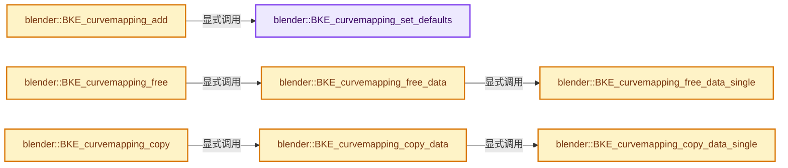
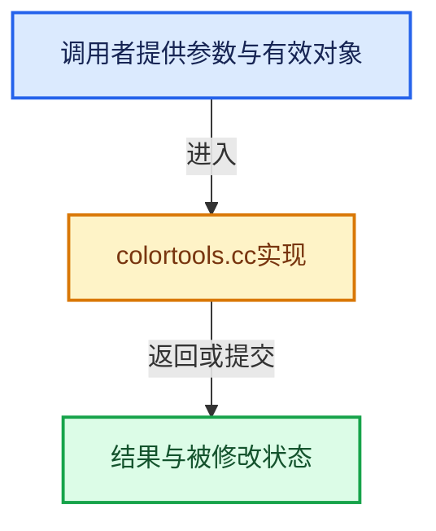

# 实现依赖专题：source/blender/blenkernel/intern/colortools.cc

[方向导航](README.md) · [符号索引](../%E7%AC%A6%E5%8F%B7%E4%BE%9D%E8%B5%96%E4%B8%8E%E5%AE%9E%E7%8E%B0%E7%B4%A2%E5%BC%95.md)

本专题从正文实际调用进入，集中保存共享实现。函数有稳定锚点，可从调用处直接跳到对应完整函数；递归与互相调用通过回链组织。

## 本文件的实现关系






## 完整成员与函数实现

<a id="f-fa23e368508d911a"></a>

### `blender::BKE_curvemapping_set_defaults`

实现位置：[source/blender/blenkernel/intern/colortools.cc](../../../../../source/blender/blenkernel/intern/colortools.cc) · L47—L97。

接口参数：

- `CurveMapping *cumap`
- `int tot`
- `float minx`
- `float miny`
- `float maxx`
- `float maxy`
- `eBezTriple_Handle default_handle_type`

**教学注释版**

<!-- annotated:1adf298ef0e86d -->

```cpp
void BKE_curvemapping_set_defaults(CurveMapping *cumap,
                                   int tot,
                                   float minx,
                                   float miny,
                                   float maxx,
                                   float maxy,
                                   eBezTriple_Handle default_handle_type)
{
  int a;
  float clipminx, clipminy, clipmaxx, clipmaxy;

  cumap->flag = CUMA_DO_CLIP | CUMA_EXTEND_EXTRAPOLATE;
  if (tot == 4) {
    cumap->cur = 3; /* rhms, hack for 'col' curve? */
  }

  clipminx = min_ff(minx, maxx);
  clipminy = min_ff(miny, maxy);
  clipmaxx = max_ff(minx, maxx);
  clipmaxy = max_ff(miny, maxy);

  BLI_rctf_init(&cumap->curr, clipminx, clipmaxx, clipminy, clipmaxy);
  cumap->clipr = cumap->curr;

  cumap->white[0] = cumap->white[1] = cumap->white[2] = 1.0f;
  cumap->bwmul[0] = cumap->bwmul[1] = cumap->bwmul[2] = 1.0f;

  for (a = 0; a < tot; a++) {
    if (default_handle_type == HD_VECT) {
      cumap->cm[a].default_handle_type = CUMA_HANDLE_VECTOR;
    }
    else if (default_handle_type == HD_AUTO_ANIM) {
      cumap->cm[a].default_handle_type = CUMA_HANDLE_AUTO_ANIM;
    }
    else {
      cumap->cm[a].default_handle_type = {};
    }

    cumap->cm[a].totpoint = 2;
    cumap->cm[a].curve = MEM_new_array<CurveMapPoint>(2, "curve points");

    cumap->cm[a].curve[0].x = minx;
    cumap->cm[a].curve[0].y = miny;
    cumap->cm[a].curve[0].flag |= cumap->cm[a].default_handle_type;
    cumap->cm[a].curve[1].x = maxx;
    cumap->cm[a].curve[1].y = maxy;
    cumap->cm[a].curve[1].flag |= cumap->cm[a].default_handle_type;
  }

  cumap->changed_timestamp = 0;
}
```

<details>
<summary>核对原始源码：source/blender/blenkernel/intern/colortools.cc · L47—L97</summary>

<!-- original:1adf298ef0e86d:source/blender/blenkernel/intern/colortools.cc:47:97 -->

```cpp
void BKE_curvemapping_set_defaults(CurveMapping *cumap,
                                   int tot,
                                   float minx,
                                   float miny,
                                   float maxx,
                                   float maxy,
                                   eBezTriple_Handle default_handle_type)
{
  int a;
  float clipminx, clipminy, clipmaxx, clipmaxy;

  cumap->flag = CUMA_DO_CLIP | CUMA_EXTEND_EXTRAPOLATE;
  if (tot == 4) {
    cumap->cur = 3; /* rhms, hack for 'col' curve? */
  }

  clipminx = min_ff(minx, maxx);
  clipminy = min_ff(miny, maxy);
  clipmaxx = max_ff(minx, maxx);
  clipmaxy = max_ff(miny, maxy);

  BLI_rctf_init(&cumap->curr, clipminx, clipmaxx, clipminy, clipmaxy);
  cumap->clipr = cumap->curr;

  cumap->white[0] = cumap->white[1] = cumap->white[2] = 1.0f;
  cumap->bwmul[0] = cumap->bwmul[1] = cumap->bwmul[2] = 1.0f;

  for (a = 0; a < tot; a++) {
    if (default_handle_type == HD_VECT) {
      cumap->cm[a].default_handle_type = CUMA_HANDLE_VECTOR;
    }
    else if (default_handle_type == HD_AUTO_ANIM) {
      cumap->cm[a].default_handle_type = CUMA_HANDLE_AUTO_ANIM;
    }
    else {
      cumap->cm[a].default_handle_type = {};
    }

    cumap->cm[a].totpoint = 2;
    cumap->cm[a].curve = MEM_new_array<CurveMapPoint>(2, "curve points");

    cumap->cm[a].curve[0].x = minx;
    cumap->cm[a].curve[0].y = miny;
    cumap->cm[a].curve[0].flag |= cumap->cm[a].default_handle_type;
    cumap->cm[a].curve[1].x = maxx;
    cumap->cm[a].curve[1].y = maxy;
    cumap->cm[a].curve[1].flag |= cumap->cm[a].default_handle_type;
  }

  cumap->changed_timestamp = 0;
}
```

</details>

**沿实际写入检查状态**

- `cumap->flag = CUMA_DO_CLIP | CUMA_EXTEND_EXTRAPOLATE;`
- `cumap->cur = 3; /* rhms, hack for 'col' curve? */`
- `clipminx = min_ff(minx, maxx);`
- `clipminy = min_ff(miny, maxy);`
- `clipmaxx = max_ff(minx, maxx);`
- `clipmaxy = max_ff(miny, maxy);`
- `cumap->clipr = cumap->curr;`
- `cumap->white[0] = cumap->white[1] = cumap->white[2] = 1.0f;`
- `cumap->bwmul[0] = cumap->bwmul[1] = cumap->bwmul[2] = 1.0f;`
- `cumap->cm[a].default_handle_type = CUMA_HANDLE_VECTOR;`
- `cumap->cm[a].default_handle_type = CUMA_HANDLE_AUTO_ANIM;`
- `cumap->cm[a].default_handle_type = {};`
- `cumap->cm[a].totpoint = 2;`
- `cumap->cm[a].curve = MEM_new_array<CurveMapPoint>(2, "curve points");`
- `cumap->cm[a].curve[0].x = minx;`
- `cumap->cm[a].curve[0].y = miny;`
- `cumap->cm[a].curve[0].flag |= cumap->cm[a].default_handle_type;`
- `cumap->cm[a].curve[1].x = maxx;`
- `cumap->cm[a].curve[1].y = maxy;`
- `cumap->cm[a].curve[1].flag |= cumap->cm[a].default_handle_type;`
- `cumap->changed_timestamp = 0;`

**继续追踪实现**

- `min_ff` → [blender::min_ff · L321](../12-%E7%A9%BA%E9%97%B4%E6%95%B0%E6%8D%AE%E7%BB%93%E6%9E%84%E4%B8%8E%E5%87%A0%E4%BD%95%E7%AE%97%E6%B3%95/%E4%BE%9D%E8%B5%96-math_base_inline-546b00.md#f-5b8d83d6f191be1a)。
- `max_ff` → [blender::max_ff · L325](../12-%E7%A9%BA%E9%97%B4%E6%95%B0%E6%8D%AE%E7%BB%93%E6%9E%84%E4%B8%8E%E5%87%A0%E4%BD%95%E7%AE%97%E6%B3%95/%E4%BE%9D%E8%B5%96-math_base_inline-546b00.md#f-05a351a3afd7dc2a)。
- `BLI_rctf_init` → [blender::BLI_rctf_init · L418](../01-%E5%9F%BA%E7%A1%80%E5%AE%B9%E5%99%A8%E4%B8%8E%E7%8E%B0%E4%BB%A3CPP/%E4%BE%9D%E8%B5%96-rct-6e7349.md#f-7309aa09333d3736)。
- `MEM_new_array<CurveMapPoint>` → [MEM_new_array · L372](../03-%E5%86%85%E5%AD%98%E5%88%86%E9%85%8D%E4%B8%8E%E8%BF%90%E8%A1%8C%E6%97%B6%E7%B1%BB%E5%9E%8B/%E4%BE%9D%E8%B5%96-MEM_guardedalloc-b54eca.md#f-56b8fe3d391af460)。

<a id="f-5eb2107731235af2"></a>

### `blender::BKE_curvemapping_add`

实现位置：[source/blender/blenkernel/intern/colortools.cc](../../../../../source/blender/blenkernel/intern/colortools.cc) · L99—L108。

接口参数：

- `int tot`
- `float minx`
- `float miny`
- `float maxx`
- `float maxy`

**教学注释版**

<!-- annotated:835bc0973a3661 -->

```cpp
CurveMapping *BKE_curvemapping_add(int tot, float minx, float miny, float maxx, float maxy)
{
  CurveMapping *cumap;

  cumap = MEM_new<CurveMapping>("new curvemap");

  BKE_curvemapping_set_defaults(cumap, tot, minx, miny, maxx, maxy, HD_AUTO);

  return cumap;
}
```

<details>
<summary>核对原始源码：source/blender/blenkernel/intern/colortools.cc · L99—L108</summary>

<!-- original:835bc0973a3661:source/blender/blenkernel/intern/colortools.cc:99:108 -->

```cpp
CurveMapping *BKE_curvemapping_add(int tot, float minx, float miny, float maxx, float maxy)
{
  CurveMapping *cumap;

  cumap = MEM_new<CurveMapping>("new curvemap");

  BKE_curvemapping_set_defaults(cumap, tot, minx, miny, maxx, maxy, HD_AUTO);

  return cumap;
}
```

</details>

**沿实际写入检查状态**

- `cumap = MEM_new<CurveMapping>("new curvemap");`

**结果出口**

- `return cumap;`

**继续追踪实现**

- `MEM_new<CurveMapping>` → [MEM_new · L351](../03-%E5%86%85%E5%AD%98%E5%88%86%E9%85%8D%E4%B8%8E%E8%BF%90%E8%A1%8C%E6%97%B6%E7%B1%BB%E5%9E%8B/%E4%BE%9D%E8%B5%96-MEM_guardedalloc-b54eca.md#f-115f9b6784f89912)。
- `BKE_curvemapping_set_defaults` → [blender::BKE_curvemapping_set_defaults · L47](%E4%BE%9D%E8%B5%96-colortools-8bc37a.md#f-fa23e368508d911a)。

<a id="f-2f4d77f6e78e323a"></a>

### `blender::BKE_curvemapping_free_data_single`

实现位置：[source/blender/blenkernel/intern/colortools.cc](../../../../../source/blender/blenkernel/intern/colortools.cc) · L110—L124。

接口参数：

- `CurveMapping *cumap`
- `int index`

**教学注释版**

<!-- annotated:710976965f878d -->

```cpp
void BKE_curvemapping_free_data_single(CurveMapping *cumap, int index)
{
  if (cumap->cm[index].curve) {
    MEM_delete(cumap->cm[index].curve);
    cumap->cm[index].curve = nullptr;
  }
  if (cumap->cm[index].table) {
    MEM_delete(cumap->cm[index].table);
    cumap->cm[index].table = nullptr;
  }
  if (cumap->cm[index].premultable) {
    MEM_delete(cumap->cm[index].premultable);
    cumap->cm[index].premultable = nullptr;
  }
}
```

<details>
<summary>核对原始源码：source/blender/blenkernel/intern/colortools.cc · L110—L124</summary>

<!-- original:710976965f878d:source/blender/blenkernel/intern/colortools.cc:110:124 -->

```cpp
void BKE_curvemapping_free_data_single(CurveMapping *cumap, int index)
{
  if (cumap->cm[index].curve) {
    MEM_delete(cumap->cm[index].curve);
    cumap->cm[index].curve = nullptr;
  }
  if (cumap->cm[index].table) {
    MEM_delete(cumap->cm[index].table);
    cumap->cm[index].table = nullptr;
  }
  if (cumap->cm[index].premultable) {
    MEM_delete(cumap->cm[index].premultable);
    cumap->cm[index].premultable = nullptr;
  }
}
```

</details>

**沿实际写入检查状态**

- `cumap->cm[index].curve = nullptr;`
- `cumap->cm[index].table = nullptr;`
- `cumap->cm[index].premultable = nullptr;`

**继续追踪实现**

- `MEM_delete` → [MEM_delete · L400](../03-%E5%86%85%E5%AD%98%E5%88%86%E9%85%8D%E4%B8%8E%E8%BF%90%E8%A1%8C%E6%97%B6%E7%B1%BB%E5%9E%8B/%E4%BE%9D%E8%B5%96-MEM_guardedalloc-b54eca.md#f-9049ffdd1682887c)。

<a id="f-01d23d2310845327"></a>

### `blender::BKE_curvemapping_free_data`

实现位置：[source/blender/blenkernel/intern/colortools.cc](../../../../../source/blender/blenkernel/intern/colortools.cc) · L126—L133。

接口参数：

- `CurveMapping *cumap`

**教学注释版**

<!-- annotated:f19e9e87c287a1 -->

```cpp
void BKE_curvemapping_free_data(CurveMapping *cumap)
{
  int a;

  for (a = 0; a < CM_TOT; a++) {
    BKE_curvemapping_free_data_single(cumap, a);
  }
}
```

<details>
<summary>核对原始源码：source/blender/blenkernel/intern/colortools.cc · L126—L133</summary>

<!-- original:f19e9e87c287a1:source/blender/blenkernel/intern/colortools.cc:126:133 -->

```cpp
void BKE_curvemapping_free_data(CurveMapping *cumap)
{
  int a;

  for (a = 0; a < CM_TOT; a++) {
    BKE_curvemapping_free_data_single(cumap, a);
  }
}
```

</details>

**继续追踪实现**

- `BKE_curvemapping_free_data_single` → [blender::BKE_curvemapping_free_data_single · L110](%E4%BE%9D%E8%B5%96-colortools-8bc37a.md#f-2f4d77f6e78e323a)。

<a id="f-8bede43499273823"></a>

### `blender::BKE_curvemapping_free`

实现位置：[source/blender/blenkernel/intern/colortools.cc](../../../../../source/blender/blenkernel/intern/colortools.cc) · L135—L141。

接口参数：

- `CurveMapping *cumap`

**教学注释版**

<!-- annotated:f3db5e49a83ba9 -->

```cpp
void BKE_curvemapping_free(CurveMapping *cumap)
{
  if (cumap) {
    BKE_curvemapping_free_data(cumap);
    MEM_delete(cumap);
  }
}
```

<details>
<summary>核对原始源码：source/blender/blenkernel/intern/colortools.cc · L135—L141</summary>

<!-- original:f3db5e49a83ba9:source/blender/blenkernel/intern/colortools.cc:135:141 -->

```cpp
void BKE_curvemapping_free(CurveMapping *cumap)
{
  if (cumap) {
    BKE_curvemapping_free_data(cumap);
    MEM_delete(cumap);
  }
}
```

</details>

**继续追踪实现**

- `BKE_curvemapping_free_data` → [blender::BKE_curvemapping_free_data · L126](%E4%BE%9D%E8%B5%96-colortools-8bc37a.md#f-01d23d2310845327)。
- `MEM_delete` → [MEM_delete · L400](../03-%E5%86%85%E5%AD%98%E5%88%86%E9%85%8D%E4%B8%8E%E8%BF%90%E8%A1%8C%E6%97%B6%E7%B1%BB%E5%9E%8B/%E4%BE%9D%E8%B5%96-MEM_guardedalloc-b54eca.md#f-9049ffdd1682887c)。

<a id="f-e5a55b7728691025"></a>

### `blender::BKE_curvemapping_copy_data_single`

实现位置：[source/blender/blenkernel/intern/colortools.cc](../../../../../source/blender/blenkernel/intern/colortools.cc) · L143—L162。

接口参数：

- `CurveMapping *target`
- `const CurveMapping *cumap`
- `int to_idx`
- `int from_idx`
- `bool make_copy`

**教学注释版**

<!-- annotated:2651388413d446 -->

```cpp
void BKE_curvemapping_copy_data_single(
    CurveMapping *target, const CurveMapping *cumap, int to_idx, int from_idx, bool make_copy)
{
  if (make_copy) {
    target->cm[to_idx] = dna::shallow_copy(cumap->cm[from_idx]);
  }

  if (cumap->cm[from_idx].curve) {
    target->cm[to_idx].curve = static_cast<CurveMapPoint *>(
        MEM_dupalloc(cumap->cm[from_idx].curve));
  }
  if (cumap->cm[from_idx].table) {
    target->cm[to_idx].table = static_cast<CurveMapPoint *>(
        MEM_dupalloc(cumap->cm[from_idx].table));
  }
  if (cumap->cm[from_idx].premultable) {
    target->cm[to_idx].premultable = static_cast<CurveMapPoint *>(
        MEM_dupalloc(cumap->cm[from_idx].premultable));
  }
}
```

<details>
<summary>核对原始源码：source/blender/blenkernel/intern/colortools.cc · L143—L162</summary>

<!-- original:2651388413d446:source/blender/blenkernel/intern/colortools.cc:143:162 -->

```cpp
void BKE_curvemapping_copy_data_single(
    CurveMapping *target, const CurveMapping *cumap, int to_idx, int from_idx, bool make_copy)
{
  if (make_copy) {
    target->cm[to_idx] = dna::shallow_copy(cumap->cm[from_idx]);
  }

  if (cumap->cm[from_idx].curve) {
    target->cm[to_idx].curve = static_cast<CurveMapPoint *>(
        MEM_dupalloc(cumap->cm[from_idx].curve));
  }
  if (cumap->cm[from_idx].table) {
    target->cm[to_idx].table = static_cast<CurveMapPoint *>(
        MEM_dupalloc(cumap->cm[from_idx].table));
  }
  if (cumap->cm[from_idx].premultable) {
    target->cm[to_idx].premultable = static_cast<CurveMapPoint *>(
        MEM_dupalloc(cumap->cm[from_idx].premultable));
  }
}
```

</details>

**沿实际写入检查状态**

- `target->cm[to_idx] = dna::shallow_copy(cumap->cm[from_idx]);`
- `target->cm[to_idx].curve = static_cast<CurveMapPoint *>(`
- `target->cm[to_idx].table = static_cast<CurveMapPoint *>(`
- `target->cm[to_idx].premultable = static_cast<CurveMapPoint *>(`

**继续追踪实现**

- `dna::shallow_copy` → [blender::dna::shallow_copy · L146](%E4%BE%9D%E8%B5%96-DNA_defs-ed47fd.md#f-84b6eda95a1c994c)。
- `MEM_dupalloc` → [MEM_dupalloc · L627](../03-%E5%86%85%E5%AD%98%E5%88%86%E9%85%8D%E4%B8%8E%E8%BF%90%E8%A1%8C%E6%97%B6%E7%B1%BB%E5%9E%8B/%E4%BE%9D%E8%B5%96-MEM_guardedalloc-b54eca.md#f-78a72b71e3c57010)。

<a id="f-75ef85bc493a6195"></a>

### `blender::BKE_curvemapping_copy_data`

实现位置：[source/blender/blenkernel/intern/colortools.cc](../../../../../source/blender/blenkernel/intern/colortools.cc) · L164—L173。

接口参数：

- `CurveMapping *target`
- `const CurveMapping *cumap`

**教学注释版**

<!-- annotated:9c30f2e95a22d3 -->

```cpp
void BKE_curvemapping_copy_data(CurveMapping *target, const CurveMapping *cumap)
{
  int a;

  *target = dna::shallow_copy(*cumap);

  for (a = 0; a < CM_TOT; a++) {
    BKE_curvemapping_copy_data_single(target, cumap, a, a, false);
  }
}
```

<details>
<summary>核对原始源码：source/blender/blenkernel/intern/colortools.cc · L164—L173</summary>

<!-- original:9c30f2e95a22d3:source/blender/blenkernel/intern/colortools.cc:164:173 -->

```cpp
void BKE_curvemapping_copy_data(CurveMapping *target, const CurveMapping *cumap)
{
  int a;

  *target = dna::shallow_copy(*cumap);

  for (a = 0; a < CM_TOT; a++) {
    BKE_curvemapping_copy_data_single(target, cumap, a, a, false);
  }
}
```

</details>

**继续追踪实现**

- `dna::shallow_copy` → [blender::dna::shallow_copy · L146](%E4%BE%9D%E8%B5%96-DNA_defs-ed47fd.md#f-84b6eda95a1c994c)。
- `BKE_curvemapping_copy_data_single` → [blender::BKE_curvemapping_copy_data_single · L143](%E4%BE%9D%E8%B5%96-colortools-8bc37a.md#f-e5a55b7728691025)。

<a id="f-06fdd8ce5d9a5b10"></a>

### `blender::BKE_curvemapping_copy`

实现位置：[source/blender/blenkernel/intern/colortools.cc](../../../../../source/blender/blenkernel/intern/colortools.cc) · L175—L183。

接口参数：

- `const CurveMapping *cumap`

**教学注释版**

<!-- annotated:f67aaffc36139b -->

```cpp
CurveMapping *BKE_curvemapping_copy(const CurveMapping *cumap)
{
  if (cumap) {
    CurveMapping *cumapn = MEM_dupalloc(cumap);
    BKE_curvemapping_copy_data(cumapn, cumap);
    return cumapn;
  }
  return nullptr;
}
```

<details>
<summary>核对原始源码：source/blender/blenkernel/intern/colortools.cc · L175—L183</summary>

<!-- original:f67aaffc36139b:source/blender/blenkernel/intern/colortools.cc:175:183 -->

```cpp
CurveMapping *BKE_curvemapping_copy(const CurveMapping *cumap)
{
  if (cumap) {
    CurveMapping *cumapn = MEM_dupalloc(cumap);
    BKE_curvemapping_copy_data(cumapn, cumap);
    return cumapn;
  }
  return nullptr;
}
```

</details>

**结果出口**

- `return cumapn;`
- `return nullptr;`

**继续追踪实现**

- `MEM_dupalloc` → [MEM_dupalloc · L627](../03-%E5%86%85%E5%AD%98%E5%88%86%E9%85%8D%E4%B8%8E%E8%BF%90%E8%A1%8C%E6%97%B6%E7%B1%BB%E5%9E%8B/%E4%BE%9D%E8%B5%96-MEM_guardedalloc-b54eca.md#f-78a72b71e3c57010)。
- `BKE_curvemapping_copy_data` → [blender::BKE_curvemapping_copy_data · L164](%E4%BE%9D%E8%B5%96-colortools-8bc37a.md#f-75ef85bc493a6195)。

<a id="f-1254eccf0eaca157"></a>

### `blender::BKE_curvemap_remove`

实现位置：[source/blender/blenkernel/intern/colortools.cc](../../../../../source/blender/blenkernel/intern/colortools.cc) · L244—L265。

接口参数：

- `CurveMap *cuma`
- `const short flag`

**教学注释版**

<!-- annotated:6430cf9590ba6f -->

```cpp
void BKE_curvemap_remove(CurveMap *cuma, const short flag)
{
  CurveMapPoint *cmp = MEM_new_array<CurveMapPoint>(size_t(cuma->totpoint), "curve points");
  int a, b, removed = 0;

  /* well, lets keep the two outer points! */
  cmp[0] = cuma->curve[0];
  for (a = 1, b = 1; a < cuma->totpoint - 1; a++) {
    if (!(cuma->curve[a].flag & flag)) {
      cmp[b] = cuma->curve[a];
      b++;
    }
    else {
      removed++;
    }
  }
  cmp[b] = cuma->curve[a];

  MEM_delete(cuma->curve);
  cuma->curve = cmp;
  cuma->totpoint -= removed;
}
```

<details>
<summary>核对原始源码：source/blender/blenkernel/intern/colortools.cc · L244—L265</summary>

<!-- original:6430cf9590ba6f:source/blender/blenkernel/intern/colortools.cc:244:265 -->

```cpp
void BKE_curvemap_remove(CurveMap *cuma, const short flag)
{
  CurveMapPoint *cmp = MEM_new_array<CurveMapPoint>(size_t(cuma->totpoint), "curve points");
  int a, b, removed = 0;

  /* well, lets keep the two outer points! */
  cmp[0] = cuma->curve[0];
  for (a = 1, b = 1; a < cuma->totpoint - 1; a++) {
    if (!(cuma->curve[a].flag & flag)) {
      cmp[b] = cuma->curve[a];
      b++;
    }
    else {
      removed++;
    }
  }
  cmp[b] = cuma->curve[a];

  MEM_delete(cuma->curve);
  cuma->curve = cmp;
  cuma->totpoint -= removed;
}
```

</details>

**沿实际写入检查状态**

- `cmp[0] = cuma->curve[0];`
- `cmp[b] = cuma->curve[a];`
- `cuma->curve = cmp;`
- `cuma->totpoint -= removed;`

**继续追踪实现**

- `MEM_new_array<CurveMapPoint>` → [MEM_new_array · L372](../03-%E5%86%85%E5%AD%98%E5%88%86%E9%85%8D%E4%B8%8E%E8%BF%90%E8%A1%8C%E6%97%B6%E7%B1%BB%E5%9E%8B/%E4%BE%9D%E8%B5%96-MEM_guardedalloc-b54eca.md#f-56b8fe3d391af460)。
- `MEM_delete` → [MEM_delete · L400](../03-%E5%86%85%E5%AD%98%E5%88%86%E9%85%8D%E4%B8%8E%E8%BF%90%E8%A1%8C%E6%97%B6%E7%B1%BB%E5%9E%8B/%E4%BE%9D%E8%B5%96-MEM_guardedalloc-b54eca.md#f-9049ffdd1682887c)。

<a id="f-5f2da34151e0d25a"></a>

### `blender::BKE_curvemap_insert`

实现位置：[source/blender/blenkernel/intern/colortools.cc](../../../../../source/blender/blenkernel/intern/colortools.cc) · L267—L299。

接口参数：

- `CurveMap *cuma`
- `float x`
- `float y`

**教学注释版**

<!-- annotated:ff96a8ce80a2b9 -->

```cpp
CurveMapPoint *BKE_curvemap_insert(CurveMap *cuma, float x, float y)
{
  cuma->totpoint++;
  CurveMapPoint *new_path = MEM_new_array<CurveMapPoint>(size_t(cuma->totpoint), "curve points");
  CurveMapPoint *new_pt = nullptr;

  /* Insert fragments of the old one and the new point to the new curve. */
  bool foundloc = false;
  for (int i_new = 0, i_old = 0; i_new < cuma->totpoint; i_new++) {
    if ((foundloc == false) && ((i_new + 1 == cuma->totpoint) || (x < cuma->curve[i_new].x))) {
      new_path[i_new].x = x;
      new_path[i_new].y = y;
      new_path[i_new].flag = CUMA_SELECT;
      new_path[i_new].flag |= cuma->default_handle_type;
      foundloc = true;
      new_pt = &new_path[i_new];
    }
    else {
      new_path[i_new].x = cuma->curve[i_old].x;
      new_path[i_new].y = cuma->curve[i_old].y;
      /* Make sure old points don't remain selected and active. */
      new_path[i_new].flag = cuma->curve[i_old].flag & ~(CUMA_SELECT | CUMA_ACTIVE);
      new_path[i_new].shorty = cuma->curve[i_old].shorty;
      i_old++;
    }
  }

  /* Free old curve and replace it with new one. */
  MEM_delete(cuma->curve);
  cuma->curve = new_path;

  return new_pt;
}
```

<details>
<summary>核对原始源码：source/blender/blenkernel/intern/colortools.cc · L267—L299</summary>

<!-- original:ff96a8ce80a2b9:source/blender/blenkernel/intern/colortools.cc:267:299 -->

```cpp
CurveMapPoint *BKE_curvemap_insert(CurveMap *cuma, float x, float y)
{
  cuma->totpoint++;
  CurveMapPoint *new_path = MEM_new_array<CurveMapPoint>(size_t(cuma->totpoint), "curve points");
  CurveMapPoint *new_pt = nullptr;

  /* Insert fragments of the old one and the new point to the new curve. */
  bool foundloc = false;
  for (int i_new = 0, i_old = 0; i_new < cuma->totpoint; i_new++) {
    if ((foundloc == false) && ((i_new + 1 == cuma->totpoint) || (x < cuma->curve[i_new].x))) {
      new_path[i_new].x = x;
      new_path[i_new].y = y;
      new_path[i_new].flag = CUMA_SELECT;
      new_path[i_new].flag |= cuma->default_handle_type;
      foundloc = true;
      new_pt = &new_path[i_new];
    }
    else {
      new_path[i_new].x = cuma->curve[i_old].x;
      new_path[i_new].y = cuma->curve[i_old].y;
      /* Make sure old points don't remain selected and active. */
      new_path[i_new].flag = cuma->curve[i_old].flag & ~(CUMA_SELECT | CUMA_ACTIVE);
      new_path[i_new].shorty = cuma->curve[i_old].shorty;
      i_old++;
    }
  }

  /* Free old curve and replace it with new one. */
  MEM_delete(cuma->curve);
  cuma->curve = new_path;

  return new_pt;
}
```

</details>

**沿实际写入检查状态**

- `new_path[i_new].x = x;`
- `new_path[i_new].y = y;`
- `new_path[i_new].flag = CUMA_SELECT;`
- `new_path[i_new].flag |= cuma->default_handle_type;`
- `foundloc = true;`
- `new_pt = &new_path[i_new];`
- `new_path[i_new].x = cuma->curve[i_old].x;`
- `new_path[i_new].y = cuma->curve[i_old].y;`
- `new_path[i_new].flag = cuma->curve[i_old].flag & ~(CUMA_SELECT | CUMA_ACTIVE);`
- `new_path[i_new].shorty = cuma->curve[i_old].shorty;`
- `cuma->curve = new_path;`

**结果出口**

- `return new_pt;`

**继续追踪实现**

- `MEM_new_array<CurveMapPoint>` → [MEM_new_array · L372](../03-%E5%86%85%E5%AD%98%E5%88%86%E9%85%8D%E4%B8%8E%E8%BF%90%E8%A1%8C%E6%97%B6%E7%B1%BB%E5%9E%8B/%E4%BE%9D%E8%B5%96-MEM_guardedalloc-b54eca.md#f-56b8fe3d391af460)。
- `MEM_delete` → [MEM_delete · L400](../03-%E5%86%85%E5%AD%98%E5%88%86%E9%85%8D%E4%B8%8E%E8%BF%90%E8%A1%8C%E6%97%B6%E7%B1%BB%E5%9E%8B/%E4%BE%9D%E8%B5%96-MEM_guardedalloc-b54eca.md#f-9049ffdd1682887c)。

<a id="f-1994e7546d0d653c"></a>

### `blender::BKE_curvemap_reset`

实现位置：[source/blender/blenkernel/intern/colortools.cc](../../../../../source/blender/blenkernel/intern/colortools.cc) · L301—L524。

接口参数：

- `CurveMap *cuma`
- `const rctf *clipr`
- `int preset`
- `CurveMapSlopeType slope`

**教学注释版**

<!-- annotated:27fe0bc7246e6d -->

```cpp
void BKE_curvemap_reset(CurveMap *cuma, const rctf *clipr, int preset, CurveMapSlopeType slope)
{
  if (cuma->curve) {
    MEM_delete(cuma->curve);
  }

  switch (preset) {
    case CURVE_PRESET_LINE:
    case CURVE_PRESET_CONSTANT_MEDIAN:
      cuma->totpoint = 2;
      break;
    case CURVE_PRESET_SHARP:
      cuma->totpoint = 5;
      break;
    case CURVE_PRESET_SMOOTH:
      cuma->totpoint = 8;
      break;
    case CURVE_PRESET_MAX:
      cuma->totpoint = 2;
      break;
    case CURVE_PRESET_MID8:
      cuma->totpoint = 8;
      break;
    case CURVE_PRESET_ROUND:
      cuma->totpoint = 6;
      break;
    case CURVE_PRESET_ROOT:
      cuma->totpoint = 6;
      break;
    case CURVE_PRESET_GAUSS:
      cuma->totpoint = 7;
      break;
    case CURVE_PRESET_BELL:
      cuma->totpoint = 3;
      break;
  }

  cuma->curve = MEM_new_array<CurveMapPoint>(cuma->totpoint, "curve points");

  for (int i = 0; i < cuma->totpoint; i++) {
    cuma->curve[i].flag = cuma->default_handle_type;
  }

  switch (preset) {
    case CURVE_PRESET_LINE:
      cuma->curve[0].x = clipr->xmin;
      cuma->curve[0].y = clipr->ymax;
      cuma->curve[1].x = clipr->xmax;
      cuma->curve[1].y = clipr->ymin;
      if (slope == CurveMapSlopeType::PositiveNegative) {
        cuma->curve[0].flag &= ~CUMA_HANDLE_AUTO_ANIM;
        cuma->curve[1].flag &= ~CUMA_HANDLE_AUTO_ANIM;
        cuma->curve[0].flag |= CUMA_HANDLE_VECTOR;
        cuma->curve[1].flag |= CUMA_HANDLE_VECTOR;
      }
      break;
    case CURVE_PRESET_CONSTANT_MEDIAN:
      cuma->curve[0].x = clipr->xmin;
      cuma->curve[0].y = (clipr->ymin + clipr->ymax) / 2.0f;
      cuma->curve[1].x = clipr->xmax;
      cuma->curve[1].y = (clipr->ymin + clipr->ymax) / 2.0f;
      break;
    case CURVE_PRESET_SHARP:
      cuma->curve[0].x = 0;
      cuma->curve[0].y = 1;
      cuma->curve[1].x = 0.25;
      cuma->curve[1].y = 0.5625;
      cuma->curve[2].x = 0.50;
      cuma->curve[2].y = 0.25;
      cuma->curve[3].x = 0.75;
      cuma->curve[3].y = 0.0625;
      cuma->curve[4].x = 1;
      cuma->curve[4].y = 0;
      if (slope == CurveMapSlopeType::PositiveNegative) {
        cuma->curve[0].flag &= ~CUMA_HANDLE_AUTO_ANIM;
        cuma->curve[0].flag |= CUMA_HANDLE_VECTOR;
        cuma->curve[4].flag &= ~CUMA_HANDLE_AUTO_ANIM;
        cuma->curve[4].flag |= CUMA_HANDLE_VECTOR;
      }
      break;
    case CURVE_PRESET_SMOOTH:
      cuma->curve[0].x = 0;
      cuma->curve[0].y = 1;
      cuma->curve[1].x = 0.12;
      cuma->curve[1].y = 0.96;
      cuma->curve[2].x = 0.25;
      cuma->curve[2].y = 0.84;
      cuma->curve[3].x = 0.42;
      cuma->curve[3].y = 0.62;
      cuma->curve[4].x = 0.58;
      cuma->curve[4].y = 0.38;
      cuma->curve[5].x = 0.75;
      cuma->curve[5].y = 0.16;
      cuma->curve[6].x = 0.88;
      cuma->curve[6].y = 0.04;
      cuma->curve[7].x = 1;
      cuma->curve[7].y = 0;
      break;
    case CURVE_PRESET_MAX:
      cuma->curve[0].x = 0;
      cuma->curve[0].y = 1;
      cuma->curve[1].x = 1;
      cuma->curve[1].y = 1;
      break;
    case CURVE_PRESET_MID8: {
      for (int i = 0; i < cuma->totpoint; i++) {
        cuma->curve[i].x = i / float(cuma->totpoint);
        cuma->curve[i].y = 0.5;
      }
      break;
    }
    case CURVE_PRESET_ROUND:
      cuma->curve[0].x = 0;
      cuma->curve[0].y = 1;
      cuma->curve[1].x = 0.5;
      cuma->curve[1].y = 0.866;
      cuma->curve[2].x = 0.6765;
      cuma->curve[2].y = 0.7364;
      cuma->curve[3].x = 0.8582;
      cuma->curve[3].y = 0.5133;
      cuma->curve[4].x = 0.967;
      cuma->curve[4].y = 0.2547;
      cuma->curve[5].x = 1;
      cuma->curve[5].y = 0;
      break;
    case CURVE_PRESET_ROOT:
      cuma->curve[0].x = 0;
      cuma->curve[0].y = 1;
      cuma->curve[1].x = 0.25;
      cuma->curve[1].y = 0.866;
      cuma->curve[2].x = 0.5;
      cuma->curve[2].y = 0.707;
      cuma->curve[3].x = 0.75;
      cuma->curve[3].y = 0.5;
      cuma->curve[4].x = 0.9375;
      cuma->curve[4].y = 0.25;
      cuma->curve[5].x = 1;
      cuma->curve[5].y = 0;
      if (slope == CurveMapSlopeType::PositiveNegative) {
        cuma->curve[0].flag &= ~CUMA_HANDLE_AUTO_ANIM;
        cuma->curve[0].flag |= CUMA_HANDLE_VECTOR;
        cuma->curve[5].flag &= ~CUMA_HANDLE_AUTO_ANIM;
        cuma->curve[5].flag |= CUMA_HANDLE_VECTOR;
      }
      break;
    case CURVE_PRESET_GAUSS:
      cuma->curve[0].x = 0;
      cuma->curve[0].y = 0.025f;
      cuma->curve[1].x = 0.16f;
      cuma->curve[1].y = 0.135f;
      cuma->curve[2].x = 0.298f;
      cuma->curve[2].y = 0.36f;

      cuma->curve[3].x = 0.50f;
      cuma->curve[3].y = 1.0f;

      cuma->curve[4].x = 0.70f;
      cuma->curve[4].y = 0.36f;
      cuma->curve[5].x = 0.84f;
      cuma->curve[5].y = 0.135f;
      cuma->curve[6].x = 1.0f;
      cuma->curve[6].y = 0.025f;
      break;
    case CURVE_PRESET_BELL:
      cuma->curve[0].x = 0.0f;
      cuma->curve[0].y = 0.025f;

      cuma->curve[1].x = 0.50f;
      cuma->curve[1].y = 1.0f;

      cuma->curve[2].x = 1.0f;
      cuma->curve[2].y = 0.025f;
      break;
  }

  /* mirror curve in x direction to have positive slope
   * rather than default negative slope */
  if (slope == CurveMapSlopeType::Positive) {
    if (ELEM(preset, CURVE_PRESET_LINE, CURVE_PRESET_CONSTANT_MEDIAN)) {
      BLI_assert(cuma->totpoint == 2);
      /* The LINE and CONSTANT_MEDIAN presets are defined by a single pair of points, relative to
       * the clip region. */
      std::swap(cuma->curve[0].y, cuma->curve[1].y);
    }
    else if (preset == CURVE_PRESET_MID8) {
      /* All points in the MID8 preset have y = 0.5, so no action is needed. */
    }
    else {
      int i, last = cuma->totpoint - 1;
      /* For all curves other than the LINE and CONSTANT_MEDIAN curves, we assume that the x period
       * is from [0.0, 1.0] inclusive. Resetting the curve for these presets does not take into
       * account the current clipping region. */
      BLI_assert(cuma->curve[0].x == 0.0f && cuma->curve[last].x == 1.0f);
      CurveMapPoint *newpoints = MEM_dupalloc(cuma->curve);
      for (i = 0; i < cuma->totpoint; i++) {
        newpoints[i].x = 1.0f - cuma->curve[last - i].x;
        newpoints[i].y = cuma->curve[last - i].y;
      }
      MEM_delete(cuma->curve);
      cuma->curve = newpoints;
    }
  }
  else if (slope == CurveMapSlopeType::PositiveNegative) {
    const int num_points = cuma->totpoint * 2 - 1;
    CurveMapPoint *new_points = MEM_new_array<CurveMapPoint>(size_t(num_points),
                                                             "curve symmetric points");
    for (int i = 0; i < cuma->totpoint; i++) {
      const int src_last_point = cuma->totpoint - i - 1;
      const int dst_last_point = num_points - i - 1;
      new_points[i] = cuma->curve[src_last_point];
      new_points[i].x = (1.0f - cuma->curve[src_last_point].x) * 0.5f;
      new_points[dst_last_point] = new_points[i];
      new_points[dst_last_point].x = 0.5f + cuma->curve[src_last_point].x * 0.5f;
    }
    cuma->totpoint = num_points;
    MEM_delete(cuma->curve);
    cuma->curve = new_points;
  }

  if (cuma->table) {
    MEM_delete(cuma->table);
    cuma->table = nullptr;
  }
}
```

<details>
<summary>核对原始源码：source/blender/blenkernel/intern/colortools.cc · L301—L524</summary>

<!-- original:27fe0bc7246e6d:source/blender/blenkernel/intern/colortools.cc:301:524 -->

```cpp
void BKE_curvemap_reset(CurveMap *cuma, const rctf *clipr, int preset, CurveMapSlopeType slope)
{
  if (cuma->curve) {
    MEM_delete(cuma->curve);
  }

  switch (preset) {
    case CURVE_PRESET_LINE:
    case CURVE_PRESET_CONSTANT_MEDIAN:
      cuma->totpoint = 2;
      break;
    case CURVE_PRESET_SHARP:
      cuma->totpoint = 5;
      break;
    case CURVE_PRESET_SMOOTH:
      cuma->totpoint = 8;
      break;
    case CURVE_PRESET_MAX:
      cuma->totpoint = 2;
      break;
    case CURVE_PRESET_MID8:
      cuma->totpoint = 8;
      break;
    case CURVE_PRESET_ROUND:
      cuma->totpoint = 6;
      break;
    case CURVE_PRESET_ROOT:
      cuma->totpoint = 6;
      break;
    case CURVE_PRESET_GAUSS:
      cuma->totpoint = 7;
      break;
    case CURVE_PRESET_BELL:
      cuma->totpoint = 3;
      break;
  }

  cuma->curve = MEM_new_array<CurveMapPoint>(cuma->totpoint, "curve points");

  for (int i = 0; i < cuma->totpoint; i++) {
    cuma->curve[i].flag = cuma->default_handle_type;
  }

  switch (preset) {
    case CURVE_PRESET_LINE:
      cuma->curve[0].x = clipr->xmin;
      cuma->curve[0].y = clipr->ymax;
      cuma->curve[1].x = clipr->xmax;
      cuma->curve[1].y = clipr->ymin;
      if (slope == CurveMapSlopeType::PositiveNegative) {
        cuma->curve[0].flag &= ~CUMA_HANDLE_AUTO_ANIM;
        cuma->curve[1].flag &= ~CUMA_HANDLE_AUTO_ANIM;
        cuma->curve[0].flag |= CUMA_HANDLE_VECTOR;
        cuma->curve[1].flag |= CUMA_HANDLE_VECTOR;
      }
      break;
    case CURVE_PRESET_CONSTANT_MEDIAN:
      cuma->curve[0].x = clipr->xmin;
      cuma->curve[0].y = (clipr->ymin + clipr->ymax) / 2.0f;
      cuma->curve[1].x = clipr->xmax;
      cuma->curve[1].y = (clipr->ymin + clipr->ymax) / 2.0f;
      break;
    case CURVE_PRESET_SHARP:
      cuma->curve[0].x = 0;
      cuma->curve[0].y = 1;
      cuma->curve[1].x = 0.25;
      cuma->curve[1].y = 0.5625;
      cuma->curve[2].x = 0.50;
      cuma->curve[2].y = 0.25;
      cuma->curve[3].x = 0.75;
      cuma->curve[3].y = 0.0625;
      cuma->curve[4].x = 1;
      cuma->curve[4].y = 0;
      if (slope == CurveMapSlopeType::PositiveNegative) {
        cuma->curve[0].flag &= ~CUMA_HANDLE_AUTO_ANIM;
        cuma->curve[0].flag |= CUMA_HANDLE_VECTOR;
        cuma->curve[4].flag &= ~CUMA_HANDLE_AUTO_ANIM;
        cuma->curve[4].flag |= CUMA_HANDLE_VECTOR;
      }
      break;
    case CURVE_PRESET_SMOOTH:
      cuma->curve[0].x = 0;
      cuma->curve[0].y = 1;
      cuma->curve[1].x = 0.12;
      cuma->curve[1].y = 0.96;
      cuma->curve[2].x = 0.25;
      cuma->curve[2].y = 0.84;
      cuma->curve[3].x = 0.42;
      cuma->curve[3].y = 0.62;
      cuma->curve[4].x = 0.58;
      cuma->curve[4].y = 0.38;
      cuma->curve[5].x = 0.75;
      cuma->curve[5].y = 0.16;
      cuma->curve[6].x = 0.88;
      cuma->curve[6].y = 0.04;
      cuma->curve[7].x = 1;
      cuma->curve[7].y = 0;
      break;
    case CURVE_PRESET_MAX:
      cuma->curve[0].x = 0;
      cuma->curve[0].y = 1;
      cuma->curve[1].x = 1;
      cuma->curve[1].y = 1;
      break;
    case CURVE_PRESET_MID8: {
      for (int i = 0; i < cuma->totpoint; i++) {
        cuma->curve[i].x = i / float(cuma->totpoint);
        cuma->curve[i].y = 0.5;
      }
      break;
    }
    case CURVE_PRESET_ROUND:
      cuma->curve[0].x = 0;
      cuma->curve[0].y = 1;
      cuma->curve[1].x = 0.5;
      cuma->curve[1].y = 0.866;
      cuma->curve[2].x = 0.6765;
      cuma->curve[2].y = 0.7364;
      cuma->curve[3].x = 0.8582;
      cuma->curve[3].y = 0.5133;
      cuma->curve[4].x = 0.967;
      cuma->curve[4].y = 0.2547;
      cuma->curve[5].x = 1;
      cuma->curve[5].y = 0;
      break;
    case CURVE_PRESET_ROOT:
      cuma->curve[0].x = 0;
      cuma->curve[0].y = 1;
      cuma->curve[1].x = 0.25;
      cuma->curve[1].y = 0.866;
      cuma->curve[2].x = 0.5;
      cuma->curve[2].y = 0.707;
      cuma->curve[3].x = 0.75;
      cuma->curve[3].y = 0.5;
      cuma->curve[4].x = 0.9375;
      cuma->curve[4].y = 0.25;
      cuma->curve[5].x = 1;
      cuma->curve[5].y = 0;
      if (slope == CurveMapSlopeType::PositiveNegative) {
        cuma->curve[0].flag &= ~CUMA_HANDLE_AUTO_ANIM;
        cuma->curve[0].flag |= CUMA_HANDLE_VECTOR;
        cuma->curve[5].flag &= ~CUMA_HANDLE_AUTO_ANIM;
        cuma->curve[5].flag |= CUMA_HANDLE_VECTOR;
      }
      break;
    case CURVE_PRESET_GAUSS:
      cuma->curve[0].x = 0;
      cuma->curve[0].y = 0.025f;
      cuma->curve[1].x = 0.16f;
      cuma->curve[1].y = 0.135f;
      cuma->curve[2].x = 0.298f;
      cuma->curve[2].y = 0.36f;

      cuma->curve[3].x = 0.50f;
      cuma->curve[3].y = 1.0f;

      cuma->curve[4].x = 0.70f;
      cuma->curve[4].y = 0.36f;
      cuma->curve[5].x = 0.84f;
      cuma->curve[5].y = 0.135f;
      cuma->curve[6].x = 1.0f;
      cuma->curve[6].y = 0.025f;
      break;
    case CURVE_PRESET_BELL:
      cuma->curve[0].x = 0.0f;
      cuma->curve[0].y = 0.025f;

      cuma->curve[1].x = 0.50f;
      cuma->curve[1].y = 1.0f;

      cuma->curve[2].x = 1.0f;
      cuma->curve[2].y = 0.025f;
      break;
  }

  /* mirror curve in x direction to have positive slope
   * rather than default negative slope */
  if (slope == CurveMapSlopeType::Positive) {
    if (ELEM(preset, CURVE_PRESET_LINE, CURVE_PRESET_CONSTANT_MEDIAN)) {
      BLI_assert(cuma->totpoint == 2);
      /* The LINE and CONSTANT_MEDIAN presets are defined by a single pair of points, relative to
       * the clip region. */
      std::swap(cuma->curve[0].y, cuma->curve[1].y);
    }
    else if (preset == CURVE_PRESET_MID8) {
      /* All points in the MID8 preset have y = 0.5, so no action is needed. */
    }
    else {
      int i, last = cuma->totpoint - 1;
      /* For all curves other than the LINE and CONSTANT_MEDIAN curves, we assume that the x period
       * is from [0.0, 1.0] inclusive. Resetting the curve for these presets does not take into
       * account the current clipping region. */
      BLI_assert(cuma->curve[0].x == 0.0f && cuma->curve[last].x == 1.0f);
      CurveMapPoint *newpoints = MEM_dupalloc(cuma->curve);
      for (i = 0; i < cuma->totpoint; i++) {
        newpoints[i].x = 1.0f - cuma->curve[last - i].x;
        newpoints[i].y = cuma->curve[last - i].y;
      }
      MEM_delete(cuma->curve);
      cuma->curve = newpoints;
    }
  }
  else if (slope == CurveMapSlopeType::PositiveNegative) {
    const int num_points = cuma->totpoint * 2 - 1;
    CurveMapPoint *new_points = MEM_new_array<CurveMapPoint>(size_t(num_points),
                                                             "curve symmetric points");
    for (int i = 0; i < cuma->totpoint; i++) {
      const int src_last_point = cuma->totpoint - i - 1;
      const int dst_last_point = num_points - i - 1;
      new_points[i] = cuma->curve[src_last_point];
      new_points[i].x = (1.0f - cuma->curve[src_last_point].x) * 0.5f;
      new_points[dst_last_point] = new_points[i];
      new_points[dst_last_point].x = 0.5f + cuma->curve[src_last_point].x * 0.5f;
    }
    cuma->totpoint = num_points;
    MEM_delete(cuma->curve);
    cuma->curve = new_points;
  }

  if (cuma->table) {
    MEM_delete(cuma->table);
    cuma->table = nullptr;
  }
}
```

</details>

**沿实际写入检查状态**

- `cuma->totpoint = 2;`
- `cuma->totpoint = 5;`
- `cuma->totpoint = 8;`
- `cuma->totpoint = 6;`
- `cuma->totpoint = 7;`
- `cuma->totpoint = 3;`
- `cuma->curve = MEM_new_array<CurveMapPoint>(cuma->totpoint, "curve points");`
- `cuma->curve[i].flag = cuma->default_handle_type;`
- `cuma->curve[0].x = clipr->xmin;`
- `cuma->curve[0].y = clipr->ymax;`
- `cuma->curve[1].x = clipr->xmax;`
- `cuma->curve[1].y = clipr->ymin;`
- `cuma->curve[0].flag &= ~CUMA_HANDLE_AUTO_ANIM;`
- `cuma->curve[1].flag &= ~CUMA_HANDLE_AUTO_ANIM;`
- `cuma->curve[0].flag |= CUMA_HANDLE_VECTOR;`
- `cuma->curve[1].flag |= CUMA_HANDLE_VECTOR;`
- `cuma->curve[0].y = (clipr->ymin + clipr->ymax) / 2.0f;`
- `cuma->curve[1].y = (clipr->ymin + clipr->ymax) / 2.0f;`
- `cuma->curve[0].x = 0;`
- `cuma->curve[0].y = 1;`
- `cuma->curve[1].x = 0.25;`
- `cuma->curve[1].y = 0.5625;`
- `cuma->curve[2].x = 0.50;`
- `cuma->curve[2].y = 0.25;`
- `cuma->curve[3].x = 0.75;`
- `cuma->curve[3].y = 0.0625;`
- `cuma->curve[4].x = 1;`
- `cuma->curve[4].y = 0;`
- `cuma->curve[4].flag &= ~CUMA_HANDLE_AUTO_ANIM;`
- `cuma->curve[4].flag |= CUMA_HANDLE_VECTOR;`
- `cuma->curve[1].x = 0.12;`
- `cuma->curve[1].y = 0.96;`
- `cuma->curve[2].x = 0.25;`
- `cuma->curve[2].y = 0.84;`
- `cuma->curve[3].x = 0.42;`
- `cuma->curve[3].y = 0.62;`
- `cuma->curve[4].x = 0.58;`
- `cuma->curve[4].y = 0.38;`
- `cuma->curve[5].x = 0.75;`
- `cuma->curve[5].y = 0.16;`
- `cuma->curve[6].x = 0.88;`
- `cuma->curve[6].y = 0.04;`
- `cuma->curve[7].x = 1;`
- `cuma->curve[7].y = 0;`
- `cuma->curve[1].x = 1;`
- `cuma->curve[1].y = 1;`
- `cuma->curve[i].x = i / float(cuma->totpoint);`
- `cuma->curve[i].y = 0.5;`
- `cuma->curve[1].x = 0.5;`
- `cuma->curve[1].y = 0.866;`
- `cuma->curve[2].x = 0.6765;`
- `cuma->curve[2].y = 0.7364;`
- `cuma->curve[3].x = 0.8582;`
- `cuma->curve[3].y = 0.5133;`
- `cuma->curve[4].x = 0.967;`
- `cuma->curve[4].y = 0.2547;`
- `cuma->curve[5].x = 1;`
- `cuma->curve[5].y = 0;`
- `cuma->curve[2].x = 0.5;`
- `cuma->curve[2].y = 0.707;`
- `cuma->curve[3].y = 0.5;`
- `cuma->curve[4].x = 0.9375;`
- `cuma->curve[4].y = 0.25;`
- `cuma->curve[5].flag &= ~CUMA_HANDLE_AUTO_ANIM;`
- `cuma->curve[5].flag |= CUMA_HANDLE_VECTOR;`
- `cuma->curve[0].y = 0.025f;`
- `cuma->curve[1].x = 0.16f;`
- `cuma->curve[1].y = 0.135f;`
- `cuma->curve[2].x = 0.298f;`
- `cuma->curve[2].y = 0.36f;`
- `cuma->curve[3].x = 0.50f;`
- `cuma->curve[3].y = 1.0f;`
- `cuma->curve[4].x = 0.70f;`
- `cuma->curve[4].y = 0.36f;`
- `cuma->curve[5].x = 0.84f;`
- `cuma->curve[5].y = 0.135f;`
- `cuma->curve[6].x = 1.0f;`
- `cuma->curve[6].y = 0.025f;`
- `cuma->curve[0].x = 0.0f;`
- `cuma->curve[1].x = 0.50f;`
- `cuma->curve[1].y = 1.0f;`
- `cuma->curve[2].x = 1.0f;`
- `cuma->curve[2].y = 0.025f;`
- `newpoints[i].x = 1.0f - cuma->curve[last - i].x;`
- `newpoints[i].y = cuma->curve[last - i].y;`
- `cuma->curve = newpoints;`
- `new_points[i] = cuma->curve[src_last_point];`
- `new_points[i].x = (1.0f - cuma->curve[src_last_point].x) * 0.5f;`
- `new_points[dst_last_point] = new_points[i];`
- `new_points[dst_last_point].x = 0.5f + cuma->curve[src_last_point].x * 0.5f;`
- `cuma->totpoint = num_points;`
- `cuma->curve = new_points;`
- `cuma->table = nullptr;`

**继续追踪实现**

- `MEM_delete` → [MEM_delete · L400](../03-%E5%86%85%E5%AD%98%E5%88%86%E9%85%8D%E4%B8%8E%E8%BF%90%E8%A1%8C%E6%97%B6%E7%B1%BB%E5%9E%8B/%E4%BE%9D%E8%B5%96-MEM_guardedalloc-b54eca.md#f-9049ffdd1682887c)。
- `MEM_new_array<CurveMapPoint>` → [MEM_new_array · L372](../03-%E5%86%85%E5%AD%98%E5%88%86%E9%85%8D%E4%B8%8E%E8%BF%90%E8%A1%8C%E6%97%B6%E7%B1%BB%E5%9E%8B/%E4%BE%9D%E8%B5%96-MEM_guardedalloc-b54eca.md#f-56b8fe3d391af460)。
- `ELEM` → [ELEM · L88](%E4%BE%9D%E8%B5%96-GHOST_utildefines-34b996.md#m-d28724a15928)；[ELEM · L135](../01-%E5%9F%BA%E7%A1%80%E5%AE%B9%E5%99%A8%E4%B8%8E%E7%8E%B0%E4%BB%A3CPP/%E4%BE%9D%E8%B5%96-BLI_utildefines-293a0a.md#m-d6572de7cae0)。宏定义由构建条件选择。
- `BLI_assert` → [BLI_assert · L48](../01-%E5%9F%BA%E7%A1%80%E5%AE%B9%E5%99%A8%E4%B8%8E%E7%8E%B0%E4%BB%A3CPP/%E4%BE%9D%E8%B5%96-BLI_assert-cc98e8.md#m-57a88495704d)；[BLI_assert · L63](../01-%E5%9F%BA%E7%A1%80%E5%AE%B9%E5%99%A8%E4%B8%8E%E7%8E%B0%E4%BB%A3CPP/%E4%BE%9D%E8%B5%96-BLI_assert-cc98e8.md#m-d07050020cb5)。宏定义由构建条件选择。
- `std::swap` → [外部契约](https://eel.is/c++draft/)：这个边界按实际表达式及所属类型核对参数、返回值、寿命与失败行为。这里提供接口入口，不声称已解释该第三方版本的内部实现。
- `MEM_dupalloc` → [MEM_dupalloc · L627](../03-%E5%86%85%E5%AD%98%E5%88%86%E9%85%8D%E4%B8%8E%E8%BF%90%E8%A1%8C%E6%97%B6%E7%B1%BB%E5%9E%8B/%E4%BE%9D%E8%B5%96-MEM_guardedalloc-b54eca.md#f-78a72b71e3c57010)。

<a id="f-31a626c610170cae"></a>

### `blender::BKE_curvemap_activate_nearest_point`

实现位置：[source/blender/blenkernel/intern/colortools.cc](../../../../../source/blender/blenkernel/intern/colortools.cc) · L526—L545。

接口参数：

- `CurveMap *cuma`
- `const int i_last`

**教学注释版**

<!-- annotated:8883b80dc1f56b -->

```cpp
void BKE_curvemap_activate_nearest_point(CurveMap *cuma, const int i_last)
{
  CurveMapPoint *pts = cuma->curve;
  for (int i = 1;; i++) {
    int k = (i + 1) / 2;
    int idx = (i & 1) ? (i_last - k) : (i_last + k);

    if (idx < 0 || idx >= cuma->totpoint) {
      if (i_last - k < 0 && i_last + k >= cuma->totpoint) {
        return;
      }
      continue;
    }

    if (pts[idx].flag & CUMA_SELECT) {
      pts[idx].flag |= CUMA_ACTIVE;
      return;
    }
  }
}
```

<details>
<summary>核对原始源码：source/blender/blenkernel/intern/colortools.cc · L526—L545</summary>

<!-- original:8883b80dc1f56b:source/blender/blenkernel/intern/colortools.cc:526:545 -->

```cpp
void BKE_curvemap_activate_nearest_point(CurveMap *cuma, const int i_last)
{
  CurveMapPoint *pts = cuma->curve;
  for (int i = 1;; i++) {
    int k = (i + 1) / 2;
    int idx = (i & 1) ? (i_last - k) : (i_last + k);

    if (idx < 0 || idx >= cuma->totpoint) {
      if (i_last - k < 0 && i_last + k >= cuma->totpoint) {
        return;
      }
      continue;
    }

    if (pts[idx].flag & CUMA_SELECT) {
      pts[idx].flag |= CUMA_ACTIVE;
      return;
    }
  }
}
```

</details>

**沿实际写入检查状态**

- `pts[idx].flag |= CUMA_ACTIVE;`

**继续追踪实现**

本实现没有需要继续展开的显式调用；检查返回表达式、对象转换和调用者前置条件。

<a id="f-df9c5484901f8964"></a>

### `blender::calchandle_curvemap`

实现位置：[source/blender/blenkernel/intern/colortools.cc](../../../../../source/blender/blenkernel/intern/colortools.cc) · L572—L683。

接口参数：

- `BezTriple *bezt`
- `const BezTriple *prev`
- `const BezTriple *next`

**教学注释版**

<!-- annotated:3554674113a83b -->

```cpp
static void calchandle_curvemap(BezTriple *bezt, const BezTriple *prev, const BezTriple *next)
{
/* defines to avoid confusion */
#define p2_h1 ((p2) - 3)
#define p2_h2 ((p2) + 3)

  const float *p1, *p3;
  float *p2;
  float pt[3];
  float len, len_a, len_b;
  float dvec_a[2], dvec_b[2];

  if (bezt->h1 == 0 && bezt->h2 == 0) {
    return;
  }

  p2 = bezt->vec[1];

  if (prev == nullptr) {
    p3 = next->vec[1];
    pt[0] = 2.0f * p2[0] - p3[0];
    pt[1] = 2.0f * p2[1] - p3[1];
    p1 = pt;
  }
  else {
    p1 = prev->vec[1];
  }

  if (next == nullptr) {
    p1 = prev->vec[1];
    pt[0] = 2.0f * p2[0] - p1[0];
    pt[1] = 2.0f * p2[1] - p1[1];
    p3 = pt;
  }
  else {
    p3 = next->vec[1];
  }

  sub_v2_v2v2(dvec_a, p2, p1);
  sub_v2_v2v2(dvec_b, p3, p2);

  len_a = len_v2(dvec_a);
  len_b = len_v2(dvec_b);

  if (len_a == 0.0f) {
    len_a = 1.0f;
  }
  if (len_b == 0.0f) {
    len_b = 1.0f;
  }

  if (ELEM(bezt->h1, HD_AUTO, HD_AUTO_ANIM) || ELEM(bezt->h2, HD_AUTO, HD_AUTO_ANIM)) { /* auto */
    float tvec[2];
    tvec[0] = dvec_b[0] / len_b + dvec_a[0] / len_a;
    tvec[1] = dvec_b[1] / len_b + dvec_a[1] / len_a;

    len = len_v2(tvec) * 2.5614f;
    if (len != 0.0f) {

      if (ELEM(bezt->h1, HD_AUTO, HD_AUTO_ANIM)) {
        len_a /= len;
        madd_v2_v2v2fl(p2_h1, p2, tvec, -len_a);

        if ((bezt->h1 == HD_AUTO_ANIM) && next && prev) { /* keep horizontal if extrema */
          const float ydiff1 = prev->vec[1][1] - bezt->vec[1][1];
          const float ydiff2 = next->vec[1][1] - bezt->vec[1][1];
          if ((ydiff1 <= 0.0f && ydiff2 <= 0.0f) || (ydiff1 >= 0.0f && ydiff2 >= 0.0f)) {
            bezt->vec[0][1] = bezt->vec[1][1];
          }
          else { /* handles should not be beyond y coord of two others */
            if (ydiff1 <= 0.0f) {
              // [讲解] std::max：按比较关系选取较大值。本讲解中的增长公式同时满足最低请求和几何增长；若保存返回引用，还需注意实参寿命。
              bezt->vec[0][1] = std::max(prev->vec[1][1], bezt->vec[0][1]);
            }
            else {
              // [讲解] std::min：按比较关系选取较小值；截断范围时还需先满足非负和可表示范围，min本身不会证明边界安全。
              bezt->vec[0][1] = std::min(prev->vec[1][1], bezt->vec[0][1]);
            }
          }
        }
      }
      if (ELEM(bezt->h2, HD_AUTO, HD_AUTO_ANIM)) {
        len_b /= len;
        madd_v2_v2v2fl(p2_h2, p2, tvec, len_b);

        if ((bezt->h2 == HD_AUTO_ANIM) && next && prev) { /* keep horizontal if extrema */
          const float ydiff1 = prev->vec[1][1] - bezt->vec[1][1];
          const float ydiff2 = next->vec[1][1] - bezt->vec[1][1];
          if ((ydiff1 <= 0.0f && ydiff2 <= 0.0f) || (ydiff1 >= 0.0f && ydiff2 >= 0.0f)) {
            bezt->vec[2][1] = bezt->vec[1][1];
          }
          else { /* handles should not be beyond y coord of two others */
            if (ydiff1 <= 0.0f) {
              bezt->vec[2][1] = std::min(next->vec[1][1], bezt->vec[2][1]);
            }
            else {
              bezt->vec[2][1] = std::max(next->vec[1][1], bezt->vec[2][1]);
            }
          }
        }
      }
    }
  }

  if (bezt->h1 == HD_VECT) { /* vector */
    madd_v2_v2v2fl(p2_h1, p2, dvec_a, -1.0f / 3.0f);
  }
  if (bezt->h2 == HD_VECT) {
    madd_v2_v2v2fl(p2_h2, p2, dvec_b, 1.0f / 3.0f);
  }

#undef p2_h1
#undef p2_h2
}
```

<details>
<summary>核对原始源码：source/blender/blenkernel/intern/colortools.cc · L572—L683</summary>

<!-- original:3554674113a83b:source/blender/blenkernel/intern/colortools.cc:572:683 -->

```cpp
static void calchandle_curvemap(BezTriple *bezt, const BezTriple *prev, const BezTriple *next)
{
/* defines to avoid confusion */
#define p2_h1 ((p2) - 3)
#define p2_h2 ((p2) + 3)

  const float *p1, *p3;
  float *p2;
  float pt[3];
  float len, len_a, len_b;
  float dvec_a[2], dvec_b[2];

  if (bezt->h1 == 0 && bezt->h2 == 0) {
    return;
  }

  p2 = bezt->vec[1];

  if (prev == nullptr) {
    p3 = next->vec[1];
    pt[0] = 2.0f * p2[0] - p3[0];
    pt[1] = 2.0f * p2[1] - p3[1];
    p1 = pt;
  }
  else {
    p1 = prev->vec[1];
  }

  if (next == nullptr) {
    p1 = prev->vec[1];
    pt[0] = 2.0f * p2[0] - p1[0];
    pt[1] = 2.0f * p2[1] - p1[1];
    p3 = pt;
  }
  else {
    p3 = next->vec[1];
  }

  sub_v2_v2v2(dvec_a, p2, p1);
  sub_v2_v2v2(dvec_b, p3, p2);

  len_a = len_v2(dvec_a);
  len_b = len_v2(dvec_b);

  if (len_a == 0.0f) {
    len_a = 1.0f;
  }
  if (len_b == 0.0f) {
    len_b = 1.0f;
  }

  if (ELEM(bezt->h1, HD_AUTO, HD_AUTO_ANIM) || ELEM(bezt->h2, HD_AUTO, HD_AUTO_ANIM)) { /* auto */
    float tvec[2];
    tvec[0] = dvec_b[0] / len_b + dvec_a[0] / len_a;
    tvec[1] = dvec_b[1] / len_b + dvec_a[1] / len_a;

    len = len_v2(tvec) * 2.5614f;
    if (len != 0.0f) {

      if (ELEM(bezt->h1, HD_AUTO, HD_AUTO_ANIM)) {
        len_a /= len;
        madd_v2_v2v2fl(p2_h1, p2, tvec, -len_a);

        if ((bezt->h1 == HD_AUTO_ANIM) && next && prev) { /* keep horizontal if extrema */
          const float ydiff1 = prev->vec[1][1] - bezt->vec[1][1];
          const float ydiff2 = next->vec[1][1] - bezt->vec[1][1];
          if ((ydiff1 <= 0.0f && ydiff2 <= 0.0f) || (ydiff1 >= 0.0f && ydiff2 >= 0.0f)) {
            bezt->vec[0][1] = bezt->vec[1][1];
          }
          else { /* handles should not be beyond y coord of two others */
            if (ydiff1 <= 0.0f) {
              bezt->vec[0][1] = std::max(prev->vec[1][1], bezt->vec[0][1]);
            }
            else {
              bezt->vec[0][1] = std::min(prev->vec[1][1], bezt->vec[0][1]);
            }
          }
        }
      }
      if (ELEM(bezt->h2, HD_AUTO, HD_AUTO_ANIM)) {
        len_b /= len;
        madd_v2_v2v2fl(p2_h2, p2, tvec, len_b);

        if ((bezt->h2 == HD_AUTO_ANIM) && next && prev) { /* keep horizontal if extrema */
          const float ydiff1 = prev->vec[1][1] - bezt->vec[1][1];
          const float ydiff2 = next->vec[1][1] - bezt->vec[1][1];
          if ((ydiff1 <= 0.0f && ydiff2 <= 0.0f) || (ydiff1 >= 0.0f && ydiff2 >= 0.0f)) {
            bezt->vec[2][1] = bezt->vec[1][1];
          }
          else { /* handles should not be beyond y coord of two others */
            if (ydiff1 <= 0.0f) {
              bezt->vec[2][1] = std::min(next->vec[1][1], bezt->vec[2][1]);
            }
            else {
              bezt->vec[2][1] = std::max(next->vec[1][1], bezt->vec[2][1]);
            }
          }
        }
      }
    }
  }

  if (bezt->h1 == HD_VECT) { /* vector */
    madd_v2_v2v2fl(p2_h1, p2, dvec_a, -1.0f / 3.0f);
  }
  if (bezt->h2 == HD_VECT) {
    madd_v2_v2v2fl(p2_h2, p2, dvec_b, 1.0f / 3.0f);
  }

#undef p2_h1
#undef p2_h2
}
```

</details>

**沿实际写入检查状态**

- `p2 = bezt->vec[1];`
- `p3 = next->vec[1];`
- `pt[0] = 2.0f * p2[0] - p3[0];`
- `pt[1] = 2.0f * p2[1] - p3[1];`
- `p1 = pt;`
- `p1 = prev->vec[1];`
- `pt[0] = 2.0f * p2[0] - p1[0];`
- `pt[1] = 2.0f * p2[1] - p1[1];`
- `p3 = pt;`
- `len_a = len_v2(dvec_a);`
- `len_b = len_v2(dvec_b);`
- `len_a = 1.0f;`
- `len_b = 1.0f;`
- `tvec[0] = dvec_b[0] / len_b + dvec_a[0] / len_a;`
- `tvec[1] = dvec_b[1] / len_b + dvec_a[1] / len_a;`
- `len = len_v2(tvec) * 2.5614f;`
- `bezt->vec[0][1] = bezt->vec[1][1];`
- `bezt->vec[0][1] = std::max(prev->vec[1][1], bezt->vec[0][1]);`
- `bezt->vec[0][1] = std::min(prev->vec[1][1], bezt->vec[0][1]);`
- `bezt->vec[2][1] = bezt->vec[1][1];`
- `bezt->vec[2][1] = std::min(next->vec[1][1], bezt->vec[2][1]);`
- `bezt->vec[2][1] = std::max(next->vec[1][1], bezt->vec[2][1]);`

**继续追踪实现**

- `sub_v2_v2v2` → [blender::sub_v2_v2v2 · L335](../12-%E7%A9%BA%E9%97%B4%E6%95%B0%E6%8D%AE%E7%BB%93%E6%9E%84%E4%B8%8E%E5%87%A0%E4%BD%95%E7%AE%97%E6%B3%95/%E4%BE%9D%E8%B5%96-math_vector_inline-0c8541.md#f-f37d18ab53de26ca)。
- `len_v2` → [blender::len_v2 · L744](../12-%E7%A9%BA%E9%97%B4%E6%95%B0%E6%8D%AE%E7%BB%93%E6%9E%84%E4%B8%8E%E5%87%A0%E4%BD%95%E7%AE%97%E6%B3%95/%E4%BE%9D%E8%B5%96-math_vector_inline-0c8541.md#f-5cbb0955da676dd1)。
- `ELEM` → [ELEM · L88](%E4%BE%9D%E8%B5%96-GHOST_utildefines-34b996.md#m-d28724a15928)；[ELEM · L135](../01-%E5%9F%BA%E7%A1%80%E5%AE%B9%E5%99%A8%E4%B8%8E%E7%8E%B0%E4%BB%A3CPP/%E4%BE%9D%E8%B5%96-BLI_utildefines-293a0a.md#m-d6572de7cae0)。宏定义由构建条件选择。
- `madd_v2_v2v2fl` → [blender::madd_v2_v2v2fl · L508](../12-%E7%A9%BA%E9%97%B4%E6%95%B0%E6%8D%AE%E7%BB%93%E6%9E%84%E4%B8%8E%E5%87%A0%E4%BD%95%E7%AE%97%E6%B3%95/%E4%BE%9D%E8%B5%96-math_vector_inline-0c8541.md#f-b14866659666729f)。
- `std::max` → [外部契约](https://eel.is/c++draft/alg.min.max)：按比较关系选取较大值。本讲解中的增长公式同时满足最低请求和几何增长；若保存返回引用，还需注意实参寿命。
- `std::min` → [外部契约](https://eel.is/c++draft/alg.min.max)：按比较关系选取较小值；截断范围时还需先满足非负和可表示范围，min本身不会证明边界安全。

<a id="f-b874b2fe0cb50f89"></a>

### `blender::curvemap_calc_extend`

实现位置：[source/blender/blenkernel/intern/colortools.cc](../../../../../source/blender/blenkernel/intern/colortools.cc) · L687—L718。

接口参数：

- `const CurveMapping *cumap`
- `const CurveMap *cuma`
- `float x`
- `const float first[2]`
- `const float last[2]`

**教学注释版**

<!-- annotated:6e60b613171870 -->

```cpp
static float curvemap_calc_extend(const CurveMapping *cumap,
                                  const CurveMap *cuma,
                                  float x,
                                  const float first[2],
                                  const float last[2])
{
  if (x <= first[0]) {
    if ((cumap->flag & CUMA_EXTEND_EXTRAPOLATE) == 0) {
      /* extrapolate horizontally */
      return first[1];
    }

    if (cuma->ext_in[0] == 0.0f) {
      return first[1] + cuma->ext_in[1] * 10000.0f;
    }

    return first[1] + cuma->ext_in[1] * (x - first[0]) / cuma->ext_in[0];
  }
  if (x >= last[0]) {
    if ((cumap->flag & CUMA_EXTEND_EXTRAPOLATE) == 0) {
      /* extrapolate horizontally */
      return last[1];
    }

    if (cuma->ext_out[0] == 0.0f) {
      return last[1] - cuma->ext_out[1] * 10000.0f;
    }

    return last[1] + cuma->ext_out[1] * (x - last[0]) / cuma->ext_out[0];
  }
  return 0.0f;
}
```

<details>
<summary>核对原始源码：source/blender/blenkernel/intern/colortools.cc · L687—L718</summary>

<!-- original:6e60b613171870:source/blender/blenkernel/intern/colortools.cc:687:718 -->

```cpp
static float curvemap_calc_extend(const CurveMapping *cumap,
                                  const CurveMap *cuma,
                                  float x,
                                  const float first[2],
                                  const float last[2])
{
  if (x <= first[0]) {
    if ((cumap->flag & CUMA_EXTEND_EXTRAPOLATE) == 0) {
      /* extrapolate horizontally */
      return first[1];
    }

    if (cuma->ext_in[0] == 0.0f) {
      return first[1] + cuma->ext_in[1] * 10000.0f;
    }

    return first[1] + cuma->ext_in[1] * (x - first[0]) / cuma->ext_in[0];
  }
  if (x >= last[0]) {
    if ((cumap->flag & CUMA_EXTEND_EXTRAPOLATE) == 0) {
      /* extrapolate horizontally */
      return last[1];
    }

    if (cuma->ext_out[0] == 0.0f) {
      return last[1] - cuma->ext_out[1] * 10000.0f;
    }

    return last[1] + cuma->ext_out[1] * (x - last[0]) / cuma->ext_out[0];
  }
  return 0.0f;
}
```

</details>

**结果出口**

- `return first[1];`
- `return first[1] + cuma->ext_in[1] * 10000.0f;`
- `return first[1] + cuma->ext_in[1] * (x - first[0]) / cuma->ext_in[0];`
- `return last[1];`
- `return last[1] - cuma->ext_out[1] * 10000.0f;`
- `return last[1] + cuma->ext_out[1] * (x - last[0]) / cuma->ext_out[0];`
- `return 0.0f;`

**继续追踪实现**

本实现没有需要继续展开的显式调用；检查返回表达式、对象转换和调用者前置条件。

<a id="f-a45ee9c0a910b427"></a>

### `blender::curve_eval_bezier_point`

实现位置：[source/blender/blenkernel/intern/colortools.cc](../../../../../source/blender/blenkernel/intern/colortools.cc) · L722—L729。

接口参数：

- `float start[3][3]`
- `float end[3][3]`
- `float *point`

**教学注释版**

<!-- annotated:8c9895b2edfea0 -->

```cpp
static void curve_eval_bezier_point(float start[3][3], float end[3][3], float *point)
{
  BKE_curve_correct_bezpart(start[1], start[2], end[0], end[1]);
  BKE_curve_forward_diff_bezier(
      start[1][0], start[2][0], end[0][0], end[1][0], point, CM_RESOL - 1, sizeof(float[2]));
  BKE_curve_forward_diff_bezier(
      start[1][1], start[2][1], end[0][1], end[1][1], point + 1, CM_RESOL - 1, sizeof(float[2]));
}
```

<details>
<summary>核对原始源码：source/blender/blenkernel/intern/colortools.cc · L722—L729</summary>

<!-- original:8c9895b2edfea0:source/blender/blenkernel/intern/colortools.cc:722:729 -->

```cpp
static void curve_eval_bezier_point(float start[3][3], float end[3][3], float *point)
{
  BKE_curve_correct_bezpart(start[1], start[2], end[0], end[1]);
  BKE_curve_forward_diff_bezier(
      start[1][0], start[2][0], end[0][0], end[1][0], point, CM_RESOL - 1, sizeof(float[2]));
  BKE_curve_forward_diff_bezier(
      start[1][1], start[2][1], end[0][1], end[1][1], point + 1, CM_RESOL - 1, sizeof(float[2]));
}
```

</details>

**继续追踪实现**

- `BKE_curve_correct_bezpart` → [blender::BKE_curve_correct_bezpart · L5464](%E4%BE%9D%E8%B5%96-curve-ae13d5.md#f-b4592e5220b0cb74)。
- `BKE_curve_forward_diff_bezier` → [blender::BKE_curve_forward_diff_bezier · L1696](%E4%BE%9D%E8%B5%96-curve-ae13d5.md#f-2796edbd071c95c8)。

<a id="f-fa6954847de1e12a"></a>

### `blender::curvemap_make_table`

实现位置：[source/blender/blenkernel/intern/colortools.cc](../../../../../source/blender/blenkernel/intern/colortools.cc) · L732—L962。

接口参数：

- `const CurveMapping *cumap`
- `CurveMap *cuma`

**教学注释版**

<!-- annotated:43bfbc14461b8e -->

```cpp
static void curvemap_make_table(const CurveMapping *cumap, CurveMap *cuma)
{
  const rctf *clipr = &cumap->clipr;

  /* Wrapping ensures that the heights of the first and last points are the same. It adds two
   * virtual points, which are copies of the first and last points, and moves them to the opposite
   * side of the curve offset by the table range. The handles of these points are calculated, as if
   * they were between the last and first real points. */

  const bool use_wrapping = cumap->flag & CUMA_USE_WRAPPING;

  if (cuma->curve == nullptr) {
    return;
  }

  /* default rect also is table range */
  cuma->mintable = clipr->xmin;
  cuma->maxtable = clipr->xmax;
  const int bezt_totpoint = max_ii(cuma->totpoint, 2);

  /* Rely on Blender interpolation for bezier curves, support extra functionality here as well. */
  BezTriple *bezt = MEM_new_array_zeroed<BezTriple>(bezt_totpoint, "beztarr");

  /* Valid curve has at least 2 points. */
  if (cuma->totpoint >= 2) {
    CurveMapPoint *cmp = cuma->curve;

    for (int a = 0; a < bezt_totpoint; a++) {
      cuma->mintable = min_ff(cuma->mintable, cmp[a].x);
      cuma->maxtable = max_ff(cuma->maxtable, cmp[a].x);
      bezt[a].vec[1][0] = cmp[a].x;
      bezt[a].vec[1][1] = cmp[a].y;
      if (cmp[a].flag & CUMA_HANDLE_VECTOR) {
        bezt[a].h1 = bezt[a].h2 = HD_VECT;
      }
      else if (cmp[a].flag & CUMA_HANDLE_AUTO_ANIM) {
        bezt[a].h1 = bezt[a].h2 = HD_AUTO_ANIM;
      }
      else {
        bezt[a].h1 = bezt[a].h2 = HD_AUTO;
      }
    }
  }
  else {
    /* Fallback when points are missing. */
    cuma->mintable = 0.0f;
    cuma->maxtable = 0.0f;
    zero_v2(bezt[0].vec[1]);
    zero_v2(bezt[1].vec[1]);
    bezt[0].h1 = HD_AUTO;
    bezt[0].h2 = HD_AUTO;
    bezt[1].h1 = HD_AUTO;
    bezt[1].h2 = HD_AUTO;
  }

  const BezTriple *bezt_next = nullptr;
  const BezTriple *bezt_prev = nullptr;

  /* Create two extra points for wrapping curves. */
  BezTriple bezt_pre = bezt[bezt_totpoint - 1];
  BezTriple bezt_post = bezt[0];

  BezTriple *bezt_post_ptr;

  float table_range = cuma->maxtable - cuma->mintable;
  if (use_wrapping) {
    /* Handle location of pre and post points for wrapping curves. */
    bezt_pre.h1 = bezt_pre.h2 = bezt[bezt_totpoint - 1].h2;
    bezt_pre.vec[1][0] = bezt[bezt_totpoint - 1].vec[1][0] - table_range;
    bezt_pre.vec[1][1] = bezt[bezt_totpoint - 1].vec[1][1];

    bezt_post.h1 = bezt_post.h2 = bezt[0].h1;
    bezt_post.vec[1][0] = bezt[0].vec[1][0] + table_range;
    bezt_post.vec[1][1] = bezt[0].vec[1][1];

    bezt_prev = &bezt_pre;
    bezt_post_ptr = &bezt_post;
  }
  else {
    bezt_prev = nullptr;
    bezt_post_ptr = nullptr;
  }

  /* Process middle elements */
  for (int a = 0; a < bezt_totpoint; a++) {
    bezt_next = (a != bezt_totpoint - 1) ? &bezt[a + 1] : bezt_post_ptr;
    calchandle_curvemap(&bezt[a], bezt_prev, bezt_next);
    bezt_prev = &bezt[a];
  }

  /* Correct handles of pre and post points for wrapping curves. */
  bezt_pre.vec[0][0] = bezt[bezt_totpoint - 1].vec[0][0] - table_range;
  bezt_pre.vec[0][1] = bezt[bezt_totpoint - 1].vec[0][1];
  bezt_pre.vec[2][0] = bezt[bezt_totpoint - 1].vec[2][0] - table_range;
  bezt_pre.vec[2][1] = bezt[bezt_totpoint - 1].vec[2][1];

  bezt_post.vec[0][0] = bezt[0].vec[0][0] + table_range;
  bezt_post.vec[0][1] = bezt[0].vec[0][1];
  bezt_post.vec[2][0] = bezt[0].vec[2][0] + table_range;
  bezt_post.vec[2][1] = bezt[0].vec[2][1];

  /* first and last handle need correction, instead of pointing to center of next/prev,
   * we let it point to the closest handle */
  if (bezt_totpoint > 2 && !use_wrapping) {
    float hlen, nlen, vec[3];

    if (bezt[0].h2 == HD_AUTO) {

      hlen = len_v3v3(bezt[0].vec[1], bezt[0].vec[2]); /* original handle length */
      /* clip handle point */
      copy_v3_v3(vec, bezt[1].vec[0]);
      // [讲解] std::max：按比较关系选取较大值。本讲解中的增长公式同时满足最低请求和几何增长；若保存返回引用，还需注意实参寿命。
      vec[0] = std::max(vec[0], bezt[0].vec[1][0]);

      sub_v3_v3(vec, bezt[0].vec[1]);
      nlen = len_v3(vec);
      if (nlen > FLT_EPSILON) {
        mul_v3_fl(vec, hlen / nlen);
        add_v3_v3v3(bezt[0].vec[2], vec, bezt[0].vec[1]);
        sub_v3_v3v3(bezt[0].vec[0], bezt[0].vec[1], vec);
      }
    }
    int a = bezt_totpoint - 1;
    if (bezt[a].h2 == HD_AUTO) {

      hlen = len_v3v3(bezt[a].vec[1], bezt[a].vec[0]); /* original handle length */
      /* clip handle point */
      copy_v3_v3(vec, bezt[a - 1].vec[2]);
      // [讲解] std::min：按比较关系选取较小值；截断范围时还需先满足非负和可表示范围，min本身不会证明边界安全。
      vec[0] = std::min(vec[0], bezt[a].vec[1][0]);

      sub_v3_v3(vec, bezt[a].vec[1]);
      nlen = len_v3(vec);
      if (nlen > FLT_EPSILON) {
        mul_v3_fl(vec, hlen / nlen);
        add_v3_v3v3(bezt[a].vec[0], vec, bezt[a].vec[1]);
        sub_v3_v3v3(bezt[a].vec[2], bezt[a].vec[1], vec);
      }
    }
  }

  /* make the bezier curve */
  if (cuma->table) {
    MEM_delete(cuma->table);
  }

  const int totpoint = use_wrapping ? (bezt_totpoint + 1) * CM_RESOL :
                                      (bezt_totpoint - 1) * CM_RESOL;
  float *allpoints = MEM_new_array_zeroed<float>(size_t(totpoint) * 2, "table");
  float *point = allpoints;

  /* Handle pre point for wrapping */
  if (use_wrapping) {
    curve_eval_bezier_point(bezt_pre.vec, bezt[0].vec, point);
    point += 2 * CM_RESOL;
  }

  /* Process middle elements */
  for (int a = 0; a < bezt_totpoint - 1; a++, point += 2 * CM_RESOL) {
    int b = a + 1;
    curve_eval_bezier_point(bezt[a].vec, bezt[b].vec, point);
  }

  if (use_wrapping) {
    /* Handle post point for wrapping */
    curve_eval_bezier_point(bezt[bezt_totpoint - 1].vec, bezt_post.vec, point);
  }
  /* Store first and last handle for extrapolation, unit length. (Only relevant when not using
   * wrapping.) */
  cuma->ext_in[0] = bezt[0].vec[0][0] - bezt[0].vec[1][0];
  cuma->ext_in[1] = bezt[0].vec[0][1] - bezt[0].vec[1][1];
  float ext_in_range = sqrtf(cuma->ext_in[0] * cuma->ext_in[0] +
                             cuma->ext_in[1] * cuma->ext_in[1]);
  cuma->ext_in[0] /= ext_in_range;
  cuma->ext_in[1] /= ext_in_range;

  int out_a = bezt_totpoint - 1;
  cuma->ext_out[0] = bezt[out_a].vec[1][0] - bezt[out_a].vec[2][0];
  cuma->ext_out[1] = bezt[out_a].vec[1][1] - bezt[out_a].vec[2][1];
  float ext_out_range = sqrtf(cuma->ext_out[0] * cuma->ext_out[0] +
                              cuma->ext_out[1] * cuma->ext_out[1]);
  cuma->ext_out[0] /= ext_out_range;
  cuma->ext_out[1] /= ext_out_range;

  /* cleanup */
  MEM_delete(bezt);

  float range = CM_TABLEDIV * table_range;
  cuma->range = 1.0f / range;

  /* now make a table with CM_TABLE equal x distances */
  float *firstpoint = allpoints;
  float *lastpoint = allpoints + 2 * (totpoint - 1);
  point = allpoints;

  CurveMapPoint *cmp = MEM_new_array<CurveMapPoint>(CM_TABLE + 1, "dist table");

  for (int a = 0; a <= CM_TABLE; a++) {
    float cur_x = cuma->mintable + range * float(a);
    cmp[a].x = cur_x;

    /* Get the first point with x coordinate larger than cur_x. */
    while (cur_x >= point[0] && point != lastpoint) {
      point += 2;
    }
    /* Check if we are on or outside the start or end point. */
    if ((point == firstpoint || (point == lastpoint && cur_x >= point[0])) && !use_wrapping) {
      if (compare_ff(cur_x, point[0], 1e-6f)) {
        /* When on the point exactly, use the value directly to avoid precision
         * issues with extrapolation of extreme slopes. */
        cmp[a].y = point[1];
      }
      else {
        /* Extrapolate values that lie outside the start and end point. */
        cmp[a].y = curvemap_calc_extend(cumap, cuma, cur_x, firstpoint, lastpoint);
      }
    }
    else {
      float fac1 = point[0] - point[-2];
      float fac2 = point[0] - cur_x;
      if (fac1 > FLT_EPSILON) {
        fac1 = fac2 / fac1;
      }
      else {
        fac1 = 0.0f;
      }
      cmp[a].y = fac1 * point[-1] + (1.0f - fac1) * point[1];
    }
  }

  MEM_delete(allpoints);
  cuma->table = cmp;
}
```

<details>
<summary>核对原始源码：source/blender/blenkernel/intern/colortools.cc · L732—L962</summary>

<!-- original:43bfbc14461b8e:source/blender/blenkernel/intern/colortools.cc:732:962 -->

```cpp
static void curvemap_make_table(const CurveMapping *cumap, CurveMap *cuma)
{
  const rctf *clipr = &cumap->clipr;

  /* Wrapping ensures that the heights of the first and last points are the same. It adds two
   * virtual points, which are copies of the first and last points, and moves them to the opposite
   * side of the curve offset by the table range. The handles of these points are calculated, as if
   * they were between the last and first real points. */

  const bool use_wrapping = cumap->flag & CUMA_USE_WRAPPING;

  if (cuma->curve == nullptr) {
    return;
  }

  /* default rect also is table range */
  cuma->mintable = clipr->xmin;
  cuma->maxtable = clipr->xmax;
  const int bezt_totpoint = max_ii(cuma->totpoint, 2);

  /* Rely on Blender interpolation for bezier curves, support extra functionality here as well. */
  BezTriple *bezt = MEM_new_array_zeroed<BezTriple>(bezt_totpoint, "beztarr");

  /* Valid curve has at least 2 points. */
  if (cuma->totpoint >= 2) {
    CurveMapPoint *cmp = cuma->curve;

    for (int a = 0; a < bezt_totpoint; a++) {
      cuma->mintable = min_ff(cuma->mintable, cmp[a].x);
      cuma->maxtable = max_ff(cuma->maxtable, cmp[a].x);
      bezt[a].vec[1][0] = cmp[a].x;
      bezt[a].vec[1][1] = cmp[a].y;
      if (cmp[a].flag & CUMA_HANDLE_VECTOR) {
        bezt[a].h1 = bezt[a].h2 = HD_VECT;
      }
      else if (cmp[a].flag & CUMA_HANDLE_AUTO_ANIM) {
        bezt[a].h1 = bezt[a].h2 = HD_AUTO_ANIM;
      }
      else {
        bezt[a].h1 = bezt[a].h2 = HD_AUTO;
      }
    }
  }
  else {
    /* Fallback when points are missing. */
    cuma->mintable = 0.0f;
    cuma->maxtable = 0.0f;
    zero_v2(bezt[0].vec[1]);
    zero_v2(bezt[1].vec[1]);
    bezt[0].h1 = HD_AUTO;
    bezt[0].h2 = HD_AUTO;
    bezt[1].h1 = HD_AUTO;
    bezt[1].h2 = HD_AUTO;
  }

  const BezTriple *bezt_next = nullptr;
  const BezTriple *bezt_prev = nullptr;

  /* Create two extra points for wrapping curves. */
  BezTriple bezt_pre = bezt[bezt_totpoint - 1];
  BezTriple bezt_post = bezt[0];

  BezTriple *bezt_post_ptr;

  float table_range = cuma->maxtable - cuma->mintable;
  if (use_wrapping) {
    /* Handle location of pre and post points for wrapping curves. */
    bezt_pre.h1 = bezt_pre.h2 = bezt[bezt_totpoint - 1].h2;
    bezt_pre.vec[1][0] = bezt[bezt_totpoint - 1].vec[1][0] - table_range;
    bezt_pre.vec[1][1] = bezt[bezt_totpoint - 1].vec[1][1];

    bezt_post.h1 = bezt_post.h2 = bezt[0].h1;
    bezt_post.vec[1][0] = bezt[0].vec[1][0] + table_range;
    bezt_post.vec[1][1] = bezt[0].vec[1][1];

    bezt_prev = &bezt_pre;
    bezt_post_ptr = &bezt_post;
  }
  else {
    bezt_prev = nullptr;
    bezt_post_ptr = nullptr;
  }

  /* Process middle elements */
  for (int a = 0; a < bezt_totpoint; a++) {
    bezt_next = (a != bezt_totpoint - 1) ? &bezt[a + 1] : bezt_post_ptr;
    calchandle_curvemap(&bezt[a], bezt_prev, bezt_next);
    bezt_prev = &bezt[a];
  }

  /* Correct handles of pre and post points for wrapping curves. */
  bezt_pre.vec[0][0] = bezt[bezt_totpoint - 1].vec[0][0] - table_range;
  bezt_pre.vec[0][1] = bezt[bezt_totpoint - 1].vec[0][1];
  bezt_pre.vec[2][0] = bezt[bezt_totpoint - 1].vec[2][0] - table_range;
  bezt_pre.vec[2][1] = bezt[bezt_totpoint - 1].vec[2][1];

  bezt_post.vec[0][0] = bezt[0].vec[0][0] + table_range;
  bezt_post.vec[0][1] = bezt[0].vec[0][1];
  bezt_post.vec[2][0] = bezt[0].vec[2][0] + table_range;
  bezt_post.vec[2][1] = bezt[0].vec[2][1];

  /* first and last handle need correction, instead of pointing to center of next/prev,
   * we let it point to the closest handle */
  if (bezt_totpoint > 2 && !use_wrapping) {
    float hlen, nlen, vec[3];

    if (bezt[0].h2 == HD_AUTO) {

      hlen = len_v3v3(bezt[0].vec[1], bezt[0].vec[2]); /* original handle length */
      /* clip handle point */
      copy_v3_v3(vec, bezt[1].vec[0]);
      vec[0] = std::max(vec[0], bezt[0].vec[1][0]);

      sub_v3_v3(vec, bezt[0].vec[1]);
      nlen = len_v3(vec);
      if (nlen > FLT_EPSILON) {
        mul_v3_fl(vec, hlen / nlen);
        add_v3_v3v3(bezt[0].vec[2], vec, bezt[0].vec[1]);
        sub_v3_v3v3(bezt[0].vec[0], bezt[0].vec[1], vec);
      }
    }
    int a = bezt_totpoint - 1;
    if (bezt[a].h2 == HD_AUTO) {

      hlen = len_v3v3(bezt[a].vec[1], bezt[a].vec[0]); /* original handle length */
      /* clip handle point */
      copy_v3_v3(vec, bezt[a - 1].vec[2]);
      vec[0] = std::min(vec[0], bezt[a].vec[1][0]);

      sub_v3_v3(vec, bezt[a].vec[1]);
      nlen = len_v3(vec);
      if (nlen > FLT_EPSILON) {
        mul_v3_fl(vec, hlen / nlen);
        add_v3_v3v3(bezt[a].vec[0], vec, bezt[a].vec[1]);
        sub_v3_v3v3(bezt[a].vec[2], bezt[a].vec[1], vec);
      }
    }
  }

  /* make the bezier curve */
  if (cuma->table) {
    MEM_delete(cuma->table);
  }

  const int totpoint = use_wrapping ? (bezt_totpoint + 1) * CM_RESOL :
                                      (bezt_totpoint - 1) * CM_RESOL;
  float *allpoints = MEM_new_array_zeroed<float>(size_t(totpoint) * 2, "table");
  float *point = allpoints;

  /* Handle pre point for wrapping */
  if (use_wrapping) {
    curve_eval_bezier_point(bezt_pre.vec, bezt[0].vec, point);
    point += 2 * CM_RESOL;
  }

  /* Process middle elements */
  for (int a = 0; a < bezt_totpoint - 1; a++, point += 2 * CM_RESOL) {
    int b = a + 1;
    curve_eval_bezier_point(bezt[a].vec, bezt[b].vec, point);
  }

  if (use_wrapping) {
    /* Handle post point for wrapping */
    curve_eval_bezier_point(bezt[bezt_totpoint - 1].vec, bezt_post.vec, point);
  }
  /* Store first and last handle for extrapolation, unit length. (Only relevant when not using
   * wrapping.) */
  cuma->ext_in[0] = bezt[0].vec[0][0] - bezt[0].vec[1][0];
  cuma->ext_in[1] = bezt[0].vec[0][1] - bezt[0].vec[1][1];
  float ext_in_range = sqrtf(cuma->ext_in[0] * cuma->ext_in[0] +
                             cuma->ext_in[1] * cuma->ext_in[1]);
  cuma->ext_in[0] /= ext_in_range;
  cuma->ext_in[1] /= ext_in_range;

  int out_a = bezt_totpoint - 1;
  cuma->ext_out[0] = bezt[out_a].vec[1][0] - bezt[out_a].vec[2][0];
  cuma->ext_out[1] = bezt[out_a].vec[1][1] - bezt[out_a].vec[2][1];
  float ext_out_range = sqrtf(cuma->ext_out[0] * cuma->ext_out[0] +
                              cuma->ext_out[1] * cuma->ext_out[1]);
  cuma->ext_out[0] /= ext_out_range;
  cuma->ext_out[1] /= ext_out_range;

  /* cleanup */
  MEM_delete(bezt);

  float range = CM_TABLEDIV * table_range;
  cuma->range = 1.0f / range;

  /* now make a table with CM_TABLE equal x distances */
  float *firstpoint = allpoints;
  float *lastpoint = allpoints + 2 * (totpoint - 1);
  point = allpoints;

  CurveMapPoint *cmp = MEM_new_array<CurveMapPoint>(CM_TABLE + 1, "dist table");

  for (int a = 0; a <= CM_TABLE; a++) {
    float cur_x = cuma->mintable + range * float(a);
    cmp[a].x = cur_x;

    /* Get the first point with x coordinate larger than cur_x. */
    while (cur_x >= point[0] && point != lastpoint) {
      point += 2;
    }
    /* Check if we are on or outside the start or end point. */
    if ((point == firstpoint || (point == lastpoint && cur_x >= point[0])) && !use_wrapping) {
      if (compare_ff(cur_x, point[0], 1e-6f)) {
        /* When on the point exactly, use the value directly to avoid precision
         * issues with extrapolation of extreme slopes. */
        cmp[a].y = point[1];
      }
      else {
        /* Extrapolate values that lie outside the start and end point. */
        cmp[a].y = curvemap_calc_extend(cumap, cuma, cur_x, firstpoint, lastpoint);
      }
    }
    else {
      float fac1 = point[0] - point[-2];
      float fac2 = point[0] - cur_x;
      if (fac1 > FLT_EPSILON) {
        fac1 = fac2 / fac1;
      }
      else {
        fac1 = 0.0f;
      }
      cmp[a].y = fac1 * point[-1] + (1.0f - fac1) * point[1];
    }
  }

  MEM_delete(allpoints);
  cuma->table = cmp;
}
```

</details>

**沿实际写入检查状态**

- `cuma->mintable = clipr->xmin;`
- `cuma->maxtable = clipr->xmax;`
- `cuma->mintable = min_ff(cuma->mintable, cmp[a].x);`
- `cuma->maxtable = max_ff(cuma->maxtable, cmp[a].x);`
- `bezt[a].vec[1][0] = cmp[a].x;`
- `bezt[a].vec[1][1] = cmp[a].y;`
- `bezt[a].h1 = bezt[a].h2 = HD_VECT;`
- `bezt[a].h1 = bezt[a].h2 = HD_AUTO_ANIM;`
- `bezt[a].h1 = bezt[a].h2 = HD_AUTO;`
- `cuma->mintable = 0.0f;`
- `cuma->maxtable = 0.0f;`
- `bezt[0].h1 = HD_AUTO;`
- `bezt[0].h2 = HD_AUTO;`
- `bezt[1].h1 = HD_AUTO;`
- `bezt[1].h2 = HD_AUTO;`
- `bezt_pre.h1 = bezt_pre.h2 = bezt[bezt_totpoint - 1].h2;`
- `bezt_pre.vec[1][0] = bezt[bezt_totpoint - 1].vec[1][0] - table_range;`
- `bezt_pre.vec[1][1] = bezt[bezt_totpoint - 1].vec[1][1];`
- `bezt_post.h1 = bezt_post.h2 = bezt[0].h1;`
- `bezt_post.vec[1][0] = bezt[0].vec[1][0] + table_range;`
- `bezt_post.vec[1][1] = bezt[0].vec[1][1];`
- `bezt_prev = &bezt_pre;`
- `bezt_post_ptr = &bezt_post;`
- `bezt_prev = nullptr;`
- `bezt_post_ptr = nullptr;`
- `bezt_next = (a != bezt_totpoint - 1) ? &bezt[a + 1] : bezt_post_ptr;`
- `bezt_prev = &bezt[a];`
- `bezt_pre.vec[0][0] = bezt[bezt_totpoint - 1].vec[0][0] - table_range;`
- `bezt_pre.vec[0][1] = bezt[bezt_totpoint - 1].vec[0][1];`
- `bezt_pre.vec[2][0] = bezt[bezt_totpoint - 1].vec[2][0] - table_range;`
- `bezt_pre.vec[2][1] = bezt[bezt_totpoint - 1].vec[2][1];`
- `bezt_post.vec[0][0] = bezt[0].vec[0][0] + table_range;`
- `bezt_post.vec[0][1] = bezt[0].vec[0][1];`
- `bezt_post.vec[2][0] = bezt[0].vec[2][0] + table_range;`
- `bezt_post.vec[2][1] = bezt[0].vec[2][1];`
- `hlen = len_v3v3(bezt[0].vec[1], bezt[0].vec[2]); /* original handle length */`
- `vec[0] = std::max(vec[0], bezt[0].vec[1][0]);`
- `nlen = len_v3(vec);`
- `hlen = len_v3v3(bezt[a].vec[1], bezt[a].vec[0]); /* original handle length */`
- `vec[0] = std::min(vec[0], bezt[a].vec[1][0]);`
- `point += 2 * CM_RESOL;`
- `cuma->ext_in[0] = bezt[0].vec[0][0] - bezt[0].vec[1][0];`
- `cuma->ext_in[1] = bezt[0].vec[0][1] - bezt[0].vec[1][1];`
- `cuma->ext_out[0] = bezt[out_a].vec[1][0] - bezt[out_a].vec[2][0];`
- `cuma->ext_out[1] = bezt[out_a].vec[1][1] - bezt[out_a].vec[2][1];`
- `cuma->range = 1.0f / range;`
- `point = allpoints;`
- `cmp[a].x = cur_x;`
- `point += 2;`
- `cmp[a].y = point[1];`
- `cmp[a].y = curvemap_calc_extend(cumap, cuma, cur_x, firstpoint, lastpoint);`
- `fac1 = fac2 / fac1;`
- `fac1 = 0.0f;`
- `cmp[a].y = fac1 * point[-1] + (1.0f - fac1) * point[1];`
- `cuma->table = cmp;`

**继续追踪实现**

- `max_ii` → [blender::max_ii · L368](../12-%E7%A9%BA%E9%97%B4%E6%95%B0%E6%8D%AE%E7%BB%93%E6%9E%84%E4%B8%8E%E5%87%A0%E4%BD%95%E7%AE%97%E6%B3%95/%E4%BE%9D%E8%B5%96-math_base_inline-546b00.md#f-c45aa7b373adb94c)。
- `MEM_new_array_zeroed<BezTriple>` → [MEM_new_array_zeroed · L566](../03-%E5%86%85%E5%AD%98%E5%88%86%E9%85%8D%E4%B8%8E%E8%BF%90%E8%A1%8C%E6%97%B6%E7%B1%BB%E5%9E%8B/%E4%BE%9D%E8%B5%96-MEM_guardedalloc-b54eca.md#f-3a0cf63fb5216500)；[MEM_new_array_zeroed · L119](../03-%E5%86%85%E5%AD%98%E5%88%86%E9%85%8D%E4%B8%8E%E8%BF%90%E8%A1%8C%E6%97%B6%E7%B1%BB%E5%9E%8B/%E4%BE%9D%E8%B5%96-mallocn-afdcd4.md#f-6825557da566fdbe)。同名重载需按实参类型选择。
- `min_ff` → [blender::min_ff · L321](../12-%E7%A9%BA%E9%97%B4%E6%95%B0%E6%8D%AE%E7%BB%93%E6%9E%84%E4%B8%8E%E5%87%A0%E4%BD%95%E7%AE%97%E6%B3%95/%E4%BE%9D%E8%B5%96-math_base_inline-546b00.md#f-5b8d83d6f191be1a)。
- `max_ff` → [blender::max_ff · L325](../12-%E7%A9%BA%E9%97%B4%E6%95%B0%E6%8D%AE%E7%BB%93%E6%9E%84%E4%B8%8E%E5%87%A0%E4%BD%95%E7%AE%97%E6%B3%95/%E4%BE%9D%E8%B5%96-math_base_inline-546b00.md#f-05a351a3afd7dc2a)。
- `zero_v2` → [blender::zero_v2 · L20](../12-%E7%A9%BA%E9%97%B4%E6%95%B0%E6%8D%AE%E7%BB%93%E6%9E%84%E4%B8%8E%E5%87%A0%E4%BD%95%E7%AE%97%E6%B3%95/%E4%BE%9D%E8%B5%96-math_vector_inline-0c8541.md#f-3f0f4c37141bd4f2)。
- `calchandle_curvemap` → [blender::calchandle_curvemap · L572](%E4%BE%9D%E8%B5%96-colortools-8bc37a.md#f-df9c5484901f8964)。
- `len_v3v3` → [blender::len_v3v3 · L826](../12-%E7%A9%BA%E9%97%B4%E6%95%B0%E6%8D%AE%E7%BB%93%E6%9E%84%E4%B8%8E%E5%87%A0%E4%BD%95%E7%AE%97%E6%B3%95/%E4%BE%9D%E8%B5%96-math_vector_inline-0c8541.md#f-c873370566848169)。
- `copy_v3_v3` → [blender::copy_v3_v3 · L47](../12-%E7%A9%BA%E9%97%B4%E6%95%B0%E6%8D%AE%E7%BB%93%E6%9E%84%E4%B8%8E%E5%87%A0%E4%BD%95%E7%AE%97%E6%B3%95/%E4%BE%9D%E8%B5%96-math_vector_inline-0c8541.md#f-037a0d5fa5060bd6)。
- `std::max` → [外部契约](https://eel.is/c++draft/alg.min.max)：按比较关系选取较大值。本讲解中的增长公式同时满足最低请求和几何增长；若保存返回引用，还需注意实参寿命。
- `sub_v3_v3` → [blender::sub_v3_v3 · L353](../12-%E7%A9%BA%E9%97%B4%E6%95%B0%E6%8D%AE%E7%BB%93%E6%9E%84%E4%B8%8E%E5%87%A0%E4%BD%95%E7%AE%97%E6%B3%95/%E4%BE%9D%E8%B5%96-math_vector_inline-0c8541.md#f-da39d7342c417f4b)。
- `len_v3` → [blender::len_v3 · L781](../12-%E7%A9%BA%E9%97%B4%E6%95%B0%E6%8D%AE%E7%BB%93%E6%9E%84%E4%B8%8E%E5%87%A0%E4%BD%95%E7%AE%97%E6%B3%95/%E4%BE%9D%E8%B5%96-math_vector_inline-0c8541.md#f-4ad88eb0aa8d70ab)。
- `mul_v3_fl` → [blender::mul_v3_fl · L414](../12-%E7%A9%BA%E9%97%B4%E6%95%B0%E6%8D%AE%E7%BB%93%E6%9E%84%E4%B8%8E%E5%87%A0%E4%BD%95%E7%AE%97%E6%B3%95/%E4%BE%9D%E8%B5%96-math_vector_inline-0c8541.md#f-00165156a06d1224)。
- `add_v3_v3v3` → [blender::add_v3_v3v3 · L300](../12-%E7%A9%BA%E9%97%B4%E6%95%B0%E6%8D%AE%E7%BB%93%E6%9E%84%E4%B8%8E%E5%87%A0%E4%BD%95%E7%AE%97%E6%B3%95/%E4%BE%9D%E8%B5%96-math_vector_inline-0c8541.md#f-7343b459d0d3db69)。
- `sub_v3_v3v3` → [blender::sub_v3_v3v3 · L360](../12-%E7%A9%BA%E9%97%B4%E6%95%B0%E6%8D%AE%E7%BB%93%E6%9E%84%E4%B8%8E%E5%87%A0%E4%BD%95%E7%AE%97%E6%B3%95/%E4%BE%9D%E8%B5%96-math_vector_inline-0c8541.md#f-23781c252db8b30c)。
- `std::min` → [外部契约](https://eel.is/c++draft/alg.min.max)：按比较关系选取较小值；截断范围时还需先满足非负和可表示范围，min本身不会证明边界安全。
- `MEM_delete` → [MEM_delete · L400](../03-%E5%86%85%E5%AD%98%E5%88%86%E9%85%8D%E4%B8%8E%E8%BF%90%E8%A1%8C%E6%97%B6%E7%B1%BB%E5%9E%8B/%E4%BE%9D%E8%B5%96-MEM_guardedalloc-b54eca.md#f-9049ffdd1682887c)。
- `MEM_new_array_zeroed<float>` → [MEM_new_array_zeroed · L566](../03-%E5%86%85%E5%AD%98%E5%88%86%E9%85%8D%E4%B8%8E%E8%BF%90%E8%A1%8C%E6%97%B6%E7%B1%BB%E5%9E%8B/%E4%BE%9D%E8%B5%96-MEM_guardedalloc-b54eca.md#f-3a0cf63fb5216500)；[MEM_new_array_zeroed · L119](../03-%E5%86%85%E5%AD%98%E5%88%86%E9%85%8D%E4%B8%8E%E8%BF%90%E8%A1%8C%E6%97%B6%E7%B1%BB%E5%9E%8B/%E4%BE%9D%E8%B5%96-mallocn-afdcd4.md#f-6825557da566fdbe)。同名重载需按实参类型选择。
- `curve_eval_bezier_point` → [blender::curve_eval_bezier_point · L722](%E4%BE%9D%E8%B5%96-colortools-8bc37a.md#f-a45ee9c0a910b427)。
- `sqrtf` → [外部契约](https://eel.is/c++draft/)：这个边界按实际表达式及所属类型核对参数、返回值、寿命与失败行为。这里提供接口入口，不声称已解释该第三方版本的内部实现。
- `MEM_new_array<CurveMapPoint>` → [MEM_new_array · L372](../03-%E5%86%85%E5%AD%98%E5%88%86%E9%85%8D%E4%B8%8E%E8%BF%90%E8%A1%8C%E6%97%B6%E7%B1%BB%E5%9E%8B/%E4%BE%9D%E8%B5%96-MEM_guardedalloc-b54eca.md#f-56b8fe3d391af460)。
- `compare_ff` → [blender::compare_ff · L416](../12-%E7%A9%BA%E9%97%B4%E6%95%B0%E6%8D%AE%E7%BB%93%E6%9E%84%E4%B8%8E%E5%87%A0%E4%BD%95%E7%AE%97%E6%B3%95/%E4%BE%9D%E8%B5%96-math_base_inline-546b00.md#f-05969a4cd4cc634f)。
- `curvemap_calc_extend` → [blender::curvemap_calc_extend · L687](%E4%BE%9D%E8%B5%96-colortools-8bc37a.md#f-b874b2fe0cb50f89)。

<a id="f-d32a4d2df09aab0c"></a>

### `blender::BKE_curvemapping_premultiply`

实现位置：[source/blender/blenkernel/intern/colortools.cc](../../../../../source/blender/blenkernel/intern/colortools.cc) · L964—L1020。

接口参数：

- `CurveMapping *cumap`
- `bool restore`

**教学注释版**

<!-- annotated:ca34359f3e21db -->

```cpp
void BKE_curvemapping_premultiply(CurveMapping *cumap, bool restore)
{
  /* It uses a flag to prevent pre-multiply or free to happen twice. */

  int a;

  if (restore) {
    if (cumap->flag & CUMA_PREMULLED) {
      for (a = 0; a < 3; a++) {
        MEM_delete(cumap->cm[a].table);
        cumap->cm[a].table = cumap->cm[a].premultable;
        cumap->cm[a].premultable = nullptr;

        copy_v2_v2(cumap->cm[a].ext_in, cumap->cm[a].premul_ext_in);
        copy_v2_v2(cumap->cm[a].ext_out, cumap->cm[a].premul_ext_out);
        zero_v2(cumap->cm[a].premul_ext_in);
        zero_v2(cumap->cm[a].premul_ext_out);
      }

      cumap->flag &= ~CUMA_PREMULLED;
    }
  }
  else {
    if ((cumap->flag & CUMA_PREMULLED) == 0) {
      /* verify and copy */
      for (a = 0; a < 3; a++) {
        if (cumap->cm[a].table == nullptr) {
          curvemap_make_table(cumap, cumap->cm + a);
        }
        cumap->cm[a].premultable = cumap->cm[a].table;
        cumap->cm[a].table = MEM_new_array<CurveMapPoint>(CM_TABLE + 1, "premul table");
        // [讲解] memcpy：复制字节，源与目标不应重叠。类型生命周期、对齐和可复制表示须由调用者证明，不是任意对象的复制构造。
        memcpy(
            cumap->cm[a].table, cumap->cm[a].premultable, (CM_TABLE + 1) * sizeof(CurveMapPoint));
      }

      if (cumap->cm[3].table == nullptr) {
        curvemap_make_table(cumap, cumap->cm + 3);
      }

      /* premul */
      for (a = 0; a < 3; a++) {
        int b;
        for (b = 0; b <= CM_TABLE; b++) {
          cumap->cm[a].table[b].y = BKE_curvemap_evaluateF(
              cumap, cumap->cm + 3, cumap->cm[a].table[b].y);
        }

        copy_v2_v2(cumap->cm[a].premul_ext_in, cumap->cm[a].ext_in);
        copy_v2_v2(cumap->cm[a].premul_ext_out, cumap->cm[a].ext_out);
        mul_v2_v2(cumap->cm[a].ext_in, cumap->cm[3].ext_in);
        mul_v2_v2(cumap->cm[a].ext_out, cumap->cm[3].ext_out);
      }

      cumap->flag |= CUMA_PREMULLED;
    }
  }
}
```

<details>
<summary>核对原始源码：source/blender/blenkernel/intern/colortools.cc · L964—L1020</summary>

<!-- original:ca34359f3e21db:source/blender/blenkernel/intern/colortools.cc:964:1020 -->

```cpp
void BKE_curvemapping_premultiply(CurveMapping *cumap, bool restore)
{
  /* It uses a flag to prevent pre-multiply or free to happen twice. */

  int a;

  if (restore) {
    if (cumap->flag & CUMA_PREMULLED) {
      for (a = 0; a < 3; a++) {
        MEM_delete(cumap->cm[a].table);
        cumap->cm[a].table = cumap->cm[a].premultable;
        cumap->cm[a].premultable = nullptr;

        copy_v2_v2(cumap->cm[a].ext_in, cumap->cm[a].premul_ext_in);
        copy_v2_v2(cumap->cm[a].ext_out, cumap->cm[a].premul_ext_out);
        zero_v2(cumap->cm[a].premul_ext_in);
        zero_v2(cumap->cm[a].premul_ext_out);
      }

      cumap->flag &= ~CUMA_PREMULLED;
    }
  }
  else {
    if ((cumap->flag & CUMA_PREMULLED) == 0) {
      /* verify and copy */
      for (a = 0; a < 3; a++) {
        if (cumap->cm[a].table == nullptr) {
          curvemap_make_table(cumap, cumap->cm + a);
        }
        cumap->cm[a].premultable = cumap->cm[a].table;
        cumap->cm[a].table = MEM_new_array<CurveMapPoint>(CM_TABLE + 1, "premul table");
        memcpy(
            cumap->cm[a].table, cumap->cm[a].premultable, (CM_TABLE + 1) * sizeof(CurveMapPoint));
      }

      if (cumap->cm[3].table == nullptr) {
        curvemap_make_table(cumap, cumap->cm + 3);
      }

      /* premul */
      for (a = 0; a < 3; a++) {
        int b;
        for (b = 0; b <= CM_TABLE; b++) {
          cumap->cm[a].table[b].y = BKE_curvemap_evaluateF(
              cumap, cumap->cm + 3, cumap->cm[a].table[b].y);
        }

        copy_v2_v2(cumap->cm[a].premul_ext_in, cumap->cm[a].ext_in);
        copy_v2_v2(cumap->cm[a].premul_ext_out, cumap->cm[a].ext_out);
        mul_v2_v2(cumap->cm[a].ext_in, cumap->cm[3].ext_in);
        mul_v2_v2(cumap->cm[a].ext_out, cumap->cm[3].ext_out);
      }

      cumap->flag |= CUMA_PREMULLED;
    }
  }
}
```

</details>

**沿实际写入检查状态**

- `cumap->cm[a].table = cumap->cm[a].premultable;`
- `cumap->cm[a].premultable = nullptr;`
- `cumap->flag &= ~CUMA_PREMULLED;`
- `cumap->cm[a].premultable = cumap->cm[a].table;`
- `cumap->cm[a].table = MEM_new_array<CurveMapPoint>(CM_TABLE + 1, "premul table");`
- `cumap->cm[a].table[b].y = BKE_curvemap_evaluateF(`
- `cumap->flag |= CUMA_PREMULLED;`

**继续追踪实现**

- `MEM_delete` → [MEM_delete · L400](../03-%E5%86%85%E5%AD%98%E5%88%86%E9%85%8D%E4%B8%8E%E8%BF%90%E8%A1%8C%E6%97%B6%E7%B1%BB%E5%9E%8B/%E4%BE%9D%E8%B5%96-MEM_guardedalloc-b54eca.md#f-9049ffdd1682887c)。
- `copy_v2_v2` → [blender::copy_v2_v2 · L41](../12-%E7%A9%BA%E9%97%B4%E6%95%B0%E6%8D%AE%E7%BB%93%E6%9E%84%E4%B8%8E%E5%87%A0%E4%BD%95%E7%AE%97%E6%B3%95/%E4%BE%9D%E8%B5%96-math_vector_inline-0c8541.md#f-e736ee2dd71cd821)。
- `zero_v2` → [blender::zero_v2 · L20](../12-%E7%A9%BA%E9%97%B4%E6%95%B0%E6%8D%AE%E7%BB%93%E6%9E%84%E4%B8%8E%E5%87%A0%E4%BD%95%E7%AE%97%E6%B3%95/%E4%BE%9D%E8%B5%96-math_vector_inline-0c8541.md#f-3f0f4c37141bd4f2)。
- `curvemap_make_table` → [blender::curvemap_make_table · L732](%E4%BE%9D%E8%B5%96-colortools-8bc37a.md#f-fa6954847de1e12a)。
- `MEM_new_array<CurveMapPoint>` → [MEM_new_array · L372](../03-%E5%86%85%E5%AD%98%E5%88%86%E9%85%8D%E4%B8%8E%E8%BF%90%E8%A1%8C%E6%97%B6%E7%B1%BB%E5%9E%8B/%E4%BE%9D%E8%B5%96-MEM_guardedalloc-b54eca.md#f-56b8fe3d391af460)。
- `memcpy` → [外部契约](https://eel.is/c++draft/cstring.syn)：复制字节，源与目标不应重叠。类型生命周期、对齐和可复制表示须由调用者证明，不是任意对象的复制构造。
- `BKE_curvemap_evaluateF` → [blender::BKE_curvemap_evaluateF · L1153](%E4%BE%9D%E8%B5%96-colortools-8bc37a.md#f-772b7d5e4497d2e2)。
- `mul_v2_v2` → [blender::mul_v2_v2 · L435](../12-%E7%A9%BA%E9%97%B4%E6%95%B0%E6%8D%AE%E7%BB%93%E6%9E%84%E4%B8%8E%E5%87%A0%E4%BD%95%E7%AE%97%E6%B3%95/%E4%BE%9D%E8%B5%96-math_vector_inline-0c8541.md#f-628c0e4f1d2deb5b)。

<a id="f-32891a25dc0d6fd9"></a>

### `blender::BKE_curvemapping_changed`

实现位置：[source/blender/blenkernel/intern/colortools.cc](../../../../../source/blender/blenkernel/intern/colortools.cc) · L1049—L1132。

接口参数：

- `CurveMapping *cumap`
- `const bool rem_doubles`

**教学注释版**

<!-- annotated:52af7c1320e442 -->

```cpp
void BKE_curvemapping_changed(CurveMapping *cumap, const bool rem_doubles)
{
  CurveMap *cuma = cumap->cm + cumap->cur;
  CurveMapPoint *cmp = cuma->curve;
  const rctf *clipr = &cumap->clipr;
  float thresh = 0.01f * BLI_rctf_size_x(clipr);
  float dx = 0.0f, dy = 0.0f;
  int a;

  cumap->changed_timestamp++;

  /* clamp with clip */
  if (cumap->flag & CUMA_DO_CLIP) {
    for (a = 0; a < cuma->totpoint; a++) {
      if (cmp[a].flag & CUMA_SELECT) {
        if (cmp[a].x < clipr->xmin) {
          dx = min_ff(dx, cmp[a].x - clipr->xmin);
        }
        else if (cmp[a].x > clipr->xmax) {
          dx = max_ff(dx, cmp[a].x - clipr->xmax);
        }
        if (cmp[a].y < clipr->ymin) {
          dy = min_ff(dy, cmp[a].y - clipr->ymin);
        }
        else if (cmp[a].y > clipr->ymax) {
          dy = max_ff(dy, cmp[a].y - clipr->ymax);
        }
      }
    }
    for (a = 0; a < cuma->totpoint; a++) {
      if (cmp[a].flag & CUMA_SELECT) {
        cmp[a].x -= dx;
        cmp[a].y -= dy;
      }
    }

    /* ensure zoom-level respects clipping */
    if (BLI_rctf_size_x(&cumap->curr) > BLI_rctf_size_x(&cumap->clipr)) {
      cumap->curr.xmin = cumap->clipr.xmin;
      cumap->curr.xmax = cumap->clipr.xmax;
    }
    if (BLI_rctf_size_y(&cumap->curr) > BLI_rctf_size_y(&cumap->clipr)) {
      cumap->curr.ymin = cumap->clipr.ymin;
      cumap->curr.ymax = cumap->clipr.ymax;
    }
  }

  std::stable_sort(cuma->curve,
                   cuma->curve + cuma->totpoint,
                   [](const CurveMapPoint &a, const CurveMapPoint &b) { return a.x < b.x; });

  /* remove doubles, threshold set on 1% of default range */
  if (rem_doubles && cuma->totpoint > 2) {
    for (a = 0; a < cuma->totpoint - 1; a++) {
      dx = cmp[a].x - cmp[a + 1].x;
      dy = cmp[a].y - cmp[a + 1].y;
      if (sqrtf(dx * dx + dy * dy) < thresh) {
        if (a == 0) {
          cmp[a + 1].flag |= CUMA_REMOVE;
          if (cmp[a + 1].flag & CUMA_SELECT) {
            cmp[a].flag |= CUMA_SELECT;
          }
          if (cmp[a + 1].flag & CUMA_ACTIVE) {
            cmp[a].flag |= CUMA_ACTIVE;
          }
        }
        else {
          cmp[a].flag |= CUMA_REMOVE;
          if (cmp[a].flag & CUMA_SELECT) {
            cmp[a + 1].flag |= CUMA_SELECT;
          }
          if (cmp[a].flag & CUMA_ACTIVE) {
            cmp[a + 1].flag |= CUMA_ACTIVE;
          }
        }
        break; /* we assume 1 deletion per edit is ok */
      }
    }
    if (a != cuma->totpoint - 1) {
      BKE_curvemap_remove(cuma, CUMA_REMOVE);
    }
  }
  curvemap_make_table(cumap, cuma);
}
```

<details>
<summary>核对原始源码：source/blender/blenkernel/intern/colortools.cc · L1049—L1132</summary>

<!-- original:52af7c1320e442:source/blender/blenkernel/intern/colortools.cc:1049:1132 -->

```cpp
void BKE_curvemapping_changed(CurveMapping *cumap, const bool rem_doubles)
{
  CurveMap *cuma = cumap->cm + cumap->cur;
  CurveMapPoint *cmp = cuma->curve;
  const rctf *clipr = &cumap->clipr;
  float thresh = 0.01f * BLI_rctf_size_x(clipr);
  float dx = 0.0f, dy = 0.0f;
  int a;

  cumap->changed_timestamp++;

  /* clamp with clip */
  if (cumap->flag & CUMA_DO_CLIP) {
    for (a = 0; a < cuma->totpoint; a++) {
      if (cmp[a].flag & CUMA_SELECT) {
        if (cmp[a].x < clipr->xmin) {
          dx = min_ff(dx, cmp[a].x - clipr->xmin);
        }
        else if (cmp[a].x > clipr->xmax) {
          dx = max_ff(dx, cmp[a].x - clipr->xmax);
        }
        if (cmp[a].y < clipr->ymin) {
          dy = min_ff(dy, cmp[a].y - clipr->ymin);
        }
        else if (cmp[a].y > clipr->ymax) {
          dy = max_ff(dy, cmp[a].y - clipr->ymax);
        }
      }
    }
    for (a = 0; a < cuma->totpoint; a++) {
      if (cmp[a].flag & CUMA_SELECT) {
        cmp[a].x -= dx;
        cmp[a].y -= dy;
      }
    }

    /* ensure zoom-level respects clipping */
    if (BLI_rctf_size_x(&cumap->curr) > BLI_rctf_size_x(&cumap->clipr)) {
      cumap->curr.xmin = cumap->clipr.xmin;
      cumap->curr.xmax = cumap->clipr.xmax;
    }
    if (BLI_rctf_size_y(&cumap->curr) > BLI_rctf_size_y(&cumap->clipr)) {
      cumap->curr.ymin = cumap->clipr.ymin;
      cumap->curr.ymax = cumap->clipr.ymax;
    }
  }

  std::stable_sort(cuma->curve,
                   cuma->curve + cuma->totpoint,
                   [](const CurveMapPoint &a, const CurveMapPoint &b) { return a.x < b.x; });

  /* remove doubles, threshold set on 1% of default range */
  if (rem_doubles && cuma->totpoint > 2) {
    for (a = 0; a < cuma->totpoint - 1; a++) {
      dx = cmp[a].x - cmp[a + 1].x;
      dy = cmp[a].y - cmp[a + 1].y;
      if (sqrtf(dx * dx + dy * dy) < thresh) {
        if (a == 0) {
          cmp[a + 1].flag |= CUMA_REMOVE;
          if (cmp[a + 1].flag & CUMA_SELECT) {
            cmp[a].flag |= CUMA_SELECT;
          }
          if (cmp[a + 1].flag & CUMA_ACTIVE) {
            cmp[a].flag |= CUMA_ACTIVE;
          }
        }
        else {
          cmp[a].flag |= CUMA_REMOVE;
          if (cmp[a].flag & CUMA_SELECT) {
            cmp[a + 1].flag |= CUMA_SELECT;
          }
          if (cmp[a].flag & CUMA_ACTIVE) {
            cmp[a + 1].flag |= CUMA_ACTIVE;
          }
        }
        break; /* we assume 1 deletion per edit is ok */
      }
    }
    if (a != cuma->totpoint - 1) {
      BKE_curvemap_remove(cuma, CUMA_REMOVE);
    }
  }
  curvemap_make_table(cumap, cuma);
}
```

</details>

**沿实际写入检查状态**

- `dx = min_ff(dx, cmp[a].x - clipr->xmin);`
- `dx = max_ff(dx, cmp[a].x - clipr->xmax);`
- `dy = min_ff(dy, cmp[a].y - clipr->ymin);`
- `dy = max_ff(dy, cmp[a].y - clipr->ymax);`
- `cmp[a].x -= dx;`
- `cmp[a].y -= dy;`
- `cumap->curr.xmin = cumap->clipr.xmin;`
- `cumap->curr.xmax = cumap->clipr.xmax;`
- `cumap->curr.ymin = cumap->clipr.ymin;`
- `cumap->curr.ymax = cumap->clipr.ymax;`
- `dx = cmp[a].x - cmp[a + 1].x;`
- `dy = cmp[a].y - cmp[a + 1].y;`
- `cmp[a].flag |= CUMA_SELECT;`
- `cmp[a].flag |= CUMA_ACTIVE;`
- `cmp[a].flag |= CUMA_REMOVE;`

**继续追踪实现**

- `BLI_rctf_size_x` → [blender::BLI_rctf_size_x · L211](../01-%E5%9F%BA%E7%A1%80%E5%AE%B9%E5%99%A8%E4%B8%8E%E7%8E%B0%E4%BB%A3CPP/%E4%BE%9D%E8%B5%96-BLI_rect-2996c6.md#f-017b86a9d189e3ba)。
- `min_ff` → [blender::min_ff · L321](../12-%E7%A9%BA%E9%97%B4%E6%95%B0%E6%8D%AE%E7%BB%93%E6%9E%84%E4%B8%8E%E5%87%A0%E4%BD%95%E7%AE%97%E6%B3%95/%E4%BE%9D%E8%B5%96-math_base_inline-546b00.md#f-5b8d83d6f191be1a)。
- `max_ff` → [blender::max_ff · L325](../12-%E7%A9%BA%E9%97%B4%E6%95%B0%E6%8D%AE%E7%BB%93%E6%9E%84%E4%B8%8E%E5%87%A0%E4%BD%95%E7%AE%97%E6%B3%95/%E4%BE%9D%E8%B5%96-math_base_inline-546b00.md#f-05a351a3afd7dc2a)。
- `BLI_rctf_size_y` → [blender::BLI_rctf_size_y · L215](../01-%E5%9F%BA%E7%A1%80%E5%AE%B9%E5%99%A8%E4%B8%8E%E7%8E%B0%E4%BB%A3CPP/%E4%BE%9D%E8%B5%96-BLI_rect-2996c6.md#f-6d179bc3c1b71b0e)。
- `std::stable_sort` → [外部契约](https://eel.is/c++draft/)：这个边界按实际表达式及所属类型核对参数、返回值、寿命与失败行为。这里提供接口入口，不声称已解释该第三方版本的内部实现。
- `sqrtf` → [外部契约](https://eel.is/c++draft/)：这个边界按实际表达式及所属类型核对参数、返回值、寿命与失败行为。这里提供接口入口，不声称已解释该第三方版本的内部实现。
- `BKE_curvemap_remove` → [blender::BKE_curvemap_remove · L244](%E4%BE%9D%E8%B5%96-colortools-8bc37a.md#f-1254eccf0eaca157)。
- `curvemap_make_table` → [blender::curvemap_make_table · L732](%E4%BE%9D%E8%B5%96-colortools-8bc37a.md#f-fa6954847de1e12a)。

<a id="f-45d21facf6ed4053"></a>

### `blender::BKE_curvemapping_changed_all`

实现位置：[source/blender/blenkernel/intern/colortools.cc](../../../../../source/blender/blenkernel/intern/colortools.cc) · L1134—L1146。

接口参数：

- `CurveMapping *cumap`

**教学注释版**

<!-- annotated:90f993a2a79e98 -->

```cpp
void BKE_curvemapping_changed_all(CurveMapping *cumap)
{
  int a, cur = cumap->cur;

  for (a = 0; a < CM_TOT; a++) {
    if (cumap->cm[a].curve) {
      cumap->cur = a;
      BKE_curvemapping_changed(cumap, false);
    }
  }

  cumap->cur = cur;
}
```

<details>
<summary>核对原始源码：source/blender/blenkernel/intern/colortools.cc · L1134—L1146</summary>

<!-- original:90f993a2a79e98:source/blender/blenkernel/intern/colortools.cc:1134:1146 -->

```cpp
void BKE_curvemapping_changed_all(CurveMapping *cumap)
{
  int a, cur = cumap->cur;

  for (a = 0; a < CM_TOT; a++) {
    if (cumap->cm[a].curve) {
      cumap->cur = a;
      BKE_curvemapping_changed(cumap, false);
    }
  }

  cumap->cur = cur;
}
```

</details>

**沿实际写入检查状态**

- `cumap->cur = a;`
- `cumap->cur = cur;`

**继续追踪实现**

- `BKE_curvemapping_changed` → [blender::BKE_curvemapping_changed · L1049](%E4%BE%9D%E8%B5%96-colortools-8bc37a.md#f-32891a25dc0d6fd9)。

<a id="f-772b7d5e4497d2e2"></a>

### `blender::BKE_curvemap_evaluateF`

实现位置：[source/blender/blenkernel/intern/colortools.cc](../../../../../source/blender/blenkernel/intern/colortools.cc) · L1153—L1175。

接口参数：

- `const CurveMapping *cumap`
- `const CurveMap *cuma`
- `float value`

**教学注释版**

<!-- annotated:a0705e781e079b -->

```cpp
float BKE_curvemap_evaluateF(const CurveMapping *cumap, const CurveMap *cuma, float value)
{
  BLI_assert_msg(cuma->table, "Table must be initialized, see 'BKE_curvemapping_init'");

  /* index in table */
  float fi = (value - cuma->mintable) * cuma->range;
  int i = int(fi);

  /* fi is table float index and should check against table range i.e. [0.0 CM_TABLE] */
  if (fi < 0.0f || fi > CM_TABLE) {
    return curvemap_calc_extend(cumap, cuma, value, &cuma->table[0].x, &cuma->table[CM_TABLE].x);
  }

  if (i < 0) {
    return cuma->table[0].y;
  }
  if (i >= CM_TABLE) {
    return cuma->table[CM_TABLE].y;
  }

  fi = fi - float(i);
  return (1.0f - fi) * cuma->table[i].y + (fi)*cuma->table[i + 1].y;
}
```

<details>
<summary>核对原始源码：source/blender/blenkernel/intern/colortools.cc · L1153—L1175</summary>

<!-- original:a0705e781e079b:source/blender/blenkernel/intern/colortools.cc:1153:1175 -->

```cpp
float BKE_curvemap_evaluateF(const CurveMapping *cumap, const CurveMap *cuma, float value)
{
  BLI_assert_msg(cuma->table, "Table must be initialized, see 'BKE_curvemapping_init'");

  /* index in table */
  float fi = (value - cuma->mintable) * cuma->range;
  int i = int(fi);

  /* fi is table float index and should check against table range i.e. [0.0 CM_TABLE] */
  if (fi < 0.0f || fi > CM_TABLE) {
    return curvemap_calc_extend(cumap, cuma, value, &cuma->table[0].x, &cuma->table[CM_TABLE].x);
  }

  if (i < 0) {
    return cuma->table[0].y;
  }
  if (i >= CM_TABLE) {
    return cuma->table[CM_TABLE].y;
  }

  fi = fi - float(i);
  return (1.0f - fi) * cuma->table[i].y + (fi)*cuma->table[i + 1].y;
}
```

</details>

**沿实际写入检查状态**

- `fi = fi - float(i);`

**结果出口**

- `return curvemap_calc_extend(cumap, cuma, value, &cuma->table[0].x, &cuma->table[CM_TABLE].x);`
- `return cuma->table[0].y;`
- `return cuma->table[CM_TABLE].y;`
- `return (1.0f - fi) * cuma->table[i].y + (fi)*cuma->table[i + 1].y;`

**继续追踪实现**

- `BLI_assert_msg` → [BLI_assert_msg · L55](../01-%E5%9F%BA%E7%A1%80%E5%AE%B9%E5%99%A8%E4%B8%8E%E7%8E%B0%E4%BB%A3CPP/%E4%BE%9D%E8%B5%96-BLI_assert-cc98e8.md#m-695eed20dceb)；[BLI_assert_msg · L64](../01-%E5%9F%BA%E7%A1%80%E5%AE%B9%E5%99%A8%E4%B8%8E%E7%8E%B0%E4%BB%A3CPP/%E4%BE%9D%E8%B5%96-BLI_assert-cc98e8.md#m-7de5563de4db)。宏定义由构建条件选择。
- `curvemap_calc_extend` → [blender::curvemap_calc_extend · L687](%E4%BE%9D%E8%B5%96-colortools-8bc37a.md#f-b874b2fe0cb50f89)。

<a id="f-014584e04eeb1392"></a>

### `blender::BKE_curvemapping_evaluateF`

实现位置：[source/blender/blenkernel/intern/colortools.cc](../../../../../source/blender/blenkernel/intern/colortools.cc) · L1177—L1193。

接口参数：

- `const CurveMapping *cumap`
- `int cur`
- `float value`

**教学注释版**

<!-- annotated:d2abc0fd89185a -->

```cpp
float BKE_curvemapping_evaluateF(const CurveMapping *cumap, int cur, float value)
{
  const CurveMap *cuma = cumap->cm + cur;
  float val = BKE_curvemap_evaluateF(cumap, cuma, value);

  /* account for clipping */
  if (cumap->flag & CUMA_DO_CLIP) {
    if (val < cumap->clipr.ymin) {
      val = cumap->clipr.ymin;
    }
    else if (val > cumap->clipr.ymax) {
      val = cumap->clipr.ymax;
    }
  }

  return val;
}
```

<details>
<summary>核对原始源码：source/blender/blenkernel/intern/colortools.cc · L1177—L1193</summary>

<!-- original:d2abc0fd89185a:source/blender/blenkernel/intern/colortools.cc:1177:1193 -->

```cpp
float BKE_curvemapping_evaluateF(const CurveMapping *cumap, int cur, float value)
{
  const CurveMap *cuma = cumap->cm + cur;
  float val = BKE_curvemap_evaluateF(cumap, cuma, value);

  /* account for clipping */
  if (cumap->flag & CUMA_DO_CLIP) {
    if (val < cumap->clipr.ymin) {
      val = cumap->clipr.ymin;
    }
    else if (val > cumap->clipr.ymax) {
      val = cumap->clipr.ymax;
    }
  }

  return val;
}
```

</details>

**沿实际写入检查状态**

- `val = cumap->clipr.ymin;`
- `val = cumap->clipr.ymax;`

**结果出口**

- `return val;`

**继续追踪实现**

- `BKE_curvemap_evaluateF` → [blender::BKE_curvemap_evaluateF · L1153](%E4%BE%9D%E8%B5%96-colortools-8bc37a.md#f-772b7d5e4497d2e2)。

<a id="f-91fb4fcc1319b9f2"></a>

### `blender::evaluate_film_like`

实现位置：[source/blender/blenkernel/intern/colortools.cc](../../../../../source/blender/blenkernel/intern/colortools.cc) · L1245—L1270。

接口参数：

- `const CurveMapping *curve_mapping`
- `float3 input`

**教学注释版**

<!-- annotated:af6e2e70d55cba -->

```cpp
static float3 evaluate_film_like(const CurveMapping *curve_mapping, float3 input)
{
  /* Film-like curves are only evaluated on the combined curve, which is the fourth curve map. */
  const CurveMap *curve_map = curve_mapping->cm + 3;

  /* Find the maximum, minimum, and median of the color channels. */
  const float minimum = math::reduce_min(input);
  const float maximum = math::reduce_max(input);
  const float median = math::max(math::min(input.x, input.y),
                                 math::min(input.z, math::max(input.x, input.y)));

  const float new_min = BKE_curvemap_evaluateF(curve_mapping, curve_map, minimum);
  const float new_max = BKE_curvemap_evaluateF(curve_mapping, curve_map, maximum);

  /* Compute the new median using the ratio between the new and the original range. */
  const float scaling_ratio = (new_max - new_min) / (maximum - minimum);
  const float new_median = new_min + (median - minimum) * scaling_ratio;

  /* Write each value to its original channel. */
  const float3 median_or_min = float3(input.x == minimum ? new_min : new_median,
                                      input.y == minimum ? new_min : new_median,
                                      input.z == minimum ? new_min : new_median);
  return float3(input.x == maximum ? new_max : median_or_min.x,
                input.y == maximum ? new_max : median_or_min.y,
                input.z == maximum ? new_max : median_or_min.z);
}
```

<details>
<summary>核对原始源码：source/blender/blenkernel/intern/colortools.cc · L1245—L1270</summary>

<!-- original:af6e2e70d55cba:source/blender/blenkernel/intern/colortools.cc:1245:1270 -->

```cpp
static float3 evaluate_film_like(const CurveMapping *curve_mapping, float3 input)
{
  /* Film-like curves are only evaluated on the combined curve, which is the fourth curve map. */
  const CurveMap *curve_map = curve_mapping->cm + 3;

  /* Find the maximum, minimum, and median of the color channels. */
  const float minimum = math::reduce_min(input);
  const float maximum = math::reduce_max(input);
  const float median = math::max(math::min(input.x, input.y),
                                 math::min(input.z, math::max(input.x, input.y)));

  const float new_min = BKE_curvemap_evaluateF(curve_mapping, curve_map, minimum);
  const float new_max = BKE_curvemap_evaluateF(curve_mapping, curve_map, maximum);

  /* Compute the new median using the ratio between the new and the original range. */
  const float scaling_ratio = (new_max - new_min) / (maximum - minimum);
  const float new_median = new_min + (median - minimum) * scaling_ratio;

  /* Write each value to its original channel. */
  const float3 median_or_min = float3(input.x == minimum ? new_min : new_median,
                                      input.y == minimum ? new_min : new_median,
                                      input.z == minimum ? new_min : new_median);
  return float3(input.x == maximum ? new_max : median_or_min.x,
                input.y == maximum ? new_max : median_or_min.y,
                input.z == maximum ? new_max : median_or_min.z);
}
```

</details>

**结果出口**

- `return float3(input.x == maximum ? new_max : median_or_min.x,`

**继续追踪实现**

- `math::reduce_min` → [blender::math::reduce_min · L691](../12-%E7%A9%BA%E9%97%B4%E6%95%B0%E6%8D%AE%E7%BB%93%E6%9E%84%E4%B8%8E%E5%87%A0%E4%BD%95%E7%AE%97%E6%B3%95/%E4%BE%9D%E8%B5%96-BLI_math_vector-906a87.md#f-8d5f73d1881e019b)。
- `math::reduce_max` → [blender::math::reduce_max · L677](../12-%E7%A9%BA%E9%97%B4%E6%95%B0%E6%8D%AE%E7%BB%93%E6%9E%84%E4%B8%8E%E5%87%A0%E4%BD%95%E7%AE%97%E6%B3%95/%E4%BE%9D%E8%B5%96-BLI_math_vector-906a87.md#f-17b781b79639d9eb)。
- `math::max` → [blender::math::max · L87](../12-%E7%A9%BA%E9%97%B4%E6%95%B0%E6%8D%AE%E7%BB%93%E6%9E%84%E4%B8%8E%E5%87%A0%E4%BD%95%E7%AE%97%E6%B3%95/%E4%BE%9D%E8%B5%96-BLI_math_vector-906a87.md#f-9be564a293777d6b)；[blender::math::max · L96](../12-%E7%A9%BA%E9%97%B4%E6%95%B0%E6%8D%AE%E7%BB%93%E6%9E%84%E4%B8%8E%E5%87%A0%E4%BD%95%E7%AE%97%E6%B3%95/%E4%BE%9D%E8%B5%96-BLI_math_vector-906a87.md#f-ce32dff37d0af3bc)；[blender::math::max · L112](../12-%E7%A9%BA%E9%97%B4%E6%95%B0%E6%8D%AE%E7%BB%93%E6%9E%84%E4%B8%8E%E5%87%A0%E4%BD%95%E7%AE%97%E6%B3%95/%E4%BE%9D%E8%B5%96-BLI_math_vector-906a87.md#f-668eb1fcf1fa8292)；[blender::math::max · L49](../12-%E7%A9%BA%E9%97%B4%E6%95%B0%E6%8D%AE%E7%BB%93%E6%9E%84%E4%B8%8E%E5%87%A0%E4%BD%95%E7%AE%97%E6%B3%95/%E4%BE%9D%E8%B5%96-BLI_math_base-0728eb.md#f-a6991ca3d12937e1)。同名重载需按实参类型选择。
- `math::min` → [blender::math::min · L56](../12-%E7%A9%BA%E9%97%B4%E6%95%B0%E6%8D%AE%E7%BB%93%E6%9E%84%E4%B8%8E%E5%87%A0%E4%BD%95%E7%AE%97%E6%B3%95/%E4%BE%9D%E8%B5%96-BLI_math_vector-906a87.md#f-ee6ead51e4bb3364)；[blender::math::min · L65](../12-%E7%A9%BA%E9%97%B4%E6%95%B0%E6%8D%AE%E7%BB%93%E6%9E%84%E4%B8%8E%E5%87%A0%E4%BD%95%E7%AE%97%E6%B3%95/%E4%BE%9D%E8%B5%96-BLI_math_vector-906a87.md#f-f65ce48b3051cce3)；[blender::math::min · L81](../12-%E7%A9%BA%E9%97%B4%E6%95%B0%E6%8D%AE%E7%BB%93%E6%9E%84%E4%B8%8E%E5%87%A0%E4%BD%95%E7%AE%97%E6%B3%95/%E4%BE%9D%E8%B5%96-BLI_math_vector-906a87.md#f-9c602d29fab41795)；[blender::math::min · L43](../12-%E7%A9%BA%E9%97%B4%E6%95%B0%E6%8D%AE%E7%BB%93%E6%9E%84%E4%B8%8E%E5%87%A0%E4%BD%95%E7%AE%97%E6%B3%95/%E4%BE%9D%E8%B5%96-BLI_math_base-0728eb.md#f-72ff0c229e6c09b0)。同名重载需按实参类型选择。
- `BKE_curvemap_evaluateF` → [blender::BKE_curvemap_evaluateF · L1153](%E4%BE%9D%E8%B5%96-colortools-8bc37a.md#f-772b7d5e4497d2e2)。
- `float3` → [float3 · L641](%E4%BE%9D%E8%B5%96-smaa-b67bc2.md#m-0ea8254cfdb4)。宏定义由构建条件选择。

<a id="f-9d73129849329dd0"></a>

### `blender::BKE_curvemapping_evaluate_premulRGBF_ex`

实现位置：[source/blender/blenkernel/intern/colortools.cc](../../../../../source/blender/blenkernel/intern/colortools.cc) · L1272—L1297。

接口参数：

- `const CurveMapping *cumap`
- `float vecout[3]`
- `const float vecin[3]`
- `const float black[3]`
- `const float bwmul[3]`

**教学注释版**

<!-- annotated:cd68bcfe10c603 -->

```cpp
void BKE_curvemapping_evaluate_premulRGBF_ex(const CurveMapping *cumap,
                                             float vecout[3],
                                             const float vecin[3],
                                             const float black[3],
                                             const float bwmul[3])
{
  const float r = (vecin[0] - black[0]) * bwmul[0];
  const float g = (vecin[1] - black[1]) * bwmul[1];
  const float b = (vecin[2] - black[2]) * bwmul[2];
  const float balanced_color[3] = {r, g, b};

  switch (cumap->tone) {
    default:
    case CURVE_TONE_STANDARD: {
      vecout[0] = BKE_curvemap_evaluateF(cumap, &cumap->cm[0], r);
      vecout[1] = BKE_curvemap_evaluateF(cumap, &cumap->cm[1], g);
      vecout[2] = BKE_curvemap_evaluateF(cumap, &cumap->cm[2], b);
      break;
    }
    case CURVE_TONE_FILMLIKE: {
      const float3 output = evaluate_film_like(cumap, balanced_color);
      copy_v3_v3(vecout, output);
      break;
    }
  }
}
```

<details>
<summary>核对原始源码：source/blender/blenkernel/intern/colortools.cc · L1272—L1297</summary>

<!-- original:cd68bcfe10c603:source/blender/blenkernel/intern/colortools.cc:1272:1297 -->

```cpp
void BKE_curvemapping_evaluate_premulRGBF_ex(const CurveMapping *cumap,
                                             float vecout[3],
                                             const float vecin[3],
                                             const float black[3],
                                             const float bwmul[3])
{
  const float r = (vecin[0] - black[0]) * bwmul[0];
  const float g = (vecin[1] - black[1]) * bwmul[1];
  const float b = (vecin[2] - black[2]) * bwmul[2];
  const float balanced_color[3] = {r, g, b};

  switch (cumap->tone) {
    default:
    case CURVE_TONE_STANDARD: {
      vecout[0] = BKE_curvemap_evaluateF(cumap, &cumap->cm[0], r);
      vecout[1] = BKE_curvemap_evaluateF(cumap, &cumap->cm[1], g);
      vecout[2] = BKE_curvemap_evaluateF(cumap, &cumap->cm[2], b);
      break;
    }
    case CURVE_TONE_FILMLIKE: {
      const float3 output = evaluate_film_like(cumap, balanced_color);
      copy_v3_v3(vecout, output);
      break;
    }
  }
}
```

</details>

**沿实际写入检查状态**

- `vecout[0] = BKE_curvemap_evaluateF(cumap, &cumap->cm[0], r);`
- `vecout[1] = BKE_curvemap_evaluateF(cumap, &cumap->cm[1], g);`
- `vecout[2] = BKE_curvemap_evaluateF(cumap, &cumap->cm[2], b);`

**继续追踪实现**

- `BKE_curvemap_evaluateF` → [blender::BKE_curvemap_evaluateF · L1153](%E4%BE%9D%E8%B5%96-colortools-8bc37a.md#f-772b7d5e4497d2e2)。
- `evaluate_film_like` → [blender::evaluate_film_like · L1245](%E4%BE%9D%E8%B5%96-colortools-8bc37a.md#f-91fb4fcc1319b9f2)。
- `copy_v3_v3` → [blender::copy_v3_v3 · L47](../12-%E7%A9%BA%E9%97%B4%E6%95%B0%E6%8D%AE%E7%BB%93%E6%9E%84%E4%B8%8E%E5%87%A0%E4%BD%95%E7%AE%97%E6%B3%95/%E4%BE%9D%E8%B5%96-math_vector_inline-0c8541.md#f-037a0d5fa5060bd6)。

<a id="f-778360ef57f03e75"></a>

### `blender::BKE_curvemapping_evaluate_premulRGBF`

实现位置：[source/blender/blenkernel/intern/colortools.cc](../../../../../source/blender/blenkernel/intern/colortools.cc) · L1299—L1304。

接口参数：

- `const CurveMapping *cumap`
- `float vecout[3]`
- `const float vecin[3]`

**教学注释版**

<!-- annotated:ad0bcf4e6f9bbd -->

```cpp
void BKE_curvemapping_evaluate_premulRGBF(const CurveMapping *cumap,
                                          float vecout[3],
                                          const float vecin[3])
{
  BKE_curvemapping_evaluate_premulRGBF_ex(cumap, vecout, vecin, cumap->black, cumap->bwmul);
}
```

<details>
<summary>核对原始源码：source/blender/blenkernel/intern/colortools.cc · L1299—L1304</summary>

<!-- original:ad0bcf4e6f9bbd:source/blender/blenkernel/intern/colortools.cc:1299:1304 -->

```cpp
void BKE_curvemapping_evaluate_premulRGBF(const CurveMapping *cumap,
                                          float vecout[3],
                                          const float vecin[3])
{
  BKE_curvemapping_evaluate_premulRGBF_ex(cumap, vecout, vecin, cumap->black, cumap->bwmul);
}
```

</details>

**继续追踪实现**

- `BKE_curvemapping_evaluate_premulRGBF_ex` → [blender::BKE_curvemapping_evaluate_premulRGBF_ex · L1272](%E4%BE%9D%E8%B5%96-colortools-8bc37a.md#f-9d73129849329dd0)。

<a id="f-f7d75fd7ad2a5ee6"></a>

### `blender::BKE_curvemapping_init`

实现位置：[source/blender/blenkernel/intern/colortools.cc](../../../../../source/blender/blenkernel/intern/colortools.cc) · L1441—L1454。

接口参数：

- `CurveMapping *cumap`

**教学注释版**

<!-- annotated:37850861f2e1ca -->

```cpp
void BKE_curvemapping_init(CurveMapping *cumap)
{
  int a;

  if (cumap == nullptr) {
    return;
  }

  for (a = 0; a < CM_TOT; a++) {
    if (cumap->cm[a].table == nullptr) {
      curvemap_make_table(cumap, cumap->cm + a);
    }
  }
}
```

<details>
<summary>核对原始源码：source/blender/blenkernel/intern/colortools.cc · L1441—L1454</summary>

<!-- original:37850861f2e1ca:source/blender/blenkernel/intern/colortools.cc:1441:1454 -->

```cpp
void BKE_curvemapping_init(CurveMapping *cumap)
{
  int a;

  if (cumap == nullptr) {
    return;
  }

  for (a = 0; a < CM_TOT; a++) {
    if (cumap->cm[a].table == nullptr) {
      curvemap_make_table(cumap, cumap->cm + a);
    }
  }
}
```

</details>

**继续追踪实现**

- `curvemap_make_table` → [blender::curvemap_make_table · L732](%E4%BE%9D%E8%B5%96-colortools-8bc37a.md#f-fa6954847de1e12a)。

<a id="f-2eb63dc1c9d123b9"></a>

### `blender::BKE_curvemapping_num_channels`

实现位置：[source/blender/blenkernel/intern/colortools.cc](../../../../../source/blender/blenkernel/intern/colortools.cc) · L1493—L1506。

接口参数：

- `const CurveMapping *cumap`

**教学注释版**

<!-- annotated:5937e676043a22 -->

```cpp
int BKE_curvemapping_num_channels(const CurveMapping *cumap)
{
  if (cumap->cm[3].totpoint > 0) {
    return 4;
  }
  if (cumap->cm[2].totpoint > 0) {
    return 3;
  }
  if (cumap->cm[1].totpoint > 0) {
    return 2;
  }

  return 1;
}
```

<details>
<summary>核对原始源码：source/blender/blenkernel/intern/colortools.cc · L1493—L1506</summary>

<!-- original:5937e676043a22:source/blender/blenkernel/intern/colortools.cc:1493:1506 -->

```cpp
int BKE_curvemapping_num_channels(const CurveMapping *cumap)
{
  if (cumap->cm[3].totpoint > 0) {
    return 4;
  }
  if (cumap->cm[2].totpoint > 0) {
    return 3;
  }
  if (cumap->cm[1].totpoint > 0) {
    return 2;
  }

  return 1;
}
```

</details>

**结果出口**

- `return 4;`
- `return 3;`
- `return 2;`
- `return 1;`

**继续追踪实现**

本实现没有需要继续展开的显式调用；检查返回表达式、对象转换和调用者前置条件。

<a id="f-f23ff1bfb98a5bf1"></a>

### `blender::BKE_curvemapping_blend_write`

实现位置：[source/blender/blenkernel/intern/colortools.cc](../../../../../source/blender/blenkernel/intern/colortools.cc) · L1508—L1528。

接口参数：

- `BlendWriter *writer`
- `const CurveMapping *cumap`

**教学注释版**

<!-- annotated:5e9753f309f8c0 -->

```cpp
void BKE_curvemapping_blend_write(BlendWriter *writer, const CurveMapping *cumap)
{
  writer->write_struct(cumap, [writer](BlendStructWriter<CurveMapping> &struct_writer) {
    CurveMapping &shallow_cumap = struct_writer.shallow_data;
    if (!writer->is_undo()) {
      shallow_cumap.changed_timestamp = 0;
    }
    for (const int i : IndexRange(CM_TOT)) {
      shallow_cumap.cm[i].range = 0;
      shallow_cumap.cm[i].mintable = 0;
      shallow_cumap.cm[i].maxtable = 0;
      zero_v2(shallow_cumap.cm[i].ext_in);
      zero_v2(shallow_cumap.cm[i].ext_out);
      shallow_cumap.cm[i].table = nullptr;
      shallow_cumap.cm[i].premultable = nullptr;
      zero_v2(shallow_cumap.cm[i].premul_ext_in);
      zero_v2(shallow_cumap.cm[i].premul_ext_out);
    }
  });
  BKE_curvemapping_curves_blend_write(writer, cumap);
}
```

<details>
<summary>核对原始源码：source/blender/blenkernel/intern/colortools.cc · L1508—L1528</summary>

<!-- original:5e9753f309f8c0:source/blender/blenkernel/intern/colortools.cc:1508:1528 -->

```cpp
void BKE_curvemapping_blend_write(BlendWriter *writer, const CurveMapping *cumap)
{
  writer->write_struct(cumap, [writer](BlendStructWriter<CurveMapping> &struct_writer) {
    CurveMapping &shallow_cumap = struct_writer.shallow_data;
    if (!writer->is_undo()) {
      shallow_cumap.changed_timestamp = 0;
    }
    for (const int i : IndexRange(CM_TOT)) {
      shallow_cumap.cm[i].range = 0;
      shallow_cumap.cm[i].mintable = 0;
      shallow_cumap.cm[i].maxtable = 0;
      zero_v2(shallow_cumap.cm[i].ext_in);
      zero_v2(shallow_cumap.cm[i].ext_out);
      shallow_cumap.cm[i].table = nullptr;
      shallow_cumap.cm[i].premultable = nullptr;
      zero_v2(shallow_cumap.cm[i].premul_ext_in);
      zero_v2(shallow_cumap.cm[i].premul_ext_out);
    }
  });
  BKE_curvemapping_curves_blend_write(writer, cumap);
}
```

</details>

**沿实际写入检查状态**

- `shallow_cumap.changed_timestamp = 0;`
- `shallow_cumap.cm[i].range = 0;`
- `shallow_cumap.cm[i].mintable = 0;`
- `shallow_cumap.cm[i].maxtable = 0;`
- `shallow_cumap.cm[i].table = nullptr;`
- `shallow_cumap.cm[i].premultable = nullptr;`

**继续追踪实现**

- `writer->write_struct` → [blender::BlendWriter::write_struct · L236](%E4%BE%9D%E8%B5%96-BLO_read_write-a54308.md#f-65ffd01269f4b779)。
- `writer->is_undo` → [blender::BlendWriter::is_undo · L2199](%E4%BE%9D%E8%B5%96-writefile-3eb36f.md#f-575a0be6b62031df)。
- `IndexRange` → [blender::IndexRange](../01-%E5%9F%BA%E7%A1%80%E5%AE%B9%E5%99%A8%E4%B8%8E%E7%8E%B0%E4%BB%A3CPP/%E4%BE%9D%E8%B5%96-BLI_index_range-7d7cc5.md#t-caa3466d6776)；[blender::gpu::shader::parser::IndexRange](%E4%BE%9D%E8%B5%96-utils-06433d.md#t-82d2bd4ea71c)；[blender::IndexRange](%E4%BE%9D%E8%B5%96-DNA_node_types-6708b9.md#t-0448cc889d39)。
- `zero_v2` → [blender::zero_v2 · L20](../12-%E7%A9%BA%E9%97%B4%E6%95%B0%E6%8D%AE%E7%BB%93%E6%9E%84%E4%B8%8E%E5%87%A0%E4%BD%95%E7%AE%97%E6%B3%95/%E4%BE%9D%E8%B5%96-math_vector_inline-0c8541.md#f-3f0f4c37141bd4f2)。
- `BKE_curvemapping_curves_blend_write` → [blender::BKE_curvemapping_curves_blend_write · L1530](%E4%BE%9D%E8%B5%96-colortools-8bc37a.md#f-d6012f5b9465cd3c)。

<a id="f-d6012f5b9465cd3c"></a>

### `blender::BKE_curvemapping_curves_blend_write`

实现位置：[source/blender/blenkernel/intern/colortools.cc](../../../../../source/blender/blenkernel/intern/colortools.cc) · L1530—L1535。

接口参数：

- `BlendWriter *writer`
- `const CurveMapping *cumap`

**教学注释版**

<!-- annotated:f48c2d3cf5a315 -->

```cpp
void BKE_curvemapping_curves_blend_write(BlendWriter *writer, const CurveMapping *cumap)
{
  for (int a = 0; a < CM_TOT; a++) {
    writer->write_struct_array(cumap->cm[a].totpoint, cumap->cm[a].curve);
  }
}
```

<details>
<summary>核对原始源码：source/blender/blenkernel/intern/colortools.cc · L1530—L1535</summary>

<!-- original:f48c2d3cf5a315:source/blender/blenkernel/intern/colortools.cc:1530:1535 -->

```cpp
void BKE_curvemapping_curves_blend_write(BlendWriter *writer, const CurveMapping *cumap)
{
  for (int a = 0; a < CM_TOT; a++) {
    writer->write_struct_array(cumap->cm[a].totpoint, cumap->cm[a].curve);
  }
}
```

</details>

**继续追踪实现**

- `writer->write_struct_array` → [blender::BlendWriter::write_struct_array · L267](%E4%BE%9D%E8%B5%96-BLO_read_write-a54308.md#f-0dbd1649a1c88312)。

<a id="f-a05fe8d77b99f622"></a>

### `blender::BKE_curvemapping_blend_read`

实现位置：[source/blender/blenkernel/intern/colortools.cc](../../../../../source/blender/blenkernel/intern/colortools.cc) · L1537—L1547。

接口参数：

- `BlendDataReader *reader`
- `CurveMapping *cumap`

**教学注释版**

<!-- annotated:7edf90aa1a26c7 -->

```cpp
void BKE_curvemapping_blend_read(BlendDataReader *reader, CurveMapping *cumap)
{
  /* flag seems to be able to hang? Maybe old files... not bad to clear anyway */
  cumap->flag &= ~CUMA_PREMULLED;

  for (int a = 0; a < CM_TOT; a++) {
    BLO_read_array_and_validate_size(reader, &cumap->cm[a].curve, &cumap->cm[a].totpoint);
    cumap->cm[a].table = nullptr;
    cumap->cm[a].premultable = nullptr;
  }
}
```

<details>
<summary>核对原始源码：source/blender/blenkernel/intern/colortools.cc · L1537—L1547</summary>

<!-- original:7edf90aa1a26c7:source/blender/blenkernel/intern/colortools.cc:1537:1547 -->

```cpp
void BKE_curvemapping_blend_read(BlendDataReader *reader, CurveMapping *cumap)
{
  /* flag seems to be able to hang? Maybe old files... not bad to clear anyway */
  cumap->flag &= ~CUMA_PREMULLED;

  for (int a = 0; a < CM_TOT; a++) {
    BLO_read_array_and_validate_size(reader, &cumap->cm[a].curve, &cumap->cm[a].totpoint);
    cumap->cm[a].table = nullptr;
    cumap->cm[a].premultable = nullptr;
  }
}
```

</details>

**沿实际写入检查状态**

- `cumap->flag &= ~CUMA_PREMULLED;`
- `cumap->cm[a].table = nullptr;`
- `cumap->cm[a].premultable = nullptr;`

**继续追踪实现**

- `BLO_read_array_and_validate_size` → [blender::BLO_read_array_and_validate_size · L571](%E4%BE%9D%E8%B5%96-BLO_read_write-a54308.md#f-645e9600b66d0b15)。

<a id="f-a23c8f67b00946d7"></a>

### `blender::BKE_scopes_new`

实现位置：[source/blender/blenkernel/intern/colortools.cc](../../../../../source/blender/blenkernel/intern/colortools.cc) · L2040—L2055。

接口参数：

- `Scopes *scopes`

**教学注释版**

<!-- annotated:8a078116fd1451 -->

```cpp
void BKE_scopes_new(Scopes *scopes)
{
  scopes->accuracy = 30.0;
  scopes->hist.mode = HISTO_MODE_RGB;
  scopes->wavefrm_alpha = 0.3;
  scopes->vecscope_alpha = 0.3;
  scopes->wavefrm_height = 100;
  scopes->vecscope_height = 100;
  scopes->hist.height = 100;
  scopes->ok = 0;
  scopes->waveform_1 = nullptr;
  scopes->waveform_2 = nullptr;
  scopes->waveform_3 = nullptr;
  scopes->vecscope = nullptr;
  scopes->vecscope_rgb = nullptr;
}
```

<details>
<summary>核对原始源码：source/blender/blenkernel/intern/colortools.cc · L2040—L2055</summary>

<!-- original:8a078116fd1451:source/blender/blenkernel/intern/colortools.cc:2040:2055 -->

```cpp
void BKE_scopes_new(Scopes *scopes)
{
  scopes->accuracy = 30.0;
  scopes->hist.mode = HISTO_MODE_RGB;
  scopes->wavefrm_alpha = 0.3;
  scopes->vecscope_alpha = 0.3;
  scopes->wavefrm_height = 100;
  scopes->vecscope_height = 100;
  scopes->hist.height = 100;
  scopes->ok = 0;
  scopes->waveform_1 = nullptr;
  scopes->waveform_2 = nullptr;
  scopes->waveform_3 = nullptr;
  scopes->vecscope = nullptr;
  scopes->vecscope_rgb = nullptr;
}
```

</details>

**沿实际写入检查状态**

- `scopes->accuracy = 30.0;`
- `scopes->hist.mode = HISTO_MODE_RGB;`
- `scopes->wavefrm_alpha = 0.3;`
- `scopes->vecscope_alpha = 0.3;`
- `scopes->wavefrm_height = 100;`
- `scopes->vecscope_height = 100;`
- `scopes->hist.height = 100;`
- `scopes->ok = 0;`
- `scopes->waveform_1 = nullptr;`
- `scopes->waveform_2 = nullptr;`
- `scopes->waveform_3 = nullptr;`
- `scopes->vecscope = nullptr;`
- `scopes->vecscope_rgb = nullptr;`

**继续追踪实现**

本实现没有需要继续展开的显式调用；检查返回表达式、对象转换和调用者前置条件。

<a id="f-b824b74422e24ef5"></a>

### `blender::BKE_color_managed_display_settings_init`

实现位置：[source/blender/blenkernel/intern/colortools.cc](../../../../../source/blender/blenkernel/intern/colortools.cc) · L2057—L2063。

接口参数：

- `ColorManagedDisplaySettings *settings`

**教学注释版**

<!-- annotated:44fbec870e6711 -->

```cpp
void BKE_color_managed_display_settings_init(ColorManagedDisplaySettings *settings)
{
  const char *display_name = IMB_colormanagement_display_get_default_name();

  STRNCPY_UTF8(settings->display_device, display_name);
  settings->emulation = COLORMANAGE_DISPLAY_EMULATION_AUTO;
}
```

<details>
<summary>核对原始源码：source/blender/blenkernel/intern/colortools.cc · L2057—L2063</summary>

<!-- original:44fbec870e6711:source/blender/blenkernel/intern/colortools.cc:2057:2063 -->

```cpp
void BKE_color_managed_display_settings_init(ColorManagedDisplaySettings *settings)
{
  const char *display_name = IMB_colormanagement_display_get_default_name();

  STRNCPY_UTF8(settings->display_device, display_name);
  settings->emulation = COLORMANAGE_DISPLAY_EMULATION_AUTO;
}
```

</details>

**沿实际写入检查状态**

- `settings->emulation = COLORMANAGE_DISPLAY_EMULATION_AUTO;`

**继续追踪实现**

- `IMB_colormanagement_display_get_default_name` → [blender::IMB_colormanagement_display_get_default_name · L2927](%E4%BE%9D%E8%B5%96-colormanagement-d4733d.md#f-981c7eab59b6280b)。
- `STRNCPY_UTF8` → [STRNCPY_UTF8 · L335](../01-%E5%9F%BA%E7%A1%80%E5%AE%B9%E5%99%A8%E4%B8%8E%E7%8E%B0%E4%BB%A3CPP/%E4%BE%9D%E8%B5%96-BLI_string_utf8-bcc961.md#m-222967f0ab6a)。宏定义由构建条件选择。

<a id="f-0d59e2259287d424"></a>

### `blender::BKE_color_managed_display_settings_copy`

实现位置：[source/blender/blenkernel/intern/colortools.cc](../../../../../source/blender/blenkernel/intern/colortools.cc) · L2065—L2070。

接口参数：

- `ColorManagedDisplaySettings *new_settings`
- `const ColorManagedDisplaySettings *settings`

**教学注释版**

<!-- annotated:50d6c04ba48146 -->

```cpp
void BKE_color_managed_display_settings_copy(ColorManagedDisplaySettings *new_settings,
                                             const ColorManagedDisplaySettings *settings)
{
  STRNCPY_UTF8(new_settings->display_device, settings->display_device);
  new_settings->emulation = settings->emulation;
}
```

<details>
<summary>核对原始源码：source/blender/blenkernel/intern/colortools.cc · L2065—L2070</summary>

<!-- original:50d6c04ba48146:source/blender/blenkernel/intern/colortools.cc:2065:2070 -->

```cpp
void BKE_color_managed_display_settings_copy(ColorManagedDisplaySettings *new_settings,
                                             const ColorManagedDisplaySettings *settings)
{
  STRNCPY_UTF8(new_settings->display_device, settings->display_device);
  new_settings->emulation = settings->emulation;
}
```

</details>

**沿实际写入检查状态**

- `new_settings->emulation = settings->emulation;`

**继续追踪实现**

- `STRNCPY_UTF8` → [STRNCPY_UTF8 · L335](../01-%E5%9F%BA%E7%A1%80%E5%AE%B9%E5%99%A8%E4%B8%8E%E7%8E%B0%E4%BB%A3CPP/%E4%BE%9D%E8%B5%96-BLI_string_utf8-bcc961.md#m-222967f0ab6a)。宏定义由构建条件选择。

<a id="f-e7c867f23704cf15"></a>

### `blender::BKE_color_managed_view_settings_init`

实现位置：[source/blender/blenkernel/intern/colortools.cc](../../../../../source/blender/blenkernel/intern/colortools.cc) · L2072—L2097。

接口参数：

- `ColorManagedViewSettings *view_settings`
- `const ColorManagedDisplaySettings *display_settings`
- `const char *view_transform`

**教学注释版**

<!-- annotated:8f4586c54fd456 -->

```cpp
void BKE_color_managed_view_settings_init(ColorManagedViewSettings *view_settings,
                                          const ColorManagedDisplaySettings *display_settings,
                                          const char *view_transform)
{
  const ColorManagedDisplay *display = IMB_colormanagement_display_get_named(
      display_settings->display_device);
  BLI_assert(display);

  if (!view_transform) {
    view_transform = IMB_colormanagement_display_get_default_view_transform_name(display);
  }

  /* TODO(sergey): Find a way to make look query more reliable with non
   * default configuration. */
  STRNCPY_UTF8(view_settings->view_transform, view_transform);
  STRNCPY_UTF8(view_settings->look, "None");

  view_settings->flag = eColorManageView_Flag{};
  view_settings->gamma = 1.0f;
  view_settings->exposure = 0.0f;
  view_settings->temperature = 6500.0f;
  view_settings->tint = 10.0f;
  view_settings->curve_mapping = nullptr;

  IMB_colormanagement_validate_settings(display_settings, view_settings);
}
```

<details>
<summary>核对原始源码：source/blender/blenkernel/intern/colortools.cc · L2072—L2097</summary>

<!-- original:8f4586c54fd456:source/blender/blenkernel/intern/colortools.cc:2072:2097 -->

```cpp
void BKE_color_managed_view_settings_init(ColorManagedViewSettings *view_settings,
                                          const ColorManagedDisplaySettings *display_settings,
                                          const char *view_transform)
{
  const ColorManagedDisplay *display = IMB_colormanagement_display_get_named(
      display_settings->display_device);
  BLI_assert(display);

  if (!view_transform) {
    view_transform = IMB_colormanagement_display_get_default_view_transform_name(display);
  }

  /* TODO(sergey): Find a way to make look query more reliable with non
   * default configuration. */
  STRNCPY_UTF8(view_settings->view_transform, view_transform);
  STRNCPY_UTF8(view_settings->look, "None");

  view_settings->flag = eColorManageView_Flag{};
  view_settings->gamma = 1.0f;
  view_settings->exposure = 0.0f;
  view_settings->temperature = 6500.0f;
  view_settings->tint = 10.0f;
  view_settings->curve_mapping = nullptr;

  IMB_colormanagement_validate_settings(display_settings, view_settings);
}
```

</details>

**沿实际写入检查状态**

- `view_transform = IMB_colormanagement_display_get_default_view_transform_name(display);`
- `view_settings->flag = eColorManageView_Flag{};`
- `view_settings->gamma = 1.0f;`
- `view_settings->exposure = 0.0f;`
- `view_settings->temperature = 6500.0f;`
- `view_settings->tint = 10.0f;`
- `view_settings->curve_mapping = nullptr;`

**继续追踪实现**

- `IMB_colormanagement_display_get_named` → [blender::IMB_colormanagement_display_get_named · L2933](%E4%BE%9D%E8%B5%96-colormanagement-d4733d.md#f-4c2af8d1c47983cb)。
- `BLI_assert` → [BLI_assert · L48](../01-%E5%9F%BA%E7%A1%80%E5%AE%B9%E5%99%A8%E4%B8%8E%E7%8E%B0%E4%BB%A3CPP/%E4%BE%9D%E8%B5%96-BLI_assert-cc98e8.md#m-57a88495704d)；[BLI_assert · L63](../01-%E5%9F%BA%E7%A1%80%E5%AE%B9%E5%99%A8%E4%B8%8E%E7%8E%B0%E4%BB%A3CPP/%E4%BE%9D%E8%B5%96-BLI_assert-cc98e8.md#m-d07050020cb5)。宏定义由构建条件选择。
- `IMB_colormanagement_display_get_default_view_transform_name` → [blender::IMB_colormanagement_display_get_default_view_transform_name · L2946](%E4%BE%9D%E8%B5%96-colormanagement-d4733d.md#f-3acfa8052ce67b68)。
- `STRNCPY_UTF8` → [STRNCPY_UTF8 · L335](../01-%E5%9F%BA%E7%A1%80%E5%AE%B9%E5%99%A8%E4%B8%8E%E7%8E%B0%E4%BB%A3CPP/%E4%BE%9D%E8%B5%96-BLI_string_utf8-bcc961.md#m-222967f0ab6a)。宏定义由构建条件选择。
- `IMB_colormanagement_validate_settings` → [blender::IMB_colormanagement_validate_settings · L1224](%E4%BE%9D%E8%B5%96-colormanagement-d4733d.md#f-410641fedad9c517)。

<a id="f-b017f7e4f8af5e8e"></a>

### `blender::BKE_color_managed_view_settings_copy`

实现位置：[source/blender/blenkernel/intern/colortools.cc](../../../../../source/blender/blenkernel/intern/colortools.cc) · L2099—L2110。

接口参数：

- `ColorManagedViewSettings *new_settings`
- `const ColorManagedViewSettings *settings`

**教学注释版**

<!-- annotated:aa12b676b18b38 -->

```cpp
void BKE_color_managed_view_settings_copy(ColorManagedViewSettings *new_settings,
                                          const ColorManagedViewSettings *settings)
{
  BKE_color_managed_view_settings_copy_keep_curve_mapping(new_settings, settings);

  if (settings->curve_mapping) {
    new_settings->curve_mapping = BKE_curvemapping_copy(settings->curve_mapping);
  }
  else {
    new_settings->curve_mapping = nullptr;
  }
}
```

<details>
<summary>核对原始源码：source/blender/blenkernel/intern/colortools.cc · L2099—L2110</summary>

<!-- original:aa12b676b18b38:source/blender/blenkernel/intern/colortools.cc:2099:2110 -->

```cpp
void BKE_color_managed_view_settings_copy(ColorManagedViewSettings *new_settings,
                                          const ColorManagedViewSettings *settings)
{
  BKE_color_managed_view_settings_copy_keep_curve_mapping(new_settings, settings);

  if (settings->curve_mapping) {
    new_settings->curve_mapping = BKE_curvemapping_copy(settings->curve_mapping);
  }
  else {
    new_settings->curve_mapping = nullptr;
  }
}
```

</details>

**沿实际写入检查状态**

- `new_settings->curve_mapping = BKE_curvemapping_copy(settings->curve_mapping);`
- `new_settings->curve_mapping = nullptr;`

**继续追踪实现**

- `BKE_color_managed_view_settings_copy_keep_curve_mapping` → [blender::BKE_color_managed_view_settings_copy_keep_curve_mapping · L2112](%E4%BE%9D%E8%B5%96-colortools-8bc37a.md#f-9ba532ed9b407912)。
- `BKE_curvemapping_copy` → [blender::BKE_curvemapping_copy · L175](%E4%BE%9D%E8%B5%96-colortools-8bc37a.md#f-06fdd8ce5d9a5b10)。

<a id="f-9ba532ed9b407912"></a>

### `blender::BKE_color_managed_view_settings_copy_keep_curve_mapping`

实现位置：[source/blender/blenkernel/intern/colortools.cc](../../../../../source/blender/blenkernel/intern/colortools.cc) · L2112—L2123。

接口参数：

- `ColorManagedViewSettings *new_settings`
- `const ColorManagedViewSettings *settings`

**教学注释版**

<!-- annotated:ca3683f40bb301 -->

```cpp
void BKE_color_managed_view_settings_copy_keep_curve_mapping(
    ColorManagedViewSettings *new_settings, const ColorManagedViewSettings *settings)
{
  STRNCPY_UTF8(new_settings->look, settings->look);
  STRNCPY_UTF8(new_settings->view_transform, settings->view_transform);

  new_settings->flag = settings->flag;
  new_settings->exposure = settings->exposure;
  new_settings->gamma = settings->gamma;
  new_settings->temperature = settings->temperature;
  new_settings->tint = settings->tint;
}
```

<details>
<summary>核对原始源码：source/blender/blenkernel/intern/colortools.cc · L2112—L2123</summary>

<!-- original:ca3683f40bb301:source/blender/blenkernel/intern/colortools.cc:2112:2123 -->

```cpp
void BKE_color_managed_view_settings_copy_keep_curve_mapping(
    ColorManagedViewSettings *new_settings, const ColorManagedViewSettings *settings)
{
  STRNCPY_UTF8(new_settings->look, settings->look);
  STRNCPY_UTF8(new_settings->view_transform, settings->view_transform);

  new_settings->flag = settings->flag;
  new_settings->exposure = settings->exposure;
  new_settings->gamma = settings->gamma;
  new_settings->temperature = settings->temperature;
  new_settings->tint = settings->tint;
}
```

</details>

**沿实际写入检查状态**

- `new_settings->flag = settings->flag;`
- `new_settings->exposure = settings->exposure;`
- `new_settings->gamma = settings->gamma;`
- `new_settings->temperature = settings->temperature;`
- `new_settings->tint = settings->tint;`

**继续追踪实现**

- `STRNCPY_UTF8` → [STRNCPY_UTF8 · L335](../01-%E5%9F%BA%E7%A1%80%E5%AE%B9%E5%99%A8%E4%B8%8E%E7%8E%B0%E4%BB%A3CPP/%E4%BE%9D%E8%B5%96-BLI_string_utf8-bcc961.md#m-222967f0ab6a)。宏定义由构建条件选择。

<a id="f-bd5fbe8eb2acb4f3"></a>

### `blender::BKE_color_managed_view_settings_free`

实现位置：[source/blender/blenkernel/intern/colortools.cc](../../../../../source/blender/blenkernel/intern/colortools.cc) · L2125—L2131。

接口参数：

- `ColorManagedViewSettings *settings`

**教学注释版**

<!-- annotated:e927949ee299f6 -->

```cpp
void BKE_color_managed_view_settings_free(ColorManagedViewSettings *settings)
{
  if (settings->curve_mapping) {
    BKE_curvemapping_free(settings->curve_mapping);
    settings->curve_mapping = nullptr;
  }
}
```

<details>
<summary>核对原始源码：source/blender/blenkernel/intern/colortools.cc · L2125—L2131</summary>

<!-- original:e927949ee299f6:source/blender/blenkernel/intern/colortools.cc:2125:2131 -->

```cpp
void BKE_color_managed_view_settings_free(ColorManagedViewSettings *settings)
{
  if (settings->curve_mapping) {
    BKE_curvemapping_free(settings->curve_mapping);
    settings->curve_mapping = nullptr;
  }
}
```

</details>

**沿实际写入检查状态**

- `settings->curve_mapping = nullptr;`

**继续追踪实现**

- `BKE_curvemapping_free` → [blender::BKE_curvemapping_free · L135](%E4%BE%9D%E8%B5%96-colortools-8bc37a.md#f-8bede43499273823)。

<a id="f-17bfc9dbc8260a72"></a>

### `blender::BKE_color_managed_view_settings_blend_write`

实现位置：[source/blender/blenkernel/intern/colortools.cc](../../../../../source/blender/blenkernel/intern/colortools.cc) · L2133—L2139。

接口参数：

- `BlendWriter *writer`
- `const ColorManagedViewSettings *settings`

**教学注释版**

<!-- annotated:a8640260b77353 -->

```cpp
void BKE_color_managed_view_settings_blend_write(BlendWriter *writer,
                                                 const ColorManagedViewSettings *settings)
{
  if (settings->curve_mapping) {
    BKE_curvemapping_blend_write(writer, settings->curve_mapping);
  }
}
```

<details>
<summary>核对原始源码：source/blender/blenkernel/intern/colortools.cc · L2133—L2139</summary>

<!-- original:a8640260b77353:source/blender/blenkernel/intern/colortools.cc:2133:2139 -->

```cpp
void BKE_color_managed_view_settings_blend_write(BlendWriter *writer,
                                                 const ColorManagedViewSettings *settings)
{
  if (settings->curve_mapping) {
    BKE_curvemapping_blend_write(writer, settings->curve_mapping);
  }
}
```

</details>

**继续追踪实现**

- `BKE_curvemapping_blend_write` → [blender::BKE_curvemapping_blend_write · L1508](%E4%BE%9D%E8%B5%96-colortools-8bc37a.md#f-f23ff1bfb98a5bf1)。

<a id="f-21c28600f7bad512"></a>

### `blender::BKE_color_managed_view_settings_blend_read_data`

实现位置：[source/blender/blenkernel/intern/colortools.cc](../../../../../source/blender/blenkernel/intern/colortools.cc) · L2141—L2149。

接口参数：

- `BlendDataReader *reader`
- `ColorManagedViewSettings *settings`

**教学注释版**

<!-- annotated:4ce3a7857d201e -->

```cpp
void BKE_color_managed_view_settings_blend_read_data(BlendDataReader *reader,
                                                     ColorManagedViewSettings *settings)
{
  BLO_read_struct(reader, CurveMapping, &settings->curve_mapping);

  if (settings->curve_mapping) {
    BKE_curvemapping_blend_read(reader, settings->curve_mapping);
  }
}
```

<details>
<summary>核对原始源码：source/blender/blenkernel/intern/colortools.cc · L2141—L2149</summary>

<!-- original:4ce3a7857d201e:source/blender/blenkernel/intern/colortools.cc:2141:2149 -->

```cpp
void BKE_color_managed_view_settings_blend_read_data(BlendDataReader *reader,
                                                     ColorManagedViewSettings *settings)
{
  BLO_read_struct(reader, CurveMapping, &settings->curve_mapping);

  if (settings->curve_mapping) {
    BKE_curvemapping_blend_read(reader, settings->curve_mapping);
  }
}
```

</details>

**继续追踪实现**

- `BLO_read_struct` → [BLO_read_struct · L477](%E4%BE%9D%E8%B5%96-BLO_read_write-a54308.md#m-d307fd6f7c0e)。宏定义由构建条件选择。
- `BKE_curvemapping_blend_read` → [blender::BKE_curvemapping_blend_read · L1537](%E4%BE%9D%E8%B5%96-colortools-8bc37a.md#f-a05fe8d77b99f622)。

<a id="f-664027fab2b8848a"></a>

### `blender::BKE_color_managed_colorspace_settings_init`

实现位置：[source/blender/blenkernel/intern/colortools.cc](../../../../../source/blender/blenkernel/intern/colortools.cc) · L2151—L2156。

接口参数：

- `ColorManagedColorspaceSettings *colorspace_settings`

**教学注释版**

<!-- annotated:4253c416c674af -->

```cpp
void BKE_color_managed_colorspace_settings_init(
    ColorManagedColorspaceSettings *colorspace_settings)
{
  STRNCPY_UTF8(colorspace_settings->name, "");
  STRNCPY_UTF8(colorspace_settings->interop_id, "");
}
```

<details>
<summary>核对原始源码：source/blender/blenkernel/intern/colortools.cc · L2151—L2156</summary>

<!-- original:4253c416c674af:source/blender/blenkernel/intern/colortools.cc:2151:2156 -->

```cpp
void BKE_color_managed_colorspace_settings_init(
    ColorManagedColorspaceSettings *colorspace_settings)
{
  STRNCPY_UTF8(colorspace_settings->name, "");
  STRNCPY_UTF8(colorspace_settings->interop_id, "");
}
```

</details>

**继续追踪实现**

- `STRNCPY_UTF8` → [STRNCPY_UTF8 · L335](../01-%E5%9F%BA%E7%A1%80%E5%AE%B9%E5%99%A8%E4%B8%8E%E7%8E%B0%E4%BB%A3CPP/%E4%BE%9D%E8%B5%96-BLI_string_utf8-bcc961.md#m-222967f0ab6a)。宏定义由构建条件选择。

<a id="f-a9c85852386c8b2c"></a>

### `blender::BKE_color_managed_colorspace_settings_copy`

实现位置：[source/blender/blenkernel/intern/colortools.cc](../../../../../source/blender/blenkernel/intern/colortools.cc) · L2158—L2164。

接口参数：

- `ColorManagedColorspaceSettings *colorspace_settings`
- `const ColorManagedColorspaceSettings *settings`

**教学注释版**

<!-- annotated:8ff03fb938a750 -->

```cpp
void BKE_color_managed_colorspace_settings_copy(
    ColorManagedColorspaceSettings *colorspace_settings,
    const ColorManagedColorspaceSettings *settings)
{
  STRNCPY_UTF8(colorspace_settings->name, settings->name);
  STRNCPY_UTF8(colorspace_settings->interop_id, settings->interop_id);
}
```

<details>
<summary>核对原始源码：source/blender/blenkernel/intern/colortools.cc · L2158—L2164</summary>

<!-- original:8ff03fb938a750:source/blender/blenkernel/intern/colortools.cc:2158:2164 -->

```cpp
void BKE_color_managed_colorspace_settings_copy(
    ColorManagedColorspaceSettings *colorspace_settings,
    const ColorManagedColorspaceSettings *settings)
{
  STRNCPY_UTF8(colorspace_settings->name, settings->name);
  STRNCPY_UTF8(colorspace_settings->interop_id, settings->interop_id);
}
```

</details>

**继续追踪实现**

- `STRNCPY_UTF8` → [STRNCPY_UTF8 · L335](../01-%E5%9F%BA%E7%A1%80%E5%AE%B9%E5%99%A8%E4%B8%8E%E7%8E%B0%E4%BB%A3CPP/%E4%BE%9D%E8%B5%96-BLI_string_utf8-bcc961.md#m-222967f0ab6a)。宏定义由构建条件选择。
