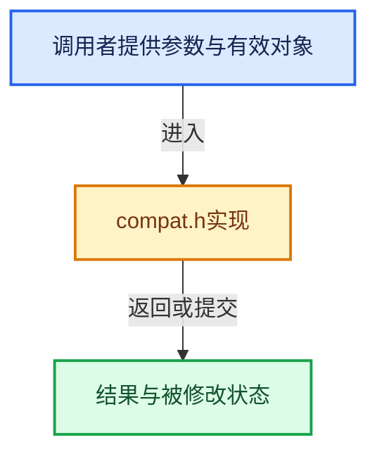

# 实现依赖专题：intern/cycles/kernel/device/oneapi/compat.h

[方向导航](README.md) · [符号索引](../%E7%AC%A6%E5%8F%B7%E4%BE%9D%E8%B5%96%E4%B8%8E%E5%AE%9E%E7%8E%B0%E7%B4%A2%E5%BC%95.md)

本专题从正文实际调用进入，集中保存共享实现。函数有稳定锚点，可从调用处直接跳到对应完整函数；递归与互相调用通过回链组织。

## 本文件的实现关系





<a id="m-b039ee6c1601"></a>

## 宏 `fabsf`

<!-- annotated:5031a135376d44 -->

```cpp
#define fabsf(x) sycl::fabs((x))
#define copysignf(x, y) sycl::copysign((x), (y))
```

<details>
<summary>核对原始源码：intern/cycles/kernel/device/oneapi/compat.h · L167—L168</summary>

<!-- original:5031a135376d44:intern/cycles/kernel/device/oneapi/compat.h:167:168 -->

```cpp
#define fabsf(x) sycl::fabs((x))
#define copysignf(x, y) sycl::copysign((x), (y))
```

</details>

宏在预处理阶段展开，参数替换、重复求值和条件编译应直接从该定义检查。与普通函数不同，宏不会自动提供参数类型检查；构建配置选择哪个定义需结合外围条件。

<a id="m-2dde2da339f8"></a>

## 宏 `copysignf`

<!-- annotated:a25cb37151e6fa -->

```cpp
#define copysignf(x, y) sycl::copysign((x), (y))
#define asinf(x) sycl::asin((x))
```

<details>
<summary>核对原始源码：intern/cycles/kernel/device/oneapi/compat.h · L168—L169</summary>

<!-- original:a25cb37151e6fa:intern/cycles/kernel/device/oneapi/compat.h:168:169 -->

```cpp
#define copysignf(x, y) sycl::copysign((x), (y))
#define asinf(x) sycl::asin((x))
```

</details>

宏在预处理阶段展开，参数替换、重复求值和条件编译应直接从该定义检查。与普通函数不同，宏不会自动提供参数类型检查；构建配置选择哪个定义需结合外围条件。

<a id="m-dd90417fae94"></a>

## 宏 `asinf`

<!-- annotated:100f8d371d292d -->

```cpp
#define asinf(x) sycl::asin((x))
#define acosf(x) sycl::acos((x))
```

<details>
<summary>核对原始源码：intern/cycles/kernel/device/oneapi/compat.h · L169—L170</summary>

<!-- original:100f8d371d292d:intern/cycles/kernel/device/oneapi/compat.h:169:170 -->

```cpp
#define asinf(x) sycl::asin((x))
#define acosf(x) sycl::acos((x))
```

</details>

宏在预处理阶段展开，参数替换、重复求值和条件编译应直接从该定义检查。与普通函数不同，宏不会自动提供参数类型检查；构建配置选择哪个定义需结合外围条件。

<a id="m-68452ab01424"></a>

## 宏 `acosf`

<!-- annotated:e2666fe752e856 -->

```cpp
#define acosf(x) sycl::acos((x))
#define atanf(x) sycl::atan((x))
```

<details>
<summary>核对原始源码：intern/cycles/kernel/device/oneapi/compat.h · L170—L171</summary>

<!-- original:e2666fe752e856:intern/cycles/kernel/device/oneapi/compat.h:170:171 -->

```cpp
#define acosf(x) sycl::acos((x))
#define atanf(x) sycl::atan((x))
```

</details>

宏在预处理阶段展开，参数替换、重复求值和条件编译应直接从该定义检查。与普通函数不同，宏不会自动提供参数类型检查；构建配置选择哪个定义需结合外围条件。

<a id="m-caeefe73fc01"></a>

## 宏 `atanf`

<!-- annotated:d4b35beaf778b5 -->

```cpp
#define atanf(x) sycl::atan((x))
#define floorf(x) sycl::floor((x))
```

<details>
<summary>核对原始源码：intern/cycles/kernel/device/oneapi/compat.h · L171—L172</summary>

<!-- original:d4b35beaf778b5:intern/cycles/kernel/device/oneapi/compat.h:171:172 -->

```cpp
#define atanf(x) sycl::atan((x))
#define floorf(x) sycl::floor((x))
```

</details>

宏在预处理阶段展开，参数替换、重复求值和条件编译应直接从该定义检查。与普通函数不同，宏不会自动提供参数类型检查；构建配置选择哪个定义需结合外围条件。

<a id="m-176475a253a6"></a>

## 宏 `floorf`

<!-- annotated:7a0c3775334412 -->

```cpp
#define floorf(x) sycl::floor((x))
#define ceilf(x) sycl::ceil((x))
```

<details>
<summary>核对原始源码：intern/cycles/kernel/device/oneapi/compat.h · L172—L173</summary>

<!-- original:7a0c3775334412:intern/cycles/kernel/device/oneapi/compat.h:172:173 -->

```cpp
#define floorf(x) sycl::floor((x))
#define ceilf(x) sycl::ceil((x))
```

</details>

宏在预处理阶段展开，参数替换、重复求值和条件编译应直接从该定义检查。与普通函数不同，宏不会自动提供参数类型检查；构建配置选择哪个定义需结合外围条件。

<a id="m-8b19a4af8ed1"></a>

## 宏 `ceilf`

<!-- annotated:3215dcbb0f540d -->

```cpp
#define ceilf(x) sycl::ceil((x))
#define roundf(x) sycl::round((x))
```

<details>
<summary>核对原始源码：intern/cycles/kernel/device/oneapi/compat.h · L173—L174</summary>

<!-- original:3215dcbb0f540d:intern/cycles/kernel/device/oneapi/compat.h:173:174 -->

```cpp
#define ceilf(x) sycl::ceil((x))
#define roundf(x) sycl::round((x))
```

</details>

宏在预处理阶段展开，参数替换、重复求值和条件编译应直接从该定义检查。与普通函数不同，宏不会自动提供参数类型检查；构建配置选择哪个定义需结合外围条件。

<a id="m-bdf6eb01f4f1"></a>

## 宏 `roundf`

<!-- annotated:0e09e4648226f4 -->

```cpp
#define roundf(x) sycl::round((x))
#define sinhf(x) sycl::sinh((x))
```

<details>
<summary>核对原始源码：intern/cycles/kernel/device/oneapi/compat.h · L174—L175</summary>

<!-- original:0e09e4648226f4:intern/cycles/kernel/device/oneapi/compat.h:174:175 -->

```cpp
#define roundf(x) sycl::round((x))
#define sinhf(x) sycl::sinh((x))
```

</details>

宏在预处理阶段展开，参数替换、重复求值和条件编译应直接从该定义检查。与普通函数不同，宏不会自动提供参数类型检查；构建配置选择哪个定义需结合外围条件。

<a id="m-53c69e247d72"></a>

## 宏 `hypotf`

<!-- annotated:e8207b6bc0abd5 -->

```cpp
#define hypotf(x, y) sycl::hypot((x), (y))
#define atan2f(x, y) sycl::atan2((x), (y))
```

<details>
<summary>核对原始源码：intern/cycles/kernel/device/oneapi/compat.h · L178—L179</summary>

<!-- original:e8207b6bc0abd5:intern/cycles/kernel/device/oneapi/compat.h:178:179 -->

```cpp
#define hypotf(x, y) sycl::hypot((x), (y))
#define atan2f(x, y) sycl::atan2((x), (y))
```

</details>

宏在预处理阶段展开，参数替换、重复求值和条件编译应直接从该定义检查。与普通函数不同，宏不会自动提供参数类型检查；构建配置选择哪个定义需结合外围条件。

<a id="m-5be26d38bfa7"></a>

## 宏 `atan2f`

<!-- annotated:96c31b10971049 -->

```cpp
#define atan2f(x, y) sycl::atan2((x), (y))
#define fmaxf(x, y) sycl::fmax((x), (y))
```

<details>
<summary>核对原始源码：intern/cycles/kernel/device/oneapi/compat.h · L179—L180</summary>

<!-- original:96c31b10971049:intern/cycles/kernel/device/oneapi/compat.h:179:180 -->

```cpp
#define atan2f(x, y) sycl::atan2((x), (y))
#define fmaxf(x, y) sycl::fmax((x), (y))
```

</details>

宏在预处理阶段展开，参数替换、重复求值和条件编译应直接从该定义检查。与普通函数不同，宏不会自动提供参数类型检查；构建配置选择哪个定义需结合外围条件。

<a id="m-56e5993ab048"></a>

## 宏 `fmodf`

<!-- annotated:9f47b952f0469e -->

```cpp
#define fmodf(x, y) sycl::fmod((x), (y))
#define lgammaf(x) sycl::lgamma((x))
```

<details>
<summary>核对原始源码：intern/cycles/kernel/device/oneapi/compat.h · L182—L183</summary>

<!-- original:9f47b952f0469e:intern/cycles/kernel/device/oneapi/compat.h:182:183 -->

```cpp
#define fmodf(x, y) sycl::fmod((x), (y))
#define lgammaf(x) sycl::lgamma((x))
```

</details>

宏在预处理阶段展开，参数替换、重复求值和条件编译应直接从该定义检查。与普通函数不同，宏不会自动提供参数类型检查；构建配置选择哪个定义需结合外围条件。

<a id="m-7fdbd99009e0"></a>

## 宏 `cosf`

<!-- annotated:23ba6cac8027bd -->

```cpp
#define cosf(x) sycl::native::cos(((float)(x)))
#define sinf(x) sycl::native::sin(((float)(x)))
```

<details>
<summary>核对原始源码：intern/cycles/kernel/device/oneapi/compat.h · L186—L187</summary>

<!-- original:23ba6cac8027bd:intern/cycles/kernel/device/oneapi/compat.h:186:187 -->

```cpp
#define cosf(x) sycl::native::cos(((float)(x)))
#define sinf(x) sycl::native::sin(((float)(x)))
```

</details>

宏在预处理阶段展开，参数替换、重复求值和条件编译应直接从该定义检查。与普通函数不同，宏不会自动提供参数类型检查；构建配置选择哪个定义需结合外围条件。

<a id="m-aab07e522dda"></a>

## 宏 `sinf`

<!-- annotated:0d88232432e731 -->

```cpp
#define sinf(x) sycl::native::sin(((float)(x)))
#define powf(x, y) sycl::native::powr(((float)(x)), ((float)(y)))
```

<details>
<summary>核对原始源码：intern/cycles/kernel/device/oneapi/compat.h · L187—L188</summary>

<!-- original:0d88232432e731:intern/cycles/kernel/device/oneapi/compat.h:187:188 -->

```cpp
#define sinf(x) sycl::native::sin(((float)(x)))
#define powf(x, y) sycl::native::powr(((float)(x)), ((float)(y)))
```

</details>

宏在预处理阶段展开，参数替换、重复求值和条件编译应直接从该定义检查。与普通函数不同，宏不会自动提供参数类型检查；构建配置选择哪个定义需结合外围条件。

<a id="m-d8a2a165b5d3"></a>

## 宏 `powf`

<!-- annotated:b14d136c9593a3 -->

```cpp
#define powf(x, y) sycl::native::powr(((float)(x)), ((float)(y)))
#define tanf(x) sycl::native::tan(((float)(x)))
```

<details>
<summary>核对原始源码：intern/cycles/kernel/device/oneapi/compat.h · L188—L189</summary>

<!-- original:b14d136c9593a3:intern/cycles/kernel/device/oneapi/compat.h:188:189 -->

```cpp
#define powf(x, y) sycl::native::powr(((float)(x)), ((float)(y)))
#define tanf(x) sycl::native::tan(((float)(x)))
```

</details>

宏在预处理阶段展开，参数替换、重复求值和条件编译应直接从该定义检查。与普通函数不同，宏不会自动提供参数类型检查；构建配置选择哪个定义需结合外围条件。

<a id="m-2c0993e4c930"></a>

## 宏 `tanf`

<!-- annotated:95884a64cef3f5 -->

```cpp
#define tanf(x) sycl::native::tan(((float)(x)))
#define logf(x) sycl::native::log(((float)(x)))
```

<details>
<summary>核对原始源码：intern/cycles/kernel/device/oneapi/compat.h · L189—L190</summary>

<!-- original:95884a64cef3f5:intern/cycles/kernel/device/oneapi/compat.h:189:190 -->

```cpp
#define tanf(x) sycl::native::tan(((float)(x)))
#define logf(x) sycl::native::log(((float)(x)))
```

</details>

宏在预处理阶段展开，参数替换、重复求值和条件编译应直接从该定义检查。与普通函数不同，宏不会自动提供参数类型检查；构建配置选择哪个定义需结合外围条件。

<a id="m-f53da009c50d"></a>

## 宏 `logf`

<!-- annotated:27cf668483024f -->

```cpp
#define logf(x) sycl::native::log(((float)(x)))
#define expf(x) sycl::native::exp(((float)(x)))
```

<details>
<summary>核对原始源码：intern/cycles/kernel/device/oneapi/compat.h · L190—L191</summary>

<!-- original:27cf668483024f:intern/cycles/kernel/device/oneapi/compat.h:190:191 -->

```cpp
#define logf(x) sycl::native::log(((float)(x)))
#define expf(x) sycl::native::exp(((float)(x)))
```

</details>

宏在预处理阶段展开，参数替换、重复求值和条件编译应直接从该定义检查。与普通函数不同，宏不会自动提供参数类型检查；构建配置选择哪个定义需结合外围条件。

<a id="m-666ba7d423f9"></a>

## 宏 `expf`

<!-- annotated:5b08c6dd076d3b -->

```cpp
#define expf(x) sycl::native::exp(((float)(x)))
#define sqrtf(x) sycl::native::sqrt(((float)(x)))
```

<details>
<summary>核对原始源码：intern/cycles/kernel/device/oneapi/compat.h · L191—L192</summary>

<!-- original:5b08c6dd076d3b:intern/cycles/kernel/device/oneapi/compat.h:191:192 -->

```cpp
#define expf(x) sycl::native::exp(((float)(x)))
#define sqrtf(x) sycl::native::sqrt(((float)(x)))
```

</details>

宏在预处理阶段展开，参数替换、重复求值和条件编译应直接从该定义检查。与普通函数不同，宏不会自动提供参数类型检查；构建配置选择哪个定义需结合外围条件。

## 完整成员与函数实现
