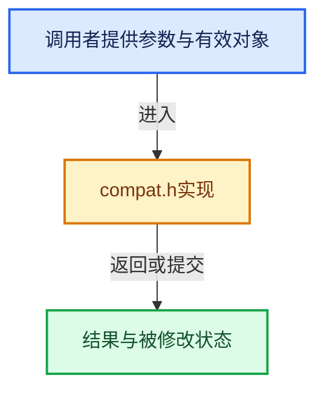

# 实现依赖专题：intern/cycles/kernel/device/metal/compat.h

[方向导航](README.md) · [符号索引](../%E7%AC%A6%E5%8F%B7%E4%BE%9D%E8%B5%96%E4%B8%8E%E5%AE%9E%E7%8E%B0%E7%B4%A2%E5%BC%95.md)

本专题从正文实际调用进入，集中保存共享实现。函数有稳定锚点，可从调用处直接跳到对应完整函数；递归与互相调用通过回链组织。

## 本文件的实现关系





<a id="m-3de6a9230b53"></a>

## 宏 `powf`

<!-- annotated:33830b9465ea71 -->

```cpp
#define powf(x, y) metal::pow(float(x), float(y))
#define fabsf(x) metal::fabs(float(x))
```

<details>
<summary>核对原始源码：intern/cycles/kernel/device/metal/compat.h · L264—L265</summary>

<!-- original:33830b9465ea71:intern/cycles/kernel/device/metal/compat.h:264:265 -->

```cpp
#define powf(x, y) metal::pow(float(x), float(y))
#define fabsf(x) metal::fabs(float(x))
```

</details>

宏在预处理阶段展开，参数替换、重复求值和条件编译应直接从该定义检查。与普通函数不同，宏不会自动提供参数类型检查；构建配置选择哪个定义需结合外围条件。

<a id="m-6b21869e9f3f"></a>

## 宏 `fabsf`

<!-- annotated:6c8772d389504c -->

```cpp
#define fabsf(x) metal::fabs(float(x))
#define copysignf(x, y) metal::copysign(float(x), float(y))
```

<details>
<summary>核对原始源码：intern/cycles/kernel/device/metal/compat.h · L265—L266</summary>

<!-- original:6c8772d389504c:intern/cycles/kernel/device/metal/compat.h:265:266 -->

```cpp
#define fabsf(x) metal::fabs(float(x))
#define copysignf(x, y) metal::copysign(float(x), float(y))
```

</details>

宏在预处理阶段展开，参数替换、重复求值和条件编译应直接从该定义检查。与普通函数不同，宏不会自动提供参数类型检查；构建配置选择哪个定义需结合外围条件。

<a id="m-5b657929ce8c"></a>

## 宏 `copysignf`

<!-- annotated:6d0809019620c5 -->

```cpp
#define copysignf(x, y) metal::copysign(float(x), float(y))
#define asinf(x) metal::asin(float(x))
```

<details>
<summary>核对原始源码：intern/cycles/kernel/device/metal/compat.h · L266—L267</summary>

<!-- original:6d0809019620c5:intern/cycles/kernel/device/metal/compat.h:266:267 -->

```cpp
#define copysignf(x, y) metal::copysign(float(x), float(y))
#define asinf(x) metal::asin(float(x))
```

</details>

宏在预处理阶段展开，参数替换、重复求值和条件编译应直接从该定义检查。与普通函数不同，宏不会自动提供参数类型检查；构建配置选择哪个定义需结合外围条件。

<a id="m-e1a6a02d64f4"></a>

## 宏 `asinf`

<!-- annotated:9132c1fd90762d -->

```cpp
#define asinf(x) metal::asin(float(x))
#define acosf(x) metal::acos(float(x))
```

<details>
<summary>核对原始源码：intern/cycles/kernel/device/metal/compat.h · L267—L268</summary>

<!-- original:9132c1fd90762d:intern/cycles/kernel/device/metal/compat.h:267:268 -->

```cpp
#define asinf(x) metal::asin(float(x))
#define acosf(x) metal::acos(float(x))
```

</details>

宏在预处理阶段展开，参数替换、重复求值和条件编译应直接从该定义检查。与普通函数不同，宏不会自动提供参数类型检查；构建配置选择哪个定义需结合外围条件。

<a id="m-a0383e8919c5"></a>

## 宏 `acosf`

<!-- annotated:68fe85679a628a -->

```cpp
#define acosf(x) metal::acos(float(x))
#define atanf(x) metal::atan(float(x))
```

<details>
<summary>核对原始源码：intern/cycles/kernel/device/metal/compat.h · L268—L269</summary>

<!-- original:68fe85679a628a:intern/cycles/kernel/device/metal/compat.h:268:269 -->

```cpp
#define acosf(x) metal::acos(float(x))
#define atanf(x) metal::atan(float(x))
```

</details>

宏在预处理阶段展开，参数替换、重复求值和条件编译应直接从该定义检查。与普通函数不同，宏不会自动提供参数类型检查；构建配置选择哪个定义需结合外围条件。

<a id="m-da3e3271f62f"></a>

## 宏 `atanf`

<!-- annotated:eefdcdda970190 -->

```cpp
#define atanf(x) metal::atan(float(x))
#define floorf(x) metal::floor(float(x))
```

<details>
<summary>核对原始源码：intern/cycles/kernel/device/metal/compat.h · L269—L270</summary>

<!-- original:eefdcdda970190:intern/cycles/kernel/device/metal/compat.h:269:270 -->

```cpp
#define atanf(x) metal::atan(float(x))
#define floorf(x) metal::floor(float(x))
```

</details>

宏在预处理阶段展开，参数替换、重复求值和条件编译应直接从该定义检查。与普通函数不同，宏不会自动提供参数类型检查；构建配置选择哪个定义需结合外围条件。

<a id="m-fb37dbc77698"></a>

## 宏 `floorf`

<!-- annotated:85e9af9cfab52e -->

```cpp
#define floorf(x) metal::floor(float(x))
#define ceilf(x) metal::ceil(float(x))
```

<details>
<summary>核对原始源码：intern/cycles/kernel/device/metal/compat.h · L270—L271</summary>

<!-- original:85e9af9cfab52e:intern/cycles/kernel/device/metal/compat.h:270:271 -->

```cpp
#define floorf(x) metal::floor(float(x))
#define ceilf(x) metal::ceil(float(x))
```

</details>

宏在预处理阶段展开，参数替换、重复求值和条件编译应直接从该定义检查。与普通函数不同，宏不会自动提供参数类型检查；构建配置选择哪个定义需结合外围条件。

<a id="m-95cb074a923c"></a>

## 宏 `ceilf`

<!-- annotated:1d07efde256fdb -->

```cpp
#define ceilf(x) metal::ceil(float(x))
#define roundf(x) metal::round(float(x))
```

<details>
<summary>核对原始源码：intern/cycles/kernel/device/metal/compat.h · L271—L272</summary>

<!-- original:1d07efde256fdb:intern/cycles/kernel/device/metal/compat.h:271:272 -->

```cpp
#define ceilf(x) metal::ceil(float(x))
#define roundf(x) metal::round(float(x))
```

</details>

宏在预处理阶段展开，参数替换、重复求值和条件编译应直接从该定义检查。与普通函数不同，宏不会自动提供参数类型检查；构建配置选择哪个定义需结合外围条件。

<a id="m-97b17e1586c9"></a>

## 宏 `roundf`

<!-- annotated:ba1690b18b6739 -->

```cpp
#define roundf(x) metal::round(float(x))
#define hypotf(x, y) metal::hypot(float(x), float(y))
```

<details>
<summary>核对原始源码：intern/cycles/kernel/device/metal/compat.h · L272—L273</summary>

<!-- original:ba1690b18b6739:intern/cycles/kernel/device/metal/compat.h:272:273 -->

```cpp
#define roundf(x) metal::round(float(x))
#define hypotf(x, y) metal::hypot(float(x), float(y))
```

</details>

宏在预处理阶段展开，参数替换、重复求值和条件编译应直接从该定义检查。与普通函数不同，宏不会自动提供参数类型检查；构建配置选择哪个定义需结合外围条件。

<a id="m-1dec60f6749a"></a>

## 宏 `hypotf`

<!-- annotated:acdbc1b7712619 -->

```cpp
#define hypotf(x, y) metal::hypot(float(x), float(y))
#define atan2f(x, y) metal::atan2(float(x), float(y))
```

<details>
<summary>核对原始源码：intern/cycles/kernel/device/metal/compat.h · L273—L274</summary>

<!-- original:acdbc1b7712619:intern/cycles/kernel/device/metal/compat.h:273:274 -->

```cpp
#define hypotf(x, y) metal::hypot(float(x), float(y))
#define atan2f(x, y) metal::atan2(float(x), float(y))
```

</details>

宏在预处理阶段展开，参数替换、重复求值和条件编译应直接从该定义检查。与普通函数不同，宏不会自动提供参数类型检查；构建配置选择哪个定义需结合外围条件。

<a id="m-1b9636d3b02f"></a>

## 宏 `atan2f`

<!-- annotated:1b32fbe5af2435 -->

```cpp
#define atan2f(x, y) metal::atan2(float(x), float(y))
#define fmaxf(x, y) metal::fmax(float(x), float(y))
```

<details>
<summary>核对原始源码：intern/cycles/kernel/device/metal/compat.h · L274—L275</summary>

<!-- original:1b32fbe5af2435:intern/cycles/kernel/device/metal/compat.h:274:275 -->

```cpp
#define atan2f(x, y) metal::atan2(float(x), float(y))
#define fmaxf(x, y) metal::fmax(float(x), float(y))
```

</details>

宏在预处理阶段展开，参数替换、重复求值和条件编译应直接从该定义检查。与普通函数不同，宏不会自动提供参数类型检查；构建配置选择哪个定义需结合外围条件。

<a id="m-d7e7e2616aed"></a>

## 宏 `fmodf`

<!-- annotated:cef2a127fb06ee -->

```cpp
#define fmodf(x, y) metal::fmod(float(x), float(y))
#define sinhf(x) metal::sinh(float(x))
```

<details>
<summary>核对原始源码：intern/cycles/kernel/device/metal/compat.h · L277—L278</summary>

<!-- original:cef2a127fb06ee:intern/cycles/kernel/device/metal/compat.h:277:278 -->

```cpp
#define fmodf(x, y) metal::fmod(float(x), float(y))
#define sinhf(x) metal::sinh(float(x))
```

</details>

宏在预处理阶段展开，参数替换、重复求值和条件编译应直接从该定义检查。与普通函数不同，宏不会自动提供参数类型检查；构建配置选择哪个定义需结合外围条件。

<a id="m-7009b99c07ca"></a>

## 宏 `sinf`

<!-- annotated:4f36da1ca8e4f5 -->

```cpp
#define sinf(x) trigmode::sin(float(x))
#define cosf(x) trigmode::cos(float(x))
```

<details>
<summary>核对原始源码：intern/cycles/kernel/device/metal/compat.h · L287—L288</summary>

<!-- original:4f36da1ca8e4f5:intern/cycles/kernel/device/metal/compat.h:287:288 -->

```cpp
#define sinf(x) trigmode::sin(float(x))
#define cosf(x) trigmode::cos(float(x))
```

</details>

宏在预处理阶段展开，参数替换、重复求值和条件编译应直接从该定义检查。与普通函数不同，宏不会自动提供参数类型检查；构建配置选择哪个定义需结合外围条件。

<a id="m-68fe984e8b68"></a>

## 宏 `cosf`

<!-- annotated:62792e1e1bc607 -->

```cpp
#define cosf(x) trigmode::cos(float(x))
#define tanf(x) trigmode::tan(float(x))
```

<details>
<summary>核对原始源码：intern/cycles/kernel/device/metal/compat.h · L288—L289</summary>

<!-- original:62792e1e1bc607:intern/cycles/kernel/device/metal/compat.h:288:289 -->

```cpp
#define cosf(x) trigmode::cos(float(x))
#define tanf(x) trigmode::tan(float(x))
```

</details>

宏在预处理阶段展开，参数替换、重复求值和条件编译应直接从该定义检查。与普通函数不同，宏不会自动提供参数类型检查；构建配置选择哪个定义需结合外围条件。

<a id="m-377fea82ecaa"></a>

## 宏 `tanf`

<!-- annotated:dd114aa3c590c1 -->

```cpp
#define tanf(x) trigmode::tan(float(x))
#define expf(x) trigmode::exp(float(x))
```

<details>
<summary>核对原始源码：intern/cycles/kernel/device/metal/compat.h · L289—L290</summary>

<!-- original:dd114aa3c590c1:intern/cycles/kernel/device/metal/compat.h:289:290 -->

```cpp
#define tanf(x) trigmode::tan(float(x))
#define expf(x) trigmode::exp(float(x))
```

</details>

宏在预处理阶段展开，参数替换、重复求值和条件编译应直接从该定义检查。与普通函数不同，宏不会自动提供参数类型检查；构建配置选择哪个定义需结合外围条件。

<a id="m-fd388a772c4f"></a>

## 宏 `expf`

<!-- annotated:2d5b14f266bb2a -->

```cpp
#define expf(x) trigmode::exp(float(x))
#define sqrtf(x) trigmode::sqrt(float(x))
```

<details>
<summary>核对原始源码：intern/cycles/kernel/device/metal/compat.h · L290—L291</summary>

<!-- original:2d5b14f266bb2a:intern/cycles/kernel/device/metal/compat.h:290:291 -->

```cpp
#define expf(x) trigmode::exp(float(x))
#define sqrtf(x) trigmode::sqrt(float(x))
```

</details>

宏在预处理阶段展开，参数替换、重复求值和条件编译应直接从该定义检查。与普通函数不同，宏不会自动提供参数类型检查；构建配置选择哪个定义需结合外围条件。

<a id="m-be890a2167de"></a>

## 宏 `logf`

<!-- annotated:bb7f5150fd50f3 -->

```cpp
#define logf(x) trigmode::log(float(x))

```

<details>
<summary>核对原始源码：intern/cycles/kernel/device/metal/compat.h · L292—L293</summary>

<!-- original:bb7f5150fd50f3:intern/cycles/kernel/device/metal/compat.h:292:293 -->

```cpp
#define logf(x) trigmode::log(float(x))

```

</details>

宏在预处理阶段展开，参数替换、重复求值和条件编译应直接从该定义检查。与普通函数不同，宏不会自动提供参数类型检查；构建配置选择哪个定义需结合外围条件。

## 完整成员与函数实现

<a id="f-b8a1b1e293e9ec03"></a>

### `make_float3`

实现位置：[intern/cycles/kernel/device/metal/compat.h](../../../../../intern/cycles/kernel/device/metal/compat.h) · L206—L209。

接口参数：

- `const float x`
- `const float y`
- `const float z`

**教学注释版**

<!-- annotated:5bbeae572b75bd -->

```cpp
ccl_device_forceinline float3 make_float3(const float x, const float y, const float z)
{
  return float3(x, y, z);
}
```

<details>
<summary>核对原始源码：intern/cycles/kernel/device/metal/compat.h · L206—L209</summary>

<!-- original:5bbeae572b75bd:intern/cycles/kernel/device/metal/compat.h:206:209 -->

```cpp
ccl_device_forceinline float3 make_float3(const float x, const float y, const float z)
{
  return float3(x, y, z);
}
```

</details>

**结果出口**

- `return float3(x, y, z);`

**继续追踪实现**

- `float3` → [float3 · L41](%E4%BE%9D%E8%B5%96-types_float3-48c65a.md#f-7da2e52c0fb766ec)；[float3 · L42](%E4%BE%9D%E8%B5%96-types_float3-48c65a.md#f-4c476b25be347939)；[float3 · L43](%E4%BE%9D%E8%B5%96-types_float3-48c65a.md#f-776e8df31bde8162)。同名重载需按实参类型选择。
