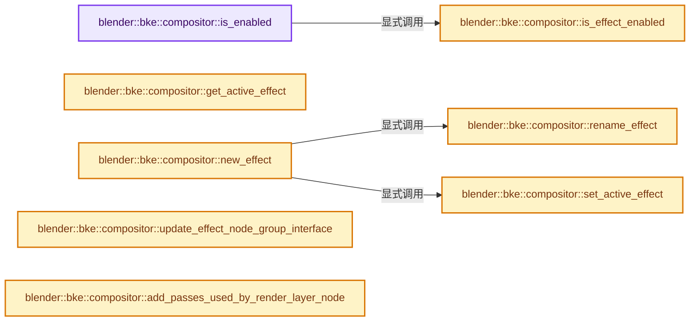
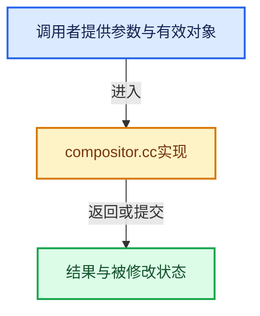

# 实现依赖专题：source/blender/blenkernel/intern/compositor.cc

[方向导航](README.md) · [符号索引](../%E7%AC%A6%E5%8F%B7%E4%BE%9D%E8%B5%96%E4%B8%8E%E5%AE%9E%E7%8E%B0%E7%B4%A2%E5%BC%95.md)

本专题从正文实际调用进入，集中保存共享实现。函数有稳定锚点，可从调用处直接跳到对应完整函数；递归与互相调用通过回链组织。

## 本文件的实现关系






## 完整成员与函数实现

<a id="f-819c7d4837fda4bd"></a>

### `blender::bke::compositor::is_enabled`

实现位置：[source/blender/blenkernel/intern/compositor.cc](../../../../../source/blender/blenkernel/intern/compositor.cc) · L185—L198。

接口参数：

- `const Scene &scene`
- `const ExecutionMode mode`

**教学注释版**

<!-- annotated:02cae1faeb2206 -->

```cpp
bool is_enabled(const Scene &scene, const ExecutionMode mode)
{
  if (mode == ExecutionMode::Render && !(scene.r.scemode & R_DOCOMP)) {
    return false;
  }

  for (SceneCompositorEffect &effect : scene.compositor_effects) {
    if (is_effect_enabled(effect, mode)) {
      return true;
    }
  }

  return false;
}
```

<details>
<summary>核对原始源码：source/blender/blenkernel/intern/compositor.cc · L185—L198</summary>

<!-- original:02cae1faeb2206:source/blender/blenkernel/intern/compositor.cc:185:198 -->

```cpp
bool is_enabled(const Scene &scene, const ExecutionMode mode)
{
  if (mode == ExecutionMode::Render && !(scene.r.scemode & R_DOCOMP)) {
    return false;
  }

  for (SceneCompositorEffect &effect : scene.compositor_effects) {
    if (is_effect_enabled(effect, mode)) {
      return true;
    }
  }

  return false;
}
```

</details>

**结果出口**

- `return false;`
- `return true;`

**继续追踪实现**

- `is_effect_enabled` → [blender::bke::compositor::is_effect_enabled · L217](%E4%BE%9D%E8%B5%96-compositor-ce5aa3.md#f-830f37984d91f2c3)。

<a id="f-4aa576dadb9cfd59"></a>

### `blender::bke::compositor::get_active_effect`

实现位置：[source/blender/blenkernel/intern/compositor.cc](../../../../../source/blender/blenkernel/intern/compositor.cc) · L206—L215。

接口参数：

- `const Scene &scene`

**教学注释版**

<!-- annotated:8e6d5a4e14ccbf -->

```cpp
SceneCompositorEffect *get_active_effect(const Scene &scene)
{
  for (SceneCompositorEffect &effect : scene.compositor_effects) {
    if (flag_is_set(effect.flags, SceneCompositorEffectFlags::IsActive)) {
      return &effect;
    }
  }

  return nullptr;
}
```

<details>
<summary>核对原始源码：source/blender/blenkernel/intern/compositor.cc · L206—L215</summary>

<!-- original:8e6d5a4e14ccbf:source/blender/blenkernel/intern/compositor.cc:206:215 -->

```cpp
SceneCompositorEffect *get_active_effect(const Scene &scene)
{
  for (SceneCompositorEffect &effect : scene.compositor_effects) {
    if (flag_is_set(effect.flags, SceneCompositorEffectFlags::IsActive)) {
      return &effect;
    }
  }

  return nullptr;
}
```

</details>

**结果出口**

- `return &effect;`
- `return nullptr;`

**继续追踪实现**

- `flag_is_set` → [调用协议](../%E6%A8%A1%E6%9D%BF%E5%AE%8F%E4%B8%8E%E5%8A%A8%E6%80%81%E5%88%86%E6%B4%BE%E5%8D%8F%E8%AE%AE.md)：函数指针、局部可调用对象或未展开的宏；必须结合调用者环境。调用位置L209。

<a id="f-830f37984d91f2c3"></a>

### `blender::bke::compositor::is_effect_enabled`

实现位置：[source/blender/blenkernel/intern/compositor.cc](../../../../../source/blender/blenkernel/intern/compositor.cc) · L217—L233。

接口参数：

- `const SceneCompositorEffect &effect`
- `const ExecutionMode mode`

**教学注释版**

<!-- annotated:3312ec0069e2a1 -->

```cpp
bool is_effect_enabled(const SceneCompositorEffect &effect, const ExecutionMode mode)
{
  const bNodeTree *original_node_group = DEG_get_original(effect.node_group);
  if (!original_node_group || ID_MISSING(original_node_group)) {
    return false;
  }

  switch (mode) {
    case ExecutionMode::Render:
      return flag_is_set(effect.flags, SceneCompositorEffectFlags::EnableForRender);
    case ExecutionMode::Preview:
      return flag_is_set(effect.flags, SceneCompositorEffectFlags::EnableForPreview);
  }

  BLI_assert_unreachable();
  return false;
}
```

<details>
<summary>核对原始源码：source/blender/blenkernel/intern/compositor.cc · L217—L233</summary>

<!-- original:3312ec0069e2a1:source/blender/blenkernel/intern/compositor.cc:217:233 -->

```cpp
bool is_effect_enabled(const SceneCompositorEffect &effect, const ExecutionMode mode)
{
  const bNodeTree *original_node_group = DEG_get_original(effect.node_group);
  if (!original_node_group || ID_MISSING(original_node_group)) {
    return false;
  }

  switch (mode) {
    case ExecutionMode::Render:
      return flag_is_set(effect.flags, SceneCompositorEffectFlags::EnableForRender);
    case ExecutionMode::Preview:
      return flag_is_set(effect.flags, SceneCompositorEffectFlags::EnableForPreview);
  }

  BLI_assert_unreachable();
  return false;
}
```

</details>

**结果出口**

- `return false;`
- `return flag_is_set(effect.flags, SceneCompositorEffectFlags::EnableForRender);`
- `return flag_is_set(effect.flags, SceneCompositorEffectFlags::EnableForPreview);`

**继续追踪实现**

- `DEG_get_original` → [blender::DEG_get_original · L128](../11-Depsgraph%E4%B8%8E%E5%B9%B6%E8%A1%8C%E4%BB%BB%E5%8A%A1%E7%B3%BB%E7%BB%9F/%E4%BE%9D%E8%B5%96-DEG_depsgraph_query-db0d31.md#f-79782eab82a92d86)；[blender::DEG_get_original · L134](../11-Depsgraph%E4%B8%8E%E5%B9%B6%E8%A1%8C%E4%BB%BB%E5%8A%A1%E7%B3%BB%E7%BB%9F/%E4%BE%9D%E8%B5%96-DEG_depsgraph_query-db0d31.md#f-c032f06e9ef8f0cb)。同名重载需按实参类型选择。
- `ID_MISSING` → [ID_MISSING · L695](%E4%BE%9D%E8%B5%96-DNA_ID-3eb091.md#m-ab9a2a270fb3)。宏定义由构建条件选择。
- `flag_is_set` → [调用协议](../%E6%A8%A1%E6%9D%BF%E5%AE%8F%E4%B8%8E%E5%8A%A8%E6%80%81%E5%88%86%E6%B4%BE%E5%8D%8F%E8%AE%AE.md)：函数指针、局部可调用对象或未展开的宏；必须结合调用者环境。调用位置L226。
- `BLI_assert_unreachable` → [BLI_assert_unreachable · L77](../01-%E5%9F%BA%E7%A1%80%E5%AE%B9%E5%99%A8%E4%B8%8E%E7%8E%B0%E4%BB%A3CPP/%E4%BE%9D%E8%B5%96-BLI_assert-cc98e8.md#m-7a2d91a67d8e)。宏定义由构建条件选择。

<a id="f-2d115a694947be50"></a>

### `blender::bke::compositor::set_active_effect`

实现位置：[source/blender/blenkernel/intern/compositor.cc](../../../../../source/blender/blenkernel/intern/compositor.cc) · L235—L243。

接口参数：

- `const Scene &scene`
- `SceneCompositorEffect &effect`

**教学注释版**

<!-- annotated:61f2222c5049dc -->

```cpp
void set_active_effect(const Scene &scene, SceneCompositorEffect &effect)
{
  for (SceneCompositorEffect &other_effect : scene.compositor_effects) {
    other_effect.flags &= ~SceneCompositorEffectFlags::IsActive;
  }

  /* Activate the active state of the effect. */
  effect.flags |= SceneCompositorEffectFlags::IsActive;
}
```

<details>
<summary>核对原始源码：source/blender/blenkernel/intern/compositor.cc · L235—L243</summary>

<!-- original:61f2222c5049dc:source/blender/blenkernel/intern/compositor.cc:235:243 -->

```cpp
void set_active_effect(const Scene &scene, SceneCompositorEffect &effect)
{
  for (SceneCompositorEffect &other_effect : scene.compositor_effects) {
    other_effect.flags &= ~SceneCompositorEffectFlags::IsActive;
  }

  /* Activate the active state of the effect. */
  effect.flags |= SceneCompositorEffectFlags::IsActive;
}
```

</details>

**沿实际写入检查状态**

- `other_effect.flags &= ~SceneCompositorEffectFlags::IsActive;`
- `effect.flags |= SceneCompositorEffectFlags::IsActive;`

**继续追踪实现**

本实现没有需要继续展开的显式调用；检查返回表达式、对象转换和调用者前置条件。

<a id="f-4cd517b53e997154"></a>

### `blender::bke::compositor::rename_effect`

实现位置：[source/blender/blenkernel/intern/compositor.cc](../../../../../source/blender/blenkernel/intern/compositor.cc) · L245—L270。

接口参数：

- `Scene &scene`
- `SceneCompositorEffect &effect`
- `StringRef new_name`
- `const bool update_animation_data`

**教学注释版**

<!-- annotated:0508e6b5bd8343 -->

```cpp
void rename_effect(Scene &scene,
                   SceneCompositorEffect &effect,
                   StringRef new_name,
                   const bool update_animation_data)
{
  std::string old_name = effect.name;
  new_name.copy_utf8_truncated(effect.name);
  BLI_uniquename(&scene.compositor_effects,
                 &effect,
                 CTX_DATA_(BLT_I18NCONTEXT_ID_SCENE, "Scene Effect"),
                 '.',
                 offsetof(SceneCompositorEffect, name),
                 sizeof(effect.name));

  if (!update_animation_data) {
    return;
  }

  /* Fix all the animation data which may link to this. */
  BKE_animdata_fix_paths(scene.id,
                         "compositor_effects",
                         RNA_path_name_to_infix(old_name.c_str()),
                         RNA_path_name_to_infix(effect.name),
                         true,
                         *G_MAIN);
}
```

<details>
<summary>核对原始源码：source/blender/blenkernel/intern/compositor.cc · L245—L270</summary>

<!-- original:0508e6b5bd8343:source/blender/blenkernel/intern/compositor.cc:245:270 -->

```cpp
void rename_effect(Scene &scene,
                   SceneCompositorEffect &effect,
                   StringRef new_name,
                   const bool update_animation_data)
{
  std::string old_name = effect.name;
  new_name.copy_utf8_truncated(effect.name);
  BLI_uniquename(&scene.compositor_effects,
                 &effect,
                 CTX_DATA_(BLT_I18NCONTEXT_ID_SCENE, "Scene Effect"),
                 '.',
                 offsetof(SceneCompositorEffect, name),
                 sizeof(effect.name));

  if (!update_animation_data) {
    return;
  }

  /* Fix all the animation data which may link to this. */
  BKE_animdata_fix_paths(scene.id,
                         "compositor_effects",
                         RNA_path_name_to_infix(old_name.c_str()),
                         RNA_path_name_to_infix(effect.name),
                         true,
                         *G_MAIN);
}
```

</details>

**继续追踪实现**

- `new_name.copy_utf8_truncated` → [blender::StringRefBase::copy_utf8_truncated · L28](../01-%E5%9F%BA%E7%A1%80%E5%AE%B9%E5%99%A8%E4%B8%8E%E7%8E%B0%E4%BB%A3CPP/%E4%BE%9D%E8%B5%96-string_ref-ed6905.md#f-5d01486bac37768d)；[blender::StringRefBase::copy_utf8_truncated · L256](../01-%E5%9F%BA%E7%A1%80%E5%AE%B9%E5%99%A8%E4%B8%8E%E7%8E%B0%E4%BB%A3CPP/15-StringRef%E5%AD%97%E7%AC%A6%E4%B8%B2%E8%A7%86%E5%9B%BE.md#f-b2a0157cbe286321)。同名重载需按实参类型选择。
- `BLI_uniquename` → [blender::BLI_uniquename · L491](../01-%E5%9F%BA%E7%A1%80%E5%AE%B9%E5%99%A8%E4%B8%8E%E7%8E%B0%E4%BB%A3CPP/%E4%BE%9D%E8%B5%96-string_utils-bbfe0c.md#f-bcf1a000dbfb87d1)。
- `CTX_DATA_` → [CTX_DATA_ · L56](%E4%BE%9D%E8%B5%96-BLT_translation-c89e58.md#m-4611dbdcc407)。宏定义由构建条件选择。
- `BKE_animdata_fix_paths` → [blender::BKE_animdata_fix_paths · L1001](%E4%BE%9D%E8%B5%96-anim_data-56c81c.md#f-ba061b4dce9eccbc)；[blender::BKE_animdata_fix_paths · L1044](%E4%BE%9D%E8%B5%96-anim_data-56c81c.md#f-d7648451f6591b0b)。同名重载需按实参类型选择。
- `RNA_path_name_to_infix` → [blender::RNA_path_name_to_infix · L1416](%E4%BE%9D%E8%B5%96-rna_path-495878.md#f-8a0460224c9dd680)。
- `old_name.c_str` → [外部契约](https://eel.is/c++draft/)：这个边界按实际表达式及所属类型核对参数、返回值、寿命与失败行为。这里提供接口入口，不声称已解释该第三方版本的内部实现。

<a id="f-63817a11bd208600"></a>

### `blender::bke::compositor::new_effect`

实现位置：[source/blender/blenkernel/intern/compositor.cc](../../../../../source/blender/blenkernel/intern/compositor.cc) · L272—L279。

接口参数：

- `Scene &scene`
- `StringRef name`

**教学注释版**

<!-- annotated:51de3cce7378d6 -->

```cpp
SceneCompositorEffect &new_effect(Scene &scene, StringRef name)
{
  SceneCompositorEffect &effect = *MEM_new<SceneCompositorEffect>("Scene Compositor Effect");
  rename_effect(scene, effect, name, false);
  BLI_addtail(&scene.compositor_effects, &effect);
  set_active_effect(scene, effect);
  return effect;
}
```

<details>
<summary>核对原始源码：source/blender/blenkernel/intern/compositor.cc · L272—L279</summary>

<!-- original:51de3cce7378d6:source/blender/blenkernel/intern/compositor.cc:272:279 -->

```cpp
SceneCompositorEffect &new_effect(Scene &scene, StringRef name)
{
  SceneCompositorEffect &effect = *MEM_new<SceneCompositorEffect>("Scene Compositor Effect");
  rename_effect(scene, effect, name, false);
  BLI_addtail(&scene.compositor_effects, &effect);
  set_active_effect(scene, effect);
  return effect;
}
```

</details>

**结果出口**

- `return effect;`

**继续追踪实现**

- `MEM_new<SceneCompositorEffect>` → [MEM_new · L351](../03-%E5%86%85%E5%AD%98%E5%88%86%E9%85%8D%E4%B8%8E%E8%BF%90%E8%A1%8C%E6%97%B6%E7%B1%BB%E5%9E%8B/%E4%BE%9D%E8%B5%96-MEM_guardedalloc-b54eca.md#f-115f9b6784f89912)。
- `rename_effect` → [blender::bke::compositor::rename_effect · L245](%E4%BE%9D%E8%B5%96-compositor-ce5aa3.md#f-4cd517b53e997154)。
- `BLI_addtail` → [blender::BLI_addtail · L118](../01-%E5%9F%BA%E7%A1%80%E5%AE%B9%E5%99%A8%E4%B8%8E%E7%8E%B0%E4%BB%A3CPP/%E4%BE%9D%E8%B5%96-listbase-2816d9.md#f-4fb027713fa3115b)。
- `set_active_effect` → [blender::bke::compositor::set_active_effect · L235](%E4%BE%9D%E8%B5%96-compositor-ce5aa3.md#f-2d115a694947be50)。

<a id="f-a9bbeb1677cd0716"></a>

### `blender::bke::compositor::update_effect_node_group_interface`

实现位置：[source/blender/blenkernel/intern/compositor.cc](../../../../../source/blender/blenkernel/intern/compositor.cc) · L405—L424。

接口参数：

- `Main &main`
- `Scene &scene`
- `SceneCompositorEffect &effect`

**教学注释版**

<!-- annotated:9af8f2f28761db -->

```cpp
void update_effect_node_group_interface(Main &main, Scene &scene, SceneCompositorEffect &effect)
{
  if (!effect.system_properties) {
    effect.system_properties =
        bke::idprop::create_group("SceneCompositorEffectProperties").release();
  }

  /* In case the node group is missing, do not update the properties to avoid the values reverting
   * to their default value if the node group later becomes available. */
  if (!effect.node_group || ID_MISSING(effect.node_group)) {
    return;
  }

  PointerRNA properties_ptr = RNA_pointer_create_discrete(
      &scene.id, RNA_SceneCompositorEffectProperties, &effect);
  RNA_ensure_and_sync_system_properties(main, properties_ptr, *effect.system_properties);

  DEG_id_tag_update(&scene.id, ID_RECALC_COMPOSITOR);
  WM_main_add_notifier(NC_SCENE | ND_COMPO_RESULT, &scene);
}
```

<details>
<summary>核对原始源码：source/blender/blenkernel/intern/compositor.cc · L405—L424</summary>

<!-- original:9af8f2f28761db:source/blender/blenkernel/intern/compositor.cc:405:424 -->

```cpp
void update_effect_node_group_interface(Main &main, Scene &scene, SceneCompositorEffect &effect)
{
  if (!effect.system_properties) {
    effect.system_properties =
        bke::idprop::create_group("SceneCompositorEffectProperties").release();
  }

  /* In case the node group is missing, do not update the properties to avoid the values reverting
   * to their default value if the node group later becomes available. */
  if (!effect.node_group || ID_MISSING(effect.node_group)) {
    return;
  }

  PointerRNA properties_ptr = RNA_pointer_create_discrete(
      &scene.id, RNA_SceneCompositorEffectProperties, &effect);
  RNA_ensure_and_sync_system_properties(main, properties_ptr, *effect.system_properties);

  DEG_id_tag_update(&scene.id, ID_RECALC_COMPOSITOR);
  WM_main_add_notifier(NC_SCENE | ND_COMPO_RESULT, &scene);
}
```

</details>

**沿实际写入检查状态**

- `effect.system_properties =`

**继续追踪实现**

- `bke::idprop::create_group("SceneCompositorEffectProperties").release` → [调用协议](../%E6%A8%A1%E6%9D%BF%E5%AE%8F%E4%B8%8E%E5%8A%A8%E6%80%81%E5%88%86%E6%B4%BE%E5%8D%8F%E8%AE%AE.md)：接收对象类型依赖auto、返回值或模板实例；不按同名猜测目标。调用位置L409。
- `bke::idprop::create_group` → [blender::bke::idprop::create_group · L155](%E4%BE%9D%E8%B5%96-idprop_create-f89f51.md#f-b1e2d8bfd5654bc2)。
- `ID_MISSING` → [ID_MISSING · L695](%E4%BE%9D%E8%B5%96-DNA_ID-3eb091.md#m-ab9a2a270fb3)。宏定义由构建条件选择。
- `RNA_pointer_create_discrete` → [blender::RNA_pointer_create_discrete · L181](%E4%BE%9D%E8%B5%96-rna_access-706bea.md#f-592a276e869c6d94)。
- `RNA_ensure_and_sync_system_properties` → [blender::RNA_ensure_and_sync_system_properties · L6568](%E4%BE%9D%E8%B5%96-rna_access-706bea.md#f-3787705e085177e6)。
- `DEG_id_tag_update` → [blender::DEG_id_tag_update · L844](../11-Depsgraph%E4%B8%8E%E5%B9%B6%E8%A1%8C%E4%BB%BB%E5%8A%A1%E7%B3%BB%E7%BB%9F/%E4%BE%9D%E8%B5%96-depsgraph_tag-d8b3c7.md#f-62d2949dd168bb81)。
- `WM_main_add_notifier` → [blender::WM_main_add_notifier · L403](%E4%BE%9D%E8%B5%96-wm_event_system-a0fa4f.md#f-29a090eae8ebe51c)。

<a id="f-20daf22beb02b38f"></a>

### `blender::bke::compositor::add_passes_used_by_render_layer_node`

实现位置：[source/blender/blenkernel/intern/compositor.cc](../../../../../source/blender/blenkernel/intern/compositor.cc) · L432—L446。

接口参数：

- `const bNode *node`
- `Set<std::string> &used_passes`

**教学注释版**

<!-- annotated:5b4ed0f19bf954 -->

```cpp
static void add_passes_used_by_render_layer_node(const bNode *node, Set<std::string> &used_passes)
{
  for (const bNodeSocket *output : node->output_sockets()) {
    if (output->is_logically_linked()) {
      /* The combined pass is aliased as Image and Alpha is generated by the node based on the
       * combined pass. */
      if (output->identifier == StringRef("Image") || output->identifier == StringRef("Alpha")) {
        // [讲解] used_passes.add：按哈希与相等关系加入键或键值。
        used_passes.add(RE_PASSNAME_COMBINED);
      }
      else {
        used_passes.add(output->identifier);
      }
    }
  }
}
```

<details>
<summary>核对原始源码：source/blender/blenkernel/intern/compositor.cc · L432—L446</summary>

<!-- original:5b4ed0f19bf954:source/blender/blenkernel/intern/compositor.cc:432:446 -->

```cpp
static void add_passes_used_by_render_layer_node(const bNode *node, Set<std::string> &used_passes)
{
  for (const bNodeSocket *output : node->output_sockets()) {
    if (output->is_logically_linked()) {
      /* The combined pass is aliased as Image and Alpha is generated by the node based on the
       * combined pass. */
      if (output->identifier == StringRef("Image") || output->identifier == StringRef("Alpha")) {
        used_passes.add(RE_PASSNAME_COMBINED);
      }
      else {
        used_passes.add(output->identifier);
      }
    }
  }
}
```

</details>

**继续追踪实现**

- `node->output_sockets` → [blender::bNode::output_sockets · L760](%E4%BE%9D%E8%B5%96-BKE_node_runtime-ee561b.md#f-40ec6d6aed2ab6fb)；[blender::bNode::output_sockets · L772](%E4%BE%9D%E8%B5%96-BKE_node_runtime-ee561b.md#f-ddbd8f42409bdcd1)。同名重载需按实参类型选择。
- `output->is_logically_linked` → [调用协议](../%E6%A8%A1%E6%9D%BF%E5%AE%8F%E4%B8%8E%E5%8A%A8%E6%80%81%E5%88%86%E6%B4%BE%E5%8D%8F%E8%AE%AE.md)：接收对象类型依赖auto、返回值或模板实例；不按同名猜测目标。调用位置L435。
- `StringRef` → [blender::StringRef::StringRef · L555](../01-%E5%9F%BA%E7%A1%80%E5%AE%B9%E5%99%A8%E4%B8%8E%E7%8E%B0%E4%BB%A3CPP/15-StringRef%E5%AD%97%E7%AC%A6%E4%B8%B2%E8%A7%86%E5%9B%BE.md#f-f6aca324a36faa7e)；[blender::StringRef::StringRef · L560](../01-%E5%9F%BA%E7%A1%80%E5%AE%B9%E5%99%A8%E4%B8%8E%E7%8E%B0%E4%BB%A3CPP/15-StringRef%E5%AD%97%E7%AC%A6%E4%B8%B2%E8%A7%86%E5%9B%BE.md#f-ab9714781ca51bac)；[blender::StringRef::StringRef · L565](../01-%E5%9F%BA%E7%A1%80%E5%AE%B9%E5%99%A8%E4%B8%8E%E7%8E%B0%E4%BB%A3CPP/15-StringRef%E5%AD%97%E7%AC%A6%E4%B8%B2%E8%A7%86%E5%9B%BE.md#f-95f0b483bbdd7739)；[blender::StringRef::StringRef · L570](../01-%E5%9F%BA%E7%A1%80%E5%AE%B9%E5%99%A8%E4%B8%8E%E7%8E%B0%E4%BB%A3CPP/15-StringRef%E5%AD%97%E7%AC%A6%E4%B8%B2%E8%A7%86%E5%9B%BE.md#f-808d05699cb33334)；[blender::StringRef::StringRef · L631](../01-%E5%9F%BA%E7%A1%80%E5%AE%B9%E5%99%A8%E4%B8%8E%E7%8E%B0%E4%BB%A3CPP/15-StringRef%E5%AD%97%E7%AC%A6%E4%B8%B2%E8%A7%86%E5%9B%BE.md#f-37788e5f3fa3b736)；[blender::StringRef::StringRef · L641](../01-%E5%9F%BA%E7%A1%80%E5%AE%B9%E5%99%A8%E4%B8%8E%E7%8E%B0%E4%BB%A3CPP/15-StringRef%E5%AD%97%E7%AC%A6%E4%B8%B2%E8%A7%86%E5%9B%BE.md#f-11abd0510fb6b926)；[blender::StringRef::StringRef · L646](../01-%E5%9F%BA%E7%A1%80%E5%AE%B9%E5%99%A8%E4%B8%8E%E7%8E%B0%E4%BB%A3CPP/15-StringRef%E5%AD%97%E7%AC%A6%E4%B8%B2%E8%A7%86%E5%9B%BE.md#f-8437dbd8a582eefd)；[blender::StringRef::StringRef · L651](../01-%E5%9F%BA%E7%A1%80%E5%AE%B9%E5%99%A8%E4%B8%8E%E7%8E%B0%E4%BB%A3CPP/15-StringRef%E5%AD%97%E7%AC%A6%E4%B8%B2%E8%A7%86%E5%9B%BE.md#f-70bcb338de0db978)。同名重载需按实参类型选择。
- `used_passes.add` → [blender::Set::add · L248](../02-%E5%93%88%E5%B8%8C%E8%A1%A8%E4%B8%8E%E5%85%B3%E8%81%94%E6%95%B0%E6%8D%AE%E7%BB%93%E6%9E%84/08-Set%E4%B8%8E%E9%9B%86%E5%90%88%E8%AF%AD%E4%B9%89.md#f-c7498809c2327fba)；[blender::Set::add · L252](../02-%E5%93%88%E5%B8%8C%E8%A1%A8%E4%B8%8E%E5%85%B3%E8%81%94%E6%95%B0%E6%8D%AE%E7%BB%93%E6%9E%84/08-Set%E4%B8%8E%E9%9B%86%E5%90%88%E8%AF%AD%E4%B9%89.md#f-e3ac8d1c52c03c2b)。同名重载需按实参类型选择。

<a id="f-4cb929f40e1a0abf"></a>

### `blender::bke::compositor::add_passes_used_by_group_input_node`

实现位置：[source/blender/blenkernel/intern/compositor.cc](../../../../../source/blender/blenkernel/intern/compositor.cc) · L451—L463。

接口参数：

- `const bNode *node`
- `Set<std::string> &used_passes`

**教学注释版**

<!-- annotated:c1a75cf7e07502 -->

```cpp
static void add_passes_used_by_group_input_node(const bNode *node, Set<std::string> &used_passes)
{
  /* Only the virtual socket exists, so no pass is used. */
  if (node->output_sockets().size() == 1) {
    return;
  }

  if (!node->output_sockets()[0]->is_logically_linked()) {
    return;
  }

  // [讲解] used_passes.add：按哈希与相等关系加入键或键值。
  used_passes.add(RE_PASSNAME_COMBINED);
}
```

<details>
<summary>核对原始源码：source/blender/blenkernel/intern/compositor.cc · L451—L463</summary>

<!-- original:c1a75cf7e07502:source/blender/blenkernel/intern/compositor.cc:451:463 -->

```cpp
static void add_passes_used_by_group_input_node(const bNode *node, Set<std::string> &used_passes)
{
  /* Only the virtual socket exists, so no pass is used. */
  if (node->output_sockets().size() == 1) {
    return;
  }

  if (!node->output_sockets()[0]->is_logically_linked()) {
    return;
  }

  used_passes.add(RE_PASSNAME_COMBINED);
}
```

</details>

**继续追踪实现**

- `node->output_sockets().size` → [调用协议](../%E6%A8%A1%E6%9D%BF%E5%AE%8F%E4%B8%8E%E5%8A%A8%E6%80%81%E5%88%86%E6%B4%BE%E5%8D%8F%E8%AE%AE.md)：接收对象类型依赖auto、返回值或模板实例；不按同名猜测目标。调用位置L454。
- `node->output_sockets` → [blender::bNode::output_sockets · L760](%E4%BE%9D%E8%B5%96-BKE_node_runtime-ee561b.md#f-40ec6d6aed2ab6fb)；[blender::bNode::output_sockets · L772](%E4%BE%9D%E8%B5%96-BKE_node_runtime-ee561b.md#f-ddbd8f42409bdcd1)。同名重载需按实参类型选择。
- `node->output_sockets()[0]->is_logically_linked` → [调用协议](../%E6%A8%A1%E6%9D%BF%E5%AE%8F%E4%B8%8E%E5%8A%A8%E6%80%81%E5%88%86%E6%B4%BE%E5%8D%8F%E8%AE%AE.md)：接收对象类型依赖auto、返回值或模板实例；不按同名猜测目标。调用位置L458。
- `used_passes.add` → [blender::Set::add · L248](../02-%E5%93%88%E5%B8%8C%E8%A1%A8%E4%B8%8E%E5%85%B3%E8%81%94%E6%95%B0%E6%8D%AE%E7%BB%93%E6%9E%84/08-Set%E4%B8%8E%E9%9B%86%E5%90%88%E8%AF%AD%E4%B9%89.md#f-c7498809c2327fba)；[blender::Set::add · L252](../02-%E5%93%88%E5%B8%8C%E8%A1%A8%E4%B8%8E%E5%85%B3%E8%81%94%E6%95%B0%E6%8D%AE%E7%BB%93%E6%9E%84/08-Set%E4%B8%8E%E9%9B%86%E5%90%88%E8%AF%AD%E4%B9%89.md#f-e3ac8d1c52c03c2b)。同名重载需按实参类型选择。

<a id="f-b28d983c1dbdf309"></a>

### `blender::bke::compositor::add_passes_used_by_cryptomatte_node`

实现位置：[source/blender/blenkernel/intern/compositor.cc](../../../../../source/blender/blenkernel/intern/compositor.cc) · L467—L527。

接口参数：

- `const bNode *node`
- `const ViewLayer *view_layer`
- `Set<std::string> &used_passes`

**教学注释版**

<!-- annotated:480b3c4a407677 -->

```cpp
static void add_passes_used_by_cryptomatte_node(const bNode *node,
                                                const ViewLayer *view_layer,
                                                Set<std::string> &used_passes)
{
  if (node->custom1 != CMP_NODE_CRYPTOMATTE_SOURCE_RENDER) {
    return;
  }

  Scene *scene = reinterpret_cast<Scene *>(node->id);
  if (!scene) {
    return;
  }

  cryptomatte::CryptomatteSessionPtr session = cryptomatte::CryptomatteSessionPtr(
      BKE_cryptomatte_init_from_scene(scene, false));

  const Vector<std::string> &layer_names = cryptomatte::BKE_cryptomatte_layer_names_get(*session);
  if (layer_names.is_empty()) {
    return;
  }

  /* If the stored layer name doesn't corresponds to an existing Cryptomatte layer, fall back to
   * the name of the first layer. */
  const NodeCryptomatte *data = static_cast<NodeCryptomatte *>(node->storage);
  // [讲解] layer_names.contains：在有效元素中按相等关系查找。
  const std::string layer_name = layer_names.contains(data->layer_name) ? data->layer_name :
                                                                          layer_names[0];

  /* Does not use passes from the given view layer, so no need to add anything. */
  if (!StringRef(layer_name).startswith(view_layer->name)) {
    return;
  }

  /* Find out which type of Cryptomatte layers the node needs. Also ensure the type is enabled in
   * the view layer, because the node can use one of the types as a placeholder. */
  const char *cryptomatte_type_name = nullptr;
  if (StringRef(layer_name).endswith(RE_PASSNAME_CRYPTOMATTE_OBJECT)) {
    if (view_layer->cryptomatte_flag & VIEW_LAYER_CRYPTOMATTE_OBJECT) {
      cryptomatte_type_name = RE_PASSNAME_CRYPTOMATTE_OBJECT;
    }
  }
  else if (StringRef(layer_name).endswith(RE_PASSNAME_CRYPTOMATTE_ASSET)) {
    if (view_layer->cryptomatte_flag & VIEW_LAYER_CRYPTOMATTE_ASSET) {
      cryptomatte_type_name = RE_PASSNAME_CRYPTOMATTE_ASSET;
    }
  }
  else if (StringRef(layer_name).endswith(RE_PASSNAME_CRYPTOMATTE_MATERIAL)) {
    if (view_layer->cryptomatte_flag & VIEW_LAYER_CRYPTOMATTE_MATERIAL) {
      cryptomatte_type_name = RE_PASSNAME_CRYPTOMATTE_MATERIAL;
    }
  }

  if (!cryptomatte_type_name) {
    return;
  }

  /* Each layer stores two ranks/levels, so do ceiling division by two. */
  const int cryptomatte_layers_count = int(math::ceil(view_layer->cryptomatte_levels / 2.0f));
  for (const int i : IndexRange(cryptomatte_layers_count)) {
    // [讲解] used_passes.add：按哈希与相等关系加入键或键值。
    used_passes.add(fmt::format("{}{:02}", cryptomatte_type_name, i));
  }
}
```

<details>
<summary>核对原始源码：source/blender/blenkernel/intern/compositor.cc · L467—L527</summary>

<!-- original:480b3c4a407677:source/blender/blenkernel/intern/compositor.cc:467:527 -->

```cpp
static void add_passes_used_by_cryptomatte_node(const bNode *node,
                                                const ViewLayer *view_layer,
                                                Set<std::string> &used_passes)
{
  if (node->custom1 != CMP_NODE_CRYPTOMATTE_SOURCE_RENDER) {
    return;
  }

  Scene *scene = reinterpret_cast<Scene *>(node->id);
  if (!scene) {
    return;
  }

  cryptomatte::CryptomatteSessionPtr session = cryptomatte::CryptomatteSessionPtr(
      BKE_cryptomatte_init_from_scene(scene, false));

  const Vector<std::string> &layer_names = cryptomatte::BKE_cryptomatte_layer_names_get(*session);
  if (layer_names.is_empty()) {
    return;
  }

  /* If the stored layer name doesn't corresponds to an existing Cryptomatte layer, fall back to
   * the name of the first layer. */
  const NodeCryptomatte *data = static_cast<NodeCryptomatte *>(node->storage);
  const std::string layer_name = layer_names.contains(data->layer_name) ? data->layer_name :
                                                                          layer_names[0];

  /* Does not use passes from the given view layer, so no need to add anything. */
  if (!StringRef(layer_name).startswith(view_layer->name)) {
    return;
  }

  /* Find out which type of Cryptomatte layers the node needs. Also ensure the type is enabled in
   * the view layer, because the node can use one of the types as a placeholder. */
  const char *cryptomatte_type_name = nullptr;
  if (StringRef(layer_name).endswith(RE_PASSNAME_CRYPTOMATTE_OBJECT)) {
    if (view_layer->cryptomatte_flag & VIEW_LAYER_CRYPTOMATTE_OBJECT) {
      cryptomatte_type_name = RE_PASSNAME_CRYPTOMATTE_OBJECT;
    }
  }
  else if (StringRef(layer_name).endswith(RE_PASSNAME_CRYPTOMATTE_ASSET)) {
    if (view_layer->cryptomatte_flag & VIEW_LAYER_CRYPTOMATTE_ASSET) {
      cryptomatte_type_name = RE_PASSNAME_CRYPTOMATTE_ASSET;
    }
  }
  else if (StringRef(layer_name).endswith(RE_PASSNAME_CRYPTOMATTE_MATERIAL)) {
    if (view_layer->cryptomatte_flag & VIEW_LAYER_CRYPTOMATTE_MATERIAL) {
      cryptomatte_type_name = RE_PASSNAME_CRYPTOMATTE_MATERIAL;
    }
  }

  if (!cryptomatte_type_name) {
    return;
  }

  /* Each layer stores two ranks/levels, so do ceiling division by two. */
  const int cryptomatte_layers_count = int(math::ceil(view_layer->cryptomatte_levels / 2.0f));
  for (const int i : IndexRange(cryptomatte_layers_count)) {
    used_passes.add(fmt::format("{}{:02}", cryptomatte_type_name, i));
  }
}
```

</details>

**沿实际写入检查状态**

- `cryptomatte_type_name = RE_PASSNAME_CRYPTOMATTE_OBJECT;`
- `cryptomatte_type_name = RE_PASSNAME_CRYPTOMATTE_ASSET;`
- `cryptomatte_type_name = RE_PASSNAME_CRYPTOMATTE_MATERIAL;`

**继续追踪实现**

- `cryptomatte::CryptomatteSessionPtr` → [调用协议](../%E6%A8%A1%E6%9D%BF%E5%AE%8F%E4%B8%8E%E5%8A%A8%E6%80%81%E5%88%86%E6%B4%BE%E5%8D%8F%E8%AE%AE.md)：函数指针、局部可调用对象或未展开的宏；必须结合调用者环境。调用位置L480。
- `BKE_cryptomatte_init_from_scene` → [blender::BKE_cryptomatte_init_from_scene · L200](%E4%BE%9D%E8%B5%96-cryptomatte-457bfc.md#f-3288188abc6d9c73)。
- `cryptomatte::BKE_cryptomatte_layer_names_get` → [blender::bke::cryptomatte::BKE_cryptomatte_layer_names_get · L656](%E4%BE%9D%E8%B5%96-cryptomatte-457bfc.md#f-b31adeae245a8f3d)。
- `layer_names.is_empty` → [blender::Vector::is_empty · L792](../01-%E5%9F%BA%E7%A1%80%E5%AE%B9%E5%99%A8%E4%B8%8E%E7%8E%B0%E4%BB%A3CPP/11-Vector%E6%8F%92%E5%85%A5%E5%88%A0%E9%99%A4%E4%B8%8E%E9%87%8D%E6%8E%92.md#f-937bbd9cb80bdcc8)。
- `layer_names.contains` → [blender::Vector::contains · L938](../01-%E5%9F%BA%E7%A1%80%E5%AE%B9%E5%99%A8%E4%B8%8E%E7%8E%B0%E4%BB%A3CPP/12-Vector%E5%BC%82%E5%B8%B8%E5%AE%89%E5%85%A8%E4%B8%8E%E8%BE%B9%E7%95%8C.md#f-11ad8adb697ee04a)。
- `StringRef(layer_name).startswith` → [调用协议](../%E6%A8%A1%E6%9D%BF%E5%AE%8F%E4%B8%8E%E5%8A%A8%E6%80%81%E5%88%86%E6%B4%BE%E5%8D%8F%E8%AE%AE.md)：接收对象类型依赖auto、返回值或模板实例；不按同名猜测目标。调用位置L495。
- `StringRef` → [blender::StringRef::StringRef · L555](../01-%E5%9F%BA%E7%A1%80%E5%AE%B9%E5%99%A8%E4%B8%8E%E7%8E%B0%E4%BB%A3CPP/15-StringRef%E5%AD%97%E7%AC%A6%E4%B8%B2%E8%A7%86%E5%9B%BE.md#f-f6aca324a36faa7e)；[blender::StringRef::StringRef · L560](../01-%E5%9F%BA%E7%A1%80%E5%AE%B9%E5%99%A8%E4%B8%8E%E7%8E%B0%E4%BB%A3CPP/15-StringRef%E5%AD%97%E7%AC%A6%E4%B8%B2%E8%A7%86%E5%9B%BE.md#f-ab9714781ca51bac)；[blender::StringRef::StringRef · L565](../01-%E5%9F%BA%E7%A1%80%E5%AE%B9%E5%99%A8%E4%B8%8E%E7%8E%B0%E4%BB%A3CPP/15-StringRef%E5%AD%97%E7%AC%A6%E4%B8%B2%E8%A7%86%E5%9B%BE.md#f-95f0b483bbdd7739)；[blender::StringRef::StringRef · L570](../01-%E5%9F%BA%E7%A1%80%E5%AE%B9%E5%99%A8%E4%B8%8E%E7%8E%B0%E4%BB%A3CPP/15-StringRef%E5%AD%97%E7%AC%A6%E4%B8%B2%E8%A7%86%E5%9B%BE.md#f-808d05699cb33334)；[blender::StringRef::StringRef · L631](../01-%E5%9F%BA%E7%A1%80%E5%AE%B9%E5%99%A8%E4%B8%8E%E7%8E%B0%E4%BB%A3CPP/15-StringRef%E5%AD%97%E7%AC%A6%E4%B8%B2%E8%A7%86%E5%9B%BE.md#f-37788e5f3fa3b736)；[blender::StringRef::StringRef · L641](../01-%E5%9F%BA%E7%A1%80%E5%AE%B9%E5%99%A8%E4%B8%8E%E7%8E%B0%E4%BB%A3CPP/15-StringRef%E5%AD%97%E7%AC%A6%E4%B8%B2%E8%A7%86%E5%9B%BE.md#f-11abd0510fb6b926)；[blender::StringRef::StringRef · L646](../01-%E5%9F%BA%E7%A1%80%E5%AE%B9%E5%99%A8%E4%B8%8E%E7%8E%B0%E4%BB%A3CPP/15-StringRef%E5%AD%97%E7%AC%A6%E4%B8%B2%E8%A7%86%E5%9B%BE.md#f-8437dbd8a582eefd)；[blender::StringRef::StringRef · L651](../01-%E5%9F%BA%E7%A1%80%E5%AE%B9%E5%99%A8%E4%B8%8E%E7%8E%B0%E4%BB%A3CPP/15-StringRef%E5%AD%97%E7%AC%A6%E4%B8%B2%E8%A7%86%E5%9B%BE.md#f-70bcb338de0db978)。同名重载需按实参类型选择。
- `StringRef(layer_name).endswith` → [调用协议](../%E6%A8%A1%E6%9D%BF%E5%AE%8F%E4%B8%8E%E5%8A%A8%E6%80%81%E5%88%86%E6%B4%BE%E5%8D%8F%E8%AE%AE.md)：接收对象类型依赖auto、返回值或模板实例；不按同名猜测目标。调用位置L502。
- `math::ceil` → [外部契约](https://eel.is/c++draft/)：这个边界按实际表达式及所属类型核对参数、返回值、寿命与失败行为。这里提供接口入口，不声称已解释该第三方版本的内部实现。
- `IndexRange` → [blender::IndexRange](../01-%E5%9F%BA%E7%A1%80%E5%AE%B9%E5%99%A8%E4%B8%8E%E7%8E%B0%E4%BB%A3CPP/%E4%BE%9D%E8%B5%96-BLI_index_range-7d7cc5.md#t-caa3466d6776)；[blender::gpu::shader::parser::IndexRange](%E4%BE%9D%E8%B5%96-utils-06433d.md#t-82d2bd4ea71c)；[blender::IndexRange](%E4%BE%9D%E8%B5%96-DNA_node_types-6708b9.md#t-0448cc889d39)。
- `used_passes.add` → [blender::Set::add · L248](../02-%E5%93%88%E5%B8%8C%E8%A1%A8%E4%B8%8E%E5%85%B3%E8%81%94%E6%95%B0%E6%8D%AE%E7%BB%93%E6%9E%84/08-Set%E4%B8%8E%E9%9B%86%E5%90%88%E8%AF%AD%E4%B9%89.md#f-c7498809c2327fba)；[blender::Set::add · L252](../02-%E5%93%88%E5%B8%8C%E8%A1%A8%E4%B8%8E%E5%85%B3%E8%81%94%E6%95%B0%E6%8D%AE%E7%BB%93%E6%9E%84/08-Set%E4%B8%8E%E9%9B%86%E5%90%88%E8%AF%AD%E4%B9%89.md#f-e3ac8d1c52c03c2b)。同名重载需按实参类型选择。
- `fmt::format` → [外部契约](https://fmt.dev/latest/api/)：按fmt接口的格式字符串与参数类型契约使用，格式化不改变被格式化对象的拥有关系。

<a id="f-ff2ac10c1bb40252"></a>

### `blender::bke::compositor::add_used_passes_recursive`

实现位置：[source/blender/blenkernel/intern/compositor.cc](../../../../../source/blender/blenkernel/intern/compositor.cc) · L531—L572。

接口参数：

- `const bNodeTree *node_tree`
- `const ViewLayer *view_layer`
- `const bool is_root_tree_of_first_effect`
- `Set<const bNodeTree *> &node_trees_already_searched`
- `Set<std::string> &used_passes`

**教学注释版**

<!-- annotated:32594b1db7ea60 -->

```cpp
static void add_used_passes_recursive(const bNodeTree *node_tree,
                                      const ViewLayer *view_layer,
                                      const bool is_root_tree_of_first_effect,
                                      Set<const bNodeTree *> &node_trees_already_searched,
                                      Set<std::string> &used_passes)
{
  if (node_tree == nullptr) {
    return;
  }

  node_tree->ensure_topology_cache();
  for (const bNode *node : node_tree->all_nodes()) {
    if (node->is_muted()) {
      continue;
    }

    switch (node->type_legacy) {
      case NODE_GROUP:
      case NODE_CUSTOM_GROUP: {
        const bNodeTree *node_group_tree = reinterpret_cast<const bNodeTree *>(node->id);
        // [讲解] node_trees_already_searched.add：按哈希与相等关系加入键或键值。
        if (node_trees_already_searched.add(node_group_tree)) {
          add_used_passes_recursive(
              node_group_tree, view_layer, false, node_trees_already_searched, used_passes);
        }
        break;
      }
      case CMP_NODE_R_LAYERS:
        add_passes_used_by_render_layer_node(node, used_passes);
        break;
      case NODE_GROUP_INPUT:
        if (is_root_tree_of_first_effect) {
          add_passes_used_by_group_input_node(node, used_passes);
        }
        break;
      case CMP_NODE_CRYPTOMATTE:
        add_passes_used_by_cryptomatte_node(node, view_layer, used_passes);
        break;
      default:
        break;
    }
  }
}
```

<details>
<summary>核对原始源码：source/blender/blenkernel/intern/compositor.cc · L531—L572</summary>

<!-- original:32594b1db7ea60:source/blender/blenkernel/intern/compositor.cc:531:572 -->

```cpp
static void add_used_passes_recursive(const bNodeTree *node_tree,
                                      const ViewLayer *view_layer,
                                      const bool is_root_tree_of_first_effect,
                                      Set<const bNodeTree *> &node_trees_already_searched,
                                      Set<std::string> &used_passes)
{
  if (node_tree == nullptr) {
    return;
  }

  node_tree->ensure_topology_cache();
  for (const bNode *node : node_tree->all_nodes()) {
    if (node->is_muted()) {
      continue;
    }

    switch (node->type_legacy) {
      case NODE_GROUP:
      case NODE_CUSTOM_GROUP: {
        const bNodeTree *node_group_tree = reinterpret_cast<const bNodeTree *>(node->id);
        if (node_trees_already_searched.add(node_group_tree)) {
          add_used_passes_recursive(
              node_group_tree, view_layer, false, node_trees_already_searched, used_passes);
        }
        break;
      }
      case CMP_NODE_R_LAYERS:
        add_passes_used_by_render_layer_node(node, used_passes);
        break;
      case NODE_GROUP_INPUT:
        if (is_root_tree_of_first_effect) {
          add_passes_used_by_group_input_node(node, used_passes);
        }
        break;
      case CMP_NODE_CRYPTOMATTE:
        add_passes_used_by_cryptomatte_node(node, view_layer, used_passes);
        break;
      default:
        break;
    }
  }
}
```

</details>

**继续追踪实现**

- `node_tree->ensure_topology_cache` → [blender::bNodeTree::ensure_topology_cache · L621](%E4%BE%9D%E8%B5%96-node_runtime-ee7c39.md#f-566e97bdf0367424)。
- `node_tree->all_nodes` → [blender::bNodeTree::all_nodes · L500](%E4%BE%9D%E8%B5%96-BKE_node_runtime-ee561b.md#f-cda455cbcc6c7f36)；[blender::bNodeTree::all_nodes · L505](%E4%BE%9D%E8%B5%96-BKE_node_runtime-ee561b.md#f-358b65e5678f8a32)。同名重载需按实参类型选择。
- `node->is_muted` → [调用协议](../%E6%A8%A1%E6%9D%BF%E5%AE%8F%E4%B8%8E%E5%8A%A8%E6%80%81%E5%88%86%E6%B4%BE%E5%8D%8F%E8%AE%AE.md)：接收对象类型依赖auto、返回值或模板实例；不按同名猜测目标。调用位置L543。
- `node_trees_already_searched.add` → [blender::Set::add · L248](../02-%E5%93%88%E5%B8%8C%E8%A1%A8%E4%B8%8E%E5%85%B3%E8%81%94%E6%95%B0%E6%8D%AE%E7%BB%93%E6%9E%84/08-Set%E4%B8%8E%E9%9B%86%E5%90%88%E8%AF%AD%E4%B9%89.md#f-c7498809c2327fba)；[blender::Set::add · L252](../02-%E5%93%88%E5%B8%8C%E8%A1%A8%E4%B8%8E%E5%85%B3%E8%81%94%E6%95%B0%E6%8D%AE%E7%BB%93%E6%9E%84/08-Set%E4%B8%8E%E9%9B%86%E5%90%88%E8%AF%AD%E4%B9%89.md#f-e3ac8d1c52c03c2b)。同名重载需按实参类型选择。
- `add_used_passes_recursive` → [blender::bke::compositor::add_used_passes_recursive · L531](%E4%BE%9D%E8%B5%96-compositor-ce5aa3.md#f-ff2ac10c1bb40252)。
- `add_passes_used_by_render_layer_node` → [blender::bke::compositor::add_passes_used_by_render_layer_node · L432](%E4%BE%9D%E8%B5%96-compositor-ce5aa3.md#f-20daf22beb02b38f)。
- `add_passes_used_by_group_input_node` → [blender::bke::compositor::add_passes_used_by_group_input_node · L451](%E4%BE%9D%E8%B5%96-compositor-ce5aa3.md#f-4cb929f40e1a0abf)。
- `add_passes_used_by_cryptomatte_node` → [blender::bke::compositor::add_passes_used_by_cryptomatte_node · L467](%E4%BE%9D%E8%B5%96-compositor-ce5aa3.md#f-b28d983c1dbdf309)。

<a id="f-8b69edce43e8bc23"></a>

### `blender::bke::compositor::get_used_passes`

实现位置：[source/blender/blenkernel/intern/compositor.cc](../../../../../source/blender/blenkernel/intern/compositor.cc) · L574—L590。

接口参数：

- `const Scene &scene`
- `const ViewLayer *view_layer`
- `const ExecutionMode mode`

**教学注释版**

<!-- annotated:b42b50693e0338 -->

```cpp
Set<std::string> get_used_passes(const Scene &scene,
                                 const ViewLayer *view_layer,
                                 const ExecutionMode mode)
{
  Set<std::string> used_passes;
  bool is_first_effect = true;
  Set<const bNodeTree *> node_trees_already_searched;
  for (const SceneCompositorEffect &effect : scene.compositor_effects) {
    if (!is_effect_enabled(effect, mode)) {
      continue;
    }
    add_used_passes_recursive(
        effect.node_group, view_layer, is_first_effect, node_trees_already_searched, used_passes);
    is_first_effect = false;
  }
  return used_passes;
}
```

<details>
<summary>核对原始源码：source/blender/blenkernel/intern/compositor.cc · L574—L590</summary>

<!-- original:b42b50693e0338:source/blender/blenkernel/intern/compositor.cc:574:590 -->

```cpp
Set<std::string> get_used_passes(const Scene &scene,
                                 const ViewLayer *view_layer,
                                 const ExecutionMode mode)
{
  Set<std::string> used_passes;
  bool is_first_effect = true;
  Set<const bNodeTree *> node_trees_already_searched;
  for (const SceneCompositorEffect &effect : scene.compositor_effects) {
    if (!is_effect_enabled(effect, mode)) {
      continue;
    }
    add_used_passes_recursive(
        effect.node_group, view_layer, is_first_effect, node_trees_already_searched, used_passes);
    is_first_effect = false;
  }
  return used_passes;
}
```

</details>

**沿实际写入检查状态**

- `is_first_effect = false;`

**结果出口**

- `return used_passes;`

**继续追踪实现**

- `is_effect_enabled` → [blender::bke::compositor::is_effect_enabled · L217](%E4%BE%9D%E8%B5%96-compositor-ce5aa3.md#f-830f37984d91f2c3)。
- `add_used_passes_recursive` → [blender::bke::compositor::add_used_passes_recursive · L531](%E4%BE%9D%E8%B5%96-compositor-ce5aa3.md#f-ff2ac10c1bb40252)。

<a id="f-52d045bf1bc3e8b5"></a>

### `blender::bke::compositor::is_viewport_compositor_enabled`

实现位置：[source/blender/blenkernel/intern/compositor.cc](../../../../../source/blender/blenkernel/intern/compositor.cc) · L592—L609。

接口参数：

- `const View3D &view_3d`
- `const RegionView3D &region_view_3d`

**教学注释版**

<!-- annotated:14c2eb9310ed03 -->

```cpp
bool is_viewport_compositor_enabled(const View3D &view_3d, const RegionView3D &region_view_3d)
{
  if (view_3d.shading.use_compositor == V3D_SHADING_USE_COMPOSITOR_DISABLED) {
    return false;
  }

  if (!ELEM(view_3d.shading.type, OB_MATERIAL, OB_TEXTURE, OB_RENDER)) {
    return false;
  }

  if (view_3d.shading.use_compositor == V3D_SHADING_USE_COMPOSITOR_CAMERA &&
      region_view_3d.persp != RV3D_CAMOB)
  {
    return false;
  }

  return true;
}
```

<details>
<summary>核对原始源码：source/blender/blenkernel/intern/compositor.cc · L592—L609</summary>

<!-- original:14c2eb9310ed03:source/blender/blenkernel/intern/compositor.cc:592:609 -->

```cpp
bool is_viewport_compositor_enabled(const View3D &view_3d, const RegionView3D &region_view_3d)
{
  if (view_3d.shading.use_compositor == V3D_SHADING_USE_COMPOSITOR_DISABLED) {
    return false;
  }

  if (!ELEM(view_3d.shading.type, OB_MATERIAL, OB_TEXTURE, OB_RENDER)) {
    return false;
  }

  if (view_3d.shading.use_compositor == V3D_SHADING_USE_COMPOSITOR_CAMERA &&
      region_view_3d.persp != RV3D_CAMOB)
  {
    return false;
  }

  return true;
}
```

</details>

**结果出口**

- `return false;`
- `return true;`

**继续追踪实现**

- `ELEM` → [ELEM · L88](%E4%BE%9D%E8%B5%96-GHOST_utildefines-34b996.md#m-d28724a15928)；[ELEM · L135](../01-%E5%9F%BA%E7%A1%80%E5%AE%B9%E5%99%A8%E4%B8%8E%E7%8E%B0%E4%BB%A3CPP/%E4%BE%9D%E8%B5%96-BLI_utildefines-293a0a.md#m-d6572de7cae0)。宏定义由构建条件选择。
