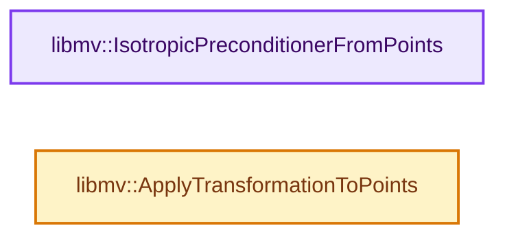
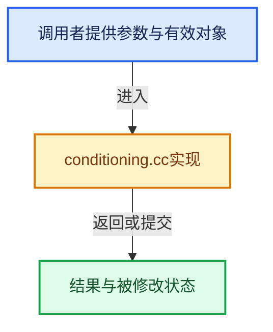

# 实现依赖专题：intern/libmv/libmv/multiview/conditioning.cc

[方向导航](README.md) · [符号索引](../%E7%AC%A6%E5%8F%B7%E4%BE%9D%E8%B5%96%E4%B8%8E%E5%AE%9E%E7%8E%B0%E7%B4%A2%E5%BC%95.md)

本专题从正文实际调用进入，集中保存共享实现。函数有稳定锚点，可从调用处直接跳到对应完整函数；递归与互相调用通过回链组织。

## 本文件的实现关系






## 完整成员与函数实现

<a id="f-67b3e2b4a98fbfc4"></a>

### `libmv::IsotropicPreconditionerFromPoints`

实现位置：[intern/libmv/libmv/multiview/conditioning.cc](../../../../../intern/libmv/libmv/multiview/conditioning.cc) · L50—L69。

接口参数：

- `const Mat& points`
- `Mat3* T`

**教学注释版**

<!-- annotated:092a32193a4830 -->

```cpp
void IsotropicPreconditionerFromPoints(const Mat& points, Mat3* T) {
  Vec mean, variance;
  MeanAndVarianceAlongRows(points, &mean, &variance);

  double var_norm = variance.norm();
  double factor = sqrt(2.0 / var_norm);

  // If variance is equal to 0.0 set scaling factor to identity.
  // -> Else it will provide nan value (because division by 0).
  if (var_norm < 1e-8) {
    factor = 1.0;
    mean.setOnes();
  }

  // clang-format off
  *T << factor, 0,       -factor * mean(0),
        0,       factor, -factor * mean(1),
        0,       0,        1;
  // clang-format on
}
```

<details>
<summary>核对原始源码：intern/libmv/libmv/multiview/conditioning.cc · L50—L69</summary>

<!-- original:092a32193a4830:intern/libmv/libmv/multiview/conditioning.cc:50:69 -->

```cpp
void IsotropicPreconditionerFromPoints(const Mat& points, Mat3* T) {
  Vec mean, variance;
  MeanAndVarianceAlongRows(points, &mean, &variance);

  double var_norm = variance.norm();
  double factor = sqrt(2.0 / var_norm);

  // If variance is equal to 0.0 set scaling factor to identity.
  // -> Else it will provide nan value (because division by 0).
  if (var_norm < 1e-8) {
    factor = 1.0;
    mean.setOnes();
  }

  // clang-format off
  *T << factor, 0,       -factor * mean(0),
        0,       factor, -factor * mean(1),
        0,       0,        1;
  // clang-format on
}
```

</details>

**沿实际写入检查状态**

- `factor = 1.0;`

**继续追踪实现**

- `MeanAndVarianceAlongRows` → [libmv::MeanAndVarianceAlongRows · L90](%E4%BE%9D%E8%B5%96-numeric-651f85.md#f-aa9051c0ad471072)。
- `variance.norm` → [调用协议](../%E6%A8%A1%E6%9D%BF%E5%AE%8F%E4%B8%8E%E5%8A%A8%E6%80%81%E5%88%86%E6%B4%BE%E5%8D%8F%E8%AE%AE.md)：接收对象类型依赖auto、返回值或模板实例；不按同名猜测目标。调用位置L54。
- `sqrt` → [外部契约](https://eel.is/c++draft/)：这个边界按实际表达式及所属类型核对参数、返回值、寿命与失败行为。这里提供接口入口，不声称已解释该第三方版本的内部实现。
- `mean.setOnes` → [调用协议](../%E6%A8%A1%E6%9D%BF%E5%AE%8F%E4%B8%8E%E5%8A%A8%E6%80%81%E5%88%86%E6%B4%BE%E5%8D%8F%E8%AE%AE.md)：由接收对象具体类型或运行时策略提供实现。调用位置L61。
- `mean` → [调用协议](../%E6%A8%A1%E6%9D%BF%E5%AE%8F%E4%B8%8E%E5%8A%A8%E6%80%81%E5%88%86%E6%B4%BE%E5%8D%8F%E8%AE%AE.md)：局部可调用对象，须结合其初始化与捕获环境。调用位置L65。

<a id="f-b7f6d24b0029a235"></a>

### `libmv::ApplyTransformationToPoints`

实现位置：[intern/libmv/libmv/multiview/conditioning.cc](../../../../../intern/libmv/libmv/multiview/conditioning.cc) · L71—L80。

接口参数：

- `const Mat& points`
- `const Mat3& T`
- `Mat* transformed_points`

**教学注释版**

<!-- annotated:8728e122e1a40c -->

```cpp
void ApplyTransformationToPoints(const Mat& points,
                                 const Mat3& T,
                                 Mat* transformed_points) {
  int n = points.cols();
  transformed_points->resize(2, n);
  Mat3X p(3, n);
  EuclideanToHomogeneous(points, &p);
  p = T * p;
  HomogeneousToEuclidean(p, transformed_points);
}
```

<details>
<summary>核对原始源码：intern/libmv/libmv/multiview/conditioning.cc · L71—L80</summary>

<!-- original:8728e122e1a40c:intern/libmv/libmv/multiview/conditioning.cc:71:80 -->

```cpp
void ApplyTransformationToPoints(const Mat& points,
                                 const Mat3& T,
                                 Mat* transformed_points) {
  int n = points.cols();
  transformed_points->resize(2, n);
  Mat3X p(3, n);
  EuclideanToHomogeneous(points, &p);
  p = T * p;
  HomogeneousToEuclidean(p, transformed_points);
}
```

</details>

**沿实际写入检查状态**

- `p = T * p;`

**继续追踪实现**

- `points.cols` → [调用协议](../%E6%A8%A1%E6%9D%BF%E5%AE%8F%E4%B8%8E%E5%8A%A8%E6%80%81%E5%88%86%E6%B4%BE%E5%8D%8F%E8%AE%AE.md)：由接收对象具体类型或运行时策略提供实现。调用位置L74。
- `transformed_points->resize` → [调用协议](../%E6%A8%A1%E6%9D%BF%E5%AE%8F%E4%B8%8E%E5%8A%A8%E6%80%81%E5%88%86%E6%B4%BE%E5%8D%8F%E8%AE%AE.md)：由接收对象具体类型或运行时策略提供实现。调用位置L75。
- `EuclideanToHomogeneous` → [libmv::EuclideanToHomogeneous · L67](%E4%BE%9D%E8%B5%96-projection-10222f.md#f-a08ca367970fbe53)；[libmv::EuclideanToHomogeneous · L73](%E4%BE%9D%E8%B5%96-projection-10222f.md#f-3a47f7d22a8953df)；[libmv::EuclideanToHomogeneous · L78](%E4%BE%9D%E8%B5%96-projection-10222f.md#f-6b125a1820ff56ad)；[libmv::EuclideanToHomogeneous · L84](%E4%BE%9D%E8%B5%96-projection-10222f.md#f-62d154fcc0e84630)；[libmv::EuclideanToHomogeneous · L91](%E4%BE%9D%E8%B5%96-projection-10222f.md#f-d6968897b0bd421e)；[libmv::EuclideanToHomogeneous · L94](%E4%BE%9D%E8%B5%96-projection-10222f.md#f-bf8e963285466a53)；[libmv::EuclideanToHomogeneous · L200](%E4%BE%9D%E8%B5%96-projection-2cdbfd.md#f-a5842bfa24b3fb3e)；[libmv::EuclideanToHomogeneous · L208](%E4%BE%9D%E8%B5%96-projection-2cdbfd.md#f-26ce89d4fd07ec92)；[libmv::EuclideanToHomogeneous · L212](%E4%BE%9D%E8%B5%96-projection-2cdbfd.md#f-d235f999e66e4769)。同名重载需按实参类型选择。
- `HomogeneousToEuclidean` → [libmv::HomogeneousToEuclidean · L53](%E4%BE%9D%E8%B5%96-projection-10222f.md#f-50e3a45d1ca46e98)；[libmv::HomogeneousToEuclidean · L56](%E4%BE%9D%E8%B5%96-projection-10222f.md#f-ed9556d666e66e2d)；[libmv::HomogeneousToEuclidean · L59](%E4%BE%9D%E8%B5%96-projection-10222f.md#f-4346bffaa6d17013)；[libmv::HomogeneousToEuclidean · L166](%E4%BE%9D%E8%B5%96-projection-2cdbfd.md#f-a66eea5b0cd29df2)；[libmv::HomogeneousToEuclidean · L178](%E4%BE%9D%E8%B5%96-projection-2cdbfd.md#f-22cf57d39a2756f5)；[libmv::HomogeneousToEuclidean · L183](%E4%BE%9D%E8%B5%96-projection-2cdbfd.md#f-1bc679a051cfb967)；[libmv::HomogeneousToEuclidean · L190](%E4%BE%9D%E8%B5%96-projection-2cdbfd.md#f-f5bcabffd483b089)；[libmv::HomogeneousToEuclidean · L195](%E4%BE%9D%E8%B5%96-projection-2cdbfd.md#f-b884674e75f12027)。同名重载需按实参类型选择。
