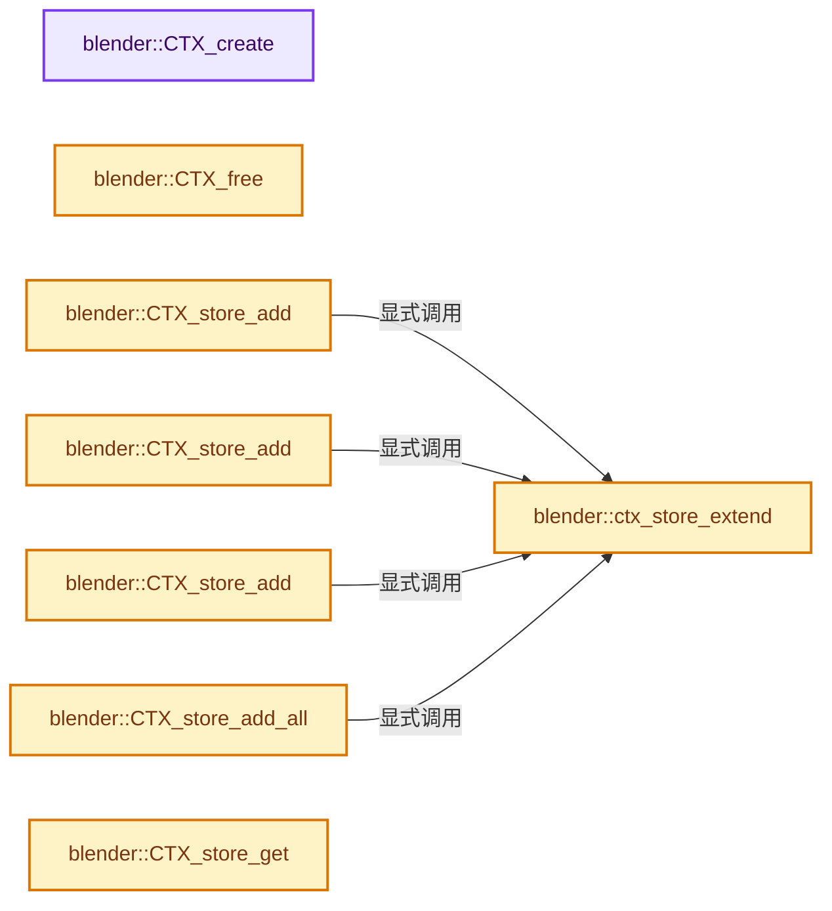
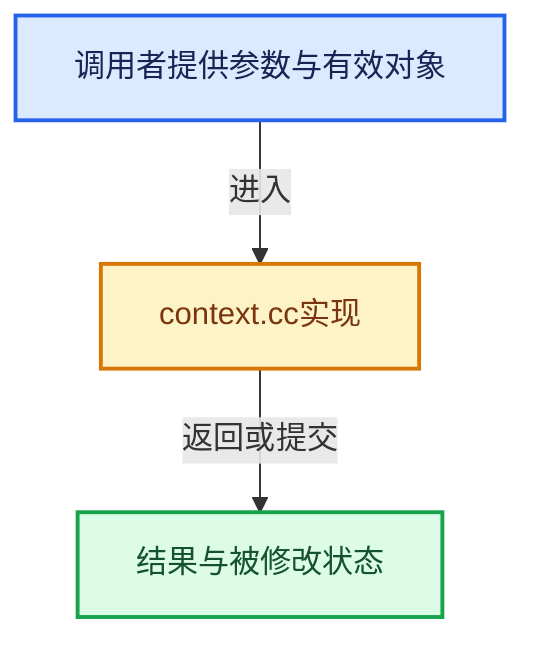

# 实现依赖专题：source/blender/blenkernel/intern/context.cc

[方向导航](README.md) · [符号索引](../%E7%AC%A6%E5%8F%B7%E4%BE%9D%E8%B5%96%E4%B8%8E%E5%AE%9E%E7%8E%B0%E7%B4%A2%E5%BC%95.md)

本专题从正文实际调用进入，集中保存共享实现。函数有稳定锚点，可从调用处直接跳到对应完整函数；递归与互相调用通过回链组织。

## 本文件的实现关系






## 完整成员与函数实现

<a id="f-6bb599996ad92494"></a>

### `blender::CTX_create`

实现位置：[source/blender/blenkernel/intern/context.cc](../../../../../source/blender/blenkernel/intern/context.cc) · L119—L123。

**教学注释版**

<!-- annotated:a53d7ddde68499 -->

```cpp
bContext *CTX_create()
{
  bContext *C = MEM_new<bContext>(__func__);
  return C;
}
```

<details>
<summary>核对原始源码：source/blender/blenkernel/intern/context.cc · L119—L123</summary>

<!-- original:a53d7ddde68499:source/blender/blenkernel/intern/context.cc:119:123 -->

```cpp
bContext *CTX_create()
{
  bContext *C = MEM_new<bContext>(__func__);
  return C;
}
```

</details>

**结果出口**

- `return C;`

**继续追踪实现**

- `MEM_new<bContext>` → [MEM_new · L351](../03-%E5%86%85%E5%AD%98%E5%88%86%E9%85%8D%E4%B8%8E%E8%BF%90%E8%A1%8C%E6%97%B6%E7%B1%BB%E5%9E%8B/%E4%BE%9D%E8%B5%96-MEM_guardedalloc-b54eca.md#f-115f9b6784f89912)。

<a id="f-9d1d4ac3a33ed0a8"></a>

### `blender::CTX_free`

实现位置：[source/blender/blenkernel/intern/context.cc](../../../../../source/blender/blenkernel/intern/context.cc) · L133—L139。

接口参数：

- `bContext *C`

**教学注释版**

<!-- annotated:799f85b2f33e51 -->

```cpp
void CTX_free(bContext *C)
{
  /* This may contain a dynamically allocated data, free. */
  CTX_wm_operator_poll_msg_clear(C);

  MEM_delete(C);
}
```

<details>
<summary>核对原始源码：source/blender/blenkernel/intern/context.cc · L133—L139</summary>

<!-- original:799f85b2f33e51:source/blender/blenkernel/intern/context.cc:133:139 -->

```cpp
void CTX_free(bContext *C)
{
  /* This may contain a dynamically allocated data, free. */
  CTX_wm_operator_poll_msg_clear(C);

  MEM_delete(C);
}
```

</details>

**继续追踪实现**

- `CTX_wm_operator_poll_msg_clear` → [blender::CTX_wm_operator_poll_msg_clear · L1264](%E4%BE%9D%E8%B5%96-context-a929d9.md#f-e7eb8cf3726fd357)。
- `MEM_delete` → [MEM_delete · L400](../03-%E5%86%85%E5%AD%98%E5%88%86%E9%85%8D%E4%B8%8E%E8%BF%90%E8%A1%8C%E6%97%B6%E7%B1%BB%E5%9E%8B/%E4%BE%9D%E8%B5%96-MEM_guardedalloc-b54eca.md#f-9049ffdd1682887c)。

<a id="f-5bb19a13eead33b3"></a>

### `blender::ctx_store_extend`

实现位置：[source/blender/blenkernel/intern/context.cc](../../../../../source/blender/blenkernel/intern/context.cc) · L146—L159。

接口参数：

- `Vector<std::unique_ptr<bContextStore>> &contexts`

**教学注释版**

<!-- annotated:e2720f4fe844da -->

```cpp
static bContextStore *ctx_store_extend(Vector<std::unique_ptr<bContextStore>> &contexts)
{
  /* ensure we have a context to put the entry in, if it was already used
   * we have to copy the context to ensure */
  if (contexts.is_empty()) {
    // [讲解] contexts.append：在尾部建立新元素，必要时先扩大存储。
    contexts.append(std::make_unique<bContextStore>());
  }
  // [讲解] contexts.last：访问有效范围首端或末端元素。
  else if (contexts.last()->used) {
    // [讲解] std::make_unique<bContextStore>：创建独占拥有的对象，拥有关系可移动，get返回的借用指针不自动延长寿命。
    auto new_ctx = std::make_unique<bContextStore>(bContextStore{contexts.last()->entries, false});
    // [讲解] std::move：把表达式转换成可供移动重载选择的值类别；不保证真的移动，不结束源对象寿命，对const值可能选择复制。
    contexts.append(std::move(new_ctx));
  }

  return contexts.last().get();
}
```

<details>
<summary>核对原始源码：source/blender/blenkernel/intern/context.cc · L146—L159</summary>

<!-- original:e2720f4fe844da:source/blender/blenkernel/intern/context.cc:146:159 -->

```cpp
static bContextStore *ctx_store_extend(Vector<std::unique_ptr<bContextStore>> &contexts)
{
  /* ensure we have a context to put the entry in, if it was already used
   * we have to copy the context to ensure */
  if (contexts.is_empty()) {
    contexts.append(std::make_unique<bContextStore>());
  }
  else if (contexts.last()->used) {
    auto new_ctx = std::make_unique<bContextStore>(bContextStore{contexts.last()->entries, false});
    contexts.append(std::move(new_ctx));
  }

  return contexts.last().get();
}
```

</details>

**结果出口**

- `return contexts.last().get();`

**继续追踪实现**

- `contexts.is_empty` → [blender::Vector::is_empty · L792](../01-%E5%9F%BA%E7%A1%80%E5%AE%B9%E5%99%A8%E4%B8%8E%E7%8E%B0%E4%BB%A3CPP/11-Vector%E6%8F%92%E5%85%A5%E5%88%A0%E9%99%A4%E4%B8%8E%E9%87%8D%E6%8E%92.md#f-937bbd9cb80bdcc8)。
- `contexts.append` → [blender::Vector::append · L498](../01-%E5%9F%BA%E7%A1%80%E5%AE%B9%E5%99%A8%E4%B8%8E%E7%8E%B0%E4%BB%A3CPP/11-Vector%E6%8F%92%E5%85%A5%E5%88%A0%E9%99%A4%E4%B8%8E%E9%87%8D%E6%8E%92.md#f-5bde268a69e443ec)；[blender::Vector::append · L502](../01-%E5%9F%BA%E7%A1%80%E5%AE%B9%E5%99%A8%E4%B8%8E%E7%8E%B0%E4%BB%A3CPP/11-Vector%E6%8F%92%E5%85%A5%E5%88%A0%E9%99%A4%E4%B8%8E%E9%87%8D%E6%8E%92.md#f-591e0b15e6308532)。同名重载需按实参类型选择。
- `std::make_unique<bContextStore>` → [外部契约](https://eel.is/c++draft/unique.ptr.create)：创建独占拥有的对象，拥有关系可移动，get返回的借用指针不自动延长寿命。
- `contexts.last` → [blender::Vector::last · L749](../01-%E5%9F%BA%E7%A1%80%E5%AE%B9%E5%99%A8%E4%B8%8E%E7%8E%B0%E4%BB%A3CPP/11-Vector%E6%8F%92%E5%85%A5%E5%88%A0%E9%99%A4%E4%B8%8E%E9%87%8D%E6%8E%92.md#f-d32e1fd895e766b4)；[blender::Vector::last · L755](../01-%E5%9F%BA%E7%A1%80%E5%AE%B9%E5%99%A8%E4%B8%8E%E7%8E%B0%E4%BB%A3CPP/11-Vector%E6%8F%92%E5%85%A5%E5%88%A0%E9%99%A4%E4%B8%8E%E9%87%8D%E6%8E%92.md#f-66b262993c080d9d)。同名重载需按实参类型选择。
- `std::move` → [外部契约](https://eel.is/c++draft/utility.forward)：把表达式转换成可供移动重载选择的值类别；不保证真的移动，不结束源对象寿命，对const值可能选择复制。
- `contexts.last().get` → [调用协议](../%E6%A8%A1%E6%9D%BF%E5%AE%8F%E4%B8%8E%E5%8A%A8%E6%80%81%E5%88%86%E6%B4%BE%E5%8D%8F%E8%AE%AE.md)：接收对象类型依赖auto、返回值或模板实例；不按同名猜测目标。调用位置L158。

<a id="f-6cf9114bf60eeaa4"></a>

### `blender::CTX_store_add`

实现位置：[source/blender/blenkernel/intern/context.cc](../../../../../source/blender/blenkernel/intern/context.cc) · L161—L168。

接口参数：

- `Vector<std::unique_ptr<bContextStore>> &contexts`
- `const StringRef name`
- `const PointerRNA *ptr`

**教学注释版**

<!-- annotated:aefc000651e3c5 -->

```cpp
bContextStore *CTX_store_add(Vector<std::unique_ptr<bContextStore>> &contexts,
                             const StringRef name,
                             const PointerRNA *ptr)
{
  bContextStore *ctx = ctx_store_extend(contexts);
  ctx->entries.append(bContextStoreEntry{name, *ptr});
  return ctx;
}
```

<details>
<summary>核对原始源码：source/blender/blenkernel/intern/context.cc · L161—L168</summary>

<!-- original:aefc000651e3c5:source/blender/blenkernel/intern/context.cc:161:168 -->

```cpp
bContextStore *CTX_store_add(Vector<std::unique_ptr<bContextStore>> &contexts,
                             const StringRef name,
                             const PointerRNA *ptr)
{
  bContextStore *ctx = ctx_store_extend(contexts);
  ctx->entries.append(bContextStoreEntry{name, *ptr});
  return ctx;
}
```

</details>

**结果出口**

- `return ctx;`

**继续追踪实现**

- `ctx_store_extend` → [blender::ctx_store_extend · L146](%E4%BE%9D%E8%B5%96-context-a929d9.md#f-5bb19a13eead33b3)。
- `ctx->entries.append` → [调用协议](../%E6%A8%A1%E6%9D%BF%E5%AE%8F%E4%B8%8E%E5%8A%A8%E6%80%81%E5%88%86%E6%B4%BE%E5%8D%8F%E8%AE%AE.md)：接收对象类型依赖auto、返回值或模板实例；不按同名猜测目标。调用位置L166。

<a id="f-822b1dbffea067cc"></a>

### `blender::CTX_store_add`

实现位置：[source/blender/blenkernel/intern/context.cc](../../../../../source/blender/blenkernel/intern/context.cc) · L170—L177。

接口参数：

- `Vector<std::unique_ptr<bContextStore>> &contexts`
- `const StringRef name`
- `const StringRef str`

**教学注释版**

<!-- annotated:2a7f77e10423a8 -->

```cpp
bContextStore *CTX_store_add(Vector<std::unique_ptr<bContextStore>> &contexts,
                             const StringRef name,
                             const StringRef str)
{
  bContextStore *ctx = ctx_store_extend(contexts);
  ctx->entries.append(bContextStoreEntry{name, std::string{str}});
  return ctx;
}
```

<details>
<summary>核对原始源码：source/blender/blenkernel/intern/context.cc · L170—L177</summary>

<!-- original:2a7f77e10423a8:source/blender/blenkernel/intern/context.cc:170:177 -->

```cpp
bContextStore *CTX_store_add(Vector<std::unique_ptr<bContextStore>> &contexts,
                             const StringRef name,
                             const StringRef str)
{
  bContextStore *ctx = ctx_store_extend(contexts);
  ctx->entries.append(bContextStoreEntry{name, std::string{str}});
  return ctx;
}
```

</details>

**结果出口**

- `return ctx;`

**继续追踪实现**

- `ctx_store_extend` → [blender::ctx_store_extend · L146](%E4%BE%9D%E8%B5%96-context-a929d9.md#f-5bb19a13eead33b3)。
- `ctx->entries.append` → [调用协议](../%E6%A8%A1%E6%9D%BF%E5%AE%8F%E4%B8%8E%E5%8A%A8%E6%80%81%E5%88%86%E6%B4%BE%E5%8D%8F%E8%AE%AE.md)：接收对象类型依赖auto、返回值或模板实例；不按同名猜测目标。调用位置L175。

<a id="f-73e7c790d35aa775"></a>

### `blender::CTX_store_add`

实现位置：[source/blender/blenkernel/intern/context.cc](../../../../../source/blender/blenkernel/intern/context.cc) · L179—L186。

接口参数：

- `Vector<std::unique_ptr<bContextStore>> &contexts`
- `const StringRef name`
- `const int64_t value`

**教学注释版**

<!-- annotated:1b7916295fbe68 -->

```cpp
bContextStore *CTX_store_add(Vector<std::unique_ptr<bContextStore>> &contexts,
                             const StringRef name,
                             const int64_t value)
{
  bContextStore *ctx = ctx_store_extend(contexts);
  ctx->entries.append(bContextStoreEntry{name, value});
  return ctx;
}
```

<details>
<summary>核对原始源码：source/blender/blenkernel/intern/context.cc · L179—L186</summary>

<!-- original:1b7916295fbe68:source/blender/blenkernel/intern/context.cc:179:186 -->

```cpp
bContextStore *CTX_store_add(Vector<std::unique_ptr<bContextStore>> &contexts,
                             const StringRef name,
                             const int64_t value)
{
  bContextStore *ctx = ctx_store_extend(contexts);
  ctx->entries.append(bContextStoreEntry{name, value});
  return ctx;
}
```

</details>

**结果出口**

- `return ctx;`

**继续追踪实现**

- `ctx_store_extend` → [blender::ctx_store_extend · L146](%E4%BE%9D%E8%B5%96-context-a929d9.md#f-5bb19a13eead33b3)。
- `ctx->entries.append` → [调用协议](../%E6%A8%A1%E6%9D%BF%E5%AE%8F%E4%B8%8E%E5%8A%A8%E6%80%81%E5%88%86%E6%B4%BE%E5%8D%8F%E8%AE%AE.md)：接收对象类型依赖auto、返回值或模板实例；不按同名猜测目标。调用位置L184。

<a id="f-1708b550bf6c0808"></a>

### `blender::CTX_store_add_all`

实现位置：[source/blender/blenkernel/intern/context.cc](../../../../../source/blender/blenkernel/intern/context.cc) · L188—L196。

接口参数：

- `Vector<std::unique_ptr<bContextStore>> &contexts`
- `const bContextStore *context`

**教学注释版**

<!-- annotated:735ae162bc6418 -->

```cpp
bContextStore *CTX_store_add_all(Vector<std::unique_ptr<bContextStore>> &contexts,
                                 const bContextStore *context)
{
  bContextStore *ctx = ctx_store_extend(contexts);
  for (const bContextStoreEntry &src_entry : context->entries) {
    ctx->entries.append(src_entry);
  }
  return ctx;
}
```

<details>
<summary>核对原始源码：source/blender/blenkernel/intern/context.cc · L188—L196</summary>

<!-- original:735ae162bc6418:source/blender/blenkernel/intern/context.cc:188:196 -->

```cpp
bContextStore *CTX_store_add_all(Vector<std::unique_ptr<bContextStore>> &contexts,
                                 const bContextStore *context)
{
  bContextStore *ctx = ctx_store_extend(contexts);
  for (const bContextStoreEntry &src_entry : context->entries) {
    ctx->entries.append(src_entry);
  }
  return ctx;
}
```

</details>

**结果出口**

- `return ctx;`

**继续追踪实现**

- `ctx_store_extend` → [blender::ctx_store_extend · L146](%E4%BE%9D%E8%B5%96-context-a929d9.md#f-5bb19a13eead33b3)。
- `ctx->entries.append` → [调用协议](../%E6%A8%A1%E6%9D%BF%E5%AE%8F%E4%B8%8E%E5%8A%A8%E6%80%81%E5%88%86%E6%B4%BE%E5%8D%8F%E8%AE%AE.md)：接收对象类型依赖auto、返回值或模板实例；不按同名猜测目标。调用位置L193。

<a id="f-72120481647ce215"></a>

### `blender::CTX_store_get`

实现位置：[source/blender/blenkernel/intern/context.cc](../../../../../source/blender/blenkernel/intern/context.cc) · L198—L201。

接口参数：

- `const bContext *C`

**教学注释版**

<!-- annotated:40059347c167f2 -->

```cpp
const bContextStore *CTX_store_get(const bContext *C)
{
  return C->wm.store;
}
```

<details>
<summary>核对原始源码：source/blender/blenkernel/intern/context.cc · L198—L201</summary>

<!-- original:40059347c167f2:source/blender/blenkernel/intern/context.cc:198:201 -->

```cpp
const bContextStore *CTX_store_get(const bContext *C)
{
  return C->wm.store;
}
```

</details>

**结果出口**

- `return C->wm.store;`

**继续追踪实现**

本实现没有需要继续展开的显式调用；检查返回表达式、对象转换和调用者前置条件。

<a id="f-7afda6dfa8323e15"></a>

### `blender::CTX_store_set`

实现位置：[source/blender/blenkernel/intern/context.cc](../../../../../source/blender/blenkernel/intern/context.cc) · L203—L206。

接口参数：

- `bContext *C`
- `const bContextStore *store`

**教学注释版**

<!-- annotated:76febf5dbd43c9 -->

```cpp
void CTX_store_set(bContext *C, const bContextStore *store)
{
  C->wm.store = store;
}
```

<details>
<summary>核对原始源码：source/blender/blenkernel/intern/context.cc · L203—L206</summary>

<!-- original:76febf5dbd43c9:source/blender/blenkernel/intern/context.cc:203:206 -->

```cpp
void CTX_store_set(bContext *C, const bContextStore *store)
{
  C->wm.store = store;
}
```

</details>

**沿实际写入检查状态**

- `C->wm.store = store;`

**继续追踪实现**

本实现没有需要继续展开的显式调用；检查返回表达式、对象转换和调用者前置条件。

<a id="f-9bfd7faa5f93c09d"></a>

### `blender::CTX_store_ptr_lookup`

实现位置：[source/blender/blenkernel/intern/context.cc](../../../../../source/blender/blenkernel/intern/context.cc) · L208—L221。

接口参数：

- `const bContextStore *store`
- `const StringRef name`
- `const StructRNA *type`

**教学注释版**

<!-- annotated:028ba5c776846f -->

```cpp
const PointerRNA *CTX_store_ptr_lookup(const bContextStore *store,
                                       const StringRef name,
                                       const StructRNA *type)
{
  for (auto entry = store->entries.rbegin(); entry != store->entries.rend(); ++entry) {
    if (entry->name == name && std::holds_alternative<PointerRNA>(entry->value)) {
      const PointerRNA &ptr = std::get<PointerRNA>(entry->value);
      if (!type || RNA_struct_is_a(ptr.type, type)) {
        return &ptr;
      }
    }
  }
  return nullptr;
}
```

<details>
<summary>核对原始源码：source/blender/blenkernel/intern/context.cc · L208—L221</summary>

<!-- original:028ba5c776846f:source/blender/blenkernel/intern/context.cc:208:221 -->

```cpp
const PointerRNA *CTX_store_ptr_lookup(const bContextStore *store,
                                       const StringRef name,
                                       const StructRNA *type)
{
  for (auto entry = store->entries.rbegin(); entry != store->entries.rend(); ++entry) {
    if (entry->name == name && std::holds_alternative<PointerRNA>(entry->value)) {
      const PointerRNA &ptr = std::get<PointerRNA>(entry->value);
      if (!type || RNA_struct_is_a(ptr.type, type)) {
        return &ptr;
      }
    }
  }
  return nullptr;
}
```

</details>

**结果出口**

- `return &ptr;`
- `return nullptr;`

**继续追踪实现**

- `store->entries.rbegin` → [调用协议](../%E6%A8%A1%E6%9D%BF%E5%AE%8F%E4%B8%8E%E5%8A%A8%E6%80%81%E5%88%86%E6%B4%BE%E5%8D%8F%E8%AE%AE.md)：接收对象类型依赖auto、返回值或模板实例；不按同名猜测目标。调用位置L212。
- `store->entries.rend` → [调用协议](../%E6%A8%A1%E6%9D%BF%E5%AE%8F%E4%B8%8E%E5%8A%A8%E6%80%81%E5%88%86%E6%B4%BE%E5%8D%8F%E8%AE%AE.md)：接收对象类型依赖auto、返回值或模板实例；不按同名猜测目标。调用位置L212。
- `std::holds_alternative<PointerRNA>` → [外部契约](https://eel.is/c++draft/)：这个边界按实际表达式及所属类型核对参数、返回值、寿命与失败行为。这里提供接口入口，不声称已解释该第三方版本的内部实现。
- `std::get<PointerRNA>` → [外部契约](https://eel.is/c++draft/)：这个边界按实际表达式及所属类型核对参数、返回值、寿命与失败行为。这里提供接口入口，不声称已解释该第三方版本的内部实现。
- `RNA_struct_is_a` → [blender::RNA_struct_is_a · L833](%E4%BE%9D%E8%B5%96-rna_access-706bea.md#f-9eaabe3c6e731ea5)。

<a id="f-0c881a3b35d2ea8c"></a>

### `blender::ctx_store_lookup_impl`

实现位置：[source/blender/blenkernel/intern/context.cc](../../../../../source/blender/blenkernel/intern/context.cc) · L223—L232。

接口参数：

- `const bContextStore *store`
- `const StringRef name`

**教学注释版**

<!-- annotated:aee0bbe1695065 -->

```cpp
template<typename T>
const T *ctx_store_lookup_impl(const bContextStore *store, const StringRef name)
{
  for (auto entry = store->entries.rbegin(); entry != store->entries.rend(); ++entry) {
    if (entry->name == name && std::holds_alternative<T>(entry->value)) {
      return &std::get<T>(entry->value);
    }
  }
  return nullptr;
}
```

<details>
<summary>核对原始源码：source/blender/blenkernel/intern/context.cc · L223—L232</summary>

<!-- original:aee0bbe1695065:source/blender/blenkernel/intern/context.cc:223:232 -->

```cpp
template<typename T>
const T *ctx_store_lookup_impl(const bContextStore *store, const StringRef name)
{
  for (auto entry = store->entries.rbegin(); entry != store->entries.rend(); ++entry) {
    if (entry->name == name && std::holds_alternative<T>(entry->value)) {
      return &std::get<T>(entry->value);
    }
  }
  return nullptr;
}
```

</details>

**结果出口**

- `return &std::get<T>(entry->value);`
- `return nullptr;`

**继续追踪实现**

- `store->entries.rbegin` → [调用协议](../%E6%A8%A1%E6%9D%BF%E5%AE%8F%E4%B8%8E%E5%8A%A8%E6%80%81%E5%88%86%E6%B4%BE%E5%8D%8F%E8%AE%AE.md)：接收对象类型依赖auto、返回值或模板实例；不按同名猜测目标。调用位置L226。
- `store->entries.rend` → [调用协议](../%E6%A8%A1%E6%9D%BF%E5%AE%8F%E4%B8%8E%E5%8A%A8%E6%80%81%E5%88%86%E6%B4%BE%E5%8D%8F%E8%AE%AE.md)：接收对象类型依赖auto、返回值或模板实例；不按同名猜测目标。调用位置L226。
- `std::holds_alternative<T>` → [外部契约](https://eel.is/c++draft/)：这个边界按实际表达式及所属类型核对参数、返回值、寿命与失败行为。这里提供接口入口，不声称已解释该第三方版本的内部实现。
- `std::get<T>` → [外部契约](https://eel.is/c++draft/)：这个边界按实际表达式及所属类型核对参数、返回值、寿命与失败行为。这里提供接口入口，不声称已解释该第三方版本的内部实现。

<a id="f-f9254d35967301f5"></a>

### `blender::CTX_store_string_lookup`

实现位置：[source/blender/blenkernel/intern/context.cc](../../../../../source/blender/blenkernel/intern/context.cc) · L234—L241。

接口参数：

- `const bContextStore *store`
- `const StringRef name`

**教学注释版**

<!-- annotated:0c90991355f91c -->

```cpp
std::optional<StringRefNull> CTX_store_string_lookup(const bContextStore *store,
                                                     const StringRef name)
{
  if (const std::string *value = ctx_store_lookup_impl<std::string>(store, name)) {
    return *value;
  }
  return {};
}
```

<details>
<summary>核对原始源码：source/blender/blenkernel/intern/context.cc · L234—L241</summary>

<!-- original:0c90991355f91c:source/blender/blenkernel/intern/context.cc:234:241 -->

```cpp
std::optional<StringRefNull> CTX_store_string_lookup(const bContextStore *store,
                                                     const StringRef name)
{
  if (const std::string *value = ctx_store_lookup_impl<std::string>(store, name)) {
    return *value;
  }
  return {};
}
```

</details>

**结果出口**

- `return *value;`
- `return {};`

**继续追踪实现**

- `ctx_store_lookup_impl<std::string>` → [blender::ctx_store_lookup_impl · L223](%E4%BE%9D%E8%B5%96-context-a929d9.md#f-0c881a3b35d2ea8c)。

<a id="f-504b6fc17e03f031"></a>

### `blender::CTX_store_int_lookup`

实现位置：[source/blender/blenkernel/intern/context.cc](../../../../../source/blender/blenkernel/intern/context.cc) · L243—L249。

接口参数：

- `const bContextStore *store`
- `const StringRef name`

**教学注释版**

<!-- annotated:5eaa629eb9e268 -->

```cpp
std::optional<int64_t> CTX_store_int_lookup(const bContextStore *store, const StringRef name)
{
  if (const int64_t *value = ctx_store_lookup_impl<int64_t>(store, name)) {
    return *value;
  }
  return {};
}
```

<details>
<summary>核对原始源码：source/blender/blenkernel/intern/context.cc · L243—L249</summary>

<!-- original:5eaa629eb9e268:source/blender/blenkernel/intern/context.cc:243:249 -->

```cpp
std::optional<int64_t> CTX_store_int_lookup(const bContextStore *store, const StringRef name)
{
  if (const int64_t *value = ctx_store_lookup_impl<int64_t>(store, name)) {
    return *value;
  }
  return {};
}
```

</details>

**结果出口**

- `return *value;`
- `return {};`

**继续追踪实现**

- `ctx_store_lookup_impl<int64_t>` → [blender::ctx_store_lookup_impl · L223](%E4%BE%9D%E8%B5%96-context-a929d9.md#f-0c881a3b35d2ea8c)。

<a id="f-fe5e877b7383e917"></a>

### `blender::CTX_py_init_get`

实现位置：[source/blender/blenkernel/intern/context.cc](../../../../../source/blender/blenkernel/intern/context.cc) · L253—L256。

接口参数：

- `const bContext *C`

**教学注释版**

<!-- annotated:5bb09a8c07cf4a -->

```cpp
bool CTX_py_init_get(const bContext *C)
{
  return C->data.py_init;
}
```

<details>
<summary>核对原始源码：source/blender/blenkernel/intern/context.cc · L253—L256</summary>

<!-- original:5bb09a8c07cf4a:source/blender/blenkernel/intern/context.cc:253:256 -->

```cpp
bool CTX_py_init_get(const bContext *C)
{
  return C->data.py_init;
}
```

</details>

**结果出口**

- `return C->data.py_init;`

**继续追踪实现**

本实现没有需要继续展开的显式调用；检查返回表达式、对象转换和调用者前置条件。

<a id="f-b4b690a4ecabdbd6"></a>

### `blender::CTX_py_dict_get`

实现位置：[source/blender/blenkernel/intern/context.cc](../../../../../source/blender/blenkernel/intern/context.cc) · L262—L265。

接口参数：

- `const bContext *C`

**教学注释版**

<!-- annotated:27a8d6611b0739 -->

```cpp
void *CTX_py_dict_get(const bContext *C)
{
  return C->data.py_context;
}
```

<details>
<summary>核对原始源码：source/blender/blenkernel/intern/context.cc · L262—L265</summary>

<!-- original:27a8d6611b0739:source/blender/blenkernel/intern/context.cc:262:265 -->

```cpp
void *CTX_py_dict_get(const bContext *C)
{
  return C->data.py_context;
}
```

</details>

**结果出口**

- `return C->data.py_context;`

**继续追踪实现**

本实现没有需要继续展开的显式调用；检查返回表达式、对象转换和调用者前置条件。

<a id="f-b935ab49825222e7"></a>

### `blender::CTX_rna_disallow_write_set_p`

实现位置：[source/blender/blenkernel/intern/context.cc](../../../../../source/blender/blenkernel/intern/context.cc) · L285—L288。

接口参数：

- `bContext *C`
- `const bool *rna_disallow_writes`

**教学注释版**

<!-- annotated:1706058de27ab7 -->

```cpp
void CTX_rna_disallow_write_set_p(bContext *C, const bool *rna_disallow_writes)
{
  C->data.rna_disallow_writes = rna_disallow_writes;
}
```

<details>
<summary>核对原始源码：source/blender/blenkernel/intern/context.cc · L285—L288</summary>

<!-- original:1706058de27ab7:source/blender/blenkernel/intern/context.cc:285:288 -->

```cpp
void CTX_rna_disallow_write_set_p(bContext *C, const bool *rna_disallow_writes)
{
  C->data.rna_disallow_writes = rna_disallow_writes;
}
```

</details>

**沿实际写入检查状态**

- `C->data.rna_disallow_writes = rna_disallow_writes;`

**继续追踪实现**

本实现没有需要继续展开的显式调用；检查返回表达式、对象转换和调用者前置条件。

<a id="f-4356eb5b9bdc4043"></a>

### `blender::ctx_result_brief_repr`

实现位置：[source/blender/blenkernel/intern/context.cc](../../../../../source/blender/blenkernel/intern/context.cc) · L304—L376。

接口参数：

- `const bContextDataResult &result`

**教学注释版**

<!-- annotated:f02307e99c1776 -->

```cpp
static std::string ctx_result_brief_repr(const bContextDataResult &result)
{
  switch (result.type) {
    case ContextDataType::Pointer:
      if (result.ptr) {
        const char *rna_type_name = result.ptr.has_type() ?
                                        RNA_struct_identifier(result.ptr.type) :
                                        "Unknown";
        /* Try to get the name property if it exists. */
        std::string member_name;
        if (result.ptr.has_type()) {
          PropertyRNA *name_prop = RNA_struct_name_property(result.ptr.type);
          if (name_prop) {
            char name_buf[256];
            PointerRNA ptr_copy = result.ptr; /* Make a non-const copy. */
            char *name = RNA_property_string_get_alloc(
                &ptr_copy, name_prop, name_buf, sizeof(name_buf), nullptr);
            if (name && name[0] != '\0') {
              member_name = name;
              if (name != name_buf) {
                MEM_delete(name);
              }
            }
          }
        }
        /* Format like PyRNA: '<Type("name") at 0xAddress>' or '<Type at 0xAddress>'. */
        if (!member_name.empty()) {
          return fmt::format("<{}(\"{}\") at 0x{:x}>",
                             rna_type_name,
                             member_name,
                             reinterpret_cast<uintptr_t>(result.ptr.data));
        }
        return fmt::format(
            "<{} at 0x{:x}>", rna_type_name, reinterpret_cast<uintptr_t>(result.ptr.data));
      }
      return "None";

    case ContextDataType::Collection:
      return fmt::format("[{} item(s)]", result.list.size());

    case ContextDataType::String:
      if (!result.str.is_empty()) {
        return "\"" + result.str + "\"";
      }
      else {
        return "\"\"";
      }

    case ContextDataType::Property:
      if (result.prop && result.ptr) {
        const char *prop_name = RNA_property_identifier(result.prop);
        const char *rna_type_name = result.ptr.has_type() ?
                                        RNA_struct_identifier(result.ptr.type) :
                                        "Unknown";
        if (result.index >= 0) {
          return fmt::format("<Property({}.{}[{}])>", rna_type_name, prop_name, result.index);
        }
        return fmt::format("<Property({}.{})>", rna_type_name, prop_name);
      }
      return "<Property(None)>";

    case ContextDataType::Int64:
      if (result.int_value.has_value()) {
        return std::to_string(result.int_value.value());
      }
      else {
        return "None";
      }
  }
  /* Unhandled context type. Update if new types are added. */
  BLI_assert_unreachable();
  return "<UNKNOWN>";
}
```

<details>
<summary>核对原始源码：source/blender/blenkernel/intern/context.cc · L304—L376</summary>

<!-- original:f02307e99c1776:source/blender/blenkernel/intern/context.cc:304:376 -->

```cpp
static std::string ctx_result_brief_repr(const bContextDataResult &result)
{
  switch (result.type) {
    case ContextDataType::Pointer:
      if (result.ptr) {
        const char *rna_type_name = result.ptr.has_type() ?
                                        RNA_struct_identifier(result.ptr.type) :
                                        "Unknown";
        /* Try to get the name property if it exists. */
        std::string member_name;
        if (result.ptr.has_type()) {
          PropertyRNA *name_prop = RNA_struct_name_property(result.ptr.type);
          if (name_prop) {
            char name_buf[256];
            PointerRNA ptr_copy = result.ptr; /* Make a non-const copy. */
            char *name = RNA_property_string_get_alloc(
                &ptr_copy, name_prop, name_buf, sizeof(name_buf), nullptr);
            if (name && name[0] != '\0') {
              member_name = name;
              if (name != name_buf) {
                MEM_delete(name);
              }
            }
          }
        }
        /* Format like PyRNA: '<Type("name") at 0xAddress>' or '<Type at 0xAddress>'. */
        if (!member_name.empty()) {
          return fmt::format("<{}(\"{}\") at 0x{:x}>",
                             rna_type_name,
                             member_name,
                             reinterpret_cast<uintptr_t>(result.ptr.data));
        }
        return fmt::format(
            "<{} at 0x{:x}>", rna_type_name, reinterpret_cast<uintptr_t>(result.ptr.data));
      }
      return "None";

    case ContextDataType::Collection:
      return fmt::format("[{} item(s)]", result.list.size());

    case ContextDataType::String:
      if (!result.str.is_empty()) {
        return "\"" + result.str + "\"";
      }
      else {
        return "\"\"";
      }

    case ContextDataType::Property:
      if (result.prop && result.ptr) {
        const char *prop_name = RNA_property_identifier(result.prop);
        const char *rna_type_name = result.ptr.has_type() ?
                                        RNA_struct_identifier(result.ptr.type) :
                                        "Unknown";
        if (result.index >= 0) {
          return fmt::format("<Property({}.{}[{}])>", rna_type_name, prop_name, result.index);
        }
        return fmt::format("<Property({}.{})>", rna_type_name, prop_name);
      }
      return "<Property(None)>";

    case ContextDataType::Int64:
      if (result.int_value.has_value()) {
        return std::to_string(result.int_value.value());
      }
      else {
        return "None";
      }
  }
  /* Unhandled context type. Update if new types are added. */
  BLI_assert_unreachable();
  return "<UNKNOWN>";
}
```

</details>

**沿实际写入检查状态**

- `member_name = name;`

**结果出口**

- `return fmt::format("<{}(\"{}\") at 0x{:x}>",`
- `return fmt::format(`
- `return "None";`
- `return fmt::format("[{} item(s)]", result.list.size());`
- `return "\"" + result.str + "\"";`
- `return "\"\"";`
- `return fmt::format("<Property({}.{}[{}])>", rna_type_name, prop_name, result.index);`
- `return fmt::format("<Property({}.{})>", rna_type_name, prop_name);`
- `return "<Property(None)>";`
- `return std::to_string(result.int_value.value());`
- `return "<UNKNOWN>";`

**继续追踪实现**

- `result.ptr.has_type` → [调用协议](../%E6%A8%A1%E6%9D%BF%E5%AE%8F%E4%B8%8E%E5%8A%A8%E6%80%81%E5%88%86%E6%B4%BE%E5%8D%8F%E8%AE%AE.md)：接收对象类型依赖auto、返回值或模板实例；不按同名猜测目标。调用位置L309。
- `RNA_struct_identifier` → [blender::RNA_struct_identifier · L711](%E4%BE%9D%E8%B5%96-rna_access-706bea.md#f-754de32877e73311)。
- `RNA_struct_name_property` → [blender::RNA_struct_name_property · L749](%E4%BE%9D%E8%B5%96-rna_access-706bea.md#f-cd7e56afece96a5a)。
- `RNA_property_string_get_alloc` → [blender::RNA_property_string_get_alloc · L4220](%E4%BE%9D%E8%B5%96-rna_access-706bea.md#f-7aaf908f724ade76)。
- `MEM_delete` → [MEM_delete · L400](../03-%E5%86%85%E5%AD%98%E5%88%86%E9%85%8D%E4%B8%8E%E8%BF%90%E8%A1%8C%E6%97%B6%E7%B1%BB%E5%9E%8B/%E4%BE%9D%E8%B5%96-MEM_guardedalloc-b54eca.md#f-9049ffdd1682887c)。
- `member_name.empty` → [外部契约](https://eel.is/c++draft/)：这个边界按实际表达式及所属类型核对参数、返回值、寿命与失败行为。这里提供接口入口，不声称已解释该第三方版本的内部实现。
- `fmt::format` → [外部契约](https://fmt.dev/latest/api/)：按fmt接口的格式字符串与参数类型契约使用，格式化不改变被格式化对象的拥有关系。
- `result.list.size` → [调用协议](../%E6%A8%A1%E6%9D%BF%E5%AE%8F%E4%B8%8E%E5%8A%A8%E6%80%81%E5%88%86%E6%B4%BE%E5%8D%8F%E8%AE%AE.md)：接收对象类型依赖auto、返回值或模板实例；不按同名猜测目标。调用位置L342。
- `result.str.is_empty` → [调用协议](../%E6%A8%A1%E6%9D%BF%E5%AE%8F%E4%B8%8E%E5%8A%A8%E6%80%81%E5%88%86%E6%B4%BE%E5%8D%8F%E8%AE%AE.md)：接收对象类型依赖auto、返回值或模板实例；不按同名猜测目标。调用位置L345。
- `RNA_property_identifier` → [blender::RNA_property_identifier · L1275](%E4%BE%9D%E8%B5%96-rna_access-706bea.md#f-67de6dc6c76092df)。
- `result.int_value.has_value` → [调用协议](../%E6%A8%A1%E6%9D%BF%E5%AE%8F%E4%B8%8E%E5%8A%A8%E6%80%81%E5%88%86%E6%B4%BE%E5%8D%8F%E8%AE%AE.md)：接收对象类型依赖auto、返回值或模板实例；不按同名猜测目标。调用位置L366。
- `std::to_string` → [外部契约](https://eel.is/c++draft/)：这个边界按实际表达式及所属类型核对参数、返回值、寿命与失败行为。这里提供接口入口，不声称已解释该第三方版本的内部实现。
- `result.int_value.value` → [调用协议](../%E6%A8%A1%E6%9D%BF%E5%AE%8F%E4%B8%8E%E5%8A%A8%E6%80%81%E5%88%86%E6%B4%BE%E5%8D%8F%E8%AE%AE.md)：接收对象类型依赖auto、返回值或模板实例；不按同名猜测目标。调用位置L367。
- `BLI_assert_unreachable` → [BLI_assert_unreachable · L77](../01-%E5%9F%BA%E7%A1%80%E5%AE%B9%E5%99%A8%E4%B8%8E%E7%8E%B0%E4%BB%A3CPP/%E4%BE%9D%E8%B5%96-BLI_assert-cc98e8.md#m-7a2d91a67d8e)。宏定义由构建条件选择。

<a id="f-d2ab723eb040429f"></a>

### `blender::ctx_member_log_access`

实现位置：[source/blender/blenkernel/intern/context.cc](../../../../../source/blender/blenkernel/intern/context.cc) · L379—L421。

接口参数：

- `const bContext *C`
- `const char *member`
- `const bContextDataResult &result`
- `const eContextResult lookup_result`

**教学注释版**

<!-- annotated:b7ecb172981709 -->

```cpp
static void ctx_member_log_access(const bContext *C,
                                  const char *member,
                                  const bContextDataResult &result,
                                  const eContextResult lookup_result)
{
  const bool use_logging = CLOG_CHECK(BKE_LOG_CONTEXT, CLG_LEVEL_TRACE) ||
                           CTX_member_logging_get(C);

  if (!use_logging) {
    return;
  }

  /* If hiding missing is enabled and the member was not found, skip logging. */
  if (C && bool(C->data.log_flag & CTX_LogFlag::HideMissing)) {
    if (lookup_result == CTX_RESULT_MEMBER_NOT_FOUND) {
      return;
    }
  }

  std::string value_repr = ctx_result_brief_repr(result);
  const char *value_desc = value_repr.c_str();

#ifdef WITH_PYTHON
  /* Get current Python location if available and Python is properly initialized. */
  std::optional<std::string> python_location;
  if (CTX_py_init_get(C)) {
    python_location = BPY_python_current_file_and_line();
  }
  const char *location = python_location ? python_location->c_str() : "unknown:0";
#else
  const char *location = "unknown:0";
#endif

  /* Use TRACE level when available, otherwise force output when Python logging is enabled. */
  const char *format = "%s: %s=%s";
  if (CLOG_CHECK(BKE_LOG_CONTEXT, CLG_LEVEL_TRACE)) {
    CLOG_TRACE(BKE_LOG_CONTEXT, format, location, member, value_desc);
  }
  else if (CTX_member_logging_get(C)) {
    /* Force output at TRACE level even if not enabled via command line. */
    CLOG_AT_LEVEL_NOCHECK(BKE_LOG_CONTEXT, CLG_LEVEL_TRACE, format, location, member, value_desc);
  }
}
```

<details>
<summary>核对原始源码：source/blender/blenkernel/intern/context.cc · L379—L421</summary>

<!-- original:b7ecb172981709:source/blender/blenkernel/intern/context.cc:379:421 -->

```cpp
static void ctx_member_log_access(const bContext *C,
                                  const char *member,
                                  const bContextDataResult &result,
                                  const eContextResult lookup_result)
{
  const bool use_logging = CLOG_CHECK(BKE_LOG_CONTEXT, CLG_LEVEL_TRACE) ||
                           CTX_member_logging_get(C);

  if (!use_logging) {
    return;
  }

  /* If hiding missing is enabled and the member was not found, skip logging. */
  if (C && bool(C->data.log_flag & CTX_LogFlag::HideMissing)) {
    if (lookup_result == CTX_RESULT_MEMBER_NOT_FOUND) {
      return;
    }
  }

  std::string value_repr = ctx_result_brief_repr(result);
  const char *value_desc = value_repr.c_str();

#ifdef WITH_PYTHON
  /* Get current Python location if available and Python is properly initialized. */
  std::optional<std::string> python_location;
  if (CTX_py_init_get(C)) {
    python_location = BPY_python_current_file_and_line();
  }
  const char *location = python_location ? python_location->c_str() : "unknown:0";
#else
  const char *location = "unknown:0";
#endif

  /* Use TRACE level when available, otherwise force output when Python logging is enabled. */
  const char *format = "%s: %s=%s";
  if (CLOG_CHECK(BKE_LOG_CONTEXT, CLG_LEVEL_TRACE)) {
    CLOG_TRACE(BKE_LOG_CONTEXT, format, location, member, value_desc);
  }
  else if (CTX_member_logging_get(C)) {
    /* Force output at TRACE level even if not enabled via command line. */
    CLOG_AT_LEVEL_NOCHECK(BKE_LOG_CONTEXT, CLG_LEVEL_TRACE, format, location, member, value_desc);
  }
}
```

</details>

**沿实际写入检查状态**

- `python_location = BPY_python_current_file_and_line();`

**继续追踪实现**

- `CLOG_CHECK` → [CLOG_CHECK · L147](%E4%BE%9D%E8%B5%96-CLG_log-e9051b.md#m-27348fec3943)。宏定义由构建条件选择。
- `CTX_member_logging_get` → [blender::CTX_member_logging_get · L1801](%E4%BE%9D%E8%B5%96-context-a929d9.md#f-5eacbfe637c13628)。
- `ctx_result_brief_repr` → [blender::ctx_result_brief_repr · L304](%E4%BE%9D%E8%B5%96-context-a929d9.md#f-4356eb5b9bdc4043)。
- `value_repr.c_str` → [外部契约](https://eel.is/c++draft/)：这个边界按实际表达式及所属类型核对参数、返回值、寿命与失败行为。这里提供接口入口，不声称已解释该第三方版本的内部实现。
- `CTX_py_init_get` → [blender::CTX_py_init_get · L253](%E4%BE%9D%E8%B5%96-context-a929d9.md#f-fe5e877b7383e917)。
- `BPY_python_current_file_and_line` → [blender::BPY_python_current_file_and_line · L953](%E4%BE%9D%E8%B5%96-bpy_interface-b3b9e6.md#f-9621b5f0e28841aa)。
- `python_location->c_str` → [外部契约](https://eel.is/c++draft/)：这个边界按实际表达式及所属类型核对参数、返回值、寿命与失败行为。这里提供接口入口，不声称已解释该第三方版本的内部实现。
- `CLOG_TRACE` → [CLOG_TRACE · L192](%E4%BE%9D%E8%B5%96-CLG_log-e9051b.md#m-46273bee5728)。宏定义由构建条件选择。
- `CLOG_AT_LEVEL_NOCHECK` → [CLOG_AT_LEVEL_NOCHECK · L159](%E4%BE%9D%E8%B5%96-CLG_log-e9051b.md#m-e99b34853919)。宏定义由构建条件选择。

<a id="f-e38dc4f20c27f376"></a>

### `blender::ctx_wm_python_context_get`

实现位置：[source/blender/blenkernel/intern/context.cc](../../../../../source/blender/blenkernel/intern/context.cc) · L423—L477。

接口参数：

- `const bContext *C`
- `const char *member`
- `const StructRNA *member_type`
- `void *fall_through`

**教学注释版**

<!-- annotated:e53150121f91c4 -->

```cpp
static void *ctx_wm_python_context_get(const bContext *C,
                                       const char *member,
                                       const StructRNA *member_type,
                                       void *fall_through)
{
  void *return_data = nullptr;
  bool found_member = false;

#ifdef WITH_PYTHON
  if (CTX_py_dict_get(C)) [[unlikely]] {
    bContextDataResult result{};
    if (BPY_context_member_get(const_cast<bContext *>(C), member, &result)) {
      found_member = true;

      if (result.ptr) {
        if (RNA_struct_is_a(result.ptr.type, member_type)) {
          return_data = result.ptr.data;
        }
        else {
          CLOG_WARN(&LOG,
                    "PyContext '%s' is a '%s', expected a '%s'",
                    member,
                    RNA_struct_identifier(result.ptr.type),
                    RNA_struct_identifier(member_type));
        }
      }

      /* Log context member access directly without storing a copy. */
      ctx_member_log_access(C, member, result, CTX_RESULT_OK);
    }
  }
#else
  UNUSED_VARS(C, member, member_type);
#endif

  /* If no member was found, use the fallback value and create a simple result for logging. */
  if (!found_member) {
    bContextDataResult fallback_result{};
    fallback_result.ptr.data = fall_through;
    fallback_result.ptr.type = const_cast<StructRNA *>(
        member_type); /* Use the expected RNA type */
    fallback_result.type = ContextDataType::Pointer;
    return_data = fall_through;

    /* Log fallback context member access. */
    ctx_member_log_access(C, member, fallback_result, CTX_RESULT_MEMBER_NOT_FOUND);
  }

  /* Don't allow UI context access from non-main threads. */
  if (!BLI_thread_is_main()) {
    return nullptr;
  }

  return return_data;
}
```

<details>
<summary>核对原始源码：source/blender/blenkernel/intern/context.cc · L423—L477</summary>

<!-- original:e53150121f91c4:source/blender/blenkernel/intern/context.cc:423:477 -->

```cpp
static void *ctx_wm_python_context_get(const bContext *C,
                                       const char *member,
                                       const StructRNA *member_type,
                                       void *fall_through)
{
  void *return_data = nullptr;
  bool found_member = false;

#ifdef WITH_PYTHON
  if (CTX_py_dict_get(C)) [[unlikely]] {
    bContextDataResult result{};
    if (BPY_context_member_get(const_cast<bContext *>(C), member, &result)) {
      found_member = true;

      if (result.ptr) {
        if (RNA_struct_is_a(result.ptr.type, member_type)) {
          return_data = result.ptr.data;
        }
        else {
          CLOG_WARN(&LOG,
                    "PyContext '%s' is a '%s', expected a '%s'",
                    member,
                    RNA_struct_identifier(result.ptr.type),
                    RNA_struct_identifier(member_type));
        }
      }

      /* Log context member access directly without storing a copy. */
      ctx_member_log_access(C, member, result, CTX_RESULT_OK);
    }
  }
#else
  UNUSED_VARS(C, member, member_type);
#endif

  /* If no member was found, use the fallback value and create a simple result for logging. */
  if (!found_member) {
    bContextDataResult fallback_result{};
    fallback_result.ptr.data = fall_through;
    fallback_result.ptr.type = const_cast<StructRNA *>(
        member_type); /* Use the expected RNA type */
    fallback_result.type = ContextDataType::Pointer;
    return_data = fall_through;

    /* Log fallback context member access. */
    ctx_member_log_access(C, member, fallback_result, CTX_RESULT_MEMBER_NOT_FOUND);
  }

  /* Don't allow UI context access from non-main threads. */
  if (!BLI_thread_is_main()) {
    return nullptr;
  }

  return return_data;
}
```

</details>

**沿实际写入检查状态**

- `found_member = true;`
- `return_data = result.ptr.data;`
- `fallback_result.ptr.data = fall_through;`
- `fallback_result.ptr.type = const_cast<StructRNA *>(`
- `fallback_result.type = ContextDataType::Pointer;`
- `return_data = fall_through;`

**结果出口**

- `return nullptr;`
- `return return_data;`

**继续追踪实现**

- `CTX_py_dict_get` → [blender::CTX_py_dict_get · L262](%E4%BE%9D%E8%B5%96-context-a929d9.md#f-b4b690a4ecabdbd6)。
- `BPY_context_member_get` → [blender::BPY_context_member_get · L877](%E4%BE%9D%E8%B5%96-bpy_interface-b3b9e6.md#f-88ef297707f161a9)。
- `RNA_struct_is_a` → [blender::RNA_struct_is_a · L833](%E4%BE%9D%E8%B5%96-rna_access-706bea.md#f-9eaabe3c6e731ea5)。
- `CLOG_WARN` → [CLOG_WARN · L189](%E4%BE%9D%E8%B5%96-CLG_log-e9051b.md#m-9da21a06cdbe)。宏定义由构建条件选择。
- `RNA_struct_identifier` → [blender::RNA_struct_identifier · L711](%E4%BE%9D%E8%B5%96-rna_access-706bea.md#f-754de32877e73311)。
- `ctx_member_log_access` → [blender::ctx_member_log_access · L379](%E4%BE%9D%E8%B5%96-context-a929d9.md#f-d2ab723eb040429f)。
- `UNUSED_VARS` → [UNUSED_VARS · L522](../01-%E5%9F%BA%E7%A1%80%E5%AE%B9%E5%99%A8%E4%B8%8E%E7%8E%B0%E4%BB%A3CPP/%E4%BE%9D%E8%B5%96-BLI_utildefines-293a0a.md#m-013582537634)；[UNUSED_VARS · L41](%E4%BE%9D%E8%B5%96-GPU_shader_shared_utils-0adda3.md#m-05d9d7a33da0)；[UNUSED_VARS · L62](%E4%BE%9D%E8%B5%96-GPU_shader_shared_utils-0adda3.md#m-e12c683a4aca)。宏定义由构建条件选择。
- `BLI_thread_is_main` → [BLI_thread_is_main · L184](../01-%E5%9F%BA%E7%A1%80%E5%AE%B9%E5%99%A8%E4%B8%8E%E7%8E%B0%E4%BB%A3CPP/%E4%BE%9D%E8%B5%96-threads-a036bf.md#f-da304af4327defdc)。

<a id="f-50d9ed93a62403a8"></a>

### `blender::ctx_data_get`

实现位置：[source/blender/blenkernel/intern/context.cc](../../../../../source/blender/blenkernel/intern/context.cc) · L479—L574。

接口参数：

- `bContext *C`
- `const char *member`
- `bContextDataResult *result`

**教学注释版**

<!-- annotated:04075c36ecd5ba -->

```cpp
static eContextResult ctx_data_get(bContext *C, const char *member, bContextDataResult *result)
{
  bScreen *screen;
  ScrArea *area;
  ARegion *region;
  int done = 0, recursion = C->data.recursion;
  int ret = 0;

  *result = {};

  /* NOTE: We'll log access when we have actual results. */

#ifdef WITH_PYTHON
  if (CTX_py_dict_get(C)) {
    if (BPY_context_member_get(C, member, result)) {
      /* Log the Python context result if we're in a temp_override. */
      ctx_member_log_access(C, member, *result, CTX_RESULT_OK);
      return CTX_RESULT_OK;
    }
  }
#endif

  /* Don't allow UI context access from non-main threads or when access has been explicitly denied.
   */
  if (!BLI_thread_is_main() || C->data.ui_data_access_deny) {
    return CTX_RESULT_MEMBER_NOT_FOUND;
  }

  /* we check recursion to ensure that we do not get infinite
   * loops requesting data from ourselves in a context callback */

  /* Ok, this looks evil...
   * if (ret) done = -(-ret | -done);
   *
   * Values in order of importance
   * (0, -1, 1) - Where 1 is highest priority
   */
  if (done != 1 && recursion < 1 && C->wm.store) {
    C->data.recursion = 1;

    if (const PointerRNA *ptr = CTX_store_ptr_lookup(C->wm.store, member, nullptr)) {
      result->ptr = *ptr;
      done = 1;
    }
    else if (std::optional<StringRefNull> str = CTX_store_string_lookup(C->wm.store, member)) {
      result->str = *str;
      result->type = ContextDataType::String;
      done = 1;
    }
    else if (std::optional<int64_t> int_value = CTX_store_int_lookup(C->wm.store, member)) {
      result->int_value = int_value;
      result->type = ContextDataType::Int64;
      done = 1;
    }
  }
  if (done != 1 && recursion < 2 && (region = CTX_wm_region(C))) {
    C->data.recursion = 2;
    if (region->runtime->type && region->runtime->type->context) {
      ret = region->runtime->type->context(C, member, result);
      if (ret) {
        done = -(-ret | -done);
      }
    }
  }
  if (done != 1 && recursion < 3 && (area = CTX_wm_area(C))) {
    C->data.recursion = 3;
    if (area->type && area->type->context) {
      ret = area->type->context(C, member, result);
      if (ret) {
        done = -(-ret | -done);
      }
    }
  }

  if (done != 1 && recursion < 4 && (screen = CTX_wm_screen(C))) {
    bContextDataCallback cb = reinterpret_cast<bContextDataCallback>(screen->context);
    C->data.recursion = 4;
    if (cb) {
      ret = cb(C, member, result);
      if (ret) {
        done = -(-ret | -done);
      }
    }
  }

  C->data.recursion = recursion;

  eContextResult final_result = eContextResult(done);

  /* Log context result if we're in a temp_override and we got a successful or no-data result. */
  if (ELEM(final_result, CTX_RESULT_OK, CTX_RESULT_NO_DATA)) {
    ctx_member_log_access(C, member, *result, final_result);
  }

  return final_result;
}
```

<details>
<summary>核对原始源码：source/blender/blenkernel/intern/context.cc · L479—L574</summary>

<!-- original:04075c36ecd5ba:source/blender/blenkernel/intern/context.cc:479:574 -->

```cpp
static eContextResult ctx_data_get(bContext *C, const char *member, bContextDataResult *result)
{
  bScreen *screen;
  ScrArea *area;
  ARegion *region;
  int done = 0, recursion = C->data.recursion;
  int ret = 0;

  *result = {};

  /* NOTE: We'll log access when we have actual results. */

#ifdef WITH_PYTHON
  if (CTX_py_dict_get(C)) {
    if (BPY_context_member_get(C, member, result)) {
      /* Log the Python context result if we're in a temp_override. */
      ctx_member_log_access(C, member, *result, CTX_RESULT_OK);
      return CTX_RESULT_OK;
    }
  }
#endif

  /* Don't allow UI context access from non-main threads or when access has been explicitly denied.
   */
  if (!BLI_thread_is_main() || C->data.ui_data_access_deny) {
    return CTX_RESULT_MEMBER_NOT_FOUND;
  }

  /* we check recursion to ensure that we do not get infinite
   * loops requesting data from ourselves in a context callback */

  /* Ok, this looks evil...
   * if (ret) done = -(-ret | -done);
   *
   * Values in order of importance
   * (0, -1, 1) - Where 1 is highest priority
   */
  if (done != 1 && recursion < 1 && C->wm.store) {
    C->data.recursion = 1;

    if (const PointerRNA *ptr = CTX_store_ptr_lookup(C->wm.store, member, nullptr)) {
      result->ptr = *ptr;
      done = 1;
    }
    else if (std::optional<StringRefNull> str = CTX_store_string_lookup(C->wm.store, member)) {
      result->str = *str;
      result->type = ContextDataType::String;
      done = 1;
    }
    else if (std::optional<int64_t> int_value = CTX_store_int_lookup(C->wm.store, member)) {
      result->int_value = int_value;
      result->type = ContextDataType::Int64;
      done = 1;
    }
  }
  if (done != 1 && recursion < 2 && (region = CTX_wm_region(C))) {
    C->data.recursion = 2;
    if (region->runtime->type && region->runtime->type->context) {
      ret = region->runtime->type->context(C, member, result);
      if (ret) {
        done = -(-ret | -done);
      }
    }
  }
  if (done != 1 && recursion < 3 && (area = CTX_wm_area(C))) {
    C->data.recursion = 3;
    if (area->type && area->type->context) {
      ret = area->type->context(C, member, result);
      if (ret) {
        done = -(-ret | -done);
      }
    }
  }

  if (done != 1 && recursion < 4 && (screen = CTX_wm_screen(C))) {
    bContextDataCallback cb = reinterpret_cast<bContextDataCallback>(screen->context);
    C->data.recursion = 4;
    if (cb) {
      ret = cb(C, member, result);
      if (ret) {
        done = -(-ret | -done);
      }
    }
  }

  C->data.recursion = recursion;

  eContextResult final_result = eContextResult(done);

  /* Log context result if we're in a temp_override and we got a successful or no-data result. */
  if (ELEM(final_result, CTX_RESULT_OK, CTX_RESULT_NO_DATA)) {
    ctx_member_log_access(C, member, *result, final_result);
  }

  return final_result;
}
```

</details>

**沿实际写入检查状态**

- `C->data.recursion = 1;`
- `result->ptr = *ptr;`
- `done = 1;`
- `result->str = *str;`
- `result->type = ContextDataType::String;`
- `result->int_value = int_value;`
- `result->type = ContextDataType::Int64;`
- `C->data.recursion = 2;`
- `ret = region->runtime->type->context(C, member, result);`
- `done = -(-ret | -done);`
- `C->data.recursion = 3;`
- `ret = area->type->context(C, member, result);`
- `C->data.recursion = 4;`
- `ret = cb(C, member, result);`
- `C->data.recursion = recursion;`

**结果出口**

- `return CTX_RESULT_OK;`
- `return CTX_RESULT_MEMBER_NOT_FOUND;`
- `return final_result;`

**继续追踪实现**

- `CTX_py_dict_get` → [blender::CTX_py_dict_get · L262](%E4%BE%9D%E8%B5%96-context-a929d9.md#f-b4b690a4ecabdbd6)。
- `BPY_context_member_get` → [blender::BPY_context_member_get · L877](%E4%BE%9D%E8%B5%96-bpy_interface-b3b9e6.md#f-88ef297707f161a9)。
- `ctx_member_log_access` → [blender::ctx_member_log_access · L379](%E4%BE%9D%E8%B5%96-context-a929d9.md#f-d2ab723eb040429f)。
- `BLI_thread_is_main` → [BLI_thread_is_main · L184](../01-%E5%9F%BA%E7%A1%80%E5%AE%B9%E5%99%A8%E4%B8%8E%E7%8E%B0%E4%BB%A3CPP/%E4%BE%9D%E8%B5%96-threads-a036bf.md#f-da304af4327defdc)。
- `CTX_store_ptr_lookup` → [blender::CTX_store_ptr_lookup · L208](%E4%BE%9D%E8%B5%96-context-a929d9.md#f-9bfd7faa5f93c09d)。
- `CTX_store_string_lookup` → [blender::CTX_store_string_lookup · L234](%E4%BE%9D%E8%B5%96-context-a929d9.md#f-f9254d35967301f5)。
- `CTX_store_int_lookup` → [blender::CTX_store_int_lookup · L243](%E4%BE%9D%E8%B5%96-context-a929d9.md#f-504b6fc17e03f031)。
- `CTX_wm_region` → [blender::CTX_wm_region · L965](%E4%BE%9D%E8%B5%96-context-a929d9.md#f-6cc0a26bc4539ae0)。
- `region->runtime->type->context` → [调用协议](../%E6%A8%A1%E6%9D%BF%E5%AE%8F%E4%B8%8E%E5%8A%A8%E6%80%81%E5%88%86%E6%B4%BE%E5%8D%8F%E8%AE%AE.md)：接收对象类型依赖auto、返回值或模板实例；不按同名猜测目标。调用位置L537。
- `CTX_wm_area` → [blender::CTX_wm_area · L954](%E4%BE%9D%E8%B5%96-context-a929d9.md#f-f8ad7c2c364d711c)。
- `area->type->context` → [调用协议](../%E6%A8%A1%E6%9D%BF%E5%AE%8F%E4%B8%8E%E5%8A%A8%E6%80%81%E5%88%86%E6%B4%BE%E5%8D%8F%E8%AE%AE.md)：接收对象类型依赖auto、返回值或模板实例；不按同名猜测目标。调用位置L546。
- `CTX_wm_screen` → [blender::CTX_wm_screen · L949](%E4%BE%9D%E8%B5%96-context-a929d9.md#f-78039a0c1148839b)。
- `cb` → [调用协议](../%E6%A8%A1%E6%9D%BF%E5%AE%8F%E4%B8%8E%E5%8A%A8%E6%80%81%E5%88%86%E6%B4%BE%E5%8D%8F%E8%AE%AE.md)：局部可调用对象，须结合其初始化与捕获环境。调用位置L557。
- `eContextResult` → [blender::eContextResult](%E4%BE%9D%E8%B5%96-BKE_context-fe0648.md#t-fe4d7a09ab9e)。
- `ELEM` → [ELEM · L88](%E4%BE%9D%E8%B5%96-GHOST_utildefines-34b996.md#m-d28724a15928)；[ELEM · L135](../01-%E5%9F%BA%E7%A1%80%E5%AE%B9%E5%99%A8%E4%B8%8E%E7%8E%B0%E4%BB%A3CPP/%E4%BE%9D%E8%B5%96-BLI_utildefines-293a0a.md#m-d6572de7cae0)。宏定义由构建条件选择。

<a id="f-b1de54b67f7eb4ae"></a>

### `blender::ctx_data_pointer_get`

实现位置：[source/blender/blenkernel/intern/context.cc](../../../../../source/blender/blenkernel/intern/context.cc) · L576—L585。

接口参数：

- `const bContext *C`
- `const char *member`

**教学注释版**

<!-- annotated:835cd5ac8078b5 -->

```cpp
static void *ctx_data_pointer_get(const bContext *C, const char *member)
{
  bContextDataResult result;
  if (ctx_data_get(const_cast<bContext *>(C), member, &result) == CTX_RESULT_OK) {
    BLI_assert(result.type == ContextDataType::Pointer);
    return result.ptr.data;
  }

  return nullptr;
}
```

<details>
<summary>核对原始源码：source/blender/blenkernel/intern/context.cc · L576—L585</summary>

<!-- original:835cd5ac8078b5:source/blender/blenkernel/intern/context.cc:576:585 -->

```cpp
static void *ctx_data_pointer_get(const bContext *C, const char *member)
{
  bContextDataResult result;
  if (ctx_data_get(const_cast<bContext *>(C), member, &result) == CTX_RESULT_OK) {
    BLI_assert(result.type == ContextDataType::Pointer);
    return result.ptr.data;
  }

  return nullptr;
}
```

</details>

**结果出口**

- `return result.ptr.data;`
- `return nullptr;`

**继续追踪实现**

- `ctx_data_get` → [blender::ctx_data_get · L479](%E4%BE%9D%E8%B5%96-context-a929d9.md#f-50d9ed93a62403a8)。
- `BLI_assert` → [BLI_assert · L48](../01-%E5%9F%BA%E7%A1%80%E5%AE%B9%E5%99%A8%E4%B8%8E%E7%8E%B0%E4%BB%A3CPP/%E4%BE%9D%E8%B5%96-BLI_assert-cc98e8.md#m-57a88495704d)；[BLI_assert · L63](../01-%E5%9F%BA%E7%A1%80%E5%AE%B9%E5%99%A8%E4%B8%8E%E7%8E%B0%E4%BB%A3CPP/%E4%BE%9D%E8%B5%96-BLI_assert-cc98e8.md#m-d07050020cb5)。宏定义由构建条件选择。

<a id="f-982a4079c3cf4dab"></a>

### `blender::ctx_data_pointer_verify`

实现位置：[source/blender/blenkernel/intern/context.cc](../../../../../source/blender/blenkernel/intern/context.cc) · L587—L598。

接口参数：

- `const bContext *C`
- `const char *member`
- `void **pointer`

**教学注释版**

<!-- annotated:33a20378aee036 -->

```cpp
static bool ctx_data_pointer_verify(const bContext *C, const char *member, void **pointer)
{
  bContextDataResult result;
  if (ctx_data_get(const_cast<bContext *>(C), member, &result) == CTX_RESULT_OK) {
    BLI_assert(result.type == ContextDataType::Pointer);
    *pointer = result.ptr.data;
    return true;
  }

  *pointer = nullptr;
  return false;
}
```

<details>
<summary>核对原始源码：source/blender/blenkernel/intern/context.cc · L587—L598</summary>

<!-- original:33a20378aee036:source/blender/blenkernel/intern/context.cc:587:598 -->

```cpp
static bool ctx_data_pointer_verify(const bContext *C, const char *member, void **pointer)
{
  bContextDataResult result;
  if (ctx_data_get(const_cast<bContext *>(C), member, &result) == CTX_RESULT_OK) {
    BLI_assert(result.type == ContextDataType::Pointer);
    *pointer = result.ptr.data;
    return true;
  }

  *pointer = nullptr;
  return false;
}
```

</details>

**结果出口**

- `return true;`
- `return false;`

**继续追踪实现**

- `ctx_data_get` → [blender::ctx_data_get · L479](%E4%BE%9D%E8%B5%96-context-a929d9.md#f-50d9ed93a62403a8)。
- `BLI_assert` → [BLI_assert · L48](../01-%E5%9F%BA%E7%A1%80%E5%AE%B9%E5%99%A8%E4%B8%8E%E7%8E%B0%E4%BB%A3CPP/%E4%BE%9D%E8%B5%96-BLI_assert-cc98e8.md#m-57a88495704d)；[BLI_assert · L63](../01-%E5%9F%BA%E7%A1%80%E5%AE%B9%E5%99%A8%E4%B8%8E%E7%8E%B0%E4%BB%A3CPP/%E4%BE%9D%E8%B5%96-BLI_assert-cc98e8.md#m-d07050020cb5)。宏定义由构建条件选择。

<a id="f-0df7d7c6ee952b2c"></a>

### `blender::CTX_data_pointer_get`

实现位置：[source/blender/blenkernel/intern/context.cc](../../../../../source/blender/blenkernel/intern/context.cc) · L650—L659。

接口参数：

- `const bContext *C`
- `const char *member`

**教学注释版**

<!-- annotated:4d58ecd3af67ee -->

```cpp
PointerRNA CTX_data_pointer_get(const bContext *C, const char *member)
{
  bContextDataResult result;
  if (ctx_data_get(const_cast<bContext *>(C), member, &result) == CTX_RESULT_OK) {
    BLI_assert(result.type == ContextDataType::Pointer);
    return result.ptr;
  }

  return {};
}
```

<details>
<summary>核对原始源码：source/blender/blenkernel/intern/context.cc · L650—L659</summary>

<!-- original:4d58ecd3af67ee:source/blender/blenkernel/intern/context.cc:650:659 -->

```cpp
PointerRNA CTX_data_pointer_get(const bContext *C, const char *member)
{
  bContextDataResult result;
  if (ctx_data_get(const_cast<bContext *>(C), member, &result) == CTX_RESULT_OK) {
    BLI_assert(result.type == ContextDataType::Pointer);
    return result.ptr;
  }

  return {};
}
```

</details>

**结果出口**

- `return result.ptr;`
- `return {};`

**继续追踪实现**

- `ctx_data_get` → [blender::ctx_data_get · L479](%E4%BE%9D%E8%B5%96-context-a929d9.md#f-50d9ed93a62403a8)。
- `BLI_assert` → [BLI_assert · L48](../01-%E5%9F%BA%E7%A1%80%E5%AE%B9%E5%99%A8%E4%B8%8E%E7%8E%B0%E4%BB%A3CPP/%E4%BE%9D%E8%B5%96-BLI_assert-cc98e8.md#m-57a88495704d)；[BLI_assert · L63](../01-%E5%9F%BA%E7%A1%80%E5%AE%B9%E5%99%A8%E4%B8%8E%E7%8E%B0%E4%BB%A3CPP/%E4%BE%9D%E8%B5%96-BLI_assert-cc98e8.md#m-d07050020cb5)。宏定义由构建条件选择。

<a id="f-beafaf620a33655a"></a>

### `blender::CTX_data_pointer_get_type`

实现位置：[source/blender/blenkernel/intern/context.cc](../../../../../source/blender/blenkernel/intern/context.cc) · L661—L678。

接口参数：

- `const bContext *C`
- `const char *member`
- `StructRNA *type`

**教学注释版**

<!-- annotated:802ec11a2e4548 -->

```cpp
PointerRNA CTX_data_pointer_get_type(const bContext *C, const char *member, StructRNA *type)
{
  PointerRNA ptr = CTX_data_pointer_get(C, member);

  if (ptr) {
    if (RNA_struct_is_a(ptr.type, type)) {
      return ptr;
    }

    CLOG_WARN(&LOG,
              "member '%s' is '%s', not '%s'",
              member,
              RNA_struct_identifier(ptr.type),
              RNA_struct_identifier(type));
  }

  return {};
}
```

<details>
<summary>核对原始源码：source/blender/blenkernel/intern/context.cc · L661—L678</summary>

<!-- original:802ec11a2e4548:source/blender/blenkernel/intern/context.cc:661:678 -->

```cpp
PointerRNA CTX_data_pointer_get_type(const bContext *C, const char *member, StructRNA *type)
{
  PointerRNA ptr = CTX_data_pointer_get(C, member);

  if (ptr) {
    if (RNA_struct_is_a(ptr.type, type)) {
      return ptr;
    }

    CLOG_WARN(&LOG,
              "member '%s' is '%s', not '%s'",
              member,
              RNA_struct_identifier(ptr.type),
              RNA_struct_identifier(type));
  }

  return {};
}
```

</details>

**结果出口**

- `return ptr;`
- `return {};`

**继续追踪实现**

- `CTX_data_pointer_get` → [blender::CTX_data_pointer_get · L650](%E4%BE%9D%E8%B5%96-context-a929d9.md#f-0df7d7c6ee952b2c)。
- `RNA_struct_is_a` → [blender::RNA_struct_is_a · L833](%E4%BE%9D%E8%B5%96-rna_access-706bea.md#f-9eaabe3c6e731ea5)。
- `CLOG_WARN` → [CLOG_WARN · L189](%E4%BE%9D%E8%B5%96-CLG_log-e9051b.md#m-9da21a06cdbe)。宏定义由构建条件选择。
- `RNA_struct_identifier` → [blender::RNA_struct_identifier · L711](%E4%BE%9D%E8%B5%96-rna_access-706bea.md#f-754de32877e73311)。

<a id="f-cbffa111260463df"></a>

### `blender::CTX_data_pointer_get_type_silent`

实现位置：[source/blender/blenkernel/intern/context.cc](../../../../../source/blender/blenkernel/intern/context.cc) · L680—L689。

接口参数：

- `const bContext *C`
- `const char *member`
- `StructRNA *type`

**教学注释版**

<!-- annotated:7a362b2d4b1df7 -->

```cpp
PointerRNA CTX_data_pointer_get_type_silent(const bContext *C, const char *member, StructRNA *type)
{
  PointerRNA ptr = CTX_data_pointer_get(C, member);

  if (ptr && RNA_struct_is_a(ptr.type, type)) {
    return ptr;
  }

  return {};
}
```

<details>
<summary>核对原始源码：source/blender/blenkernel/intern/context.cc · L680—L689</summary>

<!-- original:7a362b2d4b1df7:source/blender/blenkernel/intern/context.cc:680:689 -->

```cpp
PointerRNA CTX_data_pointer_get_type_silent(const bContext *C, const char *member, StructRNA *type)
{
  PointerRNA ptr = CTX_data_pointer_get(C, member);

  if (ptr && RNA_struct_is_a(ptr.type, type)) {
    return ptr;
  }

  return {};
}
```

</details>

**结果出口**

- `return ptr;`
- `return {};`

**继续追踪实现**

- `CTX_data_pointer_get` → [blender::CTX_data_pointer_get · L650](%E4%BE%9D%E8%B5%96-context-a929d9.md#f-0df7d7c6ee952b2c)。
- `RNA_struct_is_a` → [blender::RNA_struct_is_a · L833](%E4%BE%9D%E8%B5%96-rna_access-706bea.md#f-9eaabe3c6e731ea5)。

<a id="f-88506dcf87cb5a35"></a>

### `blender::CTX_data_collection_get`

实现位置：[source/blender/blenkernel/intern/context.cc](../../../../../source/blender/blenkernel/intern/context.cc) · L691—L699。

接口参数：

- `const bContext *C`
- `const char *member`

**教学注释版**

<!-- annotated:a3c71edbae618c -->

```cpp
Vector<PointerRNA> CTX_data_collection_get(const bContext *C, const char *member)
{
  bContextDataResult result;
  if (ctx_data_get(const_cast<bContext *>(C), member, &result) == CTX_RESULT_OK) {
    BLI_assert(result.type == ContextDataType::Collection);
    return result.list;
  }
  return {};
}
```

<details>
<summary>核对原始源码：source/blender/blenkernel/intern/context.cc · L691—L699</summary>

<!-- original:a3c71edbae618c:source/blender/blenkernel/intern/context.cc:691:699 -->

```cpp
Vector<PointerRNA> CTX_data_collection_get(const bContext *C, const char *member)
{
  bContextDataResult result;
  if (ctx_data_get(const_cast<bContext *>(C), member, &result) == CTX_RESULT_OK) {
    BLI_assert(result.type == ContextDataType::Collection);
    return result.list;
  }
  return {};
}
```

</details>

**结果出口**

- `return result.list;`
- `return {};`

**继续追踪实现**

- `ctx_data_get` → [blender::ctx_data_get · L479](%E4%BE%9D%E8%B5%96-context-a929d9.md#f-50d9ed93a62403a8)。
- `BLI_assert` → [BLI_assert · L48](../01-%E5%9F%BA%E7%A1%80%E5%AE%B9%E5%99%A8%E4%B8%8E%E7%8E%B0%E4%BB%A3CPP/%E4%BE%9D%E8%B5%96-BLI_assert-cc98e8.md#m-57a88495704d)；[BLI_assert · L63](../01-%E5%9F%BA%E7%A1%80%E5%AE%B9%E5%99%A8%E4%B8%8E%E7%8E%B0%E4%BB%A3CPP/%E4%BE%9D%E8%B5%96-BLI_assert-cc98e8.md#m-d07050020cb5)。宏定义由构建条件选择。

<a id="f-be91073e20e5cd40"></a>

### `blender::CTX_data_collection_remap_property`

实现位置：[source/blender/blenkernel/intern/context.cc](../../../../../source/blender/blenkernel/intern/context.cc) · L701—L707。

接口参数：

- `MutableSpan<PointerRNA> collection_pointers`
- `const char *propname`

**教学注释版**

<!-- annotated:14e8f40b405e36 -->

```cpp
void CTX_data_collection_remap_property(MutableSpan<PointerRNA> collection_pointers,
                                        const char *propname)
{
  for (PointerRNA &ptr : collection_pointers) {
    ptr = RNA_pointer_get(&ptr, propname);
  }
}
```

<details>
<summary>核对原始源码：source/blender/blenkernel/intern/context.cc · L701—L707</summary>

<!-- original:14e8f40b405e36:source/blender/blenkernel/intern/context.cc:701:707 -->

```cpp
void CTX_data_collection_remap_property(MutableSpan<PointerRNA> collection_pointers,
                                        const char *propname)
{
  for (PointerRNA &ptr : collection_pointers) {
    ptr = RNA_pointer_get(&ptr, propname);
  }
}
```

</details>

**沿实际写入检查状态**

- `ptr = RNA_pointer_get(&ptr, propname);`

**继续追踪实现**

- `RNA_pointer_get` → [blender::RNA_pointer_get · L7040](%E4%BE%9D%E8%B5%96-rna_access-706bea.md#f-3ccd96658ac85256)。

<a id="f-3c8d586e4419e091"></a>

### `blender::data_dir_add`

实现位置：[source/blender/blenkernel/intern/context.cc](../../../../../source/blender/blenkernel/intern/context.cc) · L764—L779。

接口参数：

- `ListBaseT<LinkData> *lb`
- `const char *member`
- `const bool use_all`

**教学注释版**

<!-- annotated:98366861da4841 -->

```cpp
static void data_dir_add(ListBaseT<LinkData> *lb, const char *member, const bool use_all)
{
  LinkData *link;

  if ((use_all == false) && STREQ(member, "scene")) { /* exception */
    return;
  }

  if (BLI_findstring(lb, member, offsetof(LinkData, data))) {
    return;
  }

  link = MEM_new_zeroed<LinkData>(__func__);
  link->data = const_cast<char *>(member);
  BLI_addtail(lb, link);
}
```

<details>
<summary>核对原始源码：source/blender/blenkernel/intern/context.cc · L764—L779</summary>

<!-- original:98366861da4841:source/blender/blenkernel/intern/context.cc:764:779 -->

```cpp
static void data_dir_add(ListBaseT<LinkData> *lb, const char *member, const bool use_all)
{
  LinkData *link;

  if ((use_all == false) && STREQ(member, "scene")) { /* exception */
    return;
  }

  if (BLI_findstring(lb, member, offsetof(LinkData, data))) {
    return;
  }

  link = MEM_new_zeroed<LinkData>(__func__);
  link->data = const_cast<char *>(member);
  BLI_addtail(lb, link);
}
```

</details>

**沿实际写入检查状态**

- `link = MEM_new_zeroed<LinkData>(__func__);`
- `link->data = const_cast<char *>(member);`

**继续追踪实现**

- `STREQ` → [STREQ · L112](%E4%BE%9D%E8%B5%96-GHOST_utildefines-34b996.md#m-9549fb6aafd2)；[STREQ · L451](../01-%E5%9F%BA%E7%A1%80%E5%AE%B9%E5%99%A8%E4%B8%8E%E7%8E%B0%E4%BB%A3CPP/%E4%BE%9D%E8%B5%96-BLI_utildefines-293a0a.md#m-c7b745bcfad2)；[STREQ · L55](%E4%BE%9D%E8%B5%96-clog-a0bec8.md#m-96e78f386894)。宏定义由构建条件选择。
- `BLI_findstring` → [blender::BLI_findstring · L615](../01-%E5%9F%BA%E7%A1%80%E5%AE%B9%E5%99%A8%E4%B8%8E%E7%8E%B0%E4%BB%A3CPP/%E4%BE%9D%E8%B5%96-listbase-2816d9.md#f-d913b13b2651348e)。
- `MEM_new_zeroed<LinkData>` → [MEM_new_zeroed · L550](../03-%E5%86%85%E5%AD%98%E5%88%86%E9%85%8D%E4%B8%8E%E8%BF%90%E8%A1%8C%E6%97%B6%E7%B1%BB%E5%9E%8B/%E4%BE%9D%E8%B5%96-MEM_guardedalloc-b54eca.md#f-eeb1e2a7f57dd231)；[MEM_new_zeroed · L114](../03-%E5%86%85%E5%AD%98%E5%88%86%E9%85%8D%E4%B8%8E%E8%BF%90%E8%A1%8C%E6%97%B6%E7%B1%BB%E5%9E%8B/%E4%BE%9D%E8%B5%96-mallocn-afdcd4.md#f-e04cf01c64c8b180)。同名重载需按实参类型选择。
- `BLI_addtail` → [blender::BLI_addtail · L118](../01-%E5%9F%BA%E7%A1%80%E5%AE%B9%E5%99%A8%E4%B8%8E%E7%8E%B0%E4%BB%A3CPP/%E4%BE%9D%E8%B5%96-listbase-2816d9.md#f-4fb027713fa3115b)。

<a id="f-aae0522887fa5707"></a>

### `blender::CTX_data_dir_get_ex`

实现位置：[source/blender/blenkernel/intern/context.cc](../../../../../source/blender/blenkernel/intern/context.cc) · L781—L849。

接口参数：

- `const bContext *C`
- `const bool use_store`
- `const bool use_rna`
- `const bool use_all`

**教学注释版**

<!-- annotated:4aef51e3e334f2 -->

```cpp
ListBaseT<LinkData> CTX_data_dir_get_ex(const bContext *C,
                                        const bool use_store,
                                        const bool use_rna,
                                        const bool use_all)
{
  bContextDataResult result{};
  ListBaseT<LinkData> lb;
  bScreen *screen;
  ScrArea *area;
  ARegion *region;
  int a;

  // [讲解] memset：填充字节，不调用T构造函数，也不保证任意类型的全零表示是合法或期望值。
  memset(&lb, 0, sizeof(lb));

  if (use_rna) {
    char name_buf[256], *name;
    int namelen;

    PropertyRNA *iterprop;
    PointerRNA ctx_ptr = RNA_pointer_create_discrete(
        nullptr, RNA_Context, const_cast<bContext *>(C));

    iterprop = RNA_struct_iterator_property(ctx_ptr.type);

    RNA_PROP_BEGIN (&ctx_ptr, itemptr, iterprop) {
      name = RNA_struct_name_get_alloc(&itemptr, name_buf, sizeof(name_buf), &namelen);
      data_dir_add(&lb, name, use_all);
      if (name != name_buf) {
        MEM_delete(name);
      }
    }
    RNA_PROP_END;
  }
  if (use_store && C->wm.store) {
    for (const bContextStoreEntry &entry : C->wm.store->entries) {
      data_dir_add(&lb, entry.name.c_str(), use_all);
    }
  }
  if ((region = CTX_wm_region(C)) && region->runtime->type && region->runtime->type->context) {
    region->runtime->type->context(C, "", &result);

    if (result.dir) {
      for (a = 0; result.dir[a]; a++) {
        data_dir_add(&lb, result.dir[a], use_all);
      }
    }
  }
  if ((area = CTX_wm_area(C)) && area->type && area->type->context) {
    area->type->context(C, "", &result);

    if (result.dir) {
      for (a = 0; result.dir[a]; a++) {
        data_dir_add(&lb, result.dir[a], use_all);
      }
    }
  }
  if ((screen = CTX_wm_screen(C)) && screen->context) {
    bContextDataCallback cb = reinterpret_cast<bContextDataCallback>(screen->context);
    cb(C, "", &result);

    if (result.dir) {
      for (a = 0; result.dir[a]; a++) {
        data_dir_add(&lb, result.dir[a], use_all);
      }
    }
  }

  return lb;
}
```

<details>
<summary>核对原始源码：source/blender/blenkernel/intern/context.cc · L781—L849</summary>

<!-- original:4aef51e3e334f2:source/blender/blenkernel/intern/context.cc:781:849 -->

```cpp
ListBaseT<LinkData> CTX_data_dir_get_ex(const bContext *C,
                                        const bool use_store,
                                        const bool use_rna,
                                        const bool use_all)
{
  bContextDataResult result{};
  ListBaseT<LinkData> lb;
  bScreen *screen;
  ScrArea *area;
  ARegion *region;
  int a;

  memset(&lb, 0, sizeof(lb));

  if (use_rna) {
    char name_buf[256], *name;
    int namelen;

    PropertyRNA *iterprop;
    PointerRNA ctx_ptr = RNA_pointer_create_discrete(
        nullptr, RNA_Context, const_cast<bContext *>(C));

    iterprop = RNA_struct_iterator_property(ctx_ptr.type);

    RNA_PROP_BEGIN (&ctx_ptr, itemptr, iterprop) {
      name = RNA_struct_name_get_alloc(&itemptr, name_buf, sizeof(name_buf), &namelen);
      data_dir_add(&lb, name, use_all);
      if (name != name_buf) {
        MEM_delete(name);
      }
    }
    RNA_PROP_END;
  }
  if (use_store && C->wm.store) {
    for (const bContextStoreEntry &entry : C->wm.store->entries) {
      data_dir_add(&lb, entry.name.c_str(), use_all);
    }
  }
  if ((region = CTX_wm_region(C)) && region->runtime->type && region->runtime->type->context) {
    region->runtime->type->context(C, "", &result);

    if (result.dir) {
      for (a = 0; result.dir[a]; a++) {
        data_dir_add(&lb, result.dir[a], use_all);
      }
    }
  }
  if ((area = CTX_wm_area(C)) && area->type && area->type->context) {
    area->type->context(C, "", &result);

    if (result.dir) {
      for (a = 0; result.dir[a]; a++) {
        data_dir_add(&lb, result.dir[a], use_all);
      }
    }
  }
  if ((screen = CTX_wm_screen(C)) && screen->context) {
    bContextDataCallback cb = reinterpret_cast<bContextDataCallback>(screen->context);
    cb(C, "", &result);

    if (result.dir) {
      for (a = 0; result.dir[a]; a++) {
        data_dir_add(&lb, result.dir[a], use_all);
      }
    }
  }

  return lb;
}
```

</details>

**沿实际写入检查状态**

- `iterprop = RNA_struct_iterator_property(ctx_ptr.type);`
- `name = RNA_struct_name_get_alloc(&itemptr, name_buf, sizeof(name_buf), &namelen);`

**结果出口**

- `return lb;`

**继续追踪实现**

- `memset` → [外部契约](https://eel.is/c++draft/cstring.syn)：填充字节，不调用T构造函数，也不保证任意类型的全零表示是合法或期望值。
- `RNA_pointer_create_discrete` → [blender::RNA_pointer_create_discrete · L181](%E4%BE%9D%E8%B5%96-rna_access-706bea.md#f-592a276e869c6d94)。
- `RNA_struct_iterator_property` → [blender::RNA_struct_iterator_property · L759](%E4%BE%9D%E8%B5%96-rna_access-706bea.md#f-444835144749cd82)。
- `RNA_PROP_BEGIN` → [RNA_PROP_BEGIN · L822](%E4%BE%9D%E8%B5%96-RNA_access-80976f.md#m-f66bb84fb7b4)。宏定义由构建条件选择。
- `RNA_struct_name_get_alloc` → [blender::RNA_struct_name_get_alloc · L1176](%E4%BE%9D%E8%B5%96-rna_access-706bea.md#f-7762519fe64a2347)。
- `data_dir_add` → [blender::data_dir_add · L764](%E4%BE%9D%E8%B5%96-context-a929d9.md#f-3c8d586e4419e091)。
- `MEM_delete` → [MEM_delete · L400](../03-%E5%86%85%E5%AD%98%E5%88%86%E9%85%8D%E4%B8%8E%E8%BF%90%E8%A1%8C%E6%97%B6%E7%B1%BB%E5%9E%8B/%E4%BE%9D%E8%B5%96-MEM_guardedalloc-b54eca.md#f-9049ffdd1682887c)。
- `entry.name.c_str` → [调用协议](../%E6%A8%A1%E6%9D%BF%E5%AE%8F%E4%B8%8E%E5%8A%A8%E6%80%81%E5%88%86%E6%B4%BE%E5%8D%8F%E8%AE%AE.md)：接收对象类型依赖auto、返回值或模板实例；不按同名猜测目标。调用位置L816。
- `CTX_wm_region` → [blender::CTX_wm_region · L965](%E4%BE%9D%E8%B5%96-context-a929d9.md#f-6cc0a26bc4539ae0)。
- `region->runtime->type->context` → [调用协议](../%E6%A8%A1%E6%9D%BF%E5%AE%8F%E4%B8%8E%E5%8A%A8%E6%80%81%E5%88%86%E6%B4%BE%E5%8D%8F%E8%AE%AE.md)：接收对象类型依赖auto、返回值或模板实例；不按同名猜测目标。调用位置L820。
- `CTX_wm_area` → [blender::CTX_wm_area · L954](%E4%BE%9D%E8%B5%96-context-a929d9.md#f-f8ad7c2c364d711c)。
- `area->type->context` → [调用协议](../%E6%A8%A1%E6%9D%BF%E5%AE%8F%E4%B8%8E%E5%8A%A8%E6%80%81%E5%88%86%E6%B4%BE%E5%8D%8F%E8%AE%AE.md)：接收对象类型依赖auto、返回值或模板实例；不按同名猜测目标。调用位置L829。
- `CTX_wm_screen` → [blender::CTX_wm_screen · L949](%E4%BE%9D%E8%B5%96-context-a929d9.md#f-78039a0c1148839b)。
- `cb` → [调用协议](../%E6%A8%A1%E6%9D%BF%E5%AE%8F%E4%B8%8E%E5%8A%A8%E6%80%81%E5%88%86%E6%B4%BE%E5%8D%8F%E8%AE%AE.md)：局部可调用对象，须结合其初始化与捕获环境。调用位置L839。

<a id="f-6c162c52b5a18013"></a>

### `blender::CTX_data_pointer_set_ptr`

实现位置：[source/blender/blenkernel/intern/context.cc](../../../../../source/blender/blenkernel/intern/context.cc) · L876—L879。

接口参数：

- `bContextDataResult *result`
- `const PointerRNA *ptr`

**教学注释版**

<!-- annotated:ef860d77cef8b9 -->

```cpp
void CTX_data_pointer_set_ptr(bContextDataResult *result, const PointerRNA *ptr)
{
  result->ptr = *ptr;
}
```

<details>
<summary>核对原始源码：source/blender/blenkernel/intern/context.cc · L876—L879</summary>

<!-- original:ef860d77cef8b9:source/blender/blenkernel/intern/context.cc:876:879 -->

```cpp
void CTX_data_pointer_set_ptr(bContextDataResult *result, const PointerRNA *ptr)
{
  result->ptr = *ptr;
}
```

</details>

**沿实际写入检查状态**

- `result->ptr = *ptr;`

**继续追踪实现**

本实现没有需要继续展开的显式调用；检查返回表达式、对象转换和调用者前置条件。

<a id="f-f937a0e1ade8888f"></a>

### `blender::CTX_data_list_add_ptr`

实现位置：[source/blender/blenkernel/intern/context.cc](../../../../../source/blender/blenkernel/intern/context.cc) · L891—L894。

接口参数：

- `bContextDataResult *result`
- `const PointerRNA *ptr`

**教学注释版**

<!-- annotated:703ef31efc4d3d -->

```cpp
void CTX_data_list_add_ptr(bContextDataResult *result, const PointerRNA *ptr)
{
  result->list.append(*ptr);
}
```

<details>
<summary>核对原始源码：source/blender/blenkernel/intern/context.cc · L891—L894</summary>

<!-- original:703ef31efc4d3d:source/blender/blenkernel/intern/context.cc:891:894 -->

```cpp
void CTX_data_list_add_ptr(bContextDataResult *result, const PointerRNA *ptr)
{
  result->list.append(*ptr);
}
```

</details>

**继续追踪实现**

- `result->list.append` → [调用协议](../%E6%A8%A1%E6%9D%BF%E5%AE%8F%E4%B8%8E%E5%8A%A8%E6%80%81%E5%88%86%E6%B4%BE%E5%8D%8F%E8%AE%AE.md)：接收对象类型依赖auto、返回值或模板实例；不按同名猜测目标。调用位置L893。

<a id="f-2f6124b656dd4dfc"></a>

### `blender::CTX_data_type_set`

实现位置：[source/blender/blenkernel/intern/context.cc](../../../../../source/blender/blenkernel/intern/context.cc) · L916—L919。

接口参数：

- `bContextDataResult *result`
- `ContextDataType type`

**教学注释版**

<!-- annotated:4b7b137cb7c138 -->

```cpp
void CTX_data_type_set(bContextDataResult *result, ContextDataType type)
{
  result->type = type;
}
```

<details>
<summary>核对原始源码：source/blender/blenkernel/intern/context.cc · L916—L919</summary>

<!-- original:4b7b137cb7c138:source/blender/blenkernel/intern/context.cc:916:919 -->

```cpp
void CTX_data_type_set(bContextDataResult *result, ContextDataType type)
{
  result->type = type;
}
```

</details>

**沿实际写入检查状态**

- `result->type = type;`

**继续追踪实现**

本实现没有需要继续展开的显式调用；检查返回表达式、对象转换和调用者前置条件。

<a id="f-158f36db7379fbe8"></a>

### `blender::CTX_wm_manager`

实现位置：[source/blender/blenkernel/intern/context.cc](../../../../../source/blender/blenkernel/intern/context.cc) · L928—L931。

接口参数：

- `const bContext *C`

**教学注释版**

<!-- annotated:9c2adf6da7098f -->

```cpp
wmWindowManager *CTX_wm_manager(const bContext *C)
{
  return C->wm.manager;
}
```

<details>
<summary>核对原始源码：source/blender/blenkernel/intern/context.cc · L928—L931</summary>

<!-- original:9c2adf6da7098f:source/blender/blenkernel/intern/context.cc:928:931 -->

```cpp
wmWindowManager *CTX_wm_manager(const bContext *C)
{
  return C->wm.manager;
}
```

</details>

**结果出口**

- `return C->wm.manager;`

**继续追踪实现**

本实现没有需要继续展开的显式调用；检查返回表达式、对象转换和调用者前置条件。

<a id="f-a1996003b2409854"></a>

### `blender::CTX_wm_window`

实现位置：[source/blender/blenkernel/intern/context.cc](../../../../../source/blender/blenkernel/intern/context.cc) · L938—L941。

接口参数：

- `const bContext *C`

**教学注释版**

<!-- annotated:525bace6156f54 -->

```cpp
wmWindow *CTX_wm_window(const bContext *C)
{
  return static_cast<wmWindow *>(ctx_wm_python_context_get(C, "window", RNA_Window, C->wm.window));
}
```

<details>
<summary>核对原始源码：source/blender/blenkernel/intern/context.cc · L938—L941</summary>

<!-- original:525bace6156f54:source/blender/blenkernel/intern/context.cc:938:941 -->

```cpp
wmWindow *CTX_wm_window(const bContext *C)
{
  return static_cast<wmWindow *>(ctx_wm_python_context_get(C, "window", RNA_Window, C->wm.window));
}
```

</details>

**结果出口**

- `return static_cast<wmWindow *>(ctx_wm_python_context_get(C, "window", RNA_Window, C->wm.window));`

**继续追踪实现**

- `ctx_wm_python_context_get` → [blender::ctx_wm_python_context_get · L423](%E4%BE%9D%E8%B5%96-context-a929d9.md#f-e38dc4f20c27f376)。

<a id="f-b74037d7a9d4ee39"></a>

### `blender::CTX_wm_workspace`

实现位置：[source/blender/blenkernel/intern/context.cc](../../../../../source/blender/blenkernel/intern/context.cc) · L943—L947。

接口参数：

- `const bContext *C`

**教学注释版**

<!-- annotated:6314dd3eace4e0 -->

```cpp
WorkSpace *CTX_wm_workspace(const bContext *C)
{
  return static_cast<WorkSpace *>(
      ctx_wm_python_context_get(C, "workspace", RNA_WorkSpace, C->wm.workspace));
}
```

<details>
<summary>核对原始源码：source/blender/blenkernel/intern/context.cc · L943—L947</summary>

<!-- original:6314dd3eace4e0:source/blender/blenkernel/intern/context.cc:943:947 -->

```cpp
WorkSpace *CTX_wm_workspace(const bContext *C)
{
  return static_cast<WorkSpace *>(
      ctx_wm_python_context_get(C, "workspace", RNA_WorkSpace, C->wm.workspace));
}
```

</details>

**结果出口**

- `return static_cast<WorkSpace *>(`

**继续追踪实现**

- `ctx_wm_python_context_get` → [blender::ctx_wm_python_context_get · L423](%E4%BE%9D%E8%B5%96-context-a929d9.md#f-e38dc4f20c27f376)。

<a id="f-78039a0c1148839b"></a>

### `blender::CTX_wm_screen`

实现位置：[source/blender/blenkernel/intern/context.cc](../../../../../source/blender/blenkernel/intern/context.cc) · L949—L952。

接口参数：

- `const bContext *C`

**教学注释版**

<!-- annotated:0761fb19b148aa -->

```cpp
bScreen *CTX_wm_screen(const bContext *C)
{
  return static_cast<bScreen *>(ctx_wm_python_context_get(C, "screen", RNA_Screen, C->wm.screen));
}
```

<details>
<summary>核对原始源码：source/blender/blenkernel/intern/context.cc · L949—L952</summary>

<!-- original:0761fb19b148aa:source/blender/blenkernel/intern/context.cc:949:952 -->

```cpp
bScreen *CTX_wm_screen(const bContext *C)
{
  return static_cast<bScreen *>(ctx_wm_python_context_get(C, "screen", RNA_Screen, C->wm.screen));
}
```

</details>

**结果出口**

- `return static_cast<bScreen *>(ctx_wm_python_context_get(C, "screen", RNA_Screen, C->wm.screen));`

**继续追踪实现**

- `ctx_wm_python_context_get` → [blender::ctx_wm_python_context_get · L423](%E4%BE%9D%E8%B5%96-context-a929d9.md#f-e38dc4f20c27f376)。

<a id="f-f8ad7c2c364d711c"></a>

### `blender::CTX_wm_area`

实现位置：[source/blender/blenkernel/intern/context.cc](../../../../../source/blender/blenkernel/intern/context.cc) · L954—L957。

接口参数：

- `const bContext *C`

**教学注释版**

<!-- annotated:7f0968e691ad98 -->

```cpp
ScrArea *CTX_wm_area(const bContext *C)
{
  return static_cast<ScrArea *>(ctx_wm_python_context_get(C, "area", RNA_Area, C->wm.area));
}
```

<details>
<summary>核对原始源码：source/blender/blenkernel/intern/context.cc · L954—L957</summary>

<!-- original:7f0968e691ad98:source/blender/blenkernel/intern/context.cc:954:957 -->

```cpp
ScrArea *CTX_wm_area(const bContext *C)
{
  return static_cast<ScrArea *>(ctx_wm_python_context_get(C, "area", RNA_Area, C->wm.area));
}
```

</details>

**结果出口**

- `return static_cast<ScrArea *>(ctx_wm_python_context_get(C, "area", RNA_Area, C->wm.area));`

**继续追踪实现**

- `ctx_wm_python_context_get` → [blender::ctx_wm_python_context_get · L423](%E4%BE%9D%E8%B5%96-context-a929d9.md#f-e38dc4f20c27f376)。

<a id="f-ddd6af522f1f553c"></a>

### `blender::CTX_wm_space_data`

实现位置：[source/blender/blenkernel/intern/context.cc](../../../../../source/blender/blenkernel/intern/context.cc) · L959—L963。

接口参数：

- `const bContext *C`

**教学注释版**

<!-- annotated:6af335059c647c -->

```cpp
SpaceLink *CTX_wm_space_data(const bContext *C)
{
  ScrArea *area = CTX_wm_area(C);
  return (area) ? area->spacedata.first() : nullptr;
}
```

<details>
<summary>核对原始源码：source/blender/blenkernel/intern/context.cc · L959—L963</summary>

<!-- original:6af335059c647c:source/blender/blenkernel/intern/context.cc:959:963 -->

```cpp
SpaceLink *CTX_wm_space_data(const bContext *C)
{
  ScrArea *area = CTX_wm_area(C);
  return (area) ? area->spacedata.first() : nullptr;
}
```

</details>

**结果出口**

- `return (area) ? area->spacedata.first() : nullptr;`

**继续追踪实现**

- `CTX_wm_area` → [blender::CTX_wm_area · L954](%E4%BE%9D%E8%B5%96-context-a929d9.md#f-f8ad7c2c364d711c)。
- `area->spacedata.first` → [调用协议](../%E6%A8%A1%E6%9D%BF%E5%AE%8F%E4%B8%8E%E5%8A%A8%E6%80%81%E5%88%86%E6%B4%BE%E5%8D%8F%E8%AE%AE.md)：接收对象类型依赖auto、返回值或模板实例；不按同名猜测目标。调用位置L962。

<a id="f-6cc0a26bc4539ae0"></a>

### `blender::CTX_wm_region`

实现位置：[source/blender/blenkernel/intern/context.cc](../../../../../source/blender/blenkernel/intern/context.cc) · L965—L968。

接口参数：

- `const bContext *C`

**教学注释版**

<!-- annotated:207d84e36a2107 -->

```cpp
ARegion *CTX_wm_region(const bContext *C)
{
  return static_cast<ARegion *>(ctx_wm_python_context_get(C, "region", RNA_Region, C->wm.region));
}
```

<details>
<summary>核对原始源码：source/blender/blenkernel/intern/context.cc · L965—L968</summary>

<!-- original:207d84e36a2107:source/blender/blenkernel/intern/context.cc:965:968 -->

```cpp
ARegion *CTX_wm_region(const bContext *C)
{
  return static_cast<ARegion *>(ctx_wm_python_context_get(C, "region", RNA_Region, C->wm.region));
}
```

</details>

**结果出口**

- `return static_cast<ARegion *>(ctx_wm_python_context_get(C, "region", RNA_Region, C->wm.region));`

**继续追踪实现**

- `ctx_wm_python_context_get` → [blender::ctx_wm_python_context_get · L423](%E4%BE%9D%E8%B5%96-context-a929d9.md#f-e38dc4f20c27f376)。

<a id="f-0300c76092cd3bbc"></a>

### `blender::CTX_wm_region_popup`

实现位置：[source/blender/blenkernel/intern/context.cc](../../../../../source/blender/blenkernel/intern/context.cc) · L976—L979。

接口参数：

- `const bContext *C`

**教学注释版**

<!-- annotated:ae0277bae62b9f -->

```cpp
ARegion *CTX_wm_region_popup(const bContext *C)
{
  return C->wm.region_popup;
}
```

<details>
<summary>核对原始源码：source/blender/blenkernel/intern/context.cc · L976—L979</summary>

<!-- original:ae0277bae62b9f:source/blender/blenkernel/intern/context.cc:976:979 -->

```cpp
ARegion *CTX_wm_region_popup(const bContext *C)
{
  return C->wm.region_popup;
}
```

</details>

**结果出口**

- `return C->wm.region_popup;`

**继续追踪实现**

本实现没有需要继续展开的显式调用；检查返回表达式、对象转换和调用者前置条件。

<a id="f-7ded93f45f4e8c89"></a>

### `blender::CTX_wm_message_bus`

实现位置：[source/blender/blenkernel/intern/context.cc](../../../../../source/blender/blenkernel/intern/context.cc) · L986—L989。

接口参数：

- `const bContext *C`

**教学注释版**

<!-- annotated:509e5466380b99 -->

```cpp
wmMsgBus *CTX_wm_message_bus(const bContext *C)
{
  return C->wm.manager ? C->wm.manager->runtime->message_bus : nullptr;
}
```

<details>
<summary>核对原始源码：source/blender/blenkernel/intern/context.cc · L986—L989</summary>

<!-- original:509e5466380b99:source/blender/blenkernel/intern/context.cc:986:989 -->

```cpp
wmMsgBus *CTX_wm_message_bus(const bContext *C)
{
  return C->wm.manager ? C->wm.manager->runtime->message_bus : nullptr;
}
```

</details>

**结果出口**

- `return C->wm.manager ? C->wm.manager->runtime->message_bus : nullptr;`

**继续追踪实现**

本实现没有需要继续展开的显式调用；检查返回表达式、对象转换和调用者前置条件。

<a id="f-ada8e83c6b09fb3a"></a>

### `blender::CTX_wm_reports`

实现位置：[source/blender/blenkernel/intern/context.cc](../../../../../source/blender/blenkernel/intern/context.cc) · L991—L998。

接口参数：

- `const bContext *C`

**教学注释版**

<!-- annotated:2e2a46e206a98d -->

```cpp
ReportList *CTX_wm_reports(const bContext *C)
{
  if (C->wm.manager) {
    return &(C->wm.manager->runtime->reports);
  }

  return nullptr;
}
```

<details>
<summary>核对原始源码：source/blender/blenkernel/intern/context.cc · L991—L998</summary>

<!-- original:2e2a46e206a98d:source/blender/blenkernel/intern/context.cc:991:998 -->

```cpp
ReportList *CTX_wm_reports(const bContext *C)
{
  if (C->wm.manager) {
    return &(C->wm.manager->runtime->reports);
  }

  return nullptr;
}
```

</details>

**结果出口**

- `return &(C->wm.manager->runtime->reports);`
- `return nullptr;`

**继续追踪实现**

本实现没有需要继续展开的显式调用；检查返回表达式、对象转换和调用者前置条件。

<a id="f-e2607667360616f7"></a>

### `blender::CTX_wm_view3d`

实现位置：[source/blender/blenkernel/intern/context.cc](../../../../../source/blender/blenkernel/intern/context.cc) · L1000—L1007。

接口参数：

- `const bContext *C`

**教学注释版**

<!-- annotated:af4287ea73a948 -->

```cpp
View3D *CTX_wm_view3d(const bContext *C)
{
  ScrArea *area = CTX_wm_area(C);
  if (area && area->spacetype == SPACE_VIEW3D) {
    return area->spacedata.first_as<View3D>();
  }
  return nullptr;
}
```

<details>
<summary>核对原始源码：source/blender/blenkernel/intern/context.cc · L1000—L1007</summary>

<!-- original:af4287ea73a948:source/blender/blenkernel/intern/context.cc:1000:1007 -->

```cpp
View3D *CTX_wm_view3d(const bContext *C)
{
  ScrArea *area = CTX_wm_area(C);
  if (area && area->spacetype == SPACE_VIEW3D) {
    return area->spacedata.first_as<View3D>();
  }
  return nullptr;
}
```

</details>

**结果出口**

- `return area->spacedata.first_as<View3D>();`
- `return nullptr;`

**继续追踪实现**

- `CTX_wm_area` → [blender::CTX_wm_area · L954](%E4%BE%9D%E8%B5%96-context-a929d9.md#f-f8ad7c2c364d711c)。
- `area->spacedata.first_as<View3D>` → [调用协议](../%E6%A8%A1%E6%9D%BF%E5%AE%8F%E4%B8%8E%E5%8A%A8%E6%80%81%E5%88%86%E6%B4%BE%E5%8D%8F%E8%AE%AE.md)：接收对象类型依赖auto、返回值或模板实例；不按同名猜测目标。调用位置L1004。

<a id="f-77c9aa04e585367e"></a>

### `blender::CTX_wm_region_view3d`

实现位置：[source/blender/blenkernel/intern/context.cc](../../../../../source/blender/blenkernel/intern/context.cc) · L1009—L1020。

接口参数：

- `const bContext *C`

**教学注释版**

<!-- annotated:e47402f83db834 -->

```cpp
RegionView3D *CTX_wm_region_view3d(const bContext *C)
{
  ScrArea *area = CTX_wm_area(C);
  ARegion *region = CTX_wm_region(C);

  if (area && area->spacetype == SPACE_VIEW3D) {
    if (region && region->regiontype == RGN_TYPE_WINDOW) {
      return static_cast<RegionView3D *>(region->regiondata);
    }
  }
  return nullptr;
}
```

<details>
<summary>核对原始源码：source/blender/blenkernel/intern/context.cc · L1009—L1020</summary>

<!-- original:e47402f83db834:source/blender/blenkernel/intern/context.cc:1009:1020 -->

```cpp
RegionView3D *CTX_wm_region_view3d(const bContext *C)
{
  ScrArea *area = CTX_wm_area(C);
  ARegion *region = CTX_wm_region(C);

  if (area && area->spacetype == SPACE_VIEW3D) {
    if (region && region->regiontype == RGN_TYPE_WINDOW) {
      return static_cast<RegionView3D *>(region->regiondata);
    }
  }
  return nullptr;
}
```

</details>

**结果出口**

- `return static_cast<RegionView3D *>(region->regiondata);`
- `return nullptr;`

**继续追踪实现**

- `CTX_wm_area` → [blender::CTX_wm_area · L954](%E4%BE%9D%E8%B5%96-context-a929d9.md#f-f8ad7c2c364d711c)。
- `CTX_wm_region` → [blender::CTX_wm_region · L965](%E4%BE%9D%E8%B5%96-context-a929d9.md#f-6cc0a26bc4539ae0)。

<a id="f-298ffbf670ec655c"></a>

### `blender::CTX_wm_space_image`

实现位置：[source/blender/blenkernel/intern/context.cc](../../../../../source/blender/blenkernel/intern/context.cc) · L1040—L1047。

接口参数：

- `const bContext *C`

**教学注释版**

<!-- annotated:c73828b07897c5 -->

```cpp
SpaceImage *CTX_wm_space_image(const bContext *C)
{
  ScrArea *area = CTX_wm_area(C);
  if (area && area->spacetype == SPACE_IMAGE) {
    return area->spacedata.first_as<SpaceImage>();
  }
  return nullptr;
}
```

<details>
<summary>核对原始源码：source/blender/blenkernel/intern/context.cc · L1040—L1047</summary>

<!-- original:c73828b07897c5:source/blender/blenkernel/intern/context.cc:1040:1047 -->

```cpp
SpaceImage *CTX_wm_space_image(const bContext *C)
{
  ScrArea *area = CTX_wm_area(C);
  if (area && area->spacetype == SPACE_IMAGE) {
    return area->spacedata.first_as<SpaceImage>();
  }
  return nullptr;
}
```

</details>

**结果出口**

- `return area->spacedata.first_as<SpaceImage>();`
- `return nullptr;`

**继续追踪实现**

- `CTX_wm_area` → [blender::CTX_wm_area · L954](%E4%BE%9D%E8%B5%96-context-a929d9.md#f-f8ad7c2c364d711c)。
- `area->spacedata.first_as<SpaceImage>` → [调用协议](../%E6%A8%A1%E6%9D%BF%E5%AE%8F%E4%B8%8E%E5%8A%A8%E6%80%81%E5%88%86%E6%B4%BE%E5%8D%8F%E8%AE%AE.md)：接收对象类型依赖auto、返回值或模板实例；不按同名猜测目标。调用位置L1044。

<a id="f-67f28671ebd856c1"></a>

### `blender::CTX_wm_space_file`

实现位置：[source/blender/blenkernel/intern/context.cc](../../../../../source/blender/blenkernel/intern/context.cc) · L1058—L1065。

接口参数：

- `const bContext *C`

**教学注释版**

<!-- annotated:2f07596b12d730 -->

```cpp
SpaceFile *CTX_wm_space_file(const bContext *C)
{
  ScrArea *area = CTX_wm_area(C);
  if (area && area->spacetype == SPACE_FILE) {
    return area->spacedata.first_as<SpaceFile>();
  }
  return nullptr;
}
```

<details>
<summary>核对原始源码：source/blender/blenkernel/intern/context.cc · L1058—L1065</summary>

<!-- original:2f07596b12d730:source/blender/blenkernel/intern/context.cc:1058:1065 -->

```cpp
SpaceFile *CTX_wm_space_file(const bContext *C)
{
  ScrArea *area = CTX_wm_area(C);
  if (area && area->spacetype == SPACE_FILE) {
    return area->spacedata.first_as<SpaceFile>();
  }
  return nullptr;
}
```

</details>

**结果出口**

- `return area->spacedata.first_as<SpaceFile>();`
- `return nullptr;`

**继续追踪实现**

- `CTX_wm_area` → [blender::CTX_wm_area · L954](%E4%BE%9D%E8%B5%96-context-a929d9.md#f-f8ad7c2c364d711c)。
- `area->spacedata.first_as<SpaceFile>` → [调用协议](../%E6%A8%A1%E6%9D%BF%E5%AE%8F%E4%B8%8E%E5%8A%A8%E6%80%81%E5%88%86%E6%B4%BE%E5%8D%8F%E8%AE%AE.md)：接收对象类型依赖auto、返回值或模板实例；不按同名猜测目标。调用位置L1062。

<a id="f-f8d504d7f208fe51"></a>

### `blender::CTX_wm_space_outliner`

实现位置：[source/blender/blenkernel/intern/context.cc](../../../../../source/blender/blenkernel/intern/context.cc) · L1076—L1083。

接口参数：

- `const bContext *C`

**教学注释版**

<!-- annotated:9a8e5bf487c533 -->

```cpp
SpaceOutliner *CTX_wm_space_outliner(const bContext *C)
{
  ScrArea *area = CTX_wm_area(C);
  if (area && area->spacetype == SPACE_OUTLINER) {
    return area->spacedata.first_as<SpaceOutliner>();
  }
  return nullptr;
}
```

<details>
<summary>核对原始源码：source/blender/blenkernel/intern/context.cc · L1076—L1083</summary>

<!-- original:9a8e5bf487c533:source/blender/blenkernel/intern/context.cc:1076:1083 -->

```cpp
SpaceOutliner *CTX_wm_space_outliner(const bContext *C)
{
  ScrArea *area = CTX_wm_area(C);
  if (area && area->spacetype == SPACE_OUTLINER) {
    return area->spacedata.first_as<SpaceOutliner>();
  }
  return nullptr;
}
```

</details>

**结果出口**

- `return area->spacedata.first_as<SpaceOutliner>();`
- `return nullptr;`

**继续追踪实现**

- `CTX_wm_area` → [blender::CTX_wm_area · L954](%E4%BE%9D%E8%B5%96-context-a929d9.md#f-f8ad7c2c364d711c)。
- `area->spacedata.first_as<SpaceOutliner>` → [调用协议](../%E6%A8%A1%E6%9D%BF%E5%AE%8F%E4%B8%8E%E5%8A%A8%E6%80%81%E5%88%86%E6%B4%BE%E5%8D%8F%E8%AE%AE.md)：接收对象类型依赖auto、返回值或模板实例；不按同名猜测目标。调用位置L1080。

<a id="f-e31437a7bf017cf6"></a>

### `blender::CTX_wm_space_node`

实现位置：[source/blender/blenkernel/intern/context.cc](../../../../../source/blender/blenkernel/intern/context.cc) · L1094—L1101。

接口参数：

- `const bContext *C`

**教学注释版**

<!-- annotated:0acb62873c6cf1 -->

```cpp
SpaceNode *CTX_wm_space_node(const bContext *C)
{
  ScrArea *area = CTX_wm_area(C);
  if (area && area->spacetype == SPACE_NODE) {
    return area->spacedata.first_as<SpaceNode>();
  }
  return nullptr;
}
```

<details>
<summary>核对原始源码：source/blender/blenkernel/intern/context.cc · L1094—L1101</summary>

<!-- original:0acb62873c6cf1:source/blender/blenkernel/intern/context.cc:1094:1101 -->

```cpp
SpaceNode *CTX_wm_space_node(const bContext *C)
{
  ScrArea *area = CTX_wm_area(C);
  if (area && area->spacetype == SPACE_NODE) {
    return area->spacedata.first_as<SpaceNode>();
  }
  return nullptr;
}
```

</details>

**结果出口**

- `return area->spacedata.first_as<SpaceNode>();`
- `return nullptr;`

**继续追踪实现**

- `CTX_wm_area` → [blender::CTX_wm_area · L954](%E4%BE%9D%E8%B5%96-context-a929d9.md#f-f8ad7c2c364d711c)。
- `area->spacedata.first_as<SpaceNode>` → [调用协议](../%E6%A8%A1%E6%9D%BF%E5%AE%8F%E4%B8%8E%E5%8A%A8%E6%80%81%E5%88%86%E6%B4%BE%E5%8D%8F%E8%AE%AE.md)：接收对象类型依赖auto、返回值或模板实例；不按同名猜测目标。调用位置L1098。

<a id="f-9ecc830b11e46300"></a>

### `blender::CTX_wm_window_set`

实现位置：[source/blender/blenkernel/intern/context.cc](../../../../../source/blender/blenkernel/intern/context.cc) · L1191—L1209。

接口参数：

- `bContext *C`
- `wmWindow *win`

**教学注释版**

<!-- annotated:66892bba192d65 -->

```cpp
void CTX_wm_window_set(bContext *C, wmWindow *win)
{
  C->wm.window = win;
  if (win) {
    C->data.scene = win->scene;
  }
  C->wm.workspace = (win) ? BKE_workspace_active_get(win->workspace_hook) : nullptr;
  C->wm.screen = (win) ? BKE_workspace_active_screen_get(win->workspace_hook) : nullptr;
  C->wm.area = nullptr;
  C->wm.region = nullptr;

#ifdef WITH_PYTHON
  if (C->data.py_context != nullptr) {
    const char *members[] = {PYCTX_WINDOW_MEMBERS};
    BPY_context_dict_clear_members_array(
        &C->data.py_context, C->data.py_context_orig, members, ARRAY_SIZE(members));
  }
#endif
}
```

<details>
<summary>核对原始源码：source/blender/blenkernel/intern/context.cc · L1191—L1209</summary>

<!-- original:66892bba192d65:source/blender/blenkernel/intern/context.cc:1191:1209 -->

```cpp
void CTX_wm_window_set(bContext *C, wmWindow *win)
{
  C->wm.window = win;
  if (win) {
    C->data.scene = win->scene;
  }
  C->wm.workspace = (win) ? BKE_workspace_active_get(win->workspace_hook) : nullptr;
  C->wm.screen = (win) ? BKE_workspace_active_screen_get(win->workspace_hook) : nullptr;
  C->wm.area = nullptr;
  C->wm.region = nullptr;

#ifdef WITH_PYTHON
  if (C->data.py_context != nullptr) {
    const char *members[] = {PYCTX_WINDOW_MEMBERS};
    BPY_context_dict_clear_members_array(
        &C->data.py_context, C->data.py_context_orig, members, ARRAY_SIZE(members));
  }
#endif
}
```

</details>

**沿实际写入检查状态**

- `C->wm.window = win;`
- `C->data.scene = win->scene;`
- `C->wm.workspace = (win) ? BKE_workspace_active_get(win->workspace_hook) : nullptr;`
- `C->wm.screen = (win) ? BKE_workspace_active_screen_get(win->workspace_hook) : nullptr;`
- `C->wm.area = nullptr;`
- `C->wm.region = nullptr;`

**继续追踪实现**

- `BKE_workspace_active_get` → [blender::BKE_workspace_active_get · L633](%E4%BE%9D%E8%B5%96-workspace-c772d1.md#f-ce6f20307c1fc1a9)。
- `BKE_workspace_active_screen_get` → [blender::BKE_workspace_active_screen_get · L684](%E4%BE%9D%E8%B5%96-workspace-c772d1.md#f-514f5bcbd6245e5d)。
- `BPY_context_dict_clear_members_array` → [blender::BPY_context_dict_clear_members_array · L213](%E4%BE%9D%E8%B5%96-bpy_interface-b3b9e6.md#f-50f7c388f4aa0752)。
- `ARRAY_SIZE` → [blender::ARRAY_SIZE · L608](../01-%E5%9F%BA%E7%A1%80%E5%AE%B9%E5%99%A8%E4%B8%8E%E7%8E%B0%E4%BB%A3CPP/%E4%BE%9D%E8%B5%96-BLI_utildefines-293a0a.md#f-eaec3a7e47b85c7c)。

<a id="f-d1a016e39c2c0baa"></a>

### `blender::CTX_wm_area_set`

实现位置：[source/blender/blenkernel/intern/context.cc](../../../../../source/blender/blenkernel/intern/context.cc) · L1226—L1238。

接口参数：

- `bContext *C`
- `ScrArea *area`

**教学注释版**

<!-- annotated:74751fff1c76be -->

```cpp
void CTX_wm_area_set(bContext *C, ScrArea *area)
{
  C->wm.area = area;
  C->wm.region = nullptr;

#ifdef WITH_PYTHON
  if (C->data.py_context != nullptr) {
    const char *members[] = {PYCTX_AREA_MEMBERS};
    BPY_context_dict_clear_members_array(
        &C->data.py_context, C->data.py_context_orig, members, ARRAY_SIZE(members));
  }
#endif
}
```

<details>
<summary>核对原始源码：source/blender/blenkernel/intern/context.cc · L1226—L1238</summary>

<!-- original:74751fff1c76be:source/blender/blenkernel/intern/context.cc:1226:1238 -->

```cpp
void CTX_wm_area_set(bContext *C, ScrArea *area)
{
  C->wm.area = area;
  C->wm.region = nullptr;

#ifdef WITH_PYTHON
  if (C->data.py_context != nullptr) {
    const char *members[] = {PYCTX_AREA_MEMBERS};
    BPY_context_dict_clear_members_array(
        &C->data.py_context, C->data.py_context_orig, members, ARRAY_SIZE(members));
  }
#endif
}
```

</details>

**沿实际写入检查状态**

- `C->wm.area = area;`
- `C->wm.region = nullptr;`

**继续追踪实现**

- `BPY_context_dict_clear_members_array` → [blender::BPY_context_dict_clear_members_array · L213](%E4%BE%9D%E8%B5%96-bpy_interface-b3b9e6.md#f-50f7c388f4aa0752)。
- `ARRAY_SIZE` → [blender::ARRAY_SIZE · L608](../01-%E5%9F%BA%E7%A1%80%E5%AE%B9%E5%99%A8%E4%B8%8E%E7%8E%B0%E4%BB%A3CPP/%E4%BE%9D%E8%B5%96-BLI_utildefines-293a0a.md#f-eaec3a7e47b85c7c)。

<a id="f-7c17937537b1c2fc"></a>

### `blender::CTX_wm_region_set`

实现位置：[source/blender/blenkernel/intern/context.cc](../../../../../source/blender/blenkernel/intern/context.cc) · L1240—L1251。

接口参数：

- `bContext *C`
- `ARegion *region`

**教学注释版**

<!-- annotated:19a8719e0b2173 -->

```cpp
void CTX_wm_region_set(bContext *C, ARegion *region)
{
  C->wm.region = region;

#ifdef WITH_PYTHON
  if (C->data.py_context != nullptr) {
    const char *members[] = {PYCTX_REGION_MEMBERS};
    BPY_context_dict_clear_members_array(
        &C->data.py_context, C->data.py_context_orig, members, ARRAY_SIZE(members));
  }
#endif
}
```

<details>
<summary>核对原始源码：source/blender/blenkernel/intern/context.cc · L1240—L1251</summary>

<!-- original:19a8719e0b2173:source/blender/blenkernel/intern/context.cc:1240:1251 -->

```cpp
void CTX_wm_region_set(bContext *C, ARegion *region)
{
  C->wm.region = region;

#ifdef WITH_PYTHON
  if (C->data.py_context != nullptr) {
    const char *members[] = {PYCTX_REGION_MEMBERS};
    BPY_context_dict_clear_members_array(
        &C->data.py_context, C->data.py_context_orig, members, ARRAY_SIZE(members));
  }
#endif
}
```

</details>

**沿实际写入检查状态**

- `C->wm.region = region;`

**继续追踪实现**

- `BPY_context_dict_clear_members_array` → [blender::BPY_context_dict_clear_members_array · L213](%E4%BE%9D%E8%B5%96-bpy_interface-b3b9e6.md#f-50f7c388f4aa0752)。
- `ARRAY_SIZE` → [blender::ARRAY_SIZE · L608](../01-%E5%9F%BA%E7%A1%80%E5%AE%B9%E5%99%A8%E4%B8%8E%E7%8E%B0%E4%BB%A3CPP/%E4%BE%9D%E8%B5%96-BLI_utildefines-293a0a.md#f-eaec3a7e47b85c7c)。

<a id="f-362f845d998ad9ae"></a>

### `blender::CTX_wm_region_popup_set`

实现位置：[source/blender/blenkernel/intern/context.cc](../../../../../source/blender/blenkernel/intern/context.cc) · L1253—L1257。

接口参数：

- `bContext *C`
- `ARegion *region_popup`

**教学注释版**

<!-- annotated:bc6bf31569ce12 -->

```cpp
void CTX_wm_region_popup_set(bContext *C, ARegion *region_popup)
{
  BLI_assert(region_popup == nullptr || region_popup->regiontype == RGN_TYPE_TEMPORARY);
  C->wm.region_popup = region_popup;
}
```

<details>
<summary>核对原始源码：source/blender/blenkernel/intern/context.cc · L1253—L1257</summary>

<!-- original:bc6bf31569ce12:source/blender/blenkernel/intern/context.cc:1253:1257 -->

```cpp
void CTX_wm_region_popup_set(bContext *C, ARegion *region_popup)
{
  BLI_assert(region_popup == nullptr || region_popup->regiontype == RGN_TYPE_TEMPORARY);
  C->wm.region_popup = region_popup;
}
```

</details>

**沿实际写入检查状态**

- `C->wm.region_popup = region_popup;`

**继续追踪实现**

- `BLI_assert` → [BLI_assert · L48](../01-%E5%9F%BA%E7%A1%80%E5%AE%B9%E5%99%A8%E4%B8%8E%E7%8E%B0%E4%BB%A3CPP/%E4%BE%9D%E8%B5%96-BLI_assert-cc98e8.md#m-57a88495704d)；[BLI_assert · L63](../01-%E5%9F%BA%E7%A1%80%E5%AE%B9%E5%99%A8%E4%B8%8E%E7%8E%B0%E4%BB%A3CPP/%E4%BE%9D%E8%B5%96-BLI_assert-cc98e8.md#m-d07050020cb5)。宏定义由构建条件选择。

<a id="f-e7eb8cf3726fd357"></a>

### `blender::CTX_wm_operator_poll_msg_clear`

实现位置：[source/blender/blenkernel/intern/context.cc](../../../../../source/blender/blenkernel/intern/context.cc) · L1264—L1275。

接口参数：

- `bContext *C`

**教学注释版**

<!-- annotated:45200da0056479 -->

```cpp
void CTX_wm_operator_poll_msg_clear(bContext *C)
{
  bContextPollMsgDyn_Params *params = &C->wm.operator_poll_msg_dyn_params;
  if (params->free_fn != nullptr) {
    params->free_fn(C, params->user_data);
  }
  params->get_fn = nullptr;
  params->free_fn = nullptr;
  params->user_data = nullptr;

  C->wm.operator_poll_msg = "";
}
```

<details>
<summary>核对原始源码：source/blender/blenkernel/intern/context.cc · L1264—L1275</summary>

<!-- original:45200da0056479:source/blender/blenkernel/intern/context.cc:1264:1275 -->

```cpp
void CTX_wm_operator_poll_msg_clear(bContext *C)
{
  bContextPollMsgDyn_Params *params = &C->wm.operator_poll_msg_dyn_params;
  if (params->free_fn != nullptr) {
    params->free_fn(C, params->user_data);
  }
  params->get_fn = nullptr;
  params->free_fn = nullptr;
  params->user_data = nullptr;

  C->wm.operator_poll_msg = "";
}
```

</details>

**沿实际写入检查状态**

- `params->get_fn = nullptr;`
- `params->free_fn = nullptr;`
- `params->user_data = nullptr;`
- `C->wm.operator_poll_msg = "";`

**继续追踪实现**

- `params->free_fn` → [blender::PreviewLoadJob::free_fn · L2180](%E4%BE%9D%E8%B5%96-render_preview-3e12aa.md#f-77e68d6150aef910)。

<a id="f-92542f9f2e36d340"></a>

### `blender::CTX_wm_operator_poll_msg_set`

实现位置：[source/blender/blenkernel/intern/context.cc](../../../../../source/blender/blenkernel/intern/context.cc) · L1276—L1281。

接口参数：

- `bContext *C`
- `const char *msg`

**教学注释版**

<!-- annotated:460568f9a54406 -->

```cpp
void CTX_wm_operator_poll_msg_set(bContext *C, const char *msg)
{
  CTX_wm_operator_poll_msg_clear(C);

  C->wm.operator_poll_msg = msg;
}
```

<details>
<summary>核对原始源码：source/blender/blenkernel/intern/context.cc · L1276—L1281</summary>

<!-- original:460568f9a54406:source/blender/blenkernel/intern/context.cc:1276:1281 -->

```cpp
void CTX_wm_operator_poll_msg_set(bContext *C, const char *msg)
{
  CTX_wm_operator_poll_msg_clear(C);

  C->wm.operator_poll_msg = msg;
}
```

</details>

**沿实际写入检查状态**

- `C->wm.operator_poll_msg = msg;`

**继续追踪实现**

- `CTX_wm_operator_poll_msg_clear` → [blender::CTX_wm_operator_poll_msg_clear · L1264](%E4%BE%9D%E8%B5%96-context-a929d9.md#f-e7eb8cf3726fd357)。

<a id="f-c010407ebab8dbc2"></a>

### `blender::CTX_wm_operator_poll_msg_set`

实现位置：[source/blender/blenkernel/intern/context.cc](../../../../../source/blender/blenkernel/intern/context.cc) · L1282—L1287。

接口参数：

- `bContext *C`
- `const StringRef msg`

**教学注释版**

<!-- annotated:3003e5ea3f4d85 -->

```cpp
void CTX_wm_operator_poll_msg_set(bContext *C, const StringRef msg)
{
  CTX_wm_operator_poll_msg_clear(C);

  C->wm.operator_poll_msg = msg;
}
```

<details>
<summary>核对原始源码：source/blender/blenkernel/intern/context.cc · L1282—L1287</summary>

<!-- original:3003e5ea3f4d85:source/blender/blenkernel/intern/context.cc:1282:1287 -->

```cpp
void CTX_wm_operator_poll_msg_set(bContext *C, const StringRef msg)
{
  CTX_wm_operator_poll_msg_clear(C);

  C->wm.operator_poll_msg = msg;
}
```

</details>

**沿实际写入检查状态**

- `C->wm.operator_poll_msg = msg;`

**继续追踪实现**

- `CTX_wm_operator_poll_msg_clear` → [blender::CTX_wm_operator_poll_msg_clear · L1264](%E4%BE%9D%E8%B5%96-context-a929d9.md#f-e7eb8cf3726fd357)。

<a id="f-6d4ba24a62a80b94"></a>

### `blender::CTX_data_main`

实现位置：[source/blender/blenkernel/intern/context.cc](../../../../../source/blender/blenkernel/intern/context.cc) · L1313—L1321。

接口参数：

- `const bContext *C`

**教学注释版**

<!-- annotated:ee1b99b6d5be60 -->

```cpp
Main *CTX_data_main(const bContext *C)
{
  Main *bmain;
  if (ctx_data_pointer_verify(C, "blend_data", reinterpret_cast<void **>(&bmain))) {
    return bmain;
  }

  return C->data.main;
}
```

<details>
<summary>核对原始源码：source/blender/blenkernel/intern/context.cc · L1313—L1321</summary>

<!-- original:ee1b99b6d5be60:source/blender/blenkernel/intern/context.cc:1313:1321 -->

```cpp
Main *CTX_data_main(const bContext *C)
{
  Main *bmain;
  if (ctx_data_pointer_verify(C, "blend_data", reinterpret_cast<void **>(&bmain))) {
    return bmain;
  }

  return C->data.main;
}
```

</details>

**结果出口**

- `return bmain;`
- `return C->data.main;`

**继续追踪实现**

- `ctx_data_pointer_verify` → [blender::ctx_data_pointer_verify · L587](%E4%BE%9D%E8%B5%96-context-a929d9.md#f-982a4079c3cf4dab)。

<a id="f-d2f9d7ddde2abf8e"></a>

### `blender::CTX_data_main_set`

实现位置：[source/blender/blenkernel/intern/context.cc](../../../../../source/blender/blenkernel/intern/context.cc) · L1323—L1327。

接口参数：

- `bContext *C`
- `Main *bmain`

**教学注释版**

<!-- annotated:0b439504032d42 -->

```cpp
void CTX_data_main_set(bContext *C, Main *bmain)
{
  C->data.main = bmain;
  BKE_sound_refresh_callback_bmain(bmain);
}
```

<details>
<summary>核对原始源码：source/blender/blenkernel/intern/context.cc · L1323—L1327</summary>

<!-- original:0b439504032d42:source/blender/blenkernel/intern/context.cc:1323:1327 -->

```cpp
void CTX_data_main_set(bContext *C, Main *bmain)
{
  C->data.main = bmain;
  BKE_sound_refresh_callback_bmain(bmain);
}
```

</details>

**沿实际写入检查状态**

- `C->data.main = bmain;`

**继续追踪实现**

- `BKE_sound_refresh_callback_bmain` → [blender::BKE_sound_refresh_callback_bmain · L717](%E4%BE%9D%E8%B5%96-sound-6c4717.md#f-26b7935c33b8b623)；[blender::BKE_sound_refresh_callback_bmain · L1941](%E4%BE%9D%E8%B5%96-sound-6c4717.md#f-feecb98f98ae6955)。同名重载需按实参类型选择。

<a id="f-6a2fb518a7aa2eee"></a>

### `blender::CTX_data_scene`

实现位置：[source/blender/blenkernel/intern/context.cc](../../../../../source/blender/blenkernel/intern/context.cc) · L1329—L1337。

接口参数：

- `const bContext *C`

**教学注释版**

<!-- annotated:27c1c086ddc303 -->

```cpp
Scene *CTX_data_scene(const bContext *C)
{
  Scene *scene;
  if (ctx_data_pointer_verify(C, "scene", reinterpret_cast<void **>(&scene))) {
    return scene;
  }

  return C->data.scene;
}
```

<details>
<summary>核对原始源码：source/blender/blenkernel/intern/context.cc · L1329—L1337</summary>

<!-- original:27c1c086ddc303:source/blender/blenkernel/intern/context.cc:1329:1337 -->

```cpp
Scene *CTX_data_scene(const bContext *C)
{
  Scene *scene;
  if (ctx_data_pointer_verify(C, "scene", reinterpret_cast<void **>(&scene))) {
    return scene;
  }

  return C->data.scene;
}
```

</details>

**结果出口**

- `return scene;`
- `return C->data.scene;`

**继续追踪实现**

- `ctx_data_pointer_verify` → [blender::ctx_data_pointer_verify · L587](%E4%BE%9D%E8%B5%96-context-a929d9.md#f-982a4079c3cf4dab)。

<a id="f-c709ffbfdb75990a"></a>

### `blender::CTX_data_sequencer_scene`

实现位置：[source/blender/blenkernel/intern/context.cc](../../../../../source/blender/blenkernel/intern/context.cc) · L1339—L1350。

接口参数：

- `const bContext *C`

**教学注释版**

<!-- annotated:3558a8d9deb96b -->

```cpp
Scene *CTX_data_sequencer_scene(const bContext *C)
{
  Scene *scene;
  if (ctx_data_pointer_verify(C, "sequencer_scene", reinterpret_cast<void **>(&scene))) {
    return scene;
  }
  WorkSpace *workspace = CTX_wm_workspace(C);
  if (workspace) {
    return workspace->sequencer_scene;
  }
  return nullptr;
}
```

<details>
<summary>核对原始源码：source/blender/blenkernel/intern/context.cc · L1339—L1350</summary>

<!-- original:3558a8d9deb96b:source/blender/blenkernel/intern/context.cc:1339:1350 -->

```cpp
Scene *CTX_data_sequencer_scene(const bContext *C)
{
  Scene *scene;
  if (ctx_data_pointer_verify(C, "sequencer_scene", reinterpret_cast<void **>(&scene))) {
    return scene;
  }
  WorkSpace *workspace = CTX_wm_workspace(C);
  if (workspace) {
    return workspace->sequencer_scene;
  }
  return nullptr;
}
```

</details>

**结果出口**

- `return scene;`
- `return workspace->sequencer_scene;`
- `return nullptr;`

**继续追踪实现**

- `ctx_data_pointer_verify` → [blender::ctx_data_pointer_verify · L587](%E4%BE%9D%E8%B5%96-context-a929d9.md#f-982a4079c3cf4dab)。
- `CTX_wm_workspace` → [blender::CTX_wm_workspace · L943](%E4%BE%9D%E8%B5%96-context-a929d9.md#f-b74037d7a9d4ee39)。

<a id="f-31b9fbfc3ff836d4"></a>

### `blender::CTX_data_view_layer`

实现位置：[source/blender/blenkernel/intern/context.cc](../../../../../source/blender/blenkernel/intern/context.cc) · L1352—L1370。

接口参数：

- `const bContext *C`

**教学注释版**

<!-- annotated:329c9d22e2e18e -->

```cpp
ViewLayer *CTX_data_view_layer(const bContext *C)
{
  ViewLayer *view_layer;

  if (ctx_data_pointer_verify(C, "view_layer", reinterpret_cast<void **>(&view_layer))) {
    return view_layer;
  }

  wmWindow *win = CTX_wm_window(C);
  Scene *scene = CTX_data_scene(C);
  if (win) {
    view_layer = BKE_view_layer_find(scene, win->view_layer_name);
    if (view_layer) {
      return view_layer;
    }
  }

  return BKE_view_layer_default_view(scene);
}
```

<details>
<summary>核对原始源码：source/blender/blenkernel/intern/context.cc · L1352—L1370</summary>

<!-- original:329c9d22e2e18e:source/blender/blenkernel/intern/context.cc:1352:1370 -->

```cpp
ViewLayer *CTX_data_view_layer(const bContext *C)
{
  ViewLayer *view_layer;

  if (ctx_data_pointer_verify(C, "view_layer", reinterpret_cast<void **>(&view_layer))) {
    return view_layer;
  }

  wmWindow *win = CTX_wm_window(C);
  Scene *scene = CTX_data_scene(C);
  if (win) {
    view_layer = BKE_view_layer_find(scene, win->view_layer_name);
    if (view_layer) {
      return view_layer;
    }
  }

  return BKE_view_layer_default_view(scene);
}
```

</details>

**沿实际写入检查状态**

- `view_layer = BKE_view_layer_find(scene, win->view_layer_name);`

**结果出口**

- `return view_layer;`
- `return BKE_view_layer_default_view(scene);`

**继续追踪实现**

- `ctx_data_pointer_verify` → [blender::ctx_data_pointer_verify · L587](%E4%BE%9D%E8%B5%96-context-a929d9.md#f-982a4079c3cf4dab)。
- `CTX_wm_window` → [blender::CTX_wm_window · L938](%E4%BE%9D%E8%B5%96-context-a929d9.md#f-a1996003b2409854)。
- `CTX_data_scene` → [blender::CTX_data_scene · L1329](%E4%BE%9D%E8%B5%96-context-a929d9.md#f-6a2fb518a7aa2eee)。
- `BKE_view_layer_find` → [blender::BKE_view_layer_find · L150](%E4%BE%9D%E8%B5%96-layer-0bc136.md#f-886c6c7025b5b68b)。
- `BKE_view_layer_default_view` → [blender::BKE_view_layer_default_view · L126](%E4%BE%9D%E8%B5%96-layer-0bc136.md#f-43eb64033ee54636)。

<a id="f-8634567d285b0df9"></a>

### `blender::CTX_data_mode_enum_ex`

实现位置：[source/blender/blenkernel/intern/context.cc](../../../../../source/blender/blenkernel/intern/context.cc) · L1411—L1493。

接口参数：

- `const Object *obedit`
- `const Object *ob`
- `const eObjectMode object_mode`

**教学注释版**

<!-- annotated:9c15ea4d0239b7 -->

```cpp
enum eContextObjectMode CTX_data_mode_enum_ex(const Object *obedit,
                                              const Object *ob,
                                              const eObjectMode object_mode)
{
  // Object *obedit = CTX_data_edit_object(C);
  if (obedit) {
    switch (obedit->type) {
      case OB_MESH:
        return CTX_MODE_EDIT_MESH;
      case OB_CURVES_LEGACY:
        return CTX_MODE_EDIT_CURVE;
      case OB_SURF:
        return CTX_MODE_EDIT_SURFACE;
      case OB_FONT:
        return CTX_MODE_EDIT_TEXT;
      case OB_ARMATURE:
        return CTX_MODE_EDIT_ARMATURE;
      case OB_MBALL:
        return CTX_MODE_EDIT_METABALL;
      case OB_LATTICE:
        return CTX_MODE_EDIT_LATTICE;
      case OB_CURVES:
        return CTX_MODE_EDIT_CURVES;
      case OB_GREASE_PENCIL:
        return CTX_MODE_EDIT_GREASE_PENCIL;
      case OB_POINTCLOUD:
        return CTX_MODE_EDIT_POINTCLOUD;
      default:
        break;
    }
  }
  else {
    // Object *ob = CTX_data_active_object(C);
    if (ob) {
      if (object_mode & OB_MODE_POSE) {
        return CTX_MODE_POSE;
      }
      if (object_mode & OB_MODE_SCULPT) {
        return CTX_MODE_SCULPT;
      }
      if (object_mode & OB_MODE_WEIGHT_PAINT) {
        return CTX_MODE_PAINT_WEIGHT;
      }
      if (object_mode & OB_MODE_VERTEX_PAINT) {
        return CTX_MODE_PAINT_VERTEX;
      }
      if (object_mode & OB_MODE_TEXTURE_PAINT) {
        return CTX_MODE_PAINT_TEXTURE;
      }
      if (object_mode & OB_MODE_PARTICLE_EDIT) {
        return CTX_MODE_PARTICLE;
      }
      if (object_mode & OB_MODE_PAINT_GREASE_PENCIL) {
        if (ob->type == OB_GREASE_PENCIL) {
          return CTX_MODE_PAINT_GREASE_PENCIL;
        }
      }
      if (object_mode & OB_MODE_EDIT_GPENCIL_LEGACY) {
        return CTX_MODE_EDIT_GPENCIL_LEGACY;
      }
      if (object_mode & OB_MODE_SCULPT_GREASE_PENCIL) {
        if (ob->type == OB_GREASE_PENCIL) {
          return CTX_MODE_SCULPT_GREASE_PENCIL;
        }
      }
      if (object_mode & OB_MODE_WEIGHT_GREASE_PENCIL) {
        if (ob->type == OB_GREASE_PENCIL) {
          return CTX_MODE_WEIGHT_GREASE_PENCIL;
        }
      }
      if (object_mode & OB_MODE_VERTEX_GREASE_PENCIL) {
        if (ob->type == OB_GREASE_PENCIL) {
          return CTX_MODE_VERTEX_GREASE_PENCIL;
        }
      }
      if (object_mode & OB_MODE_SCULPT_CURVES) {
        return CTX_MODE_SCULPT_CURVES;
      }
    }
  }

  return CTX_MODE_OBJECT;
}
```

<details>
<summary>核对原始源码：source/blender/blenkernel/intern/context.cc · L1411—L1493</summary>

<!-- original:9c15ea4d0239b7:source/blender/blenkernel/intern/context.cc:1411:1493 -->

```cpp
enum eContextObjectMode CTX_data_mode_enum_ex(const Object *obedit,
                                              const Object *ob,
                                              const eObjectMode object_mode)
{
  // Object *obedit = CTX_data_edit_object(C);
  if (obedit) {
    switch (obedit->type) {
      case OB_MESH:
        return CTX_MODE_EDIT_MESH;
      case OB_CURVES_LEGACY:
        return CTX_MODE_EDIT_CURVE;
      case OB_SURF:
        return CTX_MODE_EDIT_SURFACE;
      case OB_FONT:
        return CTX_MODE_EDIT_TEXT;
      case OB_ARMATURE:
        return CTX_MODE_EDIT_ARMATURE;
      case OB_MBALL:
        return CTX_MODE_EDIT_METABALL;
      case OB_LATTICE:
        return CTX_MODE_EDIT_LATTICE;
      case OB_CURVES:
        return CTX_MODE_EDIT_CURVES;
      case OB_GREASE_PENCIL:
        return CTX_MODE_EDIT_GREASE_PENCIL;
      case OB_POINTCLOUD:
        return CTX_MODE_EDIT_POINTCLOUD;
      default:
        break;
    }
  }
  else {
    // Object *ob = CTX_data_active_object(C);
    if (ob) {
      if (object_mode & OB_MODE_POSE) {
        return CTX_MODE_POSE;
      }
      if (object_mode & OB_MODE_SCULPT) {
        return CTX_MODE_SCULPT;
      }
      if (object_mode & OB_MODE_WEIGHT_PAINT) {
        return CTX_MODE_PAINT_WEIGHT;
      }
      if (object_mode & OB_MODE_VERTEX_PAINT) {
        return CTX_MODE_PAINT_VERTEX;
      }
      if (object_mode & OB_MODE_TEXTURE_PAINT) {
        return CTX_MODE_PAINT_TEXTURE;
      }
      if (object_mode & OB_MODE_PARTICLE_EDIT) {
        return CTX_MODE_PARTICLE;
      }
      if (object_mode & OB_MODE_PAINT_GREASE_PENCIL) {
        if (ob->type == OB_GREASE_PENCIL) {
          return CTX_MODE_PAINT_GREASE_PENCIL;
        }
      }
      if (object_mode & OB_MODE_EDIT_GPENCIL_LEGACY) {
        return CTX_MODE_EDIT_GPENCIL_LEGACY;
      }
      if (object_mode & OB_MODE_SCULPT_GREASE_PENCIL) {
        if (ob->type == OB_GREASE_PENCIL) {
          return CTX_MODE_SCULPT_GREASE_PENCIL;
        }
      }
      if (object_mode & OB_MODE_WEIGHT_GREASE_PENCIL) {
        if (ob->type == OB_GREASE_PENCIL) {
          return CTX_MODE_WEIGHT_GREASE_PENCIL;
        }
      }
      if (object_mode & OB_MODE_VERTEX_GREASE_PENCIL) {
        if (ob->type == OB_GREASE_PENCIL) {
          return CTX_MODE_VERTEX_GREASE_PENCIL;
        }
      }
      if (object_mode & OB_MODE_SCULPT_CURVES) {
        return CTX_MODE_SCULPT_CURVES;
      }
    }
  }

  return CTX_MODE_OBJECT;
}
```

</details>

**结果出口**

- `return CTX_MODE_EDIT_MESH;`
- `return CTX_MODE_EDIT_CURVE;`
- `return CTX_MODE_EDIT_SURFACE;`
- `return CTX_MODE_EDIT_TEXT;`
- `return CTX_MODE_EDIT_ARMATURE;`
- `return CTX_MODE_EDIT_METABALL;`
- `return CTX_MODE_EDIT_LATTICE;`
- `return CTX_MODE_EDIT_CURVES;`
- `return CTX_MODE_EDIT_GREASE_PENCIL;`
- `return CTX_MODE_EDIT_POINTCLOUD;`
- `return CTX_MODE_POSE;`
- `return CTX_MODE_SCULPT;`
- `return CTX_MODE_PAINT_WEIGHT;`
- `return CTX_MODE_PAINT_VERTEX;`
- `return CTX_MODE_PAINT_TEXTURE;`
- `return CTX_MODE_PARTICLE;`
- `return CTX_MODE_PAINT_GREASE_PENCIL;`
- `return CTX_MODE_EDIT_GPENCIL_LEGACY;`
- `return CTX_MODE_SCULPT_GREASE_PENCIL;`
- `return CTX_MODE_WEIGHT_GREASE_PENCIL;`
- `return CTX_MODE_VERTEX_GREASE_PENCIL;`
- `return CTX_MODE_SCULPT_CURVES;`
- `return CTX_MODE_OBJECT;`

**继续追踪实现**

本实现没有需要继续展开的显式调用；检查返回表达式、对象转换和调用者前置条件。

<a id="f-b33bca83bf05ef47"></a>

### `blender::CTX_data_mode_enum`

实现位置：[source/blender/blenkernel/intern/context.cc](../../../../../source/blender/blenkernel/intern/context.cc) · L1495—L1500。

接口参数：

- `const bContext *C`

**教学注释版**

<!-- annotated:6ececc0b2572b4 -->

```cpp
enum eContextObjectMode CTX_data_mode_enum(const bContext *C)
{
  Object *obedit = CTX_data_edit_object(C);
  Object *obact = obedit ? nullptr : CTX_data_active_object(C);
  return CTX_data_mode_enum_ex(obedit, obact, obact ? obact->mode : OB_MODE_OBJECT);
}
```

<details>
<summary>核对原始源码：source/blender/blenkernel/intern/context.cc · L1495—L1500</summary>

<!-- original:6ececc0b2572b4:source/blender/blenkernel/intern/context.cc:1495:1500 -->

```cpp
enum eContextObjectMode CTX_data_mode_enum(const bContext *C)
{
  Object *obedit = CTX_data_edit_object(C);
  Object *obact = obedit ? nullptr : CTX_data_active_object(C);
  return CTX_data_mode_enum_ex(obedit, obact, obact ? obact->mode : OB_MODE_OBJECT);
}
```

</details>

**结果出口**

- `return CTX_data_mode_enum_ex(obedit, obact, obact ? obact->mode : OB_MODE_OBJECT);`

**继续追踪实现**

- `CTX_data_edit_object` → [blender::CTX_data_edit_object · L1656](%E4%BE%9D%E8%B5%96-context-a929d9.md#f-a78865939b510881)。
- `CTX_data_active_object` → [blender::CTX_data_active_object · L1636](%E4%BE%9D%E8%B5%96-context-a929d9.md#f-a20e763460765d4b)。
- `CTX_data_mode_enum_ex` → [blender::CTX_data_mode_enum_ex · L1411](%E4%BE%9D%E8%B5%96-context-a929d9.md#f-8634567d285b0df9)。

<a id="f-68dabb93b6b028b1"></a>

### `blender::CTX_data_mode_string`

实现位置：[source/blender/blenkernel/intern/context.cc](../../../../../source/blender/blenkernel/intern/context.cc) · L1539—L1542。

接口参数：

- `const bContext *C`

**教学注释版**

<!-- annotated:7e8b1220dd2bd6 -->

```cpp
const char *CTX_data_mode_string(const bContext *C)
{
  return data_mode_strings[CTX_data_mode_enum(C)];
}
```

<details>
<summary>核对原始源码：source/blender/blenkernel/intern/context.cc · L1539—L1542</summary>

<!-- original:7e8b1220dd2bd6:source/blender/blenkernel/intern/context.cc:1539:1542 -->

```cpp
const char *CTX_data_mode_string(const bContext *C)
{
  return data_mode_strings[CTX_data_mode_enum(C)];
}
```

</details>

**结果出口**

- `return data_mode_strings[CTX_data_mode_enum(C)];`

**继续追踪实现**

- `CTX_data_mode_enum` → [blender::CTX_data_mode_enum · L1495](%E4%BE%9D%E8%B5%96-context-a929d9.md#f-b33bca83bf05ef47)。

<a id="f-a20e763460765d4b"></a>

### `blender::CTX_data_active_object`

实现位置：[source/blender/blenkernel/intern/context.cc](../../../../../source/blender/blenkernel/intern/context.cc) · L1636—L1639。

接口参数：

- `const bContext *C`

**教学注释版**

<!-- annotated:cc70e5c3f9462e -->

```cpp
Object *CTX_data_active_object(const bContext *C)
{
  return static_cast<Object *>(ctx_data_pointer_get(C, "active_object"));
}
```

<details>
<summary>核对原始源码：source/blender/blenkernel/intern/context.cc · L1636—L1639</summary>

<!-- original:cc70e5c3f9462e:source/blender/blenkernel/intern/context.cc:1636:1639 -->

```cpp
Object *CTX_data_active_object(const bContext *C)
{
  return static_cast<Object *>(ctx_data_pointer_get(C, "active_object"));
}
```

</details>

**结果出口**

- `return static_cast<Object *>(ctx_data_pointer_get(C, "active_object"));`

**继续追踪实现**

- `ctx_data_pointer_get` → [blender::ctx_data_pointer_get · L576](%E4%BE%9D%E8%B5%96-context-a929d9.md#f-b1de54b67f7eb4ae)。

<a id="f-a78865939b510881"></a>

### `blender::CTX_data_edit_object`

实现位置：[source/blender/blenkernel/intern/context.cc](../../../../../source/blender/blenkernel/intern/context.cc) · L1656—L1659。

接口参数：

- `const bContext *C`

**教学注释版**

<!-- annotated:7a622b37834aab -->

```cpp
Object *CTX_data_edit_object(const bContext *C)
{
  return static_cast<Object *>(ctx_data_pointer_get(C, "edit_object"));
}
```

<details>
<summary>核对原始源码：source/blender/blenkernel/intern/context.cc · L1656—L1659</summary>

<!-- original:7a622b37834aab:source/blender/blenkernel/intern/context.cc:1656:1659 -->

```cpp
Object *CTX_data_edit_object(const bContext *C)
{
  return static_cast<Object *>(ctx_data_pointer_get(C, "edit_object"));
}
```

</details>

**结果出口**

- `return static_cast<Object *>(ctx_data_pointer_get(C, "edit_object"));`

**继续追踪实现**

- `ctx_data_pointer_get` → [blender::ctx_data_pointer_get · L576](%E4%BE%9D%E8%B5%96-context-a929d9.md#f-b1de54b67f7eb4ae)。

<a id="f-f6364dd8e955c50d"></a>

### `blender::CTX_data_edit_movieclip`

实现位置：[source/blender/blenkernel/intern/context.cc](../../../../../source/blender/blenkernel/intern/context.cc) · L1671—L1674。

接口参数：

- `const bContext *C`

**教学注释版**

<!-- annotated:b37a43f0b42567 -->

```cpp
MovieClip *CTX_data_edit_movieclip(const bContext *C)
{
  return static_cast<MovieClip *>(ctx_data_pointer_get(C, "edit_movieclip"));
}
```

<details>
<summary>核对原始源码：source/blender/blenkernel/intern/context.cc · L1671—L1674</summary>

<!-- original:b37a43f0b42567:source/blender/blenkernel/intern/context.cc:1671:1674 -->

```cpp
MovieClip *CTX_data_edit_movieclip(const bContext *C)
{
  return static_cast<MovieClip *>(ctx_data_pointer_get(C, "edit_movieclip"));
}
```

</details>

**结果出口**

- `return static_cast<MovieClip *>(ctx_data_pointer_get(C, "edit_movieclip"));`

**继续追踪实现**

- `ctx_data_pointer_get` → [blender::ctx_data_pointer_get · L576](%E4%BE%9D%E8%B5%96-context-a929d9.md#f-b1de54b67f7eb4ae)。

<a id="f-310a8e4b86b07a35"></a>

### `blender::CTX_wm_asset`

实现位置：[source/blender/blenkernel/intern/context.cc](../../../../../source/blender/blenkernel/intern/context.cc) · L1741—L1744。

接口参数：

- `const bContext *C`

**教学注释版**

<!-- annotated:d63233f7ba131f -->

```cpp
asset_system::AssetRepresentation *CTX_wm_asset(const bContext *C)
{
  return static_cast<asset_system::AssetRepresentation *>(ctx_data_pointer_get(C, "asset"));
}
```

<details>
<summary>核对原始源码：source/blender/blenkernel/intern/context.cc · L1741—L1744</summary>

<!-- original:d63233f7ba131f:source/blender/blenkernel/intern/context.cc:1741:1744 -->

```cpp
asset_system::AssetRepresentation *CTX_wm_asset(const bContext *C)
{
  return static_cast<asset_system::AssetRepresentation *>(ctx_data_pointer_get(C, "asset"));
}
```

</details>

**结果出口**

- `return static_cast<asset_system::AssetRepresentation *>(ctx_data_pointer_get(C, "asset"));`

**继续追踪实现**

- `ctx_data_pointer_get` → [blender::ctx_data_pointer_get · L576](%E4%BE%9D%E8%B5%96-context-a929d9.md#f-b1de54b67f7eb4ae)。

<a id="f-461ab8150c5d4d18"></a>

### `blender::CTX_data_depsgraph_pointer`

实现位置：[source/blender/blenkernel/intern/context.cc](../../../../../source/blender/blenkernel/intern/context.cc) · L1746—L1758。

接口参数：

- `const bContext *C`

**教学注释版**

<!-- annotated:f865a455fcc793 -->

```cpp
Depsgraph *CTX_data_depsgraph_pointer(const bContext *C)
{
  Main *bmain = CTX_data_main(C);
  Scene *scene = CTX_data_scene(C);
  ViewLayer *view_layer = CTX_data_view_layer(C);
  Depsgraph *depsgraph = BKE_scene_ensure_depsgraph(bmain, scene, view_layer);
  /* Dependency graph might have been just allocated, and hence it will not be marked.
   * This confuses redo system due to the lack of flushing changes back to the original data.
   * In the future we would need to check whether the CTX_wm_window(C)  is in editing mode (as an
   * opposite of playback-preview-only) and set active flag based on that. */
  DEG_make_active(depsgraph);
  return depsgraph;
}
```

<details>
<summary>核对原始源码：source/blender/blenkernel/intern/context.cc · L1746—L1758</summary>

<!-- original:f865a455fcc793:source/blender/blenkernel/intern/context.cc:1746:1758 -->

```cpp
Depsgraph *CTX_data_depsgraph_pointer(const bContext *C)
{
  Main *bmain = CTX_data_main(C);
  Scene *scene = CTX_data_scene(C);
  ViewLayer *view_layer = CTX_data_view_layer(C);
  Depsgraph *depsgraph = BKE_scene_ensure_depsgraph(bmain, scene, view_layer);
  /* Dependency graph might have been just allocated, and hence it will not be marked.
   * This confuses redo system due to the lack of flushing changes back to the original data.
   * In the future we would need to check whether the CTX_wm_window(C)  is in editing mode (as an
   * opposite of playback-preview-only) and set active flag based on that. */
  DEG_make_active(depsgraph);
  return depsgraph;
}
```

</details>

**结果出口**

- `return depsgraph;`

**继续追踪实现**

- `CTX_data_main` → [blender::CTX_data_main · L1313](%E4%BE%9D%E8%B5%96-context-a929d9.md#f-6d4ba24a62a80b94)。
- `CTX_data_scene` → [blender::CTX_data_scene · L1329](%E4%BE%9D%E8%B5%96-context-a929d9.md#f-6a2fb518a7aa2eee)。
- `CTX_data_view_layer` → [blender::CTX_data_view_layer · L1352](%E4%BE%9D%E8%B5%96-context-a929d9.md#f-31b9fbfc3ff836d4)。
- `BKE_scene_ensure_depsgraph` → [blender::BKE_scene_ensure_depsgraph · L3654](%E4%BE%9D%E8%B5%96-scene-94f43c.md#f-eb26d00ccbfb6c0a)。
- `DEG_make_active` → [blender::DEG_make_active · L337](../11-Depsgraph%E4%B8%8E%E5%B9%B6%E8%A1%8C%E4%BB%BB%E5%8A%A1%E7%B3%BB%E7%BB%9F/%E4%BE%9D%E8%B5%96-depsgraph-177fcb.md#f-b75d7d0370b6131c)。

<a id="f-5e8fe6d5248763f8"></a>

### `blender::CTX_data_expect_evaluated_depsgraph`

实现位置：[source/blender/blenkernel/intern/context.cc](../../../../../source/blender/blenkernel/intern/context.cc) · L1760—L1767。

接口参数：

- `const bContext *C`

**教学注释版**

<!-- annotated:ba17e6f05db3f0 -->

```cpp
Depsgraph *CTX_data_expect_evaluated_depsgraph(const bContext *C)
{
  Depsgraph *depsgraph = CTX_data_depsgraph_pointer(C);
  /* TODO(sergey): Assert that the dependency graph is fully evaluated.
   * Note that first the depsgraph and scene post-evaluation hooks needs to run extra round of
   * updates first to make check here really reliable. */
  return depsgraph;
}
```

<details>
<summary>核对原始源码：source/blender/blenkernel/intern/context.cc · L1760—L1767</summary>

<!-- original:ba17e6f05db3f0:source/blender/blenkernel/intern/context.cc:1760:1767 -->

```cpp
Depsgraph *CTX_data_expect_evaluated_depsgraph(const bContext *C)
{
  Depsgraph *depsgraph = CTX_data_depsgraph_pointer(C);
  /* TODO(sergey): Assert that the dependency graph is fully evaluated.
   * Note that first the depsgraph and scene post-evaluation hooks needs to run extra round of
   * updates first to make check here really reliable. */
  return depsgraph;
}
```

</details>

**结果出口**

- `return depsgraph;`

**继续追踪实现**

- `CTX_data_depsgraph_pointer` → [blender::CTX_data_depsgraph_pointer · L1746](%E4%BE%9D%E8%B5%96-context-a929d9.md#f-461ab8150c5d4d18)。

<a id="f-07bbbc6e0cb075cc"></a>

### `blender::CTX_data_ensure_evaluated_depsgraph`

实现位置：[source/blender/blenkernel/intern/context.cc](../../../../../source/blender/blenkernel/intern/context.cc) · L1769—L1780。

接口参数：

- `const bContext *C`
- `bool rna_write_check`

**教学注释版**

<!-- annotated:27217f4e571aa9 -->

```cpp
Depsgraph *CTX_data_ensure_evaluated_depsgraph(const bContext *C, bool rna_write_check)
{
  Depsgraph *depsgraph = CTX_data_depsgraph_pointer(C);
  if (rna_write_check && !CTX_member_rna_write_check(C)) {
    return depsgraph;
  }
  BLI_assert(CTX_member_rna_write_check(C) || DEG_is_fully_evaluated(depsgraph));

  Main *bmain = CTX_data_main(C);
  BKE_scene_graph_evaluated_ensure(depsgraph, bmain);
  return depsgraph;
}
```

<details>
<summary>核对原始源码：source/blender/blenkernel/intern/context.cc · L1769—L1780</summary>

<!-- original:27217f4e571aa9:source/blender/blenkernel/intern/context.cc:1769:1780 -->

```cpp
Depsgraph *CTX_data_ensure_evaluated_depsgraph(const bContext *C, bool rna_write_check)
{
  Depsgraph *depsgraph = CTX_data_depsgraph_pointer(C);
  if (rna_write_check && !CTX_member_rna_write_check(C)) {
    return depsgraph;
  }
  BLI_assert(CTX_member_rna_write_check(C) || DEG_is_fully_evaluated(depsgraph));

  Main *bmain = CTX_data_main(C);
  BKE_scene_graph_evaluated_ensure(depsgraph, bmain);
  return depsgraph;
}
```

</details>

**结果出口**

- `return depsgraph;`

**继续追踪实现**

- `CTX_data_depsgraph_pointer` → [blender::CTX_data_depsgraph_pointer · L1746](%E4%BE%9D%E8%B5%96-context-a929d9.md#f-461ab8150c5d4d18)。
- `CTX_member_rna_write_check` → [blender::CTX_member_rna_write_check · L1806](%E4%BE%9D%E8%B5%96-context-a929d9.md#f-90046e5fe41d0e0d)。
- `BLI_assert` → [BLI_assert · L48](../01-%E5%9F%BA%E7%A1%80%E5%AE%B9%E5%99%A8%E4%B8%8E%E7%8E%B0%E4%BB%A3CPP/%E4%BE%9D%E8%B5%96-BLI_assert-cc98e8.md#m-57a88495704d)；[BLI_assert · L63](../01-%E5%9F%BA%E7%A1%80%E5%AE%B9%E5%99%A8%E4%B8%8E%E7%8E%B0%E4%BB%A3CPP/%E4%BE%9D%E8%B5%96-BLI_assert-cc98e8.md#m-d07050020cb5)。宏定义由构建条件选择。
- `DEG_is_fully_evaluated` → [blender::DEG_is_fully_evaluated · L343](../11-Depsgraph%E4%B8%8E%E5%B9%B6%E8%A1%8C%E4%BB%BB%E5%8A%A1%E7%B3%BB%E7%BB%9F/%E4%BE%9D%E8%B5%96-depsgraph_query-e8b1e4.md#f-b301f4062ec09fd4)。
- `CTX_data_main` → [blender::CTX_data_main · L1313](%E4%BE%9D%E8%B5%96-context-a929d9.md#f-6d4ba24a62a80b94)。
- `BKE_scene_graph_evaluated_ensure` → [blender::BKE_scene_graph_evaluated_ensure · L2882](%E4%BE%9D%E8%B5%96-scene-94f43c.md#f-eceb832a338c7e4a)。

<a id="f-5eacbfe637c13628"></a>

### `blender::CTX_member_logging_get`

实现位置：[source/blender/blenkernel/intern/context.cc](../../../../../source/blender/blenkernel/intern/context.cc) · L1801—L1804。

接口参数：

- `const bContext *C`

**教学注释版**

<!-- annotated:b359f23d4a0b43 -->

```cpp
bool CTX_member_logging_get(const bContext *C)
{
  return (C->data.log_flag & CTX_LogFlag::Access) != CTX_LogFlag(0);
}
```

<details>
<summary>核对原始源码：source/blender/blenkernel/intern/context.cc · L1801—L1804</summary>

<!-- original:b359f23d4a0b43:source/blender/blenkernel/intern/context.cc:1801:1804 -->

```cpp
bool CTX_member_logging_get(const bContext *C)
{
  return (C->data.log_flag & CTX_LogFlag::Access) != CTX_LogFlag(0);
}
```

</details>

**结果出口**

- `return (C->data.log_flag & CTX_LogFlag::Access) != CTX_LogFlag(0);`

**继续追踪实现**

- `CTX_LogFlag` → [blender::CTX_LogFlag](%E4%BE%9D%E8%B5%96-BKE_context-fe0648.md#t-645530365eb1)。

<a id="f-90046e5fe41d0e0d"></a>

### `blender::CTX_member_rna_write_check`

实现位置：[source/blender/blenkernel/intern/context.cc](../../../../../source/blender/blenkernel/intern/context.cc) · L1806—L1809。

接口参数：

- `const bContext *C`

**教学注释版**

<!-- annotated:c5e6539fa78c08 -->

```cpp
bool CTX_member_rna_write_check(const bContext *C)
{
  return C->data.rna_disallow_writes ? !(*C->data.rna_disallow_writes) : true;
}
```

<details>
<summary>核对原始源码：source/blender/blenkernel/intern/context.cc · L1806—L1809</summary>

<!-- original:c5e6539fa78c08:source/blender/blenkernel/intern/context.cc:1806:1809 -->

```cpp
bool CTX_member_rna_write_check(const bContext *C)
{
  return C->data.rna_disallow_writes ? !(*C->data.rna_disallow_writes) : true;
}
```

</details>

**结果出口**

- `return C->data.rna_disallow_writes ? !(*C->data.rna_disallow_writes) : true;`

**继续追踪实现**

本实现没有需要继续展开的显式调用；检查返回表达式、对象转换和调用者前置条件。
