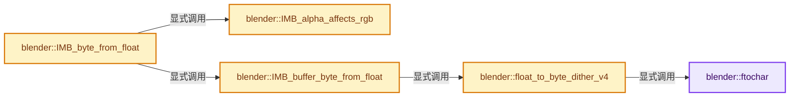

# 实现依赖专题：source/blender/imbuf/intern/conversion.cc

[方向导航](README.md) · [符号索引](../%E7%AC%A6%E5%8F%B7%E4%BE%9D%E8%B5%96%E4%B8%8E%E5%AE%9E%E7%8E%B0%E7%B4%A2%E5%BC%95.md)

本专题从正文实际调用进入，集中保存共享实现。函数有稳定锚点，可从调用处直接跳到对应完整函数；递归与互相调用通过回链组织。

## 本文件的实现关系




## 完整成员与函数实现

<a id="f-064643b787251418"></a>

### `blender::ftochar`

实现位置：[source/blender/imbuf/intern/conversion.cc](../../../../../source/blender/imbuf/intern/conversion.cc) · L30—L33。

接口参数：

- `float value`

**教学注释版**

<!-- annotated:7cf27b0a4ebeb9 -->

```cpp
MINLINE uchar ftochar(float value)
{
  return unit_float_to_uchar_clamp(value);
}
```

<details>
<summary>核对原始源码：source/blender/imbuf/intern/conversion.cc · L30—L33</summary>

<!-- original:7cf27b0a4ebeb9:source/blender/imbuf/intern/conversion.cc:30:33 -->

```cpp
MINLINE uchar ftochar(float value)
{
  return unit_float_to_uchar_clamp(value);
}
```

</details>

**结果出口**

- `return unit_float_to_uchar_clamp(value);`

**继续追踪实现**

- `unit_float_to_uchar_clamp` → [blender::unit_float_to_uchar_clamp · L579](../12-%E7%A9%BA%E9%97%B4%E6%95%B0%E6%8D%AE%E7%BB%93%E6%9E%84%E4%B8%8E%E5%87%A0%E4%BD%95%E7%AE%97%E6%B3%95/%E4%BE%9D%E8%B5%96-math_base_inline-546b00.md#f-078b5581dbbfbc81)。

<a id="f-6436f1a4863af2f0"></a>

### `blender::float_to_byte_dither_v4`

实现位置：[source/blender/imbuf/intern/conversion.cc](../../../../../source/blender/imbuf/intern/conversion.cc) · L35—L43。

接口参数：

- `uchar b[4]`
- `const float f[4]`
- `float dither`
- `int x`
- `int y`

**教学注释版**

<!-- annotated:079a7c02069efa -->

```cpp
MINLINE void float_to_byte_dither_v4(uchar b[4], const float f[4], float dither, int x, int y)
{
  float dither_value = dither_random_value(x, y) * 0.0033f * dither;

  b[0] = ftochar(dither_value + f[0]);
  b[1] = ftochar(dither_value + f[1]);
  b[2] = ftochar(dither_value + f[2]);
  b[3] = unit_float_to_uchar_clamp(f[3]);
}
```

<details>
<summary>核对原始源码：source/blender/imbuf/intern/conversion.cc · L35—L43</summary>

<!-- original:079a7c02069efa:source/blender/imbuf/intern/conversion.cc:35:43 -->

```cpp
MINLINE void float_to_byte_dither_v4(uchar b[4], const float f[4], float dither, int x, int y)
{
  float dither_value = dither_random_value(x, y) * 0.0033f * dither;

  b[0] = ftochar(dither_value + f[0]);
  b[1] = ftochar(dither_value + f[1]);
  b[2] = ftochar(dither_value + f[2]);
  b[3] = unit_float_to_uchar_clamp(f[3]);
}
```

</details>

**沿实际写入检查状态**

- `b[0] = ftochar(dither_value + f[0]);`
- `b[1] = ftochar(dither_value + f[1]);`
- `b[2] = ftochar(dither_value + f[2]);`
- `b[3] = unit_float_to_uchar_clamp(f[3]);`

**继续追踪实现**

- `dither_random_value` → [blender::dither_random_value · L257](../12-%E7%A9%BA%E9%97%B4%E6%95%B0%E6%8D%AE%E7%BB%93%E6%9E%84%E4%B8%8E%E5%87%A0%E4%BD%95%E7%AE%97%E6%B3%95/%E4%BE%9D%E8%B5%96-math_color_inline-48fb4c.md#f-57f9fc154cd6140e)。
- `ftochar` → [blender::ftochar · L30](%E4%BE%9D%E8%B5%96-conversion-b82337.md#f-064643b787251418)。
- `unit_float_to_uchar_clamp` → [blender::unit_float_to_uchar_clamp · L579](../12-%E7%A9%BA%E9%97%B4%E6%95%B0%E6%8D%AE%E7%BB%93%E6%9E%84%E4%B8%8E%E5%87%A0%E4%BD%95%E7%AE%97%E6%B3%95/%E4%BE%9D%E8%B5%96-math_base_inline-546b00.md#f-078b5581dbbfbc81)。

<a id="f-00ee0dd9db7e6963"></a>

### `blender::IMB_alpha_affects_rgb`

实现位置：[source/blender/imbuf/intern/conversion.cc](../../../../../source/blender/imbuf/intern/conversion.cc) · L45—L48。

接口参数：

- `const ImBuf *ibuf`

**教学注释版**

<!-- annotated:7735c6b86f7dd4 -->

```cpp
bool IMB_alpha_affects_rgb(const ImBuf *ibuf)
{
  return ibuf && !flag_is_set(ibuf->flags, ImBufFlags::AlphaChannelPacked);
}
```

<details>
<summary>核对原始源码：source/blender/imbuf/intern/conversion.cc · L45—L48</summary>

<!-- original:7735c6b86f7dd4:source/blender/imbuf/intern/conversion.cc:45:48 -->

```cpp
bool IMB_alpha_affects_rgb(const ImBuf *ibuf)
{
  return ibuf && !flag_is_set(ibuf->flags, ImBufFlags::AlphaChannelPacked);
}
```

</details>

**结果出口**

- `return ibuf && !flag_is_set(ibuf->flags, ImBufFlags::AlphaChannelPacked);`

**继续追踪实现**

- `flag_is_set` → [调用协议](../%E6%A8%A1%E6%9D%BF%E5%AE%8F%E4%B8%8E%E5%8A%A8%E6%80%81%E5%88%86%E6%B4%BE%E5%8D%8F%E8%AE%AE.md)：函数指针、局部可调用对象或未展开的宏；必须结合调用者环境。调用位置L47。

<a id="f-0787585aa7922561"></a>

### `blender::IMB_buffer_byte_from_float`

实现位置：[source/blender/imbuf/intern/conversion.cc](../../../../../source/blender/imbuf/intern/conversion.cc) · L50—L102。

接口参数：

- `uchar *dest`
- `const float *src`
- `int src_channels`
- `float dither`
- `bool predivide`
- `int width`
- `int height`
- `int stride`
- `int start_y`

**教学注释版**

<!-- annotated:75142a146666f4 -->

```cpp
void IMB_buffer_byte_from_float(uchar *dest,
                                const float *src,
                                int src_channels,
                                float dither,
                                bool predivide,
                                int width,
                                int height,
                                int stride,
                                int start_y)
{
  for (int y = 0; y < height; y++) {
    const float *from = src + size_t(stride) * y * src_channels;
    uchar *to = dest + size_t(stride) * y * 4;
    if (src_channels == 1) {
      /* single channel input */
      for (int x = 0; x < width; x++, from++, to += 4) {
        to[0] = to[1] = to[2] = to[3] = unit_float_to_uchar_clamp(from[0]);
      }
    }
    else if (src_channels == 3) {
      /* RGB input */
      for (int x = 0; x < width; x++, from += 3, to += 4) {
        rgb_float_to_uchar(to, from);
        to[3] = 255;
      }
    }
    else if (src_channels == 4) {
      /* RGBA input */
      if (dither && predivide) {
        float straight[4];
        for (int x = 0; x < width; x++, from += 4, to += 4) {
          premul_to_straight_v4_v4(straight, from);
          float_to_byte_dither_v4(to, straight, dither, x, y + start_y);
        }
      }
      else if (dither) {
        for (int x = 0; x < width; x++, from += 4, to += 4) {
          float_to_byte_dither_v4(to, from, dither, x, y + start_y);
        }
      }
      else if (predivide) {
        for (int x = 0; x < width; x++, from += 4, to += 4) {
          premul_float_to_straight_uchar(to, from);
        }
      }
      else {
        for (int x = 0; x < width; x++, from += 4, to += 4) {
          rgba_float_to_uchar(to, from);
        }
      }
    }
  }
}
```

<details>
<summary>核对原始源码：source/blender/imbuf/intern/conversion.cc · L50—L102</summary>

<!-- original:75142a146666f4:source/blender/imbuf/intern/conversion.cc:50:102 -->

```cpp
void IMB_buffer_byte_from_float(uchar *dest,
                                const float *src,
                                int src_channels,
                                float dither,
                                bool predivide,
                                int width,
                                int height,
                                int stride,
                                int start_y)
{
  for (int y = 0; y < height; y++) {
    const float *from = src + size_t(stride) * y * src_channels;
    uchar *to = dest + size_t(stride) * y * 4;
    if (src_channels == 1) {
      /* single channel input */
      for (int x = 0; x < width; x++, from++, to += 4) {
        to[0] = to[1] = to[2] = to[3] = unit_float_to_uchar_clamp(from[0]);
      }
    }
    else if (src_channels == 3) {
      /* RGB input */
      for (int x = 0; x < width; x++, from += 3, to += 4) {
        rgb_float_to_uchar(to, from);
        to[3] = 255;
      }
    }
    else if (src_channels == 4) {
      /* RGBA input */
      if (dither && predivide) {
        float straight[4];
        for (int x = 0; x < width; x++, from += 4, to += 4) {
          premul_to_straight_v4_v4(straight, from);
          float_to_byte_dither_v4(to, straight, dither, x, y + start_y);
        }
      }
      else if (dither) {
        for (int x = 0; x < width; x++, from += 4, to += 4) {
          float_to_byte_dither_v4(to, from, dither, x, y + start_y);
        }
      }
      else if (predivide) {
        for (int x = 0; x < width; x++, from += 4, to += 4) {
          premul_float_to_straight_uchar(to, from);
        }
      }
      else {
        for (int x = 0; x < width; x++, from += 4, to += 4) {
          rgba_float_to_uchar(to, from);
        }
      }
    }
  }
}
```

</details>

**沿实际写入检查状态**

- `to[0] = to[1] = to[2] = to[3] = unit_float_to_uchar_clamp(from[0]);`
- `to[3] = 255;`

**继续追踪实现**

- `unit_float_to_uchar_clamp` → [blender::unit_float_to_uchar_clamp · L579](../12-%E7%A9%BA%E9%97%B4%E6%95%B0%E6%8D%AE%E7%BB%93%E6%9E%84%E4%B8%8E%E5%87%A0%E4%BD%95%E7%AE%97%E6%B3%95/%E4%BE%9D%E8%B5%96-math_base_inline-546b00.md#f-078b5581dbbfbc81)。
- `rgb_float_to_uchar` → [blender::rgb_float_to_uchar · L145](../12-%E7%A9%BA%E9%97%B4%E6%95%B0%E6%8D%AE%E7%BB%93%E6%9E%84%E4%B8%8E%E5%87%A0%E4%BD%95%E7%AE%97%E6%B3%95/%E4%BE%9D%E8%B5%96-math_color_inline-48fb4c.md#f-2bd4b3b3f1e8f6b7)。
- `premul_to_straight_v4_v4` → [blender::premul_to_straight_v4_v4 · L283](../12-%E7%A9%BA%E9%97%B4%E6%95%B0%E6%8D%AE%E7%BB%93%E6%9E%84%E4%B8%8E%E5%87%A0%E4%BD%95%E7%AE%97%E6%B3%95/%E4%BE%9D%E8%B5%96-math_color_inline-48fb4c.md#f-04964d02dcc5cfa0)。
- `float_to_byte_dither_v4` → [blender::float_to_byte_dither_v4 · L35](%E4%BE%9D%E8%B5%96-conversion-b82337.md#f-6436f1a4863af2f0)。
- `premul_float_to_straight_uchar` → [blender::premul_float_to_straight_uchar · L330](../12-%E7%A9%BA%E9%97%B4%E6%95%B0%E6%8D%AE%E7%BB%93%E6%9E%84%E4%B8%8E%E5%87%A0%E4%BD%95%E7%AE%97%E6%B3%95/%E4%BE%9D%E8%B5%96-math_color_inline-48fb4c.md#f-74827b7b9c18fa85)。
- `rgba_float_to_uchar` → [blender::rgba_float_to_uchar · L150](../12-%E7%A9%BA%E9%97%B4%E6%95%B0%E6%8D%AE%E7%BB%93%E6%9E%84%E4%B8%8E%E5%87%A0%E4%BD%95%E7%AE%97%E6%B3%95/%E4%BE%9D%E8%B5%96-math_color_inline-48fb4c.md#f-00fd745fcb2e3dd8)。

<a id="f-04cbc854f1a01b97"></a>

### `blender::IMB_byte_from_float`

实现位置：[source/blender/imbuf/intern/conversion.cc](../../../../../source/blender/imbuf/intern/conversion.cc) · L264—L312。

接口参数：

- `ImBuf *ibuf`

**教学注释版**

<!-- annotated:7763aec3b3c052 -->

```cpp
void IMB_byte_from_float(ImBuf *ibuf)
{
  /* Nothing to do if there's no float buffer */
  const float *float_data = ibuf->float_data();
  if (float_data == nullptr) {
    return;
  }

  /* Allocate byte buffer if needed. */
  if (ibuf->byte_data() == nullptr) {
    if (!IMB_alloc_byte_pixels(ibuf, false)) {
      return;
    }
  }

  const char *from_colorspace = IMB_colormanagement_get_float_colorspace(ibuf);
  const char *to_colorspace = IMB_colormanagement_get_byte_colorspace(ibuf);
  const bool predivide = IMB_alpha_affects_rgb(ibuf);
  ColormanageProcessor processor = ColormanageProcessor::colorspace_processor_new(from_colorspace,
                                                                                  to_colorspace);

  /* At 4 floats per pixel, this is 32KB of data, and fits into typical CPU L1 cache. */
  static constexpr int grain_size = 2048;
  uchar *byte_data = ibuf->byte_data_for_write();
  threading::parallel_for(
      IndexRange(IMB_get_pixel_count(ibuf)), grain_size, [&](const IndexRange range) {
        /* Copy chunk of source float pixels into a local buffer. */
        // [讲解] range.size：读取连续区间或分组的边界信息。
        Array<float, grain_size * 4> buffer(range.size() * ibuf->channels);
        // [讲解] buffer.as_mutable_span：提供数组的借用访问入口。
        buffer.as_mutable_span().copy_from(
            // [讲解] range.first：读取范围两端的有效索引或值。
            Span(float_data + range.first() * ibuf->channels, buffer.size()));
        /* Unpremultiply alpha if needed. */
        if (predivide) {
          // [讲解] buffer.data：提供数组的借用访问入口。
          IMB_unpremultiply_rect_float(buffer.data(), ibuf->channels, range.size(), 1);
        }
        /* Convert to byte color space if needed. */
        if (!processor.is_noop()) {
          processor.apply(buffer.data(), range.size(), 1, ibuf->channels, false);
        }
        /* Convert to bytes. */
        IMB_buffer_byte_from_float(byte_data + range.first() * 4,
                                   buffer.data(),
                                   ibuf->channels,
                                   ibuf->dither,
                                   false,
                                   range.size(),
                                   1,
                                   ibuf->x);
      });
}
```

<details>
<summary>核对原始源码：source/blender/imbuf/intern/conversion.cc · L264—L312</summary>

<!-- original:7763aec3b3c052:source/blender/imbuf/intern/conversion.cc:264:312 -->

```cpp
void IMB_byte_from_float(ImBuf *ibuf)
{
  /* Nothing to do if there's no float buffer */
  const float *float_data = ibuf->float_data();
  if (float_data == nullptr) {
    return;
  }

  /* Allocate byte buffer if needed. */
  if (ibuf->byte_data() == nullptr) {
    if (!IMB_alloc_byte_pixels(ibuf, false)) {
      return;
    }
  }

  const char *from_colorspace = IMB_colormanagement_get_float_colorspace(ibuf);
  const char *to_colorspace = IMB_colormanagement_get_byte_colorspace(ibuf);
  const bool predivide = IMB_alpha_affects_rgb(ibuf);
  ColormanageProcessor processor = ColormanageProcessor::colorspace_processor_new(from_colorspace,
                                                                                  to_colorspace);

  /* At 4 floats per pixel, this is 32KB of data, and fits into typical CPU L1 cache. */
  static constexpr int grain_size = 2048;
  uchar *byte_data = ibuf->byte_data_for_write();
  threading::parallel_for(
      IndexRange(IMB_get_pixel_count(ibuf)), grain_size, [&](const IndexRange range) {
        /* Copy chunk of source float pixels into a local buffer. */
        Array<float, grain_size * 4> buffer(range.size() * ibuf->channels);
        buffer.as_mutable_span().copy_from(
            Span(float_data + range.first() * ibuf->channels, buffer.size()));
        /* Unpremultiply alpha if needed. */
        if (predivide) {
          IMB_unpremultiply_rect_float(buffer.data(), ibuf->channels, range.size(), 1);
        }
        /* Convert to byte color space if needed. */
        if (!processor.is_noop()) {
          processor.apply(buffer.data(), range.size(), 1, ibuf->channels, false);
        }
        /* Convert to bytes. */
        IMB_buffer_byte_from_float(byte_data + range.first() * 4,
                                   buffer.data(),
                                   ibuf->channels,
                                   ibuf->dither,
                                   false,
                                   range.size(),
                                   1,
                                   ibuf->x);
      });
}
```

</details>

**继续追踪实现**

- `ibuf->float_data` → [blender::ImBuf::float_data · L358](%E4%BE%9D%E8%B5%96-IMB_imbuf_types-f69e60.md#f-2e52aa77544ffaee)。
- `ibuf->byte_data` → [blender::ImBuf::byte_data · L353](%E4%BE%9D%E8%B5%96-IMB_imbuf_types-f69e60.md#f-2cdfc552156643fa)。
- `IMB_alloc_byte_pixels` → [blender::IMB_alloc_byte_pixels · L219](%E4%BE%9D%E8%B5%96-allocimbuf-bc68dd.md#f-2186a459f2bdfa43)。
- `IMB_colormanagement_get_float_colorspace` → [blender::IMB_colormanagement_get_float_colorspace · L1304](%E4%BE%9D%E8%B5%96-colormanagement-d4733d.md#f-011a20fe810ea0fb)。
- `IMB_colormanagement_get_byte_colorspace` → [blender::IMB_colormanagement_get_byte_colorspace · L1309](%E4%BE%9D%E8%B5%96-colormanagement-d4733d.md#f-825849046c97131b)。
- `IMB_alpha_affects_rgb` → [blender::IMB_alpha_affects_rgb · L45](%E4%BE%9D%E8%B5%96-conversion-b82337.md#f-00ee0dd9db7e6963)。
- `ColormanageProcessor::colorspace_processor_new` → [blender::ColormanageProcessor::colorspace_processor_new · L3924](%E4%BE%9D%E8%B5%96-colormanagement-d4733d.md#f-1f965b732987b5f3)。
- `ibuf->byte_data_for_write` → [blender::ImBuf::byte_data_for_write · L60](%E4%BE%9D%E8%B5%96-allocimbuf-bc68dd.md#f-9ae201bd1c52aa87)。
- `threading::parallel_for` → [blender::threading::parallel_for · L68](../11-Depsgraph%E4%B8%8E%E5%B9%B6%E8%A1%8C%E4%BB%BB%E5%8A%A1%E7%B3%BB%E7%BB%9F/07-%E4%BB%BB%E5%8A%A1%E6%B1%A0%E4%B8%8ETBB%E6%8E%A5%E5%85%A5.md#f-838294754c24426c)。
- `IndexRange` → [blender::IndexRange](../01-%E5%9F%BA%E7%A1%80%E5%AE%B9%E5%99%A8%E4%B8%8E%E7%8E%B0%E4%BB%A3CPP/%E4%BE%9D%E8%B5%96-BLI_index_range-7d7cc5.md#t-caa3466d6776)；[blender::gpu::shader::parser::IndexRange](%E4%BE%9D%E8%B5%96-utils-06433d.md#t-82d2bd4ea71c)；[blender::IndexRange](%E4%BE%9D%E8%B5%96-DNA_node_types-6708b9.md#t-0448cc889d39)。
- `IMB_get_pixel_count` → [blender::IMB_get_pixel_count · L458](%E4%BE%9D%E8%B5%96-allocimbuf-bc68dd.md#f-edc523058327479e)。
- `range.size` → [blender::IndexRange::size · L156](../01-%E5%9F%BA%E7%A1%80%E5%AE%B9%E5%99%A8%E4%B8%8E%E7%8E%B0%E4%BB%A3CPP/04-IndexRange%E8%BF%9E%E7%BB%AD%E6%95%B4%E6%95%B0%E5%8C%BA%E9%97%B4.md#f-05f66c3ebb2fdfec)。
- `buffer.as_mutable_span().copy_from` → [调用协议](../%E6%A8%A1%E6%9D%BF%E5%AE%8F%E4%B8%8E%E5%8A%A8%E6%80%81%E5%88%86%E6%B4%BE%E5%8D%8F%E8%AE%AE.md)：接收对象类型依赖auto、返回值或模板实例；不按同名猜测目标。调用位置L292。
- `buffer.as_mutable_span` → [blender::Array::as_mutable_span · L259](../01-%E5%9F%BA%E7%A1%80%E5%AE%B9%E5%99%A8%E4%B8%8E%E7%8E%B0%E4%BB%A3CPP/08-Array%E5%A4%8D%E5%88%B6%E7%A7%BB%E5%8A%A8%E4%B8%8E%E9%94%80%E6%AF%81.md#f-4e91de9f1337c144)。
- `Span` → [blender::Span · L214](../01-%E5%9F%BA%E7%A1%80%E5%AE%B9%E5%99%A8%E4%B8%8E%E7%8E%B0%E4%BB%A3CPP/15-StringRef%E5%AD%97%E7%AC%A6%E4%B8%B2%E8%A7%86%E5%9B%BE.md#f-eea723436ab634ed)。
- `range.first` → [blender::IndexRange::first · L204](../01-%E5%9F%BA%E7%A1%80%E5%AE%B9%E5%99%A8%E4%B8%8E%E7%8E%B0%E4%BB%A3CPP/04-IndexRange%E8%BF%9E%E7%BB%AD%E6%95%B4%E6%95%B0%E5%8C%BA%E9%97%B4.md#f-ab443c94e531befa)。
- `buffer.size` → [blender::Array::size · L267](../01-%E5%9F%BA%E7%A1%80%E5%AE%B9%E5%99%A8%E4%B8%8E%E7%8E%B0%E4%BB%A3CPP/08-Array%E5%A4%8D%E5%88%B6%E7%A7%BB%E5%8A%A8%E4%B8%8E%E9%94%80%E6%AF%81.md#f-c13f1b5a44f423b2)。
- `IMB_unpremultiply_rect_float` → [blender::IMB_unpremultiply_rect_float · L426](%E4%BE%9D%E8%B5%96-filter-a2d526.md#f-d0dea23f6a73f956)。
- `buffer.data` → [blender::Array::data · L323](../01-%E5%9F%BA%E7%A1%80%E5%AE%B9%E5%99%A8%E4%B8%8E%E7%8E%B0%E4%BB%A3CPP/08-Array%E5%A4%8D%E5%88%B6%E7%A7%BB%E5%8A%A8%E4%B8%8E%E9%94%80%E6%AF%81.md#f-95648c799002f4ba)；[blender::Array::data · L327](../01-%E5%9F%BA%E7%A1%80%E5%AE%B9%E5%99%A8%E4%B8%8E%E7%8E%B0%E4%BB%A3CPP/08-Array%E5%A4%8D%E5%88%B6%E7%A7%BB%E5%8A%A8%E4%B8%8E%E9%94%80%E6%AF%81.md#f-50c18301f8c40f9e)。同名重载需按实参类型选择。
- `processor.is_noop` → [blender::ColormanageProcessor::is_noop · L4034](%E4%BE%9D%E8%B5%96-colormanagement-d4733d.md#f-09f6a46a346037a9)。
- `processor.apply` → [blender::ColormanageProcessor::apply · L4115](%E4%BE%9D%E8%B5%96-colormanagement-d4733d.md#f-0aef2337986af889)。
- `IMB_buffer_byte_from_float` → [blender::IMB_buffer_byte_from_float · L50](%E4%BE%9D%E8%B5%96-conversion-b82337.md#f-0787585aa7922561)。
