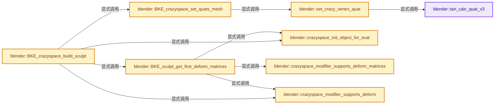
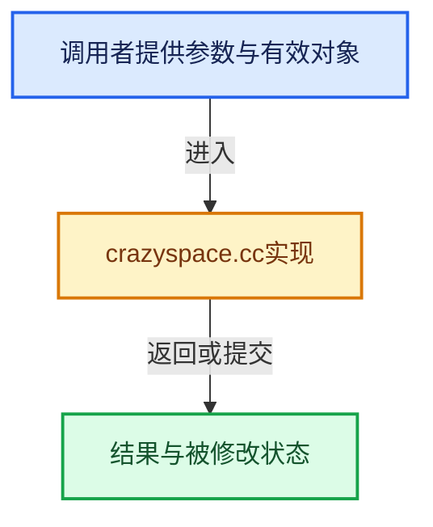

# 实现依赖专题：source/blender/blenkernel/intern/crazyspace.cc

[方向导航](README.md) · [符号索引](../%E7%AC%A6%E5%8F%B7%E4%BE%9D%E8%B5%96%E4%B8%8E%E5%AE%9E%E7%8E%B0%E7%B4%A2%E5%BC%95.md)

本专题从正文实际调用进入，集中保存共享实现。函数有稳定锚点，可从调用处直接跳到对应完整函数；递归与互相调用通过回链组织。

## 本文件的实现关系






## 完整成员与函数实现

<a id="f-709a15ccf7fc8d94"></a>

### `blender::tan_calc_quat_v3`

实现位置：[source/blender/blenkernel/intern/crazyspace.cc](../../../../../source/blender/blenkernel/intern/crazyspace.cc) · L40—L60。

接口参数：

- `float r_quat[4]`
- `const float co_1[3]`
- `const float co_2[3]`
- `const float co_3[3]`

**教学注释版**

<!-- annotated:015a353c0bb32f -->

```cpp
BLI_INLINE void tan_calc_quat_v3(float r_quat[4],
                                 const float co_1[3],
                                 const float co_2[3],
                                 const float co_3[3])
{
  float vec_u[3], vec_v[3];
  float nor[3];

  sub_v3_v3v3(vec_u, co_1, co_2);
  sub_v3_v3v3(vec_v, co_1, co_3);

  cross_v3_v3v3(nor, vec_u, vec_v);

  if (normalize_v3(nor) > FLT_EPSILON) {
    const float zero_vec[3] = {0.0f};
    tri_to_quat_ex(r_quat, zero_vec, vec_u, vec_v, nor);
  }
  else {
    unit_qt(r_quat);
  }
}
```

<details>
<summary>核对原始源码：source/blender/blenkernel/intern/crazyspace.cc · L40—L60</summary>

<!-- original:015a353c0bb32f:source/blender/blenkernel/intern/crazyspace.cc:40:60 -->

```cpp
BLI_INLINE void tan_calc_quat_v3(float r_quat[4],
                                 const float co_1[3],
                                 const float co_2[3],
                                 const float co_3[3])
{
  float vec_u[3], vec_v[3];
  float nor[3];

  sub_v3_v3v3(vec_u, co_1, co_2);
  sub_v3_v3v3(vec_v, co_1, co_3);

  cross_v3_v3v3(nor, vec_u, vec_v);

  if (normalize_v3(nor) > FLT_EPSILON) {
    const float zero_vec[3] = {0.0f};
    tri_to_quat_ex(r_quat, zero_vec, vec_u, vec_v, nor);
  }
  else {
    unit_qt(r_quat);
  }
}
```

</details>

**继续追踪实现**

- `sub_v3_v3v3` → [blender::sub_v3_v3v3 · L360](../12-%E7%A9%BA%E9%97%B4%E6%95%B0%E6%8D%AE%E7%BB%93%E6%9E%84%E4%B8%8E%E5%87%A0%E4%BD%95%E7%AE%97%E6%B3%95/%E4%BE%9D%E8%B5%96-math_vector_inline-0c8541.md#f-23781c252db8b30c)。
- `cross_v3_v3v3` → [blender::cross_v3_v3v3 · L690](../12-%E7%A9%BA%E9%97%B4%E6%95%B0%E6%8D%AE%E7%BB%93%E6%9E%84%E4%B8%8E%E5%87%A0%E4%BD%95%E7%AE%97%E6%B3%95/%E4%BE%9D%E8%B5%96-math_vector_inline-0c8541.md#f-ac8d04405fb5dad4)。
- `normalize_v3` → [blender::normalize_v3 · L933](../12-%E7%A9%BA%E9%97%B4%E6%95%B0%E6%8D%AE%E7%BB%93%E6%9E%84%E4%B8%8E%E5%87%A0%E4%BD%95%E7%AE%97%E6%B3%95/%E4%BE%9D%E8%B5%96-math_vector_inline-0c8541.md#f-5f3257e657ef732c)。
- `tri_to_quat_ex` → [blender::tri_to_quat_ex · L934](../12-%E7%A9%BA%E9%97%B4%E6%95%B0%E6%8D%AE%E7%BB%93%E6%9E%84%E4%B8%8E%E5%87%A0%E4%BD%95%E7%AE%97%E6%B3%95/%E4%BE%9D%E8%B5%96-math_rotation_c-8e57f4.md#f-a587bb2af9539780)。
- `unit_qt` → [blender::unit_qt · L45](../12-%E7%A9%BA%E9%97%B4%E6%95%B0%E6%8D%AE%E7%BB%93%E6%9E%84%E4%B8%8E%E5%87%A0%E4%BD%95%E7%AE%97%E6%B3%95/%E4%BE%9D%E8%B5%96-math_rotation_c-8e57f4.md#f-6323eadd66d3989a)。

<a id="f-48e244026b6541e9"></a>

### `blender::set_crazy_vertex_quat`

实现位置：[source/blender/blenkernel/intern/crazyspace.cc](../../../../../source/blender/blenkernel/intern/crazyspace.cc) · L62—L76。

接口参数：

- `float r_quat[4]`
- `const float co_1[3]`
- `const float co_2[3]`
- `const float co_3[3]`
- `const float vd_1[3]`
- `const float vd_2[3]`
- `const float vd_3[3]`

**教学注释版**

<!-- annotated:e253f1af7f1475 -->

```cpp
static void set_crazy_vertex_quat(float r_quat[4],
                                  const float co_1[3],
                                  const float co_2[3],
                                  const float co_3[3],
                                  const float vd_1[3],
                                  const float vd_2[3],
                                  const float vd_3[3])
{
  float q1[4], q2[4];

  tan_calc_quat_v3(q1, co_1, co_2, co_3);
  tan_calc_quat_v3(q2, vd_1, vd_2, vd_3);

  sub_qt_qtqt(r_quat, q2, q1);
}
```

<details>
<summary>核对原始源码：source/blender/blenkernel/intern/crazyspace.cc · L62—L76</summary>

<!-- original:e253f1af7f1475:source/blender/blenkernel/intern/crazyspace.cc:62:76 -->

```cpp
static void set_crazy_vertex_quat(float r_quat[4],
                                  const float co_1[3],
                                  const float co_2[3],
                                  const float co_3[3],
                                  const float vd_1[3],
                                  const float vd_2[3],
                                  const float vd_3[3])
{
  float q1[4], q2[4];

  tan_calc_quat_v3(q1, co_1, co_2, co_3);
  tan_calc_quat_v3(q2, vd_1, vd_2, vd_3);

  sub_qt_qtqt(r_quat, q2, q1);
}
```

</details>

**继续追踪实现**

- `tan_calc_quat_v3` → [blender::tan_calc_quat_v3 · L40](%E4%BE%9D%E8%B5%96-crazyspace-e15fef.md#f-709a15ccf7fc8d94)。
- `sub_qt_qtqt` → [blender::sub_qt_qtqt · L153](../12-%E7%A9%BA%E9%97%B4%E6%95%B0%E6%8D%AE%E7%BB%93%E6%9E%84%E4%B8%8E%E5%87%A0%E4%BD%95%E7%AE%97%E6%B3%95/%E4%BE%9D%E8%B5%96-math_rotation_c-8e57f4.md#f-c003026efa0a7134)。

<a id="f-826788ec06175b02"></a>

### `blender::BKE_crazyspace_set_quats_mesh`

实现位置：[source/blender/blenkernel/intern/crazyspace.cc](../../../../../source/blender/blenkernel/intern/crazyspace.cc) · L186—L223。

接口参数：

- `Mesh *mesh`
- `const Span<float3> origcos`
- `const Span<float3> mappedcos`
- `float (*quats)[4]`

**教学注释版**

<!-- annotated:e3ce3580d15e12 -->

```cpp
void BKE_crazyspace_set_quats_mesh(Mesh *mesh,
                                   const Span<float3> origcos,
                                   const Span<float3> mappedcos,
                                   float (*quats)[4])
{
  using namespace blender::bke;
  BitVector<> vert_tag(mesh->verts_num);

  /* first store two sets of tangent vectors in vertices, we derive it just from the face-edges */
  // [讲解] origcos.is_empty：查询视图长度或生成对应有效索引区间。
  const Span<float3> positions = origcos.is_empty() ? mesh->vert_positions() : origcos;
  const OffsetIndices<int> faces = mesh->faces();
  const Span<int> corner_verts = mesh->corner_verts();

  for (const int i : faces.index_range()) {
    const IndexRange face = faces[i];

    for (const int corner : face) {
      const int vert = corner_verts[corner];
      if (vert_tag[vert]) {
        continue;
      }
      const int vert_prev = corner_verts[mesh::face_corner_prev(face, corner)];
      const int vert_next = corner_verts[mesh::face_corner_next(face, corner)];

      const float3 &vd_prev = mappedcos[vert_prev];
      const float3 &vd_curr = mappedcos[vert];
      const float3 &vd_next = mappedcos[vert_next];

      const float3 &co_prev = positions[vert_prev];
      const float3 &co_curr = positions[vert];
      const float3 &co_next = positions[vert_next];

      set_crazy_vertex_quat(quats[vert], co_curr, co_next, co_prev, vd_curr, vd_next, vd_prev);

      vert_tag[vert].set();
    }
  }
}
```

<details>
<summary>核对原始源码：source/blender/blenkernel/intern/crazyspace.cc · L186—L223</summary>

<!-- original:e3ce3580d15e12:source/blender/blenkernel/intern/crazyspace.cc:186:223 -->

```cpp
void BKE_crazyspace_set_quats_mesh(Mesh *mesh,
                                   const Span<float3> origcos,
                                   const Span<float3> mappedcos,
                                   float (*quats)[4])
{
  using namespace blender::bke;
  BitVector<> vert_tag(mesh->verts_num);

  /* first store two sets of tangent vectors in vertices, we derive it just from the face-edges */
  const Span<float3> positions = origcos.is_empty() ? mesh->vert_positions() : origcos;
  const OffsetIndices<int> faces = mesh->faces();
  const Span<int> corner_verts = mesh->corner_verts();

  for (const int i : faces.index_range()) {
    const IndexRange face = faces[i];

    for (const int corner : face) {
      const int vert = corner_verts[corner];
      if (vert_tag[vert]) {
        continue;
      }
      const int vert_prev = corner_verts[mesh::face_corner_prev(face, corner)];
      const int vert_next = corner_verts[mesh::face_corner_next(face, corner)];

      const float3 &vd_prev = mappedcos[vert_prev];
      const float3 &vd_curr = mappedcos[vert];
      const float3 &vd_next = mappedcos[vert_next];

      const float3 &co_prev = positions[vert_prev];
      const float3 &co_curr = positions[vert];
      const float3 &co_next = positions[vert_next];

      set_crazy_vertex_quat(quats[vert], co_curr, co_next, co_prev, vd_curr, vd_next, vd_prev);

      vert_tag[vert].set();
    }
  }
}
```

</details>

**继续追踪实现**

- `origcos.is_empty` → [blender::Span::is_empty · L264](../01-%E5%9F%BA%E7%A1%80%E5%AE%B9%E5%99%A8%E4%B8%8E%E7%8E%B0%E4%BB%A3CPP/05-Span%E5%8F%AA%E8%AF%BB%E8%BF%9E%E7%BB%AD%E8%A7%86%E5%9B%BE.md#f-8cc1d7ba8feb50e6)。
- `mesh->vert_positions` → [Mesh::vert_positions · L1193](03-MPoly%E8%BF%81%E7%A7%BB%E4%B8%8E%E5%85%BC%E5%AE%B9.md#f-ae4177e5c5f2b371)。
- `mesh->faces` → [Mesh::faces · L1217](03-MPoly%E8%BF%81%E7%A7%BB%E4%B8%8E%E5%85%BC%E5%AE%B9.md#f-ea444760154e17b2)。
- `mesh->corner_verts` → [Mesh::corner_verts · L1238](03-MPoly%E8%BF%81%E7%A7%BB%E4%B8%8E%E5%85%BC%E5%AE%B9.md#f-a59c61f583b64bc4)。
- `faces.index_range` → [blender::offset_indices::OffsetIndices::index_range · L77](02-OffsetIndices%E5%AE%8C%E6%95%B4%E6%8E%A5%E5%8F%A3.md#f-19b5ca1456de007d)。
- `mesh::face_corner_prev` → [blender::bke::mesh::face_corner_prev · L306](01-Mesh%E9%A1%B6%E7%82%B9%E8%BE%B9%E9%9D%A2%E8%A7%92%E7%82%B9.md#f-7d8f15af3216c9f5)。
- `mesh::face_corner_next` → [blender::bke::mesh::face_corner_next · L315](01-Mesh%E9%A1%B6%E7%82%B9%E8%BE%B9%E9%9D%A2%E8%A7%92%E7%82%B9.md#f-bf639df87b51fe48)。
- `set_crazy_vertex_quat` → [blender::set_crazy_vertex_quat · L62](%E4%BE%9D%E8%B5%96-crazyspace-e15fef.md#f-48e244026b6541e9)。
- `vert_tag[vert].set` → [调用协议](../%E6%A8%A1%E6%9D%BF%E5%AE%8F%E4%B8%8E%E5%8A%A8%E6%80%81%E5%88%86%E6%B4%BE%E5%8D%8F%E8%AE%AE.md)：接收对象类型依赖auto、返回值或模板实例；不按同名猜测目标。调用位置L220。

<a id="f-54f90aaaaf16aea7"></a>

### `blender::crazyspace_init_object_for_eval`

实现位置：[source/blender/blenkernel/intern/crazyspace.cc](../../../../../source/blender/blenkernel/intern/crazyspace.cc) · L301—L311。

接口参数：

- `Depsgraph *depsgraph`
- `Object *object`
- `Object *object_crazy`

**教学注释版**

<!-- annotated:92830b238d45c8 -->

```cpp
static void crazyspace_init_object_for_eval(Depsgraph *depsgraph,
                                            Object *object,
                                            Object *object_crazy)
{
  Object *object_eval = DEG_get_evaluated(depsgraph, object);
  *object_crazy = dna::shallow_copy(*object_eval);
  object_crazy->runtime = MEM_new<bke::ObjectRuntime>(__func__, *object_eval->runtime);
  if (object_crazy->runtime->data_orig != nullptr) {
    object_crazy->data = object_crazy->runtime->data_orig;
  }
}
```

<details>
<summary>核对原始源码：source/blender/blenkernel/intern/crazyspace.cc · L301—L311</summary>

<!-- original:92830b238d45c8:source/blender/blenkernel/intern/crazyspace.cc:301:311 -->

```cpp
static void crazyspace_init_object_for_eval(Depsgraph *depsgraph,
                                            Object *object,
                                            Object *object_crazy)
{
  Object *object_eval = DEG_get_evaluated(depsgraph, object);
  *object_crazy = dna::shallow_copy(*object_eval);
  object_crazy->runtime = MEM_new<bke::ObjectRuntime>(__func__, *object_eval->runtime);
  if (object_crazy->runtime->data_orig != nullptr) {
    object_crazy->data = object_crazy->runtime->data_orig;
  }
}
```

</details>

**沿实际写入检查状态**

- `object_crazy->runtime = MEM_new<bke::ObjectRuntime>(__func__, *object_eval->runtime);`
- `object_crazy->data = object_crazy->runtime->data_orig;`

**继续追踪实现**

- `DEG_get_evaluated` → [blender::DEG_get_evaluated · L106](../11-Depsgraph%E4%B8%8E%E5%B9%B6%E8%A1%8C%E4%BB%BB%E5%8A%A1%E7%B3%BB%E7%BB%9F/%E4%BE%9D%E8%B5%96-DEG_depsgraph_query-db0d31.md#f-e70143fa875363bf)；[blender::DEG_get_evaluated · L112](../11-Depsgraph%E4%B8%8E%E5%B9%B6%E8%A1%8C%E4%BB%BB%E5%8A%A1%E7%B3%BB%E7%BB%9F/%E4%BE%9D%E8%B5%96-DEG_depsgraph_query-db0d31.md#f-129df72cfb5a1bad)。同名重载需按实参类型选择。
- `dna::shallow_copy` → [blender::dna::shallow_copy · L146](%E4%BE%9D%E8%B5%96-DNA_defs-ed47fd.md#f-84b6eda95a1c994c)。
- `MEM_new<bke::ObjectRuntime>` → [MEM_new · L351](../03-%E5%86%85%E5%AD%98%E5%88%86%E9%85%8D%E4%B8%8E%E8%BF%90%E8%A1%8C%E6%97%B6%E7%B1%BB%E5%9E%8B/%E4%BE%9D%E8%B5%96-MEM_guardedalloc-b54eca.md#f-115f9b6784f89912)。

<a id="f-164ab07817ca1a18"></a>

### `blender::crazyspace_modifier_supports_deform_matrices`

实现位置：[source/blender/blenkernel/intern/crazyspace.cc](../../../../../source/blender/blenkernel/intern/crazyspace.cc) · L313—L320。

接口参数：

- `ModifierData *md`

**教学注释版**

<!-- annotated:eacc204fa426ad -->

```cpp
static bool crazyspace_modifier_supports_deform_matrices(ModifierData *md)
{
  if (ELEM(md->type, eModifierType_Subsurf, eModifierType_Multires)) {
    return true;
  }
  const ModifierTypeInfo *mti = BKE_modifier_get_info(md->type);
  return (mti->type == ModifierTypeType::OnlyDeform);
}
```

<details>
<summary>核对原始源码：source/blender/blenkernel/intern/crazyspace.cc · L313—L320</summary>

<!-- original:eacc204fa426ad:source/blender/blenkernel/intern/crazyspace.cc:313:320 -->

```cpp
static bool crazyspace_modifier_supports_deform_matrices(ModifierData *md)
{
  if (ELEM(md->type, eModifierType_Subsurf, eModifierType_Multires)) {
    return true;
  }
  const ModifierTypeInfo *mti = BKE_modifier_get_info(md->type);
  return (mti->type == ModifierTypeType::OnlyDeform);
}
```

</details>

**结果出口**

- `return true;`
- `return (mti->type == ModifierTypeType::OnlyDeform);`

**继续追踪实现**

- `ELEM` → [ELEM · L88](%E4%BE%9D%E8%B5%96-GHOST_utildefines-34b996.md#m-d28724a15928)；[ELEM · L135](../01-%E5%9F%BA%E7%A1%80%E5%AE%B9%E5%99%A8%E4%B8%8E%E7%8E%B0%E4%BB%A3CPP/%E4%BE%9D%E8%B5%96-BLI_utildefines-293a0a.md#m-d6572de7cae0)。宏定义由构建条件选择。
- `BKE_modifier_get_info` → [blender::BKE_modifier_get_info · L120](%E4%BE%9D%E8%B5%96-modifier-ab0273.md#f-88218d6d450f0291)。

<a id="f-de53d93643e61f94"></a>

### `blender::crazyspace_modifier_supports_deform`

实现位置：[source/blender/blenkernel/intern/crazyspace.cc](../../../../../source/blender/blenkernel/intern/crazyspace.cc) · L322—L326。

接口参数：

- `ModifierData *md`

**教学注释版**

<!-- annotated:7e80fa873719dd -->

```cpp
static bool crazyspace_modifier_supports_deform(ModifierData *md)
{
  const ModifierTypeInfo *mti = BKE_modifier_get_info(md->type);
  return (mti->type == ModifierTypeType::OnlyDeform);
}
```

<details>
<summary>核对原始源码：source/blender/blenkernel/intern/crazyspace.cc · L322—L326</summary>

<!-- original:7e80fa873719dd:source/blender/blenkernel/intern/crazyspace.cc:322:326 -->

```cpp
static bool crazyspace_modifier_supports_deform(ModifierData *md)
{
  const ModifierTypeInfo *mti = BKE_modifier_get_info(md->type);
  return (mti->type == ModifierTypeType::OnlyDeform);
}
```

</details>

**结果出口**

- `return (mti->type == ModifierTypeType::OnlyDeform);`

**继续追踪实现**

- `BKE_modifier_get_info` → [blender::BKE_modifier_get_info · L120](%E4%BE%9D%E8%B5%96-modifier-ab0273.md#f-88218d6d450f0291)。

<a id="f-1f9704787f1d95cb"></a>

### `blender::BKE_sculpt_get_first_deform_matrices`

实现位置：[source/blender/blenkernel/intern/crazyspace.cc](../../../../../source/blender/blenkernel/intern/crazyspace.cc) · L328—L403。

接口参数：

- `Depsgraph *depsgraph`
- `Scene *scene`
- `Object *object`
- `Array<float3x3, 0> &deformmats`
- `Array<float3, 0> &deformcos`

**教学注释版**

<!-- annotated:3eabef47ca1abc -->

```cpp
int BKE_sculpt_get_first_deform_matrices(Depsgraph *depsgraph,
                                         Scene *scene,
                                         Object *object,
                                         Array<float3x3, 0> &deformmats,
                                         Array<float3, 0> &deformcos)
{
  ModifierData *md;
  Mesh *mesh_eval = nullptr;
  int modifiers_left_num = 0;
  VirtualModifierData virtual_modifier_data;
  Object object_eval;
  crazyspace_init_object_for_eval(depsgraph, object, &object_eval);
  BLI_SCOPED_DEFER([&]() { MEM_delete(object_eval.runtime); });
  MultiresModifierData *mmd = get_multires_modifier(scene, &object_eval, false);
  const bool is_sculpt_mode = (object->mode & OB_MODE_SCULPT) != 0;
  const bool has_multires = mmd != nullptr && mmd->sculptlvl > 0;
  const bool is_sculpt_base_mesh = mmd != nullptr &&
                                   (mmd->flags & eMultiresModifierFlag_UseSculptBaseMesh);
  const ModifierEvalContext mectx = {depsgraph, &object_eval, ModifierApplyFlag(0)};

  if (is_sculpt_mode && has_multires && !is_sculpt_base_mesh) {
    deformcos = {};
    deformmats = {};
    return modifiers_left_num;
  }

  md = BKE_modifiers_get_virtual_modifierlist(&object_eval, &virtual_modifier_data);

  for (; md; md = md->next) {
    if (!BKE_modifier_is_enabled(scene, md, eModifierMode_Realtime)) {
      continue;
    }

    if (is_sculpt_base_mesh && md->type == eModifierType_Multires) {
      continue;
    }

    if (crazyspace_modifier_supports_deform_matrices(md)) {
      const ModifierTypeInfo *mti = BKE_modifier_get_info(md->type);
      // [讲解] deformmats.is_empty：查询固定有效长度及其索引范围。
      if (deformmats.is_empty()) {
        /* NOTE: Evaluated object is re-set to its original un-deformed state. */
        Mesh *mesh = id_cast<Mesh *>(object_eval.data);
        mesh_eval = BKE_mesh_copy_for_eval(*mesh);
        deformcos = mesh->vert_positions();
        // [讲解] deformmats.reinitialize：以新长度重建数组。
        deformmats.reinitialize(mesh->verts_num);
        // [讲解] deformmats.fill：对现有元素赋同一个值。
        deformmats.fill(float3x3::identity());
      }

      if (mti->deform_matrices) {
        mti->deform_matrices(md, &mectx, mesh_eval, deformcos, deformmats);
      }
      else {
        /* More complex handling will continue in BKE_crazyspace_build_sculpt.
         * Exiting the loop on a non-deform modifier causes issues - #71213. */
        BLI_assert(crazyspace_modifier_supports_deform(md));
        break;
      }
    }
  }

  for (; md; md = md->next) {
    if (!BKE_modifier_is_enabled(scene, md, eModifierMode_Realtime)) {
      continue;
    }

    if (crazyspace_modifier_supports_deform(md)) {
      modifiers_left_num++;
    }
  }

  if (mesh_eval != nullptr) {
    BKE_id_free(nullptr, mesh_eval);
  }

  return modifiers_left_num;
}
```

<details>
<summary>核对原始源码：source/blender/blenkernel/intern/crazyspace.cc · L328—L403</summary>

<!-- original:3eabef47ca1abc:source/blender/blenkernel/intern/crazyspace.cc:328:403 -->

```cpp
int BKE_sculpt_get_first_deform_matrices(Depsgraph *depsgraph,
                                         Scene *scene,
                                         Object *object,
                                         Array<float3x3, 0> &deformmats,
                                         Array<float3, 0> &deformcos)
{
  ModifierData *md;
  Mesh *mesh_eval = nullptr;
  int modifiers_left_num = 0;
  VirtualModifierData virtual_modifier_data;
  Object object_eval;
  crazyspace_init_object_for_eval(depsgraph, object, &object_eval);
  BLI_SCOPED_DEFER([&]() { MEM_delete(object_eval.runtime); });
  MultiresModifierData *mmd = get_multires_modifier(scene, &object_eval, false);
  const bool is_sculpt_mode = (object->mode & OB_MODE_SCULPT) != 0;
  const bool has_multires = mmd != nullptr && mmd->sculptlvl > 0;
  const bool is_sculpt_base_mesh = mmd != nullptr &&
                                   (mmd->flags & eMultiresModifierFlag_UseSculptBaseMesh);
  const ModifierEvalContext mectx = {depsgraph, &object_eval, ModifierApplyFlag(0)};

  if (is_sculpt_mode && has_multires && !is_sculpt_base_mesh) {
    deformcos = {};
    deformmats = {};
    return modifiers_left_num;
  }

  md = BKE_modifiers_get_virtual_modifierlist(&object_eval, &virtual_modifier_data);

  for (; md; md = md->next) {
    if (!BKE_modifier_is_enabled(scene, md, eModifierMode_Realtime)) {
      continue;
    }

    if (is_sculpt_base_mesh && md->type == eModifierType_Multires) {
      continue;
    }

    if (crazyspace_modifier_supports_deform_matrices(md)) {
      const ModifierTypeInfo *mti = BKE_modifier_get_info(md->type);
      if (deformmats.is_empty()) {
        /* NOTE: Evaluated object is re-set to its original un-deformed state. */
        Mesh *mesh = id_cast<Mesh *>(object_eval.data);
        mesh_eval = BKE_mesh_copy_for_eval(*mesh);
        deformcos = mesh->vert_positions();
        deformmats.reinitialize(mesh->verts_num);
        deformmats.fill(float3x3::identity());
      }

      if (mti->deform_matrices) {
        mti->deform_matrices(md, &mectx, mesh_eval, deformcos, deformmats);
      }
      else {
        /* More complex handling will continue in BKE_crazyspace_build_sculpt.
         * Exiting the loop on a non-deform modifier causes issues - #71213. */
        BLI_assert(crazyspace_modifier_supports_deform(md));
        break;
      }
    }
  }

  for (; md; md = md->next) {
    if (!BKE_modifier_is_enabled(scene, md, eModifierMode_Realtime)) {
      continue;
    }

    if (crazyspace_modifier_supports_deform(md)) {
      modifiers_left_num++;
    }
  }

  if (mesh_eval != nullptr) {
    BKE_id_free(nullptr, mesh_eval);
  }

  return modifiers_left_num;
}
```

</details>

**沿实际写入检查状态**

- `deformcos = {};`
- `deformmats = {};`
- `md = BKE_modifiers_get_virtual_modifierlist(&object_eval, &virtual_modifier_data);`
- `mesh_eval = BKE_mesh_copy_for_eval(*mesh);`
- `deformcos = mesh->vert_positions();`

**结果出口**

- `return modifiers_left_num;`

**继续追踪实现**

- `crazyspace_init_object_for_eval` → [blender::crazyspace_init_object_for_eval · L301](%E4%BE%9D%E8%B5%96-crazyspace-e15fef.md#f-54f90aaaaf16aea7)。
- `BLI_SCOPED_DEFER` → [BLI_SCOPED_DEFER · L367](../03-%E5%86%85%E5%AD%98%E5%88%86%E9%85%8D%E4%B8%8E%E8%BF%90%E8%A1%8C%E6%97%B6%E7%B1%BB%E5%9E%8B/%E4%BE%9D%E8%B5%96-BLI_memory_utils-e249c3.md#m-f6328443021d)。宏定义由构建条件选择。
- `MEM_delete` → [MEM_delete · L400](../03-%E5%86%85%E5%AD%98%E5%88%86%E9%85%8D%E4%B8%8E%E8%BF%90%E8%A1%8C%E6%97%B6%E7%B1%BB%E5%9E%8B/%E4%BE%9D%E8%B5%96-MEM_guardedalloc-b54eca.md#f-9049ffdd1682887c)。
- `get_multires_modifier` → [blender::get_multires_modifier · L185](%E4%BE%9D%E8%B5%96-multires-7e6ba8.md#f-a5de968a78c7c0b1)。
- `ModifierApplyFlag` → [blender::ModifierApplyFlag](%E4%BE%9D%E8%B5%96-BKE_modifier-47a96c.md#t-de246822eca5)。
- `BKE_modifiers_get_virtual_modifierlist` → [blender::BKE_modifiers_get_virtual_modifierlist · L620](%E4%BE%9D%E8%B5%96-modifier-ab0273.md#f-47967058788364c5)。
- `BKE_modifier_is_enabled` → [blender::BKE_modifier_is_enabled · L529](%E4%BE%9D%E8%B5%96-modifier-ab0273.md#f-1debd86d0fcbcc8e)。
- `crazyspace_modifier_supports_deform_matrices` → [blender::crazyspace_modifier_supports_deform_matrices · L313](%E4%BE%9D%E8%B5%96-crazyspace-e15fef.md#f-164ab07817ca1a18)。
- `BKE_modifier_get_info` → [blender::BKE_modifier_get_info · L120](%E4%BE%9D%E8%B5%96-modifier-ab0273.md#f-88218d6d450f0291)。
- `deformmats.is_empty` → [blender::Array::is_empty · L275](../01-%E5%9F%BA%E7%A1%80%E5%AE%B9%E5%99%A8%E4%B8%8E%E7%8E%B0%E4%BB%A3CPP/08-Array%E5%A4%8D%E5%88%B6%E7%A7%BB%E5%8A%A8%E4%B8%8E%E9%94%80%E6%AF%81.md#f-5eba6dba0f0e521b)。
- `id_cast<Mesh *>` → [blender::id_cast · L1417](%E4%BE%9D%E8%B5%96-DNA_ID-3eb091.md#f-6c8ac6412850ac5a)。
- `BKE_mesh_copy_for_eval` → [BKE_mesh_copy_for_eval · L1577](03-MPoly%E8%BF%81%E7%A7%BB%E4%B8%8E%E5%85%BC%E5%AE%B9.md#f-32e8f0e51faecc10)。
- `mesh->vert_positions` → [Mesh::vert_positions · L1193](03-MPoly%E8%BF%81%E7%A7%BB%E4%B8%8E%E5%85%BC%E5%AE%B9.md#f-ae4177e5c5f2b371)。
- `deformmats.reinitialize` → [blender::Array::reinitialize · L430](../01-%E5%9F%BA%E7%A1%80%E5%AE%B9%E5%99%A8%E4%B8%8E%E7%8E%B0%E4%BB%A3CPP/08-Array%E5%A4%8D%E5%88%B6%E7%A7%BB%E5%8A%A8%E4%B8%8E%E9%94%80%E6%AF%81.md#f-3414f619e246b688)。
- `deformmats.fill` → [blender::Array::fill · L283](../01-%E5%9F%BA%E7%A1%80%E5%AE%B9%E5%99%A8%E4%B8%8E%E7%8E%B0%E4%BB%A3CPP/08-Array%E5%A4%8D%E5%88%B6%E7%A7%BB%E5%8A%A8%E4%B8%8E%E9%94%80%E6%AF%81.md#f-7c4a16a0c445ca41)。
- `float3x3::identity` → [调用协议](../%E6%A8%A1%E6%9D%BF%E5%AE%8F%E4%B8%8E%E5%8A%A8%E6%80%81%E5%88%86%E6%B4%BE%E5%8D%8F%E8%AE%AE.md)：函数指针、局部可调用对象或未展开的宏；必须结合调用者环境。调用位置L373。
- `mti->deform_matrices` → [blender::deform_matrices · L191](%E4%BE%9D%E8%B5%96-MOD_armature-a4abb0.md#f-75ae734856c7c55e)；[blender::deform_matrices · L286](%E4%BE%9D%E8%B5%96-MOD_subsurf-270fc2.md#f-3ea037cf3219c485)；[blender::deform_matrices · L44](%E4%BE%9D%E8%B5%96-MOD_shapekey-f95e99.md#f-505b228175c965f9)；[blender::deform_matrices · L248](%E4%BE%9D%E8%B5%96-MOD_multires-fc3ced.md#f-fd407e5e0c373f99)。同名重载需按实参类型选择。
- `BLI_assert` → [BLI_assert · L48](../01-%E5%9F%BA%E7%A1%80%E5%AE%B9%E5%99%A8%E4%B8%8E%E7%8E%B0%E4%BB%A3CPP/%E4%BE%9D%E8%B5%96-BLI_assert-cc98e8.md#m-57a88495704d)；[BLI_assert · L63](../01-%E5%9F%BA%E7%A1%80%E5%AE%B9%E5%99%A8%E4%B8%8E%E7%8E%B0%E4%BB%A3CPP/%E4%BE%9D%E8%B5%96-BLI_assert-cc98e8.md#m-d07050020cb5)。宏定义由构建条件选择。
- `crazyspace_modifier_supports_deform` → [blender::crazyspace_modifier_supports_deform · L322](%E4%BE%9D%E8%B5%96-crazyspace-e15fef.md#f-de53d93643e61f94)。
- `BKE_id_free` → [blender::BKE_id_free · L224](%E4%BE%9D%E8%B5%96-lib_id_delete-0cb33f.md#f-28ed02c41d0f2d5b)。

<a id="f-17dc2c1d003c55f3"></a>

### `blender::BKE_crazyspace_build_sculpt`

实现位置：[source/blender/blenkernel/intern/crazyspace.cc](../../../../../source/blender/blenkernel/intern/crazyspace.cc) · L405—L487。

接口参数：

- `Depsgraph *depsgraph`
- `Scene *scene`
- `Object *object`
- `Array<float3x3, 0> &deformmats`
- `Array<float3, 0> &deformcos`

**教学注释版**

<!-- annotated:d0d690c7fee872 -->

```cpp
void BKE_crazyspace_build_sculpt(Depsgraph *depsgraph,
                                 Scene *scene,
                                 Object *object,
                                 Array<float3x3, 0> &deformmats,
                                 Array<float3, 0> &deformcos)
{
  int totleft = BKE_sculpt_get_first_deform_matrices(
      depsgraph, scene, object, deformmats, deformcos);

  if (totleft) {
    /* There are deformation modifier which doesn't support deformation matrices calculation.
     * Need additional crazy-space correction. */

    Mesh *mesh = id_cast<Mesh *>(object->data);
    Mesh *mesh_eval = nullptr;

    // [讲解] deformcos.is_empty：查询固定有效长度及其索引范围。
    if (deformcos.is_empty()) {
      deformcos = mesh->vert_positions();
      // [讲解] deformmats.reinitialize：以新长度重建数组。
      deformmats.reinitialize(mesh->verts_num);
      // [讲解] deformmats.fill：对现有元素赋同一个值。
      deformmats.fill(float3x3::identity());
    }

    Array<float3, 0> origVerts = deformcos;
    float (*quats)[4];
    int i, deformed = 0;
    VirtualModifierData virtual_modifier_data;
    Object object_eval;
    crazyspace_init_object_for_eval(depsgraph, object, &object_eval);
    BLI_SCOPED_DEFER([&]() { MEM_delete(object_eval.runtime); });
    ModifierData *md = BKE_modifiers_get_virtual_modifierlist(&object_eval,
                                                              &virtual_modifier_data);
    const ModifierEvalContext mectx = {depsgraph, &object_eval, ModifierApplyFlag(0)};

    for (; md; md = md->next) {
      if (!BKE_modifier_is_enabled(scene, md, eModifierMode_Realtime)) {
        continue;
      }

      if (crazyspace_modifier_supports_deform(md)) {
        const ModifierTypeInfo *mti = BKE_modifier_get_info(md->type);

        /* skip leading modifiers which have been already
         * handled in sculpt_get_first_deform_matrices */
        if (mti->deform_matrices && !deformed) {
          continue;
        }

        if (mesh_eval == nullptr) {
          mesh_eval = BKE_mesh_copy_for_eval(*mesh);
        }

        mti->deform_verts(md, &mectx, mesh_eval, deformcos);
        deformed = 1;
      }
    }

    quats = MEM_new_array_uninitialized<float[4]>(size_t(mesh->verts_num), "crazy quats");

    BKE_crazyspace_set_quats_mesh(mesh, origVerts, deformcos, quats);

    for (i = 0; i < mesh->verts_num; i++) {
      float qmat[3][3], tmat[3][3];

      quat_to_mat3(qmat, quats[i]);
      mul_m3_m3m3(tmat, qmat, deformmats[i].ptr());
      copy_m3_m3(deformmats[i].ptr(), tmat);
    }

    MEM_delete(quats);

    if (mesh_eval != nullptr) {
      BKE_id_free(nullptr, mesh_eval);
    }
  }

  if (deformmats.is_empty()) {
    Mesh *mesh = id_cast<Mesh *>(object->data);

    deformcos = mesh->vert_positions();
    deformmats.reinitialize(mesh->verts_num);
    deformmats.fill(float3x3::identity());
  }
}
```

<details>
<summary>核对原始源码：source/blender/blenkernel/intern/crazyspace.cc · L405—L487</summary>

<!-- original:d0d690c7fee872:source/blender/blenkernel/intern/crazyspace.cc:405:487 -->

```cpp
void BKE_crazyspace_build_sculpt(Depsgraph *depsgraph,
                                 Scene *scene,
                                 Object *object,
                                 Array<float3x3, 0> &deformmats,
                                 Array<float3, 0> &deformcos)
{
  int totleft = BKE_sculpt_get_first_deform_matrices(
      depsgraph, scene, object, deformmats, deformcos);

  if (totleft) {
    /* There are deformation modifier which doesn't support deformation matrices calculation.
     * Need additional crazy-space correction. */

    Mesh *mesh = id_cast<Mesh *>(object->data);
    Mesh *mesh_eval = nullptr;

    if (deformcos.is_empty()) {
      deformcos = mesh->vert_positions();
      deformmats.reinitialize(mesh->verts_num);
      deformmats.fill(float3x3::identity());
    }

    Array<float3, 0> origVerts = deformcos;
    float (*quats)[4];
    int i, deformed = 0;
    VirtualModifierData virtual_modifier_data;
    Object object_eval;
    crazyspace_init_object_for_eval(depsgraph, object, &object_eval);
    BLI_SCOPED_DEFER([&]() { MEM_delete(object_eval.runtime); });
    ModifierData *md = BKE_modifiers_get_virtual_modifierlist(&object_eval,
                                                              &virtual_modifier_data);
    const ModifierEvalContext mectx = {depsgraph, &object_eval, ModifierApplyFlag(0)};

    for (; md; md = md->next) {
      if (!BKE_modifier_is_enabled(scene, md, eModifierMode_Realtime)) {
        continue;
      }

      if (crazyspace_modifier_supports_deform(md)) {
        const ModifierTypeInfo *mti = BKE_modifier_get_info(md->type);

        /* skip leading modifiers which have been already
         * handled in sculpt_get_first_deform_matrices */
        if (mti->deform_matrices && !deformed) {
          continue;
        }

        if (mesh_eval == nullptr) {
          mesh_eval = BKE_mesh_copy_for_eval(*mesh);
        }

        mti->deform_verts(md, &mectx, mesh_eval, deformcos);
        deformed = 1;
      }
    }

    quats = MEM_new_array_uninitialized<float[4]>(size_t(mesh->verts_num), "crazy quats");

    BKE_crazyspace_set_quats_mesh(mesh, origVerts, deformcos, quats);

    for (i = 0; i < mesh->verts_num; i++) {
      float qmat[3][3], tmat[3][3];

      quat_to_mat3(qmat, quats[i]);
      mul_m3_m3m3(tmat, qmat, deformmats[i].ptr());
      copy_m3_m3(deformmats[i].ptr(), tmat);
    }

    MEM_delete(quats);

    if (mesh_eval != nullptr) {
      BKE_id_free(nullptr, mesh_eval);
    }
  }

  if (deformmats.is_empty()) {
    Mesh *mesh = id_cast<Mesh *>(object->data);

    deformcos = mesh->vert_positions();
    deformmats.reinitialize(mesh->verts_num);
    deformmats.fill(float3x3::identity());
  }
}
```

</details>

**沿实际写入检查状态**

- `deformcos = mesh->vert_positions();`
- `mesh_eval = BKE_mesh_copy_for_eval(*mesh);`
- `deformed = 1;`
- `quats = MEM_new_array_uninitialized<float[4]>(size_t(mesh->verts_num), "crazy quats");`

**继续追踪实现**

- `BKE_sculpt_get_first_deform_matrices` → [blender::BKE_sculpt_get_first_deform_matrices · L328](%E4%BE%9D%E8%B5%96-crazyspace-e15fef.md#f-1f9704787f1d95cb)。
- `id_cast<Mesh *>` → [blender::id_cast · L1417](%E4%BE%9D%E8%B5%96-DNA_ID-3eb091.md#f-6c8ac6412850ac5a)。
- `deformcos.is_empty` → [blender::Array::is_empty · L275](../01-%E5%9F%BA%E7%A1%80%E5%AE%B9%E5%99%A8%E4%B8%8E%E7%8E%B0%E4%BB%A3CPP/08-Array%E5%A4%8D%E5%88%B6%E7%A7%BB%E5%8A%A8%E4%B8%8E%E9%94%80%E6%AF%81.md#f-5eba6dba0f0e521b)。
- `mesh->vert_positions` → [Mesh::vert_positions · L1193](03-MPoly%E8%BF%81%E7%A7%BB%E4%B8%8E%E5%85%BC%E5%AE%B9.md#f-ae4177e5c5f2b371)。
- `deformmats.reinitialize` → [blender::Array::reinitialize · L430](../01-%E5%9F%BA%E7%A1%80%E5%AE%B9%E5%99%A8%E4%B8%8E%E7%8E%B0%E4%BB%A3CPP/08-Array%E5%A4%8D%E5%88%B6%E7%A7%BB%E5%8A%A8%E4%B8%8E%E9%94%80%E6%AF%81.md#f-3414f619e246b688)。
- `deformmats.fill` → [blender::Array::fill · L283](../01-%E5%9F%BA%E7%A1%80%E5%AE%B9%E5%99%A8%E4%B8%8E%E7%8E%B0%E4%BB%A3CPP/08-Array%E5%A4%8D%E5%88%B6%E7%A7%BB%E5%8A%A8%E4%B8%8E%E9%94%80%E6%AF%81.md#f-7c4a16a0c445ca41)。
- `float3x3::identity` → [调用协议](../%E6%A8%A1%E6%9D%BF%E5%AE%8F%E4%B8%8E%E5%8A%A8%E6%80%81%E5%88%86%E6%B4%BE%E5%8D%8F%E8%AE%AE.md)：函数指针、局部可调用对象或未展开的宏；必须结合调用者环境。调用位置L424。
- `crazyspace_init_object_for_eval` → [blender::crazyspace_init_object_for_eval · L301](%E4%BE%9D%E8%B5%96-crazyspace-e15fef.md#f-54f90aaaaf16aea7)。
- `BLI_SCOPED_DEFER` → [BLI_SCOPED_DEFER · L367](../03-%E5%86%85%E5%AD%98%E5%88%86%E9%85%8D%E4%B8%8E%E8%BF%90%E8%A1%8C%E6%97%B6%E7%B1%BB%E5%9E%8B/%E4%BE%9D%E8%B5%96-BLI_memory_utils-e249c3.md#m-f6328443021d)。宏定义由构建条件选择。
- `MEM_delete` → [MEM_delete · L400](../03-%E5%86%85%E5%AD%98%E5%88%86%E9%85%8D%E4%B8%8E%E8%BF%90%E8%A1%8C%E6%97%B6%E7%B1%BB%E5%9E%8B/%E4%BE%9D%E8%B5%96-MEM_guardedalloc-b54eca.md#f-9049ffdd1682887c)。
- `BKE_modifiers_get_virtual_modifierlist` → [blender::BKE_modifiers_get_virtual_modifierlist · L620](%E4%BE%9D%E8%B5%96-modifier-ab0273.md#f-47967058788364c5)。
- `ModifierApplyFlag` → [blender::ModifierApplyFlag](%E4%BE%9D%E8%B5%96-BKE_modifier-47a96c.md#t-de246822eca5)。
- `BKE_modifier_is_enabled` → [blender::BKE_modifier_is_enabled · L529](%E4%BE%9D%E8%B5%96-modifier-ab0273.md#f-1debd86d0fcbcc8e)。
- `crazyspace_modifier_supports_deform` → [blender::crazyspace_modifier_supports_deform · L322](%E4%BE%9D%E8%B5%96-crazyspace-e15fef.md#f-de53d93643e61f94)。
- `BKE_modifier_get_info` → [blender::BKE_modifier_get_info · L120](%E4%BE%9D%E8%B5%96-modifier-ab0273.md#f-88218d6d450f0291)。
- `BKE_mesh_copy_for_eval` → [BKE_mesh_copy_for_eval · L1577](03-MPoly%E8%BF%81%E7%A7%BB%E4%B8%8E%E5%85%BC%E5%AE%B9.md#f-32e8f0e51faecc10)。
- `mti->deform_verts` → [blender::deform_verts · L278](%E4%BE%9D%E8%B5%96-MOD_wave-b6885d.md#f-3a377a5528fe6b4e)；[blender::deform_verts · L331](%E4%BE%9D%E8%B5%96-MOD_warp-e1832f.md#f-98dd715a1dab904a)；[blender::deform_verts · L1565](%E4%BE%9D%E8%B5%96-MOD_surfacedeform-984aaa.md#f-16234210ff29d27a)；[blender::deform_verts · L78](%E4%BE%9D%E8%B5%96-MOD_surface-807b53.md#f-de03bdbc3c06dedc)；[blender::deform_verts · L326](%E4%BE%9D%E8%B5%96-MOD_displace-57c869.md#f-5dd2136571461346)；[blender::deform_verts · L92](%E4%BE%9D%E8%B5%96-MOD_curve-81222f.md#f-d99984e6cde8d521)；[blender::deform_verts · L739](%E4%BE%9D%E8%B5%96-MOD_correctivesmooth-01d5fb.md#f-08b18fb3793bd32b)；[blender::deform_verts · L75](%E4%BE%9D%E8%B5%96-MOD_collision-49ad1c.md#f-cef5b0b08bece31a)；[blender::deform_verts · L72](%E4%BE%9D%E8%B5%96-MOD_cloth-232a0e.md#f-3cf7020249825dc5)；[blender::deform_verts · L445](%E4%BE%9D%E8%B5%96-MOD_cast-c4f475.md#f-e68dfcf9b31b2381)；[blender::deform_verts · L115](%E4%BE%9D%E8%B5%96-MOD_armature-a4abb0.md#f-00659aeadfbf2ac6)；[blender::deform_verts · L31](%E4%BE%9D%E8%B5%96-MOD_softbody-51bfa6.md#f-ec3526265f5cd79f)；[blender::deform_verts · L166](%E4%BE%9D%E8%B5%96-MOD_smooth-c5a1bf.md#f-e340cd99ecd4b8fd)；[blender::deform_verts · L423](%E4%BE%9D%E8%B5%96-MOD_simpledeform-ac2cad.md#f-9392b95e994a8195)；[blender::deform_verts · L77](%E4%BE%9D%E8%B5%96-MOD_shrinkwrap-b862d4.md#f-a55a40eb67d99344)；[blender::deform_verts · L26](%E4%BE%9D%E8%B5%96-MOD_shapekey-f95e99.md#f-28f15a07a028259a)；[blender::deform_verts · L93](%E4%BE%9D%E8%B5%96-MOD_particlesystem-809fe4.md#f-0e74765bf7dcf203)；[blender::deform_verts · L416](%E4%BE%9D%E8%B5%96-MOD_meshdeform-fc8efd.md#f-1962f813b7776661)；[blender::deform_verts · L273](%E4%BE%9D%E8%B5%96-MOD_meshcache-95a09c.md#f-9705a04062fd0b35)；[blender::deform_verts · L85](%E4%BE%9D%E8%B5%96-MOD_lattice-0787ab.md#f-ecfdd18aaaaf0313)；[blender::deform_verts · L500](%E4%BE%9D%E8%B5%96-MOD_laplaciansmooth-616d2e.md#f-1f652ed905148aa6)；[blender::deform_verts · L764](%E4%BE%9D%E8%B5%96-MOD_laplaciandeform-15347d.md#f-5a090dd99388d5a1)；[blender::deform_verts · L422](%E4%BE%9D%E8%B5%96-MOD_hook-b76f1b.md#f-a8fb3eec0222e7e8)。同名重载需按实参类型选择。
- `MEM_new_array_uninitialized<float[4]>` → [MEM_new_array_uninitialized · L608](../03-%E5%86%85%E5%AD%98%E5%88%86%E9%85%8D%E4%B8%8E%E8%BF%90%E8%A1%8C%E6%97%B6%E7%B1%BB%E5%9E%8B/%E4%BE%9D%E8%B5%96-MEM_guardedalloc-b54eca.md#f-b7103eae8eb57b05)；[MEM_new_array_uninitialized · L129](../03-%E5%86%85%E5%AD%98%E5%88%86%E9%85%8D%E4%B8%8E%E8%BF%90%E8%A1%8C%E6%97%B6%E7%B1%BB%E5%9E%8B/%E4%BE%9D%E8%B5%96-mallocn-afdcd4.md#f-bf6ef4ddcfb6e5df)。同名重载需按实参类型选择。
- `BKE_crazyspace_set_quats_mesh` → [blender::BKE_crazyspace_set_quats_mesh · L186](%E4%BE%9D%E8%B5%96-crazyspace-e15fef.md#f-826788ec06175b02)。
- `quat_to_mat3` → [blender::quat_to_mat3 · L230](../12-%E7%A9%BA%E9%97%B4%E6%95%B0%E6%8D%AE%E7%BB%93%E6%9E%84%E4%B8%8E%E5%87%A0%E4%BD%95%E7%AE%97%E6%B3%95/%E4%BE%9D%E8%B5%96-math_rotation_c-8e57f4.md#f-0bd397cf0e2222a3)。
- `mul_m3_m3m3` → [blender::mul_m3_m3m3 · L319](../12-%E7%A9%BA%E9%97%B4%E6%95%B0%E6%8D%AE%E7%BB%93%E6%9E%84%E4%B8%8E%E5%87%A0%E4%BD%95%E7%AE%97%E6%B3%95/%E4%BE%9D%E8%B5%96-math_matrix_c-004123.md#f-a94832ebc0ebc84d)。
- `deformmats[i].ptr` → [调用协议](../%E6%A8%A1%E6%9D%BF%E5%AE%8F%E4%B8%8E%E5%8A%A8%E6%80%81%E5%88%86%E6%B4%BE%E5%8D%8F%E8%AE%AE.md)：接收对象类型依赖auto、返回值或模板实例；不按同名猜测目标。调用位置L469。
- `copy_m3_m3` → [blender::copy_m3_m3 · L78](../12-%E7%A9%BA%E9%97%B4%E6%95%B0%E6%8D%AE%E7%BB%93%E6%9E%84%E4%B8%8E%E5%87%A0%E4%BD%95%E7%AE%97%E6%B3%95/%E4%BE%9D%E8%B5%96-math_matrix_c-004123.md#f-c73aa9bdf12f5c76)。
- `BKE_id_free` → [blender::BKE_id_free · L224](%E4%BE%9D%E8%B5%96-lib_id_delete-0cb33f.md#f-28ed02c41d0f2d5b)。
- `deformmats.is_empty` → [blender::Array::is_empty · L275](../01-%E5%9F%BA%E7%A1%80%E5%AE%B9%E5%99%A8%E4%B8%8E%E7%8E%B0%E4%BB%A3CPP/08-Array%E5%A4%8D%E5%88%B6%E7%A7%BB%E5%8A%A8%E4%B8%8E%E9%94%80%E6%AF%81.md#f-5eba6dba0f0e521b)。

<a id="f-74b65fc9a8ad833d"></a>

### `blender::BKE_crazyspace_api_eval_clear`

实现位置：[source/blender/blenkernel/intern/crazyspace.cc](../../../../../source/blender/blenkernel/intern/crazyspace.cc) · L561—L565。

接口参数：

- `Object *object`

**教学注释版**

<!-- annotated:ac1f70604a1759 -->

```cpp
void BKE_crazyspace_api_eval_clear(Object *object)
{
  object->runtime->crazyspace_deform_imats = {};
  object->runtime->crazyspace_deform_cos = {};
}
```

<details>
<summary>核对原始源码：source/blender/blenkernel/intern/crazyspace.cc · L561—L565</summary>

<!-- original:ac1f70604a1759:source/blender/blenkernel/intern/crazyspace.cc:561:565 -->

```cpp
void BKE_crazyspace_api_eval_clear(Object *object)
{
  object->runtime->crazyspace_deform_imats = {};
  object->runtime->crazyspace_deform_cos = {};
}
```

</details>

**沿实际写入检查状态**

- `object->runtime->crazyspace_deform_imats = {};`
- `object->runtime->crazyspace_deform_cos = {};`

**继续追踪实现**

本实现没有需要继续展开的显式调用；检查返回表达式、对象转换和调用者前置条件。

<a id="f-0b90517855523771"></a>

### `blender::bke::crazyspace::get_evaluated_curves_deformation`

实现位置：[source/blender/blenkernel/intern/crazyspace.cc](../../../../../source/blender/blenkernel/intern/crazyspace.cc) · L571—L623。

接口参数：

- `const Object *ob_eval`
- `const Object &ob_orig`

**教学注释版**

<!-- annotated:db825f72748846 -->

```cpp
GeometryDeformation get_evaluated_curves_deformation(const Object *ob_eval, const Object &ob_orig)
{
  BLI_assert(ob_orig.type == OB_CURVES);
  const Curves &curves_id_orig = *id_cast<const Curves *>(ob_orig.data);
  const CurvesGeometry &curves_orig = curves_id_orig.geometry.wrap();
  const int points_num = curves_orig.points_num();

  GeometryDeformation deformation;
  /* Use the undeformed positions by default. */
  deformation.positions = curves_orig.positions();

  if (ob_eval == nullptr) {
    return deformation;
  }
  const GeometrySet *geometry_eval = ob_eval->runtime->geometry_set_eval;
  if (geometry_eval == nullptr) {
    return deformation;
  }

  /* If available, use deformation information generated during evaluation. */
  const GeometryComponentEditData *edit_component_eval =
      geometry_eval->get_component<GeometryComponentEditData>();
  bool uses_extra_positions = false;
  if (edit_component_eval != nullptr) {
    const CurvesEditHints *edit_hints = edit_component_eval->curves_edit_hints_.get();
    if (edit_hints != nullptr && &edit_hints->curves_id_orig == &curves_id_orig) {
      if (const std::optional<Span<float3>> positions = edit_hints->positions()) {
        BLI_assert(positions->size() == points_num);
        deformation.positions = *positions;
        uses_extra_positions = true;
      }
      if (edit_hints->deform_mats.has_value()) {
        BLI_assert(edit_hints->deform_mats->size() == points_num);
        deformation.deform_mats = *edit_hints->deform_mats;
      }
    }
  }

  /* Use the positions of the evaluated curves directly, if the number of points matches. */
  if (!uses_extra_positions) {
    const CurveComponent *curves_component_eval = geometry_eval->get_component<CurveComponent>();
    if (curves_component_eval != nullptr) {
      const Curves *curves_id_eval = curves_component_eval->get();
      if (curves_id_eval != nullptr) {
        const CurvesGeometry &curves_eval = curves_id_eval->geometry.wrap();
        if (curves_eval.points_num() == points_num) {
          deformation.positions = curves_eval.positions();
        }
      }
    }
  }
  return deformation;
}
```

<details>
<summary>核对原始源码：source/blender/blenkernel/intern/crazyspace.cc · L571—L623</summary>

<!-- original:db825f72748846:source/blender/blenkernel/intern/crazyspace.cc:571:623 -->

```cpp
GeometryDeformation get_evaluated_curves_deformation(const Object *ob_eval, const Object &ob_orig)
{
  BLI_assert(ob_orig.type == OB_CURVES);
  const Curves &curves_id_orig = *id_cast<const Curves *>(ob_orig.data);
  const CurvesGeometry &curves_orig = curves_id_orig.geometry.wrap();
  const int points_num = curves_orig.points_num();

  GeometryDeformation deformation;
  /* Use the undeformed positions by default. */
  deformation.positions = curves_orig.positions();

  if (ob_eval == nullptr) {
    return deformation;
  }
  const GeometrySet *geometry_eval = ob_eval->runtime->geometry_set_eval;
  if (geometry_eval == nullptr) {
    return deformation;
  }

  /* If available, use deformation information generated during evaluation. */
  const GeometryComponentEditData *edit_component_eval =
      geometry_eval->get_component<GeometryComponentEditData>();
  bool uses_extra_positions = false;
  if (edit_component_eval != nullptr) {
    const CurvesEditHints *edit_hints = edit_component_eval->curves_edit_hints_.get();
    if (edit_hints != nullptr && &edit_hints->curves_id_orig == &curves_id_orig) {
      if (const std::optional<Span<float3>> positions = edit_hints->positions()) {
        BLI_assert(positions->size() == points_num);
        deformation.positions = *positions;
        uses_extra_positions = true;
      }
      if (edit_hints->deform_mats.has_value()) {
        BLI_assert(edit_hints->deform_mats->size() == points_num);
        deformation.deform_mats = *edit_hints->deform_mats;
      }
    }
  }

  /* Use the positions of the evaluated curves directly, if the number of points matches. */
  if (!uses_extra_positions) {
    const CurveComponent *curves_component_eval = geometry_eval->get_component<CurveComponent>();
    if (curves_component_eval != nullptr) {
      const Curves *curves_id_eval = curves_component_eval->get();
      if (curves_id_eval != nullptr) {
        const CurvesGeometry &curves_eval = curves_id_eval->geometry.wrap();
        if (curves_eval.points_num() == points_num) {
          deformation.positions = curves_eval.positions();
        }
      }
    }
  }
  return deformation;
}
```

</details>

**沿实际写入检查状态**

- `deformation.positions = curves_orig.positions();`
- `deformation.positions = *positions;`
- `uses_extra_positions = true;`
- `deformation.deform_mats = *edit_hints->deform_mats;`
- `deformation.positions = curves_eval.positions();`

**结果出口**

- `return deformation;`

**继续追踪实现**

- `BLI_assert` → [BLI_assert · L48](../01-%E5%9F%BA%E7%A1%80%E5%AE%B9%E5%99%A8%E4%B8%8E%E7%8E%B0%E4%BB%A3CPP/%E4%BE%9D%E8%B5%96-BLI_assert-cc98e8.md#m-57a88495704d)；[BLI_assert · L63](../01-%E5%9F%BA%E7%A1%80%E5%AE%B9%E5%99%A8%E4%B8%8E%E7%8E%B0%E4%BB%A3CPP/%E4%BE%9D%E8%B5%96-BLI_assert-cc98e8.md#m-d07050020cb5)。宏定义由构建条件选择。
- `id_cast<const Curves *>` → [blender::id_cast · L1417](%E4%BE%9D%E8%B5%96-DNA_ID-3eb091.md#f-6c8ac6412850ac5a)。
- `curves_id_orig.geometry.wrap` → [调用协议](../%E6%A8%A1%E6%9D%BF%E5%AE%8F%E4%B8%8E%E5%8A%A8%E6%80%81%E5%88%86%E6%B4%BE%E5%8D%8F%E8%AE%AE.md)：接收对象类型依赖auto、返回值或模板实例；不按同名猜测目标。调用位置L575。
- `curves_orig.points_num` → [blender::bke::CurvesGeometry::points_num · L1001](04-CurvesGeometry%E5%AD%98%E5%82%A8.md#f-049421b1f643c700)。
- `curves_orig.positions` → [blender::bke::CurvesGeometry::positions · L323](%E4%BE%9D%E8%B5%96-curves_geometry-ad7f9f.md#f-42ba586557e8ff18)。
- `geometry_eval->get_component<GeometryComponentEditData>` → [blender::bke::GeometrySet::get_component · L137](../06-%E9%9A%90%E5%BC%8F%E5%85%B1%E4%BA%AB%E4%B8%8E%E7%BC%93%E5%AD%98%E7%B3%BB%E7%BB%9F/05-GeometrySet%E8%AF%BB%E5%86%99%E4%B8%8E%E5%A4%8D%E5%88%B6.md#f-26f915a73bb3d7e8)。
- `edit_component_eval->curves_edit_hints_.get` → [调用协议](../%E6%A8%A1%E6%9D%BF%E5%AE%8F%E4%B8%8E%E5%8A%A8%E6%80%81%E5%88%86%E6%B4%BE%E5%8D%8F%E8%AE%AE.md)：接收对象类型依赖auto、返回值或模板实例；不按同名猜测目标。调用位置L595。
- `edit_hints->positions` → [blender::bke::CurvesEditHints::positions · L383](%E4%BE%9D%E8%B5%96-curves-fcb14d.md#f-50a38220570a15ad)。
- `positions->size` → [外部契约](https://eel.is/c++draft/)：这个边界按实际表达式及所属类型核对参数、返回值、寿命与失败行为。这里提供接口入口，不声称已解释该第三方版本的内部实现。
- `edit_hints->deform_mats.has_value` → [调用协议](../%E6%A8%A1%E6%9D%BF%E5%AE%8F%E4%B8%8E%E5%8A%A8%E6%80%81%E5%88%86%E6%B4%BE%E5%8D%8F%E8%AE%AE.md)：接收对象类型依赖auto、返回值或模板实例；不按同名猜测目标。调用位置L602。
- `edit_hints->deform_mats->size` → [调用协议](../%E6%A8%A1%E6%9D%BF%E5%AE%8F%E4%B8%8E%E5%8A%A8%E6%80%81%E5%88%86%E6%B4%BE%E5%8D%8F%E8%AE%AE.md)：接收对象类型依赖auto、返回值或模板实例；不按同名猜测目标。调用位置L603。
- `geometry_eval->get_component<CurveComponent>` → [blender::bke::GeometrySet::get_component · L137](../06-%E9%9A%90%E5%BC%8F%E5%85%B1%E4%BA%AB%E4%B8%8E%E7%BC%93%E5%AD%98%E7%B3%BB%E7%BB%9F/05-GeometrySet%E8%AF%BB%E5%86%99%E4%B8%8E%E5%A4%8D%E5%88%B6.md#f-26f915a73bb3d7e8)。
- `curves_component_eval->get` → [blender::bke::CurveComponent::get · L85](%E4%BE%9D%E8%B5%96-geometry_component_curves-b84d24.md#f-dcafa3852e73eb1e)。
- `curves_id_eval->geometry.wrap` → [调用协议](../%E6%A8%A1%E6%9D%BF%E5%AE%8F%E4%B8%8E%E5%8A%A8%E6%80%81%E5%88%86%E6%B4%BE%E5%8D%8F%E8%AE%AE.md)：接收对象类型依赖auto、返回值或模板实例；不按同名猜测目标。调用位置L615。
- `curves_eval.points_num` → [blender::bke::CurvesGeometry::points_num · L1001](04-CurvesGeometry%E5%AD%98%E5%82%A8.md#f-049421b1f643c700)。
- `curves_eval.positions` → [blender::bke::CurvesGeometry::positions · L323](%E4%BE%9D%E8%B5%96-curves_geometry-ad7f9f.md#f-42ba586557e8ff18)。

<a id="f-d1de91fb7f9636f7"></a>

### `blender::bke::crazyspace::get_evaluated_curves_deformation`

实现位置：[source/blender/blenkernel/intern/crazyspace.cc](../../../../../source/blender/blenkernel/intern/crazyspace.cc) · L625—L630。

接口参数：

- `const Depsgraph &depsgraph`
- `const Object &ob_orig`

**教学注释版**

<!-- annotated:7987d4138bc9a1 -->

```cpp
GeometryDeformation get_evaluated_curves_deformation(const Depsgraph &depsgraph,
                                                     const Object &ob_orig)
{
  const Object *ob_eval = DEG_get_evaluated(&depsgraph, &ob_orig);
  return get_evaluated_curves_deformation(ob_eval, ob_orig);
}
```

<details>
<summary>核对原始源码：source/blender/blenkernel/intern/crazyspace.cc · L625—L630</summary>

<!-- original:7987d4138bc9a1:source/blender/blenkernel/intern/crazyspace.cc:625:630 -->

```cpp
GeometryDeformation get_evaluated_curves_deformation(const Depsgraph &depsgraph,
                                                     const Object &ob_orig)
{
  const Object *ob_eval = DEG_get_evaluated(&depsgraph, &ob_orig);
  return get_evaluated_curves_deformation(ob_eval, ob_orig);
}
```

</details>

**结果出口**

- `return get_evaluated_curves_deformation(ob_eval, ob_orig);`

**继续追踪实现**

- `DEG_get_evaluated` → [blender::DEG_get_evaluated · L106](../11-Depsgraph%E4%B8%8E%E5%B9%B6%E8%A1%8C%E4%BB%BB%E5%8A%A1%E7%B3%BB%E7%BB%9F/%E4%BE%9D%E8%B5%96-DEG_depsgraph_query-db0d31.md#f-e70143fa875363bf)；[blender::DEG_get_evaluated · L112](../11-Depsgraph%E4%B8%8E%E5%B9%B6%E8%A1%8C%E4%BB%BB%E5%8A%A1%E7%B3%BB%E7%BB%9F/%E4%BE%9D%E8%B5%96-DEG_depsgraph_query-db0d31.md#f-129df72cfb5a1bad)。同名重载需按实参类型选择。
- `get_evaluated_curves_deformation` → [blender::bke::crazyspace::get_evaluated_curves_deformation · L571](%E4%BE%9D%E8%B5%96-crazyspace-e15fef.md#f-0b90517855523771)；[blender::bke::crazyspace::get_evaluated_curves_deformation · L625](%E4%BE%9D%E8%B5%96-crazyspace-e15fef.md#f-d1de91fb7f9636f7)。同名重载需按实参类型选择。
