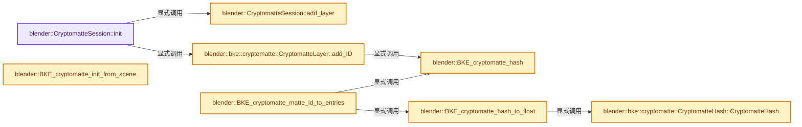
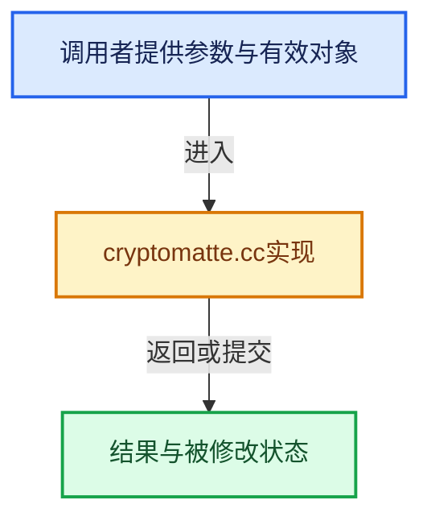

# 实现依赖专题：source/blender/blenkernel/intern/cryptomatte.cc

[方向导航](README.md) · [符号索引](../%E7%AC%A6%E5%8F%B7%E4%BE%9D%E8%B5%96%E4%B8%8E%E5%AE%9E%E7%8E%B0%E7%B4%A2%E5%BC%95.md)

本专题从正文实际调用进入，集中保存共享实现。函数有稳定锚点，可从调用处直接跳到对应完整函数；递归与互相调用通过回链组织。

## 本文件的实现关系






## 完整成员与函数实现

<a id="f-e6b4d13ecc5bd4fc"></a>

### `blender::CryptomatteSession::init`

实现位置：[source/blender/blenkernel/intern/cryptomatte.cc](../../../../../source/blender/blenkernel/intern/cryptomatte.cc) · L114—L167。

接口参数：

- `const ViewLayer *view_layer`
- `bool build_meta_data`

**教学注释版**

<!-- annotated:2b57c3af6dbf8e -->

```cpp
void CryptomatteSession::init(const ViewLayer *view_layer, bool build_meta_data)
{
  eViewLayerCryptomatteFlags cryptoflags = static_cast<eViewLayerCryptomatteFlags>(
      view_layer->cryptomatte_flag & VIEW_LAYER_CRYPTOMATTE_ALL);
  if (cryptoflags == 0) {
    cryptoflags = VIEW_LAYER_CRYPTOMATTE_ALL;
  }

  ListBaseT<Base> *object_bases = build_meta_data ? BKE_view_layer_object_bases_get(
                                                        const_cast<ViewLayer *>(view_layer)) :
                                                    nullptr;

  if (cryptoflags & VIEW_LAYER_CRYPTOMATTE_OBJECT) {
    bke::cryptomatte::CryptomatteLayer &objects = add_layer(StringRefNull(view_layer->name) + "." +
                                                            RE_PASSNAME_CRYPTOMATTE_OBJECT);

    if (build_meta_data) {
      for (Base &base : *object_bases) {
        objects.add_ID(base.object->id);
      }
    }
  }

  if (cryptoflags & VIEW_LAYER_CRYPTOMATTE_ASSET) {
    bke::cryptomatte::CryptomatteLayer &assets = add_layer(StringRefNull(view_layer->name) + "." +
                                                           RE_PASSNAME_CRYPTOMATTE_ASSET);

    if (build_meta_data) {
      for (Base &base : *object_bases) {
        const Object *asset_object = base.object;
        while (asset_object->parent != nullptr) {
          asset_object = asset_object->parent;
        }
        assets.add_ID(asset_object->id);
      }
    }
  }

  if (cryptoflags & VIEW_LAYER_CRYPTOMATTE_MATERIAL) {
    bke::cryptomatte::CryptomatteLayer &materials = add_layer(
        StringRefNull(view_layer->name) + "." + RE_PASSNAME_CRYPTOMATTE_MATERIAL);

    if (build_meta_data) {
      for (Base &base : *object_bases) {
        for (int i = 0; i < base.object->totcol; i++) {
          Material *material = BKE_object_material_get(base.object, i + 1);
          if (material) {
            materials.add_ID(material->id);
          }
        }
      }
    }
  }
}
```

<details>
<summary>核对原始源码：source/blender/blenkernel/intern/cryptomatte.cc · L114—L167</summary>

<!-- original:2b57c3af6dbf8e:source/blender/blenkernel/intern/cryptomatte.cc:114:167 -->

```cpp
void CryptomatteSession::init(const ViewLayer *view_layer, bool build_meta_data)
{
  eViewLayerCryptomatteFlags cryptoflags = static_cast<eViewLayerCryptomatteFlags>(
      view_layer->cryptomatte_flag & VIEW_LAYER_CRYPTOMATTE_ALL);
  if (cryptoflags == 0) {
    cryptoflags = VIEW_LAYER_CRYPTOMATTE_ALL;
  }

  ListBaseT<Base> *object_bases = build_meta_data ? BKE_view_layer_object_bases_get(
                                                        const_cast<ViewLayer *>(view_layer)) :
                                                    nullptr;

  if (cryptoflags & VIEW_LAYER_CRYPTOMATTE_OBJECT) {
    bke::cryptomatte::CryptomatteLayer &objects = add_layer(StringRefNull(view_layer->name) + "." +
                                                            RE_PASSNAME_CRYPTOMATTE_OBJECT);

    if (build_meta_data) {
      for (Base &base : *object_bases) {
        objects.add_ID(base.object->id);
      }
    }
  }

  if (cryptoflags & VIEW_LAYER_CRYPTOMATTE_ASSET) {
    bke::cryptomatte::CryptomatteLayer &assets = add_layer(StringRefNull(view_layer->name) + "." +
                                                           RE_PASSNAME_CRYPTOMATTE_ASSET);

    if (build_meta_data) {
      for (Base &base : *object_bases) {
        const Object *asset_object = base.object;
        while (asset_object->parent != nullptr) {
          asset_object = asset_object->parent;
        }
        assets.add_ID(asset_object->id);
      }
    }
  }

  if (cryptoflags & VIEW_LAYER_CRYPTOMATTE_MATERIAL) {
    bke::cryptomatte::CryptomatteLayer &materials = add_layer(
        StringRefNull(view_layer->name) + "." + RE_PASSNAME_CRYPTOMATTE_MATERIAL);

    if (build_meta_data) {
      for (Base &base : *object_bases) {
        for (int i = 0; i < base.object->totcol; i++) {
          Material *material = BKE_object_material_get(base.object, i + 1);
          if (material) {
            materials.add_ID(material->id);
          }
        }
      }
    }
  }
}
```

</details>

**沿实际写入检查状态**

- `cryptoflags = VIEW_LAYER_CRYPTOMATTE_ALL;`
- `asset_object = asset_object->parent;`

**继续追踪实现**

- `BKE_view_layer_object_bases_get` → [blender::BKE_view_layer_object_bases_get · L202](%E4%BE%9D%E8%B5%96-layer_utils-31ba6d.md#f-f7b3adc8941172e4)。
- `add_layer` → [blender::CryptomatteSession::add_layer · L169](%E4%BE%9D%E8%B5%96-cryptomatte-457bfc.md#f-580353d60ca0852f)。
- `StringRefNull` → [blender::StringRefNull::StringRefNull · L496](../01-%E5%9F%BA%E7%A1%80%E5%AE%B9%E5%99%A8%E4%B8%8E%E7%8E%B0%E4%BB%A3CPP/15-StringRef%E5%AD%97%E7%AC%A6%E4%B8%B2%E8%A7%86%E5%9B%BE.md#f-936c98fc0d9ae39e)；[blender::StringRefNull::StringRefNull · L502](../01-%E5%9F%BA%E7%A1%80%E5%AE%B9%E5%99%A8%E4%B8%8E%E7%8E%B0%E4%BB%A3CPP/15-StringRef%E5%AD%97%E7%AC%A6%E4%B8%B2%E8%A7%86%E5%9B%BE.md#f-cf03ac0c28007ee0)；[blender::StringRefNull::StringRefNull · L512](../01-%E5%9F%BA%E7%A1%80%E5%AE%B9%E5%99%A8%E4%B8%8E%E7%8E%B0%E4%BB%A3CPP/15-StringRef%E5%AD%97%E7%AC%A6%E4%B8%B2%E8%A7%86%E5%9B%BE.md#f-8a14273318bc57e1)；[blender::StringRefNull::StringRefNull · L523](../01-%E5%9F%BA%E7%A1%80%E5%AE%B9%E5%99%A8%E4%B8%8E%E7%8E%B0%E4%BB%A3CPP/15-StringRef%E5%AD%97%E7%AC%A6%E4%B8%B2%E8%A7%86%E5%9B%BE.md#f-e1cc63a4ff92775b)。同名重载需按实参类型选择。
- `objects.add_ID` → [blender::bke::cryptomatte::CryptomatteLayer::add_ID · L564](%E4%BE%9D%E8%B5%96-cryptomatte-457bfc.md#f-d8d656a6b6a5062a)。
- `assets.add_ID` → [blender::bke::cryptomatte::CryptomatteLayer::add_ID · L564](%E4%BE%9D%E8%B5%96-cryptomatte-457bfc.md#f-d8d656a6b6a5062a)。
- `BKE_object_material_get` → [blender::BKE_object_material_get · L759](%E4%BE%9D%E8%B5%96-material-aea8ec.md#f-9e9ad276ccef84b3)。
- `materials.add_ID` → [blender::bke::cryptomatte::CryptomatteLayer::add_ID · L564](%E4%BE%9D%E8%B5%96-cryptomatte-457bfc.md#f-d8d656a6b6a5062a)。

<a id="f-580353d60ca0852f"></a>

### `blender::CryptomatteSession::add_layer`

实现位置：[source/blender/blenkernel/intern/cryptomatte.cc](../../../../../source/blender/blenkernel/intern/cryptomatte.cc) · L169—L175。

接口参数：

- `std::string layer_name`

**教学注释版**

<!-- annotated:449da2b714d986 -->

```cpp
bke::cryptomatte::CryptomatteLayer &CryptomatteSession::add_layer(std::string layer_name)
{
  // [讲解] layer_names.contains：在有效元素中按相等关系查找。
  if (!layer_names.contains(layer_name)) {
    // [讲解] layer_names.append：在尾部建立新元素，必要时先扩大存储。
    layer_names.append(layer_name);
  }
  return layers.lookup_or_add_default(layer_name);
}
```

<details>
<summary>核对原始源码：source/blender/blenkernel/intern/cryptomatte.cc · L169—L175</summary>

<!-- original:449da2b714d986:source/blender/blenkernel/intern/cryptomatte.cc:169:175 -->

```cpp
bke::cryptomatte::CryptomatteLayer &CryptomatteSession::add_layer(std::string layer_name)
{
  if (!layer_names.contains(layer_name)) {
    layer_names.append(layer_name);
  }
  return layers.lookup_or_add_default(layer_name);
}
```

</details>

**结果出口**

- `return layers.lookup_or_add_default(layer_name);`

**继续追踪实现**

- `layer_names.contains` → [blender::Vector::contains · L938](../01-%E5%9F%BA%E7%A1%80%E5%AE%B9%E5%99%A8%E4%B8%8E%E7%8E%B0%E4%BB%A3CPP/12-Vector%E5%BC%82%E5%B8%B8%E5%AE%89%E5%85%A8%E4%B8%8E%E8%BE%B9%E7%95%8C.md#f-11ad8adb697ee04a)。
- `layer_names.append` → [blender::Vector::append · L498](../01-%E5%9F%BA%E7%A1%80%E5%AE%B9%E5%99%A8%E4%B8%8E%E7%8E%B0%E4%BB%A3CPP/11-Vector%E6%8F%92%E5%85%A5%E5%88%A0%E9%99%A4%E4%B8%8E%E9%87%8D%E6%8E%92.md#f-5bde268a69e443ec)；[blender::Vector::append · L502](../01-%E5%9F%BA%E7%A1%80%E5%AE%B9%E5%99%A8%E4%B8%8E%E7%8E%B0%E4%BB%A3CPP/11-Vector%E6%8F%92%E5%85%A5%E5%88%A0%E9%99%A4%E4%B8%8E%E9%87%8D%E6%8E%92.md#f-591e0b15e6308532)。同名重载需按实参类型选择。
- `layers.lookup_or_add_default` → [blender::Map::lookup_or_add_default · L639](../02-%E5%93%88%E5%B8%8C%E8%A1%A8%E4%B8%8E%E5%85%B3%E8%81%94%E6%95%B0%E6%8D%AE%E7%BB%93%E6%9E%84/05-Map%E6%8F%92%E5%85%A5%E4%B8%8E%E5%9B%9E%E8%B0%83.md#f-e8d33f0bfe1f3153)；[blender::Map::lookup_or_add_default · L643](../02-%E5%93%88%E5%B8%8C%E8%A1%A8%E4%B8%8E%E5%85%B3%E8%81%94%E6%95%B0%E6%8D%AE%E7%BB%93%E6%9E%84/05-Map%E6%8F%92%E5%85%A5%E4%B8%8E%E5%9B%9E%E8%B0%83.md#f-d67ab6e12fd0a267)。同名重载需按实参类型选择。

<a id="f-3288188abc6d9c73"></a>

### `blender::BKE_cryptomatte_init_from_scene`

实现位置：[source/blender/blenkernel/intern/cryptomatte.cc](../../../../../source/blender/blenkernel/intern/cryptomatte.cc) · L200—L204。

接口参数：

- `const Scene *scene`
- `bool build_meta_data`

**教学注释版**

<!-- annotated:2c7f252b9fbbdd -->

```cpp
CryptomatteSession *BKE_cryptomatte_init_from_scene(const Scene *scene, bool build_meta_data)
{
  CryptomatteSession *session = new CryptomatteSession(scene, build_meta_data);
  return session;
}
```

<details>
<summary>核对原始源码：source/blender/blenkernel/intern/cryptomatte.cc · L200—L204</summary>

<!-- original:2c7f252b9fbbdd:source/blender/blenkernel/intern/cryptomatte.cc:200:204 -->

```cpp
CryptomatteSession *BKE_cryptomatte_init_from_scene(const Scene *scene, bool build_meta_data)
{
  CryptomatteSession *session = new CryptomatteSession(scene, build_meta_data);
  return session;
}
```

</details>

**结果出口**

- `return session;`

**继续追踪实现**

本实现没有需要继续展开的显式调用；检查返回表达式、对象转换和调用者前置条件。

<a id="f-6118189aa1892ff9"></a>

### `blender::BKE_cryptomatte_hash`

实现位置：[source/blender/blenkernel/intern/cryptomatte.cc](../../../../../source/blender/blenkernel/intern/cryptomatte.cc) · L223—L227。

接口参数：

- `const char *name`
- `const int name_len`

**教学注释版**

<!-- annotated:b47ed93c46492d -->

```cpp
uint32_t BKE_cryptomatte_hash(const char *name, const int name_len)
{
  bke::cryptomatte::CryptomatteHash hash(name, name_len);
  return hash.hash;
}
```

<details>
<summary>核对原始源码：source/blender/blenkernel/intern/cryptomatte.cc · L223—L227</summary>

<!-- original:b47ed93c46492d:source/blender/blenkernel/intern/cryptomatte.cc:223:227 -->

```cpp
uint32_t BKE_cryptomatte_hash(const char *name, const int name_len)
{
  bke::cryptomatte::CryptomatteHash hash(name, name_len);
  return hash.hash;
}
```

</details>

**结果出口**

- `return hash.hash;`

**继续追踪实现**

本实现没有需要继续展开的显式调用；检查返回表达式、对象转换和调用者前置条件。

<a id="f-2c8aa6a076d94461"></a>

### `blender::BKE_cryptomatte_hash_to_float`

实现位置：[source/blender/blenkernel/intern/cryptomatte.cc](../../../../../source/blender/blenkernel/intern/cryptomatte.cc) · L261—L264。

接口参数：

- `uint32_t cryptomatte_hash`

**教学注释版**

<!-- annotated:ada9a4cb672c64 -->

```cpp
float BKE_cryptomatte_hash_to_float(uint32_t cryptomatte_hash)
{
  return bke::cryptomatte::CryptomatteHash(cryptomatte_hash).float_encoded();
}
```

<details>
<summary>核对原始源码：source/blender/blenkernel/intern/cryptomatte.cc · L261—L264</summary>

<!-- original:ada9a4cb672c64:source/blender/blenkernel/intern/cryptomatte.cc:261:264 -->

```cpp
float BKE_cryptomatte_hash_to_float(uint32_t cryptomatte_hash)
{
  return bke::cryptomatte::CryptomatteHash(cryptomatte_hash).float_encoded();
}
```

</details>

**结果出口**

- `return bke::cryptomatte::CryptomatteHash(cryptomatte_hash).float_encoded();`

**继续追踪实现**

- `bke::cryptomatte::CryptomatteHash(cryptomatte_hash).float_encoded` → [调用协议](../%E6%A8%A1%E6%9D%BF%E5%AE%8F%E4%B8%8E%E5%8A%A8%E6%80%81%E5%88%86%E6%B4%BE%E5%8D%8F%E8%AE%AE.md)：接收对象类型依赖auto、返回值或模板实例；不按同名猜测目标。调用位置L263。
- `bke::cryptomatte::CryptomatteHash` → [blender::bke::cryptomatte::CryptomatteHash::CryptomatteHash · L541](%E4%BE%9D%E8%B5%96-cryptomatte-457bfc.md#f-abaf9015f9985067)。

<a id="f-0cb5135296028d77"></a>

### `blender::BKE_cryptomatte_matte_id_to_entries`

实现位置：[source/blender/blenkernel/intern/cryptomatte.cc](../../../../../source/blender/blenkernel/intern/cryptomatte.cc) · L301—L349。

接口参数：

- `NodeCryptomatte *node_storage`
- `const char *matte_id`

**教学注释版**

<!-- annotated:a668b6b36767cc -->

```cpp
void BKE_cryptomatte_matte_id_to_entries(NodeCryptomatte *node_storage, const char *matte_id)
{
  node_storage->entries.free_no_destruct();

  if (matte_id == nullptr) {
    MEM_SAFE_DELETE(node_storage->matte_id);
    return;
  }
  /* Update the matte_id so the files can be opened in versions that don't
   * use `CryptomatteEntry`. */
  if (matte_id != node_storage->matte_id && node_storage->matte_id &&
      STREQ(node_storage->matte_id, matte_id))
  {
    MEM_SAFE_DELETE(node_storage->matte_id);
    node_storage->matte_id = MEM_dupalloc(matte_id);
  }

  std::istringstream ss(matte_id);
  while (ss.good()) {
    CryptomatteEntry *entry = nullptr;
    std::string token;
    getline(ss, token, ',');
    /* Ignore empty tokens. */
    if (!token.empty()) {
      size_t first = token.find_first_not_of(' ');
      size_t last = token.find_last_not_of(' ');
      if (first == std::string::npos || last == std::string::npos) {
        break;
      }
      token = token.substr(first, (last - first + 1));
      if (*token.begin() == '<' && *(--token.end()) == '>') {
        float encoded_hash = atof(token.substr(1, token.length() - 2).c_str());
        entry = MEM_new<CryptomatteEntry>(__func__);
        entry->encoded_hash = encoded_hash;
      }
      else {
        const char *name = token.c_str();
        int name_len = token.length();
        entry = MEM_new<CryptomatteEntry>(__func__);
        STRNCPY(entry->name, name);
        uint32_t hash = BKE_cryptomatte_hash(name, name_len);
        entry->encoded_hash = BKE_cryptomatte_hash_to_float(hash);
      }
    }
    if (entry != nullptr) {
      BLI_addtail(&node_storage->entries, entry);
    }
  }
}
```

<details>
<summary>核对原始源码：source/blender/blenkernel/intern/cryptomatte.cc · L301—L349</summary>

<!-- original:a668b6b36767cc:source/blender/blenkernel/intern/cryptomatte.cc:301:349 -->

```cpp
void BKE_cryptomatte_matte_id_to_entries(NodeCryptomatte *node_storage, const char *matte_id)
{
  node_storage->entries.free_no_destruct();

  if (matte_id == nullptr) {
    MEM_SAFE_DELETE(node_storage->matte_id);
    return;
  }
  /* Update the matte_id so the files can be opened in versions that don't
   * use `CryptomatteEntry`. */
  if (matte_id != node_storage->matte_id && node_storage->matte_id &&
      STREQ(node_storage->matte_id, matte_id))
  {
    MEM_SAFE_DELETE(node_storage->matte_id);
    node_storage->matte_id = MEM_dupalloc(matte_id);
  }

  std::istringstream ss(matte_id);
  while (ss.good()) {
    CryptomatteEntry *entry = nullptr;
    std::string token;
    getline(ss, token, ',');
    /* Ignore empty tokens. */
    if (!token.empty()) {
      size_t first = token.find_first_not_of(' ');
      size_t last = token.find_last_not_of(' ');
      if (first == std::string::npos || last == std::string::npos) {
        break;
      }
      token = token.substr(first, (last - first + 1));
      if (*token.begin() == '<' && *(--token.end()) == '>') {
        float encoded_hash = atof(token.substr(1, token.length() - 2).c_str());
        entry = MEM_new<CryptomatteEntry>(__func__);
        entry->encoded_hash = encoded_hash;
      }
      else {
        const char *name = token.c_str();
        int name_len = token.length();
        entry = MEM_new<CryptomatteEntry>(__func__);
        STRNCPY(entry->name, name);
        uint32_t hash = BKE_cryptomatte_hash(name, name_len);
        entry->encoded_hash = BKE_cryptomatte_hash_to_float(hash);
      }
    }
    if (entry != nullptr) {
      BLI_addtail(&node_storage->entries, entry);
    }
  }
}
```

</details>

**沿实际写入检查状态**

- `node_storage->matte_id = MEM_dupalloc(matte_id);`
- `token = token.substr(first, (last - first + 1));`
- `entry = MEM_new<CryptomatteEntry>(__func__);`
- `entry->encoded_hash = encoded_hash;`
- `entry->encoded_hash = BKE_cryptomatte_hash_to_float(hash);`

**继续追踪实现**

- `node_storage->entries.free_no_destruct` → [调用协议](../%E6%A8%A1%E6%9D%BF%E5%AE%8F%E4%B8%8E%E5%8A%A8%E6%80%81%E5%88%86%E6%B4%BE%E5%8D%8F%E8%AE%AE.md)：接收对象类型依赖auto、返回值或模板实例；不按同名猜测目标。调用位置L303。
- `MEM_SAFE_DELETE` → [MEM_SAFE_DELETE · L436](../03-%E5%86%85%E5%AD%98%E5%88%86%E9%85%8D%E4%B8%8E%E8%BF%90%E8%A1%8C%E6%97%B6%E7%B1%BB%E5%9E%8B/%E4%BE%9D%E8%B5%96-MEM_guardedalloc-b54eca.md#m-eadb3bc5b902)。宏定义由构建条件选择。
- `STREQ` → [STREQ · L112](%E4%BE%9D%E8%B5%96-GHOST_utildefines-34b996.md#m-9549fb6aafd2)；[STREQ · L451](../01-%E5%9F%BA%E7%A1%80%E5%AE%B9%E5%99%A8%E4%B8%8E%E7%8E%B0%E4%BB%A3CPP/%E4%BE%9D%E8%B5%96-BLI_utildefines-293a0a.md#m-c7b745bcfad2)；[STREQ · L55](%E4%BE%9D%E8%B5%96-clog-a0bec8.md#m-96e78f386894)。宏定义由构建条件选择。
- `MEM_dupalloc` → [MEM_dupalloc · L627](../03-%E5%86%85%E5%AD%98%E5%88%86%E9%85%8D%E4%B8%8E%E8%BF%90%E8%A1%8C%E6%97%B6%E7%B1%BB%E5%9E%8B/%E4%BE%9D%E8%B5%96-MEM_guardedalloc-b54eca.md#f-78a72b71e3c57010)。
- `ss.good` → [外部契约](https://eel.is/c++draft/)：这个边界按实际表达式及所属类型核对参数、返回值、寿命与失败行为。这里提供接口入口，不声称已解释该第三方版本的内部实现。
- `getline` → [调用协议](../%E6%A8%A1%E6%9D%BF%E5%AE%8F%E4%B8%8E%E5%8A%A8%E6%80%81%E5%88%86%E6%B4%BE%E5%8D%8F%E8%AE%AE.md)：函数指针、局部可调用对象或未展开的宏；必须结合调用者环境。调用位置L322。
- `token.empty` → [外部契约](https://eel.is/c++draft/)：这个边界按实际表达式及所属类型核对参数、返回值、寿命与失败行为。这里提供接口入口，不声称已解释该第三方版本的内部实现。
- `token.find_first_not_of` → [外部契约](https://eel.is/c++draft/)：这个边界按实际表达式及所属类型核对参数、返回值、寿命与失败行为。这里提供接口入口，不声称已解释该第三方版本的内部实现。
- `token.find_last_not_of` → [外部契约](https://eel.is/c++draft/)：这个边界按实际表达式及所属类型核对参数、返回值、寿命与失败行为。这里提供接口入口，不声称已解释该第三方版本的内部实现。
- `token.substr` → [外部契约](https://eel.is/c++draft/)：这个边界按实际表达式及所属类型核对参数、返回值、寿命与失败行为。这里提供接口入口，不声称已解释该第三方版本的内部实现。
- `token.begin` → [外部契约](https://eel.is/c++draft/)：这个边界按实际表达式及所属类型核对参数、返回值、寿命与失败行为。这里提供接口入口，不声称已解释该第三方版本的内部实现。
- `token.end` → [外部契约](https://eel.is/c++draft/)：这个边界按实际表达式及所属类型核对参数、返回值、寿命与失败行为。这里提供接口入口，不声称已解释该第三方版本的内部实现。
- `atof` → [调用协议](../%E6%A8%A1%E6%9D%BF%E5%AE%8F%E4%B8%8E%E5%8A%A8%E6%80%81%E5%88%86%E6%B4%BE%E5%8D%8F%E8%AE%AE.md)：函数指针、局部可调用对象或未展开的宏；必须结合调用者环境。调用位置L332。
- `token.substr(1, token.length() - 2).c_str` → [调用协议](../%E6%A8%A1%E6%9D%BF%E5%AE%8F%E4%B8%8E%E5%8A%A8%E6%80%81%E5%88%86%E6%B4%BE%E5%8D%8F%E8%AE%AE.md)：接收对象类型依赖auto、返回值或模板实例；不按同名猜测目标。调用位置L332。
- `token.length` → [外部契约](https://eel.is/c++draft/)：这个边界按实际表达式及所属类型核对参数、返回值、寿命与失败行为。这里提供接口入口，不声称已解释该第三方版本的内部实现。
- `MEM_new<CryptomatteEntry>` → [MEM_new · L351](../03-%E5%86%85%E5%AD%98%E5%88%86%E9%85%8D%E4%B8%8E%E8%BF%90%E8%A1%8C%E6%97%B6%E7%B1%BB%E5%9E%8B/%E4%BE%9D%E8%B5%96-MEM_guardedalloc-b54eca.md#f-115f9b6784f89912)。
- `token.c_str` → [外部契约](https://eel.is/c++draft/)：这个边界按实际表达式及所属类型核对参数、返回值、寿命与失败行为。这里提供接口入口，不声称已解释该第三方版本的内部实现。
- `STRNCPY` → [blender::STRNCPY · L690](../01-%E5%9F%BA%E7%A1%80%E5%AE%B9%E5%99%A8%E4%B8%8E%E7%8E%B0%E4%BB%A3CPP/%E4%BE%9D%E8%B5%96-BLI_string-b43058.md#f-6b2d861724026be6)。
- `BKE_cryptomatte_hash` → [blender::BKE_cryptomatte_hash · L223](%E4%BE%9D%E8%B5%96-cryptomatte-457bfc.md#f-6118189aa1892ff9)。
- `BKE_cryptomatte_hash_to_float` → [blender::BKE_cryptomatte_hash_to_float · L261](%E4%BE%9D%E8%B5%96-cryptomatte-457bfc.md#f-2c8aa6a076d94461)。
- `BLI_addtail` → [blender::BLI_addtail · L118](../01-%E5%9F%BA%E7%A1%80%E5%AE%B9%E5%99%A8%E4%B8%8E%E7%8E%B0%E4%BB%A3CPP/%E4%BE%9D%E8%B5%96-listbase-2816d9.md#f-4fb027713fa3115b)。

<a id="f-abaf9015f9985067"></a>

### `blender::bke::cryptomatte::CryptomatteHash::CryptomatteHash`

实现位置：[source/blender/blenkernel/intern/cryptomatte.cc](../../../../../source/blender/blenkernel/intern/cryptomatte.cc) · L541—L541。

接口参数：

- `uint32_t hash`

**教学注释版**

<!-- annotated:f6792ebb2cc752 -->

```cpp
CryptomatteHash::CryptomatteHash(uint32_t hash) : hash(hash) {}
```

<details>
<summary>核对原始源码：source/blender/blenkernel/intern/cryptomatte.cc · L541—L541</summary>

<!-- original:f6792ebb2cc752:source/blender/blenkernel/intern/cryptomatte.cc:541:541 -->

```cpp
CryptomatteHash::CryptomatteHash(uint32_t hash) : hash(hash) {}
```

</details>

**继续追踪实现**

本实现没有需要继续展开的显式调用；检查返回表达式、对象转换和调用者前置条件。

<a id="f-d8d656a6b6a5062a"></a>

### `blender::bke::cryptomatte::CryptomatteLayer::add_ID`

实现位置：[source/blender/blenkernel/intern/cryptomatte.cc](../../../../../source/blender/blenkernel/intern/cryptomatte.cc) · L564—L573。

接口参数：

- `const ID &id`

**教学注释版**

<!-- annotated:0d7d1fed745463 -->

```cpp
uint32_t CryptomatteLayer::add_ID(const ID &id)
{
  const char *name = &id.name[2];
  const int name_len = BLI_strnlen(name, MAX_NAME - 2);
  uint32_t cryptohash_int = BKE_cryptomatte_hash(name, name_len);

  add_hash(StringRef(name, name_len), cryptohash_int);

  return cryptohash_int;
}
```

<details>
<summary>核对原始源码：source/blender/blenkernel/intern/cryptomatte.cc · L564—L573</summary>

<!-- original:0d7d1fed745463:source/blender/blenkernel/intern/cryptomatte.cc:564:573 -->

```cpp
uint32_t CryptomatteLayer::add_ID(const ID &id)
{
  const char *name = &id.name[2];
  const int name_len = BLI_strnlen(name, MAX_NAME - 2);
  uint32_t cryptohash_int = BKE_cryptomatte_hash(name, name_len);

  add_hash(StringRef(name, name_len), cryptohash_int);

  return cryptohash_int;
}
```

</details>

**结果出口**

- `return cryptohash_int;`

**继续追踪实现**

- `BLI_strnlen` → [blender::BLI_strnlen · L919](../01-%E5%9F%BA%E7%A1%80%E5%AE%B9%E5%99%A8%E4%B8%8E%E7%8E%B0%E4%BB%A3CPP/%E4%BE%9D%E8%B5%96-string-1d986f.md#f-137cab173af92dd4)。
- `BKE_cryptomatte_hash` → [blender::BKE_cryptomatte_hash · L223](%E4%BE%9D%E8%B5%96-cryptomatte-457bfc.md#f-6118189aa1892ff9)。
- `add_hash` → [blender::bke::cryptomatte::CryptomatteLayer::add_hash · L575](%E4%BE%9D%E8%B5%96-cryptomatte-457bfc.md#f-89a08d409906116b)。
- `StringRef` → [blender::StringRef::StringRef · L555](../01-%E5%9F%BA%E7%A1%80%E5%AE%B9%E5%99%A8%E4%B8%8E%E7%8E%B0%E4%BB%A3CPP/15-StringRef%E5%AD%97%E7%AC%A6%E4%B8%B2%E8%A7%86%E5%9B%BE.md#f-f6aca324a36faa7e)；[blender::StringRef::StringRef · L560](../01-%E5%9F%BA%E7%A1%80%E5%AE%B9%E5%99%A8%E4%B8%8E%E7%8E%B0%E4%BB%A3CPP/15-StringRef%E5%AD%97%E7%AC%A6%E4%B8%B2%E8%A7%86%E5%9B%BE.md#f-ab9714781ca51bac)；[blender::StringRef::StringRef · L565](../01-%E5%9F%BA%E7%A1%80%E5%AE%B9%E5%99%A8%E4%B8%8E%E7%8E%B0%E4%BB%A3CPP/15-StringRef%E5%AD%97%E7%AC%A6%E4%B8%B2%E8%A7%86%E5%9B%BE.md#f-95f0b483bbdd7739)；[blender::StringRef::StringRef · L570](../01-%E5%9F%BA%E7%A1%80%E5%AE%B9%E5%99%A8%E4%B8%8E%E7%8E%B0%E4%BB%A3CPP/15-StringRef%E5%AD%97%E7%AC%A6%E4%B8%B2%E8%A7%86%E5%9B%BE.md#f-808d05699cb33334)；[blender::StringRef::StringRef · L631](../01-%E5%9F%BA%E7%A1%80%E5%AE%B9%E5%99%A8%E4%B8%8E%E7%8E%B0%E4%BB%A3CPP/15-StringRef%E5%AD%97%E7%AC%A6%E4%B8%B2%E8%A7%86%E5%9B%BE.md#f-37788e5f3fa3b736)；[blender::StringRef::StringRef · L641](../01-%E5%9F%BA%E7%A1%80%E5%AE%B9%E5%99%A8%E4%B8%8E%E7%8E%B0%E4%BB%A3CPP/15-StringRef%E5%AD%97%E7%AC%A6%E4%B8%B2%E8%A7%86%E5%9B%BE.md#f-11abd0510fb6b926)；[blender::StringRef::StringRef · L646](../01-%E5%9F%BA%E7%A1%80%E5%AE%B9%E5%99%A8%E4%B8%8E%E7%8E%B0%E4%BB%A3CPP/15-StringRef%E5%AD%97%E7%AC%A6%E4%B8%B2%E8%A7%86%E5%9B%BE.md#f-8437dbd8a582eefd)；[blender::StringRef::StringRef · L651](../01-%E5%9F%BA%E7%A1%80%E5%AE%B9%E5%99%A8%E4%B8%8E%E7%8E%B0%E4%BB%A3CPP/15-StringRef%E5%AD%97%E7%AC%A6%E4%B8%B2%E8%A7%86%E5%9B%BE.md#f-70bcb338de0db978)。同名重载需按实参类型选择。

<a id="f-89a08d409906116b"></a>

### `blender::bke::cryptomatte::CryptomatteLayer::add_hash`

实现位置：[source/blender/blenkernel/intern/cryptomatte.cc](../../../../../source/blender/blenkernel/intern/cryptomatte.cc) · L575—L578。

接口参数：

- `StringRef name`
- `CryptomatteHash cryptomatte_hash`

**教学注释版**

<!-- annotated:4ddd34354a3670 -->

```cpp
void CryptomatteLayer::add_hash(StringRef name, CryptomatteHash cryptomatte_hash)
{
  hashes.add_overwrite(name, cryptomatte_hash);
}
```

<details>
<summary>核对原始源码：source/blender/blenkernel/intern/cryptomatte.cc · L575—L578</summary>

<!-- original:4ddd34354a3670:source/blender/blenkernel/intern/cryptomatte.cc:575:578 -->

```cpp
void CryptomatteLayer::add_hash(StringRef name, CryptomatteHash cryptomatte_hash)
{
  hashes.add_overwrite(name, cryptomatte_hash);
}
```

</details>

**继续追踪实现**

- `hashes.add_overwrite` → [调用协议](../%E6%A8%A1%E6%9D%BF%E5%AE%8F%E4%B8%8E%E5%8A%A8%E6%80%81%E5%88%86%E6%B4%BE%E5%8D%8F%E8%AE%AE.md)：接收对象类型依赖auto、返回值或模板实例；不按同名猜测目标。调用位置L577。

<a id="f-b31adeae245a8f3d"></a>

### `blender::bke::cryptomatte::BKE_cryptomatte_layer_names_get`

实现位置：[source/blender/blenkernel/intern/cryptomatte.cc](../../../../../source/blender/blenkernel/intern/cryptomatte.cc) · L656—L659。

接口参数：

- `const CryptomatteSession &session`

**教学注释版**

<!-- annotated:595435f42324ef -->

```cpp
const Vector<std::string> &BKE_cryptomatte_layer_names_get(const CryptomatteSession &session)
{
  return session.layer_names;
}
```

<details>
<summary>核对原始源码：source/blender/blenkernel/intern/cryptomatte.cc · L656—L659</summary>

<!-- original:595435f42324ef:source/blender/blenkernel/intern/cryptomatte.cc:656:659 -->

```cpp
const Vector<std::string> &BKE_cryptomatte_layer_names_get(const CryptomatteSession &session)
{
  return session.layer_names;
}
```

</details>

**结果出口**

- `return session.layer_names;`

**继续追踪实现**

本实现没有需要继续展开的显式调用；检查返回表达式、对象转换和调用者前置条件。
