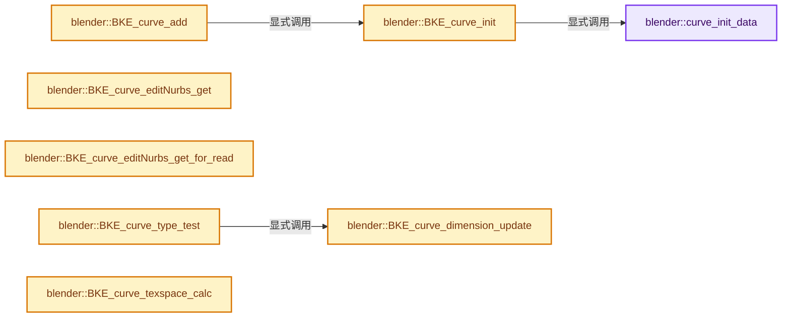
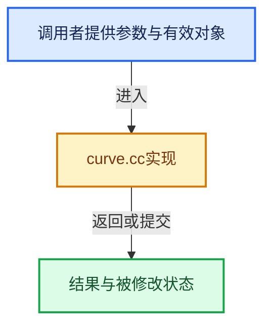

# 实现依赖专题：source/blender/blenkernel/intern/curve.cc

[方向导航](README.md) · [符号索引](../%E7%AC%A6%E5%8F%B7%E4%BE%9D%E8%B5%96%E4%B8%8E%E5%AE%9E%E7%8E%B0%E7%B4%A2%E5%BC%95.md)

本专题从正文实际调用进入，集中保存共享实现。函数有稳定锚点，可从调用处直接跳到对应完整函数；递归与互相调用通过回链组织。

## 本文件的实现关系






## 完整成员与函数实现

<a id="f-b59ebf9d4c9401bf"></a>

### `blender::curve_init_data`

实现位置：[source/blender/blenkernel/intern/curve.cc](../../../../../source/blender/blenkernel/intern/curve.cc) · L73—L78。

接口参数：

- `ID *id`

**教学注释版**

<!-- annotated:a8740772dba116 -->

```cpp
static void curve_init_data(ID *id)
{
  Curve *curve = id_cast<Curve *>(id);

  INIT_DEFAULT_STRUCT_AFTER(curve, id);
}
```

<details>
<summary>核对原始源码：source/blender/blenkernel/intern/curve.cc · L73—L78</summary>

<!-- original:a8740772dba116:source/blender/blenkernel/intern/curve.cc:73:78 -->

```cpp
static void curve_init_data(ID *id)
{
  Curve *curve = id_cast<Curve *>(id);

  INIT_DEFAULT_STRUCT_AFTER(curve, id);
}
```

</details>

**继续追踪实现**

- `id_cast<Curve *>` → [blender::id_cast · L1417](%E4%BE%9D%E8%B5%96-DNA_ID-3eb091.md#f-6c8ac6412850ac5a)。
- `INIT_DEFAULT_STRUCT_AFTER` → [INIT_DEFAULT_STRUCT_AFTER · L422](../01-%E5%9F%BA%E7%A1%80%E5%AE%B9%E5%99%A8%E4%B8%8E%E7%8E%B0%E4%BB%A3CPP/%E4%BE%9D%E8%B5%96-BLI_utildefines-293a0a.md#m-30b1f74075b1)。宏定义由构建条件选择。

<a id="f-3058b12b7936eb2d"></a>

### `blender::BKE_curve_init`

实现位置：[source/blender/blenkernel/intern/curve.cc](../../../../../source/blender/blenkernel/intern/curve.cc) · L388—L427。

接口参数：

- `Curve *cu`
- `const ObjectType curve_type`

**教学注释版**

<!-- annotated:cf02a65b4d54ce -->

```cpp
void BKE_curve_init(Curve *cu, const ObjectType curve_type)
{
  curve_init_data(&cu->id);

  cu->ob_type = curve_type;

  if (cu->ob_type == OB_FONT) {
    cu->flag |= CU_FRONT | CU_BACK;
    cu->fill_solver = CU_FILL_SOLVER_CDT;
    cu->fill_rule = CU_FILL_RULE_NONZERO;
    cu->vfont = cu->vfontb = cu->vfonti = cu->vfontbi = BKE_vfont_builtin_ensure();
    cu->vfont->id.us += 4;

    const char *str = DATA_("Text");
    size_t len_bytes;
    size_t len_char32 = BLI_strlen_utf8_ex(str, &len_bytes);

    cu->str = MEM_new_array_uninitialized<char>(len_bytes + 1, "str");
    // [讲解] memcpy：复制字节，源与目标不应重叠。类型生命周期、对齐和可复制表示须由调用者证明，不是任意对象的复制构造。
    memcpy(cu->str, str, len_bytes + 1);
    BLI_assert(cu->str[len_bytes] == '\0');

    cu->len = len_bytes;
    cu->len_char32 = cu->pos = len_char32;

    cu->strinfo = MEM_new_array<CharInfo>(len_char32 + 1, "strinfo new");

    cu->totbox = cu->actbox = 1;
    cu->tb = MEM_new_array<TextBox>(MAXTEXTBOX, "textbox");
    cu->tb[0].w = cu->tb[0].h = 0.0;
  }
  else if (cu->ob_type == OB_SURF) {
    cu->flag |= CU_3D;
    cu->resolu = 4;
    cu->resolv = 4;
  }
  cu->bevel_profile = nullptr;
  /* Initialize the offset to 1.0, to compensate for it being set to -1.0
   * in the property getter. */
  cu->offset = 1.0f;
}
```

<details>
<summary>核对原始源码：source/blender/blenkernel/intern/curve.cc · L388—L427</summary>

<!-- original:cf02a65b4d54ce:source/blender/blenkernel/intern/curve.cc:388:427 -->

```cpp
void BKE_curve_init(Curve *cu, const ObjectType curve_type)
{
  curve_init_data(&cu->id);

  cu->ob_type = curve_type;

  if (cu->ob_type == OB_FONT) {
    cu->flag |= CU_FRONT | CU_BACK;
    cu->fill_solver = CU_FILL_SOLVER_CDT;
    cu->fill_rule = CU_FILL_RULE_NONZERO;
    cu->vfont = cu->vfontb = cu->vfonti = cu->vfontbi = BKE_vfont_builtin_ensure();
    cu->vfont->id.us += 4;

    const char *str = DATA_("Text");
    size_t len_bytes;
    size_t len_char32 = BLI_strlen_utf8_ex(str, &len_bytes);

    cu->str = MEM_new_array_uninitialized<char>(len_bytes + 1, "str");
    memcpy(cu->str, str, len_bytes + 1);
    BLI_assert(cu->str[len_bytes] == '\0');

    cu->len = len_bytes;
    cu->len_char32 = cu->pos = len_char32;

    cu->strinfo = MEM_new_array<CharInfo>(len_char32 + 1, "strinfo new");

    cu->totbox = cu->actbox = 1;
    cu->tb = MEM_new_array<TextBox>(MAXTEXTBOX, "textbox");
    cu->tb[0].w = cu->tb[0].h = 0.0;
  }
  else if (cu->ob_type == OB_SURF) {
    cu->flag |= CU_3D;
    cu->resolu = 4;
    cu->resolv = 4;
  }
  cu->bevel_profile = nullptr;
  /* Initialize the offset to 1.0, to compensate for it being set to -1.0
   * in the property getter. */
  cu->offset = 1.0f;
}
```

</details>

**沿实际写入检查状态**

- `cu->ob_type = curve_type;`
- `cu->flag |= CU_FRONT | CU_BACK;`
- `cu->fill_solver = CU_FILL_SOLVER_CDT;`
- `cu->fill_rule = CU_FILL_RULE_NONZERO;`
- `cu->vfont = cu->vfontb = cu->vfonti = cu->vfontbi = BKE_vfont_builtin_ensure();`
- `cu->vfont->id.us += 4;`
- `cu->str = MEM_new_array_uninitialized<char>(len_bytes + 1, "str");`
- `cu->len = len_bytes;`
- `cu->len_char32 = cu->pos = len_char32;`
- `cu->strinfo = MEM_new_array<CharInfo>(len_char32 + 1, "strinfo new");`
- `cu->totbox = cu->actbox = 1;`
- `cu->tb = MEM_new_array<TextBox>(MAXTEXTBOX, "textbox");`
- `cu->tb[0].w = cu->tb[0].h = 0.0;`
- `cu->flag |= CU_3D;`
- `cu->resolu = 4;`
- `cu->resolv = 4;`
- `cu->bevel_profile = nullptr;`
- `cu->offset = 1.0f;`

**继续追踪实现**

- `curve_init_data` → [blender::curve_init_data · L73](%E4%BE%9D%E8%B5%96-curve-ae13d5.md#f-b59ebf9d4c9401bf)。
- `BKE_vfont_builtin_ensure` → [blender::BKE_vfont_builtin_ensure · L387](%E4%BE%9D%E8%B5%96-vfont-38c130.md#f-06e6570a0a42188d)。
- `DATA_` → [DATA_ · L52](%E4%BE%9D%E8%B5%96-BLT_translation-c89e58.md#m-178736083f83)。宏定义由构建条件选择。
- `BLI_strlen_utf8_ex` → [blender::BLI_strlen_utf8_ex · L471](../01-%E5%9F%BA%E7%A1%80%E5%AE%B9%E5%99%A8%E4%B8%8E%E7%8E%B0%E4%BB%A3CPP/%E4%BE%9D%E8%B5%96-string_utf8-3c62ca.md#f-1937d1f92ba2a3d6)。
- `MEM_new_array_uninitialized<char>` → [MEM_new_array_uninitialized · L608](../03-%E5%86%85%E5%AD%98%E5%88%86%E9%85%8D%E4%B8%8E%E8%BF%90%E8%A1%8C%E6%97%B6%E7%B1%BB%E5%9E%8B/%E4%BE%9D%E8%B5%96-MEM_guardedalloc-b54eca.md#f-b7103eae8eb57b05)；[MEM_new_array_uninitialized · L129](../03-%E5%86%85%E5%AD%98%E5%88%86%E9%85%8D%E4%B8%8E%E8%BF%90%E8%A1%8C%E6%97%B6%E7%B1%BB%E5%9E%8B/%E4%BE%9D%E8%B5%96-mallocn-afdcd4.md#f-bf6ef4ddcfb6e5df)。同名重载需按实参类型选择。
- `memcpy` → [外部契约](https://eel.is/c++draft/cstring.syn)：复制字节，源与目标不应重叠。类型生命周期、对齐和可复制表示须由调用者证明，不是任意对象的复制构造。
- `BLI_assert` → [BLI_assert · L48](../01-%E5%9F%BA%E7%A1%80%E5%AE%B9%E5%99%A8%E4%B8%8E%E7%8E%B0%E4%BB%A3CPP/%E4%BE%9D%E8%B5%96-BLI_assert-cc98e8.md#m-57a88495704d)；[BLI_assert · L63](../01-%E5%9F%BA%E7%A1%80%E5%AE%B9%E5%99%A8%E4%B8%8E%E7%8E%B0%E4%BB%A3CPP/%E4%BE%9D%E8%B5%96-BLI_assert-cc98e8.md#m-d07050020cb5)。宏定义由构建条件选择。
- `MEM_new_array<CharInfo>` → [MEM_new_array · L372](../03-%E5%86%85%E5%AD%98%E5%88%86%E9%85%8D%E4%B8%8E%E8%BF%90%E8%A1%8C%E6%97%B6%E7%B1%BB%E5%9E%8B/%E4%BE%9D%E8%B5%96-MEM_guardedalloc-b54eca.md#f-56b8fe3d391af460)。
- `MEM_new_array<TextBox>` → [MEM_new_array · L372](../03-%E5%86%85%E5%AD%98%E5%88%86%E9%85%8D%E4%B8%8E%E8%BF%90%E8%A1%8C%E6%97%B6%E7%B1%BB%E5%9E%8B/%E4%BE%9D%E8%B5%96-MEM_guardedalloc-b54eca.md#f-56b8fe3d391af460)。

<a id="f-b2e2b523401fd47c"></a>

### `blender::BKE_curve_add`

实现位置：[source/blender/blenkernel/intern/curve.cc](../../../../../source/blender/blenkernel/intern/curve.cc) · L429—L439。

接口参数：

- `Main *bmain`
- `const char *name`
- `ObjectType type`

**教学注释版**

<!-- annotated:53983ec5ddb66e -->

```cpp
Curve *BKE_curve_add(Main *bmain, const char *name, ObjectType type)
{
  Curve *cu;

  /* We cannot use #BKE_id_new here as we need some custom initialization code. */
  cu = static_cast<Curve *>(BKE_libblock_alloc(bmain, ID_CU_LEGACY, name, 0));

  BKE_curve_init(cu, type);

  return cu;
}
```

<details>
<summary>核对原始源码：source/blender/blenkernel/intern/curve.cc · L429—L439</summary>

<!-- original:53983ec5ddb66e:source/blender/blenkernel/intern/curve.cc:429:439 -->

```cpp
Curve *BKE_curve_add(Main *bmain, const char *name, ObjectType type)
{
  Curve *cu;

  /* We cannot use #BKE_id_new here as we need some custom initialization code. */
  cu = static_cast<Curve *>(BKE_libblock_alloc(bmain, ID_CU_LEGACY, name, 0));

  BKE_curve_init(cu, type);

  return cu;
}
```

</details>

**沿实际写入检查状态**

- `cu = static_cast<Curve *>(BKE_libblock_alloc(bmain, ID_CU_LEGACY, name, 0));`

**结果出口**

- `return cu;`

**继续追踪实现**

- `BKE_libblock_alloc` → [blender::BKE_libblock_alloc · L1545](%E4%BE%9D%E8%B5%96-lib_id-d4e6bd.md#f-135c8eaf9ed20667)。
- `BKE_curve_init` → [blender::BKE_curve_init · L388](%E4%BE%9D%E8%B5%96-curve-ae13d5.md#f-3058b12b7936eb2d)。

<a id="f-6e9579f439d8d1b1"></a>

### `blender::BKE_curve_editNurbs_get`

实现位置：[source/blender/blenkernel/intern/curve.cc](../../../../../source/blender/blenkernel/intern/curve.cc) · L441—L448。

接口参数：

- `Curve *cu`

**教学注释版**

<!-- annotated:fec0a2d7dfd791 -->

```cpp
ListBaseT<Nurb> *BKE_curve_editNurbs_get(Curve *cu)
{
  if (cu->editnurb) {
    return &cu->editnurb->nurbs;
  }

  return nullptr;
}
```

<details>
<summary>核对原始源码：source/blender/blenkernel/intern/curve.cc · L441—L448</summary>

<!-- original:fec0a2d7dfd791:source/blender/blenkernel/intern/curve.cc:441:448 -->

```cpp
ListBaseT<Nurb> *BKE_curve_editNurbs_get(Curve *cu)
{
  if (cu->editnurb) {
    return &cu->editnurb->nurbs;
  }

  return nullptr;
}
```

</details>

**结果出口**

- `return &cu->editnurb->nurbs;`
- `return nullptr;`

**继续追踪实现**

本实现没有需要继续展开的显式调用；检查返回表达式、对象转换和调用者前置条件。

<a id="f-13154d6db5ff3c5f"></a>

### `blender::BKE_curve_editNurbs_get_for_read`

实现位置：[source/blender/blenkernel/intern/curve.cc](../../../../../source/blender/blenkernel/intern/curve.cc) · L450—L457。

接口参数：

- `const Curve *cu`

**教学注释版**

<!-- annotated:c6f61330152daf -->

```cpp
const ListBaseT<Nurb> *BKE_curve_editNurbs_get_for_read(const Curve *cu)
{
  if (cu->editnurb) {
    return &cu->editnurb->nurbs;
  }

  return nullptr;
}
```

<details>
<summary>核对原始源码：source/blender/blenkernel/intern/curve.cc · L450—L457</summary>

<!-- original:c6f61330152daf:source/blender/blenkernel/intern/curve.cc:450:457 -->

```cpp
const ListBaseT<Nurb> *BKE_curve_editNurbs_get_for_read(const Curve *cu)
{
  if (cu->editnurb) {
    return &cu->editnurb->nurbs;
  }

  return nullptr;
}
```

</details>

**结果出口**

- `return &cu->editnurb->nurbs;`
- `return nullptr;`

**继续追踪实现**

本实现没有需要继续展开的显式调用；检查返回表达式、对象转换和调用者前置条件。

<a id="f-4564d731e622601a"></a>

### `blender::BKE_curve_dimension_update`

实现位置：[source/blender/blenkernel/intern/curve.cc](../../../../../source/blender/blenkernel/intern/curve.cc) · L459—L474。

接口参数：

- `Curve *cu`

**教学注释版**

<!-- annotated:6806d2d27d3b2f -->

```cpp
void BKE_curve_dimension_update(Curve *cu)
{
  ListBaseT<Nurb> *nurbs = BKE_curve_nurbs_get(cu);
  bool is_2d = CU_IS_2D(cu);

  for (Nurb &nu : *nurbs) {
    if (is_2d) {
      BKE_nurb_project_2d(&nu);
    }

    /* since the handles are moved they need to be auto-located again */
    if (nu.type == CU_BEZIER) {
      BKE_nurb_handles_calc(&nu);
    }
  }
}
```

<details>
<summary>核对原始源码：source/blender/blenkernel/intern/curve.cc · L459—L474</summary>

<!-- original:6806d2d27d3b2f:source/blender/blenkernel/intern/curve.cc:459:474 -->

```cpp
void BKE_curve_dimension_update(Curve *cu)
{
  ListBaseT<Nurb> *nurbs = BKE_curve_nurbs_get(cu);
  bool is_2d = CU_IS_2D(cu);

  for (Nurb &nu : *nurbs) {
    if (is_2d) {
      BKE_nurb_project_2d(&nu);
    }

    /* since the handles are moved they need to be auto-located again */
    if (nu.type == CU_BEZIER) {
      BKE_nurb_handles_calc(&nu);
    }
  }
}
```

</details>

**继续追踪实现**

- `BKE_curve_nurbs_get` → [blender::BKE_curve_nurbs_get · L4992](%E4%BE%9D%E8%B5%96-curve-ae13d5.md#f-90d985fa1171ee8e)。
- `CU_IS_2D` → [CU_IS_2D · L93](%E4%BE%9D%E8%B5%96-BKE_curve-04dd17.md#m-2114be5270f1)。宏定义由构建条件选择。
- `BKE_nurb_project_2d` → [blender::BKE_nurb_project_2d · L707](%E4%BE%9D%E8%B5%96-curve-ae13d5.md#f-996b0849514d8375)。
- `BKE_nurb_handles_calc` → [blender::BKE_nurb_handles_calc · L3992](%E4%BE%9D%E8%B5%96-curve-ae13d5.md#f-c0fe98849697d9e6)。

<a id="f-44008f8d7c308cb4"></a>

### `blender::BKE_curve_type_test`

实现位置：[source/blender/blenkernel/intern/curve.cc](../../../../../source/blender/blenkernel/intern/curve.cc) · L476—L488。

接口参数：

- `Object *ob`
- `const bool dimension_update`

**教学注释版**

<!-- annotated:60e3f62b1638d8 -->

```cpp
void BKE_curve_type_test(Object *ob, const bool dimension_update)
{
  Curve *cu = id_cast<Curve *>(ob->data);
  ob->type = cu->ob_type;

  if (dimension_update) {
    if (ob->type == OB_CURVES_LEGACY) {
      if (CU_IS_2D(cu)) {
        BKE_curve_dimension_update(cu);
      }
    }
  }
}
```

<details>
<summary>核对原始源码：source/blender/blenkernel/intern/curve.cc · L476—L488</summary>

<!-- original:60e3f62b1638d8:source/blender/blenkernel/intern/curve.cc:476:488 -->

```cpp
void BKE_curve_type_test(Object *ob, const bool dimension_update)
{
  Curve *cu = id_cast<Curve *>(ob->data);
  ob->type = cu->ob_type;

  if (dimension_update) {
    if (ob->type == OB_CURVES_LEGACY) {
      if (CU_IS_2D(cu)) {
        BKE_curve_dimension_update(cu);
      }
    }
  }
}
```

</details>

**沿实际写入检查状态**

- `ob->type = cu->ob_type;`

**继续追踪实现**

- `id_cast<Curve *>` → [blender::id_cast · L1417](%E4%BE%9D%E8%B5%96-DNA_ID-3eb091.md#f-6c8ac6412850ac5a)。
- `CU_IS_2D` → [CU_IS_2D · L93](%E4%BE%9D%E8%B5%96-BKE_curve-04dd17.md#m-2114be5270f1)。宏定义由构建条件选择。
- `BKE_curve_dimension_update` → [blender::BKE_curve_dimension_update · L459](%E4%BE%9D%E8%B5%96-curve-ae13d5.md#f-4564d731e622601a)。

<a id="f-1135d8c6c8f6bff1"></a>

### `blender::BKE_curve_texspace_calc`

实现位置：[source/blender/blenkernel/intern/curve.cc](../../../../../source/blender/blenkernel/intern/curve.cc) · L490—L522。

接口参数：

- `Curve *cu`

**教学注释版**

<!-- annotated:fb4582118f995d -->

```cpp
void BKE_curve_texspace_calc(Curve *cu)
{
  if (cu->texspace_flag & CU_TEXSPACE_FLAG_AUTO) {
    std::optional<Bounds<float3>> bounds = BKE_curve_minmax(cu, true);
    if (!bounds) {
      bounds = Bounds<float3>{float3(-FLT_MAX), -float3(FLT_MAX)};
    }

    float texspace_location[3], texspace_size[3];
    mid_v3_v3v3(texspace_location, bounds->min, bounds->max);

    texspace_size[0] = (bounds->max[0] - bounds->min[0]) / 2.0f;
    texspace_size[1] = (bounds->max[1] - bounds->min[1]) / 2.0f;
    texspace_size[2] = (bounds->max[2] - bounds->min[2]) / 2.0f;

    for (int a = 0; a < 3; a++) {
      if (texspace_size[a] == 0.0f) {
        texspace_size[a] = 1.0f;
      }
      else if (texspace_size[a] > 0.0f && texspace_size[a] < 0.00001f) {
        texspace_size[a] = 0.00001f;
      }
      else if (texspace_size[a] < 0.0f && texspace_size[a] > -0.00001f) {
        texspace_size[a] = -0.00001f;
      }
    }

    copy_v3_v3(cu->texspace_location, texspace_location);
    copy_v3_v3(cu->texspace_size, texspace_size);

    cu->texspace_flag |= CU_TEXSPACE_FLAG_AUTO_EVALUATED;
  }
}
```

<details>
<summary>核对原始源码：source/blender/blenkernel/intern/curve.cc · L490—L522</summary>

<!-- original:fb4582118f995d:source/blender/blenkernel/intern/curve.cc:490:522 -->

```cpp
void BKE_curve_texspace_calc(Curve *cu)
{
  if (cu->texspace_flag & CU_TEXSPACE_FLAG_AUTO) {
    std::optional<Bounds<float3>> bounds = BKE_curve_minmax(cu, true);
    if (!bounds) {
      bounds = Bounds<float3>{float3(-FLT_MAX), -float3(FLT_MAX)};
    }

    float texspace_location[3], texspace_size[3];
    mid_v3_v3v3(texspace_location, bounds->min, bounds->max);

    texspace_size[0] = (bounds->max[0] - bounds->min[0]) / 2.0f;
    texspace_size[1] = (bounds->max[1] - bounds->min[1]) / 2.0f;
    texspace_size[2] = (bounds->max[2] - bounds->min[2]) / 2.0f;

    for (int a = 0; a < 3; a++) {
      if (texspace_size[a] == 0.0f) {
        texspace_size[a] = 1.0f;
      }
      else if (texspace_size[a] > 0.0f && texspace_size[a] < 0.00001f) {
        texspace_size[a] = 0.00001f;
      }
      else if (texspace_size[a] < 0.0f && texspace_size[a] > -0.00001f) {
        texspace_size[a] = -0.00001f;
      }
    }

    copy_v3_v3(cu->texspace_location, texspace_location);
    copy_v3_v3(cu->texspace_size, texspace_size);

    cu->texspace_flag |= CU_TEXSPACE_FLAG_AUTO_EVALUATED;
  }
}
```

</details>

**沿实际写入检查状态**

- `bounds = Bounds<float3>{float3(-FLT_MAX), -float3(FLT_MAX)};`
- `texspace_size[0] = (bounds->max[0] - bounds->min[0]) / 2.0f;`
- `texspace_size[1] = (bounds->max[1] - bounds->min[1]) / 2.0f;`
- `texspace_size[2] = (bounds->max[2] - bounds->min[2]) / 2.0f;`
- `texspace_size[a] = 1.0f;`
- `texspace_size[a] = 0.00001f;`
- `texspace_size[a] = -0.00001f;`
- `cu->texspace_flag |= CU_TEXSPACE_FLAG_AUTO_EVALUATED;`

**继续追踪实现**

- `BKE_curve_minmax` → [blender::BKE_curve_minmax · L5131](%E4%BE%9D%E8%B5%96-curve-ae13d5.md#f-07342329517fb690)。
- `float3` → [float3 · L641](%E4%BE%9D%E8%B5%96-smaa-b67bc2.md#m-0ea8254cfdb4)。宏定义由构建条件选择。
- `mid_v3_v3v3` → [blender::mid_v3_v3v3 · L183](../12-%E7%A9%BA%E9%97%B4%E6%95%B0%E6%8D%AE%E7%BB%93%E6%9E%84%E4%B8%8E%E5%87%A0%E4%BD%95%E7%AE%97%E6%B3%95/%E4%BE%9D%E8%B5%96-math_vector-5f35fa.md#f-b748c1b0b472ad9b)。
- `copy_v3_v3` → [blender::copy_v3_v3 · L47](../12-%E7%A9%BA%E9%97%B4%E6%95%B0%E6%8D%AE%E7%BB%93%E6%9E%84%E4%B8%8E%E5%87%A0%E4%BD%95%E7%AE%97%E6%B3%95/%E4%BE%9D%E8%B5%96-math_vector_inline-0c8541.md#f-037a0d5fa5060bd6)。

<a id="f-a606a877bbe68855"></a>

### `blender::BKE_curve_texspace_ensure`

实现位置：[source/blender/blenkernel/intern/curve.cc](../../../../../source/blender/blenkernel/intern/curve.cc) · L524—L531。

接口参数：

- `Curve *cu`

**教学注释版**

<!-- annotated:5bcdb1cfb9fed0 -->

```cpp
void BKE_curve_texspace_ensure(Curve *cu)
{
  if ((cu->texspace_flag & CU_TEXSPACE_FLAG_AUTO) &&
      (cu->texspace_flag & CU_TEXSPACE_FLAG_AUTO_EVALUATED) == 0)
  {
    BKE_curve_texspace_calc(cu);
  }
}
```

<details>
<summary>核对原始源码：source/blender/blenkernel/intern/curve.cc · L524—L531</summary>

<!-- original:5bcdb1cfb9fed0:source/blender/blenkernel/intern/curve.cc:524:531 -->

```cpp
void BKE_curve_texspace_ensure(Curve *cu)
{
  if ((cu->texspace_flag & CU_TEXSPACE_FLAG_AUTO) &&
      (cu->texspace_flag & CU_TEXSPACE_FLAG_AUTO_EVALUATED) == 0)
  {
    BKE_curve_texspace_calc(cu);
  }
}
```

</details>

**继续追踪实现**

- `BKE_curve_texspace_calc` → [blender::BKE_curve_texspace_calc · L490](%E4%BE%9D%E8%B5%96-curve-ae13d5.md#f-1135d8c6c8f6bff1)。

<a id="f-f8f66c77764a37ae"></a>

### `blender::BKE_nurbList_index_get_co`

实现位置：[source/blender/blenkernel/intern/curve.cc](../../../../../source/blender/blenkernel/intern/curve.cc) · L533—L557。

接口参数：

- `ListBaseT<Nurb> *nurb`
- `const int index`
- `float r_co[3]`

**教学注释版**

<!-- annotated:8f5bbf7706d896 -->

```cpp
bool BKE_nurbList_index_get_co(ListBaseT<Nurb> *nurb, const int index, float r_co[3])
{
  int tot = 0;

  for (Nurb &nu : *nurb) {
    int tot_nu;
    if (nu.type == CU_BEZIER) {
      tot_nu = nu.pntsu;
      if (index - tot < tot_nu) {
        copy_v3_v3(r_co, nu.bezt[index - tot].vec[1]);
        return true;
      }
    }
    else {
      tot_nu = nu.pntsu * nu.pntsv;
      if (index - tot < tot_nu) {
        copy_v3_v3(r_co, nu.bp[index - tot].vec);
        return true;
      }
    }
    tot += tot_nu;
  }

  return false;
}
```

<details>
<summary>核对原始源码：source/blender/blenkernel/intern/curve.cc · L533—L557</summary>

<!-- original:8f5bbf7706d896:source/blender/blenkernel/intern/curve.cc:533:557 -->

```cpp
bool BKE_nurbList_index_get_co(ListBaseT<Nurb> *nurb, const int index, float r_co[3])
{
  int tot = 0;

  for (Nurb &nu : *nurb) {
    int tot_nu;
    if (nu.type == CU_BEZIER) {
      tot_nu = nu.pntsu;
      if (index - tot < tot_nu) {
        copy_v3_v3(r_co, nu.bezt[index - tot].vec[1]);
        return true;
      }
    }
    else {
      tot_nu = nu.pntsu * nu.pntsv;
      if (index - tot < tot_nu) {
        copy_v3_v3(r_co, nu.bp[index - tot].vec);
        return true;
      }
    }
    tot += tot_nu;
  }

  return false;
}
```

</details>

**沿实际写入检查状态**

- `tot_nu = nu.pntsu;`
- `tot_nu = nu.pntsu * nu.pntsv;`
- `tot += tot_nu;`

**结果出口**

- `return true;`
- `return false;`

**继续追踪实现**

- `copy_v3_v3` → [blender::copy_v3_v3 · L47](../12-%E7%A9%BA%E9%97%B4%E6%95%B0%E6%8D%AE%E7%BB%93%E6%9E%84%E4%B8%8E%E5%87%A0%E4%BD%95%E7%AE%97%E6%B3%95/%E4%BE%9D%E8%B5%96-math_vector_inline-0c8541.md#f-037a0d5fa5060bd6)。

<a id="f-d1b22a376e2359b9"></a>

### `blender::BKE_nurbList_verts_count`

实现位置：[source/blender/blenkernel/intern/curve.cc](../../../../../source/blender/blenkernel/intern/curve.cc) · L559—L573。

接口参数：

- `const ListBaseT<Nurb> *nurb`

**教学注释版**

<!-- annotated:4bbf4ea5bcaf0c -->

```cpp
int BKE_nurbList_verts_count(const ListBaseT<Nurb> *nurb)
{
  int tot = 0;

  for (const Nurb &nu : *nurb) {
    if (nu.bezt) {
      tot += 3 * nu.pntsu;
    }
    else if (nu.bp) {
      tot += nu.pntsu * nu.pntsv;
    }
  }

  return tot;
}
```

<details>
<summary>核对原始源码：source/blender/blenkernel/intern/curve.cc · L559—L573</summary>

<!-- original:4bbf4ea5bcaf0c:source/blender/blenkernel/intern/curve.cc:559:573 -->

```cpp
int BKE_nurbList_verts_count(const ListBaseT<Nurb> *nurb)
{
  int tot = 0;

  for (const Nurb &nu : *nurb) {
    if (nu.bezt) {
      tot += 3 * nu.pntsu;
    }
    else if (nu.bp) {
      tot += nu.pntsu * nu.pntsv;
    }
  }

  return tot;
}
```

</details>

**沿实际写入检查状态**

- `tot += 3 * nu.pntsu;`
- `tot += nu.pntsu * nu.pntsv;`

**结果出口**

- `return tot;`

**继续追踪实现**

本实现没有需要继续展开的显式调用；检查返回表达式、对象转换和调用者前置条件。

<a id="f-f238c3eb053b330d"></a>

### `blender::BKE_nurb_free`

实现位置：[source/blender/blenkernel/intern/curve.cc](../../../../../source/blender/blenkernel/intern/curve.cc) · L593—L617。

接口参数：

- `Nurb *nu`

**教学注释版**

<!-- annotated:c39ed75d63795f -->

```cpp
void BKE_nurb_free(Nurb *nu)
{
  if (nu == nullptr) {
    return;
  }

  if (nu->bezt) {
    MEM_delete(nu->bezt);
  }
  nu->bezt = nullptr;
  if (nu->bp) {
    MEM_delete(nu->bp);
  }
  nu->bp = nullptr;
  if (nu->knotsu) {
    MEM_delete(nu->knotsu);
  }
  nu->knotsu = nullptr;
  if (nu->knotsv) {
    MEM_delete(nu->knotsv);
  }
  nu->knotsv = nullptr;

  MEM_delete(nu);
}
```

<details>
<summary>核对原始源码：source/blender/blenkernel/intern/curve.cc · L593—L617</summary>

<!-- original:c39ed75d63795f:source/blender/blenkernel/intern/curve.cc:593:617 -->

```cpp
void BKE_nurb_free(Nurb *nu)
{
  if (nu == nullptr) {
    return;
  }

  if (nu->bezt) {
    MEM_delete(nu->bezt);
  }
  nu->bezt = nullptr;
  if (nu->bp) {
    MEM_delete(nu->bp);
  }
  nu->bp = nullptr;
  if (nu->knotsu) {
    MEM_delete(nu->knotsu);
  }
  nu->knotsu = nullptr;
  if (nu->knotsv) {
    MEM_delete(nu->knotsv);
  }
  nu->knotsv = nullptr;

  MEM_delete(nu);
}
```

</details>

**沿实际写入检查状态**

- `nu->bezt = nullptr;`
- `nu->bp = nullptr;`
- `nu->knotsu = nullptr;`
- `nu->knotsv = nullptr;`

**继续追踪实现**

- `MEM_delete` → [MEM_delete · L400](../03-%E5%86%85%E5%AD%98%E5%88%86%E9%85%8D%E4%B8%8E%E8%BF%90%E8%A1%8C%E6%97%B6%E7%B1%BB%E5%9E%8B/%E4%BE%9D%E8%B5%96-MEM_guardedalloc-b54eca.md#f-9049ffdd1682887c)。

<a id="f-f7a01a9be3ec4137"></a>

### `blender::BKE_nurbList_free`

实现位置：[source/blender/blenkernel/intern/curve.cc](../../../../../source/blender/blenkernel/intern/curve.cc) · L619—L629。

接口参数：

- `ListBaseT<Nurb> *lb`

**教学注释版**

<!-- annotated:265ff447c04f7c -->

```cpp
void BKE_nurbList_free(ListBaseT<Nurb> *lb)
{
  if (lb == nullptr) {
    return;
  }

  for (Nurb &nu : lb->items_mutable()) {
    BKE_nurb_free(&nu);
  }
  lb->clear_no_delete();
}
```

<details>
<summary>核对原始源码：source/blender/blenkernel/intern/curve.cc · L619—L629</summary>

<!-- original:265ff447c04f7c:source/blender/blenkernel/intern/curve.cc:619:629 -->

```cpp
void BKE_nurbList_free(ListBaseT<Nurb> *lb)
{
  if (lb == nullptr) {
    return;
  }

  for (Nurb &nu : lb->items_mutable()) {
    BKE_nurb_free(&nu);
  }
  lb->clear_no_delete();
}
```

</details>

**继续追踪实现**

- `lb->items_mutable` → [blender::ListBaseT::items_mutable · L163](%E4%BE%9D%E8%B5%96-DNA_listBase-48dbc9.md#f-cc603252f543d4ad)。
- `BKE_nurb_free` → [blender::BKE_nurb_free · L593](%E4%BE%9D%E8%B5%96-curve-ae13d5.md#f-f238c3eb053b330d)。
- `lb->clear_no_delete` → [blender::ListBaseT::clear_no_delete · L68](%E4%BE%9D%E8%B5%96-DNA_listBase-48dbc9.md#f-431defdf189ae643)。

<a id="f-481063ad76539124"></a>

### `blender::BKE_nurb_duplicate`

实现位置：[source/blender/blenkernel/intern/curve.cc](../../../../../source/blender/blenkernel/intern/curve.cc) · L631—L669。

接口参数：

- `const Nurb *nu`

**教学注释版**

<!-- annotated:a84e7b387cd02f -->

```cpp
Nurb *BKE_nurb_duplicate(const Nurb *nu)
{
  Nurb *newnu;
  int len;

  newnu = MEM_new<Nurb>("duplicateNurb");
  if (newnu == nullptr) {
    return nullptr;
  }
  *newnu = dna::shallow_copy(*nu);

  if (nu->bezt) {
    newnu->bezt = MEM_new_array_uninitialized<BezTriple>(size_t(nu->pntsu), "duplicateNurb2");
    // [讲解] memcpy：复制字节，源与目标不应重叠。类型生命周期、对齐和可复制表示须由调用者证明，不是任意对象的复制构造。
    memcpy(newnu->bezt, nu->bezt, nu->pntsu * sizeof(BezTriple));
  }
  else {
    len = nu->pntsu * nu->pntsv;
    newnu->bp = MEM_new_array_uninitialized<BPoint>(size_t(len), "duplicateNurb3");
    memcpy(newnu->bp, nu->bp, len * sizeof(BPoint));

    newnu->knotsu = newnu->knotsv = nullptr;

    if (nu->knotsu) {
      len = KNOTSU(nu);
      if (len) {
        newnu->knotsu = MEM_new_array_uninitialized<float>(size_t(len), "duplicateNurb4");
        memcpy(newnu->knotsu, nu->knotsu, sizeof(float) * len);
      }
    }
    if (nu->pntsv > 1 && nu->knotsv) {
      len = KNOTSV(nu);
      if (len) {
        newnu->knotsv = MEM_new_array_uninitialized<float>(size_t(len), "duplicateNurb5");
        memcpy(newnu->knotsv, nu->knotsv, sizeof(float) * len);
      }
    }
  }
  return newnu;
}
```

<details>
<summary>核对原始源码：source/blender/blenkernel/intern/curve.cc · L631—L669</summary>

<!-- original:a84e7b387cd02f:source/blender/blenkernel/intern/curve.cc:631:669 -->

```cpp
Nurb *BKE_nurb_duplicate(const Nurb *nu)
{
  Nurb *newnu;
  int len;

  newnu = MEM_new<Nurb>("duplicateNurb");
  if (newnu == nullptr) {
    return nullptr;
  }
  *newnu = dna::shallow_copy(*nu);

  if (nu->bezt) {
    newnu->bezt = MEM_new_array_uninitialized<BezTriple>(size_t(nu->pntsu), "duplicateNurb2");
    memcpy(newnu->bezt, nu->bezt, nu->pntsu * sizeof(BezTriple));
  }
  else {
    len = nu->pntsu * nu->pntsv;
    newnu->bp = MEM_new_array_uninitialized<BPoint>(size_t(len), "duplicateNurb3");
    memcpy(newnu->bp, nu->bp, len * sizeof(BPoint));

    newnu->knotsu = newnu->knotsv = nullptr;

    if (nu->knotsu) {
      len = KNOTSU(nu);
      if (len) {
        newnu->knotsu = MEM_new_array_uninitialized<float>(size_t(len), "duplicateNurb4");
        memcpy(newnu->knotsu, nu->knotsu, sizeof(float) * len);
      }
    }
    if (nu->pntsv > 1 && nu->knotsv) {
      len = KNOTSV(nu);
      if (len) {
        newnu->knotsv = MEM_new_array_uninitialized<float>(size_t(len), "duplicateNurb5");
        memcpy(newnu->knotsv, nu->knotsv, sizeof(float) * len);
      }
    }
  }
  return newnu;
}
```

</details>

**沿实际写入检查状态**

- `newnu = MEM_new<Nurb>("duplicateNurb");`
- `newnu->bezt = MEM_new_array_uninitialized<BezTriple>(size_t(nu->pntsu), "duplicateNurb2");`
- `len = nu->pntsu * nu->pntsv;`
- `newnu->bp = MEM_new_array_uninitialized<BPoint>(size_t(len), "duplicateNurb3");`
- `newnu->knotsu = newnu->knotsv = nullptr;`
- `len = KNOTSU(nu);`
- `newnu->knotsu = MEM_new_array_uninitialized<float>(size_t(len), "duplicateNurb4");`
- `len = KNOTSV(nu);`
- `newnu->knotsv = MEM_new_array_uninitialized<float>(size_t(len), "duplicateNurb5");`

**结果出口**

- `return nullptr;`
- `return newnu;`

**继续追踪实现**

- `MEM_new<Nurb>` → [MEM_new · L351](../03-%E5%86%85%E5%AD%98%E5%88%86%E9%85%8D%E4%B8%8E%E8%BF%90%E8%A1%8C%E6%97%B6%E7%B1%BB%E5%9E%8B/%E4%BE%9D%E8%B5%96-MEM_guardedalloc-b54eca.md#f-115f9b6784f89912)。
- `dna::shallow_copy` → [blender::dna::shallow_copy · L146](%E4%BE%9D%E8%B5%96-DNA_defs-ed47fd.md#f-84b6eda95a1c994c)。
- `MEM_new_array_uninitialized<BezTriple>` → [MEM_new_array_uninitialized · L608](../03-%E5%86%85%E5%AD%98%E5%88%86%E9%85%8D%E4%B8%8E%E8%BF%90%E8%A1%8C%E6%97%B6%E7%B1%BB%E5%9E%8B/%E4%BE%9D%E8%B5%96-MEM_guardedalloc-b54eca.md#f-b7103eae8eb57b05)；[MEM_new_array_uninitialized · L129](../03-%E5%86%85%E5%AD%98%E5%88%86%E9%85%8D%E4%B8%8E%E8%BF%90%E8%A1%8C%E6%97%B6%E7%B1%BB%E5%9E%8B/%E4%BE%9D%E8%B5%96-mallocn-afdcd4.md#f-bf6ef4ddcfb6e5df)。同名重载需按实参类型选择。
- `memcpy` → [外部契约](https://eel.is/c++draft/cstring.syn)：复制字节，源与目标不应重叠。类型生命周期、对齐和可复制表示须由调用者证明，不是任意对象的复制构造。
- `MEM_new_array_uninitialized<BPoint>` → [MEM_new_array_uninitialized · L608](../03-%E5%86%85%E5%AD%98%E5%88%86%E9%85%8D%E4%B8%8E%E8%BF%90%E8%A1%8C%E6%97%B6%E7%B1%BB%E5%9E%8B/%E4%BE%9D%E8%B5%96-MEM_guardedalloc-b54eca.md#f-b7103eae8eb57b05)；[MEM_new_array_uninitialized · L129](../03-%E5%86%85%E5%AD%98%E5%88%86%E9%85%8D%E4%B8%8E%E8%BF%90%E8%A1%8C%E6%97%B6%E7%B1%BB%E5%9E%8B/%E4%BE%9D%E8%B5%96-mallocn-afdcd4.md#f-bf6ef4ddcfb6e5df)。同名重载需按实参类型选择。
- `KNOTSU` → [KNOTSU · L78](%E4%BE%9D%E8%B5%96-BKE_curve-04dd17.md#m-a3984184f8d0)。宏定义由构建条件选择。
- `MEM_new_array_uninitialized<float>` → [MEM_new_array_uninitialized · L608](../03-%E5%86%85%E5%AD%98%E5%88%86%E9%85%8D%E4%B8%8E%E8%BF%90%E8%A1%8C%E6%97%B6%E7%B1%BB%E5%9E%8B/%E4%BE%9D%E8%B5%96-MEM_guardedalloc-b54eca.md#f-b7103eae8eb57b05)；[MEM_new_array_uninitialized · L129](../03-%E5%86%85%E5%AD%98%E5%88%86%E9%85%8D%E4%B8%8E%E8%BF%90%E8%A1%8C%E6%97%B6%E7%B1%BB%E5%9E%8B/%E4%BE%9D%E8%B5%96-mallocn-afdcd4.md#f-bf6ef4ddcfb6e5df)。同名重载需按实参类型选择。
- `KNOTSV` → [KNOTSV · L80](%E4%BE%9D%E8%B5%96-BKE_curve-04dd17.md#m-08e77f861691)。宏定义由构建条件选择。

<a id="f-5948c6713b5eb631"></a>

### `blender::BKE_nurbList_duplicate`

实现位置：[source/blender/blenkernel/intern/curve.cc](../../../../../source/blender/blenkernel/intern/curve.cc) · L697—L705。

接口参数：

- `ListBaseT<Nurb> *lb1`
- `const ListBaseT<Nurb> *lb2`

**教学注释版**

<!-- annotated:4ebb66af4ed614 -->

```cpp
void BKE_nurbList_duplicate(ListBaseT<Nurb> *lb1, const ListBaseT<Nurb> *lb2)
{
  BKE_nurbList_free(lb1);

  for (const Nurb &nu : *lb2) {
    Nurb *nurb_new = BKE_nurb_duplicate(&nu);
    BLI_addtail(lb1, nurb_new);
  }
}
```

<details>
<summary>核对原始源码：source/blender/blenkernel/intern/curve.cc · L697—L705</summary>

<!-- original:4ebb66af4ed614:source/blender/blenkernel/intern/curve.cc:697:705 -->

```cpp
void BKE_nurbList_duplicate(ListBaseT<Nurb> *lb1, const ListBaseT<Nurb> *lb2)
{
  BKE_nurbList_free(lb1);

  for (const Nurb &nu : *lb2) {
    Nurb *nurb_new = BKE_nurb_duplicate(&nu);
    BLI_addtail(lb1, nurb_new);
  }
}
```

</details>

**继续追踪实现**

- `BKE_nurbList_free` → [blender::BKE_nurbList_free · L619](%E4%BE%9D%E8%B5%96-curve-ae13d5.md#f-f7a01a9be3ec4137)。
- `BKE_nurb_duplicate` → [blender::BKE_nurb_duplicate · L631](%E4%BE%9D%E8%B5%96-curve-ae13d5.md#f-481063ad76539124)。
- `BLI_addtail` → [blender::BLI_addtail · L118](../01-%E5%9F%BA%E7%A1%80%E5%AE%B9%E5%99%A8%E4%B8%8E%E7%8E%B0%E4%BB%A3CPP/%E4%BE%9D%E8%B5%96-listbase-2816d9.md#f-4fb027713fa3115b)。

<a id="f-996b0849514d8375"></a>

### `blender::BKE_nurb_project_2d`

实现位置：[source/blender/blenkernel/intern/curve.cc](../../../../../source/blender/blenkernel/intern/curve.cc) · L707—L731。

接口参数：

- `Nurb *nu`

**教学注释版**

<!-- annotated:4201d342091997 -->

```cpp
void BKE_nurb_project_2d(Nurb *nu)
{
  BezTriple *bezt;
  BPoint *bp;
  int a;

  if (nu->type == CU_BEZIER) {
    a = nu->pntsu;
    bezt = nu->bezt;
    while (a--) {
      bezt->vec[0][2] = 0.0;
      bezt->vec[1][2] = 0.0;
      bezt->vec[2][2] = 0.0;
      bezt++;
    }
  }
  else {
    a = nu->pntsu * nu->pntsv;
    bp = nu->bp;
    while (a--) {
      bp->vec[2] = 0.0;
      bp++;
    }
  }
}
```

<details>
<summary>核对原始源码：source/blender/blenkernel/intern/curve.cc · L707—L731</summary>

<!-- original:4201d342091997:source/blender/blenkernel/intern/curve.cc:707:731 -->

```cpp
void BKE_nurb_project_2d(Nurb *nu)
{
  BezTriple *bezt;
  BPoint *bp;
  int a;

  if (nu->type == CU_BEZIER) {
    a = nu->pntsu;
    bezt = nu->bezt;
    while (a--) {
      bezt->vec[0][2] = 0.0;
      bezt->vec[1][2] = 0.0;
      bezt->vec[2][2] = 0.0;
      bezt++;
    }
  }
  else {
    a = nu->pntsu * nu->pntsv;
    bp = nu->bp;
    while (a--) {
      bp->vec[2] = 0.0;
      bp++;
    }
  }
}
```

</details>

**沿实际写入检查状态**

- `a = nu->pntsu;`
- `bezt = nu->bezt;`
- `bezt->vec[0][2] = 0.0;`
- `bezt->vec[1][2] = 0.0;`
- `bezt->vec[2][2] = 0.0;`
- `a = nu->pntsu * nu->pntsv;`
- `bp = nu->bp;`
- `bp->vec[2] = 0.0;`

**继续追踪实现**

本实现没有需要继续展开的显式调用；检查返回表达式、对象转换和调用者前置条件。

<a id="f-aefb1e1ad509ba03"></a>

### `blender::calc_nurb_minmax`

实现位置：[source/blender/blenkernel/intern/curve.cc](../../../../../source/blender/blenkernel/intern/curve.cc) · L733—L783。

接口参数：

- `const Nurb *nu`
- `bool use_radius`
- `float min[3]`
- `float max[3]`

**教学注释版**

<!-- annotated:9dcd6a1eaa2e4b -->

```cpp
static void calc_nurb_minmax(const Nurb *nu, bool use_radius, float min[3], float max[3])
{
  BezTriple *bezt;
  BPoint *bp;
  int a;
  float point[3];

  if (nu->type == CU_BEZIER) {
    a = nu->pntsu;
    bezt = nu->bezt;
    while (a--) {
      if (use_radius) {
        float radius_vector[3];
        radius_vector[0] = radius_vector[1] = radius_vector[2] = bezt->radius;

        add_v3_v3v3(point, bezt->vec[1], radius_vector);
        minmax_v3v3_v3(min, max, point);

        sub_v3_v3v3(point, bezt->vec[1], radius_vector);
        minmax_v3v3_v3(min, max, point);
      }
      else {
        minmax_v3v3_v3(min, max, bezt->vec[1]);
      }
      minmax_v3v3_v3(min, max, bezt->vec[0]);
      minmax_v3v3_v3(min, max, bezt->vec[2]);
      bezt++;
    }
  }
  else {
    a = nu->pntsu * nu->pntsv;
    bp = nu->bp;
    while (a--) {
      if (nu->pntsv == 1 && use_radius) {
        float radius_vector[3];
        radius_vector[0] = radius_vector[1] = radius_vector[2] = bp->radius;

        add_v3_v3v3(point, bp->vec, radius_vector);
        minmax_v3v3_v3(min, max, point);

        sub_v3_v3v3(point, bp->vec, radius_vector);
        minmax_v3v3_v3(min, max, point);
      }
      else {
        /* Surfaces doesn't use bevel, so no need to take radius into account. */
        minmax_v3v3_v3(min, max, bp->vec);
      }
      bp++;
    }
  }
}
```

<details>
<summary>核对原始源码：source/blender/blenkernel/intern/curve.cc · L733—L783</summary>

<!-- original:9dcd6a1eaa2e4b:source/blender/blenkernel/intern/curve.cc:733:783 -->

```cpp
static void calc_nurb_minmax(const Nurb *nu, bool use_radius, float min[3], float max[3])
{
  BezTriple *bezt;
  BPoint *bp;
  int a;
  float point[3];

  if (nu->type == CU_BEZIER) {
    a = nu->pntsu;
    bezt = nu->bezt;
    while (a--) {
      if (use_radius) {
        float radius_vector[3];
        radius_vector[0] = radius_vector[1] = radius_vector[2] = bezt->radius;

        add_v3_v3v3(point, bezt->vec[1], radius_vector);
        minmax_v3v3_v3(min, max, point);

        sub_v3_v3v3(point, bezt->vec[1], radius_vector);
        minmax_v3v3_v3(min, max, point);
      }
      else {
        minmax_v3v3_v3(min, max, bezt->vec[1]);
      }
      minmax_v3v3_v3(min, max, bezt->vec[0]);
      minmax_v3v3_v3(min, max, bezt->vec[2]);
      bezt++;
    }
  }
  else {
    a = nu->pntsu * nu->pntsv;
    bp = nu->bp;
    while (a--) {
      if (nu->pntsv == 1 && use_radius) {
        float radius_vector[3];
        radius_vector[0] = radius_vector[1] = radius_vector[2] = bp->radius;

        add_v3_v3v3(point, bp->vec, radius_vector);
        minmax_v3v3_v3(min, max, point);

        sub_v3_v3v3(point, bp->vec, radius_vector);
        minmax_v3v3_v3(min, max, point);
      }
      else {
        /* Surfaces doesn't use bevel, so no need to take radius into account. */
        minmax_v3v3_v3(min, max, bp->vec);
      }
      bp++;
    }
  }
}
```

</details>

**沿实际写入检查状态**

- `a = nu->pntsu;`
- `bezt = nu->bezt;`
- `radius_vector[0] = radius_vector[1] = radius_vector[2] = bezt->radius;`
- `a = nu->pntsu * nu->pntsv;`
- `bp = nu->bp;`
- `radius_vector[0] = radius_vector[1] = radius_vector[2] = bp->radius;`

**继续追踪实现**

- `add_v3_v3v3` → [blender::add_v3_v3v3 · L300](../12-%E7%A9%BA%E9%97%B4%E6%95%B0%E6%8D%AE%E7%BB%93%E6%9E%84%E4%B8%8E%E5%87%A0%E4%BD%95%E7%AE%97%E6%B3%95/%E4%BE%9D%E8%B5%96-math_vector_inline-0c8541.md#f-7343b459d0d3db69)。
- `minmax_v3v3_v3` → [blender::minmax_v3v3_v3 · L716](../12-%E7%A9%BA%E9%97%B4%E6%95%B0%E6%8D%AE%E7%BB%93%E6%9E%84%E4%B8%8E%E5%87%A0%E4%BD%95%E7%AE%97%E6%B3%95/%E4%BE%9D%E8%B5%96-math_vector-5f35fa.md#f-9d9c3397f2360838)。
- `sub_v3_v3v3` → [blender::sub_v3_v3v3 · L360](../12-%E7%A9%BA%E9%97%B4%E6%95%B0%E6%8D%AE%E7%BB%93%E6%9E%84%E4%B8%8E%E5%87%A0%E4%BD%95%E7%AE%97%E6%B3%95/%E4%BE%9D%E8%B5%96-math_vector_inline-0c8541.md#f-23781c252db8b30c)。

<a id="f-69838d86381f92cd"></a>

### `blender::calcknots`

实现位置：[source/blender/blenkernel/intern/curve.cc](../../../../../source/blender/blenkernel/intern/curve.cc) · L1137—L1175。

接口参数：

- `float *knots`
- `const int pnts`
- `const short order`
- `const short flag`

**教学注释版**

<!-- annotated:12cfe8d7a72c12 -->

```cpp
static void calcknots(float *knots, const int pnts, const short order, const short flag)
{
  const bool is_cyclic = flag & CU_NURB_CYCLIC;
  const bool is_bezier = flag & CU_NURB_BEZIER;
  const bool is_end_point = flag & CU_NURB_ENDPOINT;
  /* Inner knots are always repeated once except on Bezier case. */
  const int repeat_inner = is_bezier ? order - 1 : 1;
  /* How many times to repeat 0.0 at the beginning of knot. */
  const int head = is_end_point ? (order - (is_cyclic ? 1 : 0)) :
                                  (is_bezier ? min_ii(2, repeat_inner) : 1);
  /* Number of knots replicating widths of the starting knots.
   * Covers both Cyclic and EndPoint cases. */
  const int tail = is_cyclic ? 2 * order - 1 : (is_end_point ? order : 0);

  const int knot_count = pnts + order + (is_cyclic ? order - 1 : 0);

  int r = head;
  float current = 0.0f;

  const int offset = is_end_point && is_cyclic ? 1 : 0;
  if (offset) {
    knots[0] = current;
    current += 1.0f;
  }

  for (const int i : IndexRange(offset, knot_count - offset - tail)) {
    knots[i] = current;
    r--;
    if (r == 0) {
      current += 1.0f;
      r = repeat_inner;
    }
  }

  const int tail_index = knot_count - tail;
  for (const int i : IndexRange(tail)) {
    knots[tail_index + i] = current + (knots[i] - knots[0]);
  }
}
```

<details>
<summary>核对原始源码：source/blender/blenkernel/intern/curve.cc · L1137—L1175</summary>

<!-- original:12cfe8d7a72c12:source/blender/blenkernel/intern/curve.cc:1137:1175 -->

```cpp
static void calcknots(float *knots, const int pnts, const short order, const short flag)
{
  const bool is_cyclic = flag & CU_NURB_CYCLIC;
  const bool is_bezier = flag & CU_NURB_BEZIER;
  const bool is_end_point = flag & CU_NURB_ENDPOINT;
  /* Inner knots are always repeated once except on Bezier case. */
  const int repeat_inner = is_bezier ? order - 1 : 1;
  /* How many times to repeat 0.0 at the beginning of knot. */
  const int head = is_end_point ? (order - (is_cyclic ? 1 : 0)) :
                                  (is_bezier ? min_ii(2, repeat_inner) : 1);
  /* Number of knots replicating widths of the starting knots.
   * Covers both Cyclic and EndPoint cases. */
  const int tail = is_cyclic ? 2 * order - 1 : (is_end_point ? order : 0);

  const int knot_count = pnts + order + (is_cyclic ? order - 1 : 0);

  int r = head;
  float current = 0.0f;

  const int offset = is_end_point && is_cyclic ? 1 : 0;
  if (offset) {
    knots[0] = current;
    current += 1.0f;
  }

  for (const int i : IndexRange(offset, knot_count - offset - tail)) {
    knots[i] = current;
    r--;
    if (r == 0) {
      current += 1.0f;
      r = repeat_inner;
    }
  }

  const int tail_index = knot_count - tail;
  for (const int i : IndexRange(tail)) {
    knots[tail_index + i] = current + (knots[i] - knots[0]);
  }
}
```

</details>

**沿实际写入检查状态**

- `knots[0] = current;`
- `current += 1.0f;`
- `knots[i] = current;`
- `r = repeat_inner;`

**继续追踪实现**

- `min_ii` → [blender::min_ii · L364](../12-%E7%A9%BA%E9%97%B4%E6%95%B0%E6%8D%AE%E7%BB%93%E6%9E%84%E4%B8%8E%E5%87%A0%E4%BD%95%E7%AE%97%E6%B3%95/%E4%BE%9D%E8%B5%96-math_base_inline-546b00.md#f-30336db35b2810b8)。
- `IndexRange` → [blender::IndexRange](../01-%E5%9F%BA%E7%A1%80%E5%AE%B9%E5%99%A8%E4%B8%8E%E7%8E%B0%E4%BB%A3CPP/%E4%BE%9D%E8%B5%96-BLI_index_range-7d7cc5.md#t-caa3466d6776)；[blender::gpu::shader::parser::IndexRange](%E4%BE%9D%E8%B5%96-utils-06433d.md#t-82d2bd4ea71c)；[blender::IndexRange](%E4%BE%9D%E8%B5%96-DNA_node_types-6708b9.md#t-0448cc889d39)。

<a id="f-bf7259a00ebd6992"></a>

### `blender::makeknots`

实现位置：[source/blender/blenkernel/intern/curve.cc](../../../../../source/blender/blenkernel/intern/curve.cc) · L1177—L1207。

接口参数：

- `Nurb *nu`
- `short uv`

**教学注释版**

<!-- annotated:d6cdd112e034f7 -->

```cpp
static void makeknots(Nurb *nu, short uv)
{
  if (nu->type == CU_NURBS) {
    if (uv == 1) {
      if (nu->knotsu) {
        MEM_delete(nu->knotsu);
      }
      if (BKE_nurb_check_valid_u(nu)) {
        nu->knotsu = MEM_new_array_zeroed<float>(size_t(KNOTSU(nu)) + 1, "makeknots");
        calcknots(nu->knotsu, nu->pntsu, nu->orderu, nu->flagu);
        nu->flagu &= ~CU_NURB_CUSTOM;
      }
      else {
        nu->knotsu = nullptr;
      }
    }
    else if (uv == 2) {
      if (nu->knotsv) {
        MEM_delete(nu->knotsv);
      }
      if (BKE_nurb_check_valid_v(nu)) {
        nu->knotsv = MEM_new_array_zeroed<float>(size_t(KNOTSV(nu)) + 1, "makeknots");
        calcknots(nu->knotsv, nu->pntsv, nu->orderv, nu->flagv);
        nu->flagv &= ~CU_NURB_CUSTOM;
      }
      else {
        nu->knotsv = nullptr;
      }
    }
  }
}
```

<details>
<summary>核对原始源码：source/blender/blenkernel/intern/curve.cc · L1177—L1207</summary>

<!-- original:d6cdd112e034f7:source/blender/blenkernel/intern/curve.cc:1177:1207 -->

```cpp
static void makeknots(Nurb *nu, short uv)
{
  if (nu->type == CU_NURBS) {
    if (uv == 1) {
      if (nu->knotsu) {
        MEM_delete(nu->knotsu);
      }
      if (BKE_nurb_check_valid_u(nu)) {
        nu->knotsu = MEM_new_array_zeroed<float>(size_t(KNOTSU(nu)) + 1, "makeknots");
        calcknots(nu->knotsu, nu->pntsu, nu->orderu, nu->flagu);
        nu->flagu &= ~CU_NURB_CUSTOM;
      }
      else {
        nu->knotsu = nullptr;
      }
    }
    else if (uv == 2) {
      if (nu->knotsv) {
        MEM_delete(nu->knotsv);
      }
      if (BKE_nurb_check_valid_v(nu)) {
        nu->knotsv = MEM_new_array_zeroed<float>(size_t(KNOTSV(nu)) + 1, "makeknots");
        calcknots(nu->knotsv, nu->pntsv, nu->orderv, nu->flagv);
        nu->flagv &= ~CU_NURB_CUSTOM;
      }
      else {
        nu->knotsv = nullptr;
      }
    }
  }
}
```

</details>

**沿实际写入检查状态**

- `nu->knotsu = MEM_new_array_zeroed<float>(size_t(KNOTSU(nu)) + 1, "makeknots");`
- `nu->flagu &= ~CU_NURB_CUSTOM;`
- `nu->knotsu = nullptr;`
- `nu->knotsv = MEM_new_array_zeroed<float>(size_t(KNOTSV(nu)) + 1, "makeknots");`
- `nu->flagv &= ~CU_NURB_CUSTOM;`
- `nu->knotsv = nullptr;`

**继续追踪实现**

- `MEM_delete` → [MEM_delete · L400](../03-%E5%86%85%E5%AD%98%E5%88%86%E9%85%8D%E4%B8%8E%E8%BF%90%E8%A1%8C%E6%97%B6%E7%B1%BB%E5%9E%8B/%E4%BE%9D%E8%B5%96-MEM_guardedalloc-b54eca.md#f-9049ffdd1682887c)。
- `BKE_nurb_check_valid_u` → [blender::BKE_nurb_check_valid_u · L4800](%E4%BE%9D%E8%B5%96-curve-ae13d5.md#f-72d8d7b02dd70bd5)。
- `MEM_new_array_zeroed<float>` → [MEM_new_array_zeroed · L566](../03-%E5%86%85%E5%AD%98%E5%88%86%E9%85%8D%E4%B8%8E%E8%BF%90%E8%A1%8C%E6%97%B6%E7%B1%BB%E5%9E%8B/%E4%BE%9D%E8%B5%96-MEM_guardedalloc-b54eca.md#f-3a0cf63fb5216500)；[MEM_new_array_zeroed · L119](../03-%E5%86%85%E5%AD%98%E5%88%86%E9%85%8D%E4%B8%8E%E8%BF%90%E8%A1%8C%E6%97%B6%E7%B1%BB%E5%9E%8B/%E4%BE%9D%E8%B5%96-mallocn-afdcd4.md#f-6825557da566fdbe)。同名重载需按实参类型选择。
- `KNOTSU` → [KNOTSU · L78](%E4%BE%9D%E8%B5%96-BKE_curve-04dd17.md#m-a3984184f8d0)。宏定义由构建条件选择。
- `calcknots` → [blender::calcknots · L1137](%E4%BE%9D%E8%B5%96-curve-ae13d5.md#f-69838d86381f92cd)。
- `BKE_nurb_check_valid_v` → [blender::BKE_nurb_check_valid_v · L4808](%E4%BE%9D%E8%B5%96-curve-ae13d5.md#f-8682871f3907adf2)。
- `KNOTSV` → [KNOTSV · L80](%E4%BE%9D%E8%B5%96-BKE_curve-04dd17.md#m-08e77f861691)。宏定义由构建条件选择。

<a id="f-4cc36b19d0424992"></a>

### `blender::BKE_nurb_knot_calc_u`

实现位置：[source/blender/blenkernel/intern/curve.cc](../../../../../source/blender/blenkernel/intern/curve.cc) · L1214—L1217。

接口参数：

- `Nurb *nu`

**教学注释版**

<!-- annotated:80268b31ccd77b -->

```cpp
void BKE_nurb_knot_calc_u(Nurb *nu)
{
  makeknots(nu, 1);
}
```

<details>
<summary>核对原始源码：source/blender/blenkernel/intern/curve.cc · L1214—L1217</summary>

<!-- original:80268b31ccd77b:source/blender/blenkernel/intern/curve.cc:1214:1217 -->

```cpp
void BKE_nurb_knot_calc_u(Nurb *nu)
{
  makeknots(nu, 1);
}
```

</details>

**继续追踪实现**

- `makeknots` → [blender::makeknots · L1177](%E4%BE%9D%E8%B5%96-curve-ae13d5.md#f-bf7259a00ebd6992)。

<a id="f-bd5558da7ef32f61"></a>

### `blender::BKE_nurb_knot_calc_v`

实现位置：[source/blender/blenkernel/intern/curve.cc](../../../../../source/blender/blenkernel/intern/curve.cc) · L1219—L1222。

接口参数：

- `Nurb *nu`

**教学注释版**

<!-- annotated:e8b3034bc1d532 -->

```cpp
void BKE_nurb_knot_calc_v(Nurb *nu)
{
  makeknots(nu, 2);
}
```

<details>
<summary>核对原始源码：source/blender/blenkernel/intern/curve.cc · L1219—L1222</summary>

<!-- original:e8b3034bc1d532:source/blender/blenkernel/intern/curve.cc:1219:1222 -->

```cpp
void BKE_nurb_knot_calc_v(Nurb *nu)
{
  makeknots(nu, 2);
}
```

</details>

**继续追踪实现**

- `makeknots` → [blender::makeknots · L1177](%E4%BE%9D%E8%B5%96-curve-ae13d5.md#f-bf7259a00ebd6992)。

<a id="f-8b5d53cfb5635d02"></a>

### `blender::basisNurb`

实现位置：[source/blender/blenkernel/intern/curve.cc](../../../../../source/blender/blenkernel/intern/curve.cc) · L1224—L1298。

接口参数：

- `float t`
- `short order`
- `int pnts`
- `const float *knots`
- `float *basis`
- `int *start`
- `int *end`

**教学注释版**

<!-- annotated:76d3649e1bd995 -->

```cpp
static void basisNurb(
    float t, short order, int pnts, const float *knots, float *basis, int *start, int *end)
{
  float d, e;
  int i, i1 = 0, i2 = 0, j, orderpluspnts, opp2, o2;

  orderpluspnts = order + pnts;
  opp2 = orderpluspnts - 1;

  /* this is for float inaccuracy */
  if (t < knots[0]) {
    t = knots[0];
  }
  else if (t > knots[opp2]) {
    t = knots[opp2];
  }

  /* this part is order '1' */
  o2 = order + 1;
  for (i = 0; i < opp2; i++) {
    if (knots[i] != knots[i + 1] && t >= knots[i] && t <= knots[i + 1]) {
      basis[i] = 1.0;
      i1 = i - o2;
      // [讲解] std::max：按比较关系选取较大值。本讲解中的增长公式同时满足最低请求和几何增长；若保存返回引用，还需注意实参寿命。
      i1 = std::max(i1, 0);
      i2 = i;
      i++;
      while (i < opp2) {
        basis[i] = 0.0;
        i++;
      }
      break;
    }

    basis[i] = 0.0;
  }
  basis[i] = 0.0;

  /* this is order 2, 3, ... */
  for (j = 2; j <= order; j++) {

    if (i2 + j >= orderpluspnts) {
      i2 = opp2 - j;
    }

    for (i = i1; i <= i2; i++) {
      if (basis[i] != 0.0f) {
        d = ((t - knots[i]) * basis[i]) / (knots[i + j - 1] - knots[i]);
      }
      else {
        d = 0.0f;
      }

      if (basis[i + 1] != 0.0f) {
        e = ((knots[i + j] - t) * basis[i + 1]) / (knots[i + j] - knots[i + 1]);
      }
      else {
        e = 0.0;
      }

      basis[i] = d + e;
    }
  }

  *start = 1000;
  *end = 0;

  for (i = i1; i <= i2; i++) {
    if (basis[i] > 0.0f) {
      *end = i;
      if (*start == 1000) {
        *start = i;
      }
    }
  }
}
```

<details>
<summary>核对原始源码：source/blender/blenkernel/intern/curve.cc · L1224—L1298</summary>

<!-- original:76d3649e1bd995:source/blender/blenkernel/intern/curve.cc:1224:1298 -->

```cpp
static void basisNurb(
    float t, short order, int pnts, const float *knots, float *basis, int *start, int *end)
{
  float d, e;
  int i, i1 = 0, i2 = 0, j, orderpluspnts, opp2, o2;

  orderpluspnts = order + pnts;
  opp2 = orderpluspnts - 1;

  /* this is for float inaccuracy */
  if (t < knots[0]) {
    t = knots[0];
  }
  else if (t > knots[opp2]) {
    t = knots[opp2];
  }

  /* this part is order '1' */
  o2 = order + 1;
  for (i = 0; i < opp2; i++) {
    if (knots[i] != knots[i + 1] && t >= knots[i] && t <= knots[i + 1]) {
      basis[i] = 1.0;
      i1 = i - o2;
      i1 = std::max(i1, 0);
      i2 = i;
      i++;
      while (i < opp2) {
        basis[i] = 0.0;
        i++;
      }
      break;
    }

    basis[i] = 0.0;
  }
  basis[i] = 0.0;

  /* this is order 2, 3, ... */
  for (j = 2; j <= order; j++) {

    if (i2 + j >= orderpluspnts) {
      i2 = opp2 - j;
    }

    for (i = i1; i <= i2; i++) {
      if (basis[i] != 0.0f) {
        d = ((t - knots[i]) * basis[i]) / (knots[i + j - 1] - knots[i]);
      }
      else {
        d = 0.0f;
      }

      if (basis[i + 1] != 0.0f) {
        e = ((knots[i + j] - t) * basis[i + 1]) / (knots[i + j] - knots[i + 1]);
      }
      else {
        e = 0.0;
      }

      basis[i] = d + e;
    }
  }

  *start = 1000;
  *end = 0;

  for (i = i1; i <= i2; i++) {
    if (basis[i] > 0.0f) {
      *end = i;
      if (*start == 1000) {
        *start = i;
      }
    }
  }
}
```

</details>

**沿实际写入检查状态**

- `orderpluspnts = order + pnts;`
- `opp2 = orderpluspnts - 1;`
- `t = knots[0];`
- `t = knots[opp2];`
- `o2 = order + 1;`
- `basis[i] = 1.0;`
- `i1 = i - o2;`
- `i1 = std::max(i1, 0);`
- `i2 = i;`
- `basis[i] = 0.0;`
- `i2 = opp2 - j;`
- `d = ((t - knots[i]) * basis[i]) / (knots[i + j - 1] - knots[i]);`
- `d = 0.0f;`
- `e = ((knots[i + j] - t) * basis[i + 1]) / (knots[i + j] - knots[i + 1]);`
- `e = 0.0;`
- `basis[i] = d + e;`

**继续追踪实现**

- `std::max` → [外部契约](https://eel.is/c++draft/alg.min.max)：按比较关系选取较大值。本讲解中的增长公式同时满足最低请求和几何增长；若保存返回引用，还需注意实参寿命。

<a id="f-473653981486ba06"></a>

### `blender::BKE_nurb_makeFaces`

实现位置：[source/blender/blenkernel/intern/curve.cc](../../../../../source/blender/blenkernel/intern/curve.cc) · L1300—L1491。

接口参数：

- `const Nurb *nu`
- `float *coord_array`
- `int rowstride`
- `int resolu`
- `int resolv`

**教学注释版**

<!-- annotated:95c9678cd4dc6c -->

```cpp
void BKE_nurb_makeFaces(const Nurb *nu, float *coord_array, int rowstride, int resolu, int resolv)
{
  BPoint *bp;
  float *basisu, *basis, *basisv, *sum, *fp, *in;
  float u, v, ustart, uend, ustep, vstart, vend, vstep, sumdiv;
  int i, j, iofs, jofs, cycl, len, curu, curv;
  int istart, iend, jsta, jen, *jstart, *jend, ratcomp;

  int totu = nu->pntsu * resolu, totv = nu->pntsv * resolv;

  if (nu->knotsu == nullptr || nu->knotsv == nullptr) {
    return;
  }
  if (nu->orderu > nu->pntsu) {
    return;
  }
  if (nu->orderv > nu->pntsv) {
    return;
  }
  if (coord_array == nullptr) {
    return;
  }

  /* allocate and initialize */
  len = totu * totv;
  if (len == 0) {
    return;
  }

  sum = MEM_new_array_zeroed<float>(len, "makeNurbfaces1");

  bp = nu->bp;
  i = nu->pntsu * nu->pntsv;
  ratcomp = 0;
  while (i--) {
    if (bp->vec[3] != 1.0f) {
      ratcomp = 1;
      break;
    }
    bp++;
  }

  fp = nu->knotsu;
  ustart = fp[nu->orderu - 1];
  if (nu->flagu & CU_NURB_CYCLIC) {
    uend = fp[nu->pntsu + nu->orderu - 1];
  }
  else {
    uend = fp[nu->pntsu];
  }
  ustep = (uend - ustart) / ((nu->flagu & CU_NURB_CYCLIC) ? totu : totu - 1);

  basisu = MEM_new_array_uninitialized<float>(size_t(KNOTSU(nu)), "makeNurbfaces3");

  fp = nu->knotsv;
  vstart = fp[nu->orderv - 1];

  if (nu->flagv & CU_NURB_CYCLIC) {
    vend = fp[nu->pntsv + nu->orderv - 1];
  }
  else {
    vend = fp[nu->pntsv];
  }
  vstep = (vend - vstart) / ((nu->flagv & CU_NURB_CYCLIC) ? totv : totv - 1);

  len = KNOTSV(nu);
  basisv = MEM_new_array_uninitialized<float>(size_t(len) * size_t(totv), "makeNurbfaces3");
  jstart = MEM_new_array_uninitialized<int>(size_t(totv), "makeNurbfaces4");
  jend = MEM_new_array_uninitialized<int>(size_t(totv), "makeNurbfaces5");

  /* Pre-calculation of `basisv` and `jstart`, `jend`. */
  if (nu->flagv & CU_NURB_CYCLIC) {
    cycl = nu->orderv - 1;
  }
  else {
    cycl = 0;
  }
  v = vstart;
  basis = basisv;
  curv = totv;
  while (curv--) {
    basisNurb(v, nu->orderv, nu->pntsv + cycl, nu->knotsv, basis, jstart + curv, jend + curv);
    basis += KNOTSV(nu);
    v += vstep;
  }

  if (nu->flagu & CU_NURB_CYCLIC) {
    cycl = nu->orderu - 1;
  }
  else {
    cycl = 0;
  }
  in = coord_array;
  u = ustart;
  curu = totu;
  while (curu--) {
    basisNurb(u, nu->orderu, nu->pntsu + cycl, nu->knotsu, basisu, &istart, &iend);

    basis = basisv;
    curv = totv;
    while (curv--) {
      jsta = jstart[curv];
      jen = jend[curv];

      /* calculate sum */
      sumdiv = 0.0;
      fp = sum;

      for (j = jsta; j <= jen; j++) {

        if (j >= nu->pntsv) {
          jofs = (j - nu->pntsv);
        }
        else {
          jofs = j;
        }
        bp = nu->bp + nu->pntsu * jofs + istart - 1;

        for (i = istart; i <= iend; i++, fp++) {
          if (i >= nu->pntsu) {
            iofs = i - nu->pntsu;
            bp = nu->bp + nu->pntsu * jofs + iofs;
          }
          else {
            bp++;
          }

          if (ratcomp) {
            *fp = basisu[i] * basis[j] * bp->vec[3];
            sumdiv += *fp;
          }
          else {
            *fp = basisu[i] * basis[j];
          }
        }
      }

      if (ratcomp) {
        fp = sum;
        for (j = jsta; j <= jen; j++) {
          for (i = istart; i <= iend; i++, fp++) {
            *fp /= sumdiv;
          }
        }
      }

      zero_v3(in);

      /* one! (1.0) real point now */
      fp = sum;
      for (j = jsta; j <= jen; j++) {

        if (j >= nu->pntsv) {
          jofs = (j - nu->pntsv);
        }
        else {
          jofs = j;
        }
        bp = nu->bp + nu->pntsu * jofs + istart - 1;

        for (i = istart; i <= iend; i++, fp++) {
          if (i >= nu->pntsu) {
            iofs = i - nu->pntsu;
            bp = nu->bp + nu->pntsu * jofs + iofs;
          }
          else {
            bp++;
          }

          if (*fp != 0.0f) {
            madd_v3_v3fl(in, bp->vec, *fp);
          }
        }
      }

      in += 3;
      basis += KNOTSV(nu);
    }
    u += ustep;
    if (rowstride != 0) {
      in = reinterpret_cast<float *>((reinterpret_cast<uchar *>(in)) +
                                     (rowstride - 3 * totv * sizeof(*in)));
    }
  }

  /* free */
  MEM_delete(sum);
  MEM_delete(basisu);
  MEM_delete(basisv);
  MEM_delete(jstart);
  MEM_delete(jend);
}
```

<details>
<summary>核对原始源码：source/blender/blenkernel/intern/curve.cc · L1300—L1491</summary>

<!-- original:95c9678cd4dc6c:source/blender/blenkernel/intern/curve.cc:1300:1491 -->

```cpp
void BKE_nurb_makeFaces(const Nurb *nu, float *coord_array, int rowstride, int resolu, int resolv)
{
  BPoint *bp;
  float *basisu, *basis, *basisv, *sum, *fp, *in;
  float u, v, ustart, uend, ustep, vstart, vend, vstep, sumdiv;
  int i, j, iofs, jofs, cycl, len, curu, curv;
  int istart, iend, jsta, jen, *jstart, *jend, ratcomp;

  int totu = nu->pntsu * resolu, totv = nu->pntsv * resolv;

  if (nu->knotsu == nullptr || nu->knotsv == nullptr) {
    return;
  }
  if (nu->orderu > nu->pntsu) {
    return;
  }
  if (nu->orderv > nu->pntsv) {
    return;
  }
  if (coord_array == nullptr) {
    return;
  }

  /* allocate and initialize */
  len = totu * totv;
  if (len == 0) {
    return;
  }

  sum = MEM_new_array_zeroed<float>(len, "makeNurbfaces1");

  bp = nu->bp;
  i = nu->pntsu * nu->pntsv;
  ratcomp = 0;
  while (i--) {
    if (bp->vec[3] != 1.0f) {
      ratcomp = 1;
      break;
    }
    bp++;
  }

  fp = nu->knotsu;
  ustart = fp[nu->orderu - 1];
  if (nu->flagu & CU_NURB_CYCLIC) {
    uend = fp[nu->pntsu + nu->orderu - 1];
  }
  else {
    uend = fp[nu->pntsu];
  }
  ustep = (uend - ustart) / ((nu->flagu & CU_NURB_CYCLIC) ? totu : totu - 1);

  basisu = MEM_new_array_uninitialized<float>(size_t(KNOTSU(nu)), "makeNurbfaces3");

  fp = nu->knotsv;
  vstart = fp[nu->orderv - 1];

  if (nu->flagv & CU_NURB_CYCLIC) {
    vend = fp[nu->pntsv + nu->orderv - 1];
  }
  else {
    vend = fp[nu->pntsv];
  }
  vstep = (vend - vstart) / ((nu->flagv & CU_NURB_CYCLIC) ? totv : totv - 1);

  len = KNOTSV(nu);
  basisv = MEM_new_array_uninitialized<float>(size_t(len) * size_t(totv), "makeNurbfaces3");
  jstart = MEM_new_array_uninitialized<int>(size_t(totv), "makeNurbfaces4");
  jend = MEM_new_array_uninitialized<int>(size_t(totv), "makeNurbfaces5");

  /* Pre-calculation of `basisv` and `jstart`, `jend`. */
  if (nu->flagv & CU_NURB_CYCLIC) {
    cycl = nu->orderv - 1;
  }
  else {
    cycl = 0;
  }
  v = vstart;
  basis = basisv;
  curv = totv;
  while (curv--) {
    basisNurb(v, nu->orderv, nu->pntsv + cycl, nu->knotsv, basis, jstart + curv, jend + curv);
    basis += KNOTSV(nu);
    v += vstep;
  }

  if (nu->flagu & CU_NURB_CYCLIC) {
    cycl = nu->orderu - 1;
  }
  else {
    cycl = 0;
  }
  in = coord_array;
  u = ustart;
  curu = totu;
  while (curu--) {
    basisNurb(u, nu->orderu, nu->pntsu + cycl, nu->knotsu, basisu, &istart, &iend);

    basis = basisv;
    curv = totv;
    while (curv--) {
      jsta = jstart[curv];
      jen = jend[curv];

      /* calculate sum */
      sumdiv = 0.0;
      fp = sum;

      for (j = jsta; j <= jen; j++) {

        if (j >= nu->pntsv) {
          jofs = (j - nu->pntsv);
        }
        else {
          jofs = j;
        }
        bp = nu->bp + nu->pntsu * jofs + istart - 1;

        for (i = istart; i <= iend; i++, fp++) {
          if (i >= nu->pntsu) {
            iofs = i - nu->pntsu;
            bp = nu->bp + nu->pntsu * jofs + iofs;
          }
          else {
            bp++;
          }

          if (ratcomp) {
            *fp = basisu[i] * basis[j] * bp->vec[3];
            sumdiv += *fp;
          }
          else {
            *fp = basisu[i] * basis[j];
          }
        }
      }

      if (ratcomp) {
        fp = sum;
        for (j = jsta; j <= jen; j++) {
          for (i = istart; i <= iend; i++, fp++) {
            *fp /= sumdiv;
          }
        }
      }

      zero_v3(in);

      /* one! (1.0) real point now */
      fp = sum;
      for (j = jsta; j <= jen; j++) {

        if (j >= nu->pntsv) {
          jofs = (j - nu->pntsv);
        }
        else {
          jofs = j;
        }
        bp = nu->bp + nu->pntsu * jofs + istart - 1;

        for (i = istart; i <= iend; i++, fp++) {
          if (i >= nu->pntsu) {
            iofs = i - nu->pntsu;
            bp = nu->bp + nu->pntsu * jofs + iofs;
          }
          else {
            bp++;
          }

          if (*fp != 0.0f) {
            madd_v3_v3fl(in, bp->vec, *fp);
          }
        }
      }

      in += 3;
      basis += KNOTSV(nu);
    }
    u += ustep;
    if (rowstride != 0) {
      in = reinterpret_cast<float *>((reinterpret_cast<uchar *>(in)) +
                                     (rowstride - 3 * totv * sizeof(*in)));
    }
  }

  /* free */
  MEM_delete(sum);
  MEM_delete(basisu);
  MEM_delete(basisv);
  MEM_delete(jstart);
  MEM_delete(jend);
}
```

</details>

**沿实际写入检查状态**

- `len = totu * totv;`
- `sum = MEM_new_array_zeroed<float>(len, "makeNurbfaces1");`
- `bp = nu->bp;`
- `i = nu->pntsu * nu->pntsv;`
- `ratcomp = 0;`
- `ratcomp = 1;`
- `fp = nu->knotsu;`
- `ustart = fp[nu->orderu - 1];`
- `uend = fp[nu->pntsu + nu->orderu - 1];`
- `uend = fp[nu->pntsu];`
- `ustep = (uend - ustart) / ((nu->flagu & CU_NURB_CYCLIC) ? totu : totu - 1);`
- `basisu = MEM_new_array_uninitialized<float>(size_t(KNOTSU(nu)), "makeNurbfaces3");`
- `fp = nu->knotsv;`
- `vstart = fp[nu->orderv - 1];`
- `vend = fp[nu->pntsv + nu->orderv - 1];`
- `vend = fp[nu->pntsv];`
- `vstep = (vend - vstart) / ((nu->flagv & CU_NURB_CYCLIC) ? totv : totv - 1);`
- `len = KNOTSV(nu);`
- `basisv = MEM_new_array_uninitialized<float>(size_t(len) * size_t(totv), "makeNurbfaces3");`
- `jstart = MEM_new_array_uninitialized<int>(size_t(totv), "makeNurbfaces4");`
- `jend = MEM_new_array_uninitialized<int>(size_t(totv), "makeNurbfaces5");`
- `cycl = nu->orderv - 1;`
- `cycl = 0;`
- `v = vstart;`
- `basis = basisv;`
- `curv = totv;`
- `basis += KNOTSV(nu);`
- `v += vstep;`
- `cycl = nu->orderu - 1;`
- `in = coord_array;`
- `u = ustart;`
- `curu = totu;`
- `jsta = jstart[curv];`
- `jen = jend[curv];`
- `sumdiv = 0.0;`
- `fp = sum;`
- `jofs = (j - nu->pntsv);`
- `jofs = j;`
- `bp = nu->bp + nu->pntsu * jofs + istart - 1;`
- `iofs = i - nu->pntsu;`
- `bp = nu->bp + nu->pntsu * jofs + iofs;`
- `sumdiv += *fp;`
- `in += 3;`
- `u += ustep;`
- `in = reinterpret_cast<float *>((reinterpret_cast<uchar *>(in)) +`

**继续追踪实现**

- `MEM_new_array_zeroed<float>` → [MEM_new_array_zeroed · L566](../03-%E5%86%85%E5%AD%98%E5%88%86%E9%85%8D%E4%B8%8E%E8%BF%90%E8%A1%8C%E6%97%B6%E7%B1%BB%E5%9E%8B/%E4%BE%9D%E8%B5%96-MEM_guardedalloc-b54eca.md#f-3a0cf63fb5216500)；[MEM_new_array_zeroed · L119](../03-%E5%86%85%E5%AD%98%E5%88%86%E9%85%8D%E4%B8%8E%E8%BF%90%E8%A1%8C%E6%97%B6%E7%B1%BB%E5%9E%8B/%E4%BE%9D%E8%B5%96-mallocn-afdcd4.md#f-6825557da566fdbe)。同名重载需按实参类型选择。
- `MEM_new_array_uninitialized<float>` → [MEM_new_array_uninitialized · L608](../03-%E5%86%85%E5%AD%98%E5%88%86%E9%85%8D%E4%B8%8E%E8%BF%90%E8%A1%8C%E6%97%B6%E7%B1%BB%E5%9E%8B/%E4%BE%9D%E8%B5%96-MEM_guardedalloc-b54eca.md#f-b7103eae8eb57b05)；[MEM_new_array_uninitialized · L129](../03-%E5%86%85%E5%AD%98%E5%88%86%E9%85%8D%E4%B8%8E%E8%BF%90%E8%A1%8C%E6%97%B6%E7%B1%BB%E5%9E%8B/%E4%BE%9D%E8%B5%96-mallocn-afdcd4.md#f-bf6ef4ddcfb6e5df)。同名重载需按实参类型选择。
- `KNOTSU` → [KNOTSU · L78](%E4%BE%9D%E8%B5%96-BKE_curve-04dd17.md#m-a3984184f8d0)。宏定义由构建条件选择。
- `KNOTSV` → [KNOTSV · L80](%E4%BE%9D%E8%B5%96-BKE_curve-04dd17.md#m-08e77f861691)。宏定义由构建条件选择。
- `MEM_new_array_uninitialized<int>` → [MEM_new_array_uninitialized · L608](../03-%E5%86%85%E5%AD%98%E5%88%86%E9%85%8D%E4%B8%8E%E8%BF%90%E8%A1%8C%E6%97%B6%E7%B1%BB%E5%9E%8B/%E4%BE%9D%E8%B5%96-MEM_guardedalloc-b54eca.md#f-b7103eae8eb57b05)；[MEM_new_array_uninitialized · L129](../03-%E5%86%85%E5%AD%98%E5%88%86%E9%85%8D%E4%B8%8E%E8%BF%90%E8%A1%8C%E6%97%B6%E7%B1%BB%E5%9E%8B/%E4%BE%9D%E8%B5%96-mallocn-afdcd4.md#f-bf6ef4ddcfb6e5df)。同名重载需按实参类型选择。
- `basisNurb` → [blender::basisNurb · L1224](%E4%BE%9D%E8%B5%96-curve-ae13d5.md#f-8b5d53cfb5635d02)。
- `zero_v3` → [blender::zero_v3 · L26](../12-%E7%A9%BA%E9%97%B4%E6%95%B0%E6%8D%AE%E7%BB%93%E6%9E%84%E4%B8%8E%E5%87%A0%E4%BD%95%E7%AE%97%E6%B3%95/%E4%BE%9D%E8%B5%96-math_vector_inline-0c8541.md#f-13235b08fdecb098)。
- `madd_v3_v3fl` → [blender::madd_v3_v3fl · L501](../12-%E7%A9%BA%E9%97%B4%E6%95%B0%E6%8D%AE%E7%BB%93%E6%9E%84%E4%B8%8E%E5%87%A0%E4%BD%95%E7%AE%97%E6%B3%95/%E4%BE%9D%E8%B5%96-math_vector_inline-0c8541.md#f-4f81667c5d595c80)。
- `MEM_delete` → [MEM_delete · L400](../03-%E5%86%85%E5%AD%98%E5%88%86%E9%85%8D%E4%B8%8E%E8%BF%90%E8%A1%8C%E6%97%B6%E7%B1%BB%E5%9E%8B/%E4%BE%9D%E8%B5%96-MEM_guardedalloc-b54eca.md#f-9049ffdd1682887c)。

<a id="f-7f758bb98a7bb71b"></a>

### `blender::BKE_nurb_makeCurve`

实现位置：[source/blender/blenkernel/intern/curve.cc](../../../../../source/blender/blenkernel/intern/curve.cc) · L1493—L1627。

接口参数：

- `const Nurb *nu`
- `float *coord_array`
- `float *tilt_array`
- `float *radius_array`
- `float *weight_array`
- `int resolu`
- `int stride`

**教学注释版**

<!-- annotated:43adcd1e014c90 -->

```cpp
void BKE_nurb_makeCurve(const Nurb *nu,
                        float *coord_array,
                        float *tilt_array,
                        float *radius_array,
                        float *weight_array,
                        int resolu,
                        int stride)
{
  const float eps = 1e-6f;
  BPoint *bp;
  float u, ustart, uend, ustep, sumdiv;
  float *basisu, *sum, *fp;
  float *coord_fp = coord_array, *tilt_fp = tilt_array, *radius_fp = radius_array,
        *weight_fp = weight_array;
  int i, len, istart, iend, cycl;

  if (nu->knotsu == nullptr) {
    return;
  }
  if (nu->orderu > nu->pntsu) {
    return;
  }
  if (coord_array == nullptr) {
    return;
  }

  /* allocate and initialize */
  len = nu->pntsu;
  if (len == 0) {
    return;
  }
  sum = MEM_new_array_zeroed<float>(len, "makeNurbcurve1");

  resolu = (resolu * SEGMENTSU(nu));

  if (resolu == 0) {
    MEM_delete(sum);
    return;
  }

  fp = nu->knotsu;
  ustart = fp[nu->orderu - 1];
  if (nu->flagu & CU_NURB_CYCLIC) {
    uend = fp[nu->pntsu + nu->orderu - 1];
  }
  else {
    uend = fp[nu->pntsu];
  }
  ustep = (uend - ustart) / (resolu - ((nu->flagu & CU_NURB_CYCLIC) ? 0 : 1));

  basisu = MEM_new_array_uninitialized<float>(size_t(KNOTSU(nu)), "makeNurbcurve3");

  if (nu->flagu & CU_NURB_CYCLIC) {
    cycl = nu->orderu - 1;
  }
  else {
    cycl = 0;
  }

  u = ustart;
  while (resolu--) {
    basisNurb(u, nu->orderu, nu->pntsu + cycl, nu->knotsu, basisu, &istart, &iend);

    /* calc sum */
    sumdiv = 0.0;
    fp = sum;
    bp = nu->bp + istart - 1;
    for (i = istart; i <= iend; i++, fp++) {
      if (i >= nu->pntsu) {
        bp = nu->bp + (i - nu->pntsu);
      }
      else {
        bp++;
      }

      *fp = basisu[i] * bp->vec[3];
      sumdiv += *fp;
    }
    if ((sumdiv != 0.0f) && (sumdiv < 1.0f - eps || sumdiv > 1.0f + eps)) {
      /* is normalizing needed? */
      fp = sum;
      for (i = istart; i <= iend; i++, fp++) {
        *fp /= sumdiv;
      }
    }

    zero_v3(coord_fp);

    /* one! (1.0) real point */
    fp = sum;
    bp = nu->bp + istart - 1;
    for (i = istart; i <= iend; i++, fp++) {
      if (i >= nu->pntsu) {
        bp = nu->bp + (i - nu->pntsu);
      }
      else {
        bp++;
      }

      if (*fp != 0.0f) {
        madd_v3_v3fl(coord_fp, bp->vec, *fp);

        if (tilt_fp) {
          (*tilt_fp) += (*fp) * bp->tilt;
        }

        if (radius_fp) {
          (*radius_fp) += (*fp) * bp->radius;
        }

        if (weight_fp) {
          (*weight_fp) += (*fp) * bp->weight;
        }
      }
    }

    coord_fp = static_cast<float *> POINTER_OFFSET(coord_fp, stride);

    if (tilt_fp) {
      tilt_fp = static_cast<float *> POINTER_OFFSET(tilt_fp, stride);
    }
    if (radius_fp) {
      radius_fp = static_cast<float *> POINTER_OFFSET(radius_fp, stride);
    }
    if (weight_fp) {
      weight_fp = static_cast<float *> POINTER_OFFSET(weight_fp, stride);
    }

    u += ustep;
  }

  /* free */
  MEM_delete(sum);
  MEM_delete(basisu);
}
```

<details>
<summary>核对原始源码：source/blender/blenkernel/intern/curve.cc · L1493—L1627</summary>

<!-- original:43adcd1e014c90:source/blender/blenkernel/intern/curve.cc:1493:1627 -->

```cpp
void BKE_nurb_makeCurve(const Nurb *nu,
                        float *coord_array,
                        float *tilt_array,
                        float *radius_array,
                        float *weight_array,
                        int resolu,
                        int stride)
{
  const float eps = 1e-6f;
  BPoint *bp;
  float u, ustart, uend, ustep, sumdiv;
  float *basisu, *sum, *fp;
  float *coord_fp = coord_array, *tilt_fp = tilt_array, *radius_fp = radius_array,
        *weight_fp = weight_array;
  int i, len, istart, iend, cycl;

  if (nu->knotsu == nullptr) {
    return;
  }
  if (nu->orderu > nu->pntsu) {
    return;
  }
  if (coord_array == nullptr) {
    return;
  }

  /* allocate and initialize */
  len = nu->pntsu;
  if (len == 0) {
    return;
  }
  sum = MEM_new_array_zeroed<float>(len, "makeNurbcurve1");

  resolu = (resolu * SEGMENTSU(nu));

  if (resolu == 0) {
    MEM_delete(sum);
    return;
  }

  fp = nu->knotsu;
  ustart = fp[nu->orderu - 1];
  if (nu->flagu & CU_NURB_CYCLIC) {
    uend = fp[nu->pntsu + nu->orderu - 1];
  }
  else {
    uend = fp[nu->pntsu];
  }
  ustep = (uend - ustart) / (resolu - ((nu->flagu & CU_NURB_CYCLIC) ? 0 : 1));

  basisu = MEM_new_array_uninitialized<float>(size_t(KNOTSU(nu)), "makeNurbcurve3");

  if (nu->flagu & CU_NURB_CYCLIC) {
    cycl = nu->orderu - 1;
  }
  else {
    cycl = 0;
  }

  u = ustart;
  while (resolu--) {
    basisNurb(u, nu->orderu, nu->pntsu + cycl, nu->knotsu, basisu, &istart, &iend);

    /* calc sum */
    sumdiv = 0.0;
    fp = sum;
    bp = nu->bp + istart - 1;
    for (i = istart; i <= iend; i++, fp++) {
      if (i >= nu->pntsu) {
        bp = nu->bp + (i - nu->pntsu);
      }
      else {
        bp++;
      }

      *fp = basisu[i] * bp->vec[3];
      sumdiv += *fp;
    }
    if ((sumdiv != 0.0f) && (sumdiv < 1.0f - eps || sumdiv > 1.0f + eps)) {
      /* is normalizing needed? */
      fp = sum;
      for (i = istart; i <= iend; i++, fp++) {
        *fp /= sumdiv;
      }
    }

    zero_v3(coord_fp);

    /* one! (1.0) real point */
    fp = sum;
    bp = nu->bp + istart - 1;
    for (i = istart; i <= iend; i++, fp++) {
      if (i >= nu->pntsu) {
        bp = nu->bp + (i - nu->pntsu);
      }
      else {
        bp++;
      }

      if (*fp != 0.0f) {
        madd_v3_v3fl(coord_fp, bp->vec, *fp);

        if (tilt_fp) {
          (*tilt_fp) += (*fp) * bp->tilt;
        }

        if (radius_fp) {
          (*radius_fp) += (*fp) * bp->radius;
        }

        if (weight_fp) {
          (*weight_fp) += (*fp) * bp->weight;
        }
      }
    }

    coord_fp = static_cast<float *> POINTER_OFFSET(coord_fp, stride);

    if (tilt_fp) {
      tilt_fp = static_cast<float *> POINTER_OFFSET(tilt_fp, stride);
    }
    if (radius_fp) {
      radius_fp = static_cast<float *> POINTER_OFFSET(radius_fp, stride);
    }
    if (weight_fp) {
      weight_fp = static_cast<float *> POINTER_OFFSET(weight_fp, stride);
    }

    u += ustep;
  }

  /* free */
  MEM_delete(sum);
  MEM_delete(basisu);
}
```

</details>

**沿实际写入检查状态**

- `len = nu->pntsu;`
- `sum = MEM_new_array_zeroed<float>(len, "makeNurbcurve1");`
- `resolu = (resolu * SEGMENTSU(nu));`
- `fp = nu->knotsu;`
- `ustart = fp[nu->orderu - 1];`
- `uend = fp[nu->pntsu + nu->orderu - 1];`
- `uend = fp[nu->pntsu];`
- `ustep = (uend - ustart) / (resolu - ((nu->flagu & CU_NURB_CYCLIC) ? 0 : 1));`
- `basisu = MEM_new_array_uninitialized<float>(size_t(KNOTSU(nu)), "makeNurbcurve3");`
- `cycl = nu->orderu - 1;`
- `cycl = 0;`
- `u = ustart;`
- `sumdiv = 0.0;`
- `fp = sum;`
- `bp = nu->bp + istart - 1;`
- `bp = nu->bp + (i - nu->pntsu);`
- `sumdiv += *fp;`
- `coord_fp = static_cast<float *> POINTER_OFFSET(coord_fp, stride);`
- `tilt_fp = static_cast<float *> POINTER_OFFSET(tilt_fp, stride);`
- `radius_fp = static_cast<float *> POINTER_OFFSET(radius_fp, stride);`
- `weight_fp = static_cast<float *> POINTER_OFFSET(weight_fp, stride);`
- `u += ustep;`

**继续追踪实现**

- `MEM_new_array_zeroed<float>` → [MEM_new_array_zeroed · L566](../03-%E5%86%85%E5%AD%98%E5%88%86%E9%85%8D%E4%B8%8E%E8%BF%90%E8%A1%8C%E6%97%B6%E7%B1%BB%E5%9E%8B/%E4%BE%9D%E8%B5%96-MEM_guardedalloc-b54eca.md#f-3a0cf63fb5216500)；[MEM_new_array_zeroed · L119](../03-%E5%86%85%E5%AD%98%E5%88%86%E9%85%8D%E4%B8%8E%E8%BF%90%E8%A1%8C%E6%97%B6%E7%B1%BB%E5%9E%8B/%E4%BE%9D%E8%B5%96-mallocn-afdcd4.md#f-6825557da566fdbe)。同名重载需按实参类型选择。
- `SEGMENTSU` → [SEGMENTSU · L84](%E4%BE%9D%E8%B5%96-BKE_curve-04dd17.md#m-d1b4e857a9fa)。宏定义由构建条件选择。
- `MEM_delete` → [MEM_delete · L400](../03-%E5%86%85%E5%AD%98%E5%88%86%E9%85%8D%E4%B8%8E%E8%BF%90%E8%A1%8C%E6%97%B6%E7%B1%BB%E5%9E%8B/%E4%BE%9D%E8%B5%96-MEM_guardedalloc-b54eca.md#f-9049ffdd1682887c)。
- `MEM_new_array_uninitialized<float>` → [MEM_new_array_uninitialized · L608](../03-%E5%86%85%E5%AD%98%E5%88%86%E9%85%8D%E4%B8%8E%E8%BF%90%E8%A1%8C%E6%97%B6%E7%B1%BB%E5%9E%8B/%E4%BE%9D%E8%B5%96-MEM_guardedalloc-b54eca.md#f-b7103eae8eb57b05)；[MEM_new_array_uninitialized · L129](../03-%E5%86%85%E5%AD%98%E5%88%86%E9%85%8D%E4%B8%8E%E8%BF%90%E8%A1%8C%E6%97%B6%E7%B1%BB%E5%9E%8B/%E4%BE%9D%E8%B5%96-mallocn-afdcd4.md#f-bf6ef4ddcfb6e5df)。同名重载需按实参类型选择。
- `KNOTSU` → [KNOTSU · L78](%E4%BE%9D%E8%B5%96-BKE_curve-04dd17.md#m-a3984184f8d0)。宏定义由构建条件选择。
- `basisNurb` → [blender::basisNurb · L1224](%E4%BE%9D%E8%B5%96-curve-ae13d5.md#f-8b5d53cfb5635d02)。
- `zero_v3` → [blender::zero_v3 · L26](../12-%E7%A9%BA%E9%97%B4%E6%95%B0%E6%8D%AE%E7%BB%93%E6%9E%84%E4%B8%8E%E5%87%A0%E4%BD%95%E7%AE%97%E6%B3%95/%E4%BE%9D%E8%B5%96-math_vector_inline-0c8541.md#f-13235b08fdecb098)。
- `madd_v3_v3fl` → [blender::madd_v3_v3fl · L501](../12-%E7%A9%BA%E9%97%B4%E6%95%B0%E6%8D%AE%E7%BB%93%E6%9E%84%E4%B8%8E%E5%87%A0%E4%BD%95%E7%AE%97%E6%B3%95/%E4%BE%9D%E8%B5%96-math_vector_inline-0c8541.md#f-4f81667c5d595c80)。
- `POINTER_OFFSET` → [POINTER_OFFSET · L316](../01-%E5%9F%BA%E7%A1%80%E5%AE%B9%E5%99%A8%E4%B8%8E%E7%8E%B0%E4%BB%A3CPP/%E4%BE%9D%E8%B5%96-BLI_utildefines-293a0a.md#m-c812e199f26c)。宏定义由构建条件选择。

<a id="f-2796edbd071c95c8"></a>

### `blender::BKE_curve_forward_diff_bezier`

实现位置：[source/blender/blenkernel/intern/curve.cc](../../../../../source/blender/blenkernel/intern/curve.cc) · L1696—L1722。

接口参数：

- `float q0`
- `float q1`
- `float q2`
- `float q3`
- `float *p`
- `int it`
- `int stride`

**教学注释版**

<!-- annotated:cbf4c74b482846 -->

```cpp
void BKE_curve_forward_diff_bezier(
    float q0, float q1, float q2, float q3, float *p, int it, int stride)
{
  float rt0, rt1, rt2, rt3, f;
  int a;

  f = float(it);
  rt0 = q0;
  rt1 = 3.0f * (q1 - q0) / f;
  f *= f;
  rt2 = 3.0f * (q0 - 2.0f * q1 + q2) / f;
  f *= it;
  rt3 = (q3 - q0 + 3.0f * (q1 - q2)) / f;

  q0 = rt0;
  q1 = rt1 + rt2 + rt3;
  q2 = 2 * rt2 + 6 * rt3;
  q3 = 6 * rt3;

  for (a = 0; a <= it; a++) {
    *p = q0;
    p = static_cast<float *> POINTER_OFFSET(p, stride);
    q0 += q1;
    q1 += q2;
    q2 += q3;
  }
}
```

<details>
<summary>核对原始源码：source/blender/blenkernel/intern/curve.cc · L1696—L1722</summary>

<!-- original:cbf4c74b482846:source/blender/blenkernel/intern/curve.cc:1696:1722 -->

```cpp
void BKE_curve_forward_diff_bezier(
    float q0, float q1, float q2, float q3, float *p, int it, int stride)
{
  float rt0, rt1, rt2, rt3, f;
  int a;

  f = float(it);
  rt0 = q0;
  rt1 = 3.0f * (q1 - q0) / f;
  f *= f;
  rt2 = 3.0f * (q0 - 2.0f * q1 + q2) / f;
  f *= it;
  rt3 = (q3 - q0 + 3.0f * (q1 - q2)) / f;

  q0 = rt0;
  q1 = rt1 + rt2 + rt3;
  q2 = 2 * rt2 + 6 * rt3;
  q3 = 6 * rt3;

  for (a = 0; a <= it; a++) {
    *p = q0;
    p = static_cast<float *> POINTER_OFFSET(p, stride);
    q0 += q1;
    q1 += q2;
    q2 += q3;
  }
}
```

</details>

**沿实际写入检查状态**

- `f = float(it);`
- `rt0 = q0;`
- `rt1 = 3.0f * (q1 - q0) / f;`
- `f *= f;`
- `rt2 = 3.0f * (q0 - 2.0f * q1 + q2) / f;`
- `f *= it;`
- `rt3 = (q3 - q0 + 3.0f * (q1 - q2)) / f;`
- `q0 = rt0;`
- `q1 = rt1 + rt2 + rt3;`
- `q2 = 2 * rt2 + 6 * rt3;`
- `q3 = 6 * rt3;`
- `p = static_cast<float *> POINTER_OFFSET(p, stride);`
- `q0 += q1;`
- `q1 += q2;`
- `q2 += q3;`

**继续追踪实现**

- `POINTER_OFFSET` → [POINTER_OFFSET · L316](../01-%E5%9F%BA%E7%A1%80%E5%AE%B9%E5%99%A8%E4%B8%8E%E7%8E%B0%E4%BB%A3CPP/%E4%BE%9D%E8%B5%96-BLI_utildefines-293a0a.md#m-c812e199f26c)。宏定义由构建条件选择。

<a id="f-0b2b0bda093f7277"></a>

### `blender::forward_diff_bezier_cotangent`

实现位置：[source/blender/blenkernel/intern/curve.cc](../../../../../source/blender/blenkernel/intern/curve.cc) · L1748—L1770。

接口参数：

- `const float p0[3]`
- `const float p1[3]`
- `const float p2[3]`
- `const float p3[3]`
- `float p[3]`
- `int it`
- `int stride`

**教学注释版**

<!-- annotated:946300b9279926 -->

```cpp
static void forward_diff_bezier_cotangent(const float p0[3],
                                          const float p1[3],
                                          const float p2[3],
                                          const float p3[3],
                                          float p[3],
                                          int it,
                                          int stride)
{
  /* note that these are not perpendicular to the curve
   * they need to be rotated for this,
   *
   * This could also be optimized like BKE_curve_forward_diff_bezier */
  for (int a = 0; a <= it; a++) {
    float t = float(a) / float(it);

    for (int i = 0; i < 3; i++) {
      p[i] = (-6.0f * t + 6.0f) * p0[i] + (18.0f * t - 12.0f) * p1[i] +
             (-18.0f * t + 6.0f) * p2[i] + (6.0f * t) * p3[i];
    }
    normalize_v3(p);
    p = static_cast<float *> POINTER_OFFSET(p, stride);
  }
}
```

<details>
<summary>核对原始源码：source/blender/blenkernel/intern/curve.cc · L1748—L1770</summary>

<!-- original:946300b9279926:source/blender/blenkernel/intern/curve.cc:1748:1770 -->

```cpp
static void forward_diff_bezier_cotangent(const float p0[3],
                                          const float p1[3],
                                          const float p2[3],
                                          const float p3[3],
                                          float p[3],
                                          int it,
                                          int stride)
{
  /* note that these are not perpendicular to the curve
   * they need to be rotated for this,
   *
   * This could also be optimized like BKE_curve_forward_diff_bezier */
  for (int a = 0; a <= it; a++) {
    float t = float(a) / float(it);

    for (int i = 0; i < 3; i++) {
      p[i] = (-6.0f * t + 6.0f) * p0[i] + (18.0f * t - 12.0f) * p1[i] +
             (-18.0f * t + 6.0f) * p2[i] + (6.0f * t) * p3[i];
    }
    normalize_v3(p);
    p = static_cast<float *> POINTER_OFFSET(p, stride);
  }
}
```

</details>

**沿实际写入检查状态**

- `p[i] = (-6.0f * t + 6.0f) * p0[i] + (18.0f * t - 12.0f) * p1[i] +`
- `p = static_cast<float *> POINTER_OFFSET(p, stride);`

**继续追踪实现**

- `normalize_v3` → [blender::normalize_v3 · L933](../12-%E7%A9%BA%E9%97%B4%E6%95%B0%E6%8D%AE%E7%BB%93%E6%9E%84%E4%B8%8E%E5%87%A0%E4%BD%95%E7%AE%97%E6%B3%95/%E4%BE%9D%E8%B5%96-math_vector_inline-0c8541.md#f-5f3257e657ef732c)。
- `POINTER_OFFSET` → [POINTER_OFFSET · L316](../01-%E5%9F%BA%E7%A1%80%E5%AE%B9%E5%99%A8%E4%B8%8E%E7%8E%B0%E4%BB%A3CPP/%E4%BE%9D%E8%B5%96-BLI_utildefines-293a0a.md#m-c812e199f26c)。宏定义由构建条件选择。

<a id="f-954de8238523bf6d"></a>

### `blender::cu_isectLL`

实现位置：[source/blender/blenkernel/intern/curve.cc](../../../../../source/blender/blenkernel/intern/curve.cc) · L1772—L1816。

接口参数：

- `const float v1[3]`
- `const float v2[3]`
- `const float v3[3]`
- `const float v4[3]`
- `short cox`
- `short coy`
- `float *lambda`
- `float *mu`
- `float vec[3]`

**教学注释版**

<!-- annotated:59e1cad81ff100 -->

```cpp
static int cu_isectLL(const float v1[3],
                      const float v2[3],
                      const float v3[3],
                      const float v4[3],
                      short cox,
                      short coy,
                      float *lambda,
                      float *mu,
                      float vec[3])
{
  /* return:
   * -1: collinear
   *  0: no intersection of segments
   *  1: exact intersection of segments
   *  2: cross-intersection of segments
   */
  float deler;

  deler = (v1[cox] - v2[cox]) * (v3[coy] - v4[coy]) - (v3[cox] - v4[cox]) * (v1[coy] - v2[coy]);
  if (deler == 0.0f) {
    return -1;
  }

  *lambda = (v1[coy] - v3[coy]) * (v3[cox] - v4[cox]) - (v1[cox] - v3[cox]) * (v3[coy] - v4[coy]);
  *lambda = -(*lambda / deler);

  deler = v3[coy] - v4[coy];
  if (deler == 0) {
    deler = v3[cox] - v4[cox];
    *mu = -(*lambda * (v2[cox] - v1[cox]) + v1[cox] - v3[cox]) / deler;
  }
  else {
    *mu = -(*lambda * (v2[coy] - v1[coy]) + v1[coy] - v3[coy]) / deler;
  }
  vec[cox] = *lambda * (v2[cox] - v1[cox]) + v1[cox];
  vec[coy] = *lambda * (v2[coy] - v1[coy]) + v1[coy];

  if (*lambda >= 0.0f && *lambda <= 1.0f && *mu >= 0.0f && *mu <= 1.0f) {
    if (*lambda == 0.0f || *lambda == 1.0f || *mu == 0.0f || *mu == 1.0f) {
      return 1;
    }
    return 2;
  }
  return 0;
}
```

<details>
<summary>核对原始源码：source/blender/blenkernel/intern/curve.cc · L1772—L1816</summary>

<!-- original:59e1cad81ff100:source/blender/blenkernel/intern/curve.cc:1772:1816 -->

```cpp
static int cu_isectLL(const float v1[3],
                      const float v2[3],
                      const float v3[3],
                      const float v4[3],
                      short cox,
                      short coy,
                      float *lambda,
                      float *mu,
                      float vec[3])
{
  /* return:
   * -1: collinear
   *  0: no intersection of segments
   *  1: exact intersection of segments
   *  2: cross-intersection of segments
   */
  float deler;

  deler = (v1[cox] - v2[cox]) * (v3[coy] - v4[coy]) - (v3[cox] - v4[cox]) * (v1[coy] - v2[coy]);
  if (deler == 0.0f) {
    return -1;
  }

  *lambda = (v1[coy] - v3[coy]) * (v3[cox] - v4[cox]) - (v1[cox] - v3[cox]) * (v3[coy] - v4[coy]);
  *lambda = -(*lambda / deler);

  deler = v3[coy] - v4[coy];
  if (deler == 0) {
    deler = v3[cox] - v4[cox];
    *mu = -(*lambda * (v2[cox] - v1[cox]) + v1[cox] - v3[cox]) / deler;
  }
  else {
    *mu = -(*lambda * (v2[coy] - v1[coy]) + v1[coy] - v3[coy]) / deler;
  }
  vec[cox] = *lambda * (v2[cox] - v1[cox]) + v1[cox];
  vec[coy] = *lambda * (v2[coy] - v1[coy]) + v1[coy];

  if (*lambda >= 0.0f && *lambda <= 1.0f && *mu >= 0.0f && *mu <= 1.0f) {
    if (*lambda == 0.0f || *lambda == 1.0f || *mu == 0.0f || *mu == 1.0f) {
      return 1;
    }
    return 2;
  }
  return 0;
}
```

</details>

**沿实际写入检查状态**

- `deler = (v1[cox] - v2[cox]) * (v3[coy] - v4[coy]) - (v3[cox] - v4[cox]) * (v1[coy] - v2[coy]);`
- `deler = v3[coy] - v4[coy];`
- `deler = v3[cox] - v4[cox];`
- `vec[cox] = *lambda * (v2[cox] - v1[cox]) + v1[cox];`
- `vec[coy] = *lambda * (v2[coy] - v1[coy]) + v1[coy];`

**结果出口**

- `return -1;`
- `return 1;`
- `return 2;`
- `return 0;`

**继续追踪实现**

本实现没有需要继续展开的显式调用；检查返回表达式、对象转换和调用者前置条件。

<a id="f-d9759f583e445727"></a>

### `blender::bevelinside`

实现位置：[source/blender/blenkernel/intern/curve.cc](../../../../../source/blender/blenkernel/intern/curve.cc) · L1818—L1871。

接口参数：

- `const BevList *bl1`
- `const BevList *bl2`

**教学注释版**

<!-- annotated:cbcfb553bbeda9 -->

```cpp
static bool bevelinside(const BevList *bl1, const BevList *bl2)
{
  /* is bl2 INSIDE bl1 ? with left-right method and "lambda's" */
  /* returns '1' if correct hole. */
  BevPoint *bevp, *prevbevp;
  float min, max, vec[3], hvec1[3], hvec2[3], lab, mu;
  int nr, links = 0, rechts = 0, mode;

  /* take first vertex of possible hole */

  bevp = bl2->bevpoints;
  hvec1[0] = bevp->vec[0];
  hvec1[1] = bevp->vec[1];
  hvec1[2] = 0.0;
  copy_v3_v3(hvec2, hvec1);
  hvec2[0] += 1000;

  /* test it with all edges of potential surrounding poly */
  /* count number of transitions left-right. */

  bevp = bl1->bevpoints;
  nr = bl1->nr;
  prevbevp = bevp + (nr - 1);

  while (nr--) {
    min = prevbevp->vec[1];
    max = bevp->vec[1];
    if (max < min) {
      min = max;
      max = prevbevp->vec[1];
    }
    if (min != max) {
      if (min <= hvec1[1] && max >= hvec1[1]) {
        /* there's a transition, calc intersection point */
        mode = cu_isectLL(prevbevp->vec, bevp->vec, hvec1, hvec2, 0, 1, &lab, &mu, vec);
        /* if lab==0.0 or lab==1.0 then the edge intersects exactly a transition
         * only allow for one situation: we choose lab= 1.0
         */
        if (mode >= 0 && lab != 0.0f) {
          if (vec[0] < hvec1[0]) {
            links++;
          }
          else {
            rechts++;
          }
        }
      }
    }
    prevbevp = bevp;
    bevp++;
  }

  return (links & 1) && (rechts & 1);
}
```

<details>
<summary>核对原始源码：source/blender/blenkernel/intern/curve.cc · L1818—L1871</summary>

<!-- original:cbcfb553bbeda9:source/blender/blenkernel/intern/curve.cc:1818:1871 -->

```cpp
static bool bevelinside(const BevList *bl1, const BevList *bl2)
{
  /* is bl2 INSIDE bl1 ? with left-right method and "lambda's" */
  /* returns '1' if correct hole. */
  BevPoint *bevp, *prevbevp;
  float min, max, vec[3], hvec1[3], hvec2[3], lab, mu;
  int nr, links = 0, rechts = 0, mode;

  /* take first vertex of possible hole */

  bevp = bl2->bevpoints;
  hvec1[0] = bevp->vec[0];
  hvec1[1] = bevp->vec[1];
  hvec1[2] = 0.0;
  copy_v3_v3(hvec2, hvec1);
  hvec2[0] += 1000;

  /* test it with all edges of potential surrounding poly */
  /* count number of transitions left-right. */

  bevp = bl1->bevpoints;
  nr = bl1->nr;
  prevbevp = bevp + (nr - 1);

  while (nr--) {
    min = prevbevp->vec[1];
    max = bevp->vec[1];
    if (max < min) {
      min = max;
      max = prevbevp->vec[1];
    }
    if (min != max) {
      if (min <= hvec1[1] && max >= hvec1[1]) {
        /* there's a transition, calc intersection point */
        mode = cu_isectLL(prevbevp->vec, bevp->vec, hvec1, hvec2, 0, 1, &lab, &mu, vec);
        /* if lab==0.0 or lab==1.0 then the edge intersects exactly a transition
         * only allow for one situation: we choose lab= 1.0
         */
        if (mode >= 0 && lab != 0.0f) {
          if (vec[0] < hvec1[0]) {
            links++;
          }
          else {
            rechts++;
          }
        }
      }
    }
    prevbevp = bevp;
    bevp++;
  }

  return (links & 1) && (rechts & 1);
}
```

</details>

**沿实际写入检查状态**

- `bevp = bl2->bevpoints;`
- `hvec1[0] = bevp->vec[0];`
- `hvec1[1] = bevp->vec[1];`
- `hvec1[2] = 0.0;`
- `hvec2[0] += 1000;`
- `bevp = bl1->bevpoints;`
- `nr = bl1->nr;`
- `prevbevp = bevp + (nr - 1);`
- `min = prevbevp->vec[1];`
- `max = bevp->vec[1];`
- `min = max;`
- `max = prevbevp->vec[1];`
- `mode = cu_isectLL(prevbevp->vec, bevp->vec, hvec1, hvec2, 0, 1, &lab, &mu, vec);`
- `prevbevp = bevp;`

**结果出口**

- `return (links & 1) && (rechts & 1);`

**继续追踪实现**

- `copy_v3_v3` → [blender::copy_v3_v3 · L47](../12-%E7%A9%BA%E9%97%B4%E6%95%B0%E6%8D%AE%E7%BB%93%E6%9E%84%E4%B8%8E%E5%87%A0%E4%BD%95%E7%AE%97%E6%B3%95/%E4%BE%9D%E8%B5%96-math_vector_inline-0c8541.md#f-037a0d5fa5060bd6)。
- `cu_isectLL` → [blender::cu_isectLL · L1772](%E4%BE%9D%E8%B5%96-curve-ae13d5.md#f-954de8238523bf6d)。

<a id="f-ee7940b056448066"></a>

### `blender::calc_bevel_sin_cos`

实现位置：[source/blender/blenkernel/intern/curve.cc](../../../../../source/blender/blenkernel/intern/curve.cc) · L1895—L1941。

接口参数：

- `float x1`
- `float y1`
- `float x2`
- `float y2`
- `float *r_sina`
- `float *r_cosa`

**教学注释版**

<!-- annotated:4f03b295f4ddd0 -->

```cpp
static void calc_bevel_sin_cos(
    float x1, float y1, float x2, float y2, float *r_sina, float *r_cosa)
{
  float t01, t02, x3, y3;

  t01 = sqrtf(x1 * x1 + y1 * y1);
  t02 = sqrtf(x2 * x2 + y2 * y2);
  if (t01 == 0.0f) {
    t01 = 1.0f;
  }
  if (t02 == 0.0f) {
    t02 = 1.0f;
  }

  x1 /= t01;
  y1 /= t01;
  x2 /= t02;
  y2 /= t02;

  t02 = x1 * x2 + y1 * y2;
  if (fabsf(t02) >= 1.0f) {
    t02 = M_PI_2;
  }
  else {
    t02 = safe_acosf(t02) / 2.0f;
  }

  t02 = sinf(t02);
  if (t02 == 0.0f) {
    t02 = 1.0f;
  }

  x3 = x1 - x2;
  y3 = y1 - y2;
  if (x3 == 0 && y3 == 0) {
    x3 = y1;
    y3 = -x1;
  }
  else {
    t01 = sqrtf(x3 * x3 + y3 * y3);
    x3 /= t01;
    y3 /= t01;
  }

  *r_sina = -y3 / t02;
  *r_cosa = x3 / t02;
}
```

<details>
<summary>核对原始源码：source/blender/blenkernel/intern/curve.cc · L1895—L1941</summary>

<!-- original:4f03b295f4ddd0:source/blender/blenkernel/intern/curve.cc:1895:1941 -->

```cpp
static void calc_bevel_sin_cos(
    float x1, float y1, float x2, float y2, float *r_sina, float *r_cosa)
{
  float t01, t02, x3, y3;

  t01 = sqrtf(x1 * x1 + y1 * y1);
  t02 = sqrtf(x2 * x2 + y2 * y2);
  if (t01 == 0.0f) {
    t01 = 1.0f;
  }
  if (t02 == 0.0f) {
    t02 = 1.0f;
  }

  x1 /= t01;
  y1 /= t01;
  x2 /= t02;
  y2 /= t02;

  t02 = x1 * x2 + y1 * y2;
  if (fabsf(t02) >= 1.0f) {
    t02 = M_PI_2;
  }
  else {
    t02 = safe_acosf(t02) / 2.0f;
  }

  t02 = sinf(t02);
  if (t02 == 0.0f) {
    t02 = 1.0f;
  }

  x3 = x1 - x2;
  y3 = y1 - y2;
  if (x3 == 0 && y3 == 0) {
    x3 = y1;
    y3 = -x1;
  }
  else {
    t01 = sqrtf(x3 * x3 + y3 * y3);
    x3 /= t01;
    y3 /= t01;
  }

  *r_sina = -y3 / t02;
  *r_cosa = x3 / t02;
}
```

</details>

**沿实际写入检查状态**

- `t01 = sqrtf(x1 * x1 + y1 * y1);`
- `t02 = sqrtf(x2 * x2 + y2 * y2);`
- `t01 = 1.0f;`
- `t02 = 1.0f;`
- `t02 = x1 * x2 + y1 * y2;`
- `t02 = M_PI_2;`
- `t02 = safe_acosf(t02) / 2.0f;`
- `t02 = sinf(t02);`
- `x3 = x1 - x2;`
- `y3 = y1 - y2;`
- `x3 = y1;`
- `y3 = -x1;`
- `t01 = sqrtf(x3 * x3 + y3 * y3);`

**继续追踪实现**

- `sqrtf` → [外部契约](https://eel.is/c++draft/)：这个边界按实际表达式及所属类型核对参数、返回值、寿命与失败行为。这里提供接口入口，不声称已解释该第三方版本的内部实现。
- `fabsf` → [fabsf · L21](%E4%BE%9D%E8%B5%96-radial_tiling_shared-98abf9.md#m-02cc4c69cfb3)；[fabsf · L43](%E4%BE%9D%E8%B5%96-radial_tiling_shared-98abf9.md#m-04effe61803b)；[fabsf · L74](%E4%BE%9D%E8%B5%96-radial_tiling_shared-98abf9.md#m-927dd4eba7dc)；[fabsf · L25](../01-%E5%9F%BA%E7%A1%80%E5%AE%B9%E5%99%A8%E4%B8%8E%E7%8E%B0%E4%BB%A3CPP/%E4%BE%9D%E8%B5%96-radial_tiling_shared-7989a4.md#m-8348d6b3d08f)；[fabsf · L47](../01-%E5%9F%BA%E7%A1%80%E5%AE%B9%E5%99%A8%E4%B8%8E%E7%8E%B0%E4%BB%A3CPP/%E4%BE%9D%E8%B5%96-radial_tiling_shared-7989a4.md#m-13b7e0b6d84f)；[fabsf · L78](../01-%E5%9F%BA%E7%A1%80%E5%AE%B9%E5%99%A8%E4%B8%8E%E7%8E%B0%E4%BB%A3CPP/%E4%BE%9D%E8%B5%96-radial_tiling_shared-7989a4.md#m-326c83464a0d)；[fabsf · L21](%E4%BE%9D%E8%B5%96-node_radial_tiling_shared-b14bc2.md#m-7c3ee12fc119)；[fabsf · L43](%E4%BE%9D%E8%B5%96-node_radial_tiling_shared-b14bc2.md#m-9112db0e2dd1)；[fabsf · L74](%E4%BE%9D%E8%B5%96-node_radial_tiling_shared-b14bc2.md#m-ee4e61908a6f)；[fabsf · L167](%E4%BE%9D%E8%B5%96-compat-56205c.md#m-b039ee6c1601)；[fabsf · L265](%E4%BE%9D%E8%B5%96-compat-efe0e9.md#m-6b21869e9f3f)。宏定义由构建条件选择。
- `safe_acosf` → [blender::safe_acosf · L55](../12-%E7%A9%BA%E9%97%B4%E6%95%B0%E6%8D%AE%E7%BB%93%E6%9E%84%E4%B8%8E%E5%87%A0%E4%BD%95%E7%AE%97%E6%B3%95/%E4%BE%9D%E8%B5%96-math_base_safe_inline-c0d62b.md#f-ea1b330e846761a7)。
- `sinf` → [sinf · L27](%E4%BE%9D%E8%B5%96-radial_tiling_shared-98abf9.md#m-40547e913688)；[sinf · L49](%E4%BE%9D%E8%B5%96-radial_tiling_shared-98abf9.md#m-8908e5f49833)；[sinf · L80](%E4%BE%9D%E8%B5%96-radial_tiling_shared-98abf9.md#m-71130f6adcc4)；[sinf · L31](../01-%E5%9F%BA%E7%A1%80%E5%AE%B9%E5%99%A8%E4%B8%8E%E7%8E%B0%E4%BB%A3CPP/%E4%BE%9D%E8%B5%96-radial_tiling_shared-7989a4.md#m-a51a6c88deca)；[sinf · L53](../01-%E5%9F%BA%E7%A1%80%E5%AE%B9%E5%99%A8%E4%B8%8E%E7%8E%B0%E4%BB%A3CPP/%E4%BE%9D%E8%B5%96-radial_tiling_shared-7989a4.md#m-9a4db95358ff)；[sinf · L84](../01-%E5%9F%BA%E7%A1%80%E5%AE%B9%E5%99%A8%E4%B8%8E%E7%8E%B0%E4%BB%A3CPP/%E4%BE%9D%E8%B5%96-radial_tiling_shared-7989a4.md#m-d26cdafe5b93)；[sinf · L27](%E4%BE%9D%E8%B5%96-node_radial_tiling_shared-b14bc2.md#m-9f80b4d363af)；[sinf · L49](%E4%BE%9D%E8%B5%96-node_radial_tiling_shared-b14bc2.md#m-f52c29b37ed1)；[sinf · L80](%E4%BE%9D%E8%B5%96-node_radial_tiling_shared-b14bc2.md#m-7f1f234ef9ec)；[sinf · L187](%E4%BE%9D%E8%B5%96-compat-56205c.md#m-aab07e522dda)；[sinf · L287](%E4%BE%9D%E8%B5%96-compat-efe0e9.md#m-7009b99c07ca)；[sinf · L94](%E4%BE%9D%E8%B5%96-compat-9e0a25.md#m-4a1f5d760325)；[sinf · L92](%E4%BE%9D%E8%B5%96-compat-e9eab7.md#m-e63872738f13)；[sinf · L44](%E4%BE%9D%E8%B5%96-GPU_shader_shared_utils-0adda3.md#m-a916f31e38c4)；[sinf · L65](%E4%BE%9D%E8%B5%96-GPU_shader_shared_utils-0adda3.md#m-268edbf6d41e)。宏定义由构建条件选择。

<a id="f-4d80a7dce411b0ef"></a>

### `blender::tilt_bezpart`

实现位置：[source/blender/blenkernel/intern/curve.cc](../../../../../source/blender/blenkernel/intern/curve.cc) · L1943—L2036。

接口参数：

- `const BezTriple *prevbezt`
- `const BezTriple *bezt`
- `const Nurb *nu`
- `float *tilt_array`
- `float *radius_array`
- `float *weight_array`
- `int resolu`
- `int stride`

**教学注释版**

<!-- annotated:598b1089772470 -->

```cpp
static void tilt_bezpart(const BezTriple *prevbezt,
                         const BezTriple *bezt,
                         const Nurb *nu,
                         float *tilt_array,
                         float *radius_array,
                         float *weight_array,
                         int resolu,
                         int stride)
{
  const BezTriple *pprev, *next, *last;
  float fac, dfac, t[4];
  int a;

  if (tilt_array == nullptr && radius_array == nullptr) {
    return;
  }

  last = nu->bezt + (nu->pntsu - 1);

  /* returns a point */
  if (prevbezt == nu->bezt) {
    if (nu->flagu & CU_NURB_CYCLIC) {
      pprev = last;
    }
    else {
      pprev = prevbezt;
    }
  }
  else {
    pprev = prevbezt - 1;
  }

  /* next point */
  if (bezt == last) {
    if (nu->flagu & CU_NURB_CYCLIC) {
      next = nu->bezt;
    }
    else {
      next = bezt;
    }
  }
  else {
    next = bezt + 1;
  }

  fac = 0.0;
  dfac = 1.0f / float(resolu);

  for (a = 0; a < resolu; a++, fac += dfac) {
    if (tilt_array) {
      if (nu->tilt_interp == KEY_CU_EASE) {
        /* May as well support for tilt also 2.47 ease interp. */
        *tilt_array = prevbezt->tilt +
                      (bezt->tilt - prevbezt->tilt) * (3.0f * fac * fac - 2.0f * fac * fac * fac);
      }
      else {
        key_curve_position_weights(fac, t, KeyInterpolationType(nu->tilt_interp));
        *tilt_array = t[0] * pprev->tilt + t[1] * prevbezt->tilt + t[2] * bezt->tilt +
                      t[3] * next->tilt;
      }

      tilt_array = static_cast<float *> POINTER_OFFSET(tilt_array, stride);
    }

    if (radius_array) {
      if (nu->radius_interp == KEY_CU_EASE) {
        /* Support 2.47 ease interp
         * NOTE: this only takes the 2 points into account,
         * giving much more localized results to changes in radius, sometimes you want that. */
        *radius_array = prevbezt->radius + (bezt->radius - prevbezt->radius) *
                                               (3.0f * fac * fac - 2.0f * fac * fac * fac);
      }
      else {

        /* reuse interpolation from tilt if we can */
        if (tilt_array == nullptr || nu->tilt_interp != nu->radius_interp) {
          key_curve_position_weights(fac, t, KeyInterpolationType(nu->radius_interp));
        }
        *radius_array = t[0] * pprev->radius + t[1] * prevbezt->radius + t[2] * bezt->radius +
                        t[3] * next->radius;
      }

      radius_array = static_cast<float *> POINTER_OFFSET(radius_array, stride);
    }

    if (weight_array) {
      /* Basic interpolation for now, could copy tilt interp too. */
      *weight_array = prevbezt->weight + (bezt->weight - prevbezt->weight) *
                                             (3.0f * fac * fac - 2.0f * fac * fac * fac);

      weight_array = static_cast<float *> POINTER_OFFSET(weight_array, stride);
    }
  }
}
```

<details>
<summary>核对原始源码：source/blender/blenkernel/intern/curve.cc · L1943—L2036</summary>

<!-- original:598b1089772470:source/blender/blenkernel/intern/curve.cc:1943:2036 -->

```cpp
static void tilt_bezpart(const BezTriple *prevbezt,
                         const BezTriple *bezt,
                         const Nurb *nu,
                         float *tilt_array,
                         float *radius_array,
                         float *weight_array,
                         int resolu,
                         int stride)
{
  const BezTriple *pprev, *next, *last;
  float fac, dfac, t[4];
  int a;

  if (tilt_array == nullptr && radius_array == nullptr) {
    return;
  }

  last = nu->bezt + (nu->pntsu - 1);

  /* returns a point */
  if (prevbezt == nu->bezt) {
    if (nu->flagu & CU_NURB_CYCLIC) {
      pprev = last;
    }
    else {
      pprev = prevbezt;
    }
  }
  else {
    pprev = prevbezt - 1;
  }

  /* next point */
  if (bezt == last) {
    if (nu->flagu & CU_NURB_CYCLIC) {
      next = nu->bezt;
    }
    else {
      next = bezt;
    }
  }
  else {
    next = bezt + 1;
  }

  fac = 0.0;
  dfac = 1.0f / float(resolu);

  for (a = 0; a < resolu; a++, fac += dfac) {
    if (tilt_array) {
      if (nu->tilt_interp == KEY_CU_EASE) {
        /* May as well support for tilt also 2.47 ease interp. */
        *tilt_array = prevbezt->tilt +
                      (bezt->tilt - prevbezt->tilt) * (3.0f * fac * fac - 2.0f * fac * fac * fac);
      }
      else {
        key_curve_position_weights(fac, t, KeyInterpolationType(nu->tilt_interp));
        *tilt_array = t[0] * pprev->tilt + t[1] * prevbezt->tilt + t[2] * bezt->tilt +
                      t[3] * next->tilt;
      }

      tilt_array = static_cast<float *> POINTER_OFFSET(tilt_array, stride);
    }

    if (radius_array) {
      if (nu->radius_interp == KEY_CU_EASE) {
        /* Support 2.47 ease interp
         * NOTE: this only takes the 2 points into account,
         * giving much more localized results to changes in radius, sometimes you want that. */
        *radius_array = prevbezt->radius + (bezt->radius - prevbezt->radius) *
                                               (3.0f * fac * fac - 2.0f * fac * fac * fac);
      }
      else {

        /* reuse interpolation from tilt if we can */
        if (tilt_array == nullptr || nu->tilt_interp != nu->radius_interp) {
          key_curve_position_weights(fac, t, KeyInterpolationType(nu->radius_interp));
        }
        *radius_array = t[0] * pprev->radius + t[1] * prevbezt->radius + t[2] * bezt->radius +
                        t[3] * next->radius;
      }

      radius_array = static_cast<float *> POINTER_OFFSET(radius_array, stride);
    }

    if (weight_array) {
      /* Basic interpolation for now, could copy tilt interp too. */
      *weight_array = prevbezt->weight + (bezt->weight - prevbezt->weight) *
                                             (3.0f * fac * fac - 2.0f * fac * fac * fac);

      weight_array = static_cast<float *> POINTER_OFFSET(weight_array, stride);
    }
  }
}
```

</details>

**沿实际写入检查状态**

- `last = nu->bezt + (nu->pntsu - 1);`
- `pprev = last;`
- `pprev = prevbezt;`
- `pprev = prevbezt - 1;`
- `next = nu->bezt;`
- `next = bezt;`
- `next = bezt + 1;`
- `fac = 0.0;`
- `dfac = 1.0f / float(resolu);`
- `tilt_array = static_cast<float *> POINTER_OFFSET(tilt_array, stride);`
- `radius_array = static_cast<float *> POINTER_OFFSET(radius_array, stride);`
- `weight_array = static_cast<float *> POINTER_OFFSET(weight_array, stride);`

**继续追踪实现**

- `key_curve_position_weights` → [blender::key_curve_position_weights · L310](%E4%BE%9D%E8%B5%96-key-2b3be3.md#f-afb0f795e30f80db)。
- `KeyInterpolationType` → [blender::KeyInterpolationType](%E4%BE%9D%E8%B5%96-DNA_key_types-60acde.md#t-9992054eaf23)。
- `POINTER_OFFSET` → [POINTER_OFFSET · L316](../01-%E5%9F%BA%E7%A1%80%E5%AE%B9%E5%99%A8%E4%B8%8E%E7%8E%B0%E4%BB%A3CPP/%E4%BE%9D%E8%B5%96-BLI_utildefines-293a0a.md#m-c812e199f26c)。宏定义由构建条件选择。

<a id="f-9dcbb49385d806b6"></a>

### `blender::bevel_list_calc_bisect`

实现位置：[source/blender/blenkernel/intern/curve.cc](../../../../../source/blender/blenkernel/intern/curve.cc) · L2042—L2103。

接口参数：

- `BevList *bl`

**教学注释版**

<!-- annotated:9503bdcd82f182 -->

```cpp
static void bevel_list_calc_bisect(BevList *bl)
{
  BevPoint *bevp2, *bevp1, *bevp0;
  int nr;
  const bool is_cyclic = bl->poly != -1;

  if (is_cyclic) {
    bevp2 = bl->bevpoints;
    bevp1 = bevp2 + (bl->nr - 1);
    bevp0 = bevp1 - 1;
    nr = bl->nr;
  }
  else {
    /* If spline is not cyclic, direction of first and
     * last bevel points matches direction of CV handle.
     *
     * This is getting calculated earlier when we know
     * CV's handles and here we might simply skip evaluation
     * of direction for this guys.
     */

    bevp0 = bl->bevpoints;
    bevp1 = bevp0 + 1;
    bevp2 = bevp1 + 1;

    nr = bl->nr - 2;
  }

  while (nr--) {
    /* totally simple */
    bisect_v3_v3v3v3(bevp1->dir, bevp0->vec, bevp1->vec, bevp2->vec);

    bevp0 = bevp1;
    bevp1 = bevp2;
    bevp2++;
  }

  /* In the unlikely situation that handles define a zeroed direction,
   * calculate it from the adjacent points, see #80742.
   *
   * Only do this as a fallback since we typically want the end-point directions
   * to be exactly aligned with the handles at the end-point, see #83117. */
  if (is_cyclic == false) {
    bevp0 = &bl->bevpoints[0];
    bevp1 = &bl->bevpoints[1];
    if (is_zero_v3(bevp0->dir)) [[unlikely]] {
      sub_v3_v3v3(bevp0->dir, bevp1->vec, bevp0->vec);
      if (normalize_v3(bevp0->dir) == 0.0f) {
        copy_v3_v3(bevp0->dir, bevp1->dir);
      }
    }

    bevp0 = &bl->bevpoints[bl->nr - 2];
    bevp1 = &bl->bevpoints[bl->nr - 1];
    if (is_zero_v3(bevp1->dir)) [[unlikely]] {
      sub_v3_v3v3(bevp1->dir, bevp1->vec, bevp0->vec);
      if (normalize_v3(bevp1->dir) == 0.0f) {
        copy_v3_v3(bevp1->dir, bevp0->dir);
      }
    }
  }
}
```

<details>
<summary>核对原始源码：source/blender/blenkernel/intern/curve.cc · L2042—L2103</summary>

<!-- original:9503bdcd82f182:source/blender/blenkernel/intern/curve.cc:2042:2103 -->

```cpp
static void bevel_list_calc_bisect(BevList *bl)
{
  BevPoint *bevp2, *bevp1, *bevp0;
  int nr;
  const bool is_cyclic = bl->poly != -1;

  if (is_cyclic) {
    bevp2 = bl->bevpoints;
    bevp1 = bevp2 + (bl->nr - 1);
    bevp0 = bevp1 - 1;
    nr = bl->nr;
  }
  else {
    /* If spline is not cyclic, direction of first and
     * last bevel points matches direction of CV handle.
     *
     * This is getting calculated earlier when we know
     * CV's handles and here we might simply skip evaluation
     * of direction for this guys.
     */

    bevp0 = bl->bevpoints;
    bevp1 = bevp0 + 1;
    bevp2 = bevp1 + 1;

    nr = bl->nr - 2;
  }

  while (nr--) {
    /* totally simple */
    bisect_v3_v3v3v3(bevp1->dir, bevp0->vec, bevp1->vec, bevp2->vec);

    bevp0 = bevp1;
    bevp1 = bevp2;
    bevp2++;
  }

  /* In the unlikely situation that handles define a zeroed direction,
   * calculate it from the adjacent points, see #80742.
   *
   * Only do this as a fallback since we typically want the end-point directions
   * to be exactly aligned with the handles at the end-point, see #83117. */
  if (is_cyclic == false) {
    bevp0 = &bl->bevpoints[0];
    bevp1 = &bl->bevpoints[1];
    if (is_zero_v3(bevp0->dir)) [[unlikely]] {
      sub_v3_v3v3(bevp0->dir, bevp1->vec, bevp0->vec);
      if (normalize_v3(bevp0->dir) == 0.0f) {
        copy_v3_v3(bevp0->dir, bevp1->dir);
      }
    }

    bevp0 = &bl->bevpoints[bl->nr - 2];
    bevp1 = &bl->bevpoints[bl->nr - 1];
    if (is_zero_v3(bevp1->dir)) [[unlikely]] {
      sub_v3_v3v3(bevp1->dir, bevp1->vec, bevp0->vec);
      if (normalize_v3(bevp1->dir) == 0.0f) {
        copy_v3_v3(bevp1->dir, bevp0->dir);
      }
    }
  }
}
```

</details>

**沿实际写入检查状态**

- `bevp2 = bl->bevpoints;`
- `bevp1 = bevp2 + (bl->nr - 1);`
- `bevp0 = bevp1 - 1;`
- `nr = bl->nr;`
- `bevp0 = bl->bevpoints;`
- `bevp1 = bevp0 + 1;`
- `bevp2 = bevp1 + 1;`
- `nr = bl->nr - 2;`
- `bevp0 = bevp1;`
- `bevp1 = bevp2;`
- `bevp0 = &bl->bevpoints[0];`
- `bevp1 = &bl->bevpoints[1];`
- `bevp0 = &bl->bevpoints[bl->nr - 2];`
- `bevp1 = &bl->bevpoints[bl->nr - 1];`

**继续追踪实现**

- `bisect_v3_v3v3v3` → [blender::bisect_v3_v3v3v3 · L549](../12-%E7%A9%BA%E9%97%B4%E6%95%B0%E6%8D%AE%E7%BB%93%E6%9E%84%E4%B8%8E%E5%87%A0%E4%BD%95%E7%AE%97%E6%B3%95/%E4%BE%9D%E8%B5%96-math_vector-5f35fa.md#f-57cd944acc37c834)。
- `is_zero_v3` → [blender::is_zero_v3 · L963](../12-%E7%A9%BA%E9%97%B4%E6%95%B0%E6%8D%AE%E7%BB%93%E6%9E%84%E4%B8%8E%E5%87%A0%E4%BD%95%E7%AE%97%E6%B3%95/%E4%BE%9D%E8%B5%96-math_vector_inline-0c8541.md#f-80d0c8ecffdfad5b)。
- `sub_v3_v3v3` → [blender::sub_v3_v3v3 · L360](../12-%E7%A9%BA%E9%97%B4%E6%95%B0%E6%8D%AE%E7%BB%93%E6%9E%84%E4%B8%8E%E5%87%A0%E4%BD%95%E7%AE%97%E6%B3%95/%E4%BE%9D%E8%B5%96-math_vector_inline-0c8541.md#f-23781c252db8b30c)。
- `normalize_v3` → [blender::normalize_v3 · L933](../12-%E7%A9%BA%E9%97%B4%E6%95%B0%E6%8D%AE%E7%BB%93%E6%9E%84%E4%B8%8E%E5%87%A0%E4%BD%95%E7%AE%97%E6%B3%95/%E4%BE%9D%E8%B5%96-math_vector_inline-0c8541.md#f-5f3257e657ef732c)。
- `copy_v3_v3` → [blender::copy_v3_v3 · L47](../12-%E7%A9%BA%E9%97%B4%E6%95%B0%E6%8D%AE%E7%BB%93%E6%9E%84%E4%B8%8E%E5%87%A0%E4%BD%95%E7%AE%97%E6%B3%95/%E4%BE%9D%E8%B5%96-math_vector_inline-0c8541.md#f-037a0d5fa5060bd6)。

<a id="f-2f85827fc69b1973"></a>

### `blender::bevel_list_flip_tangents`

实现位置：[source/blender/blenkernel/intern/curve.cc](../../../../../source/blender/blenkernel/intern/curve.cc) · L2104—L2123。

接口参数：

- `BevList *bl`

**教学注释版**

<!-- annotated:e23981da28bbdf -->

```cpp
static void bevel_list_flip_tangents(BevList *bl)
{
  BevPoint *bevp2, *bevp1, *bevp0;
  int nr;

  bevp2 = bl->bevpoints;
  bevp1 = bevp2 + (bl->nr - 1);
  bevp0 = bevp1 - 1;

  nr = bl->nr;
  while (nr--) {
    if (angle_normalized_v3v3(bevp0->tan, bevp1->tan) > DEG2RADF(90.0f)) {
      negate_v3(bevp1->tan);
    }

    bevp0 = bevp1;
    bevp1 = bevp2;
    bevp2++;
  }
}
```

<details>
<summary>核对原始源码：source/blender/blenkernel/intern/curve.cc · L2104—L2123</summary>

<!-- original:e23981da28bbdf:source/blender/blenkernel/intern/curve.cc:2104:2123 -->

```cpp
static void bevel_list_flip_tangents(BevList *bl)
{
  BevPoint *bevp2, *bevp1, *bevp0;
  int nr;

  bevp2 = bl->bevpoints;
  bevp1 = bevp2 + (bl->nr - 1);
  bevp0 = bevp1 - 1;

  nr = bl->nr;
  while (nr--) {
    if (angle_normalized_v3v3(bevp0->tan, bevp1->tan) > DEG2RADF(90.0f)) {
      negate_v3(bevp1->tan);
    }

    bevp0 = bevp1;
    bevp1 = bevp2;
    bevp2++;
  }
}
```

</details>

**沿实际写入检查状态**

- `bevp2 = bl->bevpoints;`
- `bevp1 = bevp2 + (bl->nr - 1);`
- `bevp0 = bevp1 - 1;`
- `nr = bl->nr;`
- `bevp0 = bevp1;`
- `bevp1 = bevp2;`

**继续追踪实现**

- `angle_normalized_v3v3` → [blender::angle_normalized_v3v3 · L336](../12-%E7%A9%BA%E9%97%B4%E6%95%B0%E6%8D%AE%E7%BB%93%E6%9E%84%E4%B8%8E%E5%87%A0%E4%BD%95%E7%AE%97%E6%B3%95/%E4%BE%9D%E8%B5%96-math_vector-5f35fa.md#f-46a4c8a9d1ed895e)。
- `DEG2RADF` → [DEG2RADF · L75](../12-%E7%A9%BA%E9%97%B4%E6%95%B0%E6%8D%AE%E7%BB%93%E6%9E%84%E4%B8%8E%E5%87%A0%E4%BD%95%E7%AE%97%E6%B3%95/%E4%BE%9D%E8%B5%96-BLI_math_constants-44e144.md#m-b7feaa4acbdb)；[DEG2RADF · L17](%E4%BE%9D%E8%B5%96-cycles_xml-1f0542.md#m-de839cbb85d5)。宏定义由构建条件选择。
- `negate_v3` → [blender::negate_v3 · L571](../12-%E7%A9%BA%E9%97%B4%E6%95%B0%E6%8D%AE%E7%BB%93%E6%9E%84%E4%B8%8E%E5%87%A0%E4%BD%95%E7%AE%97%E6%B3%95/%E4%BE%9D%E8%B5%96-math_vector_inline-0c8541.md#f-10baf09f690bcba8)。

<a id="f-90e5745da04dd2c0"></a>

### `blender::bevel_list_apply_tilt`

实现位置：[source/blender/blenkernel/intern/curve.cc](../../../../../source/blender/blenkernel/intern/curve.cc) · L2125—L2143。

接口参数：

- `BevList *bl`

**教学注释版**

<!-- annotated:38cab79d15f23f -->

```cpp
static void bevel_list_apply_tilt(BevList *bl)
{
  BevPoint *bevp2, *bevp1;
  int nr;
  float q[4];

  bevp2 = bl->bevpoints;
  bevp1 = bevp2 + (bl->nr - 1);

  nr = bl->nr;
  while (nr--) {
    axis_angle_to_quat(q, bevp1->dir, bevp1->tilt);
    mul_qt_qtqt(bevp1->quat, q, bevp1->quat);
    normalize_qt(bevp1->quat);

    bevp1 = bevp2;
    bevp2++;
  }
}
```

<details>
<summary>核对原始源码：source/blender/blenkernel/intern/curve.cc · L2125—L2143</summary>

<!-- original:38cab79d15f23f:source/blender/blenkernel/intern/curve.cc:2125:2143 -->

```cpp
static void bevel_list_apply_tilt(BevList *bl)
{
  BevPoint *bevp2, *bevp1;
  int nr;
  float q[4];

  bevp2 = bl->bevpoints;
  bevp1 = bevp2 + (bl->nr - 1);

  nr = bl->nr;
  while (nr--) {
    axis_angle_to_quat(q, bevp1->dir, bevp1->tilt);
    mul_qt_qtqt(bevp1->quat, q, bevp1->quat);
    normalize_qt(bevp1->quat);

    bevp1 = bevp2;
    bevp2++;
  }
}
```

</details>

**沿实际写入检查状态**

- `bevp2 = bl->bevpoints;`
- `bevp1 = bevp2 + (bl->nr - 1);`
- `nr = bl->nr;`
- `bevp1 = bevp2;`

**继续追踪实现**

- `axis_angle_to_quat` → [blender::axis_angle_to_quat · L1075](../12-%E7%A9%BA%E9%97%B4%E6%95%B0%E6%8D%AE%E7%BB%93%E6%9E%84%E4%B8%8E%E5%87%A0%E4%BD%95%E7%AE%97%E6%B3%95/%E4%BE%9D%E8%B5%96-math_rotation_c-8e57f4.md#f-c1fc0c33fafbf227)。
- `mul_qt_qtqt` → [blender::mul_qt_qtqt · L64](../12-%E7%A9%BA%E9%97%B4%E6%95%B0%E6%8D%AE%E7%BB%93%E6%9E%84%E4%B8%8E%E5%87%A0%E4%BD%95%E7%AE%97%E6%B3%95/%E4%BE%9D%E8%B5%96-math_rotation_c-8e57f4.md#f-a42c1e370be54b71)。
- `normalize_qt` → [blender::normalize_qt · L472](../12-%E7%A9%BA%E9%97%B4%E6%95%B0%E6%8D%AE%E7%BB%93%E6%9E%84%E4%B8%8E%E5%87%A0%E4%BD%95%E7%AE%97%E6%B3%95/%E4%BE%9D%E8%B5%96-math_rotation_c-8e57f4.md#f-375ad5b9de98fb74)。

<a id="f-546f5e096da7c47a"></a>

### `blender::bevel_list_smooth`

实现位置：[source/blender/blenkernel/intern/curve.cc](../../../../../source/blender/blenkernel/intern/curve.cc) · L2148—L2200。

接口参数：

- `BevList *bl`
- `int smooth_iter`

**教学注释版**

<!-- annotated:ef28a1561e3553 -->

```cpp
static void bevel_list_smooth(BevList *bl, int smooth_iter)
{
  BevPoint *bevp2, *bevp1, *bevp0;
  int nr;

  float q[4];
  float bevp0_quat[4];
  int a;

  for (a = 0; a < smooth_iter; a++) {
    bevp2 = bl->bevpoints;
    bevp1 = bevp2 + (bl->nr - 1);
    bevp0 = bevp1 - 1;

    nr = bl->nr;

    if (bl->poly == -1) { /* check its not cyclic */
      /* Skip the first point. */
      // bevp0 = bevp1;
      bevp1 = bevp2;
      bevp2++;
      nr--;

      bevp0 = bevp1;
      bevp1 = bevp2;
      bevp2++;
      nr--;
    }

    copy_qt_qt(bevp0_quat, bevp0->quat);

    while (nr--) {
      /* Interpolate quaternions. */
      float zaxis[3] = {0, 0, 1}, cross[3], q2[4];
      interp_qt_qtqt(q, bevp0_quat, bevp2->quat, 0.5);
      normalize_qt(q);

      mul_qt_v3(q, zaxis);
      cross_v3_v3v3(cross, zaxis, bevp1->dir);
      axis_angle_to_quat(q2, cross, angle_normalized_v3v3(zaxis, bevp1->dir));
      normalize_qt(q2);

      copy_qt_qt(bevp0_quat, bevp1->quat);
      mul_qt_qtqt(q, q2, q);
      interp_qt_qtqt(bevp1->quat, bevp1->quat, q, 0.5);
      normalize_qt(bevp1->quat);

      // bevp0 = bevp1; /* UNUSED */
      bevp1 = bevp2;
      bevp2++;
    }
  }
}
```

<details>
<summary>核对原始源码：source/blender/blenkernel/intern/curve.cc · L2148—L2200</summary>

<!-- original:ef28a1561e3553:source/blender/blenkernel/intern/curve.cc:2148:2200 -->

```cpp
static void bevel_list_smooth(BevList *bl, int smooth_iter)
{
  BevPoint *bevp2, *bevp1, *bevp0;
  int nr;

  float q[4];
  float bevp0_quat[4];
  int a;

  for (a = 0; a < smooth_iter; a++) {
    bevp2 = bl->bevpoints;
    bevp1 = bevp2 + (bl->nr - 1);
    bevp0 = bevp1 - 1;

    nr = bl->nr;

    if (bl->poly == -1) { /* check its not cyclic */
      /* Skip the first point. */
      // bevp0 = bevp1;
      bevp1 = bevp2;
      bevp2++;
      nr--;

      bevp0 = bevp1;
      bevp1 = bevp2;
      bevp2++;
      nr--;
    }

    copy_qt_qt(bevp0_quat, bevp0->quat);

    while (nr--) {
      /* Interpolate quaternions. */
      float zaxis[3] = {0, 0, 1}, cross[3], q2[4];
      interp_qt_qtqt(q, bevp0_quat, bevp2->quat, 0.5);
      normalize_qt(q);

      mul_qt_v3(q, zaxis);
      cross_v3_v3v3(cross, zaxis, bevp1->dir);
      axis_angle_to_quat(q2, cross, angle_normalized_v3v3(zaxis, bevp1->dir));
      normalize_qt(q2);

      copy_qt_qt(bevp0_quat, bevp1->quat);
      mul_qt_qtqt(q, q2, q);
      interp_qt_qtqt(bevp1->quat, bevp1->quat, q, 0.5);
      normalize_qt(bevp1->quat);

      // bevp0 = bevp1; /* UNUSED */
      bevp1 = bevp2;
      bevp2++;
    }
  }
}
```

</details>

**沿实际写入检查状态**

- `bevp2 = bl->bevpoints;`
- `bevp1 = bevp2 + (bl->nr - 1);`
- `bevp0 = bevp1 - 1;`
- `nr = bl->nr;`
- `bevp1 = bevp2;`
- `bevp0 = bevp1;`

**继续追踪实现**

- `copy_qt_qt` → [blender::copy_qt_qt · L51](../12-%E7%A9%BA%E9%97%B4%E6%95%B0%E6%8D%AE%E7%BB%93%E6%9E%84%E4%B8%8E%E5%87%A0%E4%BD%95%E7%AE%97%E6%B3%95/%E4%BE%9D%E8%B5%96-math_rotation_c-8e57f4.md#f-503531a8e10b755b)。
- `interp_qt_qtqt` → [blender::interp_qt_qtqt · L900](../12-%E7%A9%BA%E9%97%B4%E6%95%B0%E6%8D%AE%E7%BB%93%E6%9E%84%E4%B8%8E%E5%87%A0%E4%BD%95%E7%AE%97%E6%B3%95/%E4%BE%9D%E8%B5%96-math_rotation_c-8e57f4.md#f-f74c2afc010cc3f9)。
- `normalize_qt` → [blender::normalize_qt · L472](../12-%E7%A9%BA%E9%97%B4%E6%95%B0%E6%8D%AE%E7%BB%93%E6%9E%84%E4%B8%8E%E5%87%A0%E4%BD%95%E7%AE%97%E6%B3%95/%E4%BE%9D%E8%B5%96-math_rotation_c-8e57f4.md#f-375ad5b9de98fb74)。
- `mul_qt_v3` → [blender::mul_qt_v3 · L77](../12-%E7%A9%BA%E9%97%B4%E6%95%B0%E6%8D%AE%E7%BB%93%E6%9E%84%E4%B8%8E%E5%87%A0%E4%BD%95%E7%AE%97%E6%B3%95/%E4%BE%9D%E8%B5%96-math_rotation_c-8e57f4.md#f-de1eaa8cb3a56e7b)。
- `cross_v3_v3v3` → [blender::cross_v3_v3v3 · L690](../12-%E7%A9%BA%E9%97%B4%E6%95%B0%E6%8D%AE%E7%BB%93%E6%9E%84%E4%B8%8E%E5%87%A0%E4%BD%95%E7%AE%97%E6%B3%95/%E4%BE%9D%E8%B5%96-math_vector_inline-0c8541.md#f-ac8d04405fb5dad4)。
- `axis_angle_to_quat` → [blender::axis_angle_to_quat · L1075](../12-%E7%A9%BA%E9%97%B4%E6%95%B0%E6%8D%AE%E7%BB%93%E6%9E%84%E4%B8%8E%E5%87%A0%E4%BD%95%E7%AE%97%E6%B3%95/%E4%BE%9D%E8%B5%96-math_rotation_c-8e57f4.md#f-c1fc0c33fafbf227)。
- `angle_normalized_v3v3` → [blender::angle_normalized_v3v3 · L336](../12-%E7%A9%BA%E9%97%B4%E6%95%B0%E6%8D%AE%E7%BB%93%E6%9E%84%E4%B8%8E%E5%87%A0%E4%BD%95%E7%AE%97%E6%B3%95/%E4%BE%9D%E8%B5%96-math_vector-5f35fa.md#f-46a4c8a9d1ed895e)。
- `mul_qt_qtqt` → [blender::mul_qt_qtqt · L64](../12-%E7%A9%BA%E9%97%B4%E6%95%B0%E6%8D%AE%E7%BB%93%E6%9E%84%E4%B8%8E%E5%87%A0%E4%BD%95%E7%AE%97%E6%B3%95/%E4%BE%9D%E8%B5%96-math_rotation_c-8e57f4.md#f-a42c1e370be54b71)。

<a id="f-ffadb052182ed6b7"></a>

### `blender::make_bevel_list_3D_zup`

实现位置：[source/blender/blenkernel/intern/curve.cc](../../../../../source/blender/blenkernel/intern/curve.cc) · L2202—L2213。

接口参数：

- `BevList *bl`

**教学注释版**

<!-- annotated:c96b0efd85748b -->

```cpp
static void make_bevel_list_3D_zup(BevList *bl)
{
  BevPoint *bevp = bl->bevpoints;
  int nr = bl->nr;

  bevel_list_calc_bisect(bl);

  while (nr--) {
    vec_to_quat(bevp->quat, bevp->dir, 5, 1);
    bevp++;
  }
}
```

<details>
<summary>核对原始源码：source/blender/blenkernel/intern/curve.cc · L2202—L2213</summary>

<!-- original:c96b0efd85748b:source/blender/blenkernel/intern/curve.cc:2202:2213 -->

```cpp
static void make_bevel_list_3D_zup(BevList *bl)
{
  BevPoint *bevp = bl->bevpoints;
  int nr = bl->nr;

  bevel_list_calc_bisect(bl);

  while (nr--) {
    vec_to_quat(bevp->quat, bevp->dir, 5, 1);
    bevp++;
  }
}
```

</details>

**继续追踪实现**

- `bevel_list_calc_bisect` → [blender::bevel_list_calc_bisect · L2042](%E4%BE%9D%E8%B5%96-curve-ae13d5.md#f-9dcbb49385d806b6)。
- `vec_to_quat` → [blender::vec_to_quat · L722](../12-%E7%A9%BA%E9%97%B4%E6%95%B0%E6%8D%AE%E7%BB%93%E6%9E%84%E4%B8%8E%E5%87%A0%E4%BD%95%E7%AE%97%E6%B3%95/%E4%BE%9D%E8%B5%96-math_rotation_c-8e57f4.md#f-69dcc29d8103988c)。

<a id="f-1c9c77d3f49369e5"></a>

### `blender::minimum_twist_between_two_points`

实现位置：[source/blender/blenkernel/intern/curve.cc](../../../../../source/blender/blenkernel/intern/curve.cc) · L2215—L2229。

接口参数：

- `BevPoint *bevp_curr`
- `const BevPoint *bevp_prev`

**教学注释版**

<!-- annotated:289897da4aab15 -->

```cpp
static void minimum_twist_between_two_points(BevPoint *bevp_curr, const BevPoint *bevp_prev)
{
  float angle = angle_normalized_v3v3(bevp_prev->dir, bevp_curr->dir);

  if (angle > 0.0f) { /* otherwise we can keep as is */
    float q[4];
    float cross_tmp[3];
    cross_v3_v3v3(cross_tmp, bevp_prev->dir, bevp_curr->dir);
    axis_angle_to_quat(q, cross_tmp, angle);
    mul_qt_qtqt(bevp_curr->quat, q, bevp_prev->quat);
  }
  else {
    copy_qt_qt(bevp_curr->quat, bevp_prev->quat);
  }
}
```

<details>
<summary>核对原始源码：source/blender/blenkernel/intern/curve.cc · L2215—L2229</summary>

<!-- original:289897da4aab15:source/blender/blenkernel/intern/curve.cc:2215:2229 -->

```cpp
static void minimum_twist_between_two_points(BevPoint *bevp_curr, const BevPoint *bevp_prev)
{
  float angle = angle_normalized_v3v3(bevp_prev->dir, bevp_curr->dir);

  if (angle > 0.0f) { /* otherwise we can keep as is */
    float q[4];
    float cross_tmp[3];
    cross_v3_v3v3(cross_tmp, bevp_prev->dir, bevp_curr->dir);
    axis_angle_to_quat(q, cross_tmp, angle);
    mul_qt_qtqt(bevp_curr->quat, q, bevp_prev->quat);
  }
  else {
    copy_qt_qt(bevp_curr->quat, bevp_prev->quat);
  }
}
```

</details>

**继续追踪实现**

- `angle_normalized_v3v3` → [blender::angle_normalized_v3v3 · L336](../12-%E7%A9%BA%E9%97%B4%E6%95%B0%E6%8D%AE%E7%BB%93%E6%9E%84%E4%B8%8E%E5%87%A0%E4%BD%95%E7%AE%97%E6%B3%95/%E4%BE%9D%E8%B5%96-math_vector-5f35fa.md#f-46a4c8a9d1ed895e)。
- `cross_v3_v3v3` → [blender::cross_v3_v3v3 · L690](../12-%E7%A9%BA%E9%97%B4%E6%95%B0%E6%8D%AE%E7%BB%93%E6%9E%84%E4%B8%8E%E5%87%A0%E4%BD%95%E7%AE%97%E6%B3%95/%E4%BE%9D%E8%B5%96-math_vector_inline-0c8541.md#f-ac8d04405fb5dad4)。
- `axis_angle_to_quat` → [blender::axis_angle_to_quat · L1075](../12-%E7%A9%BA%E9%97%B4%E6%95%B0%E6%8D%AE%E7%BB%93%E6%9E%84%E4%B8%8E%E5%87%A0%E4%BD%95%E7%AE%97%E6%B3%95/%E4%BE%9D%E8%B5%96-math_rotation_c-8e57f4.md#f-c1fc0c33fafbf227)。
- `mul_qt_qtqt` → [blender::mul_qt_qtqt · L64](../12-%E7%A9%BA%E9%97%B4%E6%95%B0%E6%8D%AE%E7%BB%93%E6%9E%84%E4%B8%8E%E5%87%A0%E4%BD%95%E7%AE%97%E6%B3%95/%E4%BE%9D%E8%B5%96-math_rotation_c-8e57f4.md#f-a42c1e370be54b71)。
- `copy_qt_qt` → [blender::copy_qt_qt · L51](../12-%E7%A9%BA%E9%97%B4%E6%95%B0%E6%8D%AE%E7%BB%93%E6%9E%84%E4%B8%8E%E5%87%A0%E4%BD%95%E7%AE%97%E6%B3%95/%E4%BE%9D%E8%B5%96-math_rotation_c-8e57f4.md#f-503531a8e10b755b)。

<a id="f-90027cdef12f245a"></a>

### `blender::make_bevel_list_3D_minimum_twist`

实现位置：[source/blender/blenkernel/intern/curve.cc](../../../../../source/blender/blenkernel/intern/curve.cc) · L2231—L2350。

接口参数：

- `BevList *bl`

**教学注释版**

<!-- annotated:0c2cd6beeae9a3 -->

```cpp
static void make_bevel_list_3D_minimum_twist(BevList *bl)
{
  BevPoint *bevp2, *bevp1, *bevp0; /* Standard for all make_bevel_list_3D_* functions. */
  int nr;
  float q[4];
  const bool is_cyclic = bl->poly != -1;
  /* NOTE(@ideasman42): For non-cyclic curves only initialize the first direction
   * (via `vec_to_quat`), necessary for symmetry, see #71137.
   * Otherwise initialize the first and second points before propagating rotation forward.
   * This is historical as changing this can cause significantly different output.
   * Specifically: `deform_modifiers` test: (`CurveMeshDeform`).
   *
   * While it would seem correct to only use the first point for non-cyclic curves as well
   * the end-points direction is initialized from the input handles (instead of the directions
   * between points), there is often a bigger difference in the first and second directions
   * than you'd otherwise expect. So using only the first direction breaks compatibility
   * enough it's best to leave it as-is. */
  const int nr_init = bl->nr - (is_cyclic ? 1 : 2);

  bevel_list_calc_bisect(bl);

  bevp2 = bl->bevpoints;
  bevp1 = bevp2 + (bl->nr - 1);
  bevp0 = bevp1 - 1;

  nr = bl->nr;
  while (nr--) {

    if (nr >= nr_init) {
      /* Initialize the rotation, otherwise propagate the previous rotation forward. */
      vec_to_quat(bevp1->quat, bevp1->dir, 5, 1);
    }
    else {
      minimum_twist_between_two_points(bevp1, bevp0);
    }

    bevp0 = bevp1;
    bevp1 = bevp2;
    bevp2++;
  }

  if (bl->poly != -1) { /* check for cyclic */

    /* Need to correct for the start/end points not matching
     * do this by calculating the tilt angle difference, then apply
     * the rotation gradually over the entire curve.
     *
     * Note that the split is between last and second last, rather than first/last as you'd expect.
     *
     * real order is like this
     * 0,1,2,3,4 --> 1,2,3,4,0
     *
     * This is why we compare last with second last.
     */
    float vec_1[3] = {0, 1, 0}, vec_2[3] = {0, 1, 0}, angle, ang_fac, cross_tmp[3];

    BevPoint *bevp_first;
    BevPoint *bevp_last;

    bevp_first = bl->bevpoints;
    bevp_first += bl->nr - 1;
    bevp_last = bevp_first;
    bevp_last--;

    /* Quaternions and vectors are normalized, should not need to re-normalize. */
    mul_qt_v3(bevp_first->quat, vec_1);
    mul_qt_v3(bevp_last->quat, vec_2);
    normalize_v3(vec_1);
    normalize_v3(vec_2);

    /* align the vector, can avoid this and it looks 98% OK but
     * better to align the angle quat roll's before comparing */
    {
      cross_v3_v3v3(cross_tmp, bevp_last->dir, bevp_first->dir);
      angle = angle_normalized_v3v3(bevp_first->dir, bevp_last->dir);
      axis_angle_to_quat(q, cross_tmp, angle);
      mul_qt_v3(q, vec_2);
    }

    angle = angle_normalized_v3v3(vec_1, vec_2);

    /* flip rotation if needs be */
    cross_v3_v3v3(cross_tmp, vec_1, vec_2);
    normalize_v3(cross_tmp);
    if (angle_normalized_v3v3(bevp_first->dir, cross_tmp) < DEG2RADF(90.0f)) {
      angle = -angle;
    }

    bevp2 = bl->bevpoints;
    bevp1 = bevp2 + (bl->nr - 1);
    bevp0 = bevp1 - 1;

    nr = bl->nr;
    while (nr--) {
      ang_fac = angle * (1.0f - (float(nr) / bl->nr)); /* also works */

      axis_angle_to_quat(q, bevp1->dir, ang_fac);
      mul_qt_qtqt(bevp1->quat, q, bevp1->quat);

      bevp0 = bevp1;
      bevp1 = bevp2;
      bevp2++;
    }
  }
  else {
    /* Need to correct quat for the first/last point,
     * this is so because previously it was only calculated
     * using its own direction, which might not correspond
     * the twist of neighbor point.
     */
    bevp1 = bl->bevpoints;
    bevp0 = bevp1 + 1;
    minimum_twist_between_two_points(bevp1, bevp0);

    bevp2 = bl->bevpoints;
    bevp1 = bevp2 + (bl->nr - 1);
    bevp0 = bevp1 - 1;
    minimum_twist_between_two_points(bevp1, bevp0);
  }
}
```

<details>
<summary>核对原始源码：source/blender/blenkernel/intern/curve.cc · L2231—L2350</summary>

<!-- original:0c2cd6beeae9a3:source/blender/blenkernel/intern/curve.cc:2231:2350 -->

```cpp
static void make_bevel_list_3D_minimum_twist(BevList *bl)
{
  BevPoint *bevp2, *bevp1, *bevp0; /* Standard for all make_bevel_list_3D_* functions. */
  int nr;
  float q[4];
  const bool is_cyclic = bl->poly != -1;
  /* NOTE(@ideasman42): For non-cyclic curves only initialize the first direction
   * (via `vec_to_quat`), necessary for symmetry, see #71137.
   * Otherwise initialize the first and second points before propagating rotation forward.
   * This is historical as changing this can cause significantly different output.
   * Specifically: `deform_modifiers` test: (`CurveMeshDeform`).
   *
   * While it would seem correct to only use the first point for non-cyclic curves as well
   * the end-points direction is initialized from the input handles (instead of the directions
   * between points), there is often a bigger difference in the first and second directions
   * than you'd otherwise expect. So using only the first direction breaks compatibility
   * enough it's best to leave it as-is. */
  const int nr_init = bl->nr - (is_cyclic ? 1 : 2);

  bevel_list_calc_bisect(bl);

  bevp2 = bl->bevpoints;
  bevp1 = bevp2 + (bl->nr - 1);
  bevp0 = bevp1 - 1;

  nr = bl->nr;
  while (nr--) {

    if (nr >= nr_init) {
      /* Initialize the rotation, otherwise propagate the previous rotation forward. */
      vec_to_quat(bevp1->quat, bevp1->dir, 5, 1);
    }
    else {
      minimum_twist_between_two_points(bevp1, bevp0);
    }

    bevp0 = bevp1;
    bevp1 = bevp2;
    bevp2++;
  }

  if (bl->poly != -1) { /* check for cyclic */

    /* Need to correct for the start/end points not matching
     * do this by calculating the tilt angle difference, then apply
     * the rotation gradually over the entire curve.
     *
     * Note that the split is between last and second last, rather than first/last as you'd expect.
     *
     * real order is like this
     * 0,1,2,3,4 --> 1,2,3,4,0
     *
     * This is why we compare last with second last.
     */
    float vec_1[3] = {0, 1, 0}, vec_2[3] = {0, 1, 0}, angle, ang_fac, cross_tmp[3];

    BevPoint *bevp_first;
    BevPoint *bevp_last;

    bevp_first = bl->bevpoints;
    bevp_first += bl->nr - 1;
    bevp_last = bevp_first;
    bevp_last--;

    /* Quaternions and vectors are normalized, should not need to re-normalize. */
    mul_qt_v3(bevp_first->quat, vec_1);
    mul_qt_v3(bevp_last->quat, vec_2);
    normalize_v3(vec_1);
    normalize_v3(vec_2);

    /* align the vector, can avoid this and it looks 98% OK but
     * better to align the angle quat roll's before comparing */
    {
      cross_v3_v3v3(cross_tmp, bevp_last->dir, bevp_first->dir);
      angle = angle_normalized_v3v3(bevp_first->dir, bevp_last->dir);
      axis_angle_to_quat(q, cross_tmp, angle);
      mul_qt_v3(q, vec_2);
    }

    angle = angle_normalized_v3v3(vec_1, vec_2);

    /* flip rotation if needs be */
    cross_v3_v3v3(cross_tmp, vec_1, vec_2);
    normalize_v3(cross_tmp);
    if (angle_normalized_v3v3(bevp_first->dir, cross_tmp) < DEG2RADF(90.0f)) {
      angle = -angle;
    }

    bevp2 = bl->bevpoints;
    bevp1 = bevp2 + (bl->nr - 1);
    bevp0 = bevp1 - 1;

    nr = bl->nr;
    while (nr--) {
      ang_fac = angle * (1.0f - (float(nr) / bl->nr)); /* also works */

      axis_angle_to_quat(q, bevp1->dir, ang_fac);
      mul_qt_qtqt(bevp1->quat, q, bevp1->quat);

      bevp0 = bevp1;
      bevp1 = bevp2;
      bevp2++;
    }
  }
  else {
    /* Need to correct quat for the first/last point,
     * this is so because previously it was only calculated
     * using its own direction, which might not correspond
     * the twist of neighbor point.
     */
    bevp1 = bl->bevpoints;
    bevp0 = bevp1 + 1;
    minimum_twist_between_two_points(bevp1, bevp0);

    bevp2 = bl->bevpoints;
    bevp1 = bevp2 + (bl->nr - 1);
    bevp0 = bevp1 - 1;
    minimum_twist_between_two_points(bevp1, bevp0);
  }
}
```

</details>

**沿实际写入检查状态**

- `bevp2 = bl->bevpoints;`
- `bevp1 = bevp2 + (bl->nr - 1);`
- `bevp0 = bevp1 - 1;`
- `nr = bl->nr;`
- `bevp0 = bevp1;`
- `bevp1 = bevp2;`
- `bevp_first = bl->bevpoints;`
- `bevp_first += bl->nr - 1;`
- `bevp_last = bevp_first;`
- `angle = angle_normalized_v3v3(bevp_first->dir, bevp_last->dir);`
- `angle = angle_normalized_v3v3(vec_1, vec_2);`
- `angle = -angle;`
- `ang_fac = angle * (1.0f - (float(nr) / bl->nr)); /* also works */`
- `bevp1 = bl->bevpoints;`
- `bevp0 = bevp1 + 1;`

**继续追踪实现**

- `bevel_list_calc_bisect` → [blender::bevel_list_calc_bisect · L2042](%E4%BE%9D%E8%B5%96-curve-ae13d5.md#f-9dcbb49385d806b6)。
- `vec_to_quat` → [blender::vec_to_quat · L722](../12-%E7%A9%BA%E9%97%B4%E6%95%B0%E6%8D%AE%E7%BB%93%E6%9E%84%E4%B8%8E%E5%87%A0%E4%BD%95%E7%AE%97%E6%B3%95/%E4%BE%9D%E8%B5%96-math_rotation_c-8e57f4.md#f-69dcc29d8103988c)。
- `minimum_twist_between_two_points` → [blender::minimum_twist_between_two_points · L2215](%E4%BE%9D%E8%B5%96-curve-ae13d5.md#f-1c9c77d3f49369e5)。
- `mul_qt_v3` → [blender::mul_qt_v3 · L77](../12-%E7%A9%BA%E9%97%B4%E6%95%B0%E6%8D%AE%E7%BB%93%E6%9E%84%E4%B8%8E%E5%87%A0%E4%BD%95%E7%AE%97%E6%B3%95/%E4%BE%9D%E8%B5%96-math_rotation_c-8e57f4.md#f-de1eaa8cb3a56e7b)。
- `normalize_v3` → [blender::normalize_v3 · L933](../12-%E7%A9%BA%E9%97%B4%E6%95%B0%E6%8D%AE%E7%BB%93%E6%9E%84%E4%B8%8E%E5%87%A0%E4%BD%95%E7%AE%97%E6%B3%95/%E4%BE%9D%E8%B5%96-math_vector_inline-0c8541.md#f-5f3257e657ef732c)。
- `cross_v3_v3v3` → [blender::cross_v3_v3v3 · L690](../12-%E7%A9%BA%E9%97%B4%E6%95%B0%E6%8D%AE%E7%BB%93%E6%9E%84%E4%B8%8E%E5%87%A0%E4%BD%95%E7%AE%97%E6%B3%95/%E4%BE%9D%E8%B5%96-math_vector_inline-0c8541.md#f-ac8d04405fb5dad4)。
- `angle_normalized_v3v3` → [blender::angle_normalized_v3v3 · L336](../12-%E7%A9%BA%E9%97%B4%E6%95%B0%E6%8D%AE%E7%BB%93%E6%9E%84%E4%B8%8E%E5%87%A0%E4%BD%95%E7%AE%97%E6%B3%95/%E4%BE%9D%E8%B5%96-math_vector-5f35fa.md#f-46a4c8a9d1ed895e)。
- `axis_angle_to_quat` → [blender::axis_angle_to_quat · L1075](../12-%E7%A9%BA%E9%97%B4%E6%95%B0%E6%8D%AE%E7%BB%93%E6%9E%84%E4%B8%8E%E5%87%A0%E4%BD%95%E7%AE%97%E6%B3%95/%E4%BE%9D%E8%B5%96-math_rotation_c-8e57f4.md#f-c1fc0c33fafbf227)。
- `DEG2RADF` → [DEG2RADF · L75](../12-%E7%A9%BA%E9%97%B4%E6%95%B0%E6%8D%AE%E7%BB%93%E6%9E%84%E4%B8%8E%E5%87%A0%E4%BD%95%E7%AE%97%E6%B3%95/%E4%BE%9D%E8%B5%96-BLI_math_constants-44e144.md#m-b7feaa4acbdb)；[DEG2RADF · L17](%E4%BE%9D%E8%B5%96-cycles_xml-1f0542.md#m-de839cbb85d5)。宏定义由构建条件选择。
- `mul_qt_qtqt` → [blender::mul_qt_qtqt · L64](../12-%E7%A9%BA%E9%97%B4%E6%95%B0%E6%8D%AE%E7%BB%93%E6%9E%84%E4%B8%8E%E5%87%A0%E4%BD%95%E7%AE%97%E6%B3%95/%E4%BE%9D%E8%B5%96-math_rotation_c-8e57f4.md#f-a42c1e370be54b71)。

<a id="f-8ef3ef3246c2f5ff"></a>

### `blender::make_bevel_list_3D_tangent`

实现位置：[source/blender/blenkernel/intern/curve.cc](../../../../../source/blender/blenkernel/intern/curve.cc) · L2352—L2400。

接口参数：

- `BevList *bl`

**教学注释版**

<!-- annotated:2794f5401dc9b0 -->

```cpp
static void make_bevel_list_3D_tangent(BevList *bl)
{
  BevPoint *bevp2, *bevp1, *bevp0; /* Standard for all make_bevel_list_3D_* functions. */
  int nr;

  float bevp0_tan[3];

  bevel_list_calc_bisect(bl);
  bevel_list_flip_tangents(bl);

  /* correct the tangents */
  bevp2 = bl->bevpoints;
  bevp1 = bevp2 + (bl->nr - 1);
  bevp0 = bevp1 - 1;

  nr = bl->nr;
  while (nr--) {
    float cross_tmp[3];
    cross_v3_v3v3(cross_tmp, bevp1->tan, bevp1->dir);
    cross_v3_v3v3(bevp1->tan, cross_tmp, bevp1->dir);
    normalize_v3(bevp1->tan);

    bevp0 = bevp1;
    bevp1 = bevp2;
    bevp2++;
  }

  /* now for the real twist calc */
  bevp2 = bl->bevpoints;
  bevp1 = bevp2 + (bl->nr - 1);
  bevp0 = bevp1 - 1;

  copy_v3_v3(bevp0_tan, bevp0->tan);

  nr = bl->nr;
  while (nr--) {
    /* make perpendicular, modify tan in place, is ok */
    float cross_tmp[3];
    const float zero[3] = {0, 0, 0};

    cross_v3_v3v3(cross_tmp, bevp1->tan, bevp1->dir);
    normalize_v3(cross_tmp);
    tri_to_quat(bevp1->quat, zero, cross_tmp, bevp1->tan); /* XXX: could be faster. */

    // bevp0 = bevp1; /* UNUSED */
    bevp1 = bevp2;
    bevp2++;
  }
}
```

<details>
<summary>核对原始源码：source/blender/blenkernel/intern/curve.cc · L2352—L2400</summary>

<!-- original:2794f5401dc9b0:source/blender/blenkernel/intern/curve.cc:2352:2400 -->

```cpp
static void make_bevel_list_3D_tangent(BevList *bl)
{
  BevPoint *bevp2, *bevp1, *bevp0; /* Standard for all make_bevel_list_3D_* functions. */
  int nr;

  float bevp0_tan[3];

  bevel_list_calc_bisect(bl);
  bevel_list_flip_tangents(bl);

  /* correct the tangents */
  bevp2 = bl->bevpoints;
  bevp1 = bevp2 + (bl->nr - 1);
  bevp0 = bevp1 - 1;

  nr = bl->nr;
  while (nr--) {
    float cross_tmp[3];
    cross_v3_v3v3(cross_tmp, bevp1->tan, bevp1->dir);
    cross_v3_v3v3(bevp1->tan, cross_tmp, bevp1->dir);
    normalize_v3(bevp1->tan);

    bevp0 = bevp1;
    bevp1 = bevp2;
    bevp2++;
  }

  /* now for the real twist calc */
  bevp2 = bl->bevpoints;
  bevp1 = bevp2 + (bl->nr - 1);
  bevp0 = bevp1 - 1;

  copy_v3_v3(bevp0_tan, bevp0->tan);

  nr = bl->nr;
  while (nr--) {
    /* make perpendicular, modify tan in place, is ok */
    float cross_tmp[3];
    const float zero[3] = {0, 0, 0};

    cross_v3_v3v3(cross_tmp, bevp1->tan, bevp1->dir);
    normalize_v3(cross_tmp);
    tri_to_quat(bevp1->quat, zero, cross_tmp, bevp1->tan); /* XXX: could be faster. */

    // bevp0 = bevp1; /* UNUSED */
    bevp1 = bevp2;
    bevp2++;
  }
}
```

</details>

**沿实际写入检查状态**

- `bevp2 = bl->bevpoints;`
- `bevp1 = bevp2 + (bl->nr - 1);`
- `bevp0 = bevp1 - 1;`
- `nr = bl->nr;`
- `bevp0 = bevp1;`
- `bevp1 = bevp2;`

**继续追踪实现**

- `bevel_list_calc_bisect` → [blender::bevel_list_calc_bisect · L2042](%E4%BE%9D%E8%B5%96-curve-ae13d5.md#f-9dcbb49385d806b6)。
- `bevel_list_flip_tangents` → [blender::bevel_list_flip_tangents · L2104](%E4%BE%9D%E8%B5%96-curve-ae13d5.md#f-2f85827fc69b1973)。
- `cross_v3_v3v3` → [blender::cross_v3_v3v3 · L690](../12-%E7%A9%BA%E9%97%B4%E6%95%B0%E6%8D%AE%E7%BB%93%E6%9E%84%E4%B8%8E%E5%87%A0%E4%BD%95%E7%AE%97%E6%B3%95/%E4%BE%9D%E8%B5%96-math_vector_inline-0c8541.md#f-ac8d04405fb5dad4)。
- `normalize_v3` → [blender::normalize_v3 · L933](../12-%E7%A9%BA%E9%97%B4%E6%95%B0%E6%8D%AE%E7%BB%93%E6%9E%84%E4%B8%8E%E5%87%A0%E4%BD%95%E7%AE%97%E6%B3%95/%E4%BE%9D%E8%B5%96-math_vector_inline-0c8541.md#f-5f3257e657ef732c)。
- `copy_v3_v3` → [blender::copy_v3_v3 · L47](../12-%E7%A9%BA%E9%97%B4%E6%95%B0%E6%8D%AE%E7%BB%93%E6%9E%84%E4%B8%8E%E5%87%A0%E4%BD%95%E7%AE%97%E6%B3%95/%E4%BE%9D%E8%B5%96-math_vector_inline-0c8541.md#f-037a0d5fa5060bd6)。
- `tri_to_quat` → [blender::tri_to_quat · L986](../12-%E7%A9%BA%E9%97%B4%E6%95%B0%E6%8D%AE%E7%BB%93%E6%9E%84%E4%B8%8E%E5%87%A0%E4%BD%95%E7%AE%97%E6%B3%95/%E4%BE%9D%E8%B5%96-math_rotation_c-8e57f4.md#f-1d487908eaef7ee0)。

<a id="f-2063738eb774f6e8"></a>

### `blender::make_bevel_list_3D`

实现位置：[source/blender/blenkernel/intern/curve.cc](../../../../../source/blender/blenkernel/intern/curve.cc) · L2402—L2421。

接口参数：

- `BevList *bl`
- `int smooth_iter`
- `int twist_mode`

**教学注释版**

<!-- annotated:7575ff3fbe6271 -->

```cpp
static void make_bevel_list_3D(BevList *bl, int smooth_iter, int twist_mode)
{
  switch (twist_mode) {
    case CU_TWIST_TANGENT:
      make_bevel_list_3D_tangent(bl);
      break;
    case CU_TWIST_MINIMUM:
      make_bevel_list_3D_minimum_twist(bl);
      break;
    default: /* CU_TWIST_Z_UP default, pre 2.49c */
      make_bevel_list_3D_zup(bl);
      break;
  }

  if (smooth_iter) {
    bevel_list_smooth(bl, smooth_iter);
  }

  bevel_list_apply_tilt(bl);
}
```

<details>
<summary>核对原始源码：source/blender/blenkernel/intern/curve.cc · L2402—L2421</summary>

<!-- original:7575ff3fbe6271:source/blender/blenkernel/intern/curve.cc:2402:2421 -->

```cpp
static void make_bevel_list_3D(BevList *bl, int smooth_iter, int twist_mode)
{
  switch (twist_mode) {
    case CU_TWIST_TANGENT:
      make_bevel_list_3D_tangent(bl);
      break;
    case CU_TWIST_MINIMUM:
      make_bevel_list_3D_minimum_twist(bl);
      break;
    default: /* CU_TWIST_Z_UP default, pre 2.49c */
      make_bevel_list_3D_zup(bl);
      break;
  }

  if (smooth_iter) {
    bevel_list_smooth(bl, smooth_iter);
  }

  bevel_list_apply_tilt(bl);
}
```

</details>

**继续追踪实现**

- `make_bevel_list_3D_tangent` → [blender::make_bevel_list_3D_tangent · L2352](%E4%BE%9D%E8%B5%96-curve-ae13d5.md#f-8ef3ef3246c2f5ff)。
- `make_bevel_list_3D_minimum_twist` → [blender::make_bevel_list_3D_minimum_twist · L2231](%E4%BE%9D%E8%B5%96-curve-ae13d5.md#f-90027cdef12f245a)。
- `make_bevel_list_3D_zup` → [blender::make_bevel_list_3D_zup · L2202](%E4%BE%9D%E8%B5%96-curve-ae13d5.md#f-ffadb052182ed6b7)。
- `bevel_list_smooth` → [blender::bevel_list_smooth · L2148](%E4%BE%9D%E8%B5%96-curve-ae13d5.md#f-546f5e096da7c47a)。
- `bevel_list_apply_tilt` → [blender::bevel_list_apply_tilt · L2125](%E4%BE%9D%E8%B5%96-curve-ae13d5.md#f-90e5745da04dd2c0)。

<a id="f-472232442c8fbd43"></a>

### `blender::make_bevel_list_segment_3D`

实现位置：[source/blender/blenkernel/intern/curve.cc](../../../../../source/blender/blenkernel/intern/curve.cc) · L2424—L2445。

接口参数：

- `BevList *bl`

**教学注释版**

<!-- annotated:aca337427d44a2 -->

```cpp
static void make_bevel_list_segment_3D(BevList *bl)
{
  float q[4];

  BevPoint *bevp2 = bl->bevpoints;
  BevPoint *bevp1 = bevp2 + 1;

  /* simple quat/dir */
  sub_v3_v3v3(bevp1->dir, bevp1->vec, bevp2->vec);
  normalize_v3(bevp1->dir);

  vec_to_quat(bevp1->quat, bevp1->dir, 5, 1);
  axis_angle_to_quat(q, bevp1->dir, bevp1->tilt);
  mul_qt_qtqt(bevp1->quat, q, bevp1->quat);
  normalize_qt(bevp1->quat);

  copy_v3_v3(bevp2->dir, bevp1->dir);
  vec_to_quat(bevp2->quat, bevp2->dir, 5, 1);
  axis_angle_to_quat(q, bevp2->dir, bevp2->tilt);
  mul_qt_qtqt(bevp2->quat, q, bevp2->quat);
  normalize_qt(bevp2->quat);
}
```

<details>
<summary>核对原始源码：source/blender/blenkernel/intern/curve.cc · L2424—L2445</summary>

<!-- original:aca337427d44a2:source/blender/blenkernel/intern/curve.cc:2424:2445 -->

```cpp
static void make_bevel_list_segment_3D(BevList *bl)
{
  float q[4];

  BevPoint *bevp2 = bl->bevpoints;
  BevPoint *bevp1 = bevp2 + 1;

  /* simple quat/dir */
  sub_v3_v3v3(bevp1->dir, bevp1->vec, bevp2->vec);
  normalize_v3(bevp1->dir);

  vec_to_quat(bevp1->quat, bevp1->dir, 5, 1);
  axis_angle_to_quat(q, bevp1->dir, bevp1->tilt);
  mul_qt_qtqt(bevp1->quat, q, bevp1->quat);
  normalize_qt(bevp1->quat);

  copy_v3_v3(bevp2->dir, bevp1->dir);
  vec_to_quat(bevp2->quat, bevp2->dir, 5, 1);
  axis_angle_to_quat(q, bevp2->dir, bevp2->tilt);
  mul_qt_qtqt(bevp2->quat, q, bevp2->quat);
  normalize_qt(bevp2->quat);
}
```

</details>

**继续追踪实现**

- `sub_v3_v3v3` → [blender::sub_v3_v3v3 · L360](../12-%E7%A9%BA%E9%97%B4%E6%95%B0%E6%8D%AE%E7%BB%93%E6%9E%84%E4%B8%8E%E5%87%A0%E4%BD%95%E7%AE%97%E6%B3%95/%E4%BE%9D%E8%B5%96-math_vector_inline-0c8541.md#f-23781c252db8b30c)。
- `normalize_v3` → [blender::normalize_v3 · L933](../12-%E7%A9%BA%E9%97%B4%E6%95%B0%E6%8D%AE%E7%BB%93%E6%9E%84%E4%B8%8E%E5%87%A0%E4%BD%95%E7%AE%97%E6%B3%95/%E4%BE%9D%E8%B5%96-math_vector_inline-0c8541.md#f-5f3257e657ef732c)。
- `vec_to_quat` → [blender::vec_to_quat · L722](../12-%E7%A9%BA%E9%97%B4%E6%95%B0%E6%8D%AE%E7%BB%93%E6%9E%84%E4%B8%8E%E5%87%A0%E4%BD%95%E7%AE%97%E6%B3%95/%E4%BE%9D%E8%B5%96-math_rotation_c-8e57f4.md#f-69dcc29d8103988c)。
- `axis_angle_to_quat` → [blender::axis_angle_to_quat · L1075](../12-%E7%A9%BA%E9%97%B4%E6%95%B0%E6%8D%AE%E7%BB%93%E6%9E%84%E4%B8%8E%E5%87%A0%E4%BD%95%E7%AE%97%E6%B3%95/%E4%BE%9D%E8%B5%96-math_rotation_c-8e57f4.md#f-c1fc0c33fafbf227)。
- `mul_qt_qtqt` → [blender::mul_qt_qtqt · L64](../12-%E7%A9%BA%E9%97%B4%E6%95%B0%E6%8D%AE%E7%BB%93%E6%9E%84%E4%B8%8E%E5%87%A0%E4%BD%95%E7%AE%97%E6%B3%95/%E4%BE%9D%E8%B5%96-math_rotation_c-8e57f4.md#f-a42c1e370be54b71)。
- `normalize_qt` → [blender::normalize_qt · L472](../12-%E7%A9%BA%E9%97%B4%E6%95%B0%E6%8D%AE%E7%BB%93%E6%9E%84%E4%B8%8E%E5%87%A0%E4%BD%95%E7%AE%97%E6%B3%95/%E4%BE%9D%E8%B5%96-math_rotation_c-8e57f4.md#f-375ad5b9de98fb74)。
- `copy_v3_v3` → [blender::copy_v3_v3 · L47](../12-%E7%A9%BA%E9%97%B4%E6%95%B0%E6%8D%AE%E7%BB%93%E6%9E%84%E4%B8%8E%E5%87%A0%E4%BD%95%E7%AE%97%E6%B3%95/%E4%BE%9D%E8%B5%96-math_vector_inline-0c8541.md#f-037a0d5fa5060bd6)。

<a id="f-83c0ca2bd3241c82"></a>

### `blender::make_bevel_list_segment_2D`

实现位置：[source/blender/blenkernel/intern/curve.cc](../../../../../source/blender/blenkernel/intern/curve.cc) · L2448—L2462。

接口参数：

- `BevList *bl`

**教学注释版**

<!-- annotated:52471432b42186 -->

```cpp
static void make_bevel_list_segment_2D(BevList *bl)
{
  BevPoint *bevp2 = bl->bevpoints;
  BevPoint *bevp1 = bevp2 + 1;

  const float x1 = bevp1->vec[0] - bevp2->vec[0];
  const float y1 = bevp1->vec[1] - bevp2->vec[1];

  calc_bevel_sin_cos(x1, y1, -x1, -y1, &(bevp1->sina), &(bevp1->cosa));
  bevp2->sina = bevp1->sina;
  bevp2->cosa = bevp1->cosa;

  /* fill in dir & quat */
  make_bevel_list_segment_3D(bl);
}
```

<details>
<summary>核对原始源码：source/blender/blenkernel/intern/curve.cc · L2448—L2462</summary>

<!-- original:52471432b42186:source/blender/blenkernel/intern/curve.cc:2448:2462 -->

```cpp
static void make_bevel_list_segment_2D(BevList *bl)
{
  BevPoint *bevp2 = bl->bevpoints;
  BevPoint *bevp1 = bevp2 + 1;

  const float x1 = bevp1->vec[0] - bevp2->vec[0];
  const float y1 = bevp1->vec[1] - bevp2->vec[1];

  calc_bevel_sin_cos(x1, y1, -x1, -y1, &(bevp1->sina), &(bevp1->cosa));
  bevp2->sina = bevp1->sina;
  bevp2->cosa = bevp1->cosa;

  /* fill in dir & quat */
  make_bevel_list_segment_3D(bl);
}
```

</details>

**沿实际写入检查状态**

- `bevp2->sina = bevp1->sina;`
- `bevp2->cosa = bevp1->cosa;`

**继续追踪实现**

- `calc_bevel_sin_cos` → [blender::calc_bevel_sin_cos · L1895](%E4%BE%9D%E8%B5%96-curve-ae13d5.md#f-ee7940b056448066)。
- `make_bevel_list_segment_3D` → [blender::make_bevel_list_segment_3D · L2424](%E4%BE%9D%E8%B5%96-curve-ae13d5.md#f-472232442c8fbd43)。

<a id="f-272abd0d4f973ce2"></a>

### `blender::make_bevel_list_2D`

实现位置：[source/blender/blenkernel/intern/curve.cc](../../../../../source/blender/blenkernel/intern/curve.cc) · L2464—L2525。

接口参数：

- `BevList *bl`

**教学注释版**

<!-- annotated:b9cc75e5eb2f38 -->

```cpp
static void make_bevel_list_2D(BevList *bl)
{
  /* NOTE(@ideasman42): `bevp->dir` and `bevp->quat` are not needed for beveling but are
   * used when making a path from a 2D curve, therefore they need to be set. */

  BevPoint *bevp0, *bevp1, *bevp2;
  int nr;

  if (bl->poly != -1) {
    bevp2 = bl->bevpoints;
    bevp1 = bevp2 + (bl->nr - 1);
    bevp0 = bevp1 - 1;
    nr = bl->nr;
  }
  else {
    bevp0 = bl->bevpoints;
    bevp1 = bevp0 + 1;
    bevp2 = bevp1 + 1;

    nr = bl->nr - 2;
  }

  while (nr--) {
    const float x1 = bevp1->vec[0] - bevp0->vec[0];
    const float x2 = bevp1->vec[0] - bevp2->vec[0];
    const float y1 = bevp1->vec[1] - bevp0->vec[1];
    const float y2 = bevp1->vec[1] - bevp2->vec[1];

    calc_bevel_sin_cos(x1, y1, x2, y2, &(bevp1->sina), &(bevp1->cosa));

    /* from: make_bevel_list_3D_zup, could call but avoid a second loop.
     * no need for tricky tilt calculation as with 3D curves */
    bisect_v3_v3v3v3(bevp1->dir, bevp0->vec, bevp1->vec, bevp2->vec);
    vec_to_quat(bevp1->quat, bevp1->dir, 5, 1);
    /* done with inline make_bevel_list_3D_zup */

    bevp0 = bevp1;
    bevp1 = bevp2;
    bevp2++;
  }

  /* correct non-cyclic cases */
  if (bl->poly == -1) {
    BevPoint *bevp;
    float angle;

    /* first */
    bevp = bl->bevpoints;
    angle = atan2f(bevp->dir[0], bevp->dir[1]) - float(M_PI_2);
    bevp->sina = sinf(angle);
    bevp->cosa = cosf(angle);
    vec_to_quat(bevp->quat, bevp->dir, 5, 1);

    /* last */
    bevp = bl->bevpoints;
    bevp += (bl->nr - 1);
    angle = atan2f(bevp->dir[0], bevp->dir[1]) - float(M_PI_2);
    bevp->sina = sinf(angle);
    bevp->cosa = cosf(angle);
    vec_to_quat(bevp->quat, bevp->dir, 5, 1);
  }
}
```

<details>
<summary>核对原始源码：source/blender/blenkernel/intern/curve.cc · L2464—L2525</summary>

<!-- original:b9cc75e5eb2f38:source/blender/blenkernel/intern/curve.cc:2464:2525 -->

```cpp
static void make_bevel_list_2D(BevList *bl)
{
  /* NOTE(@ideasman42): `bevp->dir` and `bevp->quat` are not needed for beveling but are
   * used when making a path from a 2D curve, therefore they need to be set. */

  BevPoint *bevp0, *bevp1, *bevp2;
  int nr;

  if (bl->poly != -1) {
    bevp2 = bl->bevpoints;
    bevp1 = bevp2 + (bl->nr - 1);
    bevp0 = bevp1 - 1;
    nr = bl->nr;
  }
  else {
    bevp0 = bl->bevpoints;
    bevp1 = bevp0 + 1;
    bevp2 = bevp1 + 1;

    nr = bl->nr - 2;
  }

  while (nr--) {
    const float x1 = bevp1->vec[0] - bevp0->vec[0];
    const float x2 = bevp1->vec[0] - bevp2->vec[0];
    const float y1 = bevp1->vec[1] - bevp0->vec[1];
    const float y2 = bevp1->vec[1] - bevp2->vec[1];

    calc_bevel_sin_cos(x1, y1, x2, y2, &(bevp1->sina), &(bevp1->cosa));

    /* from: make_bevel_list_3D_zup, could call but avoid a second loop.
     * no need for tricky tilt calculation as with 3D curves */
    bisect_v3_v3v3v3(bevp1->dir, bevp0->vec, bevp1->vec, bevp2->vec);
    vec_to_quat(bevp1->quat, bevp1->dir, 5, 1);
    /* done with inline make_bevel_list_3D_zup */

    bevp0 = bevp1;
    bevp1 = bevp2;
    bevp2++;
  }

  /* correct non-cyclic cases */
  if (bl->poly == -1) {
    BevPoint *bevp;
    float angle;

    /* first */
    bevp = bl->bevpoints;
    angle = atan2f(bevp->dir[0], bevp->dir[1]) - float(M_PI_2);
    bevp->sina = sinf(angle);
    bevp->cosa = cosf(angle);
    vec_to_quat(bevp->quat, bevp->dir, 5, 1);

    /* last */
    bevp = bl->bevpoints;
    bevp += (bl->nr - 1);
    angle = atan2f(bevp->dir[0], bevp->dir[1]) - float(M_PI_2);
    bevp->sina = sinf(angle);
    bevp->cosa = cosf(angle);
    vec_to_quat(bevp->quat, bevp->dir, 5, 1);
  }
}
```

</details>

**沿实际写入检查状态**

- `bevp2 = bl->bevpoints;`
- `bevp1 = bevp2 + (bl->nr - 1);`
- `bevp0 = bevp1 - 1;`
- `nr = bl->nr;`
- `bevp0 = bl->bevpoints;`
- `bevp1 = bevp0 + 1;`
- `bevp2 = bevp1 + 1;`
- `nr = bl->nr - 2;`
- `bevp0 = bevp1;`
- `bevp1 = bevp2;`
- `bevp = bl->bevpoints;`
- `angle = atan2f(bevp->dir[0], bevp->dir[1]) - float(M_PI_2);`
- `bevp->sina = sinf(angle);`
- `bevp->cosa = cosf(angle);`
- `bevp += (bl->nr - 1);`

**继续追踪实现**

- `calc_bevel_sin_cos` → [blender::calc_bevel_sin_cos · L1895](%E4%BE%9D%E8%B5%96-curve-ae13d5.md#f-ee7940b056448066)。
- `bisect_v3_v3v3v3` → [blender::bisect_v3_v3v3v3 · L549](../12-%E7%A9%BA%E9%97%B4%E6%95%B0%E6%8D%AE%E7%BB%93%E6%9E%84%E4%B8%8E%E5%87%A0%E4%BD%95%E7%AE%97%E6%B3%95/%E4%BE%9D%E8%B5%96-math_vector-5f35fa.md#f-57cd944acc37c834)。
- `vec_to_quat` → [blender::vec_to_quat · L722](../12-%E7%A9%BA%E9%97%B4%E6%95%B0%E6%8D%AE%E7%BB%93%E6%9E%84%E4%B8%8E%E5%87%A0%E4%BD%95%E7%AE%97%E6%B3%95/%E4%BE%9D%E8%B5%96-math_rotation_c-8e57f4.md#f-69dcc29d8103988c)。
- `atan2f` → [atan2f · L18](%E4%BE%9D%E8%B5%96-radial_tiling_shared-98abf9.md#m-a77af3382db2)；[atan2f · L40](%E4%BE%9D%E8%B5%96-radial_tiling_shared-98abf9.md#m-cec47b2ce998)；[atan2f · L71](%E4%BE%9D%E8%B5%96-radial_tiling_shared-98abf9.md#m-bd31b1779092)；[atan2f · L22](../01-%E5%9F%BA%E7%A1%80%E5%AE%B9%E5%99%A8%E4%B8%8E%E7%8E%B0%E4%BB%A3CPP/%E4%BE%9D%E8%B5%96-radial_tiling_shared-7989a4.md#m-9b9c2a707484)；[atan2f · L44](../01-%E5%9F%BA%E7%A1%80%E5%AE%B9%E5%99%A8%E4%B8%8E%E7%8E%B0%E4%BB%A3CPP/%E4%BE%9D%E8%B5%96-radial_tiling_shared-7989a4.md#m-63f49b7d81dc)；[atan2f · L75](../01-%E5%9F%BA%E7%A1%80%E5%AE%B9%E5%99%A8%E4%B8%8E%E7%8E%B0%E4%BB%A3CPP/%E4%BE%9D%E8%B5%96-radial_tiling_shared-7989a4.md#m-4201e8b4c423)；[atan2f · L18](%E4%BE%9D%E8%B5%96-node_radial_tiling_shared-b14bc2.md#m-ec4f8238af32)；[atan2f · L40](%E4%BE%9D%E8%B5%96-node_radial_tiling_shared-b14bc2.md#m-980162d675e3)；[atan2f · L71](%E4%BE%9D%E8%B5%96-node_radial_tiling_shared-b14bc2.md#m-bcd4c102a83d)；[atan2f · L179](%E4%BE%9D%E8%B5%96-compat-56205c.md#m-5be26d38bfa7)；[atan2f · L274](%E4%BE%9D%E8%B5%96-compat-efe0e9.md#m-1b9636d3b02f)。宏定义由构建条件选择。
- `sinf` → [sinf · L27](%E4%BE%9D%E8%B5%96-radial_tiling_shared-98abf9.md#m-40547e913688)；[sinf · L49](%E4%BE%9D%E8%B5%96-radial_tiling_shared-98abf9.md#m-8908e5f49833)；[sinf · L80](%E4%BE%9D%E8%B5%96-radial_tiling_shared-98abf9.md#m-71130f6adcc4)；[sinf · L31](../01-%E5%9F%BA%E7%A1%80%E5%AE%B9%E5%99%A8%E4%B8%8E%E7%8E%B0%E4%BB%A3CPP/%E4%BE%9D%E8%B5%96-radial_tiling_shared-7989a4.md#m-a51a6c88deca)；[sinf · L53](../01-%E5%9F%BA%E7%A1%80%E5%AE%B9%E5%99%A8%E4%B8%8E%E7%8E%B0%E4%BB%A3CPP/%E4%BE%9D%E8%B5%96-radial_tiling_shared-7989a4.md#m-9a4db95358ff)；[sinf · L84](../01-%E5%9F%BA%E7%A1%80%E5%AE%B9%E5%99%A8%E4%B8%8E%E7%8E%B0%E4%BB%A3CPP/%E4%BE%9D%E8%B5%96-radial_tiling_shared-7989a4.md#m-d26cdafe5b93)；[sinf · L27](%E4%BE%9D%E8%B5%96-node_radial_tiling_shared-b14bc2.md#m-9f80b4d363af)；[sinf · L49](%E4%BE%9D%E8%B5%96-node_radial_tiling_shared-b14bc2.md#m-f52c29b37ed1)；[sinf · L80](%E4%BE%9D%E8%B5%96-node_radial_tiling_shared-b14bc2.md#m-7f1f234ef9ec)；[sinf · L187](%E4%BE%9D%E8%B5%96-compat-56205c.md#m-aab07e522dda)；[sinf · L287](%E4%BE%9D%E8%B5%96-compat-efe0e9.md#m-7009b99c07ca)；[sinf · L94](%E4%BE%9D%E8%B5%96-compat-9e0a25.md#m-4a1f5d760325)；[sinf · L92](%E4%BE%9D%E8%B5%96-compat-e9eab7.md#m-e63872738f13)；[sinf · L44](%E4%BE%9D%E8%B5%96-GPU_shader_shared_utils-0adda3.md#m-a916f31e38c4)；[sinf · L65](%E4%BE%9D%E8%B5%96-GPU_shader_shared_utils-0adda3.md#m-268edbf6d41e)。宏定义由构建条件选择。
- `cosf` → [cosf · L20](%E4%BE%9D%E8%B5%96-radial_tiling_shared-98abf9.md#m-cee9ebf67d86)；[cosf · L42](%E4%BE%9D%E8%B5%96-radial_tiling_shared-98abf9.md#m-346533627567)；[cosf · L73](%E4%BE%9D%E8%B5%96-radial_tiling_shared-98abf9.md#m-e01b94a43b72)；[cosf · L24](../01-%E5%9F%BA%E7%A1%80%E5%AE%B9%E5%99%A8%E4%B8%8E%E7%8E%B0%E4%BB%A3CPP/%E4%BE%9D%E8%B5%96-radial_tiling_shared-7989a4.md#m-c317cb08dec6)；[cosf · L46](../01-%E5%9F%BA%E7%A1%80%E5%AE%B9%E5%99%A8%E4%B8%8E%E7%8E%B0%E4%BB%A3CPP/%E4%BE%9D%E8%B5%96-radial_tiling_shared-7989a4.md#m-93325b515297)；[cosf · L77](../01-%E5%9F%BA%E7%A1%80%E5%AE%B9%E5%99%A8%E4%B8%8E%E7%8E%B0%E4%BB%A3CPP/%E4%BE%9D%E8%B5%96-radial_tiling_shared-7989a4.md#m-d3058af0b490)；[cosf · L20](%E4%BE%9D%E8%B5%96-node_radial_tiling_shared-b14bc2.md#m-4c6aea22a560)；[cosf · L42](%E4%BE%9D%E8%B5%96-node_radial_tiling_shared-b14bc2.md#m-1fd6a5414477)；[cosf · L73](%E4%BE%9D%E8%B5%96-node_radial_tiling_shared-b14bc2.md#m-de2402f85270)；[cosf · L186](%E4%BE%9D%E8%B5%96-compat-56205c.md#m-7fdbd99009e0)；[cosf · L288](%E4%BE%9D%E8%B5%96-compat-efe0e9.md#m-68fe984e8b68)；[cosf · L93](%E4%BE%9D%E8%B5%96-compat-9e0a25.md#m-21bb557a23f1)；[cosf · L91](%E4%BE%9D%E8%B5%96-compat-e9eab7.md#m-7721be419a49)；[cosf · L43](%E4%BE%9D%E8%B5%96-GPU_shader_shared_utils-0adda3.md#m-25d02fd11b3b)；[cosf · L64](%E4%BE%9D%E8%B5%96-GPU_shader_shared_utils-0adda3.md#m-698fc51ccda3)。宏定义由构建条件选择。

<a id="f-c75b54402fad4998"></a>

### `blender::bevlist_firstlast_direction_calc_from_bpoint`

实现位置：[source/blender/blenkernel/intern/curve.cc](../../../../../source/blender/blenkernel/intern/curve.cc) · L2527—L2542。

接口参数：

- `const Nurb *nu`
- `BevList *bl`

**教学注释版**

<!-- annotated:862520d69f9a61 -->

```cpp
static void bevlist_firstlast_direction_calc_from_bpoint(const Nurb *nu, BevList *bl)
{
  if (nu->pntsu > 1) {
    BPoint *first_bp = nu->bp, *last_bp = nu->bp + (nu->pntsu - 1);
    BevPoint *first_bevp, *last_bevp;

    first_bevp = bl->bevpoints;
    last_bevp = first_bevp + (bl->nr - 1);

    sub_v3_v3v3(first_bevp->dir, (first_bp + 1)->vec, first_bp->vec);
    normalize_v3(first_bevp->dir);

    sub_v3_v3v3(last_bevp->dir, last_bp->vec, (last_bp - 1)->vec);
    normalize_v3(last_bevp->dir);
  }
}
```

<details>
<summary>核对原始源码：source/blender/blenkernel/intern/curve.cc · L2527—L2542</summary>

<!-- original:862520d69f9a61:source/blender/blenkernel/intern/curve.cc:2527:2542 -->

```cpp
static void bevlist_firstlast_direction_calc_from_bpoint(const Nurb *nu, BevList *bl)
{
  if (nu->pntsu > 1) {
    BPoint *first_bp = nu->bp, *last_bp = nu->bp + (nu->pntsu - 1);
    BevPoint *first_bevp, *last_bevp;

    first_bevp = bl->bevpoints;
    last_bevp = first_bevp + (bl->nr - 1);

    sub_v3_v3v3(first_bevp->dir, (first_bp + 1)->vec, first_bp->vec);
    normalize_v3(first_bevp->dir);

    sub_v3_v3v3(last_bevp->dir, last_bp->vec, (last_bp - 1)->vec);
    normalize_v3(last_bevp->dir);
  }
}
```

</details>

**沿实际写入检查状态**

- `first_bevp = bl->bevpoints;`
- `last_bevp = first_bevp + (bl->nr - 1);`

**继续追踪实现**

- `sub_v3_v3v3` → [blender::sub_v3_v3v3 · L360](../12-%E7%A9%BA%E9%97%B4%E6%95%B0%E6%8D%AE%E7%BB%93%E6%9E%84%E4%B8%8E%E5%87%A0%E4%BD%95%E7%AE%97%E6%B3%95/%E4%BE%9D%E8%B5%96-math_vector_inline-0c8541.md#f-23781c252db8b30c)。
- `normalize_v3` → [blender::normalize_v3 · L933](../12-%E7%A9%BA%E9%97%B4%E6%95%B0%E6%8D%AE%E7%BB%93%E6%9E%84%E4%B8%8E%E5%87%A0%E4%BD%95%E7%AE%97%E6%B3%95/%E4%BE%9D%E8%B5%96-math_vector_inline-0c8541.md#f-5f3257e657ef732c)。

<a id="f-8ce8f32b0e3f481c"></a>

### `blender::BKE_curve_bevelList_free`

实现位置：[source/blender/blenkernel/intern/curve.cc](../../../../../source/blender/blenkernel/intern/curve.cc) · L2544—L2560。

接口参数：

- `ListBaseT<BevList> *bev`

**教学注释版**

<!-- annotated:f0baeeebbe6e32 -->

```cpp
void BKE_curve_bevelList_free(ListBaseT<BevList> *bev)
{
  for (BevList &bl : bev->items_mutable()) {
    if (bl.seglen != nullptr) {
      MEM_delete(bl.seglen);
    }
    if (bl.segbevcount != nullptr) {
      MEM_delete(bl.segbevcount);
    }
    if (bl.bevpoints != nullptr) {
      MEM_delete(bl.bevpoints);
    }
    MEM_delete(&bl);
  }

  bev->clear_no_delete();
}
```

<details>
<summary>核对原始源码：source/blender/blenkernel/intern/curve.cc · L2544—L2560</summary>

<!-- original:f0baeeebbe6e32:source/blender/blenkernel/intern/curve.cc:2544:2560 -->

```cpp
void BKE_curve_bevelList_free(ListBaseT<BevList> *bev)
{
  for (BevList &bl : bev->items_mutable()) {
    if (bl.seglen != nullptr) {
      MEM_delete(bl.seglen);
    }
    if (bl.segbevcount != nullptr) {
      MEM_delete(bl.segbevcount);
    }
    if (bl.bevpoints != nullptr) {
      MEM_delete(bl.bevpoints);
    }
    MEM_delete(&bl);
  }

  bev->clear_no_delete();
}
```

</details>

**继续追踪实现**

- `bev->items_mutable` → [blender::ListBaseT::items_mutable · L163](%E4%BE%9D%E8%B5%96-DNA_listBase-48dbc9.md#f-cc603252f543d4ad)。
- `MEM_delete` → [MEM_delete · L400](../03-%E5%86%85%E5%AD%98%E5%88%86%E9%85%8D%E4%B8%8E%E8%BF%90%E8%A1%8C%E6%97%B6%E7%B1%BB%E5%9E%8B/%E4%BE%9D%E8%B5%96-MEM_guardedalloc-b54eca.md#f-9049ffdd1682887c)。
- `bev->clear_no_delete` → [blender::ListBaseT::clear_no_delete · L68](%E4%BE%9D%E8%B5%96-DNA_listBase-48dbc9.md#f-431defdf189ae643)。

<a id="f-eacd84a91fa1ba48"></a>

### `blender::BKE_curve_bevelList_make`

实现位置：[source/blender/blenkernel/intern/curve.cc](../../../../../source/blender/blenkernel/intern/curve.cc) · L2562—L3087。

接口参数：

- `Object *ob`
- `const ListBaseT<Nurb> *nurbs`
- `const bool for_render`

**教学注释版**

<!-- annotated:7fd93d2dfc67e1 -->

```cpp
void BKE_curve_bevelList_make(Object *ob, const ListBaseT<Nurb> *nurbs, const bool for_render)
{
  /* - Convert all curves to polys, with indication of resolution and flags for double-vertices.
   * - Possibly; do a smart vertex removal (in case #Nurb).
   * - Separate in individual blocks with #BoundBox.
   * - Auto-hole detection.
   */

  /* This function needs an object, because of `tflag` and `upflag`. */
  Curve *cu = id_cast<Curve *>(ob->data);
  BezTriple *bezt, *prevbezt;
  BPoint *bp;
  BevList *blnew;
  BevPoint *bevp2, *bevp1 = nullptr, *bevp0;
  const float threshold = 0.00001f;
  float min, inp;
  float *seglen = nullptr;
  BevelSort *sortdata, *sd, *sd1;
  int a, b, nr, poly, resolu = 0, len = 0, segcount;
  int *segbevcount;
  bool do_tilt, do_radius, do_weight;
  bool is_editmode = false;
  ListBaseT<BevList> *bev;

  /* segbevcount also requires seglen. */
  const bool need_seglen = ELEM(
                               cu->bevfac1_mapping, CU_BEVFAC_MAP_SEGMENT, CU_BEVFAC_MAP_SPLINE) ||
                           ELEM(cu->bevfac2_mapping, CU_BEVFAC_MAP_SEGMENT, CU_BEVFAC_MAP_SPLINE);

  bev = &ob->runtime->curve_cache->bev;

#if 0
  /* do we need to calculate the radius for each point? */
  do_radius = (cu->bevobj || cu->taperobj || (cu->flag & CU_FRONT) || (cu->flag & CU_BACK)) ? 0 :
                                                                                              1;
#endif

  /* STEP 1: MAKE POLYS */

  BKE_curve_bevelList_free(&ob->runtime->curve_cache->bev);
  if (cu->editnurb && ob->type != OB_FONT) {
    is_editmode = true;
  }

  for (const Nurb &nu : *nurbs) {
    if (nu.hide && is_editmode) {
      continue;
    }

    /* check we are a single point? also check we are not a surface and that the orderu is sane,
     * enforced in the UI but can go wrong possibly */
    if (!BKE_nurb_check_valid_u(&nu)) {
      BevList *bl = MEM_new<BevList>("makeBevelList1");
      bl->bevpoints = MEM_new_array_zeroed<BevPoint>(1, "makeBevelPoints1");
      BLI_addtail(bev, bl);
      bl->nr = 0;
      bl->charidx = nu.charidx;
      continue;
    }

    /* Tilt, as the rotation angle of curve control points, is only calculated for 3D curves,
     * (since this transformation affects the 3D space). */
    do_tilt = (cu->flag & CU_3D) != 0;

    /* Normal display uses the radius, better just to calculate them. */
    do_radius = CU_DO_RADIUS(cu, nu);

    do_weight = true;

    BevPoint *bevp;

    if (for_render && cu->resolu_ren != 0) {
      resolu = cu->resolu_ren;
    }
    else {
      resolu = nu.resolu;
    }

    segcount = SEGMENTSU(&nu);

    if (nu.type == CU_POLY) {
      len = nu.pntsu;
      BevList *bl = MEM_new<BevList>(__func__);
      bl->bevpoints = MEM_new_array_zeroed<BevPoint>(len, __func__);
      if (need_seglen && (nu.flagu & CU_NURB_CYCLIC) == 0) {
        bl->seglen = MEM_new_array_uninitialized<float>(size_t(segcount), __func__);
        bl->segbevcount = MEM_new_array_uninitialized<int>(size_t(segcount), __func__);
      }
      BLI_addtail(bev, bl);

      bl->poly = (nu.flagu & CU_NURB_CYCLIC) ? 0 : -1;
      bl->nr = len;
      bl->dupe_nr = 0;
      bl->charidx = nu.charidx;
      bevp = bl->bevpoints;
      bevp->offset = 0;
      bp = nu.bp;
      seglen = bl->seglen;
      segbevcount = bl->segbevcount;

      while (len--) {
        copy_v3_v3(bevp->vec, bp->vec);
        bevp->tilt = bp->tilt;
        bevp->radius = bp->radius;
        bevp->weight = bp->weight;
        bp++;
        if (seglen != nullptr && len != 0) {
          *seglen = len_v3v3(bevp->vec, bp->vec);
          bevp++;
          bevp->offset = *seglen;
          if (*seglen > threshold) {
            *segbevcount = 1;
          }
          else {
            *segbevcount = 0;
          }
          seglen++;
          segbevcount++;
        }
        else {
          bevp++;
        }
      }

      if ((nu.flagu & CU_NURB_CYCLIC) == 0) {
        bevlist_firstlast_direction_calc_from_bpoint(&nu, bl);
      }
    }
    else if (nu.type == CU_BEZIER) {
      /* in case last point is not cyclic */
      len = segcount * resolu + 1;

      BevList *bl = MEM_new<BevList>(__func__);
      bl->bevpoints = MEM_new_array_zeroed<BevPoint>(len, __func__);
      if (need_seglen && (nu.flagu & CU_NURB_CYCLIC) == 0) {
        bl->seglen = MEM_new_array_uninitialized<float>(size_t(segcount), __func__);
        bl->segbevcount = MEM_new_array_uninitialized<int>(size_t(segcount), __func__);
      }
      BLI_addtail(bev, bl);

      bl->poly = (nu.flagu & CU_NURB_CYCLIC) ? 0 : -1;
      bl->charidx = nu.charidx;

      bevp = bl->bevpoints;
      seglen = bl->seglen;
      segbevcount = bl->segbevcount;

      bevp->offset = 0;
      if (seglen != nullptr) {
        *seglen = 0;
        *segbevcount = 0;
      }

      a = nu.pntsu - 1;
      bezt = nu.bezt;
      if (nu.flagu & CU_NURB_CYCLIC) {
        a++;
        prevbezt = nu.bezt + (nu.pntsu - 1);
      }
      else {
        prevbezt = bezt;
        bezt++;
      }

      sub_v3_v3v3(bevp->dir, prevbezt->vec[2], prevbezt->vec[1]);
      normalize_v3(bevp->dir);

      BLI_assert(segcount >= a);

      while (a--) {
        if (prevbezt->h2 == HD_VECT && bezt->h1 == HD_VECT) {

          copy_v3_v3(bevp->vec, prevbezt->vec[1]);
          bevp->tilt = prevbezt->tilt;
          bevp->radius = prevbezt->radius;
          bevp->weight = prevbezt->weight;
          bevp->dupe_tag = false;
          bevp++;
          bl->nr++;
          bl->dupe_nr = 1;
          if (seglen != nullptr) {
            *seglen = len_v3v3(prevbezt->vec[1], bezt->vec[1]);
            bevp->offset = *seglen;
            seglen++;
            /* match segbevcount to the cleaned up bevel lists (see STEP 2) */
            if (bevp->offset > threshold) {
              *segbevcount = 1;
            }
            segbevcount++;
          }
        }
        else {
          /* Always do all three, to prevent data hanging around. */
          int j;

          /* #BevPoint must stay aligned to 4 so `sizeof(BevPoint) / sizeof(float)` works. */
          for (j = 0; j < 3; j++) {
            BKE_curve_forward_diff_bezier(prevbezt->vec[1][j],
                                          prevbezt->vec[2][j],
                                          bezt->vec[0][j],
                                          bezt->vec[1][j],
                                          &(bevp->vec[j]),
                                          resolu,
                                          sizeof(BevPoint));
          }

          /* If both arrays are `nullptr` do nothing. */
          tilt_bezpart(prevbezt,
                       bezt,
                       &nu,
                       do_tilt ? &bevp->tilt : nullptr,
                       do_radius ? &bevp->radius : nullptr,
                       do_weight ? &bevp->weight : nullptr,
                       resolu,
                       sizeof(BevPoint));

          if (cu->twist_mode == CU_TWIST_TANGENT) {
            forward_diff_bezier_cotangent(prevbezt->vec[1],
                                          prevbezt->vec[2],
                                          bezt->vec[0],
                                          bezt->vec[1],
                                          bevp->tan,
                                          resolu,
                                          sizeof(BevPoint));
          }

          /* `seglen`. */
          if (seglen != nullptr) {
            *seglen = 0;
            *segbevcount = 0;
            for (j = 0; j < resolu; j++) {
              bevp0 = bevp;
              bevp++;
              bevp->offset = len_v3v3(bevp0->vec, bevp->vec);
              /* Match `seglen` and `segbevcount` to the cleaned up bevel lists (see STEP 2). */
              if (bevp->offset > threshold) {
                *seglen += bevp->offset;
                *segbevcount += 1;
              }
            }
            seglen++;
            segbevcount++;
          }
          else {
            bevp += resolu;
          }
          bl->nr += resolu;
        }
        prevbezt = bezt;
        bezt++;
      }

      if ((nu.flagu & CU_NURB_CYCLIC) == 0) { /* not cyclic: endpoint */
        copy_v3_v3(bevp->vec, prevbezt->vec[1]);
        bevp->tilt = prevbezt->tilt;
        bevp->radius = prevbezt->radius;
        bevp->weight = prevbezt->weight;

        sub_v3_v3v3(bevp->dir, prevbezt->vec[1], prevbezt->vec[0]);
        normalize_v3(bevp->dir);

        bl->nr++;
      }
    }
    else if (nu.type == CU_NURBS) {
      if (nu.pntsv == 1) {
        len = (resolu * segcount);

        BevList *bl = MEM_new<BevList>(__func__);
        bl->bevpoints = MEM_new_array_zeroed<BevPoint>(len, __func__);
        if (need_seglen && (nu.flagu & CU_NURB_CYCLIC) == 0) {
          bl->seglen = MEM_new_array_uninitialized<float>(size_t(segcount), __func__);
          bl->segbevcount = MEM_new_array_uninitialized<int>(size_t(segcount), __func__);
        }
        BLI_addtail(bev, bl);
        bl->nr = len;
        bl->dupe_nr = 0;
        bl->poly = (nu.flagu & CU_NURB_CYCLIC) ? 0 : -1;
        bl->charidx = nu.charidx;

        bevp = bl->bevpoints;
        seglen = bl->seglen;
        segbevcount = bl->segbevcount;

        BKE_nurb_makeCurve(&nu,
                           &bevp->vec[0],
                           do_tilt ? &bevp->tilt : nullptr,
                           do_radius ? &bevp->radius : nullptr,
                           do_weight ? &bevp->weight : nullptr,
                           resolu,
                           sizeof(BevPoint));

        /* match seglen and segbevcount to the cleaned up bevel lists (see STEP 2) */
        if (seglen != nullptr) {
          nr = segcount;
          bevp0 = bevp;
          bevp++;
          while (nr) {
            int j;
            *seglen = 0;
            *segbevcount = 0;
            /* We keep last bevel segment zero-length. */
            for (j = 0; j < ((nr == 1) ? (resolu - 1) : resolu); j++) {
              bevp->offset = len_v3v3(bevp0->vec, bevp->vec);
              if (bevp->offset > threshold) {
                *seglen += bevp->offset;
                *segbevcount += 1;
              }
              bevp0 = bevp;
              bevp++;
            }
            seglen++;
            segbevcount++;
            nr--;
          }
        }

        if ((nu.flagu & CU_NURB_CYCLIC) == 0) {
          bevlist_firstlast_direction_calc_from_bpoint(&nu, bl);
        }
      }
    }
  }

  /* STEP 2: DOUBLE POINTS AND AUTOMATIC RESOLUTION, REDUCE DATABLOCKS */
  for (BevList &bl : *bev) {
    if (bl.nr == 0) { /* null bevel items come from single points */
      continue;
    }

    /* Scale the threshold so high resolution shapes don't get over reduced, see: #49850. */
    const float threshold_resolu = 0.00001f / resolu;
    const bool is_cyclic = bl.poly != -1;
    nr = bl.nr;
    if (is_cyclic) {
      bevp1 = bl.bevpoints;
      bevp0 = bevp1 + (nr - 1);
    }
    else {
      bevp0 = bl.bevpoints;
      bevp0->offset = 0;
      bevp1 = bevp0 + 1;
    }
    nr--;
    while (nr--) {
      if (seglen != nullptr) {
        if (fabsf(bevp1->offset) < threshold) {
          bevp0->dupe_tag = true;
          bl.dupe_nr++;
        }
      }
      else {
        if (compare_v3v3(bevp0->vec, bevp1->vec, threshold_resolu)) {
          bevp0->dupe_tag = true;
          bl.dupe_nr++;
        }
      }
      bevp0 = bevp1;
      bevp1++;
    }
  }

  for (BevList &bl : bev->items_mutable()) {
    if (bl.nr == 0 || bl.dupe_nr == 0) {
      continue;
    }

    nr = bl.nr - bl.dupe_nr + 1; /* +1 because vector-bezier sets flag too. */
    blnew = MEM_new<BevList>("makeBevelList4", bl);
    blnew->bevpoints = MEM_new_array_zeroed<BevPoint>(nr, "makeBevelPoints4");
    if (!blnew->bevpoints) {
      MEM_delete(blnew);
      break;
    }
    blnew->segbevcount = bl.segbevcount;
    blnew->seglen = bl.seglen;
    blnew->nr = 0;
    BLI_remlink(bev, &bl);
    BLI_insertlinkbefore(bev, bl.next, blnew); /* Ensure `bevlist` is tuned with `nurblist`. */
    bevp0 = bl.bevpoints;
    bevp1 = blnew->bevpoints;
    nr = bl.nr;
    while (nr--) {
      if (bevp0->dupe_tag == 0) {
        // [讲解] memcpy：复制字节，源与目标不应重叠。类型生命周期、对齐和可复制表示须由调用者证明，不是任意对象的复制构造。
        memcpy(bevp1, bevp0, sizeof(BevPoint));
        bevp1++;
        blnew->nr++;
      }
      bevp0++;
    }
    if (bl.bevpoints != nullptr) {
      MEM_delete(bl.bevpoints);
    }
    MEM_delete(&bl);
    blnew->dupe_nr = 0;
  }

  /* STEP 3: POLYS COUNT AND AUTOHOLE */
  poly = 0;
  for (BevList &bl : *bev) {
    if (bl.nr && bl.poly >= 0) {
      poly++;
      bl.poly = poly;
      bl.hole = 0;
    }
  }

  /* find extreme left points, also test (turning) direction */
  if (poly > 0) {
    sd = sortdata = MEM_new_array_uninitialized<BevelSort>(size_t(poly), __func__);
    for (BevList &bl : *bev) {
      if (bl.poly > 0) {
        BevPoint *bevp;

        bevp = bl.bevpoints;
        bevp1 = bl.bevpoints;
        min = bevp1->vec[0];
        nr = bl.nr;
        while (nr--) {
          if (min > bevp->vec[0]) {
            min = bevp->vec[0];
            bevp1 = bevp;
          }
          bevp++;
        }
        sd->bl = &bl;
        sd->left = min;

        bevp = bl.bevpoints;
        if (bevp1 == bevp) {
          bevp0 = bevp + (bl.nr - 1);
        }
        else {
          bevp0 = bevp1 - 1;
        }
        bevp = bevp + (bl.nr - 1);
        if (bevp1 == bevp) {
          bevp2 = bl.bevpoints;
        }
        else {
          bevp2 = bevp1 + 1;
        }

        inp = ((bevp1->vec[0] - bevp0->vec[0]) * (bevp0->vec[1] - bevp2->vec[1]) +
               (bevp0->vec[1] - bevp1->vec[1]) * (bevp0->vec[0] - bevp2->vec[0]));

        if (inp > 0.0f) {
          sd->dir = 1;
        }
        else {
          sd->dir = 0;
        }

        sd++;
      }
    }
    qsort(sortdata, poly, sizeof(BevelSort), vergxcobev);

    sd = sortdata + 1;
    for (a = 1; a < poly; a++, sd++) {
      BevList *bl = sd->bl; /* is bl a hole? */
      sd1 = sortdata + (a - 1);
      for (b = a - 1; b >= 0; b--, sd1--) {    /* all polys to the left */
        if (sd1->bl->charidx == bl->charidx) { /* for text, only check matching char */
          if (bevelinside(sd1->bl, bl)) {
            bl->hole = 1 - sd1->bl->hole;
            break;
          }
        }
      }
    }

    /* turning direction */
    if (CU_IS_2D(cu)) {
      sd = sortdata;
      for (a = 0; a < poly; a++, sd++) {
        BLI_assert(sd->bl->reversed == false);
        if (sd->bl->hole == sd->dir) {
          sd->bl->reversed = true;
          BevList *bl = sd->bl;
          bevp1 = bl->bevpoints;
          bevp2 = bevp1 + (bl->nr - 1);
          nr = bl->nr / 2;
          while (nr--) {
            std::swap(*bevp1, *bevp2);
            bevp1++;
            bevp2--;
          }
        }
      }
    }
    MEM_delete(sortdata);
  }

  /* STEP 4: 2D-COSINES or 3D ORIENTATION */
  if (CU_IS_2D(cu)) {
    /* 2D Curves */
    for (BevList &bl : *bev) {
      if (bl.nr < 2) {
        BevPoint *bevp = bl.bevpoints;
        unit_qt(bevp->quat);
      }
      else if (bl.nr == 2) { /* 2 points, treat separately. */
        make_bevel_list_segment_2D(&bl);
      }
      else {
        make_bevel_list_2D(&bl);
      }
    }
  }
  else {
    /* 3D Curves */
    for (BevList &bl : *bev) {
      if (bl.nr < 2) {
        BevPoint *bevp = bl.bevpoints;
        unit_qt(bevp->quat);
      }
      else if (bl.nr == 2) { /* 2 points, treat separately. */
        make_bevel_list_segment_3D(&bl);
      }
      else {
        make_bevel_list_3D(&bl, int(resolu * cu->twist_smooth), cu->twist_mode);
      }
    }
  }
}
```

<details>
<summary>核对原始源码：source/blender/blenkernel/intern/curve.cc · L2562—L3087</summary>

<!-- original:7fd93d2dfc67e1:source/blender/blenkernel/intern/curve.cc:2562:3087 -->

```cpp
void BKE_curve_bevelList_make(Object *ob, const ListBaseT<Nurb> *nurbs, const bool for_render)
{
  /* - Convert all curves to polys, with indication of resolution and flags for double-vertices.
   * - Possibly; do a smart vertex removal (in case #Nurb).
   * - Separate in individual blocks with #BoundBox.
   * - Auto-hole detection.
   */

  /* This function needs an object, because of `tflag` and `upflag`. */
  Curve *cu = id_cast<Curve *>(ob->data);
  BezTriple *bezt, *prevbezt;
  BPoint *bp;
  BevList *blnew;
  BevPoint *bevp2, *bevp1 = nullptr, *bevp0;
  const float threshold = 0.00001f;
  float min, inp;
  float *seglen = nullptr;
  BevelSort *sortdata, *sd, *sd1;
  int a, b, nr, poly, resolu = 0, len = 0, segcount;
  int *segbevcount;
  bool do_tilt, do_radius, do_weight;
  bool is_editmode = false;
  ListBaseT<BevList> *bev;

  /* segbevcount also requires seglen. */
  const bool need_seglen = ELEM(
                               cu->bevfac1_mapping, CU_BEVFAC_MAP_SEGMENT, CU_BEVFAC_MAP_SPLINE) ||
                           ELEM(cu->bevfac2_mapping, CU_BEVFAC_MAP_SEGMENT, CU_BEVFAC_MAP_SPLINE);

  bev = &ob->runtime->curve_cache->bev;

#if 0
  /* do we need to calculate the radius for each point? */
  do_radius = (cu->bevobj || cu->taperobj || (cu->flag & CU_FRONT) || (cu->flag & CU_BACK)) ? 0 :
                                                                                              1;
#endif

  /* STEP 1: MAKE POLYS */

  BKE_curve_bevelList_free(&ob->runtime->curve_cache->bev);
  if (cu->editnurb && ob->type != OB_FONT) {
    is_editmode = true;
  }

  for (const Nurb &nu : *nurbs) {
    if (nu.hide && is_editmode) {
      continue;
    }

    /* check we are a single point? also check we are not a surface and that the orderu is sane,
     * enforced in the UI but can go wrong possibly */
    if (!BKE_nurb_check_valid_u(&nu)) {
      BevList *bl = MEM_new<BevList>("makeBevelList1");
      bl->bevpoints = MEM_new_array_zeroed<BevPoint>(1, "makeBevelPoints1");
      BLI_addtail(bev, bl);
      bl->nr = 0;
      bl->charidx = nu.charidx;
      continue;
    }

    /* Tilt, as the rotation angle of curve control points, is only calculated for 3D curves,
     * (since this transformation affects the 3D space). */
    do_tilt = (cu->flag & CU_3D) != 0;

    /* Normal display uses the radius, better just to calculate them. */
    do_radius = CU_DO_RADIUS(cu, nu);

    do_weight = true;

    BevPoint *bevp;

    if (for_render && cu->resolu_ren != 0) {
      resolu = cu->resolu_ren;
    }
    else {
      resolu = nu.resolu;
    }

    segcount = SEGMENTSU(&nu);

    if (nu.type == CU_POLY) {
      len = nu.pntsu;
      BevList *bl = MEM_new<BevList>(__func__);
      bl->bevpoints = MEM_new_array_zeroed<BevPoint>(len, __func__);
      if (need_seglen && (nu.flagu & CU_NURB_CYCLIC) == 0) {
        bl->seglen = MEM_new_array_uninitialized<float>(size_t(segcount), __func__);
        bl->segbevcount = MEM_new_array_uninitialized<int>(size_t(segcount), __func__);
      }
      BLI_addtail(bev, bl);

      bl->poly = (nu.flagu & CU_NURB_CYCLIC) ? 0 : -1;
      bl->nr = len;
      bl->dupe_nr = 0;
      bl->charidx = nu.charidx;
      bevp = bl->bevpoints;
      bevp->offset = 0;
      bp = nu.bp;
      seglen = bl->seglen;
      segbevcount = bl->segbevcount;

      while (len--) {
        copy_v3_v3(bevp->vec, bp->vec);
        bevp->tilt = bp->tilt;
        bevp->radius = bp->radius;
        bevp->weight = bp->weight;
        bp++;
        if (seglen != nullptr && len != 0) {
          *seglen = len_v3v3(bevp->vec, bp->vec);
          bevp++;
          bevp->offset = *seglen;
          if (*seglen > threshold) {
            *segbevcount = 1;
          }
          else {
            *segbevcount = 0;
          }
          seglen++;
          segbevcount++;
        }
        else {
          bevp++;
        }
      }

      if ((nu.flagu & CU_NURB_CYCLIC) == 0) {
        bevlist_firstlast_direction_calc_from_bpoint(&nu, bl);
      }
    }
    else if (nu.type == CU_BEZIER) {
      /* in case last point is not cyclic */
      len = segcount * resolu + 1;

      BevList *bl = MEM_new<BevList>(__func__);
      bl->bevpoints = MEM_new_array_zeroed<BevPoint>(len, __func__);
      if (need_seglen && (nu.flagu & CU_NURB_CYCLIC) == 0) {
        bl->seglen = MEM_new_array_uninitialized<float>(size_t(segcount), __func__);
        bl->segbevcount = MEM_new_array_uninitialized<int>(size_t(segcount), __func__);
      }
      BLI_addtail(bev, bl);

      bl->poly = (nu.flagu & CU_NURB_CYCLIC) ? 0 : -1;
      bl->charidx = nu.charidx;

      bevp = bl->bevpoints;
      seglen = bl->seglen;
      segbevcount = bl->segbevcount;

      bevp->offset = 0;
      if (seglen != nullptr) {
        *seglen = 0;
        *segbevcount = 0;
      }

      a = nu.pntsu - 1;
      bezt = nu.bezt;
      if (nu.flagu & CU_NURB_CYCLIC) {
        a++;
        prevbezt = nu.bezt + (nu.pntsu - 1);
      }
      else {
        prevbezt = bezt;
        bezt++;
      }

      sub_v3_v3v3(bevp->dir, prevbezt->vec[2], prevbezt->vec[1]);
      normalize_v3(bevp->dir);

      BLI_assert(segcount >= a);

      while (a--) {
        if (prevbezt->h2 == HD_VECT && bezt->h1 == HD_VECT) {

          copy_v3_v3(bevp->vec, prevbezt->vec[1]);
          bevp->tilt = prevbezt->tilt;
          bevp->radius = prevbezt->radius;
          bevp->weight = prevbezt->weight;
          bevp->dupe_tag = false;
          bevp++;
          bl->nr++;
          bl->dupe_nr = 1;
          if (seglen != nullptr) {
            *seglen = len_v3v3(prevbezt->vec[1], bezt->vec[1]);
            bevp->offset = *seglen;
            seglen++;
            /* match segbevcount to the cleaned up bevel lists (see STEP 2) */
            if (bevp->offset > threshold) {
              *segbevcount = 1;
            }
            segbevcount++;
          }
        }
        else {
          /* Always do all three, to prevent data hanging around. */
          int j;

          /* #BevPoint must stay aligned to 4 so `sizeof(BevPoint) / sizeof(float)` works. */
          for (j = 0; j < 3; j++) {
            BKE_curve_forward_diff_bezier(prevbezt->vec[1][j],
                                          prevbezt->vec[2][j],
                                          bezt->vec[0][j],
                                          bezt->vec[1][j],
                                          &(bevp->vec[j]),
                                          resolu,
                                          sizeof(BevPoint));
          }

          /* If both arrays are `nullptr` do nothing. */
          tilt_bezpart(prevbezt,
                       bezt,
                       &nu,
                       do_tilt ? &bevp->tilt : nullptr,
                       do_radius ? &bevp->radius : nullptr,
                       do_weight ? &bevp->weight : nullptr,
                       resolu,
                       sizeof(BevPoint));

          if (cu->twist_mode == CU_TWIST_TANGENT) {
            forward_diff_bezier_cotangent(prevbezt->vec[1],
                                          prevbezt->vec[2],
                                          bezt->vec[0],
                                          bezt->vec[1],
                                          bevp->tan,
                                          resolu,
                                          sizeof(BevPoint));
          }

          /* `seglen`. */
          if (seglen != nullptr) {
            *seglen = 0;
            *segbevcount = 0;
            for (j = 0; j < resolu; j++) {
              bevp0 = bevp;
              bevp++;
              bevp->offset = len_v3v3(bevp0->vec, bevp->vec);
              /* Match `seglen` and `segbevcount` to the cleaned up bevel lists (see STEP 2). */
              if (bevp->offset > threshold) {
                *seglen += bevp->offset;
                *segbevcount += 1;
              }
            }
            seglen++;
            segbevcount++;
          }
          else {
            bevp += resolu;
          }
          bl->nr += resolu;
        }
        prevbezt = bezt;
        bezt++;
      }

      if ((nu.flagu & CU_NURB_CYCLIC) == 0) { /* not cyclic: endpoint */
        copy_v3_v3(bevp->vec, prevbezt->vec[1]);
        bevp->tilt = prevbezt->tilt;
        bevp->radius = prevbezt->radius;
        bevp->weight = prevbezt->weight;

        sub_v3_v3v3(bevp->dir, prevbezt->vec[1], prevbezt->vec[0]);
        normalize_v3(bevp->dir);

        bl->nr++;
      }
    }
    else if (nu.type == CU_NURBS) {
      if (nu.pntsv == 1) {
        len = (resolu * segcount);

        BevList *bl = MEM_new<BevList>(__func__);
        bl->bevpoints = MEM_new_array_zeroed<BevPoint>(len, __func__);
        if (need_seglen && (nu.flagu & CU_NURB_CYCLIC) == 0) {
          bl->seglen = MEM_new_array_uninitialized<float>(size_t(segcount), __func__);
          bl->segbevcount = MEM_new_array_uninitialized<int>(size_t(segcount), __func__);
        }
        BLI_addtail(bev, bl);
        bl->nr = len;
        bl->dupe_nr = 0;
        bl->poly = (nu.flagu & CU_NURB_CYCLIC) ? 0 : -1;
        bl->charidx = nu.charidx;

        bevp = bl->bevpoints;
        seglen = bl->seglen;
        segbevcount = bl->segbevcount;

        BKE_nurb_makeCurve(&nu,
                           &bevp->vec[0],
                           do_tilt ? &bevp->tilt : nullptr,
                           do_radius ? &bevp->radius : nullptr,
                           do_weight ? &bevp->weight : nullptr,
                           resolu,
                           sizeof(BevPoint));

        /* match seglen and segbevcount to the cleaned up bevel lists (see STEP 2) */
        if (seglen != nullptr) {
          nr = segcount;
          bevp0 = bevp;
          bevp++;
          while (nr) {
            int j;
            *seglen = 0;
            *segbevcount = 0;
            /* We keep last bevel segment zero-length. */
            for (j = 0; j < ((nr == 1) ? (resolu - 1) : resolu); j++) {
              bevp->offset = len_v3v3(bevp0->vec, bevp->vec);
              if (bevp->offset > threshold) {
                *seglen += bevp->offset;
                *segbevcount += 1;
              }
              bevp0 = bevp;
              bevp++;
            }
            seglen++;
            segbevcount++;
            nr--;
          }
        }

        if ((nu.flagu & CU_NURB_CYCLIC) == 0) {
          bevlist_firstlast_direction_calc_from_bpoint(&nu, bl);
        }
      }
    }
  }

  /* STEP 2: DOUBLE POINTS AND AUTOMATIC RESOLUTION, REDUCE DATABLOCKS */
  for (BevList &bl : *bev) {
    if (bl.nr == 0) { /* null bevel items come from single points */
      continue;
    }

    /* Scale the threshold so high resolution shapes don't get over reduced, see: #49850. */
    const float threshold_resolu = 0.00001f / resolu;
    const bool is_cyclic = bl.poly != -1;
    nr = bl.nr;
    if (is_cyclic) {
      bevp1 = bl.bevpoints;
      bevp0 = bevp1 + (nr - 1);
    }
    else {
      bevp0 = bl.bevpoints;
      bevp0->offset = 0;
      bevp1 = bevp0 + 1;
    }
    nr--;
    while (nr--) {
      if (seglen != nullptr) {
        if (fabsf(bevp1->offset) < threshold) {
          bevp0->dupe_tag = true;
          bl.dupe_nr++;
        }
      }
      else {
        if (compare_v3v3(bevp0->vec, bevp1->vec, threshold_resolu)) {
          bevp0->dupe_tag = true;
          bl.dupe_nr++;
        }
      }
      bevp0 = bevp1;
      bevp1++;
    }
  }

  for (BevList &bl : bev->items_mutable()) {
    if (bl.nr == 0 || bl.dupe_nr == 0) {
      continue;
    }

    nr = bl.nr - bl.dupe_nr + 1; /* +1 because vector-bezier sets flag too. */
    blnew = MEM_new<BevList>("makeBevelList4", bl);
    blnew->bevpoints = MEM_new_array_zeroed<BevPoint>(nr, "makeBevelPoints4");
    if (!blnew->bevpoints) {
      MEM_delete(blnew);
      break;
    }
    blnew->segbevcount = bl.segbevcount;
    blnew->seglen = bl.seglen;
    blnew->nr = 0;
    BLI_remlink(bev, &bl);
    BLI_insertlinkbefore(bev, bl.next, blnew); /* Ensure `bevlist` is tuned with `nurblist`. */
    bevp0 = bl.bevpoints;
    bevp1 = blnew->bevpoints;
    nr = bl.nr;
    while (nr--) {
      if (bevp0->dupe_tag == 0) {
        memcpy(bevp1, bevp0, sizeof(BevPoint));
        bevp1++;
        blnew->nr++;
      }
      bevp0++;
    }
    if (bl.bevpoints != nullptr) {
      MEM_delete(bl.bevpoints);
    }
    MEM_delete(&bl);
    blnew->dupe_nr = 0;
  }

  /* STEP 3: POLYS COUNT AND AUTOHOLE */
  poly = 0;
  for (BevList &bl : *bev) {
    if (bl.nr && bl.poly >= 0) {
      poly++;
      bl.poly = poly;
      bl.hole = 0;
    }
  }

  /* find extreme left points, also test (turning) direction */
  if (poly > 0) {
    sd = sortdata = MEM_new_array_uninitialized<BevelSort>(size_t(poly), __func__);
    for (BevList &bl : *bev) {
      if (bl.poly > 0) {
        BevPoint *bevp;

        bevp = bl.bevpoints;
        bevp1 = bl.bevpoints;
        min = bevp1->vec[0];
        nr = bl.nr;
        while (nr--) {
          if (min > bevp->vec[0]) {
            min = bevp->vec[0];
            bevp1 = bevp;
          }
          bevp++;
        }
        sd->bl = &bl;
        sd->left = min;

        bevp = bl.bevpoints;
        if (bevp1 == bevp) {
          bevp0 = bevp + (bl.nr - 1);
        }
        else {
          bevp0 = bevp1 - 1;
        }
        bevp = bevp + (bl.nr - 1);
        if (bevp1 == bevp) {
          bevp2 = bl.bevpoints;
        }
        else {
          bevp2 = bevp1 + 1;
        }

        inp = ((bevp1->vec[0] - bevp0->vec[0]) * (bevp0->vec[1] - bevp2->vec[1]) +
               (bevp0->vec[1] - bevp1->vec[1]) * (bevp0->vec[0] - bevp2->vec[0]));

        if (inp > 0.0f) {
          sd->dir = 1;
        }
        else {
          sd->dir = 0;
        }

        sd++;
      }
    }
    qsort(sortdata, poly, sizeof(BevelSort), vergxcobev);

    sd = sortdata + 1;
    for (a = 1; a < poly; a++, sd++) {
      BevList *bl = sd->bl; /* is bl a hole? */
      sd1 = sortdata + (a - 1);
      for (b = a - 1; b >= 0; b--, sd1--) {    /* all polys to the left */
        if (sd1->bl->charidx == bl->charidx) { /* for text, only check matching char */
          if (bevelinside(sd1->bl, bl)) {
            bl->hole = 1 - sd1->bl->hole;
            break;
          }
        }
      }
    }

    /* turning direction */
    if (CU_IS_2D(cu)) {
      sd = sortdata;
      for (a = 0; a < poly; a++, sd++) {
        BLI_assert(sd->bl->reversed == false);
        if (sd->bl->hole == sd->dir) {
          sd->bl->reversed = true;
          BevList *bl = sd->bl;
          bevp1 = bl->bevpoints;
          bevp2 = bevp1 + (bl->nr - 1);
          nr = bl->nr / 2;
          while (nr--) {
            std::swap(*bevp1, *bevp2);
            bevp1++;
            bevp2--;
          }
        }
      }
    }
    MEM_delete(sortdata);
  }

  /* STEP 4: 2D-COSINES or 3D ORIENTATION */
  if (CU_IS_2D(cu)) {
    /* 2D Curves */
    for (BevList &bl : *bev) {
      if (bl.nr < 2) {
        BevPoint *bevp = bl.bevpoints;
        unit_qt(bevp->quat);
      }
      else if (bl.nr == 2) { /* 2 points, treat separately. */
        make_bevel_list_segment_2D(&bl);
      }
      else {
        make_bevel_list_2D(&bl);
      }
    }
  }
  else {
    /* 3D Curves */
    for (BevList &bl : *bev) {
      if (bl.nr < 2) {
        BevPoint *bevp = bl.bevpoints;
        unit_qt(bevp->quat);
      }
      else if (bl.nr == 2) { /* 2 points, treat separately. */
        make_bevel_list_segment_3D(&bl);
      }
      else {
        make_bevel_list_3D(&bl, int(resolu * cu->twist_smooth), cu->twist_mode);
      }
    }
  }
}
```

</details>

**沿实际写入检查状态**

- `bev = &ob->runtime->curve_cache->bev;`
- `do_radius = (cu->bevobj || cu->taperobj || (cu->flag & CU_FRONT) || (cu->flag & CU_BACK)) ? 0 :`
- `is_editmode = true;`
- `bl->bevpoints = MEM_new_array_zeroed<BevPoint>(1, "makeBevelPoints1");`
- `bl->nr = 0;`
- `bl->charidx = nu.charidx;`
- `do_tilt = (cu->flag & CU_3D) != 0;`
- `do_radius = CU_DO_RADIUS(cu, nu);`
- `do_weight = true;`
- `resolu = cu->resolu_ren;`
- `resolu = nu.resolu;`
- `segcount = SEGMENTSU(&nu);`
- `len = nu.pntsu;`
- `bl->bevpoints = MEM_new_array_zeroed<BevPoint>(len, __func__);`
- `bl->seglen = MEM_new_array_uninitialized<float>(size_t(segcount), __func__);`
- `bl->segbevcount = MEM_new_array_uninitialized<int>(size_t(segcount), __func__);`
- `bl->poly = (nu.flagu & CU_NURB_CYCLIC) ? 0 : -1;`
- `bl->nr = len;`
- `bl->dupe_nr = 0;`
- `bevp = bl->bevpoints;`
- `bevp->offset = 0;`
- `bp = nu.bp;`
- `seglen = bl->seglen;`
- `segbevcount = bl->segbevcount;`
- `bevp->tilt = bp->tilt;`
- `bevp->radius = bp->radius;`
- `bevp->weight = bp->weight;`
- `bevp->offset = *seglen;`
- `len = segcount * resolu + 1;`
- `a = nu.pntsu - 1;`
- `bezt = nu.bezt;`
- `prevbezt = nu.bezt + (nu.pntsu - 1);`
- `prevbezt = bezt;`
- `bevp->tilt = prevbezt->tilt;`
- `bevp->radius = prevbezt->radius;`
- `bevp->weight = prevbezt->weight;`
- `bevp->dupe_tag = false;`
- `bl->dupe_nr = 1;`
- `bevp0 = bevp;`
- `bevp->offset = len_v3v3(bevp0->vec, bevp->vec);`
- `bevp += resolu;`
- `bl->nr += resolu;`
- `len = (resolu * segcount);`
- `nr = segcount;`
- `nr = bl.nr;`
- `bevp1 = bl.bevpoints;`
- `bevp0 = bevp1 + (nr - 1);`
- `bevp0 = bl.bevpoints;`
- `bevp0->offset = 0;`
- `bevp1 = bevp0 + 1;`
- `bevp0->dupe_tag = true;`
- `bevp0 = bevp1;`
- `nr = bl.nr - bl.dupe_nr + 1; /* +1 because vector-bezier sets flag too. */`
- `blnew = MEM_new<BevList>("makeBevelList4", bl);`
- `blnew->bevpoints = MEM_new_array_zeroed<BevPoint>(nr, "makeBevelPoints4");`
- `blnew->segbevcount = bl.segbevcount;`
- `blnew->seglen = bl.seglen;`
- `blnew->nr = 0;`
- `bevp1 = blnew->bevpoints;`
- `blnew->dupe_nr = 0;`
- `poly = 0;`
- `bl.poly = poly;`
- `bl.hole = 0;`
- `sd = sortdata = MEM_new_array_uninitialized<BevelSort>(size_t(poly), __func__);`
- `bevp = bl.bevpoints;`
- `min = bevp1->vec[0];`
- `min = bevp->vec[0];`
- `bevp1 = bevp;`
- `sd->bl = &bl;`
- `sd->left = min;`
- `bevp0 = bevp + (bl.nr - 1);`
- `bevp0 = bevp1 - 1;`
- `bevp = bevp + (bl.nr - 1);`
- `bevp2 = bl.bevpoints;`
- `bevp2 = bevp1 + 1;`
- `inp = ((bevp1->vec[0] - bevp0->vec[0]) * (bevp0->vec[1] - bevp2->vec[1]) +`
- `sd->dir = 1;`
- `sd->dir = 0;`
- `sd = sortdata + 1;`
- `sd1 = sortdata + (a - 1);`
- `bl->hole = 1 - sd1->bl->hole;`
- `sd = sortdata;`
- `sd->bl->reversed = true;`
- `bevp1 = bl->bevpoints;`
- `bevp2 = bevp1 + (bl->nr - 1);`
- `nr = bl->nr / 2;`

**继续追踪实现**

- `id_cast<Curve *>` → [blender::id_cast · L1417](%E4%BE%9D%E8%B5%96-DNA_ID-3eb091.md#f-6c8ac6412850ac5a)。
- `ELEM` → [ELEM · L88](%E4%BE%9D%E8%B5%96-GHOST_utildefines-34b996.md#m-d28724a15928)；[ELEM · L135](../01-%E5%9F%BA%E7%A1%80%E5%AE%B9%E5%99%A8%E4%B8%8E%E7%8E%B0%E4%BB%A3CPP/%E4%BE%9D%E8%B5%96-BLI_utildefines-293a0a.md#m-d6572de7cae0)。宏定义由构建条件选择。
- `BKE_curve_bevelList_free` → [blender::BKE_curve_bevelList_free · L2544](%E4%BE%9D%E8%B5%96-curve-ae13d5.md#f-8ce8f32b0e3f481c)。
- `BKE_nurb_check_valid_u` → [blender::BKE_nurb_check_valid_u · L4800](%E4%BE%9D%E8%B5%96-curve-ae13d5.md#f-72d8d7b02dd70bd5)。
- `MEM_new<BevList>` → [MEM_new · L351](../03-%E5%86%85%E5%AD%98%E5%88%86%E9%85%8D%E4%B8%8E%E8%BF%90%E8%A1%8C%E6%97%B6%E7%B1%BB%E5%9E%8B/%E4%BE%9D%E8%B5%96-MEM_guardedalloc-b54eca.md#f-115f9b6784f89912)。
- `MEM_new_array_zeroed<BevPoint>` → [MEM_new_array_zeroed · L566](../03-%E5%86%85%E5%AD%98%E5%88%86%E9%85%8D%E4%B8%8E%E8%BF%90%E8%A1%8C%E6%97%B6%E7%B1%BB%E5%9E%8B/%E4%BE%9D%E8%B5%96-MEM_guardedalloc-b54eca.md#f-3a0cf63fb5216500)；[MEM_new_array_zeroed · L119](../03-%E5%86%85%E5%AD%98%E5%88%86%E9%85%8D%E4%B8%8E%E8%BF%90%E8%A1%8C%E6%97%B6%E7%B1%BB%E5%9E%8B/%E4%BE%9D%E8%B5%96-mallocn-afdcd4.md#f-6825557da566fdbe)。同名重载需按实参类型选择。
- `BLI_addtail` → [blender::BLI_addtail · L118](../01-%E5%9F%BA%E7%A1%80%E5%AE%B9%E5%99%A8%E4%B8%8E%E7%8E%B0%E4%BB%A3CPP/%E4%BE%9D%E8%B5%96-listbase-2816d9.md#f-4fb027713fa3115b)。
- `CU_DO_RADIUS` → [CU_DO_RADIUS · L87](%E4%BE%9D%E8%B5%96-BKE_curve-04dd17.md#m-e61e732a51f9)。宏定义由构建条件选择。
- `SEGMENTSU` → [SEGMENTSU · L84](%E4%BE%9D%E8%B5%96-BKE_curve-04dd17.md#m-d1b4e857a9fa)。宏定义由构建条件选择。
- `MEM_new_array_uninitialized<float>` → [MEM_new_array_uninitialized · L608](../03-%E5%86%85%E5%AD%98%E5%88%86%E9%85%8D%E4%B8%8E%E8%BF%90%E8%A1%8C%E6%97%B6%E7%B1%BB%E5%9E%8B/%E4%BE%9D%E8%B5%96-MEM_guardedalloc-b54eca.md#f-b7103eae8eb57b05)；[MEM_new_array_uninitialized · L129](../03-%E5%86%85%E5%AD%98%E5%88%86%E9%85%8D%E4%B8%8E%E8%BF%90%E8%A1%8C%E6%97%B6%E7%B1%BB%E5%9E%8B/%E4%BE%9D%E8%B5%96-mallocn-afdcd4.md#f-bf6ef4ddcfb6e5df)。同名重载需按实参类型选择。
- `MEM_new_array_uninitialized<int>` → [MEM_new_array_uninitialized · L608](../03-%E5%86%85%E5%AD%98%E5%88%86%E9%85%8D%E4%B8%8E%E8%BF%90%E8%A1%8C%E6%97%B6%E7%B1%BB%E5%9E%8B/%E4%BE%9D%E8%B5%96-MEM_guardedalloc-b54eca.md#f-b7103eae8eb57b05)；[MEM_new_array_uninitialized · L129](../03-%E5%86%85%E5%AD%98%E5%88%86%E9%85%8D%E4%B8%8E%E8%BF%90%E8%A1%8C%E6%97%B6%E7%B1%BB%E5%9E%8B/%E4%BE%9D%E8%B5%96-mallocn-afdcd4.md#f-bf6ef4ddcfb6e5df)。同名重载需按实参类型选择。
- `copy_v3_v3` → [blender::copy_v3_v3 · L47](../12-%E7%A9%BA%E9%97%B4%E6%95%B0%E6%8D%AE%E7%BB%93%E6%9E%84%E4%B8%8E%E5%87%A0%E4%BD%95%E7%AE%97%E6%B3%95/%E4%BE%9D%E8%B5%96-math_vector_inline-0c8541.md#f-037a0d5fa5060bd6)。
- `len_v3v3` → [blender::len_v3v3 · L826](../12-%E7%A9%BA%E9%97%B4%E6%95%B0%E6%8D%AE%E7%BB%93%E6%9E%84%E4%B8%8E%E5%87%A0%E4%BD%95%E7%AE%97%E6%B3%95/%E4%BE%9D%E8%B5%96-math_vector_inline-0c8541.md#f-c873370566848169)。
- `bevlist_firstlast_direction_calc_from_bpoint` → [blender::bevlist_firstlast_direction_calc_from_bpoint · L2527](%E4%BE%9D%E8%B5%96-curve-ae13d5.md#f-c75b54402fad4998)。
- `sub_v3_v3v3` → [blender::sub_v3_v3v3 · L360](../12-%E7%A9%BA%E9%97%B4%E6%95%B0%E6%8D%AE%E7%BB%93%E6%9E%84%E4%B8%8E%E5%87%A0%E4%BD%95%E7%AE%97%E6%B3%95/%E4%BE%9D%E8%B5%96-math_vector_inline-0c8541.md#f-23781c252db8b30c)。
- `normalize_v3` → [blender::normalize_v3 · L933](../12-%E7%A9%BA%E9%97%B4%E6%95%B0%E6%8D%AE%E7%BB%93%E6%9E%84%E4%B8%8E%E5%87%A0%E4%BD%95%E7%AE%97%E6%B3%95/%E4%BE%9D%E8%B5%96-math_vector_inline-0c8541.md#f-5f3257e657ef732c)。
- `BLI_assert` → [BLI_assert · L48](../01-%E5%9F%BA%E7%A1%80%E5%AE%B9%E5%99%A8%E4%B8%8E%E7%8E%B0%E4%BB%A3CPP/%E4%BE%9D%E8%B5%96-BLI_assert-cc98e8.md#m-57a88495704d)；[BLI_assert · L63](../01-%E5%9F%BA%E7%A1%80%E5%AE%B9%E5%99%A8%E4%B8%8E%E7%8E%B0%E4%BB%A3CPP/%E4%BE%9D%E8%B5%96-BLI_assert-cc98e8.md#m-d07050020cb5)。宏定义由构建条件选择。
- `BKE_curve_forward_diff_bezier` → [blender::BKE_curve_forward_diff_bezier · L1696](%E4%BE%9D%E8%B5%96-curve-ae13d5.md#f-2796edbd071c95c8)。
- `tilt_bezpart` → [blender::tilt_bezpart · L1943](%E4%BE%9D%E8%B5%96-curve-ae13d5.md#f-4d80a7dce411b0ef)。
- `forward_diff_bezier_cotangent` → [blender::forward_diff_bezier_cotangent · L1748](%E4%BE%9D%E8%B5%96-curve-ae13d5.md#f-0b2b0bda093f7277)。
- `BKE_nurb_makeCurve` → [blender::BKE_nurb_makeCurve · L1493](%E4%BE%9D%E8%B5%96-curve-ae13d5.md#f-7f758bb98a7bb71b)。
- `fabsf` → [fabsf · L21](%E4%BE%9D%E8%B5%96-radial_tiling_shared-98abf9.md#m-02cc4c69cfb3)；[fabsf · L43](%E4%BE%9D%E8%B5%96-radial_tiling_shared-98abf9.md#m-04effe61803b)；[fabsf · L74](%E4%BE%9D%E8%B5%96-radial_tiling_shared-98abf9.md#m-927dd4eba7dc)；[fabsf · L25](../01-%E5%9F%BA%E7%A1%80%E5%AE%B9%E5%99%A8%E4%B8%8E%E7%8E%B0%E4%BB%A3CPP/%E4%BE%9D%E8%B5%96-radial_tiling_shared-7989a4.md#m-8348d6b3d08f)；[fabsf · L47](../01-%E5%9F%BA%E7%A1%80%E5%AE%B9%E5%99%A8%E4%B8%8E%E7%8E%B0%E4%BB%A3CPP/%E4%BE%9D%E8%B5%96-radial_tiling_shared-7989a4.md#m-13b7e0b6d84f)；[fabsf · L78](../01-%E5%9F%BA%E7%A1%80%E5%AE%B9%E5%99%A8%E4%B8%8E%E7%8E%B0%E4%BB%A3CPP/%E4%BE%9D%E8%B5%96-radial_tiling_shared-7989a4.md#m-326c83464a0d)；[fabsf · L21](%E4%BE%9D%E8%B5%96-node_radial_tiling_shared-b14bc2.md#m-7c3ee12fc119)；[fabsf · L43](%E4%BE%9D%E8%B5%96-node_radial_tiling_shared-b14bc2.md#m-9112db0e2dd1)；[fabsf · L74](%E4%BE%9D%E8%B5%96-node_radial_tiling_shared-b14bc2.md#m-ee4e61908a6f)；[fabsf · L167](%E4%BE%9D%E8%B5%96-compat-56205c.md#m-b039ee6c1601)；[fabsf · L265](%E4%BE%9D%E8%B5%96-compat-efe0e9.md#m-6b21869e9f3f)。宏定义由构建条件选择。
- `compare_v3v3` → [blender::compare_v3v3 · L1026](../12-%E7%A9%BA%E9%97%B4%E6%95%B0%E6%8D%AE%E7%BB%93%E6%9E%84%E4%B8%8E%E5%87%A0%E4%BD%95%E7%AE%97%E6%B3%95/%E4%BE%9D%E8%B5%96-math_vector_inline-0c8541.md#f-201177e3ff1f8b64)。
- `bev->items_mutable` → [blender::ListBaseT::items_mutable · L163](%E4%BE%9D%E8%B5%96-DNA_listBase-48dbc9.md#f-cc603252f543d4ad)。
- `MEM_delete` → [MEM_delete · L400](../03-%E5%86%85%E5%AD%98%E5%88%86%E9%85%8D%E4%B8%8E%E8%BF%90%E8%A1%8C%E6%97%B6%E7%B1%BB%E5%9E%8B/%E4%BE%9D%E8%B5%96-MEM_guardedalloc-b54eca.md#f-9049ffdd1682887c)。
- `BLI_remlink` → [blender::BLI_remlink · L138](../01-%E5%9F%BA%E7%A1%80%E5%AE%B9%E5%99%A8%E4%B8%8E%E7%8E%B0%E4%BB%A3CPP/%E4%BE%9D%E8%B5%96-listbase-2816d9.md#f-120d80f281ca4cb7)。
- `BLI_insertlinkbefore` → [blender::BLI_insertlinkbefore · L378](../01-%E5%9F%BA%E7%A1%80%E5%AE%B9%E5%99%A8%E4%B8%8E%E7%8E%B0%E4%BB%A3CPP/%E4%BE%9D%E8%B5%96-listbase-2816d9.md#f-b9a49151feaf9c08)。
- `memcpy` → [外部契约](https://eel.is/c++draft/cstring.syn)：复制字节，源与目标不应重叠。类型生命周期、对齐和可复制表示须由调用者证明，不是任意对象的复制构造。
- `MEM_new_array_uninitialized<BevelSort>` → [MEM_new_array_uninitialized · L608](../03-%E5%86%85%E5%AD%98%E5%88%86%E9%85%8D%E4%B8%8E%E8%BF%90%E8%A1%8C%E6%97%B6%E7%B1%BB%E5%9E%8B/%E4%BE%9D%E8%B5%96-MEM_guardedalloc-b54eca.md#f-b7103eae8eb57b05)；[MEM_new_array_uninitialized · L129](../03-%E5%86%85%E5%AD%98%E5%88%86%E9%85%8D%E4%B8%8E%E8%BF%90%E8%A1%8C%E6%97%B6%E7%B1%BB%E5%9E%8B/%E4%BE%9D%E8%B5%96-mallocn-afdcd4.md#f-bf6ef4ddcfb6e5df)。同名重载需按实参类型选择。
- `qsort` → [调用协议](../%E6%A8%A1%E6%9D%BF%E5%AE%8F%E4%B8%8E%E5%8A%A8%E6%80%81%E5%88%86%E6%B4%BE%E5%8D%8F%E8%AE%AE.md)：函数指针、局部可调用对象或未展开的宏；必须结合调用者环境。调用位置L3018。
- `bevelinside` → [blender::bevelinside · L1818](%E4%BE%9D%E8%B5%96-curve-ae13d5.md#f-d9759f583e445727)。
- `CU_IS_2D` → [CU_IS_2D · L93](%E4%BE%9D%E8%B5%96-BKE_curve-04dd17.md#m-2114be5270f1)。宏定义由构建条件选择。
- `std::swap` → [外部契约](https://eel.is/c++draft/)：这个边界按实际表达式及所属类型核对参数、返回值、寿命与失败行为。这里提供接口入口，不声称已解释该第三方版本的内部实现。
- `unit_qt` → [blender::unit_qt · L45](../12-%E7%A9%BA%E9%97%B4%E6%95%B0%E6%8D%AE%E7%BB%93%E6%9E%84%E4%B8%8E%E5%87%A0%E4%BD%95%E7%AE%97%E6%B3%95/%E4%BE%9D%E8%B5%96-math_rotation_c-8e57f4.md#f-6323eadd66d3989a)。
- `make_bevel_list_segment_2D` → [blender::make_bevel_list_segment_2D · L2448](%E4%BE%9D%E8%B5%96-curve-ae13d5.md#f-83c0ca2bd3241c82)。
- `make_bevel_list_2D` → [blender::make_bevel_list_2D · L2464](%E4%BE%9D%E8%B5%96-curve-ae13d5.md#f-272abd0d4f973ce2)。
- `make_bevel_list_segment_3D` → [blender::make_bevel_list_segment_3D · L2424](%E4%BE%9D%E8%B5%96-curve-ae13d5.md#f-472232442c8fbd43)。
- `make_bevel_list_3D` → [blender::make_bevel_list_3D · L2402](%E4%BE%9D%E8%B5%96-curve-ae13d5.md#f-2063738eb774f6e8)。

<a id="f-783ed4665230210b"></a>

### `blender::calchandleNurb_intern`

实现位置：[source/blender/blenkernel/intern/curve.cc](../../../../../source/blender/blenkernel/intern/curve.cc) · L3091—L3334。

接口参数：

- `BezTriple *bezt`
- `const BezTriple *prev`
- `const BezTriple *next`
- `eBezTriple_Flag handle_sel_flag`
- `bool is_fcurve`
- `bool skip_align`
- `char fcurve_smoothing`

**教学注释版**

<!-- annotated:39b5d48ff3d982 -->

```cpp
static void calchandleNurb_intern(BezTriple *bezt,
                                  const BezTriple *prev,
                                  const BezTriple *next,
                                  eBezTriple_Flag handle_sel_flag,
                                  bool is_fcurve,
                                  bool skip_align,
                                  char fcurve_smoothing)
{
  /* defines to avoid confusion */
#define p2_h1 ((p2) - 3)
#define p2_h2 ((p2) + 3)

  const float *p1, *p3;
  float *p2;
  float pt[3];
  float dvec_a[3], dvec_b[3];
  float len, len_a, len_b;
  const float eps = 1e-5;

  /* assume normal handle until we check */
  bezt->auto_handle_type = HD_AUTOTYPE_NORMAL;

  if (bezt->h1 == 0 && bezt->h2 == 0) {
    return;
  }

  if (prev == nullptr && next == nullptr) {
    /* Single point, no need to calculate handles. */
    return;
  }

  p2 = bezt->vec[1];

  if (prev == nullptr) {
    p3 = next->vec[1];
    pt[0] = 2.0f * p2[0] - p3[0];
    pt[1] = 2.0f * p2[1] - p3[1];
    pt[2] = 2.0f * p2[2] - p3[2];
    p1 = pt;
  }
  else {
    p1 = prev->vec[1];
  }

  if (next == nullptr) {
    pt[0] = 2.0f * p2[0] - p1[0];
    pt[1] = 2.0f * p2[1] - p1[1];
    pt[2] = 2.0f * p2[2] - p1[2];
    p3 = pt;
  }
  else {
    p3 = next->vec[1];
  }

  sub_v3_v3v3(dvec_a, p2, p1);
  sub_v3_v3v3(dvec_b, p3, p2);

  if (is_fcurve) {
    len_a = dvec_a[0];
    len_b = dvec_b[0];
  }
  else {
    len_a = len_v3(dvec_a);
    len_b = len_v3(dvec_b);
  }

  if (len_a == 0.0f) {
    len_a = 1.0f;
  }
  if (len_b == 0.0f) {
    len_b = 1.0f;
  }

  if (ELEM(bezt->h1, HD_AUTO, HD_AUTO_ANIM) || ELEM(bezt->h2, HD_AUTO, HD_AUTO_ANIM)) { /* auto */
    float tvec[3];
    tvec[0] = dvec_b[0] / len_b + dvec_a[0] / len_a;
    tvec[1] = dvec_b[1] / len_b + dvec_a[1] / len_a;
    tvec[2] = dvec_b[2] / len_b + dvec_a[2] / len_a;

    if (is_fcurve) {
      if (fcurve_smoothing != FCURVE_SMOOTH_NONE) {
        /* force the horizontal handle size to be 1/3 of the key interval so that
         * the X component of the parametric bezier curve is a linear spline */
        len = 6.0f / 2.5614f;
      }
      else {
        len = tvec[0];
      }
    }
    else {
      len = len_v3(tvec);
    }
    len *= 2.5614f;

    if (len != 0.0f) {
      /* Only for F-Curves. */
      bool leftviolate = false, rightviolate = false;

      if (!is_fcurve || fcurve_smoothing == FCURVE_SMOOTH_NONE) {
        // [讲解] std::min：按比较关系选取较小值；截断范围时还需先满足非负和可表示范围，min本身不会证明边界安全。
        len_a = std::min(len_a, 5.0f * len_b);
        len_b = std::min(len_b, 5.0f * len_a);
      }

      if (ELEM(bezt->h1, HD_AUTO, HD_AUTO_ANIM)) {
        len_a /= len;
        madd_v3_v3v3fl(p2_h1, p2, tvec, -len_a);

        if ((bezt->h1 == HD_AUTO_ANIM) && next && prev) { /* keep horizontal if extrema */
          float ydiff1 = prev->vec[1][1] - bezt->vec[1][1];
          float ydiff2 = next->vec[1][1] - bezt->vec[1][1];
          if ((ydiff1 <= 0.0f && ydiff2 <= 0.0f) || (ydiff1 >= 0.0f && ydiff2 >= 0.0f)) {
            bezt->vec[0][1] = bezt->vec[1][1];
            bezt->auto_handle_type = HD_AUTOTYPE_LOCKED_FINAL;
          }
          else { /* handles should not be beyond y coord of two others */
            if (ydiff1 <= 0.0f) {
              if (prev->vec[1][1] > bezt->vec[0][1]) {
                bezt->vec[0][1] = prev->vec[1][1];
                leftviolate = true;
              }
            }
            else {
              if (prev->vec[1][1] < bezt->vec[0][1]) {
                bezt->vec[0][1] = prev->vec[1][1];
                leftviolate = true;
              }
            }
          }
        }
      }
      if (ELEM(bezt->h2, HD_AUTO, HD_AUTO_ANIM)) {
        len_b /= len;
        madd_v3_v3v3fl(p2_h2, p2, tvec, len_b);

        if ((bezt->h2 == HD_AUTO_ANIM) && next && prev) { /* keep horizontal if extrema */
          float ydiff1 = prev->vec[1][1] - bezt->vec[1][1];
          float ydiff2 = next->vec[1][1] - bezt->vec[1][1];
          if ((ydiff1 <= 0.0f && ydiff2 <= 0.0f) || (ydiff1 >= 0.0f && ydiff2 >= 0.0f)) {
            bezt->vec[2][1] = bezt->vec[1][1];
            bezt->auto_handle_type = HD_AUTOTYPE_LOCKED_FINAL;
          }
          else { /* handles should not be beyond y coord of two others */
            if (ydiff1 <= 0.0f) {
              if (next->vec[1][1] < bezt->vec[2][1]) {
                bezt->vec[2][1] = next->vec[1][1];
                rightviolate = true;
              }
            }
            else {
              if (next->vec[1][1] > bezt->vec[2][1]) {
                bezt->vec[2][1] = next->vec[1][1];
                rightviolate = true;
              }
            }
          }
        }
      }
      if (leftviolate || rightviolate) { /* align left handle */
        BLI_assert(is_fcurve);
        /* simple 2d calculation */
        float h1_x = p2_h1[0] - p2[0];
        float h2_x = p2[0] - p2_h2[0];

        if (leftviolate) {
          p2_h2[1] = p2[1] + ((p2[1] - p2_h1[1]) / h1_x) * h2_x;
        }
        else {
          p2_h1[1] = p2[1] + ((p2[1] - p2_h2[1]) / h2_x) * h1_x;
        }
      }
    }
  }

  if (bezt->h1 == HD_VECT) { /* vector */
    madd_v3_v3v3fl(p2_h1, p2, dvec_a, -1.0f / 3.0f);
  }
  if (bezt->h2 == HD_VECT) {
    madd_v3_v3v3fl(p2_h2, p2, dvec_b, 1.0f / 3.0f);
  }

  if (skip_align ||
      /* When one handle is free, aligning makes no sense, see: #35952 */
      ELEM(HD_FREE, bezt->h1, bezt->h2) ||
      /* Also when no handles are aligned, skip this step. */
      (!ELEM(HD_ALIGN, bezt->h1, bezt->h2) && !ELEM(HD_ALIGN_DOUBLESIDE, bezt->h1, bezt->h2)))
  {
    /* Handles need to be updated during animation and applying stuff like hooks,
     * but in such situations it's quite difficult to distinguish in which order
     * align handles should be aligned so skip them for now. */
    return;
  }

  len_a = len_v3v3(p2, p2_h1);
  len_b = len_v3v3(p2, p2_h2);

  if (len_a == 0.0f) {
    len_a = 1.0f;
  }
  if (len_b == 0.0f) {
    len_b = 1.0f;
  }

  const float len_ratio = len_a / len_b;

  if (bezt->f1 & handle_sel_flag) {                      /* order of calculation */
    if (ELEM(bezt->h2, HD_ALIGN, HD_ALIGN_DOUBLESIDE)) { /* aligned */
      if (len_a > eps) {
        len = 1.0f / len_ratio;
        p2_h2[0] = p2[0] + len * (p2[0] - p2_h1[0]);
        p2_h2[1] = p2[1] + len * (p2[1] - p2_h1[1]);
        p2_h2[2] = p2[2] + len * (p2[2] - p2_h1[2]);
      }
    }
    if (ELEM(bezt->h1, HD_ALIGN, HD_ALIGN_DOUBLESIDE)) {
      if (len_b > eps) {
        len = len_ratio;
        p2_h1[0] = p2[0] + len * (p2[0] - p2_h2[0]);
        p2_h1[1] = p2[1] + len * (p2[1] - p2_h2[1]);
        p2_h1[2] = p2[2] + len * (p2[2] - p2_h2[2]);
      }
    }
  }
  else {
    if (ELEM(bezt->h1, HD_ALIGN, HD_ALIGN_DOUBLESIDE)) {
      if (len_b > eps) {
        len = len_ratio;
        p2_h1[0] = p2[0] + len * (p2[0] - p2_h2[0]);
        p2_h1[1] = p2[1] + len * (p2[1] - p2_h2[1]);
        p2_h1[2] = p2[2] + len * (p2[2] - p2_h2[2]);
      }
    }
    if (ELEM(bezt->h2, HD_ALIGN, HD_ALIGN_DOUBLESIDE)) { /* aligned */
      if (len_a > eps) {
        len = 1.0f / len_ratio;
        p2_h2[0] = p2[0] + len * (p2[0] - p2_h1[0]);
        p2_h2[1] = p2[1] + len * (p2[1] - p2_h1[1]);
        p2_h2[2] = p2[2] + len * (p2[2] - p2_h1[2]);
      }
    }
  }

#undef p2_h1
#undef p2_h2
}
```

<details>
<summary>核对原始源码：source/blender/blenkernel/intern/curve.cc · L3091—L3334</summary>

<!-- original:39b5d48ff3d982:source/blender/blenkernel/intern/curve.cc:3091:3334 -->

```cpp
static void calchandleNurb_intern(BezTriple *bezt,
                                  const BezTriple *prev,
                                  const BezTriple *next,
                                  eBezTriple_Flag handle_sel_flag,
                                  bool is_fcurve,
                                  bool skip_align,
                                  char fcurve_smoothing)
{
  /* defines to avoid confusion */
#define p2_h1 ((p2) - 3)
#define p2_h2 ((p2) + 3)

  const float *p1, *p3;
  float *p2;
  float pt[3];
  float dvec_a[3], dvec_b[3];
  float len, len_a, len_b;
  const float eps = 1e-5;

  /* assume normal handle until we check */
  bezt->auto_handle_type = HD_AUTOTYPE_NORMAL;

  if (bezt->h1 == 0 && bezt->h2 == 0) {
    return;
  }

  if (prev == nullptr && next == nullptr) {
    /* Single point, no need to calculate handles. */
    return;
  }

  p2 = bezt->vec[1];

  if (prev == nullptr) {
    p3 = next->vec[1];
    pt[0] = 2.0f * p2[0] - p3[0];
    pt[1] = 2.0f * p2[1] - p3[1];
    pt[2] = 2.0f * p2[2] - p3[2];
    p1 = pt;
  }
  else {
    p1 = prev->vec[1];
  }

  if (next == nullptr) {
    pt[0] = 2.0f * p2[0] - p1[0];
    pt[1] = 2.0f * p2[1] - p1[1];
    pt[2] = 2.0f * p2[2] - p1[2];
    p3 = pt;
  }
  else {
    p3 = next->vec[1];
  }

  sub_v3_v3v3(dvec_a, p2, p1);
  sub_v3_v3v3(dvec_b, p3, p2);

  if (is_fcurve) {
    len_a = dvec_a[0];
    len_b = dvec_b[0];
  }
  else {
    len_a = len_v3(dvec_a);
    len_b = len_v3(dvec_b);
  }

  if (len_a == 0.0f) {
    len_a = 1.0f;
  }
  if (len_b == 0.0f) {
    len_b = 1.0f;
  }

  if (ELEM(bezt->h1, HD_AUTO, HD_AUTO_ANIM) || ELEM(bezt->h2, HD_AUTO, HD_AUTO_ANIM)) { /* auto */
    float tvec[3];
    tvec[0] = dvec_b[0] / len_b + dvec_a[0] / len_a;
    tvec[1] = dvec_b[1] / len_b + dvec_a[1] / len_a;
    tvec[2] = dvec_b[2] / len_b + dvec_a[2] / len_a;

    if (is_fcurve) {
      if (fcurve_smoothing != FCURVE_SMOOTH_NONE) {
        /* force the horizontal handle size to be 1/3 of the key interval so that
         * the X component of the parametric bezier curve is a linear spline */
        len = 6.0f / 2.5614f;
      }
      else {
        len = tvec[0];
      }
    }
    else {
      len = len_v3(tvec);
    }
    len *= 2.5614f;

    if (len != 0.0f) {
      /* Only for F-Curves. */
      bool leftviolate = false, rightviolate = false;

      if (!is_fcurve || fcurve_smoothing == FCURVE_SMOOTH_NONE) {
        len_a = std::min(len_a, 5.0f * len_b);
        len_b = std::min(len_b, 5.0f * len_a);
      }

      if (ELEM(bezt->h1, HD_AUTO, HD_AUTO_ANIM)) {
        len_a /= len;
        madd_v3_v3v3fl(p2_h1, p2, tvec, -len_a);

        if ((bezt->h1 == HD_AUTO_ANIM) && next && prev) { /* keep horizontal if extrema */
          float ydiff1 = prev->vec[1][1] - bezt->vec[1][1];
          float ydiff2 = next->vec[1][1] - bezt->vec[1][1];
          if ((ydiff1 <= 0.0f && ydiff2 <= 0.0f) || (ydiff1 >= 0.0f && ydiff2 >= 0.0f)) {
            bezt->vec[0][1] = bezt->vec[1][1];
            bezt->auto_handle_type = HD_AUTOTYPE_LOCKED_FINAL;
          }
          else { /* handles should not be beyond y coord of two others */
            if (ydiff1 <= 0.0f) {
              if (prev->vec[1][1] > bezt->vec[0][1]) {
                bezt->vec[0][1] = prev->vec[1][1];
                leftviolate = true;
              }
            }
            else {
              if (prev->vec[1][1] < bezt->vec[0][1]) {
                bezt->vec[0][1] = prev->vec[1][1];
                leftviolate = true;
              }
            }
          }
        }
      }
      if (ELEM(bezt->h2, HD_AUTO, HD_AUTO_ANIM)) {
        len_b /= len;
        madd_v3_v3v3fl(p2_h2, p2, tvec, len_b);

        if ((bezt->h2 == HD_AUTO_ANIM) && next && prev) { /* keep horizontal if extrema */
          float ydiff1 = prev->vec[1][1] - bezt->vec[1][1];
          float ydiff2 = next->vec[1][1] - bezt->vec[1][1];
          if ((ydiff1 <= 0.0f && ydiff2 <= 0.0f) || (ydiff1 >= 0.0f && ydiff2 >= 0.0f)) {
            bezt->vec[2][1] = bezt->vec[1][1];
            bezt->auto_handle_type = HD_AUTOTYPE_LOCKED_FINAL;
          }
          else { /* handles should not be beyond y coord of two others */
            if (ydiff1 <= 0.0f) {
              if (next->vec[1][1] < bezt->vec[2][1]) {
                bezt->vec[2][1] = next->vec[1][1];
                rightviolate = true;
              }
            }
            else {
              if (next->vec[1][1] > bezt->vec[2][1]) {
                bezt->vec[2][1] = next->vec[1][1];
                rightviolate = true;
              }
            }
          }
        }
      }
      if (leftviolate || rightviolate) { /* align left handle */
        BLI_assert(is_fcurve);
        /* simple 2d calculation */
        float h1_x = p2_h1[0] - p2[0];
        float h2_x = p2[0] - p2_h2[0];

        if (leftviolate) {
          p2_h2[1] = p2[1] + ((p2[1] - p2_h1[1]) / h1_x) * h2_x;
        }
        else {
          p2_h1[1] = p2[1] + ((p2[1] - p2_h2[1]) / h2_x) * h1_x;
        }
      }
    }
  }

  if (bezt->h1 == HD_VECT) { /* vector */
    madd_v3_v3v3fl(p2_h1, p2, dvec_a, -1.0f / 3.0f);
  }
  if (bezt->h2 == HD_VECT) {
    madd_v3_v3v3fl(p2_h2, p2, dvec_b, 1.0f / 3.0f);
  }

  if (skip_align ||
      /* When one handle is free, aligning makes no sense, see: #35952 */
      ELEM(HD_FREE, bezt->h1, bezt->h2) ||
      /* Also when no handles are aligned, skip this step. */
      (!ELEM(HD_ALIGN, bezt->h1, bezt->h2) && !ELEM(HD_ALIGN_DOUBLESIDE, bezt->h1, bezt->h2)))
  {
    /* Handles need to be updated during animation and applying stuff like hooks,
     * but in such situations it's quite difficult to distinguish in which order
     * align handles should be aligned so skip them for now. */
    return;
  }

  len_a = len_v3v3(p2, p2_h1);
  len_b = len_v3v3(p2, p2_h2);

  if (len_a == 0.0f) {
    len_a = 1.0f;
  }
  if (len_b == 0.0f) {
    len_b = 1.0f;
  }

  const float len_ratio = len_a / len_b;

  if (bezt->f1 & handle_sel_flag) {                      /* order of calculation */
    if (ELEM(bezt->h2, HD_ALIGN, HD_ALIGN_DOUBLESIDE)) { /* aligned */
      if (len_a > eps) {
        len = 1.0f / len_ratio;
        p2_h2[0] = p2[0] + len * (p2[0] - p2_h1[0]);
        p2_h2[1] = p2[1] + len * (p2[1] - p2_h1[1]);
        p2_h2[2] = p2[2] + len * (p2[2] - p2_h1[2]);
      }
    }
    if (ELEM(bezt->h1, HD_ALIGN, HD_ALIGN_DOUBLESIDE)) {
      if (len_b > eps) {
        len = len_ratio;
        p2_h1[0] = p2[0] + len * (p2[0] - p2_h2[0]);
        p2_h1[1] = p2[1] + len * (p2[1] - p2_h2[1]);
        p2_h1[2] = p2[2] + len * (p2[2] - p2_h2[2]);
      }
    }
  }
  else {
    if (ELEM(bezt->h1, HD_ALIGN, HD_ALIGN_DOUBLESIDE)) {
      if (len_b > eps) {
        len = len_ratio;
        p2_h1[0] = p2[0] + len * (p2[0] - p2_h2[0]);
        p2_h1[1] = p2[1] + len * (p2[1] - p2_h2[1]);
        p2_h1[2] = p2[2] + len * (p2[2] - p2_h2[2]);
      }
    }
    if (ELEM(bezt->h2, HD_ALIGN, HD_ALIGN_DOUBLESIDE)) { /* aligned */
      if (len_a > eps) {
        len = 1.0f / len_ratio;
        p2_h2[0] = p2[0] + len * (p2[0] - p2_h1[0]);
        p2_h2[1] = p2[1] + len * (p2[1] - p2_h1[1]);
        p2_h2[2] = p2[2] + len * (p2[2] - p2_h1[2]);
      }
    }
  }

#undef p2_h1
#undef p2_h2
}
```

</details>

**沿实际写入检查状态**

- `bezt->auto_handle_type = HD_AUTOTYPE_NORMAL;`
- `p2 = bezt->vec[1];`
- `p3 = next->vec[1];`
- `pt[0] = 2.0f * p2[0] - p3[0];`
- `pt[1] = 2.0f * p2[1] - p3[1];`
- `pt[2] = 2.0f * p2[2] - p3[2];`
- `p1 = pt;`
- `p1 = prev->vec[1];`
- `pt[0] = 2.0f * p2[0] - p1[0];`
- `pt[1] = 2.0f * p2[1] - p1[1];`
- `pt[2] = 2.0f * p2[2] - p1[2];`
- `p3 = pt;`
- `len_a = dvec_a[0];`
- `len_b = dvec_b[0];`
- `len_a = len_v3(dvec_a);`
- `len_b = len_v3(dvec_b);`
- `len_a = 1.0f;`
- `len_b = 1.0f;`
- `tvec[0] = dvec_b[0] / len_b + dvec_a[0] / len_a;`
- `tvec[1] = dvec_b[1] / len_b + dvec_a[1] / len_a;`
- `tvec[2] = dvec_b[2] / len_b + dvec_a[2] / len_a;`
- `len = 6.0f / 2.5614f;`
- `len = tvec[0];`
- `len = len_v3(tvec);`
- `len *= 2.5614f;`
- `len_a = std::min(len_a, 5.0f * len_b);`
- `len_b = std::min(len_b, 5.0f * len_a);`
- `bezt->vec[0][1] = bezt->vec[1][1];`
- `bezt->auto_handle_type = HD_AUTOTYPE_LOCKED_FINAL;`
- `bezt->vec[0][1] = prev->vec[1][1];`
- `leftviolate = true;`
- `bezt->vec[2][1] = bezt->vec[1][1];`
- `bezt->vec[2][1] = next->vec[1][1];`
- `rightviolate = true;`
- `p2_h2[1] = p2[1] + ((p2[1] - p2_h1[1]) / h1_x) * h2_x;`
- `p2_h1[1] = p2[1] + ((p2[1] - p2_h2[1]) / h2_x) * h1_x;`
- `len_a = len_v3v3(p2, p2_h1);`
- `len_b = len_v3v3(p2, p2_h2);`
- `len = 1.0f / len_ratio;`
- `p2_h2[0] = p2[0] + len * (p2[0] - p2_h1[0]);`
- `p2_h2[1] = p2[1] + len * (p2[1] - p2_h1[1]);`
- `p2_h2[2] = p2[2] + len * (p2[2] - p2_h1[2]);`
- `len = len_ratio;`
- `p2_h1[0] = p2[0] + len * (p2[0] - p2_h2[0]);`
- `p2_h1[1] = p2[1] + len * (p2[1] - p2_h2[1]);`
- `p2_h1[2] = p2[2] + len * (p2[2] - p2_h2[2]);`

**继续追踪实现**

- `sub_v3_v3v3` → [blender::sub_v3_v3v3 · L360](../12-%E7%A9%BA%E9%97%B4%E6%95%B0%E6%8D%AE%E7%BB%93%E6%9E%84%E4%B8%8E%E5%87%A0%E4%BD%95%E7%AE%97%E6%B3%95/%E4%BE%9D%E8%B5%96-math_vector_inline-0c8541.md#f-23781c252db8b30c)。
- `len_v3` → [blender::len_v3 · L781](../12-%E7%A9%BA%E9%97%B4%E6%95%B0%E6%8D%AE%E7%BB%93%E6%9E%84%E4%B8%8E%E5%87%A0%E4%BD%95%E7%AE%97%E6%B3%95/%E4%BE%9D%E8%B5%96-math_vector_inline-0c8541.md#f-4ad88eb0aa8d70ab)。
- `ELEM` → [ELEM · L88](%E4%BE%9D%E8%B5%96-GHOST_utildefines-34b996.md#m-d28724a15928)；[ELEM · L135](../01-%E5%9F%BA%E7%A1%80%E5%AE%B9%E5%99%A8%E4%B8%8E%E7%8E%B0%E4%BB%A3CPP/%E4%BE%9D%E8%B5%96-BLI_utildefines-293a0a.md#m-d6572de7cae0)。宏定义由构建条件选择。
- `std::min` → [外部契约](https://eel.is/c++draft/alg.min.max)：按比较关系选取较小值；截断范围时还需先满足非负和可表示范围，min本身不会证明边界安全。
- `madd_v3_v3v3fl` → [blender::madd_v3_v3v3fl · L514](../12-%E7%A9%BA%E9%97%B4%E6%95%B0%E6%8D%AE%E7%BB%93%E6%9E%84%E4%B8%8E%E5%87%A0%E4%BD%95%E7%AE%97%E6%B3%95/%E4%BE%9D%E8%B5%96-math_vector_inline-0c8541.md#f-862faf7c108f3bb8)。
- `BLI_assert` → [BLI_assert · L48](../01-%E5%9F%BA%E7%A1%80%E5%AE%B9%E5%99%A8%E4%B8%8E%E7%8E%B0%E4%BB%A3CPP/%E4%BE%9D%E8%B5%96-BLI_assert-cc98e8.md#m-57a88495704d)；[BLI_assert · L63](../01-%E5%9F%BA%E7%A1%80%E5%AE%B9%E5%99%A8%E4%B8%8E%E7%8E%B0%E4%BB%A3CPP/%E4%BE%9D%E8%B5%96-BLI_assert-cc98e8.md#m-d07050020cb5)。宏定义由构建条件选择。
- `len_v3v3` → [blender::len_v3v3 · L826](../12-%E7%A9%BA%E9%97%B4%E6%95%B0%E6%8D%AE%E7%BB%93%E6%9E%84%E4%B8%8E%E5%87%A0%E4%BD%95%E7%AE%97%E6%B3%95/%E4%BE%9D%E8%B5%96-math_vector_inline-0c8541.md#f-c873370566848169)。

<a id="f-b5d01102f3c4c69f"></a>

### `blender::calchandlesNurb_intern`

实现位置：[source/blender/blenkernel/intern/curve.cc](../../../../../source/blender/blenkernel/intern/curve.cc) · L3336—L3375。

接口参数：

- `Nurb *nu`
- `eBezTriple_Flag handle_sel_flag`
- `bool skip_align`

**教学注释版**

<!-- annotated:06eba927e4f8f2 -->

```cpp
static void calchandlesNurb_intern(Nurb *nu, eBezTriple_Flag handle_sel_flag, bool skip_align)
{
  BezTriple *bezt, *prev, *next;
  int a;

  if (nu->type != CU_BEZIER) {
    return;
  }
  if (nu->pntsu < 2) {
    return;
  }

  a = nu->pntsu;
  bezt = nu->bezt;
  if (nu->flagu & CU_NURB_CYCLIC) {
    prev = bezt + (a - 1);
  }
  else {
    prev = nullptr;
  }
  next = bezt + 1;

  while (a--) {
    calchandleNurb_intern(bezt, prev, next, handle_sel_flag, false, skip_align, 0);
    prev = bezt;
    if (a == 1) {
      if (nu->flagu & CU_NURB_CYCLIC) {
        next = nu->bezt;
      }
      else {
        next = nullptr;
      }
    }
    else if (next != nullptr) {
      next++;
    }

    bezt++;
  }
}
```

<details>
<summary>核对原始源码：source/blender/blenkernel/intern/curve.cc · L3336—L3375</summary>

<!-- original:06eba927e4f8f2:source/blender/blenkernel/intern/curve.cc:3336:3375 -->

```cpp
static void calchandlesNurb_intern(Nurb *nu, eBezTriple_Flag handle_sel_flag, bool skip_align)
{
  BezTriple *bezt, *prev, *next;
  int a;

  if (nu->type != CU_BEZIER) {
    return;
  }
  if (nu->pntsu < 2) {
    return;
  }

  a = nu->pntsu;
  bezt = nu->bezt;
  if (nu->flagu & CU_NURB_CYCLIC) {
    prev = bezt + (a - 1);
  }
  else {
    prev = nullptr;
  }
  next = bezt + 1;

  while (a--) {
    calchandleNurb_intern(bezt, prev, next, handle_sel_flag, false, skip_align, 0);
    prev = bezt;
    if (a == 1) {
      if (nu->flagu & CU_NURB_CYCLIC) {
        next = nu->bezt;
      }
      else {
        next = nullptr;
      }
    }
    else if (next != nullptr) {
      next++;
    }

    bezt++;
  }
}
```

</details>

**沿实际写入检查状态**

- `a = nu->pntsu;`
- `bezt = nu->bezt;`
- `prev = bezt + (a - 1);`
- `prev = nullptr;`
- `next = bezt + 1;`
- `prev = bezt;`
- `next = nu->bezt;`
- `next = nullptr;`

**继续追踪实现**

- `calchandleNurb_intern` → [blender::calchandleNurb_intern · L3091](%E4%BE%9D%E8%B5%96-curve-ae13d5.md#f-783ed4665230210b)。

<a id="f-3ca8767f1c52bc7a"></a>

### `blender::allocate_arrays`

实现位置：[source/blender/blenkernel/intern/curve.cc](../../../../../source/blender/blenkernel/intern/curve.cc) · L3387—L3419。

接口参数：

- `int count`
- `float ***floats`
- `char ***chars`
- `const char *name`

**教学注释版**

<!-- annotated:4246ee335857fb -->

```cpp
static void *allocate_arrays(int count, float ***floats, char ***chars, const char *name)
{
  size_t num_floats = 0, num_chars = 0;

  while (floats && floats[num_floats]) {
    num_floats++;
  }

  while (chars && chars[num_chars]) {
    num_chars++;
  }

  void *buffer = MEM_new_array_uninitialized(
      count, (sizeof(float) * num_floats + num_chars), name);

  if (!buffer) {
    return nullptr;
  }

  float *fptr = static_cast<float *>(buffer);

  for (int i = 0; i < num_floats; i++, fptr += count) {
    *floats[i] = fptr;
  }

  char *cptr = reinterpret_cast<char *>(fptr);

  for (int i = 0; i < num_chars; i++, cptr += count) {
    *chars[i] = cptr;
  }

  return buffer;
}
```

<details>
<summary>核对原始源码：source/blender/blenkernel/intern/curve.cc · L3387—L3419</summary>

<!-- original:4246ee335857fb:source/blender/blenkernel/intern/curve.cc:3387:3419 -->

```cpp
static void *allocate_arrays(int count, float ***floats, char ***chars, const char *name)
{
  size_t num_floats = 0, num_chars = 0;

  while (floats && floats[num_floats]) {
    num_floats++;
  }

  while (chars && chars[num_chars]) {
    num_chars++;
  }

  void *buffer = MEM_new_array_uninitialized(
      count, (sizeof(float) * num_floats + num_chars), name);

  if (!buffer) {
    return nullptr;
  }

  float *fptr = static_cast<float *>(buffer);

  for (int i = 0; i < num_floats; i++, fptr += count) {
    *floats[i] = fptr;
  }

  char *cptr = reinterpret_cast<char *>(fptr);

  for (int i = 0; i < num_chars; i++, cptr += count) {
    *chars[i] = cptr;
  }

  return buffer;
}
```

</details>

**结果出口**

- `return nullptr;`
- `return buffer;`

**继续追踪实现**

- `MEM_new_array_uninitialized` → [MEM_new_array_uninitialized · L608](../03-%E5%86%85%E5%AD%98%E5%88%86%E9%85%8D%E4%B8%8E%E8%BF%90%E8%A1%8C%E6%97%B6%E7%B1%BB%E5%9E%8B/%E4%BE%9D%E8%B5%96-MEM_guardedalloc-b54eca.md#f-b7103eae8eb57b05)；[MEM_new_array_uninitialized · L129](../03-%E5%86%85%E5%AD%98%E5%88%86%E9%85%8D%E4%B8%8E%E8%BF%90%E8%A1%8C%E6%97%B6%E7%B1%BB%E5%9E%8B/%E4%BE%9D%E8%B5%96-mallocn-afdcd4.md#f-bf6ef4ddcfb6e5df)。同名重载需按实参类型选择。

<a id="f-8a88278ee0e822d0"></a>

### `blender::free_arrays`

实现位置：[source/blender/blenkernel/intern/curve.cc](../../../../../source/blender/blenkernel/intern/curve.cc) · L3421—L3424。

接口参数：

- `void *buffer`

**教学注释版**

<!-- annotated:1b579d49e483d8 -->

```cpp
static void free_arrays(void *buffer)
{
  // [讲解] MEM_delete_void：以原始存储释放约定调用当前后端。
  MEM_delete_void(buffer);
}
```

<details>
<summary>核对原始源码：source/blender/blenkernel/intern/curve.cc · L3421—L3424</summary>

<!-- original:1b579d49e483d8:source/blender/blenkernel/intern/curve.cc:3421:3424 -->

```cpp
static void free_arrays(void *buffer)
{
  MEM_delete_void(buffer);
}
```

</details>

**继续追踪实现**

- `MEM_delete_void` → [MEM_delete_void · L647](../03-%E5%86%85%E5%AD%98%E5%88%86%E9%85%8D%E4%B8%8E%E8%BF%90%E8%A1%8C%E6%97%B6%E7%B1%BB%E5%9E%8B/%E4%BE%9D%E8%B5%96-MEM_guardedalloc-b54eca.md#f-642896c7c62ff8b9)；[MEM_delete_void · L109](../03-%E5%86%85%E5%AD%98%E5%88%86%E9%85%8D%E4%B8%8E%E8%BF%90%E8%A1%8C%E6%97%B6%E7%B1%BB%E5%9E%8B/%E4%BE%9D%E8%B5%96-mallocn-afdcd4.md#f-9a07b26421f2bee6)。同名重载需按实参类型选择。

<a id="f-4bcd155bc97860aa"></a>

### `blender::bezier_relax_direction`

实现位置：[source/blender/blenkernel/intern/curve.cc](../../../../../source/blender/blenkernel/intern/curve.cc) · L3427—L3440。

接口参数：

- `const float *a`
- `const float *b`
- `const float *c`
- `const float *d`
- `const float *h`
- `int i`
- `int count`

**教学注释版**

<!-- annotated:6c8fef3d913567 -->

```cpp
static float bezier_relax_direction(const float *a,
                                    const float *b,
                                    const float *c,
                                    const float *d,
                                    const float *h,
                                    int i,
                                    int count)
{
  /* current deviation between sides of the equation */
  float state = a[i] * h[(i + count - 1) % count] + b[i] * h[i] + c[i] * h[(i + 1) % count] - d[i];

  /* only the sign is meaningful */
  return -state * b[i];
}
```

<details>
<summary>核对原始源码：source/blender/blenkernel/intern/curve.cc · L3427—L3440</summary>

<!-- original:6c8fef3d913567:source/blender/blenkernel/intern/curve.cc:3427:3440 -->

```cpp
static float bezier_relax_direction(const float *a,
                                    const float *b,
                                    const float *c,
                                    const float *d,
                                    const float *h,
                                    int i,
                                    int count)
{
  /* current deviation between sides of the equation */
  float state = a[i] * h[(i + count - 1) % count] + b[i] * h[i] + c[i] * h[(i + 1) % count] - d[i];

  /* only the sign is meaningful */
  return -state * b[i];
}
```

</details>

**结果出口**

- `return -state * b[i];`

**继续追踪实现**

本实现没有需要继续展开的显式调用；检查返回表达式、对象转换和调用者前置条件。

<a id="f-c59e82181aebdd8f"></a>

### `blender::bezier_lock_unknown`

实现位置：[source/blender/blenkernel/intern/curve.cc](../../../../../source/blender/blenkernel/intern/curve.cc) · L3442—L3447。

接口参数：

- `float *a`
- `float *b`
- `float *c`
- `float *d`
- `int i`
- `float value`

**教学注释版**

<!-- annotated:44febecf4577d9 -->

```cpp
static void bezier_lock_unknown(float *a, float *b, float *c, float *d, int i, float value)
{
  a[i] = c[i] = 0.0f;
  b[i] = 1.0f;
  d[i] = value;
}
```

<details>
<summary>核对原始源码：source/blender/blenkernel/intern/curve.cc · L3442—L3447</summary>

<!-- original:44febecf4577d9:source/blender/blenkernel/intern/curve.cc:3442:3447 -->

```cpp
static void bezier_lock_unknown(float *a, float *b, float *c, float *d, int i, float value)
{
  a[i] = c[i] = 0.0f;
  b[i] = 1.0f;
  d[i] = value;
}
```

</details>

**沿实际写入检查状态**

- `a[i] = c[i] = 0.0f;`
- `b[i] = 1.0f;`
- `d[i] = value;`

**继续追踪实现**

本实现没有需要继续展开的显式调用；检查返回表达式、对象转换和调用者前置条件。

<a id="f-2ab77c2231aada58"></a>

### `blender::bezier_restore_equation`

实现位置：[source/blender/blenkernel/intern/curve.cc](../../../../../source/blender/blenkernel/intern/curve.cc) · L3449—L3463。

接口参数：

- `float *a`
- `float *b`
- `float *c`
- `float *d`
- `const float *a0`
- `const float *b0`
- `const float *c0`
- `const float *d0`
- `int i`

**教学注释版**

<!-- annotated:58931a6f72e2ee -->

```cpp
static void bezier_restore_equation(float *a,
                                    float *b,
                                    float *c,
                                    float *d,
                                    const float *a0,
                                    const float *b0,
                                    const float *c0,
                                    const float *d0,
                                    int i)
{
  a[i] = a0[i];
  b[i] = b0[i];
  c[i] = c0[i];
  d[i] = d0[i];
}
```

<details>
<summary>核对原始源码：source/blender/blenkernel/intern/curve.cc · L3449—L3463</summary>

<!-- original:58931a6f72e2ee:source/blender/blenkernel/intern/curve.cc:3449:3463 -->

```cpp
static void bezier_restore_equation(float *a,
                                    float *b,
                                    float *c,
                                    float *d,
                                    const float *a0,
                                    const float *b0,
                                    const float *c0,
                                    const float *d0,
                                    int i)
{
  a[i] = a0[i];
  b[i] = b0[i];
  c[i] = c0[i];
  d[i] = d0[i];
}
```

</details>

**沿实际写入检查状态**

- `a[i] = a0[i];`
- `b[i] = b0[i];`
- `c[i] = c0[i];`
- `d[i] = d0[i];`

**继续追踪实现**

本实现没有需要继续展开的显式调用；检查返回表达式、对象转换和调用者前置条件。

<a id="f-b15a2304aef2262e"></a>

### `blender::tridiagonal_solve_with_limits`

实现位置：[source/blender/blenkernel/intern/curve.cc](../../../../../source/blender/blenkernel/intern/curve.cc) · L3465—L3553。

接口参数：

- `float *a`
- `float *b`
- `float *c`
- `float *d`
- `float *h`
- `const float *hmin`
- `const float *hmax`
- `int solve_count`

**教学注释版**

<!-- annotated:24b149e770610c -->

```cpp
static bool tridiagonal_solve_with_limits(float *a,
                                          float *b,
                                          float *c,
                                          float *d,
                                          float *h,
                                          const float *hmin,
                                          const float *hmax,
                                          int solve_count)
{
  float *a0, *b0, *c0, *d0;
  float **arrays[] = {&a0, &b0, &c0, &d0, nullptr};
  char *is_locked, *num_unlocks;
  char **flagarrays[] = {&is_locked, &num_unlocks, nullptr};

  void *tmps = allocate_arrays(solve_count, arrays, flagarrays, "tridiagonal_solve_with_limits");
  if (!tmps) {
    return false;
  }

  // [讲解] memcpy：复制字节，源与目标不应重叠。类型生命周期、对齐和可复制表示须由调用者证明，不是任意对象的复制构造。
  memcpy(a0, a, sizeof(float) * solve_count);
  memcpy(b0, b, sizeof(float) * solve_count);
  memcpy(c0, c, sizeof(float) * solve_count);
  memcpy(d0, d, sizeof(float) * solve_count);

  // [讲解] memset：填充字节，不调用T构造函数，也不保证任意类型的全零表示是合法或期望值。
  memset(is_locked, 0, solve_count);
  memset(num_unlocks, 0, solve_count);

  bool overshoot, unlocked;

  do {
    if (!BLI_tridiagonal_solve_cyclic(a, b, c, d, h, solve_count)) {
      free_arrays(tmps);
      return false;
    }

    /* first check if any handles overshoot the limits, and lock them */
    bool all = false, locked = false;

    overshoot = unlocked = false;

    do {
      for (int i = 0; i < solve_count; i++) {
        if (h[i] >= hmin[i] && h[i] <= hmax[i]) {
          continue;
        }

        overshoot = true;

        float target = h[i] > hmax[i] ? hmax[i] : hmin[i];

        /* heuristically only lock handles that go in the right direction if there are such ones */
        if (target != 0.0f || all) {
          /* mark item locked */
          is_locked[i] = 1;

          bezier_lock_unknown(a, b, c, d, i, target);
          locked = true;
        }
      }

      all = true;
    } while (overshoot && !locked);

    /* If no handles overshot and were locked,
     * see if it may be a good idea to unlock some handles. */
    if (!locked) {
      for (int i = 0; i < solve_count; i++) {
        /* to definitely avoid infinite loops limit this to 2 times */
        if (!is_locked[i] || num_unlocks[i] >= 2) {
          continue;
        }

        /* if the handle wants to move in allowable direction, release it */
        float relax = bezier_relax_direction(a0, b0, c0, d0, h, i, solve_count);

        if ((relax > 0 && h[i] < hmax[i]) || (relax < 0 && h[i] > hmin[i])) {
          bezier_restore_equation(a, b, c, d, a0, b0, c0, d0, i);

          is_locked[i] = 0;
          num_unlocks[i]++;
          unlocked = true;
        }
      }
    }
  } while (overshoot || unlocked);

  free_arrays(tmps);
  return true;
}
```

<details>
<summary>核对原始源码：source/blender/blenkernel/intern/curve.cc · L3465—L3553</summary>

<!-- original:24b149e770610c:source/blender/blenkernel/intern/curve.cc:3465:3553 -->

```cpp
static bool tridiagonal_solve_with_limits(float *a,
                                          float *b,
                                          float *c,
                                          float *d,
                                          float *h,
                                          const float *hmin,
                                          const float *hmax,
                                          int solve_count)
{
  float *a0, *b0, *c0, *d0;
  float **arrays[] = {&a0, &b0, &c0, &d0, nullptr};
  char *is_locked, *num_unlocks;
  char **flagarrays[] = {&is_locked, &num_unlocks, nullptr};

  void *tmps = allocate_arrays(solve_count, arrays, flagarrays, "tridiagonal_solve_with_limits");
  if (!tmps) {
    return false;
  }

  memcpy(a0, a, sizeof(float) * solve_count);
  memcpy(b0, b, sizeof(float) * solve_count);
  memcpy(c0, c, sizeof(float) * solve_count);
  memcpy(d0, d, sizeof(float) * solve_count);

  memset(is_locked, 0, solve_count);
  memset(num_unlocks, 0, solve_count);

  bool overshoot, unlocked;

  do {
    if (!BLI_tridiagonal_solve_cyclic(a, b, c, d, h, solve_count)) {
      free_arrays(tmps);
      return false;
    }

    /* first check if any handles overshoot the limits, and lock them */
    bool all = false, locked = false;

    overshoot = unlocked = false;

    do {
      for (int i = 0; i < solve_count; i++) {
        if (h[i] >= hmin[i] && h[i] <= hmax[i]) {
          continue;
        }

        overshoot = true;

        float target = h[i] > hmax[i] ? hmax[i] : hmin[i];

        /* heuristically only lock handles that go in the right direction if there are such ones */
        if (target != 0.0f || all) {
          /* mark item locked */
          is_locked[i] = 1;

          bezier_lock_unknown(a, b, c, d, i, target);
          locked = true;
        }
      }

      all = true;
    } while (overshoot && !locked);

    /* If no handles overshot and were locked,
     * see if it may be a good idea to unlock some handles. */
    if (!locked) {
      for (int i = 0; i < solve_count; i++) {
        /* to definitely avoid infinite loops limit this to 2 times */
        if (!is_locked[i] || num_unlocks[i] >= 2) {
          continue;
        }

        /* if the handle wants to move in allowable direction, release it */
        float relax = bezier_relax_direction(a0, b0, c0, d0, h, i, solve_count);

        if ((relax > 0 && h[i] < hmax[i]) || (relax < 0 && h[i] > hmin[i])) {
          bezier_restore_equation(a, b, c, d, a0, b0, c0, d0, i);

          is_locked[i] = 0;
          num_unlocks[i]++;
          unlocked = true;
        }
      }
    }
  } while (overshoot || unlocked);

  free_arrays(tmps);
  return true;
}
```

</details>

**沿实际写入检查状态**

- `overshoot = unlocked = false;`
- `overshoot = true;`
- `is_locked[i] = 1;`
- `locked = true;`
- `all = true;`
- `is_locked[i] = 0;`
- `unlocked = true;`

**结果出口**

- `return false;`
- `return true;`

**继续追踪实现**

- `allocate_arrays` → [blender::allocate_arrays · L3387](%E4%BE%9D%E8%B5%96-curve-ae13d5.md#f-3ca8767f1c52bc7a)。
- `memcpy` → [外部契约](https://eel.is/c++draft/cstring.syn)：复制字节，源与目标不应重叠。类型生命周期、对齐和可复制表示须由调用者证明，不是任意对象的复制构造。
- `memset` → [外部契约](https://eel.is/c++draft/cstring.syn)：填充字节，不调用T构造函数，也不保证任意类型的全零表示是合法或期望值。
- `BLI_tridiagonal_solve_cyclic` → [blender::BLI_tridiagonal_solve_cyclic · L104](../12-%E7%A9%BA%E9%97%B4%E6%95%B0%E6%8D%AE%E7%BB%93%E6%9E%84%E4%B8%8E%E5%87%A0%E4%BD%95%E7%AE%97%E6%B3%95/%E4%BE%9D%E8%B5%96-math_solvers-f0737f.md#f-6a13c9776c16b347)。
- `free_arrays` → [blender::free_arrays · L3421](%E4%BE%9D%E8%B5%96-curve-ae13d5.md#f-8a88278ee0e822d0)。
- `bezier_lock_unknown` → [blender::bezier_lock_unknown · L3442](%E4%BE%9D%E8%B5%96-curve-ae13d5.md#f-c59e82181aebdd8f)。
- `bezier_relax_direction` → [blender::bezier_relax_direction · L3427](%E4%BE%9D%E8%B5%96-curve-ae13d5.md#f-4bcd155bc97860aa)。
- `bezier_restore_equation` → [blender::bezier_restore_equation · L3449](%E4%BE%9D%E8%B5%96-curve-ae13d5.md#f-2ab77c2231aada58)。

<a id="f-a3fec1f7426feaeb"></a>

### `blender::bezier_eq_continuous`

实现位置：[source/blender/blenkernel/intern/curve.cc](../../../../../source/blender/blenkernel/intern/curve.cc) · L3627—L3634。

接口参数：

- `float *a`
- `float *b`
- `float *c`
- `float *d`
- `const float *dy`
- `const float *l`
- `int i`

**教学注释版**

<!-- annotated:7c578f00a9e338 -->

```cpp
static void bezier_eq_continuous(
    float *a, float *b, float *c, float *d, const float *dy, const float *l, int i)
{
  a[i] = l[i] * l[i];
  b[i] = 2.0f * (l[i] + 1);
  c[i] = 1.0f / l[i + 1];
  d[i] = dy[i] * l[i] * l[i] + dy[i + 1];
}
```

<details>
<summary>核对原始源码：source/blender/blenkernel/intern/curve.cc · L3627—L3634</summary>

<!-- original:7c578f00a9e338:source/blender/blenkernel/intern/curve.cc:3627:3634 -->

```cpp
static void bezier_eq_continuous(
    float *a, float *b, float *c, float *d, const float *dy, const float *l, int i)
{
  a[i] = l[i] * l[i];
  b[i] = 2.0f * (l[i] + 1);
  c[i] = 1.0f / l[i + 1];
  d[i] = dy[i] * l[i] * l[i] + dy[i + 1];
}
```

</details>

**沿实际写入检查状态**

- `a[i] = l[i] * l[i];`
- `b[i] = 2.0f * (l[i] + 1);`
- `c[i] = 1.0f / l[i + 1];`
- `d[i] = dy[i] * l[i] * l[i] + dy[i + 1];`

**继续追踪实现**

本实现没有需要继续展开的显式调用；检查返回表达式、对象转换和调用者前置条件。

<a id="f-02ee5eb643b54a17"></a>

### `blender::bezier_eq_noaccel_right`

实现位置：[source/blender/blenkernel/intern/curve.cc](../../../../../source/blender/blenkernel/intern/curve.cc) · L3636—L3643。

接口参数：

- `float *a`
- `float *b`
- `float *c`
- `float *d`
- `const float *dy`
- `const float *l`
- `int i`

**教学注释版**

<!-- annotated:7bcdbc2ffcfd93 -->

```cpp
static void bezier_eq_noaccel_right(
    float *a, float *b, float *c, float *d, const float *dy, const float *l, int i)
{
  a[i] = 0.0f;
  b[i] = 2.0f;
  c[i] = 1.0f / l[i + 1];
  d[i] = dy[i + 1];
}
```

<details>
<summary>核对原始源码：source/blender/blenkernel/intern/curve.cc · L3636—L3643</summary>

<!-- original:7bcdbc2ffcfd93:source/blender/blenkernel/intern/curve.cc:3636:3643 -->

```cpp
static void bezier_eq_noaccel_right(
    float *a, float *b, float *c, float *d, const float *dy, const float *l, int i)
{
  a[i] = 0.0f;
  b[i] = 2.0f;
  c[i] = 1.0f / l[i + 1];
  d[i] = dy[i + 1];
}
```

</details>

**沿实际写入检查状态**

- `a[i] = 0.0f;`
- `b[i] = 2.0f;`
- `c[i] = 1.0f / l[i + 1];`
- `d[i] = dy[i + 1];`

**继续追踪实现**

本实现没有需要继续展开的显式调用；检查返回表达式、对象转换和调用者前置条件。

<a id="f-3575aa09d5beee79"></a>

### `blender::bezier_eq_noaccel_left`

实现位置：[source/blender/blenkernel/intern/curve.cc](../../../../../source/blender/blenkernel/intern/curve.cc) · L3645—L3652。

接口参数：

- `float *a`
- `float *b`
- `float *c`
- `float *d`
- `const float *dy`
- `const float *l`
- `int i`

**教学注释版**

<!-- annotated:3749fd7a678f06 -->

```cpp
static void bezier_eq_noaccel_left(
    float *a, float *b, float *c, float *d, const float *dy, const float *l, int i)
{
  a[i] = l[i] * l[i];
  b[i] = 2.0f * l[i];
  c[i] = 0.0f;
  d[i] = dy[i] * l[i] * l[i];
}
```

<details>
<summary>核对原始源码：source/blender/blenkernel/intern/curve.cc · L3645—L3652</summary>

<!-- original:3749fd7a678f06:source/blender/blenkernel/intern/curve.cc:3645:3652 -->

```cpp
static void bezier_eq_noaccel_left(
    float *a, float *b, float *c, float *d, const float *dy, const float *l, int i)
{
  a[i] = l[i] * l[i];
  b[i] = 2.0f * l[i];
  c[i] = 0.0f;
  d[i] = dy[i] * l[i] * l[i];
}
```

</details>

**沿实际写入检查状态**

- `a[i] = l[i] * l[i];`
- `b[i] = 2.0f * l[i];`
- `c[i] = 0.0f;`
- `d[i] = dy[i] * l[i] * l[i];`

**继续追踪实现**

本实现没有需要继续展开的显式调用；检查返回表达式、对象转换和调用者前置条件。

<a id="f-29f26df4e86fbca7"></a>

### `blender::bezier_clamp`

实现位置：[source/blender/blenkernel/intern/curve.cc](../../../../../source/blender/blenkernel/intern/curve.cc) · L3655—L3677。

接口参数：

- `float *hmax`
- `float *hmin`
- `int i`
- `float dy`
- `bool no_reverse`
- `bool no_overshoot`

**教学注释版**

<!-- annotated:79dec5a92aaf53 -->

```cpp
static void bezier_clamp(
    float *hmax, float *hmin, int i, float dy, bool no_reverse, bool no_overshoot)
{
  if (dy > 0) {
    if (no_overshoot) {
      hmax[i] = min_ff(hmax[i], dy);
    }
    if (no_reverse) {
      hmin[i] = 0.0f;
    }
  }
  else if (dy < 0) {
    if (no_reverse) {
      hmax[i] = 0.0f;
    }
    if (no_overshoot) {
      hmin[i] = max_ff(hmin[i], dy);
    }
  }
  else if (no_reverse || no_overshoot) {
    hmax[i] = hmin[i] = 0.0f;
  }
}
```

<details>
<summary>核对原始源码：source/blender/blenkernel/intern/curve.cc · L3655—L3677</summary>

<!-- original:79dec5a92aaf53:source/blender/blenkernel/intern/curve.cc:3655:3677 -->

```cpp
static void bezier_clamp(
    float *hmax, float *hmin, int i, float dy, bool no_reverse, bool no_overshoot)
{
  if (dy > 0) {
    if (no_overshoot) {
      hmax[i] = min_ff(hmax[i], dy);
    }
    if (no_reverse) {
      hmin[i] = 0.0f;
    }
  }
  else if (dy < 0) {
    if (no_reverse) {
      hmax[i] = 0.0f;
    }
    if (no_overshoot) {
      hmin[i] = max_ff(hmin[i], dy);
    }
  }
  else if (no_reverse || no_overshoot) {
    hmax[i] = hmin[i] = 0.0f;
  }
}
```

</details>

**沿实际写入检查状态**

- `hmax[i] = min_ff(hmax[i], dy);`
- `hmin[i] = 0.0f;`
- `hmax[i] = 0.0f;`
- `hmin[i] = max_ff(hmin[i], dy);`
- `hmax[i] = hmin[i] = 0.0f;`

**继续追踪实现**

- `min_ff` → [blender::min_ff · L321](../12-%E7%A9%BA%E9%97%B4%E6%95%B0%E6%8D%AE%E7%BB%93%E6%9E%84%E4%B8%8E%E5%87%A0%E4%BD%95%E7%AE%97%E6%B3%95/%E4%BE%9D%E8%B5%96-math_base_inline-546b00.md#f-5b8d83d6f191be1a)。
- `max_ff` → [blender::max_ff · L325](../12-%E7%A9%BA%E9%97%B4%E6%95%B0%E6%8D%AE%E7%BB%93%E6%9E%84%E4%B8%8E%E5%87%A0%E4%BD%95%E7%AE%97%E6%B3%95/%E4%BE%9D%E8%B5%96-math_base_inline-546b00.md#f-05a351a3afd7dc2a)。

<a id="f-d1101aec8de10ce9"></a>

### `blender::bezier_output_handle_inner`

实现位置：[source/blender/blenkernel/intern/curve.cc](../../../../../source/blender/blenkernel/intern/curve.cc) · L3680—L3711。

接口参数：

- `BezTriple *bezt`
- `bool right`
- `const float newval[3]`
- `bool endpoint`

**教学注释版**

<!-- annotated:52d5bce4b48826 -->

```cpp
static void bezier_output_handle_inner(BezTriple *bezt,
                                       bool right,
                                       const float newval[3],
                                       bool endpoint)
{
  float tmp[3];

  int idx = right ? 2 : 0;
  char hr = right ? bezt->h2 : bezt->h1;
  char hm = right ? bezt->h1 : bezt->h2;

  /* only assign Auto/Vector handles */
  if (!ELEM(hr, HD_AUTO, HD_AUTO_ANIM, HD_VECT)) {
    return;
  }

  copy_v3_v3(bezt->vec[idx], newval);

  /* fix up the Align handle if any */
  if (ELEM(hm, HD_ALIGN, HD_ALIGN_DOUBLESIDE)) {
    float hlen = len_v3v3(bezt->vec[1], bezt->vec[2 - idx]);
    float h2len = len_v3v3(bezt->vec[1], bezt->vec[idx]);

    sub_v3_v3v3(tmp, bezt->vec[1], bezt->vec[idx]);
    madd_v3_v3v3fl(bezt->vec[2 - idx], bezt->vec[1], tmp, hlen / h2len);
  }
  /* at end points of the curve, mirror handle to the other side */
  else if (endpoint && ELEM(hm, HD_AUTO, HD_AUTO_ANIM, HD_VECT)) {
    sub_v3_v3v3(tmp, bezt->vec[1], bezt->vec[idx]);
    add_v3_v3v3(bezt->vec[2 - idx], bezt->vec[1], tmp);
  }
}
```

<details>
<summary>核对原始源码：source/blender/blenkernel/intern/curve.cc · L3680—L3711</summary>

<!-- original:52d5bce4b48826:source/blender/blenkernel/intern/curve.cc:3680:3711 -->

```cpp
static void bezier_output_handle_inner(BezTriple *bezt,
                                       bool right,
                                       const float newval[3],
                                       bool endpoint)
{
  float tmp[3];

  int idx = right ? 2 : 0;
  char hr = right ? bezt->h2 : bezt->h1;
  char hm = right ? bezt->h1 : bezt->h2;

  /* only assign Auto/Vector handles */
  if (!ELEM(hr, HD_AUTO, HD_AUTO_ANIM, HD_VECT)) {
    return;
  }

  copy_v3_v3(bezt->vec[idx], newval);

  /* fix up the Align handle if any */
  if (ELEM(hm, HD_ALIGN, HD_ALIGN_DOUBLESIDE)) {
    float hlen = len_v3v3(bezt->vec[1], bezt->vec[2 - idx]);
    float h2len = len_v3v3(bezt->vec[1], bezt->vec[idx]);

    sub_v3_v3v3(tmp, bezt->vec[1], bezt->vec[idx]);
    madd_v3_v3v3fl(bezt->vec[2 - idx], bezt->vec[1], tmp, hlen / h2len);
  }
  /* at end points of the curve, mirror handle to the other side */
  else if (endpoint && ELEM(hm, HD_AUTO, HD_AUTO_ANIM, HD_VECT)) {
    sub_v3_v3v3(tmp, bezt->vec[1], bezt->vec[idx]);
    add_v3_v3v3(bezt->vec[2 - idx], bezt->vec[1], tmp);
  }
}
```

</details>

**继续追踪实现**

- `ELEM` → [ELEM · L88](%E4%BE%9D%E8%B5%96-GHOST_utildefines-34b996.md#m-d28724a15928)；[ELEM · L135](../01-%E5%9F%BA%E7%A1%80%E5%AE%B9%E5%99%A8%E4%B8%8E%E7%8E%B0%E4%BB%A3CPP/%E4%BE%9D%E8%B5%96-BLI_utildefines-293a0a.md#m-d6572de7cae0)。宏定义由构建条件选择。
- `copy_v3_v3` → [blender::copy_v3_v3 · L47](../12-%E7%A9%BA%E9%97%B4%E6%95%B0%E6%8D%AE%E7%BB%93%E6%9E%84%E4%B8%8E%E5%87%A0%E4%BD%95%E7%AE%97%E6%B3%95/%E4%BE%9D%E8%B5%96-math_vector_inline-0c8541.md#f-037a0d5fa5060bd6)。
- `len_v3v3` → [blender::len_v3v3 · L826](../12-%E7%A9%BA%E9%97%B4%E6%95%B0%E6%8D%AE%E7%BB%93%E6%9E%84%E4%B8%8E%E5%87%A0%E4%BD%95%E7%AE%97%E6%B3%95/%E4%BE%9D%E8%B5%96-math_vector_inline-0c8541.md#f-c873370566848169)。
- `sub_v3_v3v3` → [blender::sub_v3_v3v3 · L360](../12-%E7%A9%BA%E9%97%B4%E6%95%B0%E6%8D%AE%E7%BB%93%E6%9E%84%E4%B8%8E%E5%87%A0%E4%BD%95%E7%AE%97%E6%B3%95/%E4%BE%9D%E8%B5%96-math_vector_inline-0c8541.md#f-23781c252db8b30c)。
- `madd_v3_v3v3fl` → [blender::madd_v3_v3v3fl · L514](../12-%E7%A9%BA%E9%97%B4%E6%95%B0%E6%8D%AE%E7%BB%93%E6%9E%84%E4%B8%8E%E5%87%A0%E4%BD%95%E7%AE%97%E6%B3%95/%E4%BE%9D%E8%B5%96-math_vector_inline-0c8541.md#f-862faf7c108f3bb8)。
- `add_v3_v3v3` → [blender::add_v3_v3v3 · L300](../12-%E7%A9%BA%E9%97%B4%E6%95%B0%E6%8D%AE%E7%BB%93%E6%9E%84%E4%B8%8E%E5%87%A0%E4%BD%95%E7%AE%97%E6%B3%95/%E4%BE%9D%E8%B5%96-math_vector_inline-0c8541.md#f-7343b459d0d3db69)。

<a id="f-2530d04cddefb7f8"></a>

### `blender::bezier_output_handle`

实现位置：[source/blender/blenkernel/intern/curve.cc](../../../../../source/blender/blenkernel/intern/curve.cc) · L3713—L3722。

接口参数：

- `BezTriple *bezt`
- `bool right`
- `float dy`
- `bool endpoint`

**教学注释版**

<!-- annotated:e5bbd4a21b9376 -->

```cpp
static void bezier_output_handle(BezTriple *bezt, bool right, float dy, bool endpoint)
{
  float tmp[3];

  copy_v3_v3(tmp, bezt->vec[right ? 2 : 0]);

  tmp[1] = bezt->vec[1][1] + dy;

  bezier_output_handle_inner(bezt, right, tmp, endpoint);
}
```

<details>
<summary>核对原始源码：source/blender/blenkernel/intern/curve.cc · L3713—L3722</summary>

<!-- original:e5bbd4a21b9376:source/blender/blenkernel/intern/curve.cc:3713:3722 -->

```cpp
static void bezier_output_handle(BezTriple *bezt, bool right, float dy, bool endpoint)
{
  float tmp[3];

  copy_v3_v3(tmp, bezt->vec[right ? 2 : 0]);

  tmp[1] = bezt->vec[1][1] + dy;

  bezier_output_handle_inner(bezt, right, tmp, endpoint);
}
```

</details>

**沿实际写入检查状态**

- `tmp[1] = bezt->vec[1][1] + dy;`

**继续追踪实现**

- `copy_v3_v3` → [blender::copy_v3_v3 · L47](../12-%E7%A9%BA%E9%97%B4%E6%95%B0%E6%8D%AE%E7%BB%93%E6%9E%84%E4%B8%8E%E5%87%A0%E4%BD%95%E7%AE%97%E6%B3%95/%E4%BE%9D%E8%B5%96-math_vector_inline-0c8541.md#f-037a0d5fa5060bd6)。
- `bezier_output_handle_inner` → [blender::bezier_output_handle_inner · L3680](%E4%BE%9D%E8%B5%96-curve-ae13d5.md#f-d1101aec8de10ce9)。

<a id="f-301e0ffb84b13fda"></a>

### `blender::bezier_check_solve_end_handle`

实现位置：[source/blender/blenkernel/intern/curve.cc](../../../../../source/blender/blenkernel/intern/curve.cc) · L3724—L3728。

接口参数：

- `BezTriple *bezt`
- `char htype`
- `bool end`

**教学注释版**

<!-- annotated:86449e484c6c2e -->

```cpp
static bool bezier_check_solve_end_handle(BezTriple *bezt, char htype, bool end)
{
  return (htype == HD_VECT) || (end && ELEM(htype, HD_AUTO, HD_AUTO_ANIM) &&
                                bezt->auto_handle_type == HD_AUTOTYPE_NORMAL);
}
```

<details>
<summary>核对原始源码：source/blender/blenkernel/intern/curve.cc · L3724—L3728</summary>

<!-- original:86449e484c6c2e:source/blender/blenkernel/intern/curve.cc:3724:3728 -->

```cpp
static bool bezier_check_solve_end_handle(BezTriple *bezt, char htype, bool end)
{
  return (htype == HD_VECT) || (end && ELEM(htype, HD_AUTO, HD_AUTO_ANIM) &&
                                bezt->auto_handle_type == HD_AUTOTYPE_NORMAL);
}
```

</details>

**结果出口**

- `return (htype == HD_VECT) || (end && ELEM(htype, HD_AUTO, HD_AUTO_ANIM) &&`

**继续追踪实现**

- `ELEM` → [ELEM · L88](%E4%BE%9D%E8%B5%96-GHOST_utildefines-34b996.md#m-d28724a15928)；[ELEM · L135](../01-%E5%9F%BA%E7%A1%80%E5%AE%B9%E5%99%A8%E4%B8%8E%E7%8E%B0%E4%BB%A3CPP/%E4%BE%9D%E8%B5%96-BLI_utildefines-293a0a.md#m-d6572de7cae0)。宏定义由构建条件选择。

<a id="f-6ec43d4a885ad418"></a>

### `blender::bezier_calc_handle_adj`

实现位置：[source/blender/blenkernel/intern/curve.cc](../../../../../source/blender/blenkernel/intern/curve.cc) · L3730—L3738。

接口参数：

- `float hsize[2]`
- `float dx`

**教学注释版**

<!-- annotated:9a3b275764af12 -->

```cpp
static float bezier_calc_handle_adj(float hsize[2], float dx)
{
  /* if handles intersect in x direction, they are scaled to fit */
  float fac = dx / (hsize[0] + dx / 3.0f);
  if (fac < 1.0f) {
    mul_v2_fl(hsize, fac);
  }
  return 1.0f - 3.0f * hsize[0] / dx;
}
```

<details>
<summary>核对原始源码：source/blender/blenkernel/intern/curve.cc · L3730—L3738</summary>

<!-- original:9a3b275764af12:source/blender/blenkernel/intern/curve.cc:3730:3738 -->

```cpp
static float bezier_calc_handle_adj(float hsize[2], float dx)
{
  /* if handles intersect in x direction, they are scaled to fit */
  float fac = dx / (hsize[0] + dx / 3.0f);
  if (fac < 1.0f) {
    mul_v2_fl(hsize, fac);
  }
  return 1.0f - 3.0f * hsize[0] / dx;
}
```

</details>

**结果出口**

- `return 1.0f - 3.0f * hsize[0] / dx;`

**继续追踪实现**

- `mul_v2_fl` → [blender::mul_v2_fl · L402](../12-%E7%A9%BA%E9%97%B4%E6%95%B0%E6%8D%AE%E7%BB%93%E6%9E%84%E4%B8%8E%E5%87%A0%E4%BD%95%E7%AE%97%E6%B3%95/%E4%BE%9D%E8%B5%96-math_vector_inline-0c8541.md#f-01449ccd8e2e1640)。

<a id="f-6d6ca6243d569e55"></a>

### `blender::bezier_handle_calc_smooth_fcurve`

实现位置：[source/blender/blenkernel/intern/curve.cc](../../../../../source/blender/blenkernel/intern/curve.cc) · L3740—L3919。

接口参数：

- `BezTriple *bezt`
- `int total`
- `int start`
- `int count`
- `bool cycle`

**教学注释版**

<!-- annotated:77915cd52ce8c3 -->

```cpp
static void bezier_handle_calc_smooth_fcurve(
    BezTriple *bezt, int total, int start, int count, bool cycle)
{
  float *dx, *dy, *l, *a, *b, *c, *d, *h, *hmax, *hmin;
  float **arrays[] = {&dx, &dy, &l, &a, &b, &c, &d, &h, &hmax, &hmin, nullptr};

  int solve_count = count;

  /* verify index ranges */

  if (count < 2) {
    return;
  }

  BLI_assert(start < total - 1 && count <= total);
  BLI_assert(start + count <= total || cycle);

  bool full_cycle = (start == 0 && count == total && cycle);

  BezTriple *bezt_first = &bezt[start];
  BezTriple *bezt_last =
      &bezt[(start + count > total) ? start + count - total : start + count - 1];

  bool solve_first = bezier_check_solve_end_handle(bezt_first, bezt_first->h2, start == 0);
  bool solve_last = bezier_check_solve_end_handle(
      bezt_last, bezt_last->h1, start + count == total);

  if (count == 2 && !full_cycle && solve_first == solve_last) {
    return;
  }

  /* allocate all */

  void *tmp_buffer = allocate_arrays(count, arrays, nullptr, "bezier_calc_smooth_tmp");
  if (!tmp_buffer) {
    return;
  }

  /* point locations */

  dx[0] = dy[0] = NAN_FLT;

  for (int i = 1, j = start + 1; i < count; i++, j++) {
    dx[i] = bezt[j].vec[1][0] - bezt[j - 1].vec[1][0];
    dy[i] = bezt[j].vec[1][1] - bezt[j - 1].vec[1][1];

    /* when cyclic, jump from last point to first */
    if (cycle && j == total - 1) {
      j = 0;
    }
  }

  /* ratio of x intervals */

  if (full_cycle) {
    dx[0] = dx[count - 1];
    dy[0] = dy[count - 1];

    l[0] = l[count - 1] = dx[1] / dx[0];
  }
  else {
    l[0] = l[count - 1] = 1.0f;
  }

  for (int i = 1; i < count - 1; i++) {
    l[i] = dx[i + 1] / dx[i];
  }

  /* compute handle clamp ranges */

  bool clamped_prev = false, clamped_cur = ELEM(HD_AUTO_ANIM, bezt_first->h1, bezt_first->h2);

  for (int i = 0; i < count; i++) {
    hmax[i] = FLT_MAX;
    hmin[i] = -FLT_MAX;
  }

  for (int i = 1, j = start + 1; i < count; i++, j++) {
    clamped_prev = clamped_cur;
    clamped_cur = ELEM(HD_AUTO_ANIM, bezt[j].h1, bezt[j].h2);

    if (cycle && j == total - 1) {
      j = 0;
      clamped_cur = clamped_cur || ELEM(HD_AUTO_ANIM, bezt[j].h1, bezt[j].h2);
    }

    bezier_clamp(hmax, hmin, i - 1, dy[i], clamped_prev, clamped_prev);
    bezier_clamp(hmax, hmin, i, dy[i] * l[i], clamped_cur, clamped_cur);
  }

  /* full cycle merges first and last points into continuous loop */

  float first_handle_adj = 0.0f, last_handle_adj = 0.0f;

  if (full_cycle) {
    /* reduce the number of unknowns by one */
    int i = solve_count = count - 1;

    hmin[0] = max_ff(hmin[0], hmin[i]);
    hmax[0] = min_ff(hmax[0], hmax[i]);

    solve_first = solve_last = true;

    bezier_eq_continuous(a, b, c, d, dy, l, 0);
  }
  else {
    float tmp[2];

    /* boundary condition: fixed handles or zero curvature */
    if (!solve_first) {
      sub_v2_v2v2(tmp, bezt_first->vec[2], bezt_first->vec[1]);
      first_handle_adj = bezier_calc_handle_adj(tmp, dx[1]);

      bezier_lock_unknown(a, b, c, d, 0, tmp[1]);
    }
    else {
      bezier_eq_noaccel_right(a, b, c, d, dy, l, 0);
    }

    if (!solve_last) {
      sub_v2_v2v2(tmp, bezt_last->vec[1], bezt_last->vec[0]);
      last_handle_adj = bezier_calc_handle_adj(tmp, dx[count - 1]);

      bezier_lock_unknown(a, b, c, d, count - 1, tmp[1]);
    }
    else {
      bezier_eq_noaccel_left(a, b, c, d, dy, l, count - 1);
    }
  }

  /* main tridiagonal system of equations */

  for (int i = 1; i < count - 1; i++) {
    bezier_eq_continuous(a, b, c, d, dy, l, i);
  }

  /* apply correction for user-defined handles with nonstandard x positions */

  if (!full_cycle) {
    if (count > 2 || solve_last) {
      b[1] += l[1] * first_handle_adj;
    }

    if (count > 2 || solve_first) {
      b[count - 2] += last_handle_adj;
    }
  }

  /* solve and output results */

  if (tridiagonal_solve_with_limits(a, b, c, d, h, hmin, hmax, solve_count)) {
    if (full_cycle) {
      h[count - 1] = h[0];
    }

    for (int i = 1, j = start + 1; i < count - 1; i++, j++) {
      bool end = (j == total - 1);

      bezier_output_handle(&bezt[j], false, -h[i] / l[i], end);

      if (end) {
        j = 0;
      }

      bezier_output_handle(&bezt[j], true, h[i], end);
    }

    if (solve_first) {
      bezier_output_handle(bezt_first, true, h[0], start == 0);
    }

    if (solve_last) {
      bezier_output_handle(bezt_last, false, -h[count - 1] / l[count - 1], start + count == total);
    }
  }

  /* free all */

  free_arrays(tmp_buffer);
}
```

<details>
<summary>核对原始源码：source/blender/blenkernel/intern/curve.cc · L3740—L3919</summary>

<!-- original:77915cd52ce8c3:source/blender/blenkernel/intern/curve.cc:3740:3919 -->

```cpp
static void bezier_handle_calc_smooth_fcurve(
    BezTriple *bezt, int total, int start, int count, bool cycle)
{
  float *dx, *dy, *l, *a, *b, *c, *d, *h, *hmax, *hmin;
  float **arrays[] = {&dx, &dy, &l, &a, &b, &c, &d, &h, &hmax, &hmin, nullptr};

  int solve_count = count;

  /* verify index ranges */

  if (count < 2) {
    return;
  }

  BLI_assert(start < total - 1 && count <= total);
  BLI_assert(start + count <= total || cycle);

  bool full_cycle = (start == 0 && count == total && cycle);

  BezTriple *bezt_first = &bezt[start];
  BezTriple *bezt_last =
      &bezt[(start + count > total) ? start + count - total : start + count - 1];

  bool solve_first = bezier_check_solve_end_handle(bezt_first, bezt_first->h2, start == 0);
  bool solve_last = bezier_check_solve_end_handle(
      bezt_last, bezt_last->h1, start + count == total);

  if (count == 2 && !full_cycle && solve_first == solve_last) {
    return;
  }

  /* allocate all */

  void *tmp_buffer = allocate_arrays(count, arrays, nullptr, "bezier_calc_smooth_tmp");
  if (!tmp_buffer) {
    return;
  }

  /* point locations */

  dx[0] = dy[0] = NAN_FLT;

  for (int i = 1, j = start + 1; i < count; i++, j++) {
    dx[i] = bezt[j].vec[1][0] - bezt[j - 1].vec[1][0];
    dy[i] = bezt[j].vec[1][1] - bezt[j - 1].vec[1][1];

    /* when cyclic, jump from last point to first */
    if (cycle && j == total - 1) {
      j = 0;
    }
  }

  /* ratio of x intervals */

  if (full_cycle) {
    dx[0] = dx[count - 1];
    dy[0] = dy[count - 1];

    l[0] = l[count - 1] = dx[1] / dx[0];
  }
  else {
    l[0] = l[count - 1] = 1.0f;
  }

  for (int i = 1; i < count - 1; i++) {
    l[i] = dx[i + 1] / dx[i];
  }

  /* compute handle clamp ranges */

  bool clamped_prev = false, clamped_cur = ELEM(HD_AUTO_ANIM, bezt_first->h1, bezt_first->h2);

  for (int i = 0; i < count; i++) {
    hmax[i] = FLT_MAX;
    hmin[i] = -FLT_MAX;
  }

  for (int i = 1, j = start + 1; i < count; i++, j++) {
    clamped_prev = clamped_cur;
    clamped_cur = ELEM(HD_AUTO_ANIM, bezt[j].h1, bezt[j].h2);

    if (cycle && j == total - 1) {
      j = 0;
      clamped_cur = clamped_cur || ELEM(HD_AUTO_ANIM, bezt[j].h1, bezt[j].h2);
    }

    bezier_clamp(hmax, hmin, i - 1, dy[i], clamped_prev, clamped_prev);
    bezier_clamp(hmax, hmin, i, dy[i] * l[i], clamped_cur, clamped_cur);
  }

  /* full cycle merges first and last points into continuous loop */

  float first_handle_adj = 0.0f, last_handle_adj = 0.0f;

  if (full_cycle) {
    /* reduce the number of unknowns by one */
    int i = solve_count = count - 1;

    hmin[0] = max_ff(hmin[0], hmin[i]);
    hmax[0] = min_ff(hmax[0], hmax[i]);

    solve_first = solve_last = true;

    bezier_eq_continuous(a, b, c, d, dy, l, 0);
  }
  else {
    float tmp[2];

    /* boundary condition: fixed handles or zero curvature */
    if (!solve_first) {
      sub_v2_v2v2(tmp, bezt_first->vec[2], bezt_first->vec[1]);
      first_handle_adj = bezier_calc_handle_adj(tmp, dx[1]);

      bezier_lock_unknown(a, b, c, d, 0, tmp[1]);
    }
    else {
      bezier_eq_noaccel_right(a, b, c, d, dy, l, 0);
    }

    if (!solve_last) {
      sub_v2_v2v2(tmp, bezt_last->vec[1], bezt_last->vec[0]);
      last_handle_adj = bezier_calc_handle_adj(tmp, dx[count - 1]);

      bezier_lock_unknown(a, b, c, d, count - 1, tmp[1]);
    }
    else {
      bezier_eq_noaccel_left(a, b, c, d, dy, l, count - 1);
    }
  }

  /* main tridiagonal system of equations */

  for (int i = 1; i < count - 1; i++) {
    bezier_eq_continuous(a, b, c, d, dy, l, i);
  }

  /* apply correction for user-defined handles with nonstandard x positions */

  if (!full_cycle) {
    if (count > 2 || solve_last) {
      b[1] += l[1] * first_handle_adj;
    }

    if (count > 2 || solve_first) {
      b[count - 2] += last_handle_adj;
    }
  }

  /* solve and output results */

  if (tridiagonal_solve_with_limits(a, b, c, d, h, hmin, hmax, solve_count)) {
    if (full_cycle) {
      h[count - 1] = h[0];
    }

    for (int i = 1, j = start + 1; i < count - 1; i++, j++) {
      bool end = (j == total - 1);

      bezier_output_handle(&bezt[j], false, -h[i] / l[i], end);

      if (end) {
        j = 0;
      }

      bezier_output_handle(&bezt[j], true, h[i], end);
    }

    if (solve_first) {
      bezier_output_handle(bezt_first, true, h[0], start == 0);
    }

    if (solve_last) {
      bezier_output_handle(bezt_last, false, -h[count - 1] / l[count - 1], start + count == total);
    }
  }

  /* free all */

  free_arrays(tmp_buffer);
}
```

</details>

**沿实际写入检查状态**

- `dx[0] = dy[0] = NAN_FLT;`
- `dx[i] = bezt[j].vec[1][0] - bezt[j - 1].vec[1][0];`
- `dy[i] = bezt[j].vec[1][1] - bezt[j - 1].vec[1][1];`
- `j = 0;`
- `dx[0] = dx[count - 1];`
- `dy[0] = dy[count - 1];`
- `l[0] = l[count - 1] = dx[1] / dx[0];`
- `l[0] = l[count - 1] = 1.0f;`
- `l[i] = dx[i + 1] / dx[i];`
- `hmax[i] = FLT_MAX;`
- `hmin[i] = -FLT_MAX;`
- `clamped_prev = clamped_cur;`
- `clamped_cur = ELEM(HD_AUTO_ANIM, bezt[j].h1, bezt[j].h2);`
- `clamped_cur = clamped_cur || ELEM(HD_AUTO_ANIM, bezt[j].h1, bezt[j].h2);`
- `hmin[0] = max_ff(hmin[0], hmin[i]);`
- `hmax[0] = min_ff(hmax[0], hmax[i]);`
- `solve_first = solve_last = true;`
- `first_handle_adj = bezier_calc_handle_adj(tmp, dx[1]);`
- `last_handle_adj = bezier_calc_handle_adj(tmp, dx[count - 1]);`
- `b[1] += l[1] * first_handle_adj;`

**继续追踪实现**

- `BLI_assert` → [BLI_assert · L48](../01-%E5%9F%BA%E7%A1%80%E5%AE%B9%E5%99%A8%E4%B8%8E%E7%8E%B0%E4%BB%A3CPP/%E4%BE%9D%E8%B5%96-BLI_assert-cc98e8.md#m-57a88495704d)；[BLI_assert · L63](../01-%E5%9F%BA%E7%A1%80%E5%AE%B9%E5%99%A8%E4%B8%8E%E7%8E%B0%E4%BB%A3CPP/%E4%BE%9D%E8%B5%96-BLI_assert-cc98e8.md#m-d07050020cb5)。宏定义由构建条件选择。
- `bezier_check_solve_end_handle` → [blender::bezier_check_solve_end_handle · L3724](%E4%BE%9D%E8%B5%96-curve-ae13d5.md#f-301e0ffb84b13fda)。
- `allocate_arrays` → [blender::allocate_arrays · L3387](%E4%BE%9D%E8%B5%96-curve-ae13d5.md#f-3ca8767f1c52bc7a)。
- `ELEM` → [ELEM · L88](%E4%BE%9D%E8%B5%96-GHOST_utildefines-34b996.md#m-d28724a15928)；[ELEM · L135](../01-%E5%9F%BA%E7%A1%80%E5%AE%B9%E5%99%A8%E4%B8%8E%E7%8E%B0%E4%BB%A3CPP/%E4%BE%9D%E8%B5%96-BLI_utildefines-293a0a.md#m-d6572de7cae0)。宏定义由构建条件选择。
- `bezier_clamp` → [blender::bezier_clamp · L3655](%E4%BE%9D%E8%B5%96-curve-ae13d5.md#f-29f26df4e86fbca7)。
- `max_ff` → [blender::max_ff · L325](../12-%E7%A9%BA%E9%97%B4%E6%95%B0%E6%8D%AE%E7%BB%93%E6%9E%84%E4%B8%8E%E5%87%A0%E4%BD%95%E7%AE%97%E6%B3%95/%E4%BE%9D%E8%B5%96-math_base_inline-546b00.md#f-05a351a3afd7dc2a)。
- `min_ff` → [blender::min_ff · L321](../12-%E7%A9%BA%E9%97%B4%E6%95%B0%E6%8D%AE%E7%BB%93%E6%9E%84%E4%B8%8E%E5%87%A0%E4%BD%95%E7%AE%97%E6%B3%95/%E4%BE%9D%E8%B5%96-math_base_inline-546b00.md#f-5b8d83d6f191be1a)。
- `bezier_eq_continuous` → [blender::bezier_eq_continuous · L3627](%E4%BE%9D%E8%B5%96-curve-ae13d5.md#f-a3fec1f7426feaeb)。
- `sub_v2_v2v2` → [blender::sub_v2_v2v2 · L335](../12-%E7%A9%BA%E9%97%B4%E6%95%B0%E6%8D%AE%E7%BB%93%E6%9E%84%E4%B8%8E%E5%87%A0%E4%BD%95%E7%AE%97%E6%B3%95/%E4%BE%9D%E8%B5%96-math_vector_inline-0c8541.md#f-f37d18ab53de26ca)。
- `bezier_calc_handle_adj` → [blender::bezier_calc_handle_adj · L3730](%E4%BE%9D%E8%B5%96-curve-ae13d5.md#f-6ec43d4a885ad418)。
- `bezier_lock_unknown` → [blender::bezier_lock_unknown · L3442](%E4%BE%9D%E8%B5%96-curve-ae13d5.md#f-c59e82181aebdd8f)。
- `bezier_eq_noaccel_right` → [blender::bezier_eq_noaccel_right · L3636](%E4%BE%9D%E8%B5%96-curve-ae13d5.md#f-02ee5eb643b54a17)。
- `bezier_eq_noaccel_left` → [blender::bezier_eq_noaccel_left · L3645](%E4%BE%9D%E8%B5%96-curve-ae13d5.md#f-3575aa09d5beee79)。
- `tridiagonal_solve_with_limits` → [blender::tridiagonal_solve_with_limits · L3465](%E4%BE%9D%E8%B5%96-curve-ae13d5.md#f-b15a2304aef2262e)。
- `bezier_output_handle` → [blender::bezier_output_handle · L3713](%E4%BE%9D%E8%B5%96-curve-ae13d5.md#f-2530d04cddefb7f8)。
- `free_arrays` → [blender::free_arrays · L3421](%E4%BE%9D%E8%B5%96-curve-ae13d5.md#f-8a88278ee0e822d0)。

<a id="f-1eacc885853d7ec7"></a>

### `blender::is_free_auto_point`

实现位置：[source/blender/blenkernel/intern/curve.cc](../../../../../source/blender/blenkernel/intern/curve.cc) · L3921—L3924。

接口参数：

- `BezTriple *bezt`

**教学注释版**

<!-- annotated:8f8cae8557760f -->

```cpp
static bool is_free_auto_point(BezTriple *bezt)
{
  return BEZT_IS_AUTOH(bezt) && bezt->auto_handle_type == HD_AUTOTYPE_NORMAL;
}
```

<details>
<summary>核对原始源码：source/blender/blenkernel/intern/curve.cc · L3921—L3924</summary>

<!-- original:8f8cae8557760f:source/blender/blenkernel/intern/curve.cc:3921:3924 -->

```cpp
static bool is_free_auto_point(BezTriple *bezt)
{
  return BEZT_IS_AUTOH(bezt) && bezt->auto_handle_type == HD_AUTOTYPE_NORMAL;
}
```

</details>

**结果出口**

- `return BEZT_IS_AUTOH(bezt) && bezt->auto_handle_type == HD_AUTOTYPE_NORMAL;`

**继续追踪实现**

- `BEZT_IS_AUTOH` → [BEZT_IS_AUTOH · L427](%E4%BE%9D%E8%B5%96-DNA_curve_types-befcca.md#m-49d7b808c90b)。宏定义由构建条件选择。

<a id="f-ea76a4a87390ce44"></a>

### `blender::BKE_nurb_handle_smooth_fcurve`

实现位置：[source/blender/blenkernel/intern/curve.cc](../../../../../source/blender/blenkernel/intern/curve.cc) · L3926—L3973。

接口参数：

- `BezTriple *bezt`
- `int total`
- `bool cyclic`

**教学注释版**

<!-- annotated:2262d392512a75 -->

```cpp
void BKE_nurb_handle_smooth_fcurve(BezTriple *bezt, int total, bool cyclic)
{
  /* ignore cyclic extrapolation if end points are locked */
  cyclic = cyclic && is_free_auto_point(&bezt[0]) && is_free_auto_point(&bezt[total - 1]);

  /* if cyclic, try to find a sequence break point */
  int search_base = 0;

  if (cyclic) {
    for (int i = 1; i < total - 1; i++) {
      if (!is_free_auto_point(&bezt[i])) {
        search_base = i;
        break;
      }
    }

    /* all points of the curve are freely changeable auto handles - solve as full cycle */
    if (search_base == 0) {
      bezier_handle_calc_smooth_fcurve(bezt, total, 0, total, cyclic);
      return;
    }
  }

  /* Find continuous sub-sequences of free auto handles and smooth them, starting at search_base.
   * In cyclic mode these sub-sequences can span the cycle boundary. */
  int start = search_base, count = 1;

  for (int i = 1, j = start + 1; i < total; i++, j++) {
    /* in cyclic mode: jump from last to first point when necessary */
    if (j == total - 1 && cyclic) {
      j = 0;
    }

    /* non auto handle closes the list (we come here at least for the last handle, see above) */
    if (!is_free_auto_point(&bezt[j])) {
      bezier_handle_calc_smooth_fcurve(bezt, total, start, count + 1, cyclic);
      start = j;
      count = 1;
    }
    else {
      count++;
    }
  }

  if (count > 1) {
    bezier_handle_calc_smooth_fcurve(bezt, total, start, count, cyclic);
  }
}
```

<details>
<summary>核对原始源码：source/blender/blenkernel/intern/curve.cc · L3926—L3973</summary>

<!-- original:2262d392512a75:source/blender/blenkernel/intern/curve.cc:3926:3973 -->

```cpp
void BKE_nurb_handle_smooth_fcurve(BezTriple *bezt, int total, bool cyclic)
{
  /* ignore cyclic extrapolation if end points are locked */
  cyclic = cyclic && is_free_auto_point(&bezt[0]) && is_free_auto_point(&bezt[total - 1]);

  /* if cyclic, try to find a sequence break point */
  int search_base = 0;

  if (cyclic) {
    for (int i = 1; i < total - 1; i++) {
      if (!is_free_auto_point(&bezt[i])) {
        search_base = i;
        break;
      }
    }

    /* all points of the curve are freely changeable auto handles - solve as full cycle */
    if (search_base == 0) {
      bezier_handle_calc_smooth_fcurve(bezt, total, 0, total, cyclic);
      return;
    }
  }

  /* Find continuous sub-sequences of free auto handles and smooth them, starting at search_base.
   * In cyclic mode these sub-sequences can span the cycle boundary. */
  int start = search_base, count = 1;

  for (int i = 1, j = start + 1; i < total; i++, j++) {
    /* in cyclic mode: jump from last to first point when necessary */
    if (j == total - 1 && cyclic) {
      j = 0;
    }

    /* non auto handle closes the list (we come here at least for the last handle, see above) */
    if (!is_free_auto_point(&bezt[j])) {
      bezier_handle_calc_smooth_fcurve(bezt, total, start, count + 1, cyclic);
      start = j;
      count = 1;
    }
    else {
      count++;
    }
  }

  if (count > 1) {
    bezier_handle_calc_smooth_fcurve(bezt, total, start, count, cyclic);
  }
}
```

</details>

**沿实际写入检查状态**

- `cyclic = cyclic && is_free_auto_point(&bezt[0]) && is_free_auto_point(&bezt[total - 1]);`
- `search_base = i;`
- `j = 0;`
- `start = j;`
- `count = 1;`

**继续追踪实现**

- `is_free_auto_point` → [blender::is_free_auto_point · L3921](%E4%BE%9D%E8%B5%96-curve-ae13d5.md#f-1eacc885853d7ec7)。
- `bezier_handle_calc_smooth_fcurve` → [blender::bezier_handle_calc_smooth_fcurve · L3740](%E4%BE%9D%E8%B5%96-curve-ae13d5.md#f-6d6ca6243d569e55)。

<a id="f-dc8871044a0dda66"></a>

### `blender::BKE_nurb_handle_calc`

实现位置：[source/blender/blenkernel/intern/curve.cc](../../../../../source/blender/blenkernel/intern/curve.cc) · L3975—L3979。

接口参数：

- `BezTriple *bezt`
- `BezTriple *prev`
- `BezTriple *next`
- `const bool is_fcurve`
- `const char smoothing`

**教学注释版**

<!-- annotated:ee3b989d50b5ca -->

```cpp
void BKE_nurb_handle_calc(
    BezTriple *bezt, BezTriple *prev, BezTriple *next, const bool is_fcurve, const char smoothing)
{
  calchandleNurb_intern(bezt, prev, next, BEZT_FLAG_SELECT, is_fcurve, false, smoothing);
}
```

<details>
<summary>核对原始源码：source/blender/blenkernel/intern/curve.cc · L3975—L3979</summary>

<!-- original:ee3b989d50b5ca:source/blender/blenkernel/intern/curve.cc:3975:3979 -->

```cpp
void BKE_nurb_handle_calc(
    BezTriple *bezt, BezTriple *prev, BezTriple *next, const bool is_fcurve, const char smoothing)
{
  calchandleNurb_intern(bezt, prev, next, BEZT_FLAG_SELECT, is_fcurve, false, smoothing);
}
```

</details>

**继续追踪实现**

- `calchandleNurb_intern` → [blender::calchandleNurb_intern · L3091](%E4%BE%9D%E8%B5%96-curve-ae13d5.md#f-783ed4665230210b)。

<a id="f-ccaf091899545da7"></a>

### `blender::BKE_nurb_handle_calc_ex`

实现位置：[source/blender/blenkernel/intern/curve.cc](../../../../../source/blender/blenkernel/intern/curve.cc) · L3981—L3990。

接口参数：

- `BezTriple *bezt`
- `BezTriple *prev`
- `BezTriple *next`
- `const eBezTriple_Flag__Alias handle_sel_flag`
- `const bool is_fcurve`
- `const char smoothing`

**教学注释版**

<!-- annotated:e00c6229bdd330 -->

```cpp
void BKE_nurb_handle_calc_ex(BezTriple *bezt,
                             BezTriple *prev,
                             BezTriple *next,
                             const eBezTriple_Flag__Alias handle_sel_flag,
                             const bool is_fcurve,
                             const char smoothing)
{
  calchandleNurb_intern(
      bezt, prev, next, eBezTriple_Flag(handle_sel_flag), is_fcurve, false, smoothing);
}
```

<details>
<summary>核对原始源码：source/blender/blenkernel/intern/curve.cc · L3981—L3990</summary>

<!-- original:e00c6229bdd330:source/blender/blenkernel/intern/curve.cc:3981:3990 -->

```cpp
void BKE_nurb_handle_calc_ex(BezTriple *bezt,
                             BezTriple *prev,
                             BezTriple *next,
                             const eBezTriple_Flag__Alias handle_sel_flag,
                             const bool is_fcurve,
                             const char smoothing)
{
  calchandleNurb_intern(
      bezt, prev, next, eBezTriple_Flag(handle_sel_flag), is_fcurve, false, smoothing);
}
```

</details>

**继续追踪实现**

- `calchandleNurb_intern` → [blender::calchandleNurb_intern · L3091](%E4%BE%9D%E8%B5%96-curve-ae13d5.md#f-783ed4665230210b)。
- `eBezTriple_Flag` → [blender::eBezTriple_Flag](%E4%BE%9D%E8%B5%96-DNA_curve_enums-dd6d52.md#t-400017160651)。

<a id="f-c0fe98849697d9e6"></a>

### `blender::BKE_nurb_handles_calc`

实现位置：[source/blender/blenkernel/intern/curve.cc](../../../../../source/blender/blenkernel/intern/curve.cc) · L3992—L3995。

接口参数：

- `Nurb *nu`

**教学注释版**

<!-- annotated:3b421923408f76 -->

```cpp
void BKE_nurb_handles_calc(Nurb *nu) /* first, if needed, set handle flags */
{
  calchandlesNurb_intern(nu, BEZT_FLAG_SELECT, false);
}
```

<details>
<summary>核对原始源码：source/blender/blenkernel/intern/curve.cc · L3992—L3995</summary>

<!-- original:3b421923408f76:source/blender/blenkernel/intern/curve.cc:3992:3995 -->

```cpp
void BKE_nurb_handles_calc(Nurb *nu) /* first, if needed, set handle flags */
{
  calchandlesNurb_intern(nu, BEZT_FLAG_SELECT, false);
}
```

</details>

**继续追踪实现**

- `calchandlesNurb_intern` → [blender::calchandlesNurb_intern · L3336](%E4%BE%9D%E8%B5%96-curve-ae13d5.md#f-b5d01102f3c4c69f)。

<a id="f-697c84a7b995fbd8"></a>

### `blender::BKE_curve_nurbs_vert_coords_get`

实现位置：[source/blender/blenkernel/intern/curve.cc](../../../../../source/blender/blenkernel/intern/curve.cc) · L4567—L4590。

接口参数：

- `const ListBaseT<Nurb> *lb`
- `MutableSpan<float3> vert_coords`

**教学注释版**

<!-- annotated:164bec49eb31da -->

```cpp
void BKE_curve_nurbs_vert_coords_get(const ListBaseT<Nurb> *lb, MutableSpan<float3> vert_coords)
{
  int index = 0;
  for (const Nurb &nu : *lb) {
    if (nu.type == CU_BEZIER) {
      const BezTriple *bezt = nu.bezt;
      for (int i = 0; i < nu.pntsu; i++, bezt++) {
        vert_coords[index] = bezt->vec[0];
        index++;
        vert_coords[index] = bezt->vec[1];
        index++;
        vert_coords[index] = bezt->vec[2];
        index++;
      }
    }
    else {
      const BPoint *bp = nu.bp;
      for (int i = 0; i < nu.pntsu * nu.pntsv; i++, bp++) {
        vert_coords[index] = bp->vec;
        index++;
      }
    }
  }
}
```

<details>
<summary>核对原始源码：source/blender/blenkernel/intern/curve.cc · L4567—L4590</summary>

<!-- original:164bec49eb31da:source/blender/blenkernel/intern/curve.cc:4567:4590 -->

```cpp
void BKE_curve_nurbs_vert_coords_get(const ListBaseT<Nurb> *lb, MutableSpan<float3> vert_coords)
{
  int index = 0;
  for (const Nurb &nu : *lb) {
    if (nu.type == CU_BEZIER) {
      const BezTriple *bezt = nu.bezt;
      for (int i = 0; i < nu.pntsu; i++, bezt++) {
        vert_coords[index] = bezt->vec[0];
        index++;
        vert_coords[index] = bezt->vec[1];
        index++;
        vert_coords[index] = bezt->vec[2];
        index++;
      }
    }
    else {
      const BPoint *bp = nu.bp;
      for (int i = 0; i < nu.pntsu * nu.pntsv; i++, bp++) {
        vert_coords[index] = bp->vec;
        index++;
      }
    }
  }
}
```

</details>

**沿实际写入检查状态**

- `vert_coords[index] = bezt->vec[0];`
- `vert_coords[index] = bezt->vec[1];`
- `vert_coords[index] = bezt->vec[2];`
- `vert_coords[index] = bp->vec;`

**继续追踪实现**

本实现没有需要继续展开的显式调用；检查返回表达式、对象转换和调用者前置条件。

<a id="f-24a9bcfbde718428"></a>

### `blender::BKE_curve_nurbs_vert_coords_alloc`

实现位置：[source/blender/blenkernel/intern/curve.cc](../../../../../source/blender/blenkernel/intern/curve.cc) · L4592—L4597。

接口参数：

- `const ListBaseT<Nurb> *lb`

**教学注释版**

<!-- annotated:1e4e5841b2da04 -->

```cpp
Array<float3> BKE_curve_nurbs_vert_coords_alloc(const ListBaseT<Nurb> *lb)
{
  Array<float3> vert_coords(BKE_nurbList_verts_count(lb));
  BKE_curve_nurbs_vert_coords_get(lb, vert_coords);
  return vert_coords;
}
```

<details>
<summary>核对原始源码：source/blender/blenkernel/intern/curve.cc · L4592—L4597</summary>

<!-- original:1e4e5841b2da04:source/blender/blenkernel/intern/curve.cc:4592:4597 -->

```cpp
Array<float3> BKE_curve_nurbs_vert_coords_alloc(const ListBaseT<Nurb> *lb)
{
  Array<float3> vert_coords(BKE_nurbList_verts_count(lb));
  BKE_curve_nurbs_vert_coords_get(lb, vert_coords);
  return vert_coords;
}
```

</details>

**结果出口**

- `return vert_coords;`

**继续追踪实现**

- `BKE_curve_nurbs_vert_coords_get` → [blender::BKE_curve_nurbs_vert_coords_get · L4567](%E4%BE%9D%E8%B5%96-curve-ae13d5.md#f-697c84a7b995fbd8)。

<a id="f-f1e5faf8d5e720ce"></a>

### `blender::BKE_curve_nurbs_vert_coords_apply`

实现位置：[source/blender/blenkernel/intern/curve.cc](../../../../../source/blender/blenkernel/intern/curve.cc) · L4635—L4668。

接口参数：

- `ListBaseT<Nurb> *lb`
- `const Span<float3> vert_coords`
- `const bool constrain_2d`

**教学注释版**

<!-- annotated:5eaa2a2de34aad -->

```cpp
void BKE_curve_nurbs_vert_coords_apply(ListBaseT<Nurb> *lb,
                                       const Span<float3> vert_coords,
                                       const bool constrain_2d)
{
  int index = 0;
  for (Nurb &nu : *lb) {
    if (nu.type == CU_BEZIER) {
      BezTriple *bezt = nu.bezt;

      for (int i = 0; i < nu.pntsu; i++, bezt++) {
        copy_v3_v3(bezt->vec[0], vert_coords[index]);
        index++;
        copy_v3_v3(bezt->vec[1], vert_coords[index]);
        index++;
        copy_v3_v3(bezt->vec[2], vert_coords[index]);
        index++;
      }
    }
    else {
      BPoint *bp = nu.bp;

      for (int i = 0; i < nu.pntsu * nu.pntsv; i++, bp++) {
        copy_v3_v3(bp->vec, vert_coords[index]);
        index++;
      }
    }

    if (constrain_2d) {
      BKE_nurb_project_2d(&nu);
    }

    calchandlesNurb_intern(&nu, BEZT_FLAG_SELECT, true);
  }
}
```

<details>
<summary>核对原始源码：source/blender/blenkernel/intern/curve.cc · L4635—L4668</summary>

<!-- original:5eaa2a2de34aad:source/blender/blenkernel/intern/curve.cc:4635:4668 -->

```cpp
void BKE_curve_nurbs_vert_coords_apply(ListBaseT<Nurb> *lb,
                                       const Span<float3> vert_coords,
                                       const bool constrain_2d)
{
  int index = 0;
  for (Nurb &nu : *lb) {
    if (nu.type == CU_BEZIER) {
      BezTriple *bezt = nu.bezt;

      for (int i = 0; i < nu.pntsu; i++, bezt++) {
        copy_v3_v3(bezt->vec[0], vert_coords[index]);
        index++;
        copy_v3_v3(bezt->vec[1], vert_coords[index]);
        index++;
        copy_v3_v3(bezt->vec[2], vert_coords[index]);
        index++;
      }
    }
    else {
      BPoint *bp = nu.bp;

      for (int i = 0; i < nu.pntsu * nu.pntsv; i++, bp++) {
        copy_v3_v3(bp->vec, vert_coords[index]);
        index++;
      }
    }

    if (constrain_2d) {
      BKE_nurb_project_2d(&nu);
    }

    calchandlesNurb_intern(&nu, BEZT_FLAG_SELECT, true);
  }
}
```

</details>

**继续追踪实现**

- `copy_v3_v3` → [blender::copy_v3_v3 · L47](../12-%E7%A9%BA%E9%97%B4%E6%95%B0%E6%8D%AE%E7%BB%93%E6%9E%84%E4%B8%8E%E5%87%A0%E4%BD%95%E7%AE%97%E6%B3%95/%E4%BE%9D%E8%B5%96-math_vector_inline-0c8541.md#f-037a0d5fa5060bd6)。
- `BKE_nurb_project_2d` → [blender::BKE_nurb_project_2d · L707](%E4%BE%9D%E8%B5%96-curve-ae13d5.md#f-996b0849514d8375)。
- `calchandlesNurb_intern` → [blender::calchandlesNurb_intern · L3336](%E4%BE%9D%E8%B5%96-curve-ae13d5.md#f-b5d01102f3c4c69f)。

<a id="f-b748bd63c058d781"></a>

### `blender::BKE_curve_nurbs_key_vert_coords_alloc`

实现位置：[source/blender/blenkernel/intern/curve.cc](../../../../../source/blender/blenkernel/intern/curve.cc) · L4670—L4697。

接口参数：

- `const ListBaseT<Nurb> *lb`
- `const float *key`

**教学注释版**

<!-- annotated:ef4aa6fa8a6c17 -->

```cpp
Array<float3> BKE_curve_nurbs_key_vert_coords_alloc(const ListBaseT<Nurb> *lb, const float *key)
{
  Array<float3> vert_coords(BKE_nurbList_verts_count(lb));

  int index = 0;
  for (const Nurb &nu : *lb) {
    if (nu.type == CU_BEZIER) {

      for (int i = 0; i < nu.pntsu; i++) {
        vert_coords[index] = &key[0];
        index++;
        vert_coords[index] = &key[3];
        index++;
        vert_coords[index] = &key[6];
        index++;
        key += KEYELEM_FLOAT_LEN_BEZTRIPLE;
      }
    }
    else {
      for (int i = 0; i < nu.pntsu * nu.pntsv; i++) {
        vert_coords[index] = key;
        index++;
        key += KEYELEM_FLOAT_LEN_BPOINT;
      }
    }
  }
  return vert_coords;
}
```

<details>
<summary>核对原始源码：source/blender/blenkernel/intern/curve.cc · L4670—L4697</summary>

<!-- original:ef4aa6fa8a6c17:source/blender/blenkernel/intern/curve.cc:4670:4697 -->

```cpp
Array<float3> BKE_curve_nurbs_key_vert_coords_alloc(const ListBaseT<Nurb> *lb, const float *key)
{
  Array<float3> vert_coords(BKE_nurbList_verts_count(lb));

  int index = 0;
  for (const Nurb &nu : *lb) {
    if (nu.type == CU_BEZIER) {

      for (int i = 0; i < nu.pntsu; i++) {
        vert_coords[index] = &key[0];
        index++;
        vert_coords[index] = &key[3];
        index++;
        vert_coords[index] = &key[6];
        index++;
        key += KEYELEM_FLOAT_LEN_BEZTRIPLE;
      }
    }
    else {
      for (int i = 0; i < nu.pntsu * nu.pntsv; i++) {
        vert_coords[index] = key;
        index++;
        key += KEYELEM_FLOAT_LEN_BPOINT;
      }
    }
  }
  return vert_coords;
}
```

</details>

**沿实际写入检查状态**

- `vert_coords[index] = &key[0];`
- `vert_coords[index] = &key[3];`
- `vert_coords[index] = &key[6];`
- `key += KEYELEM_FLOAT_LEN_BEZTRIPLE;`
- `vert_coords[index] = key;`
- `key += KEYELEM_FLOAT_LEN_BPOINT;`

**结果出口**

- `return vert_coords;`

**继续追踪实现**

本实现没有需要继续展开的显式调用；检查返回表达式、对象转换和调用者前置条件。

<a id="f-8eb9d3f6fc3e90a2"></a>

### `blender::BKE_curve_nurbs_key_vert_tilts_apply`

实现位置：[source/blender/blenkernel/intern/curve.cc](../../../../../source/blender/blenkernel/intern/curve.cc) · L4699—L4721。

接口参数：

- `ListBaseT<Nurb> *lb`
- `const float *key`

**教学注释版**

<!-- annotated:a5e8082b579b23 -->

```cpp
void BKE_curve_nurbs_key_vert_tilts_apply(ListBaseT<Nurb> *lb, const float *key)
{
  for (Nurb &nu : *lb) {
    if (nu.type == CU_BEZIER) {
      BezTriple *bezt = nu.bezt;

      for (int i = 0; i < nu.pntsu; i++, bezt++) {
        bezt->tilt = key[9];
        bezt->radius = key[10];
        key += KEYELEM_FLOAT_LEN_BEZTRIPLE;
      }
    }
    else {
      BPoint *bp = nu.bp;

      for (int i = 0; i < nu.pntsu * nu.pntsv; i++, bp++) {
        bp->tilt = key[3];
        bp->radius = key[4];
        key += KEYELEM_FLOAT_LEN_BPOINT;
      }
    }
  }
}
```

<details>
<summary>核对原始源码：source/blender/blenkernel/intern/curve.cc · L4699—L4721</summary>

<!-- original:a5e8082b579b23:source/blender/blenkernel/intern/curve.cc:4699:4721 -->

```cpp
void BKE_curve_nurbs_key_vert_tilts_apply(ListBaseT<Nurb> *lb, const float *key)
{
  for (Nurb &nu : *lb) {
    if (nu.type == CU_BEZIER) {
      BezTriple *bezt = nu.bezt;

      for (int i = 0; i < nu.pntsu; i++, bezt++) {
        bezt->tilt = key[9];
        bezt->radius = key[10];
        key += KEYELEM_FLOAT_LEN_BEZTRIPLE;
      }
    }
    else {
      BPoint *bp = nu.bp;

      for (int i = 0; i < nu.pntsu * nu.pntsv; i++, bp++) {
        bp->tilt = key[3];
        bp->radius = key[4];
        key += KEYELEM_FLOAT_LEN_BPOINT;
      }
    }
  }
}
```

</details>

**沿实际写入检查状态**

- `bezt->tilt = key[9];`
- `bezt->radius = key[10];`
- `key += KEYELEM_FLOAT_LEN_BEZTRIPLE;`
- `bp->tilt = key[3];`
- `bp->radius = key[4];`
- `key += KEYELEM_FLOAT_LEN_BPOINT;`

**继续追踪实现**

本实现没有需要继续展开的显式调用；检查返回表达式、对象转换和调用者前置条件。

<a id="f-378ca0c1af8bac05"></a>

### `blender::nurb_check_valid`

实现位置：[source/blender/blenkernel/intern/curve.cc](../../../../../source/blender/blenkernel/intern/curve.cc) · L4723—L4754。

接口参数：

- `const int pnts`
- `const short order`
- `const short flag`
- `const short type`
- `const bool is_surf`
- `int *r_points_needed`

**教学注释版**

<!-- annotated:25f431d41cf694 -->

```cpp
static NURBSValidationStatus nurb_check_valid(const int pnts,
                                              const short order,
                                              const short flag,
                                              const short type,
                                              const bool is_surf,
                                              int *r_points_needed)
{
  if (pnts <= 1) {
    return NURBSValidationStatus::AtLeastTwoPointsRequired;
  }
  if (type == CU_NURBS) {
    if (pnts < order) {
      return NURBSValidationStatus::MorePointsThanOrderRequired;
    }
    if (flag & CU_NURB_BEZIER) {
      int points_needed = 0;
      if (flag & CU_NURB_CYCLIC) {
        const int remainder = pnts % (order - 1);
        points_needed = remainder > 0 ? order - 1 - remainder : 0;
      }
      else if (((flag & CU_NURB_ENDPOINT) == 0) && pnts <= order) {
        points_needed = order + 1 - pnts;
      }
      if (points_needed) {
        *r_points_needed = points_needed;
        return is_surf ? NURBSValidationStatus::MoreRowsForBezierRequired :
                         NURBSValidationStatus::MorePointsForBezierRequired;
      }
    }
  }
  return NURBSValidationStatus::Valid;
}
```

<details>
<summary>核对原始源码：source/blender/blenkernel/intern/curve.cc · L4723—L4754</summary>

<!-- original:25f431d41cf694:source/blender/blenkernel/intern/curve.cc:4723:4754 -->

```cpp
static NURBSValidationStatus nurb_check_valid(const int pnts,
                                              const short order,
                                              const short flag,
                                              const short type,
                                              const bool is_surf,
                                              int *r_points_needed)
{
  if (pnts <= 1) {
    return NURBSValidationStatus::AtLeastTwoPointsRequired;
  }
  if (type == CU_NURBS) {
    if (pnts < order) {
      return NURBSValidationStatus::MorePointsThanOrderRequired;
    }
    if (flag & CU_NURB_BEZIER) {
      int points_needed = 0;
      if (flag & CU_NURB_CYCLIC) {
        const int remainder = pnts % (order - 1);
        points_needed = remainder > 0 ? order - 1 - remainder : 0;
      }
      else if (((flag & CU_NURB_ENDPOINT) == 0) && pnts <= order) {
        points_needed = order + 1 - pnts;
      }
      if (points_needed) {
        *r_points_needed = points_needed;
        return is_surf ? NURBSValidationStatus::MoreRowsForBezierRequired :
                         NURBSValidationStatus::MorePointsForBezierRequired;
      }
    }
  }
  return NURBSValidationStatus::Valid;
}
```

</details>

**沿实际写入检查状态**

- `points_needed = remainder > 0 ? order - 1 - remainder : 0;`
- `points_needed = order + 1 - pnts;`

**结果出口**

- `return NURBSValidationStatus::AtLeastTwoPointsRequired;`
- `return NURBSValidationStatus::MorePointsThanOrderRequired;`
- `return is_surf ? NURBSValidationStatus::MoreRowsForBezierRequired :`
- `return NURBSValidationStatus::Valid;`

**继续追踪实现**

本实现没有需要继续展开的显式调用；检查返回表达式、对象转换和调用者前置条件。

<a id="f-72d8d7b02dd70bd5"></a>

### `blender::BKE_nurb_check_valid_u`

实现位置：[source/blender/blenkernel/intern/curve.cc](../../../../../source/blender/blenkernel/intern/curve.cc) · L4800—L4806。

接口参数：

- `const Nurb *nu`

**教学注释版**

<!-- annotated:182f4d64559f2b -->

```cpp
bool BKE_nurb_check_valid_u(const Nurb *nu)
{
  int points_needed;
  return NURBSValidationStatus::Valid ==
         nurb_check_valid(
             nu->pntsu, nu->orderu, nu->flagu, nu->type, nu->pntsv > 1, &points_needed);
}
```

<details>
<summary>核对原始源码：source/blender/blenkernel/intern/curve.cc · L4800—L4806</summary>

<!-- original:182f4d64559f2b:source/blender/blenkernel/intern/curve.cc:4800:4806 -->

```cpp
bool BKE_nurb_check_valid_u(const Nurb *nu)
{
  int points_needed;
  return NURBSValidationStatus::Valid ==
         nurb_check_valid(
             nu->pntsu, nu->orderu, nu->flagu, nu->type, nu->pntsv > 1, &points_needed);
}
```

</details>

**结果出口**

- `return NURBSValidationStatus::Valid ==`

**继续追踪实现**

- `nurb_check_valid` → [blender::nurb_check_valid · L4723](%E4%BE%9D%E8%B5%96-curve-ae13d5.md#f-378ca0c1af8bac05)。

<a id="f-8682871f3907adf2"></a>

### `blender::BKE_nurb_check_valid_v`

实现位置：[source/blender/blenkernel/intern/curve.cc](../../../../../source/blender/blenkernel/intern/curve.cc) · L4808—L4814。

接口参数：

- `const Nurb *nu`

**教学注释版**

<!-- annotated:d5d8a9c7a4ffa3 -->

```cpp
bool BKE_nurb_check_valid_v(const Nurb *nu)
{
  int points_needed;
  return NURBSValidationStatus::Valid ==
         nurb_check_valid(
             nu->pntsv, nu->orderv, nu->flagv, nu->type, nu->pntsv > 1, &points_needed);
}
```

<details>
<summary>核对原始源码：source/blender/blenkernel/intern/curve.cc · L4808—L4814</summary>

<!-- original:d5d8a9c7a4ffa3:source/blender/blenkernel/intern/curve.cc:4808:4814 -->

```cpp
bool BKE_nurb_check_valid_v(const Nurb *nu)
{
  int points_needed;
  return NURBSValidationStatus::Valid ==
         nurb_check_valid(
             nu->pntsv, nu->orderv, nu->flagv, nu->type, nu->pntsv > 1, &points_needed);
}
```

</details>

**结果出口**

- `return NURBSValidationStatus::Valid ==`

**继续追踪实现**

- `nurb_check_valid` → [blender::nurb_check_valid · L4723](%E4%BE%9D%E8%B5%96-curve-ae13d5.md#f-378ca0c1af8bac05)。

<a id="f-674f4ab24c178e68"></a>

### `blender::BKE_nurb_check_valid_uv`

实现位置：[source/blender/blenkernel/intern/curve.cc](../../../../../source/blender/blenkernel/intern/curve.cc) · L4816—L4826。

接口参数：

- `const Nurb *nu`

**教学注释版**

<!-- annotated:e9610fdbc37db3 -->

```cpp
bool BKE_nurb_check_valid_uv(const Nurb *nu)
{
  if (!BKE_nurb_check_valid_u(nu)) {
    return false;
  }
  if ((nu->pntsv > 1) && !BKE_nurb_check_valid_v(nu)) {
    return false;
  }

  return true;
}
```

<details>
<summary>核对原始源码：source/blender/blenkernel/intern/curve.cc · L4816—L4826</summary>

<!-- original:e9610fdbc37db3:source/blender/blenkernel/intern/curve.cc:4816:4826 -->

```cpp
bool BKE_nurb_check_valid_uv(const Nurb *nu)
{
  if (!BKE_nurb_check_valid_u(nu)) {
    return false;
  }
  if ((nu->pntsv > 1) && !BKE_nurb_check_valid_v(nu)) {
    return false;
  }

  return true;
}
```

</details>

**结果出口**

- `return false;`
- `return true;`

**继续追踪实现**

- `BKE_nurb_check_valid_u` → [blender::BKE_nurb_check_valid_u · L4800](%E4%BE%9D%E8%B5%96-curve-ae13d5.md#f-72d8d7b02dd70bd5)。
- `BKE_nurb_check_valid_v` → [blender::BKE_nurb_check_valid_v · L4808](%E4%BE%9D%E8%B5%96-curve-ae13d5.md#f-8682871f3907adf2)。

<a id="f-90d985fa1171ee8e"></a>

### `blender::BKE_curve_nurbs_get`

实现位置：[source/blender/blenkernel/intern/curve.cc](../../../../../source/blender/blenkernel/intern/curve.cc) · L4992—L4999。

接口参数：

- `Curve *cu`

**教学注释版**

<!-- annotated:2ea1bedfb70c32 -->

```cpp
ListBaseT<Nurb> *BKE_curve_nurbs_get(Curve *cu)
{
  if (cu->editnurb) {
    return BKE_curve_editNurbs_get(cu);
  }

  return &cu->nurb;
}
```

<details>
<summary>核对原始源码：source/blender/blenkernel/intern/curve.cc · L4992—L4999</summary>

<!-- original:2ea1bedfb70c32:source/blender/blenkernel/intern/curve.cc:4992:4999 -->

```cpp
ListBaseT<Nurb> *BKE_curve_nurbs_get(Curve *cu)
{
  if (cu->editnurb) {
    return BKE_curve_editNurbs_get(cu);
  }

  return &cu->nurb;
}
```

</details>

**结果出口**

- `return BKE_curve_editNurbs_get(cu);`
- `return &cu->nurb;`

**继续追踪实现**

- `BKE_curve_editNurbs_get` → [blender::BKE_curve_editNurbs_get · L441](%E4%BE%9D%E8%B5%96-curve-ae13d5.md#f-6e9579f439d8d1b1)。

<a id="f-59ec5756694bdc79"></a>

### `blender::BKE_curve_nurbs_get_for_read`

实现位置：[source/blender/blenkernel/intern/curve.cc](../../../../../source/blender/blenkernel/intern/curve.cc) · L5001—L5008。

接口参数：

- `const Curve *cu`

**教学注释版**

<!-- annotated:4e77a3e292b0f9 -->

```cpp
const ListBaseT<Nurb> *BKE_curve_nurbs_get_for_read(const Curve *cu)
{
  if (cu->editnurb) {
    return BKE_curve_editNurbs_get_for_read(cu);
  }

  return &cu->nurb;
}
```

<details>
<summary>核对原始源码：source/blender/blenkernel/intern/curve.cc · L5001—L5008</summary>

<!-- original:4e77a3e292b0f9:source/blender/blenkernel/intern/curve.cc:5001:5008 -->

```cpp
const ListBaseT<Nurb> *BKE_curve_nurbs_get_for_read(const Curve *cu)
{
  if (cu->editnurb) {
    return BKE_curve_editNurbs_get_for_read(cu);
  }

  return &cu->nurb;
}
```

</details>

**结果出口**

- `return BKE_curve_editNurbs_get_for_read(cu);`
- `return &cu->nurb;`

**继续追踪实现**

- `BKE_curve_editNurbs_get_for_read` → [blender::BKE_curve_editNurbs_get_for_read · L450](%E4%BE%9D%E8%B5%96-curve-ae13d5.md#f-13154d6db5ff3c5f)。

<a id="f-3564f3d49886c3f1"></a>

### `blender::calc_nurblist_bounds`

实现位置：[source/blender/blenkernel/intern/curve.cc](../../../../../source/blender/blenkernel/intern/curve.cc) · L5117—L5129。

接口参数：

- `const ListBaseT<Nurb> *nurbs`
- `const bool use_radius`

**教学注释版**

<!-- annotated:d1357f6d2de06e -->

```cpp
static std::optional<Bounds<float3>> calc_nurblist_bounds(const ListBaseT<Nurb> *nurbs,
                                                          const bool use_radius)
{
  if (nurbs->is_empty()) {
    return std::nullopt;
  }
  float3 min(std::numeric_limits<float>::max());
  float3 max(std::numeric_limits<float>::lowest());
  for (const Nurb &nu : *nurbs) {
    calc_nurb_minmax(&nu, use_radius, min, max);
  }
  return Bounds<float3>{min, max};
}
```

<details>
<summary>核对原始源码：source/blender/blenkernel/intern/curve.cc · L5117—L5129</summary>

<!-- original:d1357f6d2de06e:source/blender/blenkernel/intern/curve.cc:5117:5129 -->

```cpp
static std::optional<Bounds<float3>> calc_nurblist_bounds(const ListBaseT<Nurb> *nurbs,
                                                          const bool use_radius)
{
  if (nurbs->is_empty()) {
    return std::nullopt;
  }
  float3 min(std::numeric_limits<float>::max());
  float3 max(std::numeric_limits<float>::lowest());
  for (const Nurb &nu : *nurbs) {
    calc_nurb_minmax(&nu, use_radius, min, max);
  }
  return Bounds<float3>{min, max};
}
```

</details>

**结果出口**

- `return std::nullopt;`
- `return Bounds<float3>{min, max};`

**继续追踪实现**

- `nurbs->is_empty` → [blender::ListBaseT::is_empty · L54](%E4%BE%9D%E8%B5%96-DNA_listBase-48dbc9.md#f-189938e5bf0f989b)。
- `calc_nurb_minmax` → [blender::calc_nurb_minmax · L733](%E4%BE%9D%E8%B5%96-curve-ae13d5.md#f-aefb1e1ad509ba03)。

<a id="f-07342329517fb690"></a>

### `blender::BKE_curve_minmax`

实现位置：[source/blender/blenkernel/intern/curve.cc](../../../../../source/blender/blenkernel/intern/curve.cc) · L5131—L5149。

接口参数：

- `const Curve *cu`
- `bool use_radius`

**教学注释版**

<!-- annotated:53dc520a183c2e -->

```cpp
std::optional<Bounds<float3>> BKE_curve_minmax(const Curve *cu, bool use_radius)
{
  const ListBaseT<Nurb> *nurb_lb = BKE_curve_nurbs_get_for_read(cu);
  const bool is_font = nurb_lb->is_empty() && (cu->len != 0);
  /* For font curves we generate temp list of splines.
   *
   * This is likely to be fine, this function is not supposed to be called
   * often, and it's the only way to get meaningful bounds for fonts.
   */
  if (is_font) {
    ListBaseT<Nurb> temp_nurb_lb{};
    BKE_vfont_to_curve_ex(
        nullptr, *cu, FO_EDIT, &temp_nurb_lb, nullptr, nullptr, nullptr, nullptr, nullptr);
    BLI_SCOPED_DEFER([&]() { BKE_nurbList_free(&temp_nurb_lb); });
    return calc_nurblist_bounds(&temp_nurb_lb, false);
  }

  return calc_nurblist_bounds(nurb_lb, use_radius);
}
```

<details>
<summary>核对原始源码：source/blender/blenkernel/intern/curve.cc · L5131—L5149</summary>

<!-- original:53dc520a183c2e:source/blender/blenkernel/intern/curve.cc:5131:5149 -->

```cpp
std::optional<Bounds<float3>> BKE_curve_minmax(const Curve *cu, bool use_radius)
{
  const ListBaseT<Nurb> *nurb_lb = BKE_curve_nurbs_get_for_read(cu);
  const bool is_font = nurb_lb->is_empty() && (cu->len != 0);
  /* For font curves we generate temp list of splines.
   *
   * This is likely to be fine, this function is not supposed to be called
   * often, and it's the only way to get meaningful bounds for fonts.
   */
  if (is_font) {
    ListBaseT<Nurb> temp_nurb_lb{};
    BKE_vfont_to_curve_ex(
        nullptr, *cu, FO_EDIT, &temp_nurb_lb, nullptr, nullptr, nullptr, nullptr, nullptr);
    BLI_SCOPED_DEFER([&]() { BKE_nurbList_free(&temp_nurb_lb); });
    return calc_nurblist_bounds(&temp_nurb_lb, false);
  }

  return calc_nurblist_bounds(nurb_lb, use_radius);
}
```

</details>

**结果出口**

- `return calc_nurblist_bounds(&temp_nurb_lb, false);`
- `return calc_nurblist_bounds(nurb_lb, use_radius);`

**继续追踪实现**

- `BKE_curve_nurbs_get_for_read` → [blender::BKE_curve_nurbs_get_for_read · L5001](%E4%BE%9D%E8%B5%96-curve-ae13d5.md#f-59ec5756694bdc79)。
- `nurb_lb->is_empty` → [blender::ListBaseT::is_empty · L54](%E4%BE%9D%E8%B5%96-DNA_listBase-48dbc9.md#f-189938e5bf0f989b)。
- `BKE_vfont_to_curve_ex` → [blender::BKE_vfont_to_curve_ex · L1979](%E4%BE%9D%E8%B5%96-vfont_curve-7ff4cd.md#f-7a7a70608f9c1e4e)。
- `BLI_SCOPED_DEFER` → [BLI_SCOPED_DEFER · L367](../03-%E5%86%85%E5%AD%98%E5%88%86%E9%85%8D%E4%B8%8E%E8%BF%90%E8%A1%8C%E6%97%B6%E7%B1%BB%E5%9E%8B/%E4%BE%9D%E8%B5%96-BLI_memory_utils-e249c3.md#m-f6328443021d)。宏定义由构建条件选择。
- `BKE_nurbList_free` → [blender::BKE_nurbList_free · L619](%E4%BE%9D%E8%B5%96-curve-ae13d5.md#f-f7a01a9be3ec4137)。
- `calc_nurblist_bounds` → [blender::calc_nurblist_bounds · L5117](%E4%BE%9D%E8%B5%96-curve-ae13d5.md#f-3564f3d49886c3f1)。

<a id="f-b4592e5220b0cb74"></a>

### `blender::BKE_curve_correct_bezpart`

实现位置：[source/blender/blenkernel/intern/curve.cc](../../../../../source/blender/blenkernel/intern/curve.cc) · L5464—L5501。

接口参数：

- `const float v1[2]`
- `float v2[2]`
- `float v3[2]`
- `const float v4[2]`

**教学注释版**

<!-- annotated:437325fcdfb058 -->

```cpp
void BKE_curve_correct_bezpart(const float v1[2], float v2[2], float v3[2], const float v4[2])
{
  float h1[2], h2[2], len1, len2, len, fac;

  /* Calculate handle deltas. */
  h1[0] = v1[0] - v2[0];
  h1[1] = v1[1] - v2[1];

  h2[0] = v4[0] - v3[0];
  h2[1] = v4[1] - v3[1];

  /* Calculate distances:
   * - len  = span of time between keyframes
   * - len1 = length of handle of start key
   * - len2 = length of handle of end key
   */
  len = v4[0] - v1[0];
  len1 = fabsf(h1[0]);
  len2 = fabsf(h2[0]);

  /* If the handles have no length, no need to do any corrections. */
  if ((len1 + len2) == 0.0f) {
    return;
  }

  /* the two handles cross over each other, so force them
   * apart using the proportion they overlap
   */
  if ((len1 + len2) > len) {
    fac = len / (len1 + len2);

    v2[0] = (v1[0] - fac * h1[0]);
    v2[1] = (v1[1] - fac * h1[1]);

    v3[0] = (v4[0] - fac * h2[0]);
    v3[1] = (v4[1] - fac * h2[1]);
  }
}
```

<details>
<summary>核对原始源码：source/blender/blenkernel/intern/curve.cc · L5464—L5501</summary>

<!-- original:437325fcdfb058:source/blender/blenkernel/intern/curve.cc:5464:5501 -->

```cpp
void BKE_curve_correct_bezpart(const float v1[2], float v2[2], float v3[2], const float v4[2])
{
  float h1[2], h2[2], len1, len2, len, fac;

  /* Calculate handle deltas. */
  h1[0] = v1[0] - v2[0];
  h1[1] = v1[1] - v2[1];

  h2[0] = v4[0] - v3[0];
  h2[1] = v4[1] - v3[1];

  /* Calculate distances:
   * - len  = span of time between keyframes
   * - len1 = length of handle of start key
   * - len2 = length of handle of end key
   */
  len = v4[0] - v1[0];
  len1 = fabsf(h1[0]);
  len2 = fabsf(h2[0]);

  /* If the handles have no length, no need to do any corrections. */
  if ((len1 + len2) == 0.0f) {
    return;
  }

  /* the two handles cross over each other, so force them
   * apart using the proportion they overlap
   */
  if ((len1 + len2) > len) {
    fac = len / (len1 + len2);

    v2[0] = (v1[0] - fac * h1[0]);
    v2[1] = (v1[1] - fac * h1[1]);

    v3[0] = (v4[0] - fac * h2[0]);
    v3[1] = (v4[1] - fac * h2[1]);
  }
}
```

</details>

**沿实际写入检查状态**

- `h1[0] = v1[0] - v2[0];`
- `h1[1] = v1[1] - v2[1];`
- `h2[0] = v4[0] - v3[0];`
- `h2[1] = v4[1] - v3[1];`
- `len = v4[0] - v1[0];`
- `len1 = fabsf(h1[0]);`
- `len2 = fabsf(h2[0]);`
- `fac = len / (len1 + len2);`
- `v2[0] = (v1[0] - fac * h1[0]);`
- `v2[1] = (v1[1] - fac * h1[1]);`
- `v3[0] = (v4[0] - fac * h2[0]);`
- `v3[1] = (v4[1] - fac * h2[1]);`

**继续追踪实现**

- `fabsf` → [fabsf · L21](%E4%BE%9D%E8%B5%96-radial_tiling_shared-98abf9.md#m-02cc4c69cfb3)；[fabsf · L43](%E4%BE%9D%E8%B5%96-radial_tiling_shared-98abf9.md#m-04effe61803b)；[fabsf · L74](%E4%BE%9D%E8%B5%96-radial_tiling_shared-98abf9.md#m-927dd4eba7dc)；[fabsf · L25](../01-%E5%9F%BA%E7%A1%80%E5%AE%B9%E5%99%A8%E4%B8%8E%E7%8E%B0%E4%BB%A3CPP/%E4%BE%9D%E8%B5%96-radial_tiling_shared-7989a4.md#m-8348d6b3d08f)；[fabsf · L47](../01-%E5%9F%BA%E7%A1%80%E5%AE%B9%E5%99%A8%E4%B8%8E%E7%8E%B0%E4%BB%A3CPP/%E4%BE%9D%E8%B5%96-radial_tiling_shared-7989a4.md#m-13b7e0b6d84f)；[fabsf · L78](../01-%E5%9F%BA%E7%A1%80%E5%AE%B9%E5%99%A8%E4%B8%8E%E7%8E%B0%E4%BB%A3CPP/%E4%BE%9D%E8%B5%96-radial_tiling_shared-7989a4.md#m-326c83464a0d)；[fabsf · L21](%E4%BE%9D%E8%B5%96-node_radial_tiling_shared-b14bc2.md#m-7c3ee12fc119)；[fabsf · L43](%E4%BE%9D%E8%B5%96-node_radial_tiling_shared-b14bc2.md#m-9112db0e2dd1)；[fabsf · L74](%E4%BE%9D%E8%B5%96-node_radial_tiling_shared-b14bc2.md#m-ee4e61908a6f)；[fabsf · L167](%E4%BE%9D%E8%B5%96-compat-56205c.md#m-b039ee6c1601)；[fabsf · L265](%E4%BE%9D%E8%B5%96-compat-efe0e9.md#m-6b21869e9f3f)。宏定义由构建条件选择。

<a id="f-54b0db5fc4a0cf60"></a>

### `blender::BKE_curve_eval_geometry`

实现位置：[source/blender/blenkernel/intern/curve.cc](../../../../../source/blender/blenkernel/intern/curve.cc) · L5517—L5529。

接口参数：

- `Depsgraph *depsgraph`
- `Curve *curve`

**教学注释版**

<!-- annotated:495e669d50acdc -->

```cpp
void BKE_curve_eval_geometry(Depsgraph *depsgraph, Curve *curve)
{
  DEG_debug_print_eval(depsgraph, __func__, curve->id.name, curve);
  BKE_curve_texspace_calc(curve);
  if (DEG_is_active(depsgraph)) {
    Curve *curve_orig = DEG_get_original(curve);
    if (curve->texspace_flag & CU_TEXSPACE_FLAG_AUTO_EVALUATED) {
      curve_orig->texspace_flag |= CU_TEXSPACE_FLAG_AUTO_EVALUATED;
      copy_v3_v3(curve_orig->texspace_location, curve->texspace_location);
      copy_v3_v3(curve_orig->texspace_size, curve->texspace_size);
    }
  }
}
```

<details>
<summary>核对原始源码：source/blender/blenkernel/intern/curve.cc · L5517—L5529</summary>

<!-- original:495e669d50acdc:source/blender/blenkernel/intern/curve.cc:5517:5529 -->

```cpp
void BKE_curve_eval_geometry(Depsgraph *depsgraph, Curve *curve)
{
  DEG_debug_print_eval(depsgraph, __func__, curve->id.name, curve);
  BKE_curve_texspace_calc(curve);
  if (DEG_is_active(depsgraph)) {
    Curve *curve_orig = DEG_get_original(curve);
    if (curve->texspace_flag & CU_TEXSPACE_FLAG_AUTO_EVALUATED) {
      curve_orig->texspace_flag |= CU_TEXSPACE_FLAG_AUTO_EVALUATED;
      copy_v3_v3(curve_orig->texspace_location, curve->texspace_location);
      copy_v3_v3(curve_orig->texspace_size, curve->texspace_size);
    }
  }
}
```

</details>

**沿实际写入检查状态**

- `curve_orig->texspace_flag |= CU_TEXSPACE_FLAG_AUTO_EVALUATED;`

**继续追踪实现**

- `DEG_debug_print_eval` → [blender::DEG_debug_print_eval · L240](../11-Depsgraph%E4%B8%8E%E5%B9%B6%E8%A1%8C%E4%BB%BB%E5%8A%A1%E7%B3%BB%E7%BB%9F/%E4%BE%9D%E8%B5%96-depsgraph_debug-f95ade.md#f-f2c4ea506dd14a2f)。
- `BKE_curve_texspace_calc` → [blender::BKE_curve_texspace_calc · L490](%E4%BE%9D%E8%B5%96-curve-ae13d5.md#f-1135d8c6c8f6bff1)。
- `DEG_is_active` → [blender::DEG_is_active · L324](../11-Depsgraph%E4%B8%8E%E5%B9%B6%E8%A1%8C%E4%BB%BB%E5%8A%A1%E7%B3%BB%E7%BB%9F/%E4%BE%9D%E8%B5%96-depsgraph-177fcb.md#f-d561ff15ce03c64a)。
- `DEG_get_original` → [blender::DEG_get_original · L128](../11-Depsgraph%E4%B8%8E%E5%B9%B6%E8%A1%8C%E4%BB%BB%E5%8A%A1%E7%B3%BB%E7%BB%9F/%E4%BE%9D%E8%B5%96-DEG_depsgraph_query-db0d31.md#f-79782eab82a92d86)；[blender::DEG_get_original · L134](../11-Depsgraph%E4%B8%8E%E5%B9%B6%E8%A1%8C%E4%BB%BB%E5%8A%A1%E7%B3%BB%E7%BB%9F/%E4%BE%9D%E8%B5%96-DEG_depsgraph_query-db0d31.md#f-c032f06e9ef8f0cb)。同名重载需按实参类型选择。
- `copy_v3_v3` → [blender::copy_v3_v3 · L47](../12-%E7%A9%BA%E9%97%B4%E6%95%B0%E6%8D%AE%E7%BB%93%E6%9E%84%E4%B8%8E%E5%87%A0%E4%BD%95%E7%AE%97%E6%B3%95/%E4%BE%9D%E8%B5%96-math_vector_inline-0c8541.md#f-037a0d5fa5060bd6)。

<a id="f-9898fb77b9cdc83f"></a>

### `blender::BKE_curve_batch_cache_dirty_tag`

实现位置：[source/blender/blenkernel/intern/curve.cc](../../../../../source/blender/blenkernel/intern/curve.cc) · L5536—L5541。

接口参数：

- `Curve *cu`
- `int mode`

**教学注释版**

<!-- annotated:eabd2c4c376ffa -->

```cpp
void BKE_curve_batch_cache_dirty_tag(Curve *cu, int mode)
{
  if (cu->batch_cache) {
    BKE_curve_batch_cache_dirty_tag_cb(cu, mode);
  }
}
```

<details>
<summary>核对原始源码：source/blender/blenkernel/intern/curve.cc · L5536—L5541</summary>

<!-- original:eabd2c4c376ffa:source/blender/blenkernel/intern/curve.cc:5536:5541 -->

```cpp
void BKE_curve_batch_cache_dirty_tag(Curve *cu, int mode)
{
  if (cu->batch_cache) {
    BKE_curve_batch_cache_dirty_tag_cb(cu, mode);
  }
}
```

</details>

**继续追踪实现**

- `BKE_curve_batch_cache_dirty_tag_cb` → [调用协议](../%E6%A8%A1%E6%9D%BF%E5%AE%8F%E4%B8%8E%E5%8A%A8%E6%80%81%E5%88%86%E6%B4%BE%E5%8D%8F%E8%AE%AE.md)：函数指针、局部可调用对象或未展开的宏；必须结合调用者环境。调用位置L5539。
