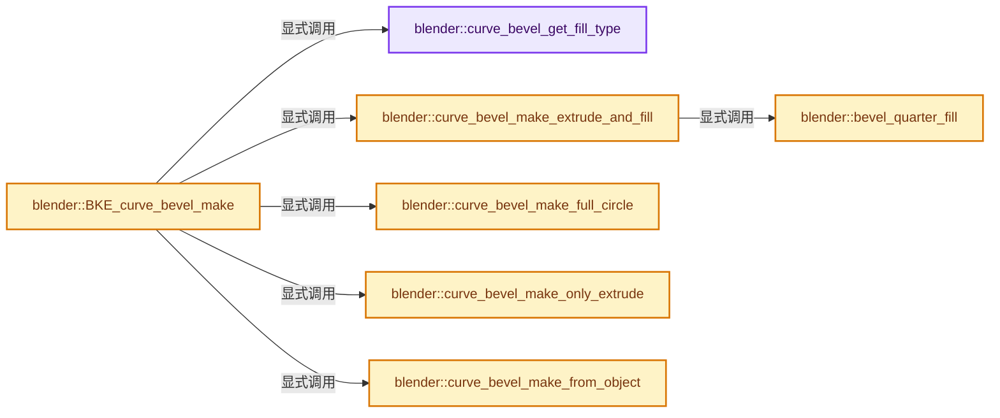
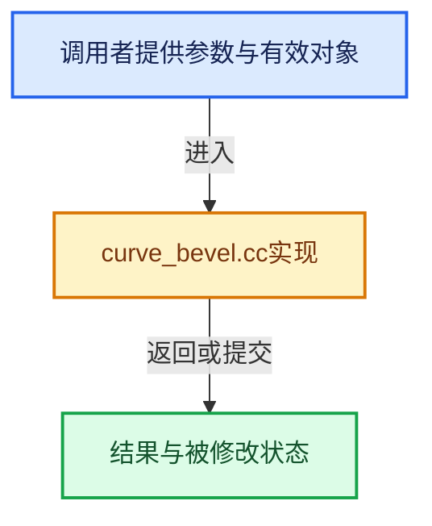

# 实现依赖专题：source/blender/blenkernel/intern/curve_bevel.cc

[方向导航](README.md) · [符号索引](../%E7%AC%A6%E5%8F%B7%E4%BE%9D%E8%B5%96%E4%B8%8E%E5%AE%9E%E7%8E%B0%E7%B4%A2%E5%BC%95.md)

本专题从正文实际调用进入，集中保存共享实现。函数有稳定锚点，可从调用处直接跳到对应完整函数；递归与互相调用通过回链组织。

## 本文件的实现关系






## 完整成员与函数实现

<a id="f-f05a151d4609299e"></a>

### `blender::curve_bevel_get_fill_type`

实现位置：[source/blender/blenkernel/intern/curve_bevel.cc](../../../../../source/blender/blenkernel/intern/curve_bevel.cc) · L36—L46。

接口参数：

- `const Curve *curve`

**教学注释版**

<!-- annotated:b981f2c1070dbc -->

```cpp
static CurveBevelFillType curve_bevel_get_fill_type(const Curve *curve)
{
  if (!(curve->flag & (CU_FRONT | CU_BACK))) {
    return FULL;
  }
  if ((curve->flag & CU_FRONT) && (curve->flag & CU_BACK)) {
    return HALF;
  }

  return (curve->flag & CU_FRONT) ? FRONT : BACK;
}
```

<details>
<summary>核对原始源码：source/blender/blenkernel/intern/curve_bevel.cc · L36—L46</summary>

<!-- original:b981f2c1070dbc:source/blender/blenkernel/intern/curve_bevel.cc:36:46 -->

```cpp
static CurveBevelFillType curve_bevel_get_fill_type(const Curve *curve)
{
  if (!(curve->flag & (CU_FRONT | CU_BACK))) {
    return FULL;
  }
  if ((curve->flag & CU_FRONT) && (curve->flag & CU_BACK)) {
    return HALF;
  }

  return (curve->flag & CU_FRONT) ? FRONT : BACK;
}
```

</details>

**结果出口**

- `return FULL;`
- `return HALF;`
- `return (curve->flag & CU_FRONT) ? FRONT : BACK;`

**继续追踪实现**

本实现没有需要继续展开的显式调用；检查返回表达式、对象转换和调用者前置条件。

<a id="f-3af9ea847ac8643e"></a>

### `blender::bevel_quarter_fill`

实现位置：[source/blender/blenkernel/intern/curve_bevel.cc](../../../../../source/blender/blenkernel/intern/curve_bevel.cc) · L48—L75。

接口参数：

- `const Curve *curve`
- `float *quarter_coords_x`
- `float *quarter_coords_y`

**教学注释版**

<!-- annotated:5818e8b0c88b95 -->

```cpp
static void bevel_quarter_fill(const Curve *curve,
                               float *quarter_coords_x,
                               float *quarter_coords_y)
{
  if (curve->bevel_mode == CU_BEV_MODE_ROUND) {
    float angle = 0.0f;
    const float dangle = float(M_PI_2) / (curve->bevresol + 1);
    for (int i = 0; i < curve->bevresol + 1; i++) {
      quarter_coords_x[i] = float(cosf(angle) * (curve->bevel_radius));
      quarter_coords_y[i] = float(sinf(angle) * (curve->bevel_radius));
      angle += dangle;
    }
  }
  else {
    /* The curve profile evaluation should be done when the resolution is set. */
    BLI_assert(curve->bevel_profile->segments != nullptr);
    BLI_assert(curve->bevel_profile->segments_len == curve->bevresol + 1);

    /* If there aren't enough samples, the curveprofile won't
     * sample the start vertex, so set it manually instead. */
    quarter_coords_x[0] = curve->bevel_radius;
    quarter_coords_y[0] = 0.0f;
    for (int i = 1; i < curve->bevresol + 1; i++) {
      quarter_coords_x[i] = float(curve->bevel_profile->segments[i].x * (curve->bevel_radius));
      quarter_coords_y[i] = float(curve->bevel_profile->segments[i].y * (curve->bevel_radius));
    }
  }
}
```

<details>
<summary>核对原始源码：source/blender/blenkernel/intern/curve_bevel.cc · L48—L75</summary>

<!-- original:5818e8b0c88b95:source/blender/blenkernel/intern/curve_bevel.cc:48:75 -->

```cpp
static void bevel_quarter_fill(const Curve *curve,
                               float *quarter_coords_x,
                               float *quarter_coords_y)
{
  if (curve->bevel_mode == CU_BEV_MODE_ROUND) {
    float angle = 0.0f;
    const float dangle = float(M_PI_2) / (curve->bevresol + 1);
    for (int i = 0; i < curve->bevresol + 1; i++) {
      quarter_coords_x[i] = float(cosf(angle) * (curve->bevel_radius));
      quarter_coords_y[i] = float(sinf(angle) * (curve->bevel_radius));
      angle += dangle;
    }
  }
  else {
    /* The curve profile evaluation should be done when the resolution is set. */
    BLI_assert(curve->bevel_profile->segments != nullptr);
    BLI_assert(curve->bevel_profile->segments_len == curve->bevresol + 1);

    /* If there aren't enough samples, the curveprofile won't
     * sample the start vertex, so set it manually instead. */
    quarter_coords_x[0] = curve->bevel_radius;
    quarter_coords_y[0] = 0.0f;
    for (int i = 1; i < curve->bevresol + 1; i++) {
      quarter_coords_x[i] = float(curve->bevel_profile->segments[i].x * (curve->bevel_radius));
      quarter_coords_y[i] = float(curve->bevel_profile->segments[i].y * (curve->bevel_radius));
    }
  }
}
```

</details>

**沿实际写入检查状态**

- `quarter_coords_x[i] = float(cosf(angle) * (curve->bevel_radius));`
- `quarter_coords_y[i] = float(sinf(angle) * (curve->bevel_radius));`
- `angle += dangle;`
- `quarter_coords_x[0] = curve->bevel_radius;`
- `quarter_coords_y[0] = 0.0f;`
- `quarter_coords_x[i] = float(curve->bevel_profile->segments[i].x * (curve->bevel_radius));`
- `quarter_coords_y[i] = float(curve->bevel_profile->segments[i].y * (curve->bevel_radius));`

**继续追踪实现**

- `cosf` → [cosf · L20](%E4%BE%9D%E8%B5%96-radial_tiling_shared-98abf9.md#m-cee9ebf67d86)；[cosf · L42](%E4%BE%9D%E8%B5%96-radial_tiling_shared-98abf9.md#m-346533627567)；[cosf · L73](%E4%BE%9D%E8%B5%96-radial_tiling_shared-98abf9.md#m-e01b94a43b72)；[cosf · L24](../01-%E5%9F%BA%E7%A1%80%E5%AE%B9%E5%99%A8%E4%B8%8E%E7%8E%B0%E4%BB%A3CPP/%E4%BE%9D%E8%B5%96-radial_tiling_shared-7989a4.md#m-c317cb08dec6)；[cosf · L46](../01-%E5%9F%BA%E7%A1%80%E5%AE%B9%E5%99%A8%E4%B8%8E%E7%8E%B0%E4%BB%A3CPP/%E4%BE%9D%E8%B5%96-radial_tiling_shared-7989a4.md#m-93325b515297)；[cosf · L77](../01-%E5%9F%BA%E7%A1%80%E5%AE%B9%E5%99%A8%E4%B8%8E%E7%8E%B0%E4%BB%A3CPP/%E4%BE%9D%E8%B5%96-radial_tiling_shared-7989a4.md#m-d3058af0b490)；[cosf · L20](%E4%BE%9D%E8%B5%96-node_radial_tiling_shared-b14bc2.md#m-4c6aea22a560)；[cosf · L42](%E4%BE%9D%E8%B5%96-node_radial_tiling_shared-b14bc2.md#m-1fd6a5414477)；[cosf · L73](%E4%BE%9D%E8%B5%96-node_radial_tiling_shared-b14bc2.md#m-de2402f85270)；[cosf · L186](%E4%BE%9D%E8%B5%96-compat-56205c.md#m-7fdbd99009e0)；[cosf · L288](%E4%BE%9D%E8%B5%96-compat-efe0e9.md#m-68fe984e8b68)；[cosf · L93](%E4%BE%9D%E8%B5%96-compat-9e0a25.md#m-21bb557a23f1)；[cosf · L91](%E4%BE%9D%E8%B5%96-compat-e9eab7.md#m-7721be419a49)；[cosf · L43](%E4%BE%9D%E8%B5%96-GPU_shader_shared_utils-0adda3.md#m-25d02fd11b3b)；[cosf · L64](%E4%BE%9D%E8%B5%96-GPU_shader_shared_utils-0adda3.md#m-698fc51ccda3)。宏定义由构建条件选择。
- `sinf` → [sinf · L27](%E4%BE%9D%E8%B5%96-radial_tiling_shared-98abf9.md#m-40547e913688)；[sinf · L49](%E4%BE%9D%E8%B5%96-radial_tiling_shared-98abf9.md#m-8908e5f49833)；[sinf · L80](%E4%BE%9D%E8%B5%96-radial_tiling_shared-98abf9.md#m-71130f6adcc4)；[sinf · L31](../01-%E5%9F%BA%E7%A1%80%E5%AE%B9%E5%99%A8%E4%B8%8E%E7%8E%B0%E4%BB%A3CPP/%E4%BE%9D%E8%B5%96-radial_tiling_shared-7989a4.md#m-a51a6c88deca)；[sinf · L53](../01-%E5%9F%BA%E7%A1%80%E5%AE%B9%E5%99%A8%E4%B8%8E%E7%8E%B0%E4%BB%A3CPP/%E4%BE%9D%E8%B5%96-radial_tiling_shared-7989a4.md#m-9a4db95358ff)；[sinf · L84](../01-%E5%9F%BA%E7%A1%80%E5%AE%B9%E5%99%A8%E4%B8%8E%E7%8E%B0%E4%BB%A3CPP/%E4%BE%9D%E8%B5%96-radial_tiling_shared-7989a4.md#m-d26cdafe5b93)；[sinf · L27](%E4%BE%9D%E8%B5%96-node_radial_tiling_shared-b14bc2.md#m-9f80b4d363af)；[sinf · L49](%E4%BE%9D%E8%B5%96-node_radial_tiling_shared-b14bc2.md#m-f52c29b37ed1)；[sinf · L80](%E4%BE%9D%E8%B5%96-node_radial_tiling_shared-b14bc2.md#m-7f1f234ef9ec)；[sinf · L187](%E4%BE%9D%E8%B5%96-compat-56205c.md#m-aab07e522dda)；[sinf · L287](%E4%BE%9D%E8%B5%96-compat-efe0e9.md#m-7009b99c07ca)；[sinf · L94](%E4%BE%9D%E8%B5%96-compat-9e0a25.md#m-4a1f5d760325)；[sinf · L92](%E4%BE%9D%E8%B5%96-compat-e9eab7.md#m-e63872738f13)；[sinf · L44](%E4%BE%9D%E8%B5%96-GPU_shader_shared_utils-0adda3.md#m-a916f31e38c4)；[sinf · L65](%E4%BE%9D%E8%B5%96-GPU_shader_shared_utils-0adda3.md#m-268edbf6d41e)。宏定义由构建条件选择。
- `BLI_assert` → [BLI_assert · L48](../01-%E5%9F%BA%E7%A1%80%E5%AE%B9%E5%99%A8%E4%B8%8E%E7%8E%B0%E4%BB%A3CPP/%E4%BE%9D%E8%B5%96-BLI_assert-cc98e8.md#m-57a88495704d)；[BLI_assert · L63](../01-%E5%9F%BA%E7%A1%80%E5%AE%B9%E5%99%A8%E4%B8%8E%E7%8E%B0%E4%BB%A3CPP/%E4%BE%9D%E8%B5%96-BLI_assert-cc98e8.md#m-d07050020cb5)。宏定义由构建条件选择。

<a id="f-5769327164b97584"></a>

### `blender::curve_bevel_make_extrude_and_fill`

实现位置：[source/blender/blenkernel/intern/curve_bevel.cc](../../../../../source/blender/blenkernel/intern/curve_bevel.cc) · L77—L185。

接口参数：

- `const Curve *cu`
- `ListBaseT<DispList> *disp`
- `const bool use_extrude`
- `const CurveBevelFillType fill_type`

**教学注释版**

<!-- annotated:d27aa3875a6934 -->

```cpp
static void curve_bevel_make_extrude_and_fill(const Curve *cu,
                                              ListBaseT<DispList> *disp,
                                              const bool use_extrude,
                                              const CurveBevelFillType fill_type)
{
  DispList *dl = MEM_new_zeroed<DispList>(__func__);

  /* Calculate the profile of the bevel once to reuse it for each quarter. We will need
   * to flip around the indices for every other section in order to build around the circle
   * in a consistent direction.
   *
   * These should be small enough for stack allocations because the current limit
   * for #Curve.bevresol is 32. */
  float *quarter_coords_x = static_cast<float *>(alloca(sizeof(float) * (cu->bevresol + 1)));
  float *quarter_coords_y = static_cast<float *>(alloca(sizeof(float) * (cu->bevresol + 1)));
  bevel_quarter_fill(cu, quarter_coords_x, quarter_coords_y);

  int nr;
  if (fill_type == FULL) {
    /* The full loop. */
    nr = 4 * cu->bevresol + (use_extrude ? 6 : 4);
    dl->flag = DL_FRONT_CURVE | DL_BACK_CURVE;
  }
  else if (fill_type == HALF) {
    /* Half the loop. */
    nr = 2 * (cu->bevresol + 1) + (use_extrude ? 2 : 1);
    dl->flag = DL_FRONT_CURVE | DL_BACK_CURVE;
  }
  else {
    /* One quarter of the loop (just front or back). */
    nr = use_extrude ? cu->bevresol + 3 : cu->bevresol + 2;
    dl->flag = (fill_type == FRONT) ? DL_FRONT_CURVE : DL_BACK_CURVE;
  }

  dl->verts = MEM_new_array_uninitialized<float>(3 * size_t(nr), __func__);
  BLI_addtail(disp, dl);
  /* Use a different type depending on whether the loop is complete or not. */
  dl->type = (fill_type == FULL) ? DL_POLY : DL_SEGM;
  dl->parts = 1;
  dl->nr = nr;

  float *fp = dl->verts;

  /* Build the back section. */
  if (ELEM(fill_type, BACK, HALF, FULL)) {
    /* Add the bottom vertex. */
    fp[0] = 0.0f;
    fp[1] = 0.0f;
    fp[2] = -cu->extrude - cu->bevel_radius;
    fp += 3;

    for (int i = cu->bevresol; i >= 0; i--) {
      fp[0] = 0.0f;
      fp[1] = quarter_coords_x[i];
      fp[2] = -quarter_coords_y[i] - cu->extrude;
      fp += 3;
    }
  }

  /* Add the extrusion if we're only building either the back or the front. */
  if (use_extrude && ELEM(fill_type, FRONT, BACK)) {
    fp[0] = 0.0f;
    fp[1] = cu->bevel_radius;
    fp[2] = (fill_type == FRONT) ? -cu->extrude : cu->extrude;
    fp += 3;
  }

  /* Build the front section. */
  if (ELEM(fill_type, FRONT, HALF, FULL)) {
    /* Don't duplicate the last back vertex. */
    const int front_start = (!use_extrude && ELEM(fill_type, HALF, FULL)) ? 1 : 0;
    for (int i = front_start; i < cu->bevresol + 1; i++) {
      fp[0] = 0.0f;
      fp[1] = quarter_coords_x[i];
      fp[2] = quarter_coords_y[i] + cu->extrude;
      fp += 3;
    }
    /* Add the top vertex. */
    fp[0] = 0.0f;
    fp[1] = 0.0f;
    fp[2] = cu->extrude + cu->bevel_radius;
    fp += 3;
  }

  /* Build the other half only if we're building the full loop. */
  if (fill_type == FULL) {
    for (int i = cu->bevresol; i > 0; i--) {
      fp[0] = 0.0f;
      fp[1] = -quarter_coords_x[i];
      fp[2] = quarter_coords_y[i] + cu->extrude;
      fp += 3;
    }

    if (use_extrude) {
      /* Add the extrusion. */
      fp[0] = 0.0f;
      fp[1] = -cu->bevel_radius;
      fp[2] = cu->extrude;
      fp += 3;
    }

    for (int i = 0; i < cu->bevresol + 1; i++) {
      fp[0] = 0.0f;
      fp[1] = -quarter_coords_x[i];
      fp[2] = -quarter_coords_y[i] - cu->extrude;
      fp += 3;
    }
  }
}
```

<details>
<summary>核对原始源码：source/blender/blenkernel/intern/curve_bevel.cc · L77—L185</summary>

<!-- original:d27aa3875a6934:source/blender/blenkernel/intern/curve_bevel.cc:77:185 -->

```cpp
static void curve_bevel_make_extrude_and_fill(const Curve *cu,
                                              ListBaseT<DispList> *disp,
                                              const bool use_extrude,
                                              const CurveBevelFillType fill_type)
{
  DispList *dl = MEM_new_zeroed<DispList>(__func__);

  /* Calculate the profile of the bevel once to reuse it for each quarter. We will need
   * to flip around the indices for every other section in order to build around the circle
   * in a consistent direction.
   *
   * These should be small enough for stack allocations because the current limit
   * for #Curve.bevresol is 32. */
  float *quarter_coords_x = static_cast<float *>(alloca(sizeof(float) * (cu->bevresol + 1)));
  float *quarter_coords_y = static_cast<float *>(alloca(sizeof(float) * (cu->bevresol + 1)));
  bevel_quarter_fill(cu, quarter_coords_x, quarter_coords_y);

  int nr;
  if (fill_type == FULL) {
    /* The full loop. */
    nr = 4 * cu->bevresol + (use_extrude ? 6 : 4);
    dl->flag = DL_FRONT_CURVE | DL_BACK_CURVE;
  }
  else if (fill_type == HALF) {
    /* Half the loop. */
    nr = 2 * (cu->bevresol + 1) + (use_extrude ? 2 : 1);
    dl->flag = DL_FRONT_CURVE | DL_BACK_CURVE;
  }
  else {
    /* One quarter of the loop (just front or back). */
    nr = use_extrude ? cu->bevresol + 3 : cu->bevresol + 2;
    dl->flag = (fill_type == FRONT) ? DL_FRONT_CURVE : DL_BACK_CURVE;
  }

  dl->verts = MEM_new_array_uninitialized<float>(3 * size_t(nr), __func__);
  BLI_addtail(disp, dl);
  /* Use a different type depending on whether the loop is complete or not. */
  dl->type = (fill_type == FULL) ? DL_POLY : DL_SEGM;
  dl->parts = 1;
  dl->nr = nr;

  float *fp = dl->verts;

  /* Build the back section. */
  if (ELEM(fill_type, BACK, HALF, FULL)) {
    /* Add the bottom vertex. */
    fp[0] = 0.0f;
    fp[1] = 0.0f;
    fp[2] = -cu->extrude - cu->bevel_radius;
    fp += 3;

    for (int i = cu->bevresol; i >= 0; i--) {
      fp[0] = 0.0f;
      fp[1] = quarter_coords_x[i];
      fp[2] = -quarter_coords_y[i] - cu->extrude;
      fp += 3;
    }
  }

  /* Add the extrusion if we're only building either the back or the front. */
  if (use_extrude && ELEM(fill_type, FRONT, BACK)) {
    fp[0] = 0.0f;
    fp[1] = cu->bevel_radius;
    fp[2] = (fill_type == FRONT) ? -cu->extrude : cu->extrude;
    fp += 3;
  }

  /* Build the front section. */
  if (ELEM(fill_type, FRONT, HALF, FULL)) {
    /* Don't duplicate the last back vertex. */
    const int front_start = (!use_extrude && ELEM(fill_type, HALF, FULL)) ? 1 : 0;
    for (int i = front_start; i < cu->bevresol + 1; i++) {
      fp[0] = 0.0f;
      fp[1] = quarter_coords_x[i];
      fp[2] = quarter_coords_y[i] + cu->extrude;
      fp += 3;
    }
    /* Add the top vertex. */
    fp[0] = 0.0f;
    fp[1] = 0.0f;
    fp[2] = cu->extrude + cu->bevel_radius;
    fp += 3;
  }

  /* Build the other half only if we're building the full loop. */
  if (fill_type == FULL) {
    for (int i = cu->bevresol; i > 0; i--) {
      fp[0] = 0.0f;
      fp[1] = -quarter_coords_x[i];
      fp[2] = quarter_coords_y[i] + cu->extrude;
      fp += 3;
    }

    if (use_extrude) {
      /* Add the extrusion. */
      fp[0] = 0.0f;
      fp[1] = -cu->bevel_radius;
      fp[2] = cu->extrude;
      fp += 3;
    }

    for (int i = 0; i < cu->bevresol + 1; i++) {
      fp[0] = 0.0f;
      fp[1] = -quarter_coords_x[i];
      fp[2] = -quarter_coords_y[i] - cu->extrude;
      fp += 3;
    }
  }
}
```

</details>

**沿实际写入检查状态**

- `nr = 4 * cu->bevresol + (use_extrude ? 6 : 4);`
- `dl->flag = DL_FRONT_CURVE | DL_BACK_CURVE;`
- `nr = 2 * (cu->bevresol + 1) + (use_extrude ? 2 : 1);`
- `nr = use_extrude ? cu->bevresol + 3 : cu->bevresol + 2;`
- `dl->flag = (fill_type == FRONT) ? DL_FRONT_CURVE : DL_BACK_CURVE;`
- `dl->verts = MEM_new_array_uninitialized<float>(3 * size_t(nr), __func__);`
- `dl->type = (fill_type == FULL) ? DL_POLY : DL_SEGM;`
- `dl->parts = 1;`
- `dl->nr = nr;`
- `fp[0] = 0.0f;`
- `fp[1] = 0.0f;`
- `fp[2] = -cu->extrude - cu->bevel_radius;`
- `fp += 3;`
- `fp[1] = quarter_coords_x[i];`
- `fp[2] = -quarter_coords_y[i] - cu->extrude;`
- `fp[1] = cu->bevel_radius;`
- `fp[2] = (fill_type == FRONT) ? -cu->extrude : cu->extrude;`
- `fp[2] = quarter_coords_y[i] + cu->extrude;`
- `fp[2] = cu->extrude + cu->bevel_radius;`
- `fp[1] = -quarter_coords_x[i];`
- `fp[1] = -cu->bevel_radius;`
- `fp[2] = cu->extrude;`

**继续追踪实现**

- `MEM_new_zeroed<DispList>` → [MEM_new_zeroed · L550](../03-%E5%86%85%E5%AD%98%E5%88%86%E9%85%8D%E4%B8%8E%E8%BF%90%E8%A1%8C%E6%97%B6%E7%B1%BB%E5%9E%8B/%E4%BE%9D%E8%B5%96-MEM_guardedalloc-b54eca.md#f-eeb1e2a7f57dd231)；[MEM_new_zeroed · L114](../03-%E5%86%85%E5%AD%98%E5%88%86%E9%85%8D%E4%B8%8E%E8%BF%90%E8%A1%8C%E6%97%B6%E7%B1%BB%E5%9E%8B/%E4%BE%9D%E8%B5%96-mallocn-afdcd4.md#f-e04cf01c64c8b180)。同名重载需按实参类型选择。
- `alloca` → [alloca · L19](../01-%E5%9F%BA%E7%A1%80%E5%AE%B9%E5%99%A8%E4%B8%8E%E7%8E%B0%E4%BB%A3CPP/%E4%BE%9D%E8%B5%96-BLI_compiler_compat-2153af.md#m-3f4c0afdcf42)。宏定义由构建条件选择。
- `bevel_quarter_fill` → [blender::bevel_quarter_fill · L48](%E4%BE%9D%E8%B5%96-curve_bevel-a226b9.md#f-3af9ea847ac8643e)。
- `MEM_new_array_uninitialized<float>` → [MEM_new_array_uninitialized · L608](../03-%E5%86%85%E5%AD%98%E5%88%86%E9%85%8D%E4%B8%8E%E8%BF%90%E8%A1%8C%E6%97%B6%E7%B1%BB%E5%9E%8B/%E4%BE%9D%E8%B5%96-MEM_guardedalloc-b54eca.md#f-b7103eae8eb57b05)；[MEM_new_array_uninitialized · L129](../03-%E5%86%85%E5%AD%98%E5%88%86%E9%85%8D%E4%B8%8E%E8%BF%90%E8%A1%8C%E6%97%B6%E7%B1%BB%E5%9E%8B/%E4%BE%9D%E8%B5%96-mallocn-afdcd4.md#f-bf6ef4ddcfb6e5df)。同名重载需按实参类型选择。
- `BLI_addtail` → [blender::BLI_addtail · L118](../01-%E5%9F%BA%E7%A1%80%E5%AE%B9%E5%99%A8%E4%B8%8E%E7%8E%B0%E4%BB%A3CPP/%E4%BE%9D%E8%B5%96-listbase-2816d9.md#f-4fb027713fa3115b)。
- `ELEM` → [ELEM · L88](%E4%BE%9D%E8%B5%96-GHOST_utildefines-34b996.md#m-d28724a15928)；[ELEM · L135](../01-%E5%9F%BA%E7%A1%80%E5%AE%B9%E5%99%A8%E4%B8%8E%E7%8E%B0%E4%BB%A3CPP/%E4%BE%9D%E8%B5%96-BLI_utildefines-293a0a.md#m-d6572de7cae0)。宏定义由构建条件选择。

<a id="f-16daa074098ab604"></a>

### `blender::curve_bevel_make_full_circle`

实现位置：[source/blender/blenkernel/intern/curve_bevel.cc](../../../../../source/blender/blenkernel/intern/curve_bevel.cc) · L187—L210。

接口参数：

- `const Curve *cu`
- `ListBaseT<DispList> *disp`

**教学注释版**

<!-- annotated:7d37ebd2ce415c -->

```cpp
static void curve_bevel_make_full_circle(const Curve *cu, ListBaseT<DispList> *disp)
{
  const int nr = 4 + 2 * cu->bevresol;

  DispList *dl = MEM_new_zeroed<DispList>(__func__);
  dl->verts = MEM_new_array_uninitialized<float>(3 * size_t(nr), __func__);
  BLI_addtail(disp, dl);
  dl->type = DL_POLY;
  dl->parts = 1;
  dl->flag = DL_BACK_CURVE;
  dl->nr = nr;

  float *fp = dl->verts;
  const float dangle = (2.0f * float(M_PI) / (nr));
  float angle = -(nr - 1) * dangle;

  for (int i = 0; i < nr; i++) {
    fp[0] = 0.0;
    fp[1] = (cosf(angle) * (cu->bevel_radius));
    fp[2] = (sinf(angle) * (cu->bevel_radius)) - cu->extrude;
    angle += dangle;
    fp += 3;
  }
}
```

<details>
<summary>核对原始源码：source/blender/blenkernel/intern/curve_bevel.cc · L187—L210</summary>

<!-- original:7d37ebd2ce415c:source/blender/blenkernel/intern/curve_bevel.cc:187:210 -->

```cpp
static void curve_bevel_make_full_circle(const Curve *cu, ListBaseT<DispList> *disp)
{
  const int nr = 4 + 2 * cu->bevresol;

  DispList *dl = MEM_new_zeroed<DispList>(__func__);
  dl->verts = MEM_new_array_uninitialized<float>(3 * size_t(nr), __func__);
  BLI_addtail(disp, dl);
  dl->type = DL_POLY;
  dl->parts = 1;
  dl->flag = DL_BACK_CURVE;
  dl->nr = nr;

  float *fp = dl->verts;
  const float dangle = (2.0f * float(M_PI) / (nr));
  float angle = -(nr - 1) * dangle;

  for (int i = 0; i < nr; i++) {
    fp[0] = 0.0;
    fp[1] = (cosf(angle) * (cu->bevel_radius));
    fp[2] = (sinf(angle) * (cu->bevel_radius)) - cu->extrude;
    angle += dangle;
    fp += 3;
  }
}
```

</details>

**沿实际写入检查状态**

- `dl->verts = MEM_new_array_uninitialized<float>(3 * size_t(nr), __func__);`
- `dl->type = DL_POLY;`
- `dl->parts = 1;`
- `dl->flag = DL_BACK_CURVE;`
- `dl->nr = nr;`
- `fp[0] = 0.0;`
- `fp[1] = (cosf(angle) * (cu->bevel_radius));`
- `fp[2] = (sinf(angle) * (cu->bevel_radius)) - cu->extrude;`
- `angle += dangle;`
- `fp += 3;`

**继续追踪实现**

- `MEM_new_zeroed<DispList>` → [MEM_new_zeroed · L550](../03-%E5%86%85%E5%AD%98%E5%88%86%E9%85%8D%E4%B8%8E%E8%BF%90%E8%A1%8C%E6%97%B6%E7%B1%BB%E5%9E%8B/%E4%BE%9D%E8%B5%96-MEM_guardedalloc-b54eca.md#f-eeb1e2a7f57dd231)；[MEM_new_zeroed · L114](../03-%E5%86%85%E5%AD%98%E5%88%86%E9%85%8D%E4%B8%8E%E8%BF%90%E8%A1%8C%E6%97%B6%E7%B1%BB%E5%9E%8B/%E4%BE%9D%E8%B5%96-mallocn-afdcd4.md#f-e04cf01c64c8b180)。同名重载需按实参类型选择。
- `MEM_new_array_uninitialized<float>` → [MEM_new_array_uninitialized · L608](../03-%E5%86%85%E5%AD%98%E5%88%86%E9%85%8D%E4%B8%8E%E8%BF%90%E8%A1%8C%E6%97%B6%E7%B1%BB%E5%9E%8B/%E4%BE%9D%E8%B5%96-MEM_guardedalloc-b54eca.md#f-b7103eae8eb57b05)；[MEM_new_array_uninitialized · L129](../03-%E5%86%85%E5%AD%98%E5%88%86%E9%85%8D%E4%B8%8E%E8%BF%90%E8%A1%8C%E6%97%B6%E7%B1%BB%E5%9E%8B/%E4%BE%9D%E8%B5%96-mallocn-afdcd4.md#f-bf6ef4ddcfb6e5df)。同名重载需按实参类型选择。
- `BLI_addtail` → [blender::BLI_addtail · L118](../01-%E5%9F%BA%E7%A1%80%E5%AE%B9%E5%99%A8%E4%B8%8E%E7%8E%B0%E4%BB%A3CPP/%E4%BE%9D%E8%B5%96-listbase-2816d9.md#f-4fb027713fa3115b)。
- `cosf` → [cosf · L20](%E4%BE%9D%E8%B5%96-radial_tiling_shared-98abf9.md#m-cee9ebf67d86)；[cosf · L42](%E4%BE%9D%E8%B5%96-radial_tiling_shared-98abf9.md#m-346533627567)；[cosf · L73](%E4%BE%9D%E8%B5%96-radial_tiling_shared-98abf9.md#m-e01b94a43b72)；[cosf · L24](../01-%E5%9F%BA%E7%A1%80%E5%AE%B9%E5%99%A8%E4%B8%8E%E7%8E%B0%E4%BB%A3CPP/%E4%BE%9D%E8%B5%96-radial_tiling_shared-7989a4.md#m-c317cb08dec6)；[cosf · L46](../01-%E5%9F%BA%E7%A1%80%E5%AE%B9%E5%99%A8%E4%B8%8E%E7%8E%B0%E4%BB%A3CPP/%E4%BE%9D%E8%B5%96-radial_tiling_shared-7989a4.md#m-93325b515297)；[cosf · L77](../01-%E5%9F%BA%E7%A1%80%E5%AE%B9%E5%99%A8%E4%B8%8E%E7%8E%B0%E4%BB%A3CPP/%E4%BE%9D%E8%B5%96-radial_tiling_shared-7989a4.md#m-d3058af0b490)；[cosf · L20](%E4%BE%9D%E8%B5%96-node_radial_tiling_shared-b14bc2.md#m-4c6aea22a560)；[cosf · L42](%E4%BE%9D%E8%B5%96-node_radial_tiling_shared-b14bc2.md#m-1fd6a5414477)；[cosf · L73](%E4%BE%9D%E8%B5%96-node_radial_tiling_shared-b14bc2.md#m-de2402f85270)；[cosf · L186](%E4%BE%9D%E8%B5%96-compat-56205c.md#m-7fdbd99009e0)；[cosf · L288](%E4%BE%9D%E8%B5%96-compat-efe0e9.md#m-68fe984e8b68)；[cosf · L93](%E4%BE%9D%E8%B5%96-compat-9e0a25.md#m-21bb557a23f1)；[cosf · L91](%E4%BE%9D%E8%B5%96-compat-e9eab7.md#m-7721be419a49)；[cosf · L43](%E4%BE%9D%E8%B5%96-GPU_shader_shared_utils-0adda3.md#m-25d02fd11b3b)；[cosf · L64](%E4%BE%9D%E8%B5%96-GPU_shader_shared_utils-0adda3.md#m-698fc51ccda3)。宏定义由构建条件选择。
- `sinf` → [sinf · L27](%E4%BE%9D%E8%B5%96-radial_tiling_shared-98abf9.md#m-40547e913688)；[sinf · L49](%E4%BE%9D%E8%B5%96-radial_tiling_shared-98abf9.md#m-8908e5f49833)；[sinf · L80](%E4%BE%9D%E8%B5%96-radial_tiling_shared-98abf9.md#m-71130f6adcc4)；[sinf · L31](../01-%E5%9F%BA%E7%A1%80%E5%AE%B9%E5%99%A8%E4%B8%8E%E7%8E%B0%E4%BB%A3CPP/%E4%BE%9D%E8%B5%96-radial_tiling_shared-7989a4.md#m-a51a6c88deca)；[sinf · L53](../01-%E5%9F%BA%E7%A1%80%E5%AE%B9%E5%99%A8%E4%B8%8E%E7%8E%B0%E4%BB%A3CPP/%E4%BE%9D%E8%B5%96-radial_tiling_shared-7989a4.md#m-9a4db95358ff)；[sinf · L84](../01-%E5%9F%BA%E7%A1%80%E5%AE%B9%E5%99%A8%E4%B8%8E%E7%8E%B0%E4%BB%A3CPP/%E4%BE%9D%E8%B5%96-radial_tiling_shared-7989a4.md#m-d26cdafe5b93)；[sinf · L27](%E4%BE%9D%E8%B5%96-node_radial_tiling_shared-b14bc2.md#m-9f80b4d363af)；[sinf · L49](%E4%BE%9D%E8%B5%96-node_radial_tiling_shared-b14bc2.md#m-f52c29b37ed1)；[sinf · L80](%E4%BE%9D%E8%B5%96-node_radial_tiling_shared-b14bc2.md#m-7f1f234ef9ec)；[sinf · L187](%E4%BE%9D%E8%B5%96-compat-56205c.md#m-aab07e522dda)；[sinf · L287](%E4%BE%9D%E8%B5%96-compat-efe0e9.md#m-7009b99c07ca)；[sinf · L94](%E4%BE%9D%E8%B5%96-compat-9e0a25.md#m-4a1f5d760325)；[sinf · L92](%E4%BE%9D%E8%B5%96-compat-e9eab7.md#m-e63872738f13)；[sinf · L44](%E4%BE%9D%E8%B5%96-GPU_shader_shared_utils-0adda3.md#m-a916f31e38c4)；[sinf · L65](%E4%BE%9D%E8%B5%96-GPU_shader_shared_utils-0adda3.md#m-268edbf6d41e)。宏定义由构建条件选择。

<a id="f-89d0afa11429811a"></a>

### `blender::curve_bevel_make_only_extrude`

实现位置：[source/blender/blenkernel/intern/curve_bevel.cc](../../../../../source/blender/blenkernel/intern/curve_bevel.cc) · L212—L227。

接口参数：

- `const Curve *cu`
- `ListBaseT<DispList> *disp`

**教学注释版**

<!-- annotated:d07aa6b679101f -->

```cpp
static void curve_bevel_make_only_extrude(const Curve *cu, ListBaseT<DispList> *disp)
{
  DispList *dl = MEM_new_zeroed<DispList>(__func__);
  dl->verts = MEM_new_array_uninitialized<float>(3 * 2, __func__);
  BLI_addtail(disp, dl);
  dl->type = DL_SEGM;
  dl->parts = 1;
  dl->flag = DL_FRONT_CURVE | DL_BACK_CURVE;
  dl->nr = 2;

  float *fp = dl->verts;
  fp[0] = fp[1] = 0.0;
  fp[2] = -cu->extrude;
  fp[3] = fp[4] = 0.0;
  fp[5] = cu->extrude;
}
```

<details>
<summary>核对原始源码：source/blender/blenkernel/intern/curve_bevel.cc · L212—L227</summary>

<!-- original:d07aa6b679101f:source/blender/blenkernel/intern/curve_bevel.cc:212:227 -->

```cpp
static void curve_bevel_make_only_extrude(const Curve *cu, ListBaseT<DispList> *disp)
{
  DispList *dl = MEM_new_zeroed<DispList>(__func__);
  dl->verts = MEM_new_array_uninitialized<float>(3 * 2, __func__);
  BLI_addtail(disp, dl);
  dl->type = DL_SEGM;
  dl->parts = 1;
  dl->flag = DL_FRONT_CURVE | DL_BACK_CURVE;
  dl->nr = 2;

  float *fp = dl->verts;
  fp[0] = fp[1] = 0.0;
  fp[2] = -cu->extrude;
  fp[3] = fp[4] = 0.0;
  fp[5] = cu->extrude;
}
```

</details>

**沿实际写入检查状态**

- `dl->verts = MEM_new_array_uninitialized<float>(3 * 2, __func__);`
- `dl->type = DL_SEGM;`
- `dl->parts = 1;`
- `dl->flag = DL_FRONT_CURVE | DL_BACK_CURVE;`
- `dl->nr = 2;`
- `fp[0] = fp[1] = 0.0;`
- `fp[2] = -cu->extrude;`
- `fp[3] = fp[4] = 0.0;`
- `fp[5] = cu->extrude;`

**继续追踪实现**

- `MEM_new_zeroed<DispList>` → [MEM_new_zeroed · L550](../03-%E5%86%85%E5%AD%98%E5%88%86%E9%85%8D%E4%B8%8E%E8%BF%90%E8%A1%8C%E6%97%B6%E7%B1%BB%E5%9E%8B/%E4%BE%9D%E8%B5%96-MEM_guardedalloc-b54eca.md#f-eeb1e2a7f57dd231)；[MEM_new_zeroed · L114](../03-%E5%86%85%E5%AD%98%E5%88%86%E9%85%8D%E4%B8%8E%E8%BF%90%E8%A1%8C%E6%97%B6%E7%B1%BB%E5%9E%8B/%E4%BE%9D%E8%B5%96-mallocn-afdcd4.md#f-e04cf01c64c8b180)。同名重载需按实参类型选择。
- `MEM_new_array_uninitialized<float>` → [MEM_new_array_uninitialized · L608](../03-%E5%86%85%E5%AD%98%E5%88%86%E9%85%8D%E4%B8%8E%E8%BF%90%E8%A1%8C%E6%97%B6%E7%B1%BB%E5%9E%8B/%E4%BE%9D%E8%B5%96-MEM_guardedalloc-b54eca.md#f-b7103eae8eb57b05)；[MEM_new_array_uninitialized · L129](../03-%E5%86%85%E5%AD%98%E5%88%86%E9%85%8D%E4%B8%8E%E8%BF%90%E8%A1%8C%E6%97%B6%E7%B1%BB%E5%9E%8B/%E4%BE%9D%E8%B5%96-mallocn-afdcd4.md#f-bf6ef4ddcfb6e5df)。同名重载需按实参类型选择。
- `BLI_addtail` → [blender::BLI_addtail · L118](../01-%E5%9F%BA%E7%A1%80%E5%AE%B9%E5%99%A8%E4%B8%8E%E7%8E%B0%E4%BB%A3CPP/%E4%BE%9D%E8%B5%96-listbase-2816d9.md#f-4fb027713fa3115b)。

<a id="f-42749b8bc0cb3cef"></a>

### `blender::curve_bevel_make_from_object`

实现位置：[source/blender/blenkernel/intern/curve_bevel.cc](../../../../../source/blender/blenkernel/intern/curve_bevel.cc) · L229—L280。

接口参数：

- `const Curve *cu`
- `ListBaseT<DispList> *disp`

**教学注释版**

<!-- annotated:c3bb60c1bd6047 -->

```cpp
static void curve_bevel_make_from_object(const Curve *cu, ListBaseT<DispList> *disp)
{
  if (cu->bevobj == nullptr) {
    return;
  }
  if (cu->bevobj->type != OB_CURVES_LEGACY) {
    return;
  }

  Curve *bevcu = id_cast<Curve *>(cu->bevobj->data);
  if (bevcu->extrude == 0.0f && bevcu->bevel_radius == 0.0f) {
    ListBaseT<DispList> bevdisp = {nullptr, nullptr};
    float facx = cu->bevobj->scale[0];
    float facy = cu->bevobj->scale[1];

    DispList *dl;
    if (cu->bevobj->runtime->curve_cache) {
      dl = cu->bevobj->runtime->curve_cache->disp.first();
    }
    else {
      BLI_assert(cu->bevobj->runtime->curve_cache != nullptr);
      dl = nullptr;
    }

    while (dl) {
      if (ELEM(dl->type, DL_POLY, DL_SEGM)) {
        DispList *dlnew = MEM_new_uninitialized<DispList>(__func__);
        *dlnew = *dl;
        dlnew->verts = MEM_new_array_uninitialized<float>(3 * size_t(dl->parts) * size_t(dl->nr),
                                                          __func__);
        // [讲解] memcpy：复制字节，源与目标不应重叠。类型生命周期、对齐和可复制表示须由调用者证明，不是任意对象的复制构造。
        memcpy(dlnew->verts, dl->verts, sizeof(float[3]) * dl->parts * dl->nr);

        if (dlnew->type == DL_SEGM) {
          dlnew->flag |= (DL_FRONT_CURVE | DL_BACK_CURVE);
        }

        BLI_addtail(disp, dlnew);
        float *fp = dlnew->verts;
        int nr = dlnew->parts * dlnew->nr;
        while (nr--) {
          fp[2] = fp[1] * facy;
          fp[1] = -fp[0] * facx;
          fp[0] = 0.0;
          fp += 3;
        }
      }
      dl = dl->next;
    }

    BKE_displist_free(&bevdisp);
  }
}
```

<details>
<summary>核对原始源码：source/blender/blenkernel/intern/curve_bevel.cc · L229—L280</summary>

<!-- original:c3bb60c1bd6047:source/blender/blenkernel/intern/curve_bevel.cc:229:280 -->

```cpp
static void curve_bevel_make_from_object(const Curve *cu, ListBaseT<DispList> *disp)
{
  if (cu->bevobj == nullptr) {
    return;
  }
  if (cu->bevobj->type != OB_CURVES_LEGACY) {
    return;
  }

  Curve *bevcu = id_cast<Curve *>(cu->bevobj->data);
  if (bevcu->extrude == 0.0f && bevcu->bevel_radius == 0.0f) {
    ListBaseT<DispList> bevdisp = {nullptr, nullptr};
    float facx = cu->bevobj->scale[0];
    float facy = cu->bevobj->scale[1];

    DispList *dl;
    if (cu->bevobj->runtime->curve_cache) {
      dl = cu->bevobj->runtime->curve_cache->disp.first();
    }
    else {
      BLI_assert(cu->bevobj->runtime->curve_cache != nullptr);
      dl = nullptr;
    }

    while (dl) {
      if (ELEM(dl->type, DL_POLY, DL_SEGM)) {
        DispList *dlnew = MEM_new_uninitialized<DispList>(__func__);
        *dlnew = *dl;
        dlnew->verts = MEM_new_array_uninitialized<float>(3 * size_t(dl->parts) * size_t(dl->nr),
                                                          __func__);
        memcpy(dlnew->verts, dl->verts, sizeof(float[3]) * dl->parts * dl->nr);

        if (dlnew->type == DL_SEGM) {
          dlnew->flag |= (DL_FRONT_CURVE | DL_BACK_CURVE);
        }

        BLI_addtail(disp, dlnew);
        float *fp = dlnew->verts;
        int nr = dlnew->parts * dlnew->nr;
        while (nr--) {
          fp[2] = fp[1] * facy;
          fp[1] = -fp[0] * facx;
          fp[0] = 0.0;
          fp += 3;
        }
      }
      dl = dl->next;
    }

    BKE_displist_free(&bevdisp);
  }
}
```

</details>

**沿实际写入检查状态**

- `dl = cu->bevobj->runtime->curve_cache->disp.first();`
- `dl = nullptr;`
- `dlnew->verts = MEM_new_array_uninitialized<float>(3 * size_t(dl->parts) * size_t(dl->nr),`
- `dlnew->flag |= (DL_FRONT_CURVE | DL_BACK_CURVE);`
- `fp[2] = fp[1] * facy;`
- `fp[1] = -fp[0] * facx;`
- `fp[0] = 0.0;`
- `fp += 3;`
- `dl = dl->next;`

**继续追踪实现**

- `id_cast<Curve *>` → [blender::id_cast · L1417](%E4%BE%9D%E8%B5%96-DNA_ID-3eb091.md#f-6c8ac6412850ac5a)。
- `cu->bevobj->runtime->curve_cache->disp.first` → [调用协议](../%E6%A8%A1%E6%9D%BF%E5%AE%8F%E4%B8%8E%E5%8A%A8%E6%80%81%E5%88%86%E6%B4%BE%E5%8D%8F%E8%AE%AE.md)：接收对象类型依赖auto、返回值或模板实例；不按同名猜测目标。调用位置L246。
- `BLI_assert` → [BLI_assert · L48](../01-%E5%9F%BA%E7%A1%80%E5%AE%B9%E5%99%A8%E4%B8%8E%E7%8E%B0%E4%BB%A3CPP/%E4%BE%9D%E8%B5%96-BLI_assert-cc98e8.md#m-57a88495704d)；[BLI_assert · L63](../01-%E5%9F%BA%E7%A1%80%E5%AE%B9%E5%99%A8%E4%B8%8E%E7%8E%B0%E4%BB%A3CPP/%E4%BE%9D%E8%B5%96-BLI_assert-cc98e8.md#m-d07050020cb5)。宏定义由构建条件选择。
- `ELEM` → [ELEM · L88](%E4%BE%9D%E8%B5%96-GHOST_utildefines-34b996.md#m-d28724a15928)；[ELEM · L135](../01-%E5%9F%BA%E7%A1%80%E5%AE%B9%E5%99%A8%E4%B8%8E%E7%8E%B0%E4%BB%A3CPP/%E4%BE%9D%E8%B5%96-BLI_utildefines-293a0a.md#m-d6572de7cae0)。宏定义由构建条件选择。
- `MEM_new_uninitialized<DispList>` → [MEM_new_uninitialized · L590](../03-%E5%86%85%E5%AD%98%E5%88%86%E9%85%8D%E4%B8%8E%E8%BF%90%E8%A1%8C%E6%97%B6%E7%B1%BB%E5%9E%8B/%E4%BE%9D%E8%B5%96-MEM_guardedalloc-b54eca.md#f-c773b2e5b8fe70e4)；[MEM_new_uninitialized · L124](../03-%E5%86%85%E5%AD%98%E5%88%86%E9%85%8D%E4%B8%8E%E8%BF%90%E8%A1%8C%E6%97%B6%E7%B1%BB%E5%9E%8B/%E4%BE%9D%E8%B5%96-mallocn-afdcd4.md#f-28a7e00a1e67f699)。同名重载需按实参类型选择。
- `MEM_new_array_uninitialized<float>` → [MEM_new_array_uninitialized · L608](../03-%E5%86%85%E5%AD%98%E5%88%86%E9%85%8D%E4%B8%8E%E8%BF%90%E8%A1%8C%E6%97%B6%E7%B1%BB%E5%9E%8B/%E4%BE%9D%E8%B5%96-MEM_guardedalloc-b54eca.md#f-b7103eae8eb57b05)；[MEM_new_array_uninitialized · L129](../03-%E5%86%85%E5%AD%98%E5%88%86%E9%85%8D%E4%B8%8E%E8%BF%90%E8%A1%8C%E6%97%B6%E7%B1%BB%E5%9E%8B/%E4%BE%9D%E8%B5%96-mallocn-afdcd4.md#f-bf6ef4ddcfb6e5df)。同名重载需按实参类型选择。
- `memcpy` → [外部契约](https://eel.is/c++draft/cstring.syn)：复制字节，源与目标不应重叠。类型生命周期、对齐和可复制表示须由调用者证明，不是任意对象的复制构造。
- `BLI_addtail` → [blender::BLI_addtail · L118](../01-%E5%9F%BA%E7%A1%80%E5%AE%B9%E5%99%A8%E4%B8%8E%E7%8E%B0%E4%BB%A3CPP/%E4%BE%9D%E8%B5%96-listbase-2816d9.md#f-4fb027713fa3115b)。
- `BKE_displist_free` → [blender::BKE_displist_free · L68](%E4%BE%9D%E8%B5%96-displist-7e6457.md#f-fe6903944ada1ff4)。

<a id="f-387fef87e7348cf6"></a>

### `blender::BKE_curve_bevel_make`

实现位置：[source/blender/blenkernel/intern/curve_bevel.cc](../../../../../source/blender/blenkernel/intern/curve_bevel.cc) · L282—L312。

接口参数：

- `const Curve *curve`

**教学注释版**

<!-- annotated:c9ce47e2ef88cf -->

```cpp
ListBaseT<DispList> BKE_curve_bevel_make(const Curve *curve)
{
  ListBaseT<DispList> bevel_shape = {nullptr, nullptr};

  if (curve->bevel_mode == CU_BEV_MODE_OBJECT) {
    if (curve->bevobj != nullptr) {
      curve_bevel_make_from_object(curve, &bevel_shape);
    }
  }
  else {
    const bool use_extrude = curve->extrude != 0.0f;
    const bool use_bevel = curve->bevel_radius != 0.0f;
    /* Pass. */
    if (use_extrude && !use_bevel) {
      curve_bevel_make_only_extrude(curve, &bevel_shape);
    }
    else if (use_extrude || use_bevel) {
      CurveBevelFillType fill_type = curve_bevel_get_fill_type(curve);

      if (!use_extrude && fill_type == FULL && curve->bevel_mode == CU_BEV_MODE_ROUND) {
        curve_bevel_make_full_circle(curve, &bevel_shape);
      }
      else {
        /* The general case for nonzero extrusion or an incomplete loop. */
        curve_bevel_make_extrude_and_fill(curve, &bevel_shape, use_extrude, fill_type);
      }
    }
  }

  return bevel_shape;
}
```

<details>
<summary>核对原始源码：source/blender/blenkernel/intern/curve_bevel.cc · L282—L312</summary>

<!-- original:c9ce47e2ef88cf:source/blender/blenkernel/intern/curve_bevel.cc:282:312 -->

```cpp
ListBaseT<DispList> BKE_curve_bevel_make(const Curve *curve)
{
  ListBaseT<DispList> bevel_shape = {nullptr, nullptr};

  if (curve->bevel_mode == CU_BEV_MODE_OBJECT) {
    if (curve->bevobj != nullptr) {
      curve_bevel_make_from_object(curve, &bevel_shape);
    }
  }
  else {
    const bool use_extrude = curve->extrude != 0.0f;
    const bool use_bevel = curve->bevel_radius != 0.0f;
    /* Pass. */
    if (use_extrude && !use_bevel) {
      curve_bevel_make_only_extrude(curve, &bevel_shape);
    }
    else if (use_extrude || use_bevel) {
      CurveBevelFillType fill_type = curve_bevel_get_fill_type(curve);

      if (!use_extrude && fill_type == FULL && curve->bevel_mode == CU_BEV_MODE_ROUND) {
        curve_bevel_make_full_circle(curve, &bevel_shape);
      }
      else {
        /* The general case for nonzero extrusion or an incomplete loop. */
        curve_bevel_make_extrude_and_fill(curve, &bevel_shape, use_extrude, fill_type);
      }
    }
  }

  return bevel_shape;
}
```

</details>

**结果出口**

- `return bevel_shape;`

**继续追踪实现**

- `curve_bevel_make_from_object` → [blender::curve_bevel_make_from_object · L229](%E4%BE%9D%E8%B5%96-curve_bevel-a226b9.md#f-42749b8bc0cb3cef)。
- `curve_bevel_make_only_extrude` → [blender::curve_bevel_make_only_extrude · L212](%E4%BE%9D%E8%B5%96-curve_bevel-a226b9.md#f-89d0afa11429811a)。
- `curve_bevel_get_fill_type` → [blender::curve_bevel_get_fill_type · L36](%E4%BE%9D%E8%B5%96-curve_bevel-a226b9.md#f-f05a151d4609299e)。
- `curve_bevel_make_full_circle` → [blender::curve_bevel_make_full_circle · L187](%E4%BE%9D%E8%B5%96-curve_bevel-a226b9.md#f-16daa074098ab604)。
- `curve_bevel_make_extrude_and_fill` → [blender::curve_bevel_make_extrude_and_fill · L77](%E4%BE%9D%E8%B5%96-curve_bevel-a226b9.md#f-5769327164b97584)。
