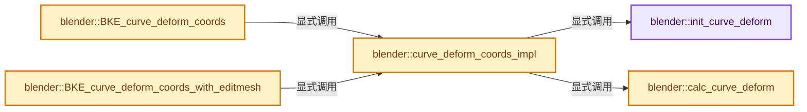
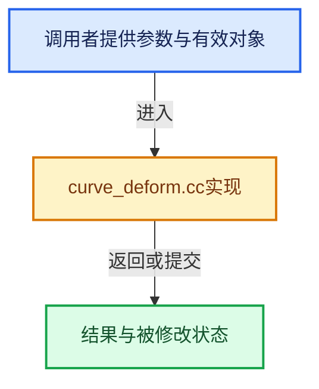

# 实现依赖专题：source/blender/blenkernel/intern/curve_deform.cc

[方向导航](README.md) · [符号索引](../%E7%AC%A6%E5%8F%B7%E4%BE%9D%E8%B5%96%E4%B8%8E%E5%AE%9E%E7%8E%B0%E7%B4%A2%E5%BC%95.md)

本专题从正文实际调用进入，集中保存共享实现。函数有稳定锚点，可从调用处直接跳到对应完整函数；递归与互相调用通过回链组织。

## 本文件的实现关系






## 完整成员与函数实现

<a id="f-68d0833da3596362"></a>

### `blender::init_curve_deform`

实现位置：[source/blender/blenkernel/intern/curve_deform.cc](../../../../../source/blender/blenkernel/intern/curve_deform.cc) · L47—L55。

接口参数：

- `const Object *ob_curve`
- `const Object *ob_target`
- `CurveDeform *cd`

**教学注释版**

<!-- annotated:7f114fd59ea107 -->

```cpp
static void init_curve_deform(const Object *ob_curve, const Object *ob_target, CurveDeform *cd)
{
  float imat[4][4];
  invert_m4_m4(imat, ob_target->object_to_world().ptr());
  mul_m4_m4m4(cd->objectspace, imat, ob_curve->object_to_world().ptr());
  invert_m4_m4(cd->curvespace, cd->objectspace);
  copy_m3_m4(cd->objectspace3, cd->objectspace);
  cd->no_rot_axis = 0;
}
```

<details>
<summary>核对原始源码：source/blender/blenkernel/intern/curve_deform.cc · L47—L55</summary>

<!-- original:7f114fd59ea107:source/blender/blenkernel/intern/curve_deform.cc:47:55 -->

```cpp
static void init_curve_deform(const Object *ob_curve, const Object *ob_target, CurveDeform *cd)
{
  float imat[4][4];
  invert_m4_m4(imat, ob_target->object_to_world().ptr());
  mul_m4_m4m4(cd->objectspace, imat, ob_curve->object_to_world().ptr());
  invert_m4_m4(cd->curvespace, cd->objectspace);
  copy_m3_m4(cd->objectspace3, cd->objectspace);
  cd->no_rot_axis = 0;
}
```

</details>

**沿实际写入检查状态**

- `cd->no_rot_axis = 0;`

**继续追踪实现**

- `invert_m4_m4` → [blender::invert_m4_m4 · L1150](../12-%E7%A9%BA%E9%97%B4%E6%95%B0%E6%8D%AE%E7%BB%93%E6%9E%84%E4%B8%8E%E5%87%A0%E4%BD%95%E7%AE%97%E6%B3%95/%E4%BE%9D%E8%B5%96-math_matrix_c-004123.md#f-c75789f10cdd5b92)。
- `ob_target->object_to_world().ptr` → [调用协议](../%E6%A8%A1%E6%9D%BF%E5%AE%8F%E4%B8%8E%E5%8A%A8%E6%80%81%E5%88%86%E6%B4%BE%E5%8D%8F%E8%AE%AE.md)：接收对象类型依赖auto、返回值或模板实例；不按同名猜测目标。调用位置L50。
- `ob_target->object_to_world` → [blender::Object::object_to_world · L5761](%E4%BE%9D%E8%B5%96-object-843689.md#f-12fc20026327d50c)。
- `mul_m4_m4m4` → [blender::mul_m4_m4m4 · L217](../12-%E7%A9%BA%E9%97%B4%E6%95%B0%E6%8D%AE%E7%BB%93%E6%9E%84%E4%B8%8E%E5%87%A0%E4%BD%95%E7%AE%97%E6%B3%95/%E4%BE%9D%E8%B5%96-math_matrix_c-004123.md#f-b5272136b543b73b)。
- `ob_curve->object_to_world().ptr` → [调用协议](../%E6%A8%A1%E6%9D%BF%E5%AE%8F%E4%B8%8E%E5%8A%A8%E6%80%81%E5%88%86%E6%B4%BE%E5%8D%8F%E8%AE%AE.md)：接收对象类型依赖auto、返回值或模板实例；不按同名猜测目标。调用位置L51。
- `ob_curve->object_to_world` → [blender::Object::object_to_world · L5761](%E4%BE%9D%E8%B5%96-object-843689.md#f-12fc20026327d50c)。
- `copy_m3_m4` → [blender::copy_m3_m4 · L94](../12-%E7%A9%BA%E9%97%B4%E6%95%B0%E6%8D%AE%E7%BB%93%E6%9E%84%E4%B8%8E%E5%87%A0%E4%BD%95%E7%AE%97%E6%B3%95/%E4%BE%9D%E8%B5%96-math_matrix_c-004123.md#f-1141cb3624c754b0)。

<a id="f-5bd0876078b34b76"></a>

### `blender::calc_curve_deform`

实现位置：[source/blender/blenkernel/intern/curve_deform.cc](../../../../../source/blender/blenkernel/intern/curve_deform.cc) · L64—L189。

接口参数：

- `const Object *ob_curve`
- `float co[3]`
- `const short axis`
- `const CurveDeform *cd`
- `float r_quat[4]`

**教学注释版**

<!-- annotated:6943f525d2bc1a -->

```cpp
static bool calc_curve_deform(
    const Object *ob_curve, float co[3], const short axis, const CurveDeform *cd, float r_quat[4])
{
  const Curve *cu = id_cast<const Curve *>(ob_curve->data);
  float fac, loc[4], dir[3], new_quat[4], radius;
  short index;
  const bool is_neg_axis = (axis > 2);

  if (ob_curve->runtime->curve_cache == nullptr) {
    /* Happens with a cyclic dependencies. */
    return false;
  }

  if (ob_curve->runtime->curve_cache->anim_path_accum_length == nullptr) {
    return false; /* happens on append, cyclic dependencies and empty curves */
  }

  /* options */
  if (is_neg_axis) {
    index = axis - 3;
    if (cu->flag & CU_STRETCH) {
      const float divisor = cd->dmax[index] - cd->dmin[index];
      if (divisor > FLT_EPSILON) [[likely]] {
        fac = -(co[index] - cd->dmax[index]) / divisor;
      }
      else {
        fac = 0.0f;
      }
    }
    else {
      const CurveCache *cc = ob_curve->runtime->curve_cache;
      float totdist = BKE_anim_path_get_length(cc);
      if (totdist > FLT_EPSILON) [[likely]] {
        fac = -(co[index] - cd->dmax[index]) / totdist;
      }
      else {
        fac = 0.0f;
      }
    }
  }
  else {
    index = axis;
    if (cu->flag & CU_STRETCH) {
      const float divisor = cd->dmax[index] - cd->dmin[index];
      if (divisor > FLT_EPSILON) [[likely]] {
        fac = (co[index] - cd->dmin[index]) / divisor;
      }
      else {
        fac = 0.0f;
      }
    }
    else {
      const CurveCache *cc = ob_curve->runtime->curve_cache;
      float totdist = BKE_anim_path_get_length(cc);
      if (totdist > FLT_EPSILON) [[likely]] {
        fac = +(co[index] - cd->dmin[index]) / totdist;
      }
      else {
        fac = 0.0f;
      }
    }
  }

  if (BKE_where_on_path(ob_curve, fac, loc, dir, new_quat, &radius, nullptr)) { /* returns OK */
    float quat[4], cent[3];

    if (cd->no_rot_axis) { /* set by caller */

      /* This is not exactly the same as 2.4x, since the axis is having rotation removed rather
       * than changing the axis before calculating the tilt but serves much the same purpose. */
      float dir_flat[3] = {0, 0, 0}, q[4];
      copy_v3_v3(dir_flat, dir);
      dir_flat[cd->no_rot_axis - 1] = 0.0f;

      normalize_v3(dir);
      normalize_v3(dir_flat);

      rotation_between_vecs_to_quat(q, dir, dir_flat); /* Could this be done faster? */

      mul_qt_qtqt(new_quat, q, new_quat);
    }

    /* Logic for 'cent' orientation *
     *
     * The way 'co' is copied to 'cent' may seem to have no meaning, but it does.
     *
     * Use a curve modifier to stretch a cube out, color each side RGB,
     * positive side light, negative dark.
     * view with X up (default), from the angle that you can see 3 faces RGB colors (light),
     * anti-clockwise
     * Notice X,Y,Z Up all have light colors and each ordered CCW.
     *
     * Now for Neg Up XYZ, the colors are all dark, and ordered clockwise - Campbell
     *
     * NOTE: moved functions into quat_apply_track/vec_apply_track
     */
    copy_qt_qt(quat, new_quat);
    copy_v3_v3(cent, co);

    /* Zero the axis which is not used,
     * the big block of text above now applies to these 3 lines.
     * The `upflag` argument may be a dummy, set so no rotation is done. */
    quat_apply_track(quat, axis, ELEM(axis, 0, 2) ? 1 : 0);
    vec_apply_track(cent, axis);
    cent[index] = 0.0f;

    /* scale if enabled */
    if (cu->flag & CU_PATH_RADIUS) {
      mul_v3_fl(cent, radius);
    }

    /* local rotation */
    normalize_qt(quat);
    mul_qt_v3(quat, cent);

    /* translation */
    add_v3_v3v3(co, cent, loc);

    if (r_quat) {
      copy_qt_qt(r_quat, quat);
    }

    return true;
  }
  return false;
}
```

<details>
<summary>核对原始源码：source/blender/blenkernel/intern/curve_deform.cc · L64—L189</summary>

<!-- original:6943f525d2bc1a:source/blender/blenkernel/intern/curve_deform.cc:64:189 -->

```cpp
static bool calc_curve_deform(
    const Object *ob_curve, float co[3], const short axis, const CurveDeform *cd, float r_quat[4])
{
  const Curve *cu = id_cast<const Curve *>(ob_curve->data);
  float fac, loc[4], dir[3], new_quat[4], radius;
  short index;
  const bool is_neg_axis = (axis > 2);

  if (ob_curve->runtime->curve_cache == nullptr) {
    /* Happens with a cyclic dependencies. */
    return false;
  }

  if (ob_curve->runtime->curve_cache->anim_path_accum_length == nullptr) {
    return false; /* happens on append, cyclic dependencies and empty curves */
  }

  /* options */
  if (is_neg_axis) {
    index = axis - 3;
    if (cu->flag & CU_STRETCH) {
      const float divisor = cd->dmax[index] - cd->dmin[index];
      if (divisor > FLT_EPSILON) [[likely]] {
        fac = -(co[index] - cd->dmax[index]) / divisor;
      }
      else {
        fac = 0.0f;
      }
    }
    else {
      const CurveCache *cc = ob_curve->runtime->curve_cache;
      float totdist = BKE_anim_path_get_length(cc);
      if (totdist > FLT_EPSILON) [[likely]] {
        fac = -(co[index] - cd->dmax[index]) / totdist;
      }
      else {
        fac = 0.0f;
      }
    }
  }
  else {
    index = axis;
    if (cu->flag & CU_STRETCH) {
      const float divisor = cd->dmax[index] - cd->dmin[index];
      if (divisor > FLT_EPSILON) [[likely]] {
        fac = (co[index] - cd->dmin[index]) / divisor;
      }
      else {
        fac = 0.0f;
      }
    }
    else {
      const CurveCache *cc = ob_curve->runtime->curve_cache;
      float totdist = BKE_anim_path_get_length(cc);
      if (totdist > FLT_EPSILON) [[likely]] {
        fac = +(co[index] - cd->dmin[index]) / totdist;
      }
      else {
        fac = 0.0f;
      }
    }
  }

  if (BKE_where_on_path(ob_curve, fac, loc, dir, new_quat, &radius, nullptr)) { /* returns OK */
    float quat[4], cent[3];

    if (cd->no_rot_axis) { /* set by caller */

      /* This is not exactly the same as 2.4x, since the axis is having rotation removed rather
       * than changing the axis before calculating the tilt but serves much the same purpose. */
      float dir_flat[3] = {0, 0, 0}, q[4];
      copy_v3_v3(dir_flat, dir);
      dir_flat[cd->no_rot_axis - 1] = 0.0f;

      normalize_v3(dir);
      normalize_v3(dir_flat);

      rotation_between_vecs_to_quat(q, dir, dir_flat); /* Could this be done faster? */

      mul_qt_qtqt(new_quat, q, new_quat);
    }

    /* Logic for 'cent' orientation *
     *
     * The way 'co' is copied to 'cent' may seem to have no meaning, but it does.
     *
     * Use a curve modifier to stretch a cube out, color each side RGB,
     * positive side light, negative dark.
     * view with X up (default), from the angle that you can see 3 faces RGB colors (light),
     * anti-clockwise
     * Notice X,Y,Z Up all have light colors and each ordered CCW.
     *
     * Now for Neg Up XYZ, the colors are all dark, and ordered clockwise - Campbell
     *
     * NOTE: moved functions into quat_apply_track/vec_apply_track
     */
    copy_qt_qt(quat, new_quat);
    copy_v3_v3(cent, co);

    /* Zero the axis which is not used,
     * the big block of text above now applies to these 3 lines.
     * The `upflag` argument may be a dummy, set so no rotation is done. */
    quat_apply_track(quat, axis, ELEM(axis, 0, 2) ? 1 : 0);
    vec_apply_track(cent, axis);
    cent[index] = 0.0f;

    /* scale if enabled */
    if (cu->flag & CU_PATH_RADIUS) {
      mul_v3_fl(cent, radius);
    }

    /* local rotation */
    normalize_qt(quat);
    mul_qt_v3(quat, cent);

    /* translation */
    add_v3_v3v3(co, cent, loc);

    if (r_quat) {
      copy_qt_qt(r_quat, quat);
    }

    return true;
  }
  return false;
}
```

</details>

**沿实际写入检查状态**

- `index = axis - 3;`
- `fac = -(co[index] - cd->dmax[index]) / divisor;`
- `fac = 0.0f;`
- `fac = -(co[index] - cd->dmax[index]) / totdist;`
- `index = axis;`
- `fac = (co[index] - cd->dmin[index]) / divisor;`
- `fac = +(co[index] - cd->dmin[index]) / totdist;`
- `cent[index] = 0.0f;`

**结果出口**

- `return false;`
- `return false; /* happens on append, cyclic dependencies and empty curves */`
- `return true;`

**继续追踪实现**

- `id_cast<const Curve *>` → [blender::id_cast · L1417](%E4%BE%9D%E8%B5%96-DNA_ID-3eb091.md#f-6c8ac6412850ac5a)。
- `BKE_anim_path_get_length` → [blender::BKE_anim_path_get_length · L55](%E4%BE%9D%E8%B5%96-anim_path-3d7dfa.md#f-123116e571c61db7)。
- `BKE_where_on_path` → [blender::BKE_where_on_path · L232](%E4%BE%9D%E8%B5%96-anim_path-3d7dfa.md#f-d78027205b64c9ed)。
- `copy_v3_v3` → [blender::copy_v3_v3 · L47](../12-%E7%A9%BA%E9%97%B4%E6%95%B0%E6%8D%AE%E7%BB%93%E6%9E%84%E4%B8%8E%E5%87%A0%E4%BD%95%E7%AE%97%E6%B3%95/%E4%BE%9D%E8%B5%96-math_vector_inline-0c8541.md#f-037a0d5fa5060bd6)。
- `normalize_v3` → [blender::normalize_v3 · L933](../12-%E7%A9%BA%E9%97%B4%E6%95%B0%E6%8D%AE%E7%BB%93%E6%9E%84%E4%B8%8E%E5%87%A0%E4%BD%95%E7%AE%97%E6%B3%95/%E4%BE%9D%E8%B5%96-math_vector_inline-0c8541.md#f-5f3257e657ef732c)。
- `rotation_between_vecs_to_quat` → [blender::rotation_between_vecs_to_quat · L530](../12-%E7%A9%BA%E9%97%B4%E6%95%B0%E6%8D%AE%E7%BB%93%E6%9E%84%E4%B8%8E%E5%87%A0%E4%BD%95%E7%AE%97%E6%B3%95/%E4%BE%9D%E8%B5%96-math_rotation_c-8e57f4.md#f-4d07743fc9f21b3a)。
- `mul_qt_qtqt` → [blender::mul_qt_qtqt · L64](../12-%E7%A9%BA%E9%97%B4%E6%95%B0%E6%8D%AE%E7%BB%93%E6%9E%84%E4%B8%8E%E5%87%A0%E4%BD%95%E7%AE%97%E6%B3%95/%E4%BE%9D%E8%B5%96-math_rotation_c-8e57f4.md#f-a42c1e370be54b71)。
- `copy_qt_qt` → [blender::copy_qt_qt · L51](../12-%E7%A9%BA%E9%97%B4%E6%95%B0%E6%8D%AE%E7%BB%93%E6%9E%84%E4%B8%8E%E5%87%A0%E4%BD%95%E7%AE%97%E6%B3%95/%E4%BE%9D%E8%B5%96-math_rotation_c-8e57f4.md#f-503531a8e10b755b)。
- `quat_apply_track` → [blender::quat_apply_track · L2256](../12-%E7%A9%BA%E9%97%B4%E6%95%B0%E6%8D%AE%E7%BB%93%E6%9E%84%E4%B8%8E%E5%87%A0%E4%BD%95%E7%AE%97%E6%B3%95/%E4%BE%9D%E8%B5%96-math_rotation_c-8e57f4.md#f-d51e02d6a58d729a)。
- `ELEM` → [ELEM · L88](%E4%BE%9D%E8%B5%96-GHOST_utildefines-34b996.md#m-d28724a15928)；[ELEM · L135](../01-%E5%9F%BA%E7%A1%80%E5%AE%B9%E5%99%A8%E4%B8%8E%E7%8E%B0%E4%BB%A3CPP/%E4%BE%9D%E8%B5%96-BLI_utildefines-293a0a.md#m-d6572de7cae0)。宏定义由构建条件选择。
- `vec_apply_track` → [blender::vec_apply_track · L2294](../12-%E7%A9%BA%E9%97%B4%E6%95%B0%E6%8D%AE%E7%BB%93%E6%9E%84%E4%B8%8E%E5%87%A0%E4%BD%95%E7%AE%97%E6%B3%95/%E4%BE%9D%E8%B5%96-math_rotation_c-8e57f4.md#f-eca9b7c22bf10fd6)。
- `mul_v3_fl` → [blender::mul_v3_fl · L414](../12-%E7%A9%BA%E9%97%B4%E6%95%B0%E6%8D%AE%E7%BB%93%E6%9E%84%E4%B8%8E%E5%87%A0%E4%BD%95%E7%AE%97%E6%B3%95/%E4%BE%9D%E8%B5%96-math_vector_inline-0c8541.md#f-00165156a06d1224)。
- `normalize_qt` → [blender::normalize_qt · L472](../12-%E7%A9%BA%E9%97%B4%E6%95%B0%E6%8D%AE%E7%BB%93%E6%9E%84%E4%B8%8E%E5%87%A0%E4%BD%95%E7%AE%97%E6%B3%95/%E4%BE%9D%E8%B5%96-math_rotation_c-8e57f4.md#f-375ad5b9de98fb74)。
- `mul_qt_v3` → [blender::mul_qt_v3 · L77](../12-%E7%A9%BA%E9%97%B4%E6%95%B0%E6%8D%AE%E7%BB%93%E6%9E%84%E4%B8%8E%E5%87%A0%E4%BD%95%E7%AE%97%E6%B3%95/%E4%BE%9D%E8%B5%96-math_rotation_c-8e57f4.md#f-de1eaa8cb3a56e7b)。
- `add_v3_v3v3` → [blender::add_v3_v3v3 · L300](../12-%E7%A9%BA%E9%97%B4%E6%95%B0%E6%8D%AE%E7%BB%93%E6%9E%84%E4%B8%8E%E5%87%A0%E4%BD%95%E7%AE%97%E6%B3%95/%E4%BE%9D%E8%B5%96-math_vector_inline-0c8541.md#f-7343b459d0d3db69)。

<a id="f-09b0b02a3955f259"></a>

### `blender::curve_deform_coords_impl`

实现位置：[source/blender/blenkernel/intern/curve_deform.cc](../../../../../source/blender/blenkernel/intern/curve_deform.cc) · L199—L368。

接口参数：

- `const Object *ob_curve`
- `const Object *ob_target`
- `float (*vert_coords)[3]`
- `const int vert_coords_len`
- `const MDeformVert *dvert`
- `const int defgrp_index`
- `const short flag`
- `const short defaxis`
- `const BMEditMesh *em_target`

**教学注释版**

<!-- annotated:527de3c61d7df3 -->

```cpp
static void curve_deform_coords_impl(const Object *ob_curve,
                                     const Object *ob_target,
                                     float (*vert_coords)[3],
                                     const int vert_coords_len,
                                     const MDeformVert *dvert,
                                     const int defgrp_index,
                                     const short flag,
                                     const short defaxis,
                                     const BMEditMesh *em_target)
{
  BLI_assert(ushort(defaxis) < 6);
  Curve *cu;
  int a;
  CurveDeform cd;
  const bool is_neg_axis = (defaxis > 2);
  const bool invert_vgroup = (flag & MOD_CURVE_INVERT_VGROUP) != 0;
  bool use_dverts = false;
  int cd_dvert_offset;

  if (ob_curve->type != OB_CURVES_LEGACY) {
    return;
  }

  cu = id_cast<Curve *>(ob_curve->data);

  init_curve_deform(ob_curve, ob_target, &cd);

  if (cu->flag & CU_DEFORM_BOUNDS_OFF) {
    /* Dummy bounds. */
    if (is_neg_axis == false) {
      cd.dmin[0] = cd.dmin[1] = cd.dmin[2] = 0.0f;
      cd.dmax[0] = cd.dmax[1] = cd.dmax[2] = 1.0f;
    }
    else {
      /* Negative, these bounds give a good rest position. */
      cd.dmin[0] = cd.dmin[1] = cd.dmin[2] = -1.0f;
      cd.dmax[0] = cd.dmax[1] = cd.dmax[2] = 0.0f;
    }
  }
  else {
    /* Set mesh min/max bounds. */
    INIT_MINMAX(cd.dmin, cd.dmax);
  }

  BMesh *bm = nullptr;
  if (em_target != nullptr) {
    bm = const_cast<BMesh *>(BKE_editmesh_bmesh_get(ob_target));
    cd_dvert_offset = CustomData_get_offset(&bm->vdata, CD_MDEFORMVERT);
    if (cd_dvert_offset != -1) {
      use_dverts = true;
    }
  }
  else {
    if (dvert != nullptr) {
      use_dverts = true;
    }
  }

  if (use_dverts) {
    if (cu->flag & CU_DEFORM_BOUNDS_OFF) {

#define DEFORM_OP(dvert) \
  { \
    const float weight = invert_vgroup ? 1.0f - BKE_defvert_find_weight(dvert, defgrp_index) : \
                                         BKE_defvert_find_weight(dvert, defgrp_index); \
    if (weight > 0.0f) { \
      float vec[3]; \
      mul_m4_v3(cd.curvespace, vert_coords[a]); \
      copy_v3_v3(vec, vert_coords[a]); \
      calc_curve_deform(ob_curve, vec, defaxis, &cd, nullptr); \
      interp_v3_v3v3(vert_coords[a], vert_coords[a], vec, weight); \
      mul_m4_v3(cd.objectspace, vert_coords[a]); \
    } \
  } \
  ((void)0)

      if (em_target != nullptr) {
        BMIter iter;
        BMVert *v;
        BM_ITER_MESH_INDEX (v, &iter, bm, BM_VERTS_OF_MESH, a) {
          dvert = static_cast<const MDeformVert *>(BM_ELEM_CD_GET_VOID_P(v, cd_dvert_offset));
          DEFORM_OP(dvert);
        }
      }
      else {
        for (a = 0; a < vert_coords_len; a++) {
          DEFORM_OP(&dvert[a]);
        }
      }

#undef DEFORM_OP
    }
    else {

#define DEFORM_OP_MINMAX(dvert) \
  { \
    const float weight = invert_vgroup ? 1.0f - BKE_defvert_find_weight(dvert, defgrp_index) : \
                                         BKE_defvert_find_weight(dvert, defgrp_index); \
    if (weight > 0.0f) { \
      mul_m4_v3(cd.curvespace, vert_coords[a]); \
      minmax_v3v3_v3(cd.dmin, cd.dmax, vert_coords[a]); \
    } \
  } \
  ((void)0)

/* Already in 'cd.curvespace', previous for loop. */
#define DEFORM_OP_CLAMPED(dvert) \
  { \
    const float weight = invert_vgroup ? 1.0f - BKE_defvert_find_weight(dvert, defgrp_index) : \
                                         BKE_defvert_find_weight(dvert, defgrp_index); \
    if (weight > 0.0f) { \
      float vec[3]; \
      copy_v3_v3(vec, vert_coords[a]); \
      calc_curve_deform(ob_curve, vec, defaxis, &cd, nullptr); \
      interp_v3_v3v3(vert_coords[a], vert_coords[a], vec, weight); \
      mul_m4_v3(cd.objectspace, vert_coords[a]); \
    } \
  } \
  ((void)0)

      if (em_target != nullptr) {
        BMIter iter;
        BMVert *v;
        BM_ITER_MESH_INDEX (v, &iter, bm, BM_VERTS_OF_MESH, a) {
          dvert = static_cast<const MDeformVert *>(BM_ELEM_CD_GET_VOID_P(v, cd_dvert_offset));
          DEFORM_OP_MINMAX(dvert);
        }

        BM_ITER_MESH_INDEX (v, &iter, bm, BM_VERTS_OF_MESH, a) {
          dvert = static_cast<const MDeformVert *>(BM_ELEM_CD_GET_VOID_P(v, cd_dvert_offset));
          DEFORM_OP_CLAMPED(dvert);
        }
      }
      else {

        for (a = 0; a < vert_coords_len; a++) {
          DEFORM_OP_MINMAX(&dvert[a]);
        }

        for (a = 0; a < vert_coords_len; a++) {
          DEFORM_OP_CLAMPED(&dvert[a]);
        }
      }
    }

#undef DEFORM_OP_MINMAX
#undef DEFORM_OP_CLAMPED
  }
  else {
    if (cu->flag & CU_DEFORM_BOUNDS_OFF) {
      for (a = 0; a < vert_coords_len; a++) {
        mul_m4_v3(cd.curvespace, vert_coords[a]);
        calc_curve_deform(ob_curve, vert_coords[a], defaxis, &cd, nullptr);
        mul_m4_v3(cd.objectspace, vert_coords[a]);
      }
    }
    else {
      for (a = 0; a < vert_coords_len; a++) {
        mul_m4_v3(cd.curvespace, vert_coords[a]);
        minmax_v3v3_v3(cd.dmin, cd.dmax, vert_coords[a]);
      }

      for (a = 0; a < vert_coords_len; a++) {
        /* Already in 'cd.curvespace', previous for loop. */
        calc_curve_deform(ob_curve, vert_coords[a], defaxis, &cd, nullptr);
        mul_m4_v3(cd.objectspace, vert_coords[a]);
      }
    }
  }
}
```

<details>
<summary>核对原始源码：source/blender/blenkernel/intern/curve_deform.cc · L199—L368</summary>

<!-- original:527de3c61d7df3:source/blender/blenkernel/intern/curve_deform.cc:199:368 -->

```cpp
static void curve_deform_coords_impl(const Object *ob_curve,
                                     const Object *ob_target,
                                     float (*vert_coords)[3],
                                     const int vert_coords_len,
                                     const MDeformVert *dvert,
                                     const int defgrp_index,
                                     const short flag,
                                     const short defaxis,
                                     const BMEditMesh *em_target)
{
  BLI_assert(ushort(defaxis) < 6);
  Curve *cu;
  int a;
  CurveDeform cd;
  const bool is_neg_axis = (defaxis > 2);
  const bool invert_vgroup = (flag & MOD_CURVE_INVERT_VGROUP) != 0;
  bool use_dverts = false;
  int cd_dvert_offset;

  if (ob_curve->type != OB_CURVES_LEGACY) {
    return;
  }

  cu = id_cast<Curve *>(ob_curve->data);

  init_curve_deform(ob_curve, ob_target, &cd);

  if (cu->flag & CU_DEFORM_BOUNDS_OFF) {
    /* Dummy bounds. */
    if (is_neg_axis == false) {
      cd.dmin[0] = cd.dmin[1] = cd.dmin[2] = 0.0f;
      cd.dmax[0] = cd.dmax[1] = cd.dmax[2] = 1.0f;
    }
    else {
      /* Negative, these bounds give a good rest position. */
      cd.dmin[0] = cd.dmin[1] = cd.dmin[2] = -1.0f;
      cd.dmax[0] = cd.dmax[1] = cd.dmax[2] = 0.0f;
    }
  }
  else {
    /* Set mesh min/max bounds. */
    INIT_MINMAX(cd.dmin, cd.dmax);
  }

  BMesh *bm = nullptr;
  if (em_target != nullptr) {
    bm = const_cast<BMesh *>(BKE_editmesh_bmesh_get(ob_target));
    cd_dvert_offset = CustomData_get_offset(&bm->vdata, CD_MDEFORMVERT);
    if (cd_dvert_offset != -1) {
      use_dverts = true;
    }
  }
  else {
    if (dvert != nullptr) {
      use_dverts = true;
    }
  }

  if (use_dverts) {
    if (cu->flag & CU_DEFORM_BOUNDS_OFF) {

#define DEFORM_OP(dvert) \
  { \
    const float weight = invert_vgroup ? 1.0f - BKE_defvert_find_weight(dvert, defgrp_index) : \
                                         BKE_defvert_find_weight(dvert, defgrp_index); \
    if (weight > 0.0f) { \
      float vec[3]; \
      mul_m4_v3(cd.curvespace, vert_coords[a]); \
      copy_v3_v3(vec, vert_coords[a]); \
      calc_curve_deform(ob_curve, vec, defaxis, &cd, nullptr); \
      interp_v3_v3v3(vert_coords[a], vert_coords[a], vec, weight); \
      mul_m4_v3(cd.objectspace, vert_coords[a]); \
    } \
  } \
  ((void)0)

      if (em_target != nullptr) {
        BMIter iter;
        BMVert *v;
        BM_ITER_MESH_INDEX (v, &iter, bm, BM_VERTS_OF_MESH, a) {
          dvert = static_cast<const MDeformVert *>(BM_ELEM_CD_GET_VOID_P(v, cd_dvert_offset));
          DEFORM_OP(dvert);
        }
      }
      else {
        for (a = 0; a < vert_coords_len; a++) {
          DEFORM_OP(&dvert[a]);
        }
      }

#undef DEFORM_OP
    }
    else {

#define DEFORM_OP_MINMAX(dvert) \
  { \
    const float weight = invert_vgroup ? 1.0f - BKE_defvert_find_weight(dvert, defgrp_index) : \
                                         BKE_defvert_find_weight(dvert, defgrp_index); \
    if (weight > 0.0f) { \
      mul_m4_v3(cd.curvespace, vert_coords[a]); \
      minmax_v3v3_v3(cd.dmin, cd.dmax, vert_coords[a]); \
    } \
  } \
  ((void)0)

/* Already in 'cd.curvespace', previous for loop. */
#define DEFORM_OP_CLAMPED(dvert) \
  { \
    const float weight = invert_vgroup ? 1.0f - BKE_defvert_find_weight(dvert, defgrp_index) : \
                                         BKE_defvert_find_weight(dvert, defgrp_index); \
    if (weight > 0.0f) { \
      float vec[3]; \
      copy_v3_v3(vec, vert_coords[a]); \
      calc_curve_deform(ob_curve, vec, defaxis, &cd, nullptr); \
      interp_v3_v3v3(vert_coords[a], vert_coords[a], vec, weight); \
      mul_m4_v3(cd.objectspace, vert_coords[a]); \
    } \
  } \
  ((void)0)

      if (em_target != nullptr) {
        BMIter iter;
        BMVert *v;
        BM_ITER_MESH_INDEX (v, &iter, bm, BM_VERTS_OF_MESH, a) {
          dvert = static_cast<const MDeformVert *>(BM_ELEM_CD_GET_VOID_P(v, cd_dvert_offset));
          DEFORM_OP_MINMAX(dvert);
        }

        BM_ITER_MESH_INDEX (v, &iter, bm, BM_VERTS_OF_MESH, a) {
          dvert = static_cast<const MDeformVert *>(BM_ELEM_CD_GET_VOID_P(v, cd_dvert_offset));
          DEFORM_OP_CLAMPED(dvert);
        }
      }
      else {

        for (a = 0; a < vert_coords_len; a++) {
          DEFORM_OP_MINMAX(&dvert[a]);
        }

        for (a = 0; a < vert_coords_len; a++) {
          DEFORM_OP_CLAMPED(&dvert[a]);
        }
      }
    }

#undef DEFORM_OP_MINMAX
#undef DEFORM_OP_CLAMPED
  }
  else {
    if (cu->flag & CU_DEFORM_BOUNDS_OFF) {
      for (a = 0; a < vert_coords_len; a++) {
        mul_m4_v3(cd.curvespace, vert_coords[a]);
        calc_curve_deform(ob_curve, vert_coords[a], defaxis, &cd, nullptr);
        mul_m4_v3(cd.objectspace, vert_coords[a]);
      }
    }
    else {
      for (a = 0; a < vert_coords_len; a++) {
        mul_m4_v3(cd.curvespace, vert_coords[a]);
        minmax_v3v3_v3(cd.dmin, cd.dmax, vert_coords[a]);
      }

      for (a = 0; a < vert_coords_len; a++) {
        /* Already in 'cd.curvespace', previous for loop. */
        calc_curve_deform(ob_curve, vert_coords[a], defaxis, &cd, nullptr);
        mul_m4_v3(cd.objectspace, vert_coords[a]);
      }
    }
  }
}
```

</details>

**沿实际写入检查状态**

- `cu = id_cast<Curve *>(ob_curve->data);`
- `cd.dmin[0] = cd.dmin[1] = cd.dmin[2] = 0.0f;`
- `cd.dmax[0] = cd.dmax[1] = cd.dmax[2] = 1.0f;`
- `cd.dmin[0] = cd.dmin[1] = cd.dmin[2] = -1.0f;`
- `cd.dmax[0] = cd.dmax[1] = cd.dmax[2] = 0.0f;`
- `bm = const_cast<BMesh *>(BKE_editmesh_bmesh_get(ob_target));`
- `cd_dvert_offset = CustomData_get_offset(&bm->vdata, CD_MDEFORMVERT);`
- `use_dverts = true;`
- `dvert = static_cast<const MDeformVert *>(BM_ELEM_CD_GET_VOID_P(v, cd_dvert_offset));`

**继续追踪实现**

- `BLI_assert` → [BLI_assert · L48](../01-%E5%9F%BA%E7%A1%80%E5%AE%B9%E5%99%A8%E4%B8%8E%E7%8E%B0%E4%BB%A3CPP/%E4%BE%9D%E8%B5%96-BLI_assert-cc98e8.md#m-57a88495704d)；[BLI_assert · L63](../01-%E5%9F%BA%E7%A1%80%E5%AE%B9%E5%99%A8%E4%B8%8E%E7%8E%B0%E4%BB%A3CPP/%E4%BE%9D%E8%B5%96-BLI_assert-cc98e8.md#m-d07050020cb5)。宏定义由构建条件选择。
- `ushort` → [调用协议](../%E6%A8%A1%E6%9D%BF%E5%AE%8F%E4%B8%8E%E5%8A%A8%E6%80%81%E5%88%86%E6%B4%BE%E5%8D%8F%E8%AE%AE.md)：函数指针、局部可调用对象或未展开的宏；必须结合调用者环境。调用位置L209。
- `id_cast<Curve *>` → [blender::id_cast · L1417](%E4%BE%9D%E8%B5%96-DNA_ID-3eb091.md#f-6c8ac6412850ac5a)。
- `init_curve_deform` → [blender::init_curve_deform · L47](%E4%BE%9D%E8%B5%96-curve_deform-cace29.md#f-68d0833da3596362)。
- `INIT_MINMAX` → [INIT_MINMAX · L31](../01-%E5%9F%BA%E7%A1%80%E5%AE%B9%E5%99%A8%E4%B8%8E%E7%8E%B0%E4%BB%A3CPP/%E4%BE%9D%E8%B5%96-BLI_utildefines-293a0a.md#m-958c70eca94e)。宏定义由构建条件选择。
- `BKE_editmesh_bmesh_get` → [blender::BKE_editmesh_bmesh_get · L65](%E4%BE%9D%E8%B5%96-editmesh-1ee56f.md#f-2afdd2773d3f0d88)；[blender::BKE_editmesh_bmesh_get · L71](%E4%BE%9D%E8%B5%96-editmesh-1ee56f.md#f-80631d704a7e9947)。同名重载需按实参类型选择。
- `CustomData_get_offset` → [blender::CustomData_get_offset · L3379](%E4%BE%9D%E8%B5%96-customdata-2eef81.md#f-e0e230c6120acc9a)。
- `BM_ITER_MESH_INDEX` → [BM_ITER_MESH_INDEX · L76](%E4%BE%9D%E8%B5%96-bmesh_iterators-13971c.md#m-6a0cac4538f9)。宏定义由构建条件选择。
- `BM_ELEM_CD_GET_VOID_P` → [BM_ELEM_CD_GET_VOID_P · L610](%E4%BE%9D%E8%B5%96-bmesh_class-4cf146.md#m-cdfe9f3023fa)；[BM_ELEM_CD_GET_VOID_P · L618](%E4%BE%9D%E8%B5%96-bmesh_class-4cf146.md#m-126b1260772d)。宏定义由构建条件选择。
- `DEFORM_OP` → [调用协议](../%E6%A8%A1%E6%9D%BF%E5%AE%8F%E4%B8%8E%E5%8A%A8%E6%80%81%E5%88%86%E6%B4%BE%E5%8D%8F%E8%AE%AE.md)：函数指针、局部可调用对象或未展开的宏；必须结合调用者环境。调用位置L280。
- `DEFORM_OP_MINMAX` → [调用协议](../%E6%A8%A1%E6%9D%BF%E5%AE%8F%E4%B8%8E%E5%8A%A8%E6%80%81%E5%88%86%E6%B4%BE%E5%8D%8F%E8%AE%AE.md)：函数指针、局部可调用对象或未展开的宏；必须结合调用者环境。调用位置L324。
- `DEFORM_OP_CLAMPED` → [调用协议](../%E6%A8%A1%E6%9D%BF%E5%AE%8F%E4%B8%8E%E5%8A%A8%E6%80%81%E5%88%86%E6%B4%BE%E5%8D%8F%E8%AE%AE.md)：函数指针、局部可调用对象或未展开的宏；必须结合调用者环境。调用位置L329。
- `mul_m4_v3` → [blender::mul_m4_v3 · L677](../12-%E7%A9%BA%E9%97%B4%E6%95%B0%E6%8D%AE%E7%BB%93%E6%9E%84%E4%B8%8E%E5%87%A0%E4%BD%95%E7%AE%97%E6%B3%95/%E4%BE%9D%E8%B5%96-math_matrix_c-004123.md#f-14a8c267710d47a3)。
- `calc_curve_deform` → [blender::calc_curve_deform · L64](%E4%BE%9D%E8%B5%96-curve_deform-cace29.md#f-5bd0876078b34b76)。
- `minmax_v3v3_v3` → [blender::minmax_v3v3_v3 · L716](../12-%E7%A9%BA%E9%97%B4%E6%95%B0%E6%8D%AE%E7%BB%93%E6%9E%84%E4%B8%8E%E5%87%A0%E4%BD%95%E7%AE%97%E6%B3%95/%E4%BE%9D%E8%B5%96-math_vector-5f35fa.md#f-9d9c3397f2360838)。

<a id="f-b6299dde8180fd5e"></a>

### `blender::BKE_curve_deform_coords`

实现位置：[source/blender/blenkernel/intern/curve_deform.cc](../../../../../source/blender/blenkernel/intern/curve_deform.cc) · L370—L388。

接口参数：

- `const Object *ob_curve`
- `const Object *ob_target`
- `float (*vert_coords)[3]`
- `const int vert_coords_len`
- `const MDeformVert *dvert`
- `const int defgrp_index`
- `const short flag`
- `const short defaxis`

**教学注释版**

<!-- annotated:3022bae4a39071 -->

```cpp
void BKE_curve_deform_coords(const Object *ob_curve,
                             const Object *ob_target,
                             float (*vert_coords)[3],
                             const int vert_coords_len,
                             const MDeformVert *dvert,
                             const int defgrp_index,
                             const short flag,
                             const short defaxis)
{
  curve_deform_coords_impl(ob_curve,
                           ob_target,
                           vert_coords,
                           vert_coords_len,
                           dvert,
                           defgrp_index,
                           flag,
                           defaxis,
                           nullptr);
}
```

<details>
<summary>核对原始源码：source/blender/blenkernel/intern/curve_deform.cc · L370—L388</summary>

<!-- original:3022bae4a39071:source/blender/blenkernel/intern/curve_deform.cc:370:388 -->

```cpp
void BKE_curve_deform_coords(const Object *ob_curve,
                             const Object *ob_target,
                             float (*vert_coords)[3],
                             const int vert_coords_len,
                             const MDeformVert *dvert,
                             const int defgrp_index,
                             const short flag,
                             const short defaxis)
{
  curve_deform_coords_impl(ob_curve,
                           ob_target,
                           vert_coords,
                           vert_coords_len,
                           dvert,
                           defgrp_index,
                           flag,
                           defaxis,
                           nullptr);
}
```

</details>

**继续追踪实现**

- `curve_deform_coords_impl` → [blender::curve_deform_coords_impl · L199](%E4%BE%9D%E8%B5%96-curve_deform-cace29.md#f-09b0b02a3955f259)。

<a id="f-4cd1168f5d1b2448"></a>

### `blender::BKE_curve_deform_coords_with_editmesh`

实现位置：[source/blender/blenkernel/intern/curve_deform.cc](../../../../../source/blender/blenkernel/intern/curve_deform.cc) · L390—L408。

接口参数：

- `const Object *ob_curve`
- `const Object *ob_target`
- `float (*vert_coords)[3]`
- `const int vert_coords_len`
- `const int defgrp_index`
- `const short flag`
- `const short defaxis`
- `const BMEditMesh *em_target`

**教学注释版**

<!-- annotated:d433f3ee3a9e83 -->

```cpp
void BKE_curve_deform_coords_with_editmesh(const Object *ob_curve,
                                           const Object *ob_target,
                                           float (*vert_coords)[3],
                                           const int vert_coords_len,
                                           const int defgrp_index,
                                           const short flag,
                                           const short defaxis,
                                           const BMEditMesh *em_target)
{
  curve_deform_coords_impl(ob_curve,
                           ob_target,
                           vert_coords,
                           vert_coords_len,
                           nullptr,
                           defgrp_index,
                           flag,
                           defaxis,
                           em_target);
}
```

<details>
<summary>核对原始源码：source/blender/blenkernel/intern/curve_deform.cc · L390—L408</summary>

<!-- original:d433f3ee3a9e83:source/blender/blenkernel/intern/curve_deform.cc:390:408 -->

```cpp
void BKE_curve_deform_coords_with_editmesh(const Object *ob_curve,
                                           const Object *ob_target,
                                           float (*vert_coords)[3],
                                           const int vert_coords_len,
                                           const int defgrp_index,
                                           const short flag,
                                           const short defaxis,
                                           const BMEditMesh *em_target)
{
  curve_deform_coords_impl(ob_curve,
                           ob_target,
                           vert_coords,
                           vert_coords_len,
                           nullptr,
                           defgrp_index,
                           flag,
                           defaxis,
                           em_target);
}
```

</details>

**继续追踪实现**

- `curve_deform_coords_impl` → [blender::curve_deform_coords_impl · L199](%E4%BE%9D%E8%B5%96-curve_deform-cace29.md#f-09b0b02a3955f259)。
