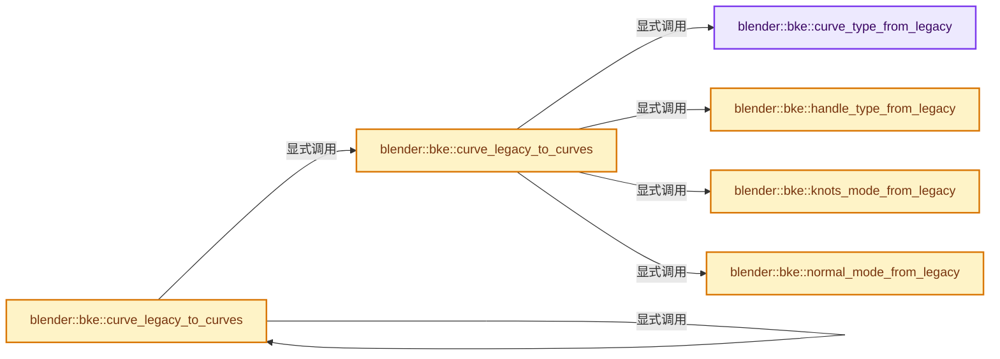
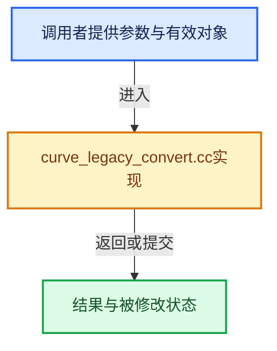

# 实现依赖专题：source/blender/blenkernel/intern/curve_legacy_convert.cc

[方向导航](README.md) · [符号索引](../%E7%AC%A6%E5%8F%B7%E4%BE%9D%E8%B5%96%E4%B8%8E%E5%AE%9E%E7%8E%B0%E7%B4%A2%E5%BC%95.md)

本专题从正文实际调用进入，集中保存共享实现。函数有稳定锚点，可从调用处直接跳到对应完整函数；递归与互相调用通过回链组织。

## 本文件的实现关系






## 完整成员与函数实现

<a id="f-b1c2333003f141c6"></a>

### `blender::bke::curve_type_from_legacy`

实现位置：[source/blender/blenkernel/intern/curve_legacy_convert.cc](../../../../../source/blender/blenkernel/intern/curve_legacy_convert.cc) · L24—L36。

接口参数：

- `const short type`

**教学注释版**

<!-- annotated:d41008d2194fcb -->

```cpp
static CurveType curve_type_from_legacy(const short type)
{
  switch (type) {
    case CU_POLY:
      return CURVE_TYPE_POLY;
    case CU_BEZIER:
      return CURVE_TYPE_BEZIER;
    case CU_NURBS:
      return CURVE_TYPE_NURBS;
  }
  BLI_assert_unreachable();
  return CURVE_TYPE_POLY;
}
```

<details>
<summary>核对原始源码：source/blender/blenkernel/intern/curve_legacy_convert.cc · L24—L36</summary>

<!-- original:d41008d2194fcb:source/blender/blenkernel/intern/curve_legacy_convert.cc:24:36 -->

```cpp
static CurveType curve_type_from_legacy(const short type)
{
  switch (type) {
    case CU_POLY:
      return CURVE_TYPE_POLY;
    case CU_BEZIER:
      return CURVE_TYPE_BEZIER;
    case CU_NURBS:
      return CURVE_TYPE_NURBS;
  }
  BLI_assert_unreachable();
  return CURVE_TYPE_POLY;
}
```

</details>

**结果出口**

- `return CURVE_TYPE_POLY;`
- `return CURVE_TYPE_BEZIER;`
- `return CURVE_TYPE_NURBS;`

**继续追踪实现**

- `BLI_assert_unreachable` → [BLI_assert_unreachable · L77](../01-%E5%9F%BA%E7%A1%80%E5%AE%B9%E5%99%A8%E4%B8%8E%E7%8E%B0%E4%BB%A3CPP/%E4%BE%9D%E8%B5%96-BLI_assert-cc98e8.md#m-7a2d91a67d8e)。宏定义由构建条件选择。

<a id="f-9eeec6923ea10778"></a>

### `blender::bke::handle_type_from_legacy`

实现位置：[source/blender/blenkernel/intern/curve_legacy_convert.cc](../../../../../source/blender/blenkernel/intern/curve_legacy_convert.cc) · L38—L56。

接口参数：

- `const uint8_t handle_type_legacy`

**教学注释版**

<!-- annotated:40f2ff514b05b8 -->

```cpp
static HandleType handle_type_from_legacy(const uint8_t handle_type_legacy)
{
  switch (handle_type_legacy) {
    case HD_FREE:
      return BEZIER_HANDLE_FREE;
    case HD_AUTO:
      return BEZIER_HANDLE_AUTO;
    case HD_VECT:
      return BEZIER_HANDLE_VECTOR;
    case HD_ALIGN:
      return BEZIER_HANDLE_ALIGN;
    case HD_AUTO_ANIM:
      return BEZIER_HANDLE_AUTO;
    case HD_ALIGN_DOUBLESIDE:
      return BEZIER_HANDLE_ALIGN;
  }
  BLI_assert_unreachable();
  return BEZIER_HANDLE_AUTO;
}
```

<details>
<summary>核对原始源码：source/blender/blenkernel/intern/curve_legacy_convert.cc · L38—L56</summary>

<!-- original:40f2ff514b05b8:source/blender/blenkernel/intern/curve_legacy_convert.cc:38:56 -->

```cpp
static HandleType handle_type_from_legacy(const uint8_t handle_type_legacy)
{
  switch (handle_type_legacy) {
    case HD_FREE:
      return BEZIER_HANDLE_FREE;
    case HD_AUTO:
      return BEZIER_HANDLE_AUTO;
    case HD_VECT:
      return BEZIER_HANDLE_VECTOR;
    case HD_ALIGN:
      return BEZIER_HANDLE_ALIGN;
    case HD_AUTO_ANIM:
      return BEZIER_HANDLE_AUTO;
    case HD_ALIGN_DOUBLESIDE:
      return BEZIER_HANDLE_ALIGN;
  }
  BLI_assert_unreachable();
  return BEZIER_HANDLE_AUTO;
}
```

</details>

**结果出口**

- `return BEZIER_HANDLE_FREE;`
- `return BEZIER_HANDLE_AUTO;`
- `return BEZIER_HANDLE_VECTOR;`
- `return BEZIER_HANDLE_ALIGN;`

**继续追踪实现**

- `BLI_assert_unreachable` → [BLI_assert_unreachable · L77](../01-%E5%9F%BA%E7%A1%80%E5%AE%B9%E5%99%A8%E4%B8%8E%E7%8E%B0%E4%BB%A3CPP/%E4%BE%9D%E8%B5%96-BLI_assert-cc98e8.md#m-7a2d91a67d8e)。宏定义由构建条件选择。

<a id="f-117f70c36f6639fc"></a>

### `blender::bke::normal_mode_from_legacy`

实现位置：[source/blender/blenkernel/intern/curve_legacy_convert.cc](../../../../../source/blender/blenkernel/intern/curve_legacy_convert.cc) · L58—L69。

接口参数：

- `const short twist_mode`

**教学注释版**

<!-- annotated:a5ee2faa71f3a2 -->

```cpp
static NormalMode normal_mode_from_legacy(const short twist_mode)
{
  switch (twist_mode) {
    case CU_TWIST_Z_UP:
    case CU_TWIST_TANGENT:
      return NORMAL_MODE_Z_UP;
    case CU_TWIST_MINIMUM:
      return NORMAL_MODE_MINIMUM_TWIST;
  }
  BLI_assert_unreachable();
  return NORMAL_MODE_MINIMUM_TWIST;
}
```

<details>
<summary>核对原始源码：source/blender/blenkernel/intern/curve_legacy_convert.cc · L58—L69</summary>

<!-- original:a5ee2faa71f3a2:source/blender/blenkernel/intern/curve_legacy_convert.cc:58:69 -->

```cpp
static NormalMode normal_mode_from_legacy(const short twist_mode)
{
  switch (twist_mode) {
    case CU_TWIST_Z_UP:
    case CU_TWIST_TANGENT:
      return NORMAL_MODE_Z_UP;
    case CU_TWIST_MINIMUM:
      return NORMAL_MODE_MINIMUM_TWIST;
  }
  BLI_assert_unreachable();
  return NORMAL_MODE_MINIMUM_TWIST;
}
```

</details>

**结果出口**

- `return NORMAL_MODE_Z_UP;`
- `return NORMAL_MODE_MINIMUM_TWIST;`

**继续追踪实现**

- `BLI_assert_unreachable` → [BLI_assert_unreachable · L77](../01-%E5%9F%BA%E7%A1%80%E5%AE%B9%E5%99%A8%E4%B8%8E%E7%8E%B0%E4%BB%A3CPP/%E4%BE%9D%E8%B5%96-BLI_assert-cc98e8.md#m-7a2d91a67d8e)。宏定义由构建条件选择。

<a id="f-ed3a5f03625ee545"></a>

### `blender::bke::knots_mode_from_legacy`

实现位置：[source/blender/blenkernel/intern/curve_legacy_convert.cc](../../../../../source/blender/blenkernel/intern/curve_legacy_convert.cc) · L71—L88。

接口参数：

- `const short flag`

**教学注释版**

<!-- annotated:9e892c13f686a3 -->

```cpp
KnotsMode knots_mode_from_legacy(const short flag)
{
  if (flag & CU_NURB_CUSTOM) {
    return NURBS_KNOT_MODE_CUSTOM;
  }
  switch (flag & (CU_NURB_ENDPOINT | CU_NURB_BEZIER)) {
    case CU_NURB_ENDPOINT:
      return NURBS_KNOT_MODE_ENDPOINT;
    case CU_NURB_BEZIER:
      return NURBS_KNOT_MODE_BEZIER;
    case CU_NURB_ENDPOINT | CU_NURB_BEZIER:
      return NURBS_KNOT_MODE_ENDPOINT_BEZIER;
    case 0:
      return NURBS_KNOT_MODE_NORMAL;
  }
  BLI_assert_unreachable();
  return NURBS_KNOT_MODE_NORMAL;
}
```

<details>
<summary>核对原始源码：source/blender/blenkernel/intern/curve_legacy_convert.cc · L71—L88</summary>

<!-- original:9e892c13f686a3:source/blender/blenkernel/intern/curve_legacy_convert.cc:71:88 -->

```cpp
KnotsMode knots_mode_from_legacy(const short flag)
{
  if (flag & CU_NURB_CUSTOM) {
    return NURBS_KNOT_MODE_CUSTOM;
  }
  switch (flag & (CU_NURB_ENDPOINT | CU_NURB_BEZIER)) {
    case CU_NURB_ENDPOINT:
      return NURBS_KNOT_MODE_ENDPOINT;
    case CU_NURB_BEZIER:
      return NURBS_KNOT_MODE_BEZIER;
    case CU_NURB_ENDPOINT | CU_NURB_BEZIER:
      return NURBS_KNOT_MODE_ENDPOINT_BEZIER;
    case 0:
      return NURBS_KNOT_MODE_NORMAL;
  }
  BLI_assert_unreachable();
  return NURBS_KNOT_MODE_NORMAL;
}
```

</details>

**结果出口**

- `return NURBS_KNOT_MODE_CUSTOM;`
- `return NURBS_KNOT_MODE_ENDPOINT;`
- `return NURBS_KNOT_MODE_BEZIER;`
- `return NURBS_KNOT_MODE_ENDPOINT_BEZIER;`
- `return NURBS_KNOT_MODE_NORMAL;`

**继续追踪实现**

- `BLI_assert_unreachable` → [BLI_assert_unreachable · L77](../01-%E5%9F%BA%E7%A1%80%E5%AE%B9%E5%99%A8%E4%B8%8E%E7%8E%B0%E4%BB%A3CPP/%E4%BE%9D%E8%B5%96-BLI_assert-cc98e8.md#m-7a2d91a67d8e)。宏定义由构建条件选择。

<a id="f-9ba8d5c6c02eba1d"></a>

### `blender::bke::curve_legacy_to_curves`

实现位置：[source/blender/blenkernel/intern/curve_legacy_convert.cc](../../../../../source/blender/blenkernel/intern/curve_legacy_convert.cc) · L90—L242。

接口参数：

- `const Curve &curve_legacy`
- `const ListBaseT<Nurb> &nurbs_list`

**教学注释版**

<!-- annotated:5d6435c7860778 -->

```cpp
Curves *curve_legacy_to_curves(const Curve &curve_legacy, const ListBaseT<Nurb> &nurbs_list)
{
  Vector<const Nurb *> src_curves;
  for (const Nurb &item : nurbs_list) {
    // [讲解] src_curves.append：在尾部建立新元素，必要时先扩大存储。
    src_curves.append(&item);
  }
  if (src_curves.is_empty()) {
    return nullptr;
  }

  // [讲解] src_curves.size：用end_减begin_得到活元素数量。
  Curves *curves_id = curves_new_nomain(0, src_curves.size());
  CurvesGeometry &curves = curves_id->geometry.wrap();
  MutableAttributeAccessor curves_attributes = curves.attributes_for_write();

  MutableSpan<int8_t> types = curves.curve_types_for_write();
  MutableSpan<bool> cyclic = curves.cyclic_for_write();

  int offset = 0;
  MutableSpan<int> offsets = curves.offsets_for_write();
  for (const int i : src_curves.index_range()) {
    offsets[i] = offset;

    const Nurb &src_curve = *src_curves[i];
    types[i] = curve_type_from_legacy(src_curve.type);
    cyclic[i] = src_curve.flagu & CU_NURB_CYCLIC;

    offset += src_curve.pntsu;
  }
  // [讲解] offsets.last：按视图边界访问元素。
  offsets.last() = offset;
  curves.resize(curves.offsets().last(), curves.curves_num());

  curves.update_curve_types();

  const OffsetIndices points_by_curve = curves.points_by_curve();
  MutableSpan<float3> positions = curves.positions_for_write();
  SpanAttributeWriter<float> radius_attribute =
      curves_attributes.lookup_or_add_for_write_only_span<float>("radius", AttrDomain::Point);
  MutableSpan<float> radii = radius_attribute.span;
  MutableSpan<float> tilts = curves.tilt_for_write();

  auto create_poly = [&](const IndexMask &selection) {
    selection.foreach_index(
        [&](const int curve_i) {
          const Nurb &src_curve = *src_curves[curve_i];
          const Span<BPoint> src_points(src_curve.bp, src_curve.pntsu);
          const IndexRange points = points_by_curve[curve_i];

          // [讲解] src_points.index_range：查询视图长度或生成对应有效索引区间。
          for (const int i : src_points.index_range()) {
            const BPoint &bp = src_points[i];
            positions[points[i]] = bp.vec;
            radii[points[i]] = bp.radius;
            tilts[points[i]] = bp.tilt;
          }
        },
        exec_mode::grain_size(256));
  };

  /* NOTE: For curve handles, legacy curves can end up in invalid situations where the handle
   * positions don't agree with the types because of evaluation, or because one-sided aligned
   * handles weren't considered. While recalculating automatic handles to fix those situations
   * is an option, currently this opts not to for the sake of flexibility. */
  auto create_bezier = [&](const IndexMask &selection) {
    MutableSpan<int> resolutions = curves.resolution_for_write();
    MutableSpan<float3> handle_positions_l = curves.handle_positions_left_for_write();
    MutableSpan<float3> handle_positions_r = curves.handle_positions_right_for_write();
    MutableSpan<int8_t> handle_types_l = curves.handle_types_left_for_write();
    MutableSpan<int8_t> handle_types_r = curves.handle_types_right_for_write();

    selection.foreach_index(
        [&](const int curve_i) {
          const Nurb &src_curve = *src_curves[curve_i];
          const Span<BezTriple> src_points(src_curve.bezt, src_curve.pntsu);
          const IndexRange points = points_by_curve[curve_i];

          resolutions[curve_i] = src_curve.resolu;

          for (const int i : src_points.index_range()) {
            const BezTriple &point = src_points[i];
            positions[points[i]] = point.vec[1];
            handle_positions_l[points[i]] = point.vec[0];
            handle_types_l[points[i]] = handle_type_from_legacy(point.h1);
            handle_positions_r[points[i]] = point.vec[2];
            handle_types_r[points[i]] = handle_type_from_legacy(point.h2);
            radii[points[i]] = point.radius;
            tilts[points[i]] = point.tilt;
          }
        },
        exec_mode::grain_size(256));
  };

  auto create_nurbs = [&](const IndexMask &selection) {
    MutableSpan<int> resolutions = curves.resolution_for_write();
    MutableSpan<float> nurbs_weights = curves.nurbs_weights_for_write();
    MutableSpan<int8_t> nurbs_orders = curves.nurbs_orders_for_write();
    MutableSpan<int8_t> nurbs_knots_modes = curves.nurbs_knots_modes_for_write();

    selection.foreach_index(
        [&](const int curve_i) {
          const Nurb &src_curve = *src_curves[curve_i];
          const Span src_points(src_curve.bp, src_curve.pntsu);
          const IndexRange points = points_by_curve[curve_i];

          resolutions[curve_i] = src_curve.resolu;
          nurbs_orders[curve_i] = src_curve.orderu;
          nurbs_knots_modes[curve_i] = knots_mode_from_legacy(src_curve.flagu);

          for (const int i : src_points.index_range()) {
            const BPoint &bp = src_points[i];
            positions[points[i]] = bp.vec;
            radii[points[i]] = bp.radius;
            tilts[points[i]] = bp.tilt;
            nurbs_weights[points[i]] = bp.vec[3];
          }
        },
        exec_mode::grain_size(256));

    curves.nurbs_custom_knots_update_size();
    if (!curves.nurbs_has_custom_knots()) {
      return;
    }

    const OffsetIndices<int> knots_by_curve = curves.nurbs_custom_knots_by_curve();
    MutableSpan<float> custom_knots = curves.nurbs_custom_knots_for_write();
    selection.foreach_index([&](const int curve_i) {
      if (nurbs_knots_modes[curve_i] == NURBS_KNOT_MODE_CUSTOM) {
        const Nurb &src_curve = *src_curves[curve_i];
        const IndexRange knots = knots_by_curve[curve_i];
        // [讲解] custom_knots.slice：建立原连续范围的子视图。
        custom_knots.slice(knots).copy_from(Span<float>(src_curve.knotsu, knots.size()));
      }
    });
  };

  bke::curves::foreach_curve_by_type(
      curves.curve_types(),
      curves.curve_type_counts(),
      curves.curves_range(),
      [&](const IndexMask & /*selection*/) { BLI_assert_unreachable(); },
      create_poly,
      create_bezier,
      create_nurbs);

  curves_attributes.add<int8_t>(
      "normal_mode",
      bke::AttrDomain::Curve,
      bke::AttributeInitValue(int8_t(normal_mode_from_legacy(curve_legacy.twist_mode))));

  radius_attribute.finish();

  curves_id->mat = MEM_dupalloc(curve_legacy.mat);
  curves_id->totcol = curve_legacy.totcol;

  return curves_id;
}
```

<details>
<summary>核对原始源码：source/blender/blenkernel/intern/curve_legacy_convert.cc · L90—L242</summary>

<!-- original:5d6435c7860778:source/blender/blenkernel/intern/curve_legacy_convert.cc:90:242 -->

```cpp
Curves *curve_legacy_to_curves(const Curve &curve_legacy, const ListBaseT<Nurb> &nurbs_list)
{
  Vector<const Nurb *> src_curves;
  for (const Nurb &item : nurbs_list) {
    src_curves.append(&item);
  }
  if (src_curves.is_empty()) {
    return nullptr;
  }

  Curves *curves_id = curves_new_nomain(0, src_curves.size());
  CurvesGeometry &curves = curves_id->geometry.wrap();
  MutableAttributeAccessor curves_attributes = curves.attributes_for_write();

  MutableSpan<int8_t> types = curves.curve_types_for_write();
  MutableSpan<bool> cyclic = curves.cyclic_for_write();

  int offset = 0;
  MutableSpan<int> offsets = curves.offsets_for_write();
  for (const int i : src_curves.index_range()) {
    offsets[i] = offset;

    const Nurb &src_curve = *src_curves[i];
    types[i] = curve_type_from_legacy(src_curve.type);
    cyclic[i] = src_curve.flagu & CU_NURB_CYCLIC;

    offset += src_curve.pntsu;
  }
  offsets.last() = offset;
  curves.resize(curves.offsets().last(), curves.curves_num());

  curves.update_curve_types();

  const OffsetIndices points_by_curve = curves.points_by_curve();
  MutableSpan<float3> positions = curves.positions_for_write();
  SpanAttributeWriter<float> radius_attribute =
      curves_attributes.lookup_or_add_for_write_only_span<float>("radius", AttrDomain::Point);
  MutableSpan<float> radii = radius_attribute.span;
  MutableSpan<float> tilts = curves.tilt_for_write();

  auto create_poly = [&](const IndexMask &selection) {
    selection.foreach_index(
        [&](const int curve_i) {
          const Nurb &src_curve = *src_curves[curve_i];
          const Span<BPoint> src_points(src_curve.bp, src_curve.pntsu);
          const IndexRange points = points_by_curve[curve_i];

          for (const int i : src_points.index_range()) {
            const BPoint &bp = src_points[i];
            positions[points[i]] = bp.vec;
            radii[points[i]] = bp.radius;
            tilts[points[i]] = bp.tilt;
          }
        },
        exec_mode::grain_size(256));
  };

  /* NOTE: For curve handles, legacy curves can end up in invalid situations where the handle
   * positions don't agree with the types because of evaluation, or because one-sided aligned
   * handles weren't considered. While recalculating automatic handles to fix those situations
   * is an option, currently this opts not to for the sake of flexibility. */
  auto create_bezier = [&](const IndexMask &selection) {
    MutableSpan<int> resolutions = curves.resolution_for_write();
    MutableSpan<float3> handle_positions_l = curves.handle_positions_left_for_write();
    MutableSpan<float3> handle_positions_r = curves.handle_positions_right_for_write();
    MutableSpan<int8_t> handle_types_l = curves.handle_types_left_for_write();
    MutableSpan<int8_t> handle_types_r = curves.handle_types_right_for_write();

    selection.foreach_index(
        [&](const int curve_i) {
          const Nurb &src_curve = *src_curves[curve_i];
          const Span<BezTriple> src_points(src_curve.bezt, src_curve.pntsu);
          const IndexRange points = points_by_curve[curve_i];

          resolutions[curve_i] = src_curve.resolu;

          for (const int i : src_points.index_range()) {
            const BezTriple &point = src_points[i];
            positions[points[i]] = point.vec[1];
            handle_positions_l[points[i]] = point.vec[0];
            handle_types_l[points[i]] = handle_type_from_legacy(point.h1);
            handle_positions_r[points[i]] = point.vec[2];
            handle_types_r[points[i]] = handle_type_from_legacy(point.h2);
            radii[points[i]] = point.radius;
            tilts[points[i]] = point.tilt;
          }
        },
        exec_mode::grain_size(256));
  };

  auto create_nurbs = [&](const IndexMask &selection) {
    MutableSpan<int> resolutions = curves.resolution_for_write();
    MutableSpan<float> nurbs_weights = curves.nurbs_weights_for_write();
    MutableSpan<int8_t> nurbs_orders = curves.nurbs_orders_for_write();
    MutableSpan<int8_t> nurbs_knots_modes = curves.nurbs_knots_modes_for_write();

    selection.foreach_index(
        [&](const int curve_i) {
          const Nurb &src_curve = *src_curves[curve_i];
          const Span src_points(src_curve.bp, src_curve.pntsu);
          const IndexRange points = points_by_curve[curve_i];

          resolutions[curve_i] = src_curve.resolu;
          nurbs_orders[curve_i] = src_curve.orderu;
          nurbs_knots_modes[curve_i] = knots_mode_from_legacy(src_curve.flagu);

          for (const int i : src_points.index_range()) {
            const BPoint &bp = src_points[i];
            positions[points[i]] = bp.vec;
            radii[points[i]] = bp.radius;
            tilts[points[i]] = bp.tilt;
            nurbs_weights[points[i]] = bp.vec[3];
          }
        },
        exec_mode::grain_size(256));

    curves.nurbs_custom_knots_update_size();
    if (!curves.nurbs_has_custom_knots()) {
      return;
    }

    const OffsetIndices<int> knots_by_curve = curves.nurbs_custom_knots_by_curve();
    MutableSpan<float> custom_knots = curves.nurbs_custom_knots_for_write();
    selection.foreach_index([&](const int curve_i) {
      if (nurbs_knots_modes[curve_i] == NURBS_KNOT_MODE_CUSTOM) {
        const Nurb &src_curve = *src_curves[curve_i];
        const IndexRange knots = knots_by_curve[curve_i];
        custom_knots.slice(knots).copy_from(Span<float>(src_curve.knotsu, knots.size()));
      }
    });
  };

  bke::curves::foreach_curve_by_type(
      curves.curve_types(),
      curves.curve_type_counts(),
      curves.curves_range(),
      [&](const IndexMask & /*selection*/) { BLI_assert_unreachable(); },
      create_poly,
      create_bezier,
      create_nurbs);

  curves_attributes.add<int8_t>(
      "normal_mode",
      bke::AttrDomain::Curve,
      bke::AttributeInitValue(int8_t(normal_mode_from_legacy(curve_legacy.twist_mode))));

  radius_attribute.finish();

  curves_id->mat = MEM_dupalloc(curve_legacy.mat);
  curves_id->totcol = curve_legacy.totcol;

  return curves_id;
}
```

</details>

**沿实际写入检查状态**

- `offsets[i] = offset;`
- `types[i] = curve_type_from_legacy(src_curve.type);`
- `cyclic[i] = src_curve.flagu & CU_NURB_CYCLIC;`
- `offset += src_curve.pntsu;`
- `positions[points[i]] = bp.vec;`
- `radii[points[i]] = bp.radius;`
- `tilts[points[i]] = bp.tilt;`
- `resolutions[curve_i] = src_curve.resolu;`
- `positions[points[i]] = point.vec[1];`
- `handle_positions_l[points[i]] = point.vec[0];`
- `handle_types_l[points[i]] = handle_type_from_legacy(point.h1);`
- `handle_positions_r[points[i]] = point.vec[2];`
- `handle_types_r[points[i]] = handle_type_from_legacy(point.h2);`
- `radii[points[i]] = point.radius;`
- `tilts[points[i]] = point.tilt;`
- `nurbs_orders[curve_i] = src_curve.orderu;`
- `nurbs_knots_modes[curve_i] = knots_mode_from_legacy(src_curve.flagu);`
- `nurbs_weights[points[i]] = bp.vec[3];`
- `curves_id->mat = MEM_dupalloc(curve_legacy.mat);`
- `curves_id->totcol = curve_legacy.totcol;`

**结果出口**

- `return nullptr;`
- `return curves_id;`

**继续追踪实现**

- `src_curves.append` → [blender::Vector::append · L498](../01-%E5%9F%BA%E7%A1%80%E5%AE%B9%E5%99%A8%E4%B8%8E%E7%8E%B0%E4%BB%A3CPP/11-Vector%E6%8F%92%E5%85%A5%E5%88%A0%E9%99%A4%E4%B8%8E%E9%87%8D%E6%8E%92.md#f-5bde268a69e443ec)；[blender::Vector::append · L502](../01-%E5%9F%BA%E7%A1%80%E5%AE%B9%E5%99%A8%E4%B8%8E%E7%8E%B0%E4%BB%A3CPP/11-Vector%E6%8F%92%E5%85%A5%E5%88%A0%E9%99%A4%E4%B8%8E%E9%87%8D%E6%8E%92.md#f-591e0b15e6308532)。同名重载需按实参类型选择。
- `src_curves.is_empty` → [blender::Vector::is_empty · L792](../01-%E5%9F%BA%E7%A1%80%E5%AE%B9%E5%99%A8%E4%B8%8E%E7%8E%B0%E4%BB%A3CPP/11-Vector%E6%8F%92%E5%85%A5%E5%88%A0%E9%99%A4%E4%B8%8E%E9%87%8D%E6%8E%92.md#f-937bbd9cb80bdcc8)。
- `curves_new_nomain` → [blender::bke::curves_new_nomain · L293](%E4%BE%9D%E8%B5%96-curves-fcb14d.md#f-702debf916bbedac)；[blender::bke::curves_new_nomain · L312](%E4%BE%9D%E8%B5%96-curves-fcb14d.md#f-ba10c7025cf69460)。同名重载需按实参类型选择。
- `src_curves.size` → [blender::Vector::size · L780](../01-%E5%9F%BA%E7%A1%80%E5%AE%B9%E5%99%A8%E4%B8%8E%E7%8E%B0%E4%BB%A3CPP/11-Vector%E6%8F%92%E5%85%A5%E5%88%A0%E9%99%A4%E4%B8%8E%E9%87%8D%E6%8E%92.md#f-714773731767349c)。
- `curves_id->geometry.wrap` → [调用协议](../%E6%A8%A1%E6%9D%BF%E5%AE%8F%E4%B8%8E%E5%8A%A8%E6%80%81%E5%88%86%E6%B4%BE%E5%8D%8F%E8%AE%AE.md)：接收对象类型依赖auto、返回值或模板实例；不按同名猜测目标。调用位置L101。
- `curves.attributes_for_write` → [blender::bke::CurvesGeometry::attributes_for_write · L1913](%E4%BE%9D%E8%B5%96-curves_geometry-ad7f9f.md#f-4930091b34fa9663)。
- `curves.curve_types_for_write` → [blender::bke::CurvesGeometry::curve_types_for_write · L238](%E4%BE%9D%E8%B5%96-curves_geometry-ad7f9f.md#f-14c49257795f8879)。
- `curves.cyclic_for_write` → [blender::bke::CurvesGeometry::cyclic_for_write · L367](%E4%BE%9D%E8%B5%96-curves_geometry-ad7f9f.md#f-b1256d63406f260e)。
- `curves.offsets_for_write` → [blender::bke::CurvesGeometry::offsets_for_write · L352](%E4%BE%9D%E8%B5%96-curves_geometry-ad7f9f.md#f-9ea1e4f36b216dd0)。
- `src_curves.index_range` → [blender::Vector::index_range · L1026](../01-%E5%9F%BA%E7%A1%80%E5%AE%B9%E5%99%A8%E4%B8%8E%E7%8E%B0%E4%BB%A3CPP/12-Vector%E5%BC%82%E5%B8%B8%E5%AE%89%E5%85%A8%E4%B8%8E%E8%BE%B9%E7%95%8C.md#f-ac29cf36ef185ab9)。
- `curve_type_from_legacy` → [blender::bke::curve_type_from_legacy · L24](%E4%BE%9D%E8%B5%96-curve_legacy_convert-a698dd.md#f-b1c2333003f141c6)。
- `offsets.last` → [blender::MutableSpan::last · L695](../01-%E5%9F%BA%E7%A1%80%E5%AE%B9%E5%99%A8%E4%B8%8E%E7%8E%B0%E4%BB%A3CPP/06-MutableSpan%E5%8F%AF%E5%86%99%E8%A7%86%E5%9B%BE.md#f-73191eeabe29aab7)。
- `curves.resize` → [blender::bke::CurvesGeometry::resize · L1223](%E4%BE%9D%E8%B5%96-curves_geometry-ad7f9f.md#f-3075a8d29a1332c0)。
- `curves.offsets().last` → [调用协议](../%E6%A8%A1%E6%9D%BF%E5%AE%8F%E4%B8%8E%E5%8A%A8%E6%80%81%E5%88%86%E6%B4%BE%E5%8D%8F%E8%AE%AE.md)：接收对象类型依赖auto、返回值或模板实例；不按同名猜测目标。调用位置L119。
- `curves.offsets` → [blender::bke::CurvesGeometry::offsets · L345](%E4%BE%9D%E8%B5%96-curves_geometry-ad7f9f.md#f-933ebcc46965545e)。
- `curves.curves_num` → [blender::bke::CurvesGeometry::curves_num · L1005](04-CurvesGeometry%E5%AD%98%E5%82%A8.md#f-eabb3f0e5d3c57be)。
- `curves.update_curve_types` → [blender::bke::CurvesGeometry::update_curve_types · L318](%E4%BE%9D%E8%B5%96-curves_geometry-ad7f9f.md#f-f7155d4f5776d2ad)。
- `curves.points_by_curve` → [blender::bke::CurvesGeometry::points_by_curve · L1058](04-CurvesGeometry%E5%AD%98%E5%82%A8.md#f-a0416697e10ec205)。
- `curves.positions_for_write` → [blender::bke::CurvesGeometry::positions_for_write · L328](%E4%BE%9D%E8%B5%96-curves_geometry-ad7f9f.md#f-30e013e651e830c3)。
- `curves_attributes.lookup_or_add_for_write_only_span<float>` → [blender::bke::MutableAttributeAccessor::lookup_or_add_for_write_only_span · L546](%E4%BE%9D%E8%B5%96-attribute_access-bceef3.md#f-97af899f7983a038)。
- `curves.tilt_for_write` → [blender::bke::CurvesGeometry::tilt_for_write · L400](%E4%BE%9D%E8%B5%96-curves_geometry-ad7f9f.md#f-b7f838eab58c874f)。
- `selection.foreach_index` → [blender::index_mask::IndexMask::foreach_index · L855](../04-%E8%99%9A%E6%8B%9F%E6%95%B0%E7%BB%84%E4%B8%8E%E7%B4%A2%E5%BC%95%E9%80%89%E6%8B%A9/09-%E5%88%86%E6%AE%B5%E5%AD%98%E5%82%A8%E4%B8%8E%E9%81%8D%E5%8E%86.md#f-cd6cd317e2e2812c)。
- `src_points.index_range` → [blender::Span::index_range · L405](../01-%E5%9F%BA%E7%A1%80%E5%AE%B9%E5%99%A8%E4%B8%8E%E7%8E%B0%E4%BB%A3CPP/05-Span%E5%8F%AA%E8%AF%BB%E8%BF%9E%E7%BB%AD%E8%A7%86%E5%9B%BE.md#f-caaa9b06e13e53e0)。
- `exec_mode::grain_size` → [blender::exec_mode::grain_size · L79](../01-%E5%9F%BA%E7%A1%80%E5%AE%B9%E5%99%A8%E4%B8%8E%E7%8E%B0%E4%BB%A3CPP/%E4%BE%9D%E8%B5%96-BLI_execution_mode-1528fb.md#f-0b4fc2f9fa6e66e7)。
- `curves.resolution_for_write` → [blender::bke::CurvesGeometry::resolution_for_write · L378](%E4%BE%9D%E8%B5%96-curves_geometry-ad7f9f.md#f-0e625de3bcdd49de)。
- `curves.handle_positions_left_for_write` → [blender::bke::CurvesGeometry::handle_positions_left_for_write · L447](%E4%BE%9D%E8%B5%96-curves_geometry-ad7f9f.md#f-4d7ff017617d8d81)。
- `curves.handle_positions_right_for_write` → [blender::bke::CurvesGeometry::handle_positions_right_for_write · L462](%E4%BE%9D%E8%B5%96-curves_geometry-ad7f9f.md#f-4e6c5f5a56ef86ec)。
- `curves.handle_types_left_for_write` → [blender::bke::CurvesGeometry::handle_types_left_for_write · L414](%E4%BE%9D%E8%B5%96-curves_geometry-ad7f9f.md#f-5e3c653e29ab9122)。
- `curves.handle_types_right_for_write` → [blender::bke::CurvesGeometry::handle_types_right_for_write · L431](%E4%BE%9D%E8%B5%96-curves_geometry-ad7f9f.md#f-c587ab7b7778d52c)。
- `handle_type_from_legacy` → [blender::bke::handle_type_from_legacy · L38](%E4%BE%9D%E8%B5%96-curve_legacy_convert-a698dd.md#f-9eeec6923ea10778)。
- `curves.nurbs_weights_for_write` → [blender::bke::CurvesGeometry::nurbs_weights_for_write · L486](%E4%BE%9D%E8%B5%96-curves_geometry-ad7f9f.md#f-934c2d7d0d990c3a)。
- `curves.nurbs_orders_for_write` → [blender::bke::CurvesGeometry::nurbs_orders_for_write · L475](%E4%BE%9D%E8%B5%96-curves_geometry-ad7f9f.md#f-b4a5a03e13af1583)。
- `curves.nurbs_knots_modes_for_write` → [blender::bke::CurvesGeometry::nurbs_knots_modes_for_write · L503](%E4%BE%9D%E8%B5%96-curves_geometry-ad7f9f.md#f-91d1b54ee2f8af59)。
- `knots_mode_from_legacy` → [blender::bke::knots_mode_from_legacy · L71](%E4%BE%9D%E8%B5%96-curve_legacy_convert-a698dd.md#f-ed3a5f03625ee545)。
- `curves.nurbs_custom_knots_update_size` → [blender::bke::CurvesGeometry::nurbs_custom_knots_update_size · L587](%E4%BE%9D%E8%B5%96-curves_geometry-ad7f9f.md#f-d445d63e7e1b4649)。
- `curves.nurbs_has_custom_knots` → [blender::bke::CurvesGeometry::nurbs_has_custom_knots · L1009](04-CurvesGeometry%E5%AD%98%E5%82%A8.md#f-462177a6bae60d14)。
- `curves.nurbs_custom_knots_by_curve` → [blender::bke::CurvesGeometry::nurbs_custom_knots_by_curve · L555](%E4%BE%9D%E8%B5%96-curves_geometry-ad7f9f.md#f-3fc61429012c4ef6)。
- `curves.nurbs_custom_knots_for_write` → [blender::bke::CurvesGeometry::nurbs_custom_knots_for_write · L536](%E4%BE%9D%E8%B5%96-curves_geometry-ad7f9f.md#f-b4d54718411be479)。
- `custom_knots.slice(knots).copy_from` → [调用协议](../%E6%A8%A1%E6%9D%BF%E5%AE%8F%E4%B8%8E%E5%8A%A8%E6%80%81%E5%88%86%E6%B4%BE%E5%8D%8F%E8%AE%AE.md)：接收对象类型依赖auto、返回值或模板实例；不按同名猜测目标。调用位置L217。
- `custom_knots.slice` → [blender::MutableSpan::slice · L579](../01-%E5%9F%BA%E7%A1%80%E5%AE%B9%E5%99%A8%E4%B8%8E%E7%8E%B0%E4%BB%A3CPP/06-MutableSpan%E5%8F%AF%E5%86%99%E8%A7%86%E5%9B%BE.md#f-6808b4aefbf58808)；[blender::MutableSpan::slice · L587](../01-%E5%9F%BA%E7%A1%80%E5%AE%B9%E5%99%A8%E4%B8%8E%E7%8E%B0%E4%BB%A3CPP/06-MutableSpan%E5%8F%AF%E5%86%99%E8%A7%86%E5%9B%BE.md#f-c05b010821861e4f)。同名重载需按实参类型选择。
- `Span<float>` → [blender::Span](../01-%E5%9F%BA%E7%A1%80%E5%AE%B9%E5%99%A8%E4%B8%8E%E7%8E%B0%E4%BB%A3CPP/%E4%BE%9D%E8%B5%96-BLI_span-6aa95f.md#t-8765a8e0c1d5)；[blender::Span](../01-%E5%9F%BA%E7%A1%80%E5%AE%B9%E5%99%A8%E4%B8%8E%E7%8E%B0%E4%BB%A3CPP/%E4%BE%9D%E8%B5%96-BLI_index_range-7d7cc5.md#t-86091874a1c0)；[blender::Span](%E4%BE%9D%E8%B5%96-DNA_pointcloud_types-cfb82c.md#t-112aa6ed842c)；[blender::Span](%E4%BE%9D%E8%B5%96-DNA_node_types-6708b9.md#t-49ec6fbb9b69)；[blender::Span](%E4%BE%9D%E8%B5%96-DNA_mesh_types-81f02e.md#t-184fd48fb638)；[blender::Span](%E4%BE%9D%E8%B5%96-DNA_anim_types-39c5d9.md#t-d841071994c2)；[blender::Span](%E4%BE%9D%E8%B5%96-RNA_path_fwd-79c989.md#t-4dbb08969e41)。
- `knots.size` → [blender::IndexRange::size · L156](../01-%E5%9F%BA%E7%A1%80%E5%AE%B9%E5%99%A8%E4%B8%8E%E7%8E%B0%E4%BB%A3CPP/04-IndexRange%E8%BF%9E%E7%BB%AD%E6%95%B4%E6%95%B0%E5%8C%BA%E9%97%B4.md#f-05f66c3ebb2fdfec)。
- `bke::curves::foreach_curve_by_type` → [blender::bke::curves::foreach_curve_by_type · L100](%E4%BE%9D%E8%B5%96-curves_utils-29d2f5.md#f-8ac12f9090c8c231)。
- `curves.curve_types` → [blender::bke::CurvesGeometry::curve_types · L229](%E4%BE%9D%E8%B5%96-curves_geometry-ad7f9f.md#f-e3847cb390c85e93)。
- `curves.curve_type_counts` → [blender::bke::CurvesGeometry::curve_type_counts · L1044](04-CurvesGeometry%E5%AD%98%E5%82%A8.md#f-c350479811891ffd)。
- `curves.curves_range` → [blender::bke::CurvesGeometry::curves_range · L1023](04-CurvesGeometry%E5%AD%98%E5%82%A8.md#f-9aedfb1afc5ebcfb)。
- `BLI_assert_unreachable` → [BLI_assert_unreachable · L77](../01-%E5%9F%BA%E7%A1%80%E5%AE%B9%E5%99%A8%E4%B8%8E%E7%8E%B0%E4%BB%A3CPP/%E4%BE%9D%E8%B5%96-BLI_assert-cc98e8.md#m-7a2d91a67d8e)。宏定义由构建条件选择。
- `curves_attributes.add<int8_t>` → [blender::bke::MutableAttributeAccessor::add · L769](08-AttributeAccessor%E6%8E%A5%E5%8F%A3.md#f-5fa7f06d7e22891a)；[blender::bke::MutableAttributeAccessor::add · L785](08-AttributeAccessor%E6%8E%A5%E5%8F%A3.md#f-42998ceb23ada8cc)。同名重载需按实参类型选择。
- `bke::AttributeInitValue` → [blender::bke::AttributeInitValue::AttributeInitValue · L100](08-AttributeAccessor%E6%8E%A5%E5%8F%A3.md#f-cd502d5742ad6d0f)；[blender::bke::AttributeInitValue::AttributeInitValue · L104](08-AttributeAccessor%E6%8E%A5%E5%8F%A3.md#f-54b1dad08bff7914)。同名重载需按实参类型选择。
- `normal_mode_from_legacy` → [blender::bke::normal_mode_from_legacy · L58](%E4%BE%9D%E8%B5%96-curve_legacy_convert-a698dd.md#f-117f70c36f6639fc)。
- `radius_attribute.finish` → [blender::bke::SpanAttributeWriter::finish · L279](08-AttributeAccessor%E6%8E%A5%E5%8F%A3.md#f-585970a3b1bd4da4)。
- `MEM_dupalloc` → [MEM_dupalloc · L627](../03-%E5%86%85%E5%AD%98%E5%88%86%E9%85%8D%E4%B8%8E%E8%BF%90%E8%A1%8C%E6%97%B6%E7%B1%BB%E5%9E%8B/%E4%BE%9D%E8%B5%96-MEM_guardedalloc-b54eca.md#f-78a72b71e3c57010)。

<a id="f-69eb5c2a53a7999e"></a>

### `blender::bke::curve_legacy_to_curves`

实现位置：[source/blender/blenkernel/intern/curve_legacy_convert.cc](../../../../../source/blender/blenkernel/intern/curve_legacy_convert.cc) · L244—L247。

接口参数：

- `const Curve &curve_legacy`

**教学注释版**

<!-- annotated:f9c2cb1c68929c -->

```cpp
Curves *curve_legacy_to_curves(const Curve &curve_legacy)
{
  return curve_legacy_to_curves(curve_legacy, *BKE_curve_nurbs_get_for_read(&curve_legacy));
}
```

<details>
<summary>核对原始源码：source/blender/blenkernel/intern/curve_legacy_convert.cc · L244—L247</summary>

<!-- original:f9c2cb1c68929c:source/blender/blenkernel/intern/curve_legacy_convert.cc:244:247 -->

```cpp
Curves *curve_legacy_to_curves(const Curve &curve_legacy)
{
  return curve_legacy_to_curves(curve_legacy, *BKE_curve_nurbs_get_for_read(&curve_legacy));
}
```

</details>

**结果出口**

- `return curve_legacy_to_curves(curve_legacy, *BKE_curve_nurbs_get_for_read(&curve_legacy));`

**继续追踪实现**

- `curve_legacy_to_curves` → [blender::bke::curve_legacy_to_curves · L90](%E4%BE%9D%E8%B5%96-curve_legacy_convert-a698dd.md#f-9ba8d5c6c02eba1d)；[blender::bke::curve_legacy_to_curves · L244](%E4%BE%9D%E8%B5%96-curve_legacy_convert-a698dd.md#f-69eb5c2a53a7999e)。同名重载需按实参类型选择。
- `BKE_curve_nurbs_get_for_read` → [blender::BKE_curve_nurbs_get_for_read · L5001](%E4%BE%9D%E8%B5%96-curve-ae13d5.md#f-59ec5756694bdc79)。
