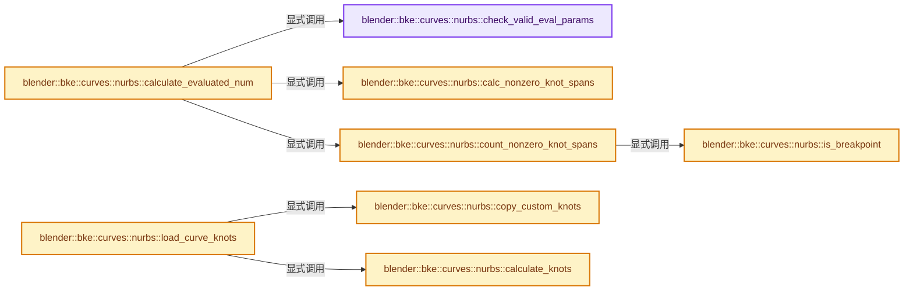
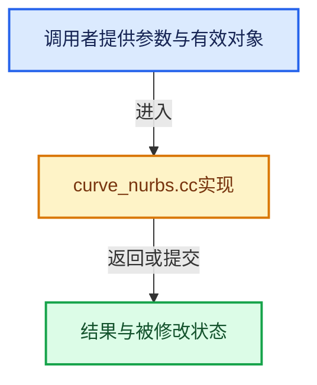

# 实现依赖专题：source/blender/blenkernel/intern/curve_nurbs.cc

[方向导航](README.md) · [符号索引](../%E7%AC%A6%E5%8F%B7%E4%BE%9D%E8%B5%96%E4%B8%8E%E5%AE%9E%E7%8E%B0%E7%B4%A2%E5%BC%95.md)

本专题从正文实际调用进入，集中保存共享实现。函数有稳定锚点，可从调用处直接跳到对应完整函数；递归与互相调用通过回链组织。

## 本文件的实现关系






## 完整成员与函数实现

<a id="f-fe35543bcd57a367"></a>

### `blender::bke::curves::nurbs::check_valid_eval_params`

实现位置：[source/blender/blenkernel/intern/curve_nurbs.cc](../../../../../source/blender/blenkernel/intern/curve_nurbs.cc) · L16—L42。

接口参数：

- `const int points_num`
- `const int8_t order`
- `const bool cyclic`
- `const KnotsMode knots_mode`
- `const int resolution`

**教学注释版**

<!-- annotated:0bf3913573e868 -->

```cpp
bool check_valid_eval_params(const int points_num,
                             const int8_t order,
                             const bool cyclic,
                             const KnotsMode knots_mode,
                             const int resolution)
{
  if (points_num < order) {
    return false;
  }

  if (order < 2) {
    return false;
  }

  if (resolution < 1) {
    return false;
  }

  if (ELEM(knots_mode, NURBS_KNOT_MODE_BEZIER, NURBS_KNOT_MODE_ENDPOINT_BEZIER)) {
    if (knots_mode == NURBS_KNOT_MODE_BEZIER && points_num <= order) {
      return false;
    }
    return (!cyclic || points_num % (order - 1) == 0);
  }

  return true;
}
```

<details>
<summary>核对原始源码：source/blender/blenkernel/intern/curve_nurbs.cc · L16—L42</summary>

<!-- original:0bf3913573e868:source/blender/blenkernel/intern/curve_nurbs.cc:16:42 -->

```cpp
bool check_valid_eval_params(const int points_num,
                             const int8_t order,
                             const bool cyclic,
                             const KnotsMode knots_mode,
                             const int resolution)
{
  if (points_num < order) {
    return false;
  }

  if (order < 2) {
    return false;
  }

  if (resolution < 1) {
    return false;
  }

  if (ELEM(knots_mode, NURBS_KNOT_MODE_BEZIER, NURBS_KNOT_MODE_ENDPOINT_BEZIER)) {
    if (knots_mode == NURBS_KNOT_MODE_BEZIER && points_num <= order) {
      return false;
    }
    return (!cyclic || points_num % (order - 1) == 0);
  }

  return true;
}
```

</details>

**结果出口**

- `return false;`
- `return (!cyclic || points_num % (order - 1) == 0);`
- `return true;`

**继续追踪实现**

- `ELEM` → [ELEM · L88](%E4%BE%9D%E8%B5%96-GHOST_utildefines-34b996.md#m-d28724a15928)；[ELEM · L135](../01-%E5%9F%BA%E7%A1%80%E5%AE%B9%E5%99%A8%E4%B8%8E%E7%8E%B0%E4%BB%A3CPP/%E4%BE%9D%E8%B5%96-BLI_utildefines-293a0a.md#m-d6572de7cae0)。宏定义由构建条件选择。

<a id="f-0857ff7cb49299c7"></a>

### `blender::bke::curves::nurbs::calc_nonzero_knot_spans`

实现位置：[source/blender/blenkernel/intern/curve_nurbs.cc](../../../../../source/blender/blenkernel/intern/curve_nurbs.cc) · L44—L65。

接口参数：

- `const int points_num`
- `const KnotsMode mode`
- `const int8_t order`
- `const bool cyclic`

**教学注释版**

<!-- annotated:353659c93fe685 -->

```cpp
static int calc_nonzero_knot_spans(const int points_num,
                                   const KnotsMode mode,
                                   const int8_t order,
                                   const bool cyclic)
{
  BLI_assert(order >= 2);
  const bool is_bezier = ELEM(mode, NURBS_KNOT_MODE_BEZIER, NURBS_KNOT_MODE_ENDPOINT_BEZIER);
  const bool is_end_point = ELEM(mode, NURBS_KNOT_MODE_ENDPOINT, NURBS_KNOT_MODE_ENDPOINT_BEZIER);
  /* Inner knots are always repeated once except on Bezier case. */
  const int repeat_inner = is_bezier ? order - 1 : 1;
  /* For non endpoint Bezier repeated knots are shifted by one. */
  const int knots_before_geometry = order + int(is_bezier && !is_end_point && order > 2);
  const int knots_after_geometry = order - 1 +
                                   (cyclic && mode == NURBS_KNOT_MODE_ENDPOINT ? order - 2 : 0);

  const int knots_total = knots_num(points_num, order, cyclic);
  /* On these knots as parameters actual geometry is generated. */
  const int geometry_knots = knots_total - knots_before_geometry - knots_after_geometry;
  /* `repeat_inner - 1` is added to `ceil`. */
  const int non_zero_knots = (geometry_knots + repeat_inner - 1) / repeat_inner;
  return non_zero_knots;
}
```

<details>
<summary>核对原始源码：source/blender/blenkernel/intern/curve_nurbs.cc · L44—L65</summary>

<!-- original:353659c93fe685:source/blender/blenkernel/intern/curve_nurbs.cc:44:65 -->

```cpp
static int calc_nonzero_knot_spans(const int points_num,
                                   const KnotsMode mode,
                                   const int8_t order,
                                   const bool cyclic)
{
  BLI_assert(order >= 2);
  const bool is_bezier = ELEM(mode, NURBS_KNOT_MODE_BEZIER, NURBS_KNOT_MODE_ENDPOINT_BEZIER);
  const bool is_end_point = ELEM(mode, NURBS_KNOT_MODE_ENDPOINT, NURBS_KNOT_MODE_ENDPOINT_BEZIER);
  /* Inner knots are always repeated once except on Bezier case. */
  const int repeat_inner = is_bezier ? order - 1 : 1;
  /* For non endpoint Bezier repeated knots are shifted by one. */
  const int knots_before_geometry = order + int(is_bezier && !is_end_point && order > 2);
  const int knots_after_geometry = order - 1 +
                                   (cyclic && mode == NURBS_KNOT_MODE_ENDPOINT ? order - 2 : 0);

  const int knots_total = knots_num(points_num, order, cyclic);
  /* On these knots as parameters actual geometry is generated. */
  const int geometry_knots = knots_total - knots_before_geometry - knots_after_geometry;
  /* `repeat_inner - 1` is added to `ceil`. */
  const int non_zero_knots = (geometry_knots + repeat_inner - 1) / repeat_inner;
  return non_zero_knots;
}
```

</details>

**结果出口**

- `return non_zero_knots;`

**继续追踪实现**

- `BLI_assert` → [BLI_assert · L48](../01-%E5%9F%BA%E7%A1%80%E5%AE%B9%E5%99%A8%E4%B8%8E%E7%8E%B0%E4%BB%A3CPP/%E4%BE%9D%E8%B5%96-BLI_assert-cc98e8.md#m-57a88495704d)；[BLI_assert · L63](../01-%E5%9F%BA%E7%A1%80%E5%AE%B9%E5%99%A8%E4%B8%8E%E7%8E%B0%E4%BB%A3CPP/%E4%BE%9D%E8%B5%96-BLI_assert-cc98e8.md#m-d07050020cb5)。宏定义由构建条件选择。
- `ELEM` → [ELEM · L88](%E4%BE%9D%E8%B5%96-GHOST_utildefines-34b996.md#m-d28724a15928)；[ELEM · L135](../01-%E5%9F%BA%E7%A1%80%E5%AE%B9%E5%99%A8%E4%B8%8E%E7%8E%B0%E4%BB%A3CPP/%E4%BE%9D%E8%B5%96-BLI_utildefines-293a0a.md#m-d6572de7cae0)。宏定义由构建条件选择。
- `knots_num` → [blender::bke::curves::nurbs::knots_num · L1156](04-CurvesGeometry%E5%AD%98%E5%82%A8.md#f-9f7f95ef37bd8123)。

<a id="f-8113a806ddbbfbac"></a>

### `blender::bke::curves::nurbs::is_breakpoint`

实现位置：[source/blender/blenkernel/intern/curve_nurbs.cc](../../../../../source/blender/blenkernel/intern/curve_nurbs.cc) · L67—L70。

接口参数：

- `const Span<float> knots`
- `const int knot_span`

**教学注释版**

<!-- annotated:0f71ad45f017db -->

```cpp
static bool is_breakpoint(const Span<float> knots, const int knot_span)
{
  return (knots[knot_span + 1] - knots[knot_span]) > 0.0f;
}
```

<details>
<summary>核对原始源码：source/blender/blenkernel/intern/curve_nurbs.cc · L67—L70</summary>

<!-- original:0f71ad45f017db:source/blender/blenkernel/intern/curve_nurbs.cc:67:70 -->

```cpp
static bool is_breakpoint(const Span<float> knots, const int knot_span)
{
  return (knots[knot_span + 1] - knots[knot_span]) > 0.0f;
}
```

</details>

**结果出口**

- `return (knots[knot_span + 1] - knots[knot_span]) > 0.0f;`

**继续追踪实现**

本实现没有需要继续展开的显式调用；检查返回表达式、对象转换和调用者前置条件。

<a id="f-27237ec5a6b04bc3"></a>

### `blender::bke::curves::nurbs::count_nonzero_knot_spans`

实现位置：[source/blender/blenkernel/intern/curve_nurbs.cc](../../../../../source/blender/blenkernel/intern/curve_nurbs.cc) · L72—L86。

接口参数：

- `const int points_num`
- `const int order`
- `const bool cyclic`
- `const Span<float> knots`

**教学注释版**

<!-- annotated:ae6777413d31a5 -->

```cpp
static int count_nonzero_knot_spans(const int points_num,
                                    const int order,
                                    const bool cyclic,
                                    const Span<float> knots)
{
  BLI_assert(points_num > 0);
  const int degree = order - 1;
  int span_num = 0;

  const int wrapped_points_num = control_points_num(points_num, order, cyclic);
  for (const int knot_span : IndexRange::from_begin_end(degree, wrapped_points_num)) {
    span_num += is_breakpoint(knots, knot_span);
  }
  return span_num;
}
```

<details>
<summary>核对原始源码：source/blender/blenkernel/intern/curve_nurbs.cc · L72—L86</summary>

<!-- original:ae6777413d31a5:source/blender/blenkernel/intern/curve_nurbs.cc:72:86 -->

```cpp
static int count_nonzero_knot_spans(const int points_num,
                                    const int order,
                                    const bool cyclic,
                                    const Span<float> knots)
{
  BLI_assert(points_num > 0);
  const int degree = order - 1;
  int span_num = 0;

  const int wrapped_points_num = control_points_num(points_num, order, cyclic);
  for (const int knot_span : IndexRange::from_begin_end(degree, wrapped_points_num)) {
    span_num += is_breakpoint(knots, knot_span);
  }
  return span_num;
}
```

</details>

**沿实际写入检查状态**

- `span_num += is_breakpoint(knots, knot_span);`

**结果出口**

- `return span_num;`

**继续追踪实现**

- `BLI_assert` → [BLI_assert · L48](../01-%E5%9F%BA%E7%A1%80%E5%AE%B9%E5%99%A8%E4%B8%8E%E7%8E%B0%E4%BB%A3CPP/%E4%BE%9D%E8%B5%96-BLI_assert-cc98e8.md#m-57a88495704d)；[BLI_assert · L63](../01-%E5%9F%BA%E7%A1%80%E5%AE%B9%E5%99%A8%E4%B8%8E%E7%8E%B0%E4%BB%A3CPP/%E4%BE%9D%E8%B5%96-BLI_assert-cc98e8.md#m-d07050020cb5)。宏定义由构建条件选择。
- `control_points_num` → [blender::bke::curves::nurbs::control_points_num · L1162](04-CurvesGeometry%E5%AD%98%E5%82%A8.md#f-3f36c56d6a2f7cbe)。
- `IndexRange::from_begin_end` → [blender::IndexRange::from_begin_end · L78](../01-%E5%9F%BA%E7%A1%80%E5%AE%B9%E5%99%A8%E4%B8%8E%E7%8E%B0%E4%BB%A3CPP/04-IndexRange%E8%BF%9E%E7%BB%AD%E6%95%B4%E6%95%B0%E5%8C%BA%E9%97%B4.md#f-a523839fb9650253)。
- `is_breakpoint` → [blender::bke::curves::nurbs::is_breakpoint · L67](%E4%BE%9D%E8%B5%96-curve_nurbs-fced28.md#f-8113a806ddbbfbac)。

<a id="f-548d29a0ed280c2e"></a>

### `blender::bke::curves::nurbs::calculate_evaluated_num`

实现位置：[source/blender/blenkernel/intern/curve_nurbs.cc](../../../../../source/blender/blenkernel/intern/curve_nurbs.cc) · L88—L103。

接口参数：

- `const int points_num`
- `const int8_t order`
- `const bool cyclic`
- `const int resolution`
- `const KnotsMode knots_mode`
- `const Span<float> knots`

**教学注释版**

<!-- annotated:cd3bdd76dac3cb -->

```cpp
int calculate_evaluated_num(const int points_num,
                            const int8_t order,
                            const bool cyclic,
                            const int resolution,
                            const KnotsMode knots_mode,
                            const Span<float> knots)
{
  if (!check_valid_eval_params(points_num, order, cyclic, knots_mode, resolution)) {
    return points_num;
  }
  const int nonzero_span_num = knots_mode == KnotsMode::NURBS_KNOT_MODE_CUSTOM &&
                                       // [讲解] knots.is_empty：查询视图长度或生成对应有效索引区间。
                                       !knots.is_empty() ?
                                   count_nonzero_knot_spans(points_num, order, cyclic, knots) :
                                   calc_nonzero_knot_spans(points_num, knots_mode, order, cyclic);
  return resolution * nonzero_span_num + int(!cyclic);
}
```

<details>
<summary>核对原始源码：source/blender/blenkernel/intern/curve_nurbs.cc · L88—L103</summary>

<!-- original:cd3bdd76dac3cb:source/blender/blenkernel/intern/curve_nurbs.cc:88:103 -->

```cpp
int calculate_evaluated_num(const int points_num,
                            const int8_t order,
                            const bool cyclic,
                            const int resolution,
                            const KnotsMode knots_mode,
                            const Span<float> knots)
{
  if (!check_valid_eval_params(points_num, order, cyclic, knots_mode, resolution)) {
    return points_num;
  }
  const int nonzero_span_num = knots_mode == KnotsMode::NURBS_KNOT_MODE_CUSTOM &&
                                       !knots.is_empty() ?
                                   count_nonzero_knot_spans(points_num, order, cyclic, knots) :
                                   calc_nonzero_knot_spans(points_num, knots_mode, order, cyclic);
  return resolution * nonzero_span_num + int(!cyclic);
}
```

</details>

**结果出口**

- `return points_num;`
- `return resolution * nonzero_span_num + int(!cyclic);`

**继续追踪实现**

- `check_valid_eval_params` → [blender::bke::curves::nurbs::check_valid_eval_params · L16](%E4%BE%9D%E8%B5%96-curve_nurbs-fced28.md#f-fe35543bcd57a367)。
- `knots.is_empty` → [blender::Span::is_empty · L264](../01-%E5%9F%BA%E7%A1%80%E5%AE%B9%E5%99%A8%E4%B8%8E%E7%8E%B0%E4%BB%A3CPP/05-Span%E5%8F%AA%E8%AF%BB%E8%BF%9E%E7%BB%AD%E8%A7%86%E5%9B%BE.md#f-8cc1d7ba8feb50e6)。
- `count_nonzero_knot_spans` → [blender::bke::curves::nurbs::count_nonzero_knot_spans · L72](%E4%BE%9D%E8%B5%96-curve_nurbs-fced28.md#f-27237ec5a6b04bc3)。
- `calc_nonzero_knot_spans` → [blender::bke::curves::nurbs::calc_nonzero_knot_spans · L44](%E4%BE%9D%E8%B5%96-curve_nurbs-fced28.md#f-0857ff7cb49299c7)。

<a id="f-a3c24e8497d51e48"></a>

### `blender::bke::curves::nurbs::copy_custom_knots`

实现位置：[source/blender/blenkernel/intern/curve_nurbs.cc](../../../../../source/blender/blenkernel/intern/curve_nurbs.cc) · L105—L119。

接口参数：

- `const int8_t order`
- `const bool cyclic`
- `const Span<float> custom_knots`
- `MutableSpan<float> knots`

**教学注释版**

<!-- annotated:b0fc1771ef35d7 -->

```cpp
static void copy_custom_knots(const int8_t order,
                              const bool cyclic,
                              const Span<float> custom_knots,
                              MutableSpan<float> knots)
{
  // [讲解] knots.slice：建立原连续范围的子视图。
  knots.slice(0, custom_knots.size()).copy_from(custom_knots);
  if (cyclic) {
    // [讲解] custom_knots.last：按视图边界访问元素。
    const float last_knot = custom_knots.last();
    const float shift = last_knot - knots[order - 1];
    // [讲解] knots.take_back：从两端裁去或选取一定数量元素形成新视图。
    const MutableSpan<float> tail = knots.take_back(order - 1);
    // [讲解] tail.index_range：查询视图长度或生成对应有效索引区间。
    for (const int knot : tail.index_range()) {
      tail[knot] = knots[order + knot] + shift;
    }
  }
}
```

<details>
<summary>核对原始源码：source/blender/blenkernel/intern/curve_nurbs.cc · L105—L119</summary>

<!-- original:b0fc1771ef35d7:source/blender/blenkernel/intern/curve_nurbs.cc:105:119 -->

```cpp
static void copy_custom_knots(const int8_t order,
                              const bool cyclic,
                              const Span<float> custom_knots,
                              MutableSpan<float> knots)
{
  knots.slice(0, custom_knots.size()).copy_from(custom_knots);
  if (cyclic) {
    const float last_knot = custom_knots.last();
    const float shift = last_knot - knots[order - 1];
    const MutableSpan<float> tail = knots.take_back(order - 1);
    for (const int knot : tail.index_range()) {
      tail[knot] = knots[order + knot] + shift;
    }
  }
}
```

</details>

**沿实际写入检查状态**

- `tail[knot] = knots[order + knot] + shift;`

**继续追踪实现**

- `knots.slice(0, custom_knots.size()).copy_from` → [调用协议](../%E6%A8%A1%E6%9D%BF%E5%AE%8F%E4%B8%8E%E5%8A%A8%E6%80%81%E5%88%86%E6%B4%BE%E5%8D%8F%E8%AE%AE.md)：接收对象类型依赖auto、返回值或模板实例；不按同名猜测目标。调用位置L110。
- `knots.slice` → [blender::MutableSpan::slice · L579](../01-%E5%9F%BA%E7%A1%80%E5%AE%B9%E5%99%A8%E4%B8%8E%E7%8E%B0%E4%BB%A3CPP/06-MutableSpan%E5%8F%AF%E5%86%99%E8%A7%86%E5%9B%BE.md#f-6808b4aefbf58808)；[blender::MutableSpan::slice · L587](../01-%E5%9F%BA%E7%A1%80%E5%AE%B9%E5%99%A8%E4%B8%8E%E7%8E%B0%E4%BB%A3CPP/06-MutableSpan%E5%8F%AF%E5%86%99%E8%A7%86%E5%9B%BE.md#f-c05b010821861e4f)。同名重载需按实参类型选择。
- `custom_knots.size` → [blender::Span::size · L256](../01-%E5%9F%BA%E7%A1%80%E5%AE%B9%E5%99%A8%E4%B8%8E%E7%8E%B0%E4%BB%A3CPP/05-Span%E5%8F%AA%E8%AF%BB%E8%BF%9E%E7%BB%AD%E8%A7%86%E5%9B%BE.md#f-5f80fa006089c998)。
- `custom_knots.last` → [blender::Span::last · L329](../01-%E5%9F%BA%E7%A1%80%E5%AE%B9%E5%99%A8%E4%B8%8E%E7%8E%B0%E4%BB%A3CPP/05-Span%E5%8F%AA%E8%AF%BB%E8%BF%9E%E7%BB%AD%E8%A7%86%E5%9B%BE.md#f-a92146c285596891)。
- `knots.take_back` → [blender::MutableSpan::take_back · L646](../01-%E5%9F%BA%E7%A1%80%E5%AE%B9%E5%99%A8%E4%B8%8E%E7%8E%B0%E4%BB%A3CPP/06-MutableSpan%E5%8F%AF%E5%86%99%E8%A7%86%E5%9B%BE.md#f-3fce5fbbe328c130)。
- `tail.index_range` → [blender::MutableSpan::index_range · L676](../01-%E5%9F%BA%E7%A1%80%E5%AE%B9%E5%99%A8%E4%B8%8E%E7%8E%B0%E4%BB%A3CPP/06-MutableSpan%E5%8F%AF%E5%86%99%E8%A7%86%E5%9B%BE.md#f-f9a9d59a69ca64b5)。

<a id="f-d60e79ecc66631a9"></a>

### `blender::bke::curves::nurbs::calculate_knots`

实现位置：[source/blender/blenkernel/intern/curve_nurbs.cc](../../../../../source/blender/blenkernel/intern/curve_nurbs.cc) · L121—L163。

接口参数：

- `const int points_num`
- `const KnotsMode mode`
- `const int8_t order`
- `const bool cyclic`
- `MutableSpan<float> knots`

**教学注释版**

<!-- annotated:d9975978cc2029 -->

```cpp
void calculate_knots(const int points_num,
                     const KnotsMode mode,
                     const int8_t order,
                     const bool cyclic,
                     MutableSpan<float> knots)
{
  // [讲解] knots.size：查询视图长度或生成对应有效索引区间。
  BLI_assert(knots.size() == knots_num(points_num, order, cyclic));
  UNUSED_VARS_NDEBUG(points_num);

  const bool is_bezier = ELEM(mode, NURBS_KNOT_MODE_BEZIER, NURBS_KNOT_MODE_ENDPOINT_BEZIER);
  const bool is_end_point = ELEM(mode, NURBS_KNOT_MODE_ENDPOINT, NURBS_KNOT_MODE_ENDPOINT_BEZIER);
  /* Inner knots are always repeated once except on Bezier case. */
  const int repeat_inner = is_bezier ? order - 1 : 1;
  /* How many times to repeat 0.0 at the beginning of knot. */
  const int head = is_end_point ? (order - (cyclic ? 1 : 0)) :
                                  (is_bezier ? min_ii(2, repeat_inner) : 1);
  /* Number of knots replicating widths of the starting knots.
   * Covers both Cyclic and EndPoint cases. */
  const int tail = cyclic ? 2 * order - 1 : (is_end_point ? order : 0);

  int r = head;
  float current = 0.0f;

  const int offset = is_end_point && cyclic ? 1 : 0;
  if (offset) {
    knots[0] = current;
    current += 1.0f;
  }

  for (const int i : IndexRange(offset, knots.size() - offset - tail)) {
    knots[i] = current;
    r--;
    if (r == 0) {
      current += 1.0;
      r = repeat_inner;
    }
  }

  const int tail_index = knots.size() - tail;
  for (const int i : IndexRange(tail)) {
    knots[tail_index + i] = current + (knots[i] - knots[0]);
  }
}
```

<details>
<summary>核对原始源码：source/blender/blenkernel/intern/curve_nurbs.cc · L121—L163</summary>

<!-- original:d9975978cc2029:source/blender/blenkernel/intern/curve_nurbs.cc:121:163 -->

```cpp
void calculate_knots(const int points_num,
                     const KnotsMode mode,
                     const int8_t order,
                     const bool cyclic,
                     MutableSpan<float> knots)
{
  BLI_assert(knots.size() == knots_num(points_num, order, cyclic));
  UNUSED_VARS_NDEBUG(points_num);

  const bool is_bezier = ELEM(mode, NURBS_KNOT_MODE_BEZIER, NURBS_KNOT_MODE_ENDPOINT_BEZIER);
  const bool is_end_point = ELEM(mode, NURBS_KNOT_MODE_ENDPOINT, NURBS_KNOT_MODE_ENDPOINT_BEZIER);
  /* Inner knots are always repeated once except on Bezier case. */
  const int repeat_inner = is_bezier ? order - 1 : 1;
  /* How many times to repeat 0.0 at the beginning of knot. */
  const int head = is_end_point ? (order - (cyclic ? 1 : 0)) :
                                  (is_bezier ? min_ii(2, repeat_inner) : 1);
  /* Number of knots replicating widths of the starting knots.
   * Covers both Cyclic and EndPoint cases. */
  const int tail = cyclic ? 2 * order - 1 : (is_end_point ? order : 0);

  int r = head;
  float current = 0.0f;

  const int offset = is_end_point && cyclic ? 1 : 0;
  if (offset) {
    knots[0] = current;
    current += 1.0f;
  }

  for (const int i : IndexRange(offset, knots.size() - offset - tail)) {
    knots[i] = current;
    r--;
    if (r == 0) {
      current += 1.0;
      r = repeat_inner;
    }
  }

  const int tail_index = knots.size() - tail;
  for (const int i : IndexRange(tail)) {
    knots[tail_index + i] = current + (knots[i] - knots[0]);
  }
}
```

</details>

**沿实际写入检查状态**

- `knots[0] = current;`
- `current += 1.0f;`
- `knots[i] = current;`
- `current += 1.0;`
- `r = repeat_inner;`

**继续追踪实现**

- `BLI_assert` → [BLI_assert · L48](../01-%E5%9F%BA%E7%A1%80%E5%AE%B9%E5%99%A8%E4%B8%8E%E7%8E%B0%E4%BB%A3CPP/%E4%BE%9D%E8%B5%96-BLI_assert-cc98e8.md#m-57a88495704d)；[BLI_assert · L63](../01-%E5%9F%BA%E7%A1%80%E5%AE%B9%E5%99%A8%E4%B8%8E%E7%8E%B0%E4%BB%A3CPP/%E4%BE%9D%E8%B5%96-BLI_assert-cc98e8.md#m-d07050020cb5)。宏定义由构建条件选择。
- `knots.size` → [blender::MutableSpan::size · L499](../01-%E5%9F%BA%E7%A1%80%E5%AE%B9%E5%99%A8%E4%B8%8E%E7%8E%B0%E4%BB%A3CPP/06-MutableSpan%E5%8F%AF%E5%86%99%E8%A7%86%E5%9B%BE.md#f-1de6a66839c304a8)；[blender::gpu::shader::parser::MutableSpan::size · L87](%E4%BE%9D%E8%B5%96-utils-06433d.md#f-5e684af6ee7990e9)。同名重载需按实参类型选择。
- `knots_num` → [blender::bke::curves::nurbs::knots_num · L1156](04-CurvesGeometry%E5%AD%98%E5%82%A8.md#f-9f7f95ef37bd8123)。
- `UNUSED_VARS_NDEBUG` → [UNUSED_VARS_NDEBUG · L526](../01-%E5%9F%BA%E7%A1%80%E5%AE%B9%E5%99%A8%E4%B8%8E%E7%8E%B0%E4%BB%A3CPP/%E4%BE%9D%E8%B5%96-BLI_utildefines-293a0a.md#m-fea439f7d366)；[UNUSED_VARS_NDEBUG · L528](../01-%E5%9F%BA%E7%A1%80%E5%AE%B9%E5%99%A8%E4%B8%8E%E7%8E%B0%E4%BB%A3CPP/%E4%BE%9D%E8%B5%96-BLI_utildefines-293a0a.md#m-a8f8cfac06c0)。宏定义由构建条件选择。
- `ELEM` → [ELEM · L88](%E4%BE%9D%E8%B5%96-GHOST_utildefines-34b996.md#m-d28724a15928)；[ELEM · L135](../01-%E5%9F%BA%E7%A1%80%E5%AE%B9%E5%99%A8%E4%B8%8E%E7%8E%B0%E4%BB%A3CPP/%E4%BE%9D%E8%B5%96-BLI_utildefines-293a0a.md#m-d6572de7cae0)。宏定义由构建条件选择。
- `min_ii` → [blender::min_ii · L364](../12-%E7%A9%BA%E9%97%B4%E6%95%B0%E6%8D%AE%E7%BB%93%E6%9E%84%E4%B8%8E%E5%87%A0%E4%BD%95%E7%AE%97%E6%B3%95/%E4%BE%9D%E8%B5%96-math_base_inline-546b00.md#f-30336db35b2810b8)。
- `IndexRange` → [blender::IndexRange](../01-%E5%9F%BA%E7%A1%80%E5%AE%B9%E5%99%A8%E4%B8%8E%E7%8E%B0%E4%BB%A3CPP/%E4%BE%9D%E8%B5%96-BLI_index_range-7d7cc5.md#t-caa3466d6776)；[blender::gpu::shader::parser::IndexRange](%E4%BE%9D%E8%B5%96-utils-06433d.md#t-82d2bd4ea71c)；[blender::IndexRange](%E4%BE%9D%E8%B5%96-DNA_node_types-6708b9.md#t-0448cc889d39)。

<a id="f-99c05f9f5e1f26ef"></a>

### `blender::bke::curves::nurbs::load_curve_knots`

实现位置：[source/blender/blenkernel/intern/curve_nurbs.cc](../../../../../source/blender/blenkernel/intern/curve_nurbs.cc) · L165—L181。

接口参数：

- `const KnotsMode mode`
- `const int points_num`
- `const int8_t order`
- `const bool cyclic`
- `const IndexRange curve_knots`
- `const Span<float> custom_knots`
- `MutableSpan<float> knots`

**教学注释版**

<!-- annotated:1d5988e70e0498 -->

```cpp
void load_curve_knots(const KnotsMode mode,
                      const int points_num,
                      const int8_t order,
                      const bool cyclic,
                      const IndexRange curve_knots,
                      const Span<float> custom_knots,
                      MutableSpan<float> knots)
{
  if (mode == NURBS_KNOT_MODE_CUSTOM) {
    // [讲解] custom_knots.is_empty：查询视图长度或生成对应有效索引区间。
    BLI_assert(!custom_knots.is_empty());
    BLI_assert(!curve_knots.is_empty());
    // [讲解] custom_knots.slice：建立原连续范围的子视图。
    copy_custom_knots(order, cyclic, custom_knots.slice(curve_knots), knots);
  }
  else {
    calculate_knots(points_num, mode, order, cyclic, knots);
  }
}
```

<details>
<summary>核对原始源码：source/blender/blenkernel/intern/curve_nurbs.cc · L165—L181</summary>

<!-- original:1d5988e70e0498:source/blender/blenkernel/intern/curve_nurbs.cc:165:181 -->

```cpp
void load_curve_knots(const KnotsMode mode,
                      const int points_num,
                      const int8_t order,
                      const bool cyclic,
                      const IndexRange curve_knots,
                      const Span<float> custom_knots,
                      MutableSpan<float> knots)
{
  if (mode == NURBS_KNOT_MODE_CUSTOM) {
    BLI_assert(!custom_knots.is_empty());
    BLI_assert(!curve_knots.is_empty());
    copy_custom_knots(order, cyclic, custom_knots.slice(curve_knots), knots);
  }
  else {
    calculate_knots(points_num, mode, order, cyclic, knots);
  }
}
```

</details>

**继续追踪实现**

- `BLI_assert` → [BLI_assert · L48](../01-%E5%9F%BA%E7%A1%80%E5%AE%B9%E5%99%A8%E4%B8%8E%E7%8E%B0%E4%BB%A3CPP/%E4%BE%9D%E8%B5%96-BLI_assert-cc98e8.md#m-57a88495704d)；[BLI_assert · L63](../01-%E5%9F%BA%E7%A1%80%E5%AE%B9%E5%99%A8%E4%B8%8E%E7%8E%B0%E4%BB%A3CPP/%E4%BE%9D%E8%B5%96-BLI_assert-cc98e8.md#m-d07050020cb5)。宏定义由构建条件选择。
- `custom_knots.is_empty` → [blender::Span::is_empty · L264](../01-%E5%9F%BA%E7%A1%80%E5%AE%B9%E5%99%A8%E4%B8%8E%E7%8E%B0%E4%BB%A3CPP/05-Span%E5%8F%AA%E8%AF%BB%E8%BF%9E%E7%BB%AD%E8%A7%86%E5%9B%BE.md#f-8cc1d7ba8feb50e6)。
- `curve_knots.is_empty` → [blender::IndexRange::is_empty · L169](../01-%E5%9F%BA%E7%A1%80%E5%AE%B9%E5%99%A8%E4%B8%8E%E7%8E%B0%E4%BB%A3CPP/04-IndexRange%E8%BF%9E%E7%BB%AD%E6%95%B4%E6%95%B0%E5%8C%BA%E9%97%B4.md#f-9501e070be01ff71)。
- `copy_custom_knots` → [blender::bke::curves::nurbs::copy_custom_knots · L105](%E4%BE%9D%E8%B5%96-curve_nurbs-fced28.md#f-a3c24e8497d51e48)。
- `custom_knots.slice` → [blender::Span::slice · L141](../01-%E5%9F%BA%E7%A1%80%E5%AE%B9%E5%99%A8%E4%B8%8E%E7%8E%B0%E4%BB%A3CPP/05-Span%E5%8F%AA%E8%AF%BB%E8%BF%9E%E7%BB%AD%E8%A7%86%E5%9B%BE.md#f-380a0e8fdcbd53cc)；[blender::Span::slice · L149](../01-%E5%9F%BA%E7%A1%80%E5%AE%B9%E5%99%A8%E4%B8%8E%E7%8E%B0%E4%BB%A3CPP/05-Span%E5%8F%AA%E8%AF%BB%E8%BF%9E%E7%BB%AD%E8%A7%86%E5%9B%BE.md#f-9b9c15e78dd54eec)。同名重载需按实参类型选择。
- `calculate_knots` → [blender::bke::curves::nurbs::calculate_knots · L121](%E4%BE%9D%E8%B5%96-curve_nurbs-fced28.md#f-d60e79ecc66631a9)。

<a id="f-c046290184b19151"></a>

### `blender::bke::curves::nurbs::calculate_basis_for_point`

实现位置：[source/blender/blenkernel/intern/curve_nurbs.cc](../../../../../source/blender/blenkernel/intern/curve_nurbs.cc) · L205—L235。

接口参数：

- `const Span<float> knots`
- `const int degree`
- `const float parameter`
- `const int span_index`
- `MutableSpan<float> r_weights`
- `int &r_start_index`

**教学注释版**

<!-- annotated:46bcc972ef910c -->

```cpp
static void calculate_basis_for_point(const Span<float> knots,
                                      const int degree,
                                      const float parameter,
                                      const int span_index,
                                      MutableSpan<float> r_weights,
                                      int &r_start_index)
{
  BLI_assert(degree >= 1);
  BLI_assert(span_index >= degree);
  // [讲解] knots.size：查询视图长度或生成对应有效索引区间。
  BLI_assert(span_index + degree < knots.size());
  BLI_assert(knots[span_index + 1] > knots[span_index]);
  const int order = degree + 1;

  r_start_index = span_index - degree;

  Array<float, 12> left(order);
  Array<float, 12> right(order);
  r_weights[0] = 1.0f;

  for (const int j : IndexRange(1, degree)) {
    left[j] = parameter - knots[span_index + 1 - j];
    right[j] = knots[span_index + j] - parameter;
    float saved = 0.0f;
    for (const int r : IndexRange(j)) {
      const float temp = r_weights[r] / (right[r + 1] + left[j - r]);
      r_weights[r] = saved + right[r + 1] * temp;
      saved = left[j - r] * temp;
    }
    r_weights[j] = saved;
  }
}
```

<details>
<summary>核对原始源码：source/blender/blenkernel/intern/curve_nurbs.cc · L205—L235</summary>

<!-- original:46bcc972ef910c:source/blender/blenkernel/intern/curve_nurbs.cc:205:235 -->

```cpp
static void calculate_basis_for_point(const Span<float> knots,
                                      const int degree,
                                      const float parameter,
                                      const int span_index,
                                      MutableSpan<float> r_weights,
                                      int &r_start_index)
{
  BLI_assert(degree >= 1);
  BLI_assert(span_index >= degree);
  BLI_assert(span_index + degree < knots.size());
  BLI_assert(knots[span_index + 1] > knots[span_index]);
  const int order = degree + 1;

  r_start_index = span_index - degree;

  Array<float, 12> left(order);
  Array<float, 12> right(order);
  r_weights[0] = 1.0f;

  for (const int j : IndexRange(1, degree)) {
    left[j] = parameter - knots[span_index + 1 - j];
    right[j] = knots[span_index + j] - parameter;
    float saved = 0.0f;
    for (const int r : IndexRange(j)) {
      const float temp = r_weights[r] / (right[r + 1] + left[j - r]);
      r_weights[r] = saved + right[r + 1] * temp;
      saved = left[j - r] * temp;
    }
    r_weights[j] = saved;
  }
}
```

</details>

**沿实际写入检查状态**

- `r_start_index = span_index - degree;`
- `r_weights[0] = 1.0f;`
- `left[j] = parameter - knots[span_index + 1 - j];`
- `right[j] = knots[span_index + j] - parameter;`
- `r_weights[r] = saved + right[r + 1] * temp;`
- `saved = left[j - r] * temp;`
- `r_weights[j] = saved;`

**继续追踪实现**

- `BLI_assert` → [BLI_assert · L48](../01-%E5%9F%BA%E7%A1%80%E5%AE%B9%E5%99%A8%E4%B8%8E%E7%8E%B0%E4%BB%A3CPP/%E4%BE%9D%E8%B5%96-BLI_assert-cc98e8.md#m-57a88495704d)；[BLI_assert · L63](../01-%E5%9F%BA%E7%A1%80%E5%AE%B9%E5%99%A8%E4%B8%8E%E7%8E%B0%E4%BB%A3CPP/%E4%BE%9D%E8%B5%96-BLI_assert-cc98e8.md#m-d07050020cb5)。宏定义由构建条件选择。
- `knots.size` → [blender::Span::size · L256](../01-%E5%9F%BA%E7%A1%80%E5%AE%B9%E5%99%A8%E4%B8%8E%E7%8E%B0%E4%BB%A3CPP/05-Span%E5%8F%AA%E8%AF%BB%E8%BF%9E%E7%BB%AD%E8%A7%86%E5%9B%BE.md#f-5f80fa006089c998)。
- `IndexRange` → [blender::IndexRange](../01-%E5%9F%BA%E7%A1%80%E5%AE%B9%E5%99%A8%E4%B8%8E%E7%8E%B0%E4%BB%A3CPP/%E4%BE%9D%E8%B5%96-BLI_index_range-7d7cc5.md#t-caa3466d6776)；[blender::gpu::shader::parser::IndexRange](%E4%BE%9D%E8%B5%96-utils-06433d.md#t-82d2bd4ea71c)；[blender::IndexRange](%E4%BE%9D%E8%B5%96-DNA_node_types-6708b9.md#t-0448cc889d39)。

<a id="f-5b077b34bf1737d3"></a>

### `blender::bke::curves::nurbs::calculate_basis_cache`

实现位置：[source/blender/blenkernel/intern/curve_nurbs.cc](../../../../../source/blender/blenkernel/intern/curve_nurbs.cc) · L237—L313。

接口参数：

- `const int points_num`
- `const int evaluated_num`
- `const int8_t order`
- `const int resolution`
- `const bool cyclic`
- `const KnotsMode knots_mode`
- `const Span<float> knots`
- `BasisCache &basis_cache`

**教学注释版**

<!-- annotated:0ec1fa20203fdb -->

```cpp
void calculate_basis_cache(const int points_num,
                           const int evaluated_num,
                           const int8_t order,
                           const int resolution,
                           const bool cyclic,
                           const KnotsMode knots_mode,
                           const Span<float> knots,
                           BasisCache &basis_cache)
{
  BLI_assert(points_num > 0);

  const int8_t degree = order - 1;
  const int wrapped_points_num = control_points_num(points_num, order, cyclic);

  basis_cache.weights.resize(evaluated_num * order);
  basis_cache.start_indices.resize(evaluated_num);

  if (evaluated_num == 0) {
    return;
  }

  if (!check_valid_eval_params(points_num, order, cyclic, knots_mode, resolution)) {
    return;
  }

  MutableSpan<float> basis_weights(basis_cache.weights);
  MutableSpan<int> basis_start_indices(basis_cache.start_indices);

  /* Find the 'span index' for each breakpoint that defines the 'evaluated spans'.
   * An evaluated span (or 'segment') in this context is the parameter interval
   * between two consecutive knots [i, i + 1], where the knot at index `i` is a
   * breakpoint and is strictly less than the value of following knot. For repeated
   * knots, with multiplicity > 1, only the rightmost is considered a breakpoint
   * as the spans between repeated knot values are zero length!
   */
  const int breakpoint_num = (evaluated_num - !cyclic) / resolution;
  Array<int, 20> span_offsets(breakpoint_num);

  int breakpoint_count = 0;
  for (const int span_index : IndexRange::from_begin_end(degree, wrapped_points_num)) {
    if (is_breakpoint(knots, span_index)) {
      span_offsets[breakpoint_count++] = span_index;
    }
  }
  BLI_assert(breakpoint_count == breakpoint_num);

  /* Build the basis cache, sampling each evaluated span at intervals. */
  // [讲解] span_offsets.index_range：查询固定有效长度及其索引范围。
  threading::parallel_for(span_offsets.index_range(), 4096, [&](const IndexRange range) {
    for (const int index : range) {
      const int span_index = span_offsets[index];
      int eval_point = index * resolution;

      const float knot_delta = knots[span_index + 1] - knots[span_index];
      const float knot_step = knot_delta / resolution;
      BLI_assert(knot_delta > 0.0f);

      for (const int step : IndexRange::from_begin_size(0, resolution)) {
        const float parameter = knots[span_index] + step * knot_step;
        calculate_basis_for_point(knots,
                                  degree,
                                  parameter,
                                  span_index,
                                  // [讲解] basis_weights.slice：建立原连续范围的子视图。
                                  basis_weights.slice(eval_point * order, order),
                                  basis_start_indices[eval_point]);
        eval_point++;
      }
    }
  });
  if (!cyclic) {
    calculate_basis_for_point(knots,
                              degree,
                              knots[wrapped_points_num],
                              span_offsets.last(),
                              // [讲解] basis_weights.size：查询视图长度或生成对应有效索引区间。
                              basis_weights.slice(basis_weights.size() - order, order),
                              // [讲解] basis_start_indices.last：按视图边界访问元素。
                              basis_start_indices.last());
  }
}
```

<details>
<summary>核对原始源码：source/blender/blenkernel/intern/curve_nurbs.cc · L237—L313</summary>

<!-- original:0ec1fa20203fdb:source/blender/blenkernel/intern/curve_nurbs.cc:237:313 -->

```cpp
void calculate_basis_cache(const int points_num,
                           const int evaluated_num,
                           const int8_t order,
                           const int resolution,
                           const bool cyclic,
                           const KnotsMode knots_mode,
                           const Span<float> knots,
                           BasisCache &basis_cache)
{
  BLI_assert(points_num > 0);

  const int8_t degree = order - 1;
  const int wrapped_points_num = control_points_num(points_num, order, cyclic);

  basis_cache.weights.resize(evaluated_num * order);
  basis_cache.start_indices.resize(evaluated_num);

  if (evaluated_num == 0) {
    return;
  }

  if (!check_valid_eval_params(points_num, order, cyclic, knots_mode, resolution)) {
    return;
  }

  MutableSpan<float> basis_weights(basis_cache.weights);
  MutableSpan<int> basis_start_indices(basis_cache.start_indices);

  /* Find the 'span index' for each breakpoint that defines the 'evaluated spans'.
   * An evaluated span (or 'segment') in this context is the parameter interval
   * between two consecutive knots [i, i + 1], where the knot at index `i` is a
   * breakpoint and is strictly less than the value of following knot. For repeated
   * knots, with multiplicity > 1, only the rightmost is considered a breakpoint
   * as the spans between repeated knot values are zero length!
   */
  const int breakpoint_num = (evaluated_num - !cyclic) / resolution;
  Array<int, 20> span_offsets(breakpoint_num);

  int breakpoint_count = 0;
  for (const int span_index : IndexRange::from_begin_end(degree, wrapped_points_num)) {
    if (is_breakpoint(knots, span_index)) {
      span_offsets[breakpoint_count++] = span_index;
    }
  }
  BLI_assert(breakpoint_count == breakpoint_num);

  /* Build the basis cache, sampling each evaluated span at intervals. */
  threading::parallel_for(span_offsets.index_range(), 4096, [&](const IndexRange range) {
    for (const int index : range) {
      const int span_index = span_offsets[index];
      int eval_point = index * resolution;

      const float knot_delta = knots[span_index + 1] - knots[span_index];
      const float knot_step = knot_delta / resolution;
      BLI_assert(knot_delta > 0.0f);

      for (const int step : IndexRange::from_begin_size(0, resolution)) {
        const float parameter = knots[span_index] + step * knot_step;
        calculate_basis_for_point(knots,
                                  degree,
                                  parameter,
                                  span_index,
                                  basis_weights.slice(eval_point * order, order),
                                  basis_start_indices[eval_point]);
        eval_point++;
      }
    }
  });
  if (!cyclic) {
    calculate_basis_for_point(knots,
                              degree,
                              knots[wrapped_points_num],
                              span_offsets.last(),
                              basis_weights.slice(basis_weights.size() - order, order),
                              basis_start_indices.last());
  }
}
```

</details>

**继续追踪实现**

- `BLI_assert` → [BLI_assert · L48](../01-%E5%9F%BA%E7%A1%80%E5%AE%B9%E5%99%A8%E4%B8%8E%E7%8E%B0%E4%BB%A3CPP/%E4%BE%9D%E8%B5%96-BLI_assert-cc98e8.md#m-57a88495704d)；[BLI_assert · L63](../01-%E5%9F%BA%E7%A1%80%E5%AE%B9%E5%99%A8%E4%B8%8E%E7%8E%B0%E4%BB%A3CPP/%E4%BE%9D%E8%B5%96-BLI_assert-cc98e8.md#m-d07050020cb5)。宏定义由构建条件选择。
- `control_points_num` → [blender::bke::curves::nurbs::control_points_num · L1162](04-CurvesGeometry%E5%AD%98%E5%82%A8.md#f-3f36c56d6a2f7cbe)。
- `basis_cache.weights.resize` → [调用协议](../%E6%A8%A1%E6%9D%BF%E5%AE%8F%E4%B8%8E%E5%8A%A8%E6%80%81%E5%88%86%E6%B4%BE%E5%8D%8F%E8%AE%AE.md)：接收对象类型依赖auto、返回值或模板实例；不按同名猜测目标。调用位置L251。
- `basis_cache.start_indices.resize` → [调用协议](../%E6%A8%A1%E6%9D%BF%E5%AE%8F%E4%B8%8E%E5%8A%A8%E6%80%81%E5%88%86%E6%B4%BE%E5%8D%8F%E8%AE%AE.md)：接收对象类型依赖auto、返回值或模板实例；不按同名猜测目标。调用位置L252。
- `check_valid_eval_params` → [blender::bke::curves::nurbs::check_valid_eval_params · L16](%E4%BE%9D%E8%B5%96-curve_nurbs-fced28.md#f-fe35543bcd57a367)。
- `IndexRange::from_begin_end` → [blender::IndexRange::from_begin_end · L78](../01-%E5%9F%BA%E7%A1%80%E5%AE%B9%E5%99%A8%E4%B8%8E%E7%8E%B0%E4%BB%A3CPP/04-IndexRange%E8%BF%9E%E7%BB%AD%E6%95%B4%E6%95%B0%E5%8C%BA%E9%97%B4.md#f-a523839fb9650253)。
- `is_breakpoint` → [blender::bke::curves::nurbs::is_breakpoint · L67](%E4%BE%9D%E8%B5%96-curve_nurbs-fced28.md#f-8113a806ddbbfbac)。
- `threading::parallel_for` → [blender::threading::parallel_for · L68](../11-Depsgraph%E4%B8%8E%E5%B9%B6%E8%A1%8C%E4%BB%BB%E5%8A%A1%E7%B3%BB%E7%BB%9F/07-%E4%BB%BB%E5%8A%A1%E6%B1%A0%E4%B8%8ETBB%E6%8E%A5%E5%85%A5.md#f-838294754c24426c)。
- `span_offsets.index_range` → [blender::Array::index_range · L371](../01-%E5%9F%BA%E7%A1%80%E5%AE%B9%E5%99%A8%E4%B8%8E%E7%8E%B0%E4%BB%A3CPP/08-Array%E5%A4%8D%E5%88%B6%E7%A7%BB%E5%8A%A8%E4%B8%8E%E9%94%80%E6%AF%81.md#f-50a09e14742887a0)。
- `IndexRange::from_begin_size` → [blender::IndexRange::from_begin_size · L73](../01-%E5%9F%BA%E7%A1%80%E5%AE%B9%E5%99%A8%E4%B8%8E%E7%8E%B0%E4%BB%A3CPP/04-IndexRange%E8%BF%9E%E7%BB%AD%E6%95%B4%E6%95%B0%E5%8C%BA%E9%97%B4.md#f-392d3c73c80f255d)。
- `calculate_basis_for_point` → [blender::bke::curves::nurbs::calculate_basis_for_point · L205](%E4%BE%9D%E8%B5%96-curve_nurbs-fced28.md#f-c046290184b19151)。
- `basis_weights.slice` → [blender::MutableSpan::slice · L579](../01-%E5%9F%BA%E7%A1%80%E5%AE%B9%E5%99%A8%E4%B8%8E%E7%8E%B0%E4%BB%A3CPP/06-MutableSpan%E5%8F%AF%E5%86%99%E8%A7%86%E5%9B%BE.md#f-6808b4aefbf58808)；[blender::MutableSpan::slice · L587](../01-%E5%9F%BA%E7%A1%80%E5%AE%B9%E5%99%A8%E4%B8%8E%E7%8E%B0%E4%BB%A3CPP/06-MutableSpan%E5%8F%AF%E5%86%99%E8%A7%86%E5%9B%BE.md#f-c05b010821861e4f)。同名重载需按实参类型选择。
- `span_offsets.last` → [blender::Array::last · L307](../01-%E5%9F%BA%E7%A1%80%E5%AE%B9%E5%99%A8%E4%B8%8E%E7%8E%B0%E4%BB%A3CPP/08-Array%E5%A4%8D%E5%88%B6%E7%A7%BB%E5%8A%A8%E4%B8%8E%E9%94%80%E6%AF%81.md#f-022e4eec5e52edfe)；[blender::Array::last · L313](../01-%E5%9F%BA%E7%A1%80%E5%AE%B9%E5%99%A8%E4%B8%8E%E7%8E%B0%E4%BB%A3CPP/08-Array%E5%A4%8D%E5%88%B6%E7%A7%BB%E5%8A%A8%E4%B8%8E%E9%94%80%E6%AF%81.md#f-5026b1478e15b195)。同名重载需按实参类型选择。
- `basis_weights.size` → [blender::MutableSpan::size · L499](../01-%E5%9F%BA%E7%A1%80%E5%AE%B9%E5%99%A8%E4%B8%8E%E7%8E%B0%E4%BB%A3CPP/06-MutableSpan%E5%8F%AF%E5%86%99%E8%A7%86%E5%9B%BE.md#f-1de6a66839c304a8)；[blender::gpu::shader::parser::MutableSpan::size · L87](%E4%BE%9D%E8%B5%96-utils-06433d.md#f-5e684af6ee7990e9)。同名重载需按实参类型选择。
- `basis_start_indices.last` → [blender::MutableSpan::last · L695](../01-%E5%9F%BA%E7%A1%80%E5%AE%B9%E5%99%A8%E4%B8%8E%E7%8E%B0%E4%BB%A3CPP/06-MutableSpan%E5%8F%AF%E5%86%99%E8%A7%86%E5%9B%BE.md#f-73191eeabe29aab7)。
