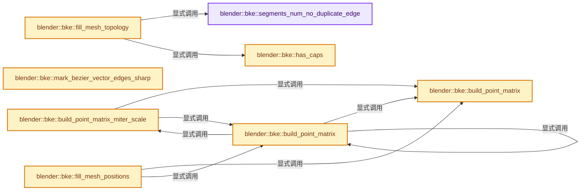
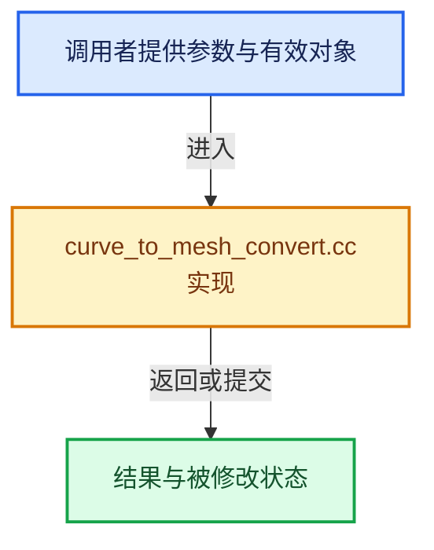

# 实现依赖专题：source/blender/blenkernel/intern/curve_to_mesh_convert.cc

[方向导航](README.md) · [符号索引](../%E7%AC%A6%E5%8F%B7%E4%BE%9D%E8%B5%96%E4%B8%8E%E5%AE%9E%E7%8E%B0%E7%B4%A2%E5%BC%95.md)

本专题从正文实际调用进入，集中保存共享实现。函数有稳定锚点，可从调用处直接跳到对应完整函数；递归与互相调用通过回链组织。

## 本文件的实现关系






## 完整成员与函数实现

<a id="f-5e3f012ed4ef5bd4"></a>

### `blender::bke::segments_num_no_duplicate_edge`

实现位置：[source/blender/blenkernel/intern/curve_to_mesh_convert.cc](../../../../../source/blender/blenkernel/intern/curve_to_mesh_convert.cc) · L27—L36。

接口参数：

- `const int points_num`
- `const bool cyclic`

**教学注释版**

<!-- annotated:44dac3b0328c61 -->

```cpp
static int segments_num_no_duplicate_edge(const int points_num, const bool cyclic)
{
  if (points_num == 0) {
    return 0;
  }
  if (points_num <= 2) {
    return curves::segments_num(points_num, false);
  }
  return curves::segments_num(points_num, cyclic);
}
```

<details>
<summary>核对原始源码：source/blender/blenkernel/intern/curve_to_mesh_convert.cc · L27—L36</summary>

<!-- original:44dac3b0328c61:source/blender/blenkernel/intern/curve_to_mesh_convert.cc:27:36 -->

```cpp
static int segments_num_no_duplicate_edge(const int points_num, const bool cyclic)
{
  if (points_num == 0) {
    return 0;
  }
  if (points_num <= 2) {
    return curves::segments_num(points_num, false);
  }
  return curves::segments_num(points_num, cyclic);
}
```

</details>

**结果出口**

- `return 0;`
- `return curves::segments_num(points_num, false);`
- `return curves::segments_num(points_num, cyclic);`

**继续追踪实现**

- `curves::segments_num` → [blender::bke::curves::segments_num · L574](04-CurvesGeometry%E5%AD%98%E5%82%A8.md#f-279080e6d7ab269f)。

<a id="f-15e9698b48515fef"></a>

### `blender::bke::has_caps`

实现位置：[source/blender/blenkernel/intern/curve_to_mesh_convert.cc](../../../../../source/blender/blenkernel/intern/curve_to_mesh_convert.cc) · L38—L43。

接口参数：

- `const bool main_cyclic`
- `const bool profile_cyclic`
- `const int profile_segment_num`

**教学注释版**

<!-- annotated:9e67ae26390f1b -->

```cpp
static inline bool has_caps(const bool main_cyclic,
                            const bool profile_cyclic,
                            const int profile_segment_num)
{
  return !main_cyclic && profile_cyclic && profile_segment_num > 2;
}
```

<details>
<summary>核对原始源码：source/blender/blenkernel/intern/curve_to_mesh_convert.cc · L38—L43</summary>

<!-- original:9e67ae26390f1b:source/blender/blenkernel/intern/curve_to_mesh_convert.cc:38:43 -->

```cpp
static inline bool has_caps(const bool main_cyclic,
                            const bool profile_cyclic,
                            const int profile_segment_num)
{
  return !main_cyclic && profile_cyclic && profile_segment_num > 2;
}
```

</details>

**结果出口**

- `return !main_cyclic && profile_cyclic && profile_segment_num > 2;`

**继续追踪实现**

本实现没有需要继续展开的显式调用；检查返回表达式、对象转换和调用者前置条件。

<a id="f-854ca08b100a1ede"></a>

### `blender::bke::fill_mesh_topology`

实现位置：[source/blender/blenkernel/intern/curve_to_mesh_convert.cc](../../../../../source/blender/blenkernel/intern/curve_to_mesh_convert.cc) · L45—L166。

接口参数：

- `const int vert_offset`
- `const int edge_offset`
- `const int face_offset`
- `const int loop_offset`
- `const int main_point_num`
- `const int profile_point_num`
- `const bool main_cyclic`
- `const bool profile_cyclic`
- `const bool fill_caps`
- `MutableSpan<int2> edges`
- `MutableSpan<int> corner_verts`
- `MutableSpan<int> corner_edges`
- `MutableSpan<int> face_offsets`

**教学注释版**

<!-- annotated:cc6bc3b86b62d3 -->

```cpp
static void fill_mesh_topology(const int vert_offset,
                               const int edge_offset,
                               const int face_offset,
                               const int loop_offset,
                               const int main_point_num,
                               const int profile_point_num,
                               const bool main_cyclic,
                               const bool profile_cyclic,
                               const bool fill_caps,
                               MutableSpan<int2> edges,
                               MutableSpan<int> corner_verts,
                               MutableSpan<int> corner_edges,
                               MutableSpan<int> face_offsets)
{
  const int main_segment_num = segments_num_no_duplicate_edge(main_point_num, main_cyclic);
  const int profile_segment_num = curves::segments_num(profile_point_num, profile_cyclic);

  if (profile_point_num == 1) {
    for (const int i : IndexRange(main_point_num - 1)) {
      int2 &edge = edges[edge_offset + i];
      edge[0] = vert_offset + i;
      edge[1] = vert_offset + i + 1;
    }

    if (main_cyclic && main_segment_num > 2) {
      int2 &edge = edges[edge_offset + main_segment_num - 1];
      edge[0] = vert_offset + main_point_num - 1;
      edge[1] = vert_offset;
    }
    return;
  }

  /* Add the edges running along the length of the curve, starting at each profile vertex. */
  const int main_edges_start = edge_offset;
  for (const int i_profile : IndexRange(profile_point_num)) {
    const int profile_edge_offset = main_edges_start + i_profile * main_segment_num;
    for (const int i_ring : IndexRange(main_segment_num)) {
      const int i_next_ring = (i_ring == main_point_num - 1) ? 0 : i_ring + 1;

      const int ring_vert_offset = vert_offset + profile_point_num * i_ring;
      const int next_ring_vert_offset = vert_offset + profile_point_num * i_next_ring;

      int2 &edge = edges[profile_edge_offset + i_ring];
      edge[0] = ring_vert_offset + i_profile;
      edge[1] = next_ring_vert_offset + i_profile;
    }
  }

  /* Add the edges running along each profile ring. */
  const int profile_edges_start = main_edges_start + profile_point_num * main_segment_num;
  for (const int i_ring : IndexRange(main_point_num)) {
    const int ring_vert_offset = vert_offset + profile_point_num * i_ring;

    const int ring_edge_offset = profile_edges_start + i_ring * profile_segment_num;
    for (const int i_profile : IndexRange(profile_segment_num)) {
      const int i_next_profile = (i_profile == profile_point_num - 1) ? 0 : i_profile + 1;

      int2 &edge = edges[ring_edge_offset + i_profile];
      edge[0] = ring_vert_offset + i_profile;
      edge[1] = ring_vert_offset + i_next_profile;
    }
  }

  /* Calculate face and corner indices. */
  for (const int i_ring : IndexRange(main_segment_num)) {
    const int i_next_ring = (i_ring == main_point_num - 1) ? 0 : i_ring + 1;

    const int ring_vert_offset = vert_offset + profile_point_num * i_ring;
    const int next_ring_vert_offset = vert_offset + profile_point_num * i_next_ring;

    const int ring_edge_start = profile_edges_start + profile_segment_num * i_ring;
    const int next_ring_edge_offset = profile_edges_start + profile_segment_num * i_next_ring;

    const int ring_face_offset = face_offset + i_ring * profile_segment_num;
    const int ring_loop_offset = loop_offset + i_ring * profile_segment_num * 4;

    for (const int i_profile : IndexRange(profile_segment_num)) {
      const int ring_segment_loop_offset = ring_loop_offset + i_profile * 4;
      const int i_next_profile = (i_profile == profile_point_num - 1) ? 0 : i_profile + 1;

      const int main_edge_start = main_edges_start + main_segment_num * i_profile;
      const int next_main_edge_start = main_edges_start + main_segment_num * i_next_profile;

      face_offsets[ring_face_offset + i_profile] = ring_segment_loop_offset;

      corner_verts[ring_segment_loop_offset] = ring_vert_offset + i_profile;
      corner_edges[ring_segment_loop_offset] = ring_edge_start + i_profile;

      corner_verts[ring_segment_loop_offset + 1] = ring_vert_offset + i_next_profile;
      corner_edges[ring_segment_loop_offset + 1] = next_main_edge_start + i_ring;

      corner_verts[ring_segment_loop_offset + 2] = next_ring_vert_offset + i_next_profile;
      corner_edges[ring_segment_loop_offset + 2] = next_ring_edge_offset + i_profile;

      corner_verts[ring_segment_loop_offset + 3] = next_ring_vert_offset + i_profile;
      corner_edges[ring_segment_loop_offset + 3] = main_edge_start + i_ring;
    }
  }

  if (fill_caps & has_caps(main_cyclic, profile_cyclic, profile_segment_num)) {
    const int face_num = main_segment_num * profile_segment_num;
    const int cap_loop_offset = loop_offset + face_num * 4;
    const int cap_face_offset = face_offset + face_num;

    face_offsets[cap_face_offset] = cap_loop_offset;
    face_offsets[cap_face_offset + 1] = cap_loop_offset + profile_segment_num;

    const int last_ring_index = main_point_num - 1;
    const int last_ring_vert_offset = vert_offset + profile_point_num * last_ring_index;
    const int last_ring_edge_offset = profile_edges_start + profile_segment_num * last_ring_index;

    for (const int i : IndexRange(profile_segment_num)) {
      const int i_inv = profile_segment_num - i - 1;
      corner_verts[cap_loop_offset + i] = vert_offset + i_inv;
      corner_edges[cap_loop_offset + i] = profile_edges_start + ((i == (profile_segment_num - 1)) ?
                                                                     (profile_segment_num - 1) :
                                                                     (i_inv - 1));
      corner_verts[cap_loop_offset + profile_segment_num + i] = last_ring_vert_offset + i;
      corner_edges[cap_loop_offset + profile_segment_num + i] = last_ring_edge_offset + i;
    }
  }
}
```

<details>
<summary>核对原始源码：source/blender/blenkernel/intern/curve_to_mesh_convert.cc · L45—L166</summary>

<!-- original:cc6bc3b86b62d3:source/blender/blenkernel/intern/curve_to_mesh_convert.cc:45:166 -->

```cpp
static void fill_mesh_topology(const int vert_offset,
                               const int edge_offset,
                               const int face_offset,
                               const int loop_offset,
                               const int main_point_num,
                               const int profile_point_num,
                               const bool main_cyclic,
                               const bool profile_cyclic,
                               const bool fill_caps,
                               MutableSpan<int2> edges,
                               MutableSpan<int> corner_verts,
                               MutableSpan<int> corner_edges,
                               MutableSpan<int> face_offsets)
{
  const int main_segment_num = segments_num_no_duplicate_edge(main_point_num, main_cyclic);
  const int profile_segment_num = curves::segments_num(profile_point_num, profile_cyclic);

  if (profile_point_num == 1) {
    for (const int i : IndexRange(main_point_num - 1)) {
      int2 &edge = edges[edge_offset + i];
      edge[0] = vert_offset + i;
      edge[1] = vert_offset + i + 1;
    }

    if (main_cyclic && main_segment_num > 2) {
      int2 &edge = edges[edge_offset + main_segment_num - 1];
      edge[0] = vert_offset + main_point_num - 1;
      edge[1] = vert_offset;
    }
    return;
  }

  /* Add the edges running along the length of the curve, starting at each profile vertex. */
  const int main_edges_start = edge_offset;
  for (const int i_profile : IndexRange(profile_point_num)) {
    const int profile_edge_offset = main_edges_start + i_profile * main_segment_num;
    for (const int i_ring : IndexRange(main_segment_num)) {
      const int i_next_ring = (i_ring == main_point_num - 1) ? 0 : i_ring + 1;

      const int ring_vert_offset = vert_offset + profile_point_num * i_ring;
      const int next_ring_vert_offset = vert_offset + profile_point_num * i_next_ring;

      int2 &edge = edges[profile_edge_offset + i_ring];
      edge[0] = ring_vert_offset + i_profile;
      edge[1] = next_ring_vert_offset + i_profile;
    }
  }

  /* Add the edges running along each profile ring. */
  const int profile_edges_start = main_edges_start + profile_point_num * main_segment_num;
  for (const int i_ring : IndexRange(main_point_num)) {
    const int ring_vert_offset = vert_offset + profile_point_num * i_ring;

    const int ring_edge_offset = profile_edges_start + i_ring * profile_segment_num;
    for (const int i_profile : IndexRange(profile_segment_num)) {
      const int i_next_profile = (i_profile == profile_point_num - 1) ? 0 : i_profile + 1;

      int2 &edge = edges[ring_edge_offset + i_profile];
      edge[0] = ring_vert_offset + i_profile;
      edge[1] = ring_vert_offset + i_next_profile;
    }
  }

  /* Calculate face and corner indices. */
  for (const int i_ring : IndexRange(main_segment_num)) {
    const int i_next_ring = (i_ring == main_point_num - 1) ? 0 : i_ring + 1;

    const int ring_vert_offset = vert_offset + profile_point_num * i_ring;
    const int next_ring_vert_offset = vert_offset + profile_point_num * i_next_ring;

    const int ring_edge_start = profile_edges_start + profile_segment_num * i_ring;
    const int next_ring_edge_offset = profile_edges_start + profile_segment_num * i_next_ring;

    const int ring_face_offset = face_offset + i_ring * profile_segment_num;
    const int ring_loop_offset = loop_offset + i_ring * profile_segment_num * 4;

    for (const int i_profile : IndexRange(profile_segment_num)) {
      const int ring_segment_loop_offset = ring_loop_offset + i_profile * 4;
      const int i_next_profile = (i_profile == profile_point_num - 1) ? 0 : i_profile + 1;

      const int main_edge_start = main_edges_start + main_segment_num * i_profile;
      const int next_main_edge_start = main_edges_start + main_segment_num * i_next_profile;

      face_offsets[ring_face_offset + i_profile] = ring_segment_loop_offset;

      corner_verts[ring_segment_loop_offset] = ring_vert_offset + i_profile;
      corner_edges[ring_segment_loop_offset] = ring_edge_start + i_profile;

      corner_verts[ring_segment_loop_offset + 1] = ring_vert_offset + i_next_profile;
      corner_edges[ring_segment_loop_offset + 1] = next_main_edge_start + i_ring;

      corner_verts[ring_segment_loop_offset + 2] = next_ring_vert_offset + i_next_profile;
      corner_edges[ring_segment_loop_offset + 2] = next_ring_edge_offset + i_profile;

      corner_verts[ring_segment_loop_offset + 3] = next_ring_vert_offset + i_profile;
      corner_edges[ring_segment_loop_offset + 3] = main_edge_start + i_ring;
    }
  }

  if (fill_caps & has_caps(main_cyclic, profile_cyclic, profile_segment_num)) {
    const int face_num = main_segment_num * profile_segment_num;
    const int cap_loop_offset = loop_offset + face_num * 4;
    const int cap_face_offset = face_offset + face_num;

    face_offsets[cap_face_offset] = cap_loop_offset;
    face_offsets[cap_face_offset + 1] = cap_loop_offset + profile_segment_num;

    const int last_ring_index = main_point_num - 1;
    const int last_ring_vert_offset = vert_offset + profile_point_num * last_ring_index;
    const int last_ring_edge_offset = profile_edges_start + profile_segment_num * last_ring_index;

    for (const int i : IndexRange(profile_segment_num)) {
      const int i_inv = profile_segment_num - i - 1;
      corner_verts[cap_loop_offset + i] = vert_offset + i_inv;
      corner_edges[cap_loop_offset + i] = profile_edges_start + ((i == (profile_segment_num - 1)) ?
                                                                     (profile_segment_num - 1) :
                                                                     (i_inv - 1));
      corner_verts[cap_loop_offset + profile_segment_num + i] = last_ring_vert_offset + i;
      corner_edges[cap_loop_offset + profile_segment_num + i] = last_ring_edge_offset + i;
    }
  }
}
```

</details>

**沿实际写入检查状态**

- `edge[0] = vert_offset + i;`
- `edge[1] = vert_offset + i + 1;`
- `edge[0] = vert_offset + main_point_num - 1;`
- `edge[1] = vert_offset;`
- `edge[0] = ring_vert_offset + i_profile;`
- `edge[1] = next_ring_vert_offset + i_profile;`
- `edge[1] = ring_vert_offset + i_next_profile;`
- `corner_verts[ring_segment_loop_offset] = ring_vert_offset + i_profile;`
- `corner_edges[ring_segment_loop_offset] = ring_edge_start + i_profile;`
- `face_offsets[cap_face_offset] = cap_loop_offset;`

**继续追踪实现**

- `segments_num_no_duplicate_edge` → [blender::bke::segments_num_no_duplicate_edge · L27](%E4%BE%9D%E8%B5%96-curve_to_mesh_convert-b4cd69.md#f-5e3f012ed4ef5bd4)。
- `curves::segments_num` → [blender::bke::curves::segments_num · L574](04-CurvesGeometry%E5%AD%98%E5%82%A8.md#f-279080e6d7ab269f)。
- `IndexRange` → [blender::IndexRange](../01-%E5%9F%BA%E7%A1%80%E5%AE%B9%E5%99%A8%E4%B8%8E%E7%8E%B0%E4%BB%A3CPP/%E4%BE%9D%E8%B5%96-BLI_index_range-7d7cc5.md#t-caa3466d6776)；[blender::gpu::shader::parser::IndexRange](%E4%BE%9D%E8%B5%96-utils-06433d.md#t-82d2bd4ea71c)；[blender::IndexRange](%E4%BE%9D%E8%B5%96-DNA_node_types-6708b9.md#t-0448cc889d39)。
- `has_caps` → [blender::bke::has_caps · L38](%E4%BE%9D%E8%B5%96-curve_to_mesh_convert-b4cd69.md#f-15e9698b48515fef)。

<a id="f-fb13052565c58bba"></a>

### `blender::bke::mark_bezier_vector_edges_sharp`

实现位置：[source/blender/blenkernel/intern/curve_to_mesh_convert.cc](../../../../../source/blender/blenkernel/intern/curve_to_mesh_convert.cc) · L169—L187。

接口参数：

- `const int profile_point_num`
- `const int main_segment_num`
- `const Span<int> control_point_offsets`
- `const Span<int8_t> handle_types_left`
- `const Span<int8_t> handle_types_right`
- `MutableSpan<bool> sharp_edges`

**教学注释版**

<!-- annotated:c7498e617558b7 -->

```cpp
static void mark_bezier_vector_edges_sharp(const int profile_point_num,
                                           const int main_segment_num,
                                           const Span<int> control_point_offsets,
                                           const Span<int8_t> handle_types_left,
                                           const Span<int8_t> handle_types_right,
                                           MutableSpan<bool> sharp_edges)
{
  const int main_edges_start = 0;
  if (curves::bezier::point_is_sharp(handle_types_left, handle_types_right, 0)) {
    // [讲解] sharp_edges.slice：建立原连续范围的子视图。
    sharp_edges.slice(main_edges_start, main_segment_num).fill(true);
  }

  for (const int i : IndexRange(profile_point_num).drop_front(1)) {
    if (curves::bezier::point_is_sharp(handle_types_left, handle_types_right, i)) {
      const int offset = main_edges_start + main_segment_num * control_point_offsets[i];
      sharp_edges.slice(offset, main_segment_num).fill(true);
    }
  }
}
```

<details>
<summary>核对原始源码：source/blender/blenkernel/intern/curve_to_mesh_convert.cc · L169—L187</summary>

<!-- original:c7498e617558b7:source/blender/blenkernel/intern/curve_to_mesh_convert.cc:169:187 -->

```cpp
static void mark_bezier_vector_edges_sharp(const int profile_point_num,
                                           const int main_segment_num,
                                           const Span<int> control_point_offsets,
                                           const Span<int8_t> handle_types_left,
                                           const Span<int8_t> handle_types_right,
                                           MutableSpan<bool> sharp_edges)
{
  const int main_edges_start = 0;
  if (curves::bezier::point_is_sharp(handle_types_left, handle_types_right, 0)) {
    sharp_edges.slice(main_edges_start, main_segment_num).fill(true);
  }

  for (const int i : IndexRange(profile_point_num).drop_front(1)) {
    if (curves::bezier::point_is_sharp(handle_types_left, handle_types_right, i)) {
      const int offset = main_edges_start + main_segment_num * control_point_offsets[i];
      sharp_edges.slice(offset, main_segment_num).fill(true);
    }
  }
}
```

</details>

**继续追踪实现**

- `curves::bezier::point_is_sharp` → [blender::bke::curves::bezier::point_is_sharp · L1115](04-CurvesGeometry%E5%AD%98%E5%82%A8.md#f-fb1b616944885465)。
- `sharp_edges.slice(main_edges_start, main_segment_num).fill` → [调用协议](../%E6%A8%A1%E6%9D%BF%E5%AE%8F%E4%B8%8E%E5%8A%A8%E6%80%81%E5%88%86%E6%B4%BE%E5%8D%8F%E8%AE%AE.md)：接收对象类型依赖auto、返回值或模板实例；不按同名猜测目标。调用位置L178。
- `sharp_edges.slice` → [blender::MutableSpan::slice · L579](../01-%E5%9F%BA%E7%A1%80%E5%AE%B9%E5%99%A8%E4%B8%8E%E7%8E%B0%E4%BB%A3CPP/06-MutableSpan%E5%8F%AF%E5%86%99%E8%A7%86%E5%9B%BE.md#f-6808b4aefbf58808)；[blender::MutableSpan::slice · L587](../01-%E5%9F%BA%E7%A1%80%E5%AE%B9%E5%99%A8%E4%B8%8E%E7%8E%B0%E4%BB%A3CPP/06-MutableSpan%E5%8F%AF%E5%86%99%E8%A7%86%E5%9B%BE.md#f-c05b010821861e4f)。同名重载需按实参类型选择。
- `IndexRange(profile_point_num).drop_front` → [调用协议](../%E6%A8%A1%E6%9D%BF%E5%AE%8F%E4%B8%8E%E5%8A%A8%E6%80%81%E5%88%86%E6%B4%BE%E5%8D%8F%E8%AE%AE.md)：接收对象类型依赖auto、返回值或模板实例；不按同名猜测目标。调用位置L181。
- `IndexRange` → [blender::IndexRange](../01-%E5%9F%BA%E7%A1%80%E5%AE%B9%E5%99%A8%E4%B8%8E%E7%8E%B0%E4%BB%A3CPP/%E4%BE%9D%E8%B5%96-BLI_index_range-7d7cc5.md#t-caa3466d6776)；[blender::gpu::shader::parser::IndexRange](%E4%BE%9D%E8%B5%96-utils-06433d.md#t-82d2bd4ea71c)；[blender::IndexRange](%E4%BE%9D%E8%B5%96-DNA_node_types-6708b9.md#t-0448cc889d39)。
- `sharp_edges.slice(offset, main_segment_num).fill` → [调用协议](../%E6%A8%A1%E6%9D%BF%E5%AE%8F%E4%B8%8E%E5%8A%A8%E6%80%81%E5%88%86%E6%B4%BE%E5%8D%8F%E8%AE%AE.md)：接收对象类型依赖auto、返回值或模板实例；不按同名猜测目标。调用位置L184。

<a id="f-f2224a14c60c94af"></a>

### `blender::bke::build_point_matrix`

实现位置：[source/blender/blenkernel/intern/curve_to_mesh_convert.cc](../../../../../source/blender/blenkernel/intern/curve_to_mesh_convert.cc) · L189—L200。

接口参数：

- `const float3 &location`
- `const float3 &tangent`
- `const float3 &normal`

**教学注释版**

<!-- annotated:335587a838c90e -->

```cpp
static float4x4 build_point_matrix(const float3 &location,
                                   const float3 &tangent,
                                   const float3 &normal)
{
  float4x4 matrix = float4x4::identity();
  matrix.x_axis() = tangent;
  /* Normal and tangent may not be orthogonal in case of custom normals. */
  matrix.y_axis() = math::normalize(math::cross(normal, tangent));
  matrix.z_axis() = normal;
  matrix.location() = location;
  return matrix;
}
```

<details>
<summary>核对原始源码：source/blender/blenkernel/intern/curve_to_mesh_convert.cc · L189—L200</summary>

<!-- original:335587a838c90e:source/blender/blenkernel/intern/curve_to_mesh_convert.cc:189:200 -->

```cpp
static float4x4 build_point_matrix(const float3 &location,
                                   const float3 &tangent,
                                   const float3 &normal)
{
  float4x4 matrix = float4x4::identity();
  matrix.x_axis() = tangent;
  /* Normal and tangent may not be orthogonal in case of custom normals. */
  matrix.y_axis() = math::normalize(math::cross(normal, tangent));
  matrix.z_axis() = normal;
  matrix.location() = location;
  return matrix;
}
```

</details>

**结果出口**

- `return matrix;`

**继续追踪实现**

- `float4x4::identity` → [调用协议](../%E6%A8%A1%E6%9D%BF%E5%AE%8F%E4%B8%8E%E5%8A%A8%E6%80%81%E5%88%86%E6%B4%BE%E5%8D%8F%E8%AE%AE.md)：函数指针、局部可调用对象或未展开的宏；必须结合调用者环境。调用位置L193。
- `matrix.x_axis` → [调用协议](../%E6%A8%A1%E6%9D%BF%E5%AE%8F%E4%B8%8E%E5%8A%A8%E6%80%81%E5%88%86%E6%B4%BE%E5%8D%8F%E8%AE%AE.md)：由接收对象具体类型或运行时策略提供实现。调用位置L194。
- `matrix.y_axis` → [调用协议](../%E6%A8%A1%E6%9D%BF%E5%AE%8F%E4%B8%8E%E5%8A%A8%E6%80%81%E5%88%86%E6%B4%BE%E5%8D%8F%E8%AE%AE.md)：由接收对象具体类型或运行时策略提供实现。调用位置L196。
- `math::normalize` → [blender::math::normalize · L542](../12-%E7%A9%BA%E9%97%B4%E6%95%B0%E6%8D%AE%E7%BB%93%E6%9E%84%E4%B8%8E%E5%87%A0%E4%BD%95%E7%AE%97%E6%B3%95/%E4%BE%9D%E8%B5%96-BLI_math_vector-906a87.md#f-5bea914457e11f7f)；[blender::math::normalize · L258](../12-%E7%A9%BA%E9%97%B4%E6%95%B0%E6%8D%AE%E7%BB%93%E6%9E%84%E4%B8%8E%E5%87%A0%E4%BD%95%E7%AE%97%E6%B3%95/%E4%BE%9D%E8%B5%96-BLI_math_quaternion-cf105d.md#f-5bf6b351333e4054)；[blender::math::normalize · L450](../12-%E7%A9%BA%E9%97%B4%E6%95%B0%E6%8D%AE%E7%BB%93%E6%9E%84%E4%B8%8E%E5%87%A0%E4%BD%95%E7%AE%97%E6%B3%95/%E4%BE%9D%E8%B5%96-BLI_math_quaternion-cf105d.md#f-b852cee8f0cc9b6a)；[blender::math::normalize · L745](../12-%E7%A9%BA%E9%97%B4%E6%95%B0%E6%8D%AE%E7%BB%93%E6%9E%84%E4%B8%8E%E5%87%A0%E4%BD%95%E7%AE%97%E6%B3%95/%E4%BE%9D%E8%B5%96-BLI_math_matrix-b7b2b4.md#f-2235cb6f5ec7ff18)；[blender::math::normalize · L783](../12-%E7%A9%BA%E9%97%B4%E6%95%B0%E6%8D%AE%E7%BB%93%E6%9E%84%E4%B8%8E%E5%87%A0%E4%BD%95%E7%AE%97%E6%B3%95/%E4%BE%9D%E8%B5%96-BLI_math_matrix-b7b2b4.md#f-0386bc4ee9ac7425)。同名重载需按实参类型选择。
- `math::cross` → [blender::math::cross · L549](../12-%E7%A9%BA%E9%97%B4%E6%95%B0%E6%8D%AE%E7%BB%93%E6%9E%84%E4%B8%8E%E5%87%A0%E4%BD%95%E7%AE%97%E6%B3%95/%E4%BE%9D%E8%B5%96-BLI_math_vector-906a87.md#f-cb1b14dc107aa107)；[blender::math::cross · L562](../12-%E7%A9%BA%E9%97%B4%E6%95%B0%E6%8D%AE%E7%BB%93%E6%9E%84%E4%B8%8E%E5%87%A0%E4%BD%95%E7%AE%97%E6%B3%95/%E4%BE%9D%E8%B5%96-BLI_math_vector-906a87.md#f-8dcac1cc63a3672a)；[blender::math::cross · L217](../12-%E7%A9%BA%E9%97%B4%E6%95%B0%E6%8D%AE%E7%BB%93%E6%9E%84%E4%B8%8E%E5%87%A0%E4%BD%95%E7%AE%97%E6%B3%95/%E4%BE%9D%E8%B5%96-BLI_math_basis_types-fc7090.md#f-0cb9fb63f068f85e)。同名重载需按实参类型选择。
- `matrix.z_axis` → [调用协议](../%E6%A8%A1%E6%9D%BF%E5%AE%8F%E4%B8%8E%E5%8A%A8%E6%80%81%E5%88%86%E6%B4%BE%E5%8D%8F%E8%AE%AE.md)：由接收对象具体类型或运行时策略提供实现。调用位置L197。
- `matrix.location` → [调用协议](../%E6%A8%A1%E6%9D%BF%E5%AE%8F%E4%B8%8E%E5%8A%A8%E6%80%81%E5%88%86%E6%B4%BE%E5%8D%8F%E8%AE%AE.md)：由接收对象具体类型或运行时策略提供实现。调用位置L198。

<a id="f-17532fd7248b32f8"></a>

### `blender::bke::build_point_matrix_miter_scale`

实现位置：[source/blender/blenkernel/intern/curve_to_mesh_convert.cc](../../../../../source/blender/blenkernel/intern/curve_to_mesh_convert.cc) · L202—L226。

接口参数：

- `const float3 &location_prev`
- `const float3 &location`
- `const float3 &location_next`
- `const float3 &tangent`
- `const float3 &normal`
- `const float miter_scale_limit`

**教学注释版**

<!-- annotated:cbfb55acbfa653 -->

```cpp
static float4x4 build_point_matrix_miter_scale(const float3 &location_prev,
                                               const float3 &location,
                                               const float3 &location_next,
                                               const float3 &tangent,
                                               const float3 &normal,
                                               const float miter_scale_limit)
{
  float length_in;
  float length_out;
  const float3 dir_in = math::normalize_and_get_length(location - location_prev, length_in);
  const float3 dir_out = math::normalize_and_get_length(location_next - location, length_out);
  if (length_in < 1e-10f || length_out < 1e-10f) {
    return build_point_matrix(location, tangent, normal);
  }
  const float cos_turn = math::dot(dir_in, dir_out);
  if (cos_turn >= 1.0f || cos_turn == -1.0f) {
    return build_point_matrix(location, tangent, normal);
  }
  float4x4 matrix = build_point_matrix(location, tangent, normal);
  const float scale = math::min(math::sqrt(2.0f / (1.0f + cos_turn)), miter_scale_limit);
  const float3 bisector = math::normalize(dir_out - dir_in);
  matrix.x_axis() += (scale - 1.0f) * math::dot(matrix.x_axis(), bisector) * bisector;
  matrix.y_axis() += (scale - 1.0f) * math::dot(matrix.y_axis(), bisector) * bisector;
  return matrix;
}
```

<details>
<summary>核对原始源码：source/blender/blenkernel/intern/curve_to_mesh_convert.cc · L202—L226</summary>

<!-- original:cbfb55acbfa653:source/blender/blenkernel/intern/curve_to_mesh_convert.cc:202:226 -->

```cpp
static float4x4 build_point_matrix_miter_scale(const float3 &location_prev,
                                               const float3 &location,
                                               const float3 &location_next,
                                               const float3 &tangent,
                                               const float3 &normal,
                                               const float miter_scale_limit)
{
  float length_in;
  float length_out;
  const float3 dir_in = math::normalize_and_get_length(location - location_prev, length_in);
  const float3 dir_out = math::normalize_and_get_length(location_next - location, length_out);
  if (length_in < 1e-10f || length_out < 1e-10f) {
    return build_point_matrix(location, tangent, normal);
  }
  const float cos_turn = math::dot(dir_in, dir_out);
  if (cos_turn >= 1.0f || cos_turn == -1.0f) {
    return build_point_matrix(location, tangent, normal);
  }
  float4x4 matrix = build_point_matrix(location, tangent, normal);
  const float scale = math::min(math::sqrt(2.0f / (1.0f + cos_turn)), miter_scale_limit);
  const float3 bisector = math::normalize(dir_out - dir_in);
  matrix.x_axis() += (scale - 1.0f) * math::dot(matrix.x_axis(), bisector) * bisector;
  matrix.y_axis() += (scale - 1.0f) * math::dot(matrix.y_axis(), bisector) * bisector;
  return matrix;
}
```

</details>

**结果出口**

- `return build_point_matrix(location, tangent, normal);`
- `return matrix;`

**继续追踪实现**

- `math::normalize_and_get_length` → [blender::math::normalize_and_get_length · L526](../12-%E7%A9%BA%E9%97%B4%E6%95%B0%E6%8D%AE%E7%BB%93%E6%9E%84%E4%B8%8E%E5%87%A0%E4%BD%95%E7%AE%97%E6%B3%95/%E4%BE%9D%E8%B5%96-BLI_math_vector-906a87.md#f-77d1393eb1349806)；[blender::math::normalize_and_get_length · L250](../12-%E7%A9%BA%E9%97%B4%E6%95%B0%E6%8D%AE%E7%BB%93%E6%9E%84%E4%B8%8E%E5%87%A0%E4%BD%95%E7%AE%97%E6%B3%95/%E4%BE%9D%E8%B5%96-BLI_math_quaternion-cf105d.md#f-6fcf25529d2136aa)。同名重载需按实参类型选择。
- `build_point_matrix` → [blender::bke::build_point_matrix · L189](%E4%BE%9D%E8%B5%96-curve_to_mesh_convert-b4cd69.md#f-f2224a14c60c94af)；[blender::bke::build_point_matrix · L228](%E4%BE%9D%E8%B5%96-curve_to_mesh_convert-b4cd69.md#f-980e24a4f3f0cf29)。同名重载需按实参类型选择。
- `math::dot` → [blender::math::dot · L430](../12-%E7%A9%BA%E9%97%B4%E6%95%B0%E6%8D%AE%E7%BB%93%E6%9E%84%E4%B8%8E%E5%87%A0%E4%BD%95%E7%AE%97%E6%B3%95/%E4%BE%9D%E8%B5%96-BLI_math_vector-906a87.md#f-6f0c6a081b107428)；[blender::math::dot · L198](../12-%E7%A9%BA%E9%97%B4%E6%95%B0%E6%8D%AE%E7%BB%93%E6%9E%84%E4%B8%8E%E5%87%A0%E4%BD%95%E7%AE%97%E6%B3%95/%E4%BE%9D%E8%B5%96-BLI_math_quaternion-cf105d.md#f-5b1ef457981dbc76)。同名重载需按实参类型选择。
- `math::min` → [blender::math::min · L56](../12-%E7%A9%BA%E9%97%B4%E6%95%B0%E6%8D%AE%E7%BB%93%E6%9E%84%E4%B8%8E%E5%87%A0%E4%BD%95%E7%AE%97%E6%B3%95/%E4%BE%9D%E8%B5%96-BLI_math_vector-906a87.md#f-ee6ead51e4bb3364)；[blender::math::min · L65](../12-%E7%A9%BA%E9%97%B4%E6%95%B0%E6%8D%AE%E7%BB%93%E6%9E%84%E4%B8%8E%E5%87%A0%E4%BD%95%E7%AE%97%E6%B3%95/%E4%BE%9D%E8%B5%96-BLI_math_vector-906a87.md#f-f65ce48b3051cce3)；[blender::math::min · L81](../12-%E7%A9%BA%E9%97%B4%E6%95%B0%E6%8D%AE%E7%BB%93%E6%9E%84%E4%B8%8E%E5%87%A0%E4%BD%95%E7%AE%97%E6%B3%95/%E4%BE%9D%E8%B5%96-BLI_math_vector-906a87.md#f-9c602d29fab41795)；[blender::math::min · L43](../12-%E7%A9%BA%E9%97%B4%E6%95%B0%E6%8D%AE%E7%BB%93%E6%9E%84%E4%B8%8E%E5%87%A0%E4%BD%95%E7%AE%97%E6%B3%95/%E4%BE%9D%E8%B5%96-BLI_math_base-0728eb.md#f-72ff0c229e6c09b0)。同名重载需按实参类型选择。
- `math::sqrt` → [外部契约](https://eel.is/c++draft/)：这个边界按实际表达式及所属类型核对参数、返回值、寿命与失败行为。这里提供接口入口，不声称已解释该第三方版本的内部实现。
- `math::normalize` → [blender::math::normalize · L542](../12-%E7%A9%BA%E9%97%B4%E6%95%B0%E6%8D%AE%E7%BB%93%E6%9E%84%E4%B8%8E%E5%87%A0%E4%BD%95%E7%AE%97%E6%B3%95/%E4%BE%9D%E8%B5%96-BLI_math_vector-906a87.md#f-5bea914457e11f7f)；[blender::math::normalize · L258](../12-%E7%A9%BA%E9%97%B4%E6%95%B0%E6%8D%AE%E7%BB%93%E6%9E%84%E4%B8%8E%E5%87%A0%E4%BD%95%E7%AE%97%E6%B3%95/%E4%BE%9D%E8%B5%96-BLI_math_quaternion-cf105d.md#f-5bf6b351333e4054)；[blender::math::normalize · L450](../12-%E7%A9%BA%E9%97%B4%E6%95%B0%E6%8D%AE%E7%BB%93%E6%9E%84%E4%B8%8E%E5%87%A0%E4%BD%95%E7%AE%97%E6%B3%95/%E4%BE%9D%E8%B5%96-BLI_math_quaternion-cf105d.md#f-b852cee8f0cc9b6a)；[blender::math::normalize · L745](../12-%E7%A9%BA%E9%97%B4%E6%95%B0%E6%8D%AE%E7%BB%93%E6%9E%84%E4%B8%8E%E5%87%A0%E4%BD%95%E7%AE%97%E6%B3%95/%E4%BE%9D%E8%B5%96-BLI_math_matrix-b7b2b4.md#f-2235cb6f5ec7ff18)；[blender::math::normalize · L783](../12-%E7%A9%BA%E9%97%B4%E6%95%B0%E6%8D%AE%E7%BB%93%E6%9E%84%E4%B8%8E%E5%87%A0%E4%BD%95%E7%AE%97%E6%B3%95/%E4%BE%9D%E8%B5%96-BLI_math_matrix-b7b2b4.md#f-0386bc4ee9ac7425)。同名重载需按实参类型选择。
- `matrix.x_axis` → [调用协议](../%E6%A8%A1%E6%9D%BF%E5%AE%8F%E4%B8%8E%E5%8A%A8%E6%80%81%E5%88%86%E6%B4%BE%E5%8D%8F%E8%AE%AE.md)：由接收对象具体类型或运行时策略提供实现。调用位置L223。
- `matrix.y_axis` → [调用协议](../%E6%A8%A1%E6%9D%BF%E5%AE%8F%E4%B8%8E%E5%8A%A8%E6%80%81%E5%88%86%E6%B4%BE%E5%8D%8F%E8%AE%AE.md)：由接收对象具体类型或运行时策略提供实现。调用位置L224。

<a id="f-980e24a4f3f0cf29"></a>

### `blender::bke::build_point_matrix`

实现位置：[source/blender/blenkernel/intern/curve_to_mesh_convert.cc](../../../../../source/blender/blenkernel/intern/curve_to_mesh_convert.cc) · L228—L255。

接口参数：

- `const Span<float3> main_positions`
- `const Span<float3> tangents`
- `const Span<float3> normals`
- `const Span<float> scales`
- `const bool main_cyclic`
- `const std::optional<float> miter_scale_limit`
- `const int i_ring`

**教学注释版**

<!-- annotated:55700a5702ffe6 -->

```cpp
static float4x4 build_point_matrix(const Span<float3> main_positions,
                                   const Span<float3> tangents,
                                   const Span<float3> normals,
                                   const Span<float> scales,
                                   const bool main_cyclic,
                                   const std::optional<float> miter_scale_limit,
                                   const int i_ring)
{
  // [讲解] main_positions.size：查询视图长度或生成对应有效索引区间。
  const bool is_end = !main_cyclic && (i_ring == 0 || i_ring == main_positions.size() - 1);
  float4x4 point_matrix;
  if (!miter_scale_limit || is_end) {
    point_matrix = build_point_matrix(main_positions[i_ring], normals[i_ring], tangents[i_ring]);
  }
  else {
    const int i_ring_prev = i_ring == 0 ? main_positions.size() - 1 : i_ring - 1;
    const int i_ring_next = i_ring == main_positions.size() - 1 ? 0 : i_ring + 1;
    point_matrix = build_point_matrix_miter_scale(main_positions[i_ring_prev],
                                                  main_positions[i_ring],
                                                  main_positions[i_ring_next],
                                                  normals[i_ring],
                                                  tangents[i_ring],
                                                  *miter_scale_limit);
  }
  // [讲解] scales.is_empty：查询视图长度或生成对应有效索引区间。
  if (!scales.is_empty()) {
    point_matrix = math::scale(point_matrix, float3(scales[i_ring]));
  }
  return point_matrix;
}
```

<details>
<summary>核对原始源码：source/blender/blenkernel/intern/curve_to_mesh_convert.cc · L228—L255</summary>

<!-- original:55700a5702ffe6:source/blender/blenkernel/intern/curve_to_mesh_convert.cc:228:255 -->

```cpp
static float4x4 build_point_matrix(const Span<float3> main_positions,
                                   const Span<float3> tangents,
                                   const Span<float3> normals,
                                   const Span<float> scales,
                                   const bool main_cyclic,
                                   const std::optional<float> miter_scale_limit,
                                   const int i_ring)
{
  const bool is_end = !main_cyclic && (i_ring == 0 || i_ring == main_positions.size() - 1);
  float4x4 point_matrix;
  if (!miter_scale_limit || is_end) {
    point_matrix = build_point_matrix(main_positions[i_ring], normals[i_ring], tangents[i_ring]);
  }
  else {
    const int i_ring_prev = i_ring == 0 ? main_positions.size() - 1 : i_ring - 1;
    const int i_ring_next = i_ring == main_positions.size() - 1 ? 0 : i_ring + 1;
    point_matrix = build_point_matrix_miter_scale(main_positions[i_ring_prev],
                                                  main_positions[i_ring],
                                                  main_positions[i_ring_next],
                                                  normals[i_ring],
                                                  tangents[i_ring],
                                                  *miter_scale_limit);
  }
  if (!scales.is_empty()) {
    point_matrix = math::scale(point_matrix, float3(scales[i_ring]));
  }
  return point_matrix;
}
```

</details>

**沿实际写入检查状态**

- `point_matrix = build_point_matrix(main_positions[i_ring], normals[i_ring], tangents[i_ring]);`
- `point_matrix = build_point_matrix_miter_scale(main_positions[i_ring_prev],`
- `point_matrix = math::scale(point_matrix, float3(scales[i_ring]));`

**结果出口**

- `return point_matrix;`

**继续追踪实现**

- `main_positions.size` → [blender::Span::size · L256](../01-%E5%9F%BA%E7%A1%80%E5%AE%B9%E5%99%A8%E4%B8%8E%E7%8E%B0%E4%BB%A3CPP/05-Span%E5%8F%AA%E8%AF%BB%E8%BF%9E%E7%BB%AD%E8%A7%86%E5%9B%BE.md#f-5f80fa006089c998)。
- `build_point_matrix` → [blender::bke::build_point_matrix · L189](%E4%BE%9D%E8%B5%96-curve_to_mesh_convert-b4cd69.md#f-f2224a14c60c94af)；[blender::bke::build_point_matrix · L228](%E4%BE%9D%E8%B5%96-curve_to_mesh_convert-b4cd69.md#f-980e24a4f3f0cf29)。同名重载需按实参类型选择。
- `build_point_matrix_miter_scale` → [blender::bke::build_point_matrix_miter_scale · L202](%E4%BE%9D%E8%B5%96-curve_to_mesh_convert-b4cd69.md#f-17532fd7248b32f8)。
- `scales.is_empty` → [blender::Span::is_empty · L264](../01-%E5%9F%BA%E7%A1%80%E5%AE%B9%E5%99%A8%E4%B8%8E%E7%8E%B0%E4%BB%A3CPP/05-Span%E5%8F%AA%E8%AF%BB%E8%BF%9E%E7%BB%AD%E8%A7%86%E5%9B%BE.md#f-8cc1d7ba8feb50e6)。
- `math::scale` → [blender::math::scale · L724](../12-%E7%A9%BA%E9%97%B4%E6%95%B0%E6%8D%AE%E7%BB%93%E6%9E%84%E4%B8%8E%E5%87%A0%E4%BD%95%E7%AE%97%E6%B3%95/%E4%BE%9D%E8%B5%96-BLI_math_matrix-b7b2b4.md#f-197f7b3dee8e1df5)。
- `float3` → [float3 · L641](%E4%BE%9D%E8%B5%96-smaa-b67bc2.md#m-0ea8254cfdb4)。宏定义由构建条件选择。

<a id="f-6c3e3c4207a79cb5"></a>

### `blender::bke::fill_mesh_positions`

实现位置：[source/blender/blenkernel/intern/curve_to_mesh_convert.cc](../../../../../source/blender/blenkernel/intern/curve_to_mesh_convert.cc) · L257—L284。

接口参数：

- `const Span<float3> main_positions`
- `const Span<float3> profile_positions`
- `const Span<float3> tangents`
- `const Span<float3> normals`
- `const Span<float> scales`
- `const bool main_cyclic`
- `const std::optional<float> miter_scale_limit`
- `MutableSpan<float3> mesh_positions`

**教学注释版**

<!-- annotated:c7dde22a46fbae -->

```cpp
static void fill_mesh_positions(const Span<float3> main_positions,
                                const Span<float3> profile_positions,
                                const Span<float3> tangents,
                                const Span<float3> normals,
                                const Span<float> scales,
                                const bool main_cyclic,
                                const std::optional<float> miter_scale_limit,
                                MutableSpan<float3> mesh_positions)
{
  // [讲解] profile_positions.size：查询视图长度或生成对应有效索引区间。
  if (profile_positions.size() == 1) {
    // [讲解] main_positions.index_range：查询视图长度或生成对应有效索引区间。
    for (const int i_ring : main_positions.index_range()) {
      const float4x4 point_matrix = build_point_matrix(
          main_positions, tangents, normals, scales, main_cyclic, miter_scale_limit, i_ring);
      // [讲解] profile_positions.first：按视图边界访问元素。
      mesh_positions[i_ring] = math::transform_point(point_matrix, profile_positions.first());
    }
  }
  else {
    for (const int i_ring : main_positions.index_range()) {
      const float4x4 point_matrix = build_point_matrix(
          main_positions, tangents, normals, scales, main_cyclic, miter_scale_limit, i_ring);
      const int ring_vert_start = i_ring * profile_positions.size();
      for (const int i_profile : profile_positions.index_range()) {
        mesh_positions[ring_vert_start + i_profile] = math::transform_point(
            point_matrix, profile_positions[i_profile]);
      }
    }
  }
}
```

<details>
<summary>核对原始源码：source/blender/blenkernel/intern/curve_to_mesh_convert.cc · L257—L284</summary>

<!-- original:c7dde22a46fbae:source/blender/blenkernel/intern/curve_to_mesh_convert.cc:257:284 -->

```cpp
static void fill_mesh_positions(const Span<float3> main_positions,
                                const Span<float3> profile_positions,
                                const Span<float3> tangents,
                                const Span<float3> normals,
                                const Span<float> scales,
                                const bool main_cyclic,
                                const std::optional<float> miter_scale_limit,
                                MutableSpan<float3> mesh_positions)
{
  if (profile_positions.size() == 1) {
    for (const int i_ring : main_positions.index_range()) {
      const float4x4 point_matrix = build_point_matrix(
          main_positions, tangents, normals, scales, main_cyclic, miter_scale_limit, i_ring);
      mesh_positions[i_ring] = math::transform_point(point_matrix, profile_positions.first());
    }
  }
  else {
    for (const int i_ring : main_positions.index_range()) {
      const float4x4 point_matrix = build_point_matrix(
          main_positions, tangents, normals, scales, main_cyclic, miter_scale_limit, i_ring);
      const int ring_vert_start = i_ring * profile_positions.size();
      for (const int i_profile : profile_positions.index_range()) {
        mesh_positions[ring_vert_start + i_profile] = math::transform_point(
            point_matrix, profile_positions[i_profile]);
      }
    }
  }
}
```

</details>

**沿实际写入检查状态**

- `mesh_positions[i_ring] = math::transform_point(point_matrix, profile_positions.first());`

**继续追踪实现**

- `profile_positions.size` → [blender::Span::size · L256](../01-%E5%9F%BA%E7%A1%80%E5%AE%B9%E5%99%A8%E4%B8%8E%E7%8E%B0%E4%BB%A3CPP/05-Span%E5%8F%AA%E8%AF%BB%E8%BF%9E%E7%BB%AD%E8%A7%86%E5%9B%BE.md#f-5f80fa006089c998)。
- `main_positions.index_range` → [blender::Span::index_range · L405](../01-%E5%9F%BA%E7%A1%80%E5%AE%B9%E5%99%A8%E4%B8%8E%E7%8E%B0%E4%BB%A3CPP/05-Span%E5%8F%AA%E8%AF%BB%E8%BF%9E%E7%BB%AD%E8%A7%86%E5%9B%BE.md#f-caaa9b06e13e53e0)。
- `build_point_matrix` → [blender::bke::build_point_matrix · L189](%E4%BE%9D%E8%B5%96-curve_to_mesh_convert-b4cd69.md#f-f2224a14c60c94af)；[blender::bke::build_point_matrix · L228](%E4%BE%9D%E8%B5%96-curve_to_mesh_convert-b4cd69.md#f-980e24a4f3f0cf29)。同名重载需按实参类型选择。
- `math::transform_point` → [blender::math::transform_point · L318](../12-%E7%A9%BA%E9%97%B4%E6%95%B0%E6%8D%AE%E7%BB%93%E6%9E%84%E4%B8%8E%E5%87%A0%E4%BD%95%E7%AE%97%E6%B3%95/%E4%BE%9D%E8%B5%96-BLI_math_quaternion-cf105d.md#f-e52a2e8c12e32657)；[blender::math::transform_point · L491](../12-%E7%A9%BA%E9%97%B4%E6%95%B0%E6%8D%AE%E7%BB%93%E6%9E%84%E4%B8%8E%E5%87%A0%E4%BD%95%E7%AE%97%E6%B3%95/%E4%BE%9D%E8%B5%96-BLI_math_quaternion-cf105d.md#f-6c9f8362c60efe6c)；[blender::math::transform_point · L445](../12-%E7%A9%BA%E9%97%B4%E6%95%B0%E6%8D%AE%E7%BB%93%E6%9E%84%E4%B8%8E%E5%87%A0%E4%BD%95%E7%AE%97%E6%B3%95/%E4%BE%9D%E8%B5%96-BLI_math_basis_types-fc7090.md#f-a151fd44ae743502)。同名重载需按实参类型选择。
- `profile_positions.first` → [blender::Span::first · L319](../01-%E5%9F%BA%E7%A1%80%E5%AE%B9%E5%99%A8%E4%B8%8E%E7%8E%B0%E4%BB%A3CPP/05-Span%E5%8F%AA%E8%AF%BB%E8%BF%9E%E7%BB%AD%E8%A7%86%E5%9B%BE.md#f-d8c9bcc3e9757248)。
- `profile_positions.index_range` → [blender::Span::index_range · L405](../01-%E5%9F%BA%E7%A1%80%E5%AE%B9%E5%99%A8%E4%B8%8E%E7%8E%B0%E4%BB%A3CPP/05-Span%E5%8F%AA%E8%AF%BB%E8%BF%9E%E7%BB%AD%E8%A7%86%E5%9B%BE.md#f-caaa9b06e13e53e0)。

<a id="f-7caa3c70e90f3c14"></a>

### `blender::bke::get_curves_info`

实现位置：[source/blender/blenkernel/intern/curve_to_mesh_convert.cc](../../../../../source/blender/blenkernel/intern/curve_to_mesh_convert.cc) · L294—L297。

接口参数：

- `const CurvesGeometry &main`
- `const CurvesGeometry &profile`

**教学注释版**

<!-- annotated:8a855599bf35a5 -->

```cpp
static CurvesInfo get_curves_info(const CurvesGeometry &main, const CurvesGeometry &profile)
{
  return {main, profile, main.cyclic(), profile.cyclic()};
}
```

<details>
<summary>核对原始源码：source/blender/blenkernel/intern/curve_to_mesh_convert.cc · L294—L297</summary>

<!-- original:8a855599bf35a5:source/blender/blenkernel/intern/curve_to_mesh_convert.cc:294:297 -->

```cpp
static CurvesInfo get_curves_info(const CurvesGeometry &main, const CurvesGeometry &profile)
{
  return {main, profile, main.cyclic(), profile.cyclic()};
}
```

</details>

**结果出口**

- `return {main, profile, main.cyclic(), profile.cyclic()};`

**继续追踪实现**

- `main.cyclic` → [blender::bke::CurvesGeometry::cyclic · L362](%E4%BE%9D%E8%B5%96-curves_geometry-ad7f9f.md#f-ec08c2a1d6f3bfea)。
- `profile.cyclic` → [blender::bke::CurvesGeometry::cyclic · L362](%E4%BE%9D%E8%B5%96-curves_geometry-ad7f9f.md#f-ec08c2a1d6f3bfea)。

<a id="f-391102c8f494a517"></a>

### `blender::bke::offsets_contain_single_point`

实现位置：[source/blender/blenkernel/intern/curve_to_mesh_convert.cc](../../../../../source/blender/blenkernel/intern/curve_to_mesh_convert.cc) · L299—L307。

接口参数：

- `const OffsetIndices<int> offsets`

**教学注释版**

<!-- annotated:6f1686b726d0a6 -->

```cpp
static bool offsets_contain_single_point(const OffsetIndices<int> offsets)
{
  for (const int64_t i : offsets.index_range()) {
    if (offsets[i].size() == 1) {
      return true;
    }
  }
  return false;
}
```

<details>
<summary>核对原始源码：source/blender/blenkernel/intern/curve_to_mesh_convert.cc · L299—L307</summary>

<!-- original:6f1686b726d0a6:source/blender/blenkernel/intern/curve_to_mesh_convert.cc:299:307 -->

```cpp
static bool offsets_contain_single_point(const OffsetIndices<int> offsets)
{
  for (const int64_t i : offsets.index_range()) {
    if (offsets[i].size() == 1) {
      return true;
    }
  }
  return false;
}
```

</details>

**结果出口**

- `return true;`
- `return false;`

**继续追踪实现**

- `offsets.index_range` → [blender::offset_indices::OffsetIndices::index_range · L77](02-OffsetIndices%E5%AE%8C%E6%95%B4%E6%8E%A5%E5%8F%A3.md#f-19b5ca1456de007d)。
- `offsets[i].size` → [调用协议](../%E6%A8%A1%E6%9D%BF%E5%AE%8F%E4%B8%8E%E5%8A%A8%E6%80%81%E5%88%86%E6%B4%BE%E5%8D%8F%E8%AE%AE.md)：接收对象类型依赖auto、返回值或模板实例；不按同名猜测目标。调用位置L302。

<a id="f-9792f7da1297e746"></a>

### `blender::bke::calculate_result_offsets`

实现位置：[source/blender/blenkernel/intern/curve_to_mesh_convert.cc](../../../../../source/blender/blenkernel/intern/curve_to_mesh_convert.cc) · L327—L410。

接口参数：

- `const CurvesInfo &info`
- `const bool fill_caps`

**教学注释版**

<!-- annotated:3bc798f9d56c82 -->

```cpp
static ResultOffsets calculate_result_offsets(const CurvesInfo &info, const bool fill_caps)
{
  ResultOffsets result;
  result.total = info.main.curves_num() * info.profile.curves_num();

  const OffsetIndices<int> main_offsets = info.main.evaluated_points_by_curve();
  const OffsetIndices<int> profile_offsets = info.profile.evaluated_points_by_curve();

  threading::parallel_invoke(
      result.total > 1024,
      [&]() {
        result.vert.reinitialize(result.total + 1);
        result.edge.reinitialize(result.total + 1);
        result.loop.reinitialize(result.total + 1);
        result.face.reinitialize(result.total + 1);

        int mesh_index = 0;
        int vert_offset = 0;
        int edge_offset = 0;
        int loop_offset = 0;
        int face_offset = 0;
        for (const int i_main : main_offsets.index_range()) {
          const bool main_cyclic = info.main_cyclic[i_main];
          const int main_point_num = main_offsets[i_main].size();
          const int main_segment_num = segments_num_no_duplicate_edge(main_point_num, main_cyclic);
          for (const int i_profile : profile_offsets.index_range()) {
            result.vert[mesh_index] = vert_offset;
            result.edge[mesh_index] = edge_offset;
            result.loop[mesh_index] = loop_offset;
            result.face[mesh_index] = face_offset;

            const bool profile_cyclic = info.profile_cyclic[i_profile];
            const int profile_point_num = profile_offsets[i_profile].size();
            if (profile_point_num == 0) {
              continue;
            }
            const int profile_segment_num = curves::segments_num(profile_point_num,
                                                                 profile_cyclic);

            const bool caps = fill_caps &
                              has_caps(main_cyclic, profile_cyclic, profile_segment_num);
            const int tube_face_num = main_segment_num * profile_segment_num;

            vert_offset += main_point_num * profile_point_num;

            /* Add the ring edges, with one ring for every curve vertex, and the edge loops
             * that run along the length of the curve, starting on the first profile. */
            edge_offset += main_point_num * profile_segment_num +
                           main_segment_num * profile_point_num;

            /* Add two cap N-gons for every ending. */
            face_offset += tube_face_num + (caps ? 2 : 0);

            /* All faces on the tube are quads, and all cap faces are N-gons with an edge for each
             * profile edge. */
            loop_offset += tube_face_num * 4 + (caps ? profile_segment_num * 2 : 0);

            mesh_index++;
          }
        }

        result.vert.last() = vert_offset;
        result.edge.last() = edge_offset;
        result.loop.last() = loop_offset;
        result.face.last() = face_offset;
      },
      [&]() {
        result.main_indices.reinitialize(result.total);
        result.profile_indices.reinitialize(result.total);

        int mesh_index = 0;
        for (const int i_main : main_offsets.index_range()) {
          for (const int i_profile : profile_offsets.index_range()) {
            result.main_indices[mesh_index] = i_main;
            result.profile_indices[mesh_index] = i_profile;
            mesh_index++;
          }
        }
      },
      [&]() { result.any_single_point_main = offsets_contain_single_point(main_offsets); },
      [&]() { result.any_single_point_profile = offsets_contain_single_point(profile_offsets); });

  return result;
}
```

<details>
<summary>核对原始源码：source/blender/blenkernel/intern/curve_to_mesh_convert.cc · L327—L410</summary>

<!-- original:3bc798f9d56c82:source/blender/blenkernel/intern/curve_to_mesh_convert.cc:327:410 -->

```cpp
static ResultOffsets calculate_result_offsets(const CurvesInfo &info, const bool fill_caps)
{
  ResultOffsets result;
  result.total = info.main.curves_num() * info.profile.curves_num();

  const OffsetIndices<int> main_offsets = info.main.evaluated_points_by_curve();
  const OffsetIndices<int> profile_offsets = info.profile.evaluated_points_by_curve();

  threading::parallel_invoke(
      result.total > 1024,
      [&]() {
        result.vert.reinitialize(result.total + 1);
        result.edge.reinitialize(result.total + 1);
        result.loop.reinitialize(result.total + 1);
        result.face.reinitialize(result.total + 1);

        int mesh_index = 0;
        int vert_offset = 0;
        int edge_offset = 0;
        int loop_offset = 0;
        int face_offset = 0;
        for (const int i_main : main_offsets.index_range()) {
          const bool main_cyclic = info.main_cyclic[i_main];
          const int main_point_num = main_offsets[i_main].size();
          const int main_segment_num = segments_num_no_duplicate_edge(main_point_num, main_cyclic);
          for (const int i_profile : profile_offsets.index_range()) {
            result.vert[mesh_index] = vert_offset;
            result.edge[mesh_index] = edge_offset;
            result.loop[mesh_index] = loop_offset;
            result.face[mesh_index] = face_offset;

            const bool profile_cyclic = info.profile_cyclic[i_profile];
            const int profile_point_num = profile_offsets[i_profile].size();
            if (profile_point_num == 0) {
              continue;
            }
            const int profile_segment_num = curves::segments_num(profile_point_num,
                                                                 profile_cyclic);

            const bool caps = fill_caps &
                              has_caps(main_cyclic, profile_cyclic, profile_segment_num);
            const int tube_face_num = main_segment_num * profile_segment_num;

            vert_offset += main_point_num * profile_point_num;

            /* Add the ring edges, with one ring for every curve vertex, and the edge loops
             * that run along the length of the curve, starting on the first profile. */
            edge_offset += main_point_num * profile_segment_num +
                           main_segment_num * profile_point_num;

            /* Add two cap N-gons for every ending. */
            face_offset += tube_face_num + (caps ? 2 : 0);

            /* All faces on the tube are quads, and all cap faces are N-gons with an edge for each
             * profile edge. */
            loop_offset += tube_face_num * 4 + (caps ? profile_segment_num * 2 : 0);

            mesh_index++;
          }
        }

        result.vert.last() = vert_offset;
        result.edge.last() = edge_offset;
        result.loop.last() = loop_offset;
        result.face.last() = face_offset;
      },
      [&]() {
        result.main_indices.reinitialize(result.total);
        result.profile_indices.reinitialize(result.total);

        int mesh_index = 0;
        for (const int i_main : main_offsets.index_range()) {
          for (const int i_profile : profile_offsets.index_range()) {
            result.main_indices[mesh_index] = i_main;
            result.profile_indices[mesh_index] = i_profile;
            mesh_index++;
          }
        }
      },
      [&]() { result.any_single_point_main = offsets_contain_single_point(main_offsets); },
      [&]() { result.any_single_point_profile = offsets_contain_single_point(profile_offsets); });

  return result;
}
```

</details>

**沿实际写入检查状态**

- `result.total = info.main.curves_num() * info.profile.curves_num();`
- `result.vert[mesh_index] = vert_offset;`
- `result.edge[mesh_index] = edge_offset;`
- `result.loop[mesh_index] = loop_offset;`
- `result.face[mesh_index] = face_offset;`
- `vert_offset += main_point_num * profile_point_num;`
- `edge_offset += main_point_num * profile_segment_num +`
- `face_offset += tube_face_num + (caps ? 2 : 0);`
- `loop_offset += tube_face_num * 4 + (caps ? profile_segment_num * 2 : 0);`
- `result.main_indices[mesh_index] = i_main;`
- `result.profile_indices[mesh_index] = i_profile;`

**结果出口**

- `return result;`

**继续追踪实现**

- `info.main.curves_num` → [调用协议](../%E6%A8%A1%E6%9D%BF%E5%AE%8F%E4%B8%8E%E5%8A%A8%E6%80%81%E5%88%86%E6%B4%BE%E5%8D%8F%E8%AE%AE.md)：接收对象类型依赖auto、返回值或模板实例；不按同名猜测目标。调用位置L330。
- `info.profile.curves_num` → [调用协议](../%E6%A8%A1%E6%9D%BF%E5%AE%8F%E4%B8%8E%E5%8A%A8%E6%80%81%E5%88%86%E6%B4%BE%E5%8D%8F%E8%AE%AE.md)：接收对象类型依赖auto、返回值或模板实例；不按同名猜测目标。调用位置L330。
- `info.main.evaluated_points_by_curve` → [调用协议](../%E6%A8%A1%E6%9D%BF%E5%AE%8F%E4%B8%8E%E5%8A%A8%E6%80%81%E5%88%86%E6%B4%BE%E5%8D%8F%E8%AE%AE.md)：接收对象类型依赖auto、返回值或模板实例；不按同名猜测目标。调用位置L332。
- `info.profile.evaluated_points_by_curve` → [调用协议](../%E6%A8%A1%E6%9D%BF%E5%AE%8F%E4%B8%8E%E5%8A%A8%E6%80%81%E5%88%86%E6%B4%BE%E5%8D%8F%E8%AE%AE.md)：接收对象类型依赖auto、返回值或模板实例；不按同名猜测目标。调用位置L333。
- `threading::parallel_invoke` → [blender::threading::parallel_invoke · L197](../11-Depsgraph%E4%B8%8E%E5%B9%B6%E8%A1%8C%E4%BB%BB%E5%8A%A1%E7%B3%BB%E7%BB%9F/07-%E4%BB%BB%E5%8A%A1%E6%B1%A0%E4%B8%8ETBB%E6%8E%A5%E5%85%A5.md#f-82fe32e383788161)；[blender::threading::parallel_invoke · L211](../11-Depsgraph%E4%B8%8E%E5%B9%B6%E8%A1%8C%E4%BB%BB%E5%8A%A1%E7%B3%BB%E7%BB%9F/07-%E4%BB%BB%E5%8A%A1%E6%B1%A0%E4%B8%8ETBB%E6%8E%A5%E5%85%A5.md#f-8600ab96e862d7e4)。同名重载需按实参类型选择。
- `result.vert.reinitialize` → [调用协议](../%E6%A8%A1%E6%9D%BF%E5%AE%8F%E4%B8%8E%E5%8A%A8%E6%80%81%E5%88%86%E6%B4%BE%E5%8D%8F%E8%AE%AE.md)：接收对象类型依赖auto、返回值或模板实例；不按同名猜测目标。调用位置L338。
- `result.edge.reinitialize` → [调用协议](../%E6%A8%A1%E6%9D%BF%E5%AE%8F%E4%B8%8E%E5%8A%A8%E6%80%81%E5%88%86%E6%B4%BE%E5%8D%8F%E8%AE%AE.md)：接收对象类型依赖auto、返回值或模板实例；不按同名猜测目标。调用位置L339。
- `result.loop.reinitialize` → [调用协议](../%E6%A8%A1%E6%9D%BF%E5%AE%8F%E4%B8%8E%E5%8A%A8%E6%80%81%E5%88%86%E6%B4%BE%E5%8D%8F%E8%AE%AE.md)：接收对象类型依赖auto、返回值或模板实例；不按同名猜测目标。调用位置L340。
- `result.face.reinitialize` → [调用协议](../%E6%A8%A1%E6%9D%BF%E5%AE%8F%E4%B8%8E%E5%8A%A8%E6%80%81%E5%88%86%E6%B4%BE%E5%8D%8F%E8%AE%AE.md)：接收对象类型依赖auto、返回值或模板实例；不按同名猜测目标。调用位置L341。
- `main_offsets.index_range` → [blender::offset_indices::OffsetIndices::index_range · L77](02-OffsetIndices%E5%AE%8C%E6%95%B4%E6%8E%A5%E5%8F%A3.md#f-19b5ca1456de007d)。
- `main_offsets[i_main].size` → [调用协议](../%E6%A8%A1%E6%9D%BF%E5%AE%8F%E4%B8%8E%E5%8A%A8%E6%80%81%E5%88%86%E6%B4%BE%E5%8D%8F%E8%AE%AE.md)：接收对象类型依赖auto、返回值或模板实例；不按同名猜测目标。调用位置L350。
- `segments_num_no_duplicate_edge` → [blender::bke::segments_num_no_duplicate_edge · L27](%E4%BE%9D%E8%B5%96-curve_to_mesh_convert-b4cd69.md#f-5e3f012ed4ef5bd4)。
- `profile_offsets.index_range` → [blender::offset_indices::OffsetIndices::index_range · L77](02-OffsetIndices%E5%AE%8C%E6%95%B4%E6%8E%A5%E5%8F%A3.md#f-19b5ca1456de007d)。
- `profile_offsets[i_profile].size` → [调用协议](../%E6%A8%A1%E6%9D%BF%E5%AE%8F%E4%B8%8E%E5%8A%A8%E6%80%81%E5%88%86%E6%B4%BE%E5%8D%8F%E8%AE%AE.md)：接收对象类型依赖auto、返回值或模板实例；不按同名猜测目标。调用位置L359。
- `curves::segments_num` → [blender::bke::curves::segments_num · L574](04-CurvesGeometry%E5%AD%98%E5%82%A8.md#f-279080e6d7ab269f)。
- `has_caps` → [blender::bke::has_caps · L38](%E4%BE%9D%E8%B5%96-curve_to_mesh_convert-b4cd69.md#f-15e9698b48515fef)。
- `result.vert.last` → [调用协议](../%E6%A8%A1%E6%9D%BF%E5%AE%8F%E4%B8%8E%E5%8A%A8%E6%80%81%E5%88%86%E6%B4%BE%E5%8D%8F%E8%AE%AE.md)：接收对象类型依赖auto、返回值或模板实例；不按同名猜测目标。调用位置L388。
- `result.edge.last` → [调用协议](../%E6%A8%A1%E6%9D%BF%E5%AE%8F%E4%B8%8E%E5%8A%A8%E6%80%81%E5%88%86%E6%B4%BE%E5%8D%8F%E8%AE%AE.md)：接收对象类型依赖auto、返回值或模板实例；不按同名猜测目标。调用位置L389。
- `result.loop.last` → [调用协议](../%E6%A8%A1%E6%9D%BF%E5%AE%8F%E4%B8%8E%E5%8A%A8%E6%80%81%E5%88%86%E6%B4%BE%E5%8D%8F%E8%AE%AE.md)：接收对象类型依赖auto、返回值或模板实例；不按同名猜测目标。调用位置L390。
- `result.face.last` → [调用协议](../%E6%A8%A1%E6%9D%BF%E5%AE%8F%E4%B8%8E%E5%8A%A8%E6%80%81%E5%88%86%E6%B4%BE%E5%8D%8F%E8%AE%AE.md)：接收对象类型依赖auto、返回值或模板实例；不按同名猜测目标。调用位置L391。
- `result.main_indices.reinitialize` → [调用协议](../%E6%A8%A1%E6%9D%BF%E5%AE%8F%E4%B8%8E%E5%8A%A8%E6%80%81%E5%88%86%E6%B4%BE%E5%8D%8F%E8%AE%AE.md)：接收对象类型依赖auto、返回值或模板实例；不按同名猜测目标。调用位置L394。
- `result.profile_indices.reinitialize` → [调用协议](../%E6%A8%A1%E6%9D%BF%E5%AE%8F%E4%B8%8E%E5%8A%A8%E6%80%81%E5%88%86%E6%B4%BE%E5%8D%8F%E8%AE%AE.md)：接收对象类型依赖auto、返回值或模板实例；不按同名猜测目标。调用位置L395。
- `offsets_contain_single_point` → [blender::bke::offsets_contain_single_point · L299](%E4%BE%9D%E8%B5%96-curve_to_mesh_convert-b4cd69.md#f-391102c8f494a517)。

<a id="f-b560a0eccb338716"></a>

### `blender::bke::get_attribute_domain_for_mesh`

实现位置：[source/blender/blenkernel/intern/curve_to_mesh_convert.cc](../../../../../source/blender/blenkernel/intern/curve_to_mesh_convert.cc) · L412—L426。

接口参数：

- `const AttributeAccessor &mesh_attributes`
- `const StringRef name`

**教学注释版**

<!-- annotated:4c33c58637db72 -->

```cpp
static AttrDomain get_attribute_domain_for_mesh(const AttributeAccessor &mesh_attributes,
                                                const StringRef name)
{
  /* Only use a different domain if it is builtin and must only exist on one domain. */
  if (!mesh_attributes.is_builtin(name)) {
    return AttrDomain::Point;
  }

  std::optional<AttributeMetaData> meta_data = mesh_attributes.lookup_meta_data(name);
  if (!meta_data) {
    return AttrDomain::Point;
  }

  return meta_data->domain;
}
```

<details>
<summary>核对原始源码：source/blender/blenkernel/intern/curve_to_mesh_convert.cc · L412—L426</summary>

<!-- original:4c33c58637db72:source/blender/blenkernel/intern/curve_to_mesh_convert.cc:412:426 -->

```cpp
static AttrDomain get_attribute_domain_for_mesh(const AttributeAccessor &mesh_attributes,
                                                const StringRef name)
{
  /* Only use a different domain if it is builtin and must only exist on one domain. */
  if (!mesh_attributes.is_builtin(name)) {
    return AttrDomain::Point;
  }

  std::optional<AttributeMetaData> meta_data = mesh_attributes.lookup_meta_data(name);
  if (!meta_data) {
    return AttrDomain::Point;
  }

  return meta_data->domain;
}
```

</details>

**结果出口**

- `return AttrDomain::Point;`
- `return meta_data->domain;`

**继续追踪实现**

- `mesh_attributes.is_builtin` → [blender::bke::AttributeAccessor::is_builtin · L558](08-AttributeAccessor%E6%8E%A5%E5%8F%A3.md#f-a2dbcba450acd997)。
- `mesh_attributes.lookup_meta_data` → [blender::bke::AttributeAccessor::lookup_meta_data · L533](08-AttributeAccessor%E6%8E%A5%E5%8F%A3.md#f-8e846cee4b51f075)。

<a id="f-0fd5699a1d0e66fc"></a>

### `blender::bke::should_add_attribute_to_mesh`

实现位置：[source/blender/blenkernel/intern/curve_to_mesh_convert.cc](../../../../../source/blender/blenkernel/intern/curve_to_mesh_convert.cc) · L428—L455。

接口参数：

- `const AttributeAccessor &curve_attributes`
- `const AttributeAccessor &mesh_attributes`
- `const StringRef name`
- `const AttributeMetaData &meta_data`
- `const AttributeFilter &attribute_filter`

**教学注释版**

<!-- annotated:8794ecd45a5847 -->

```cpp
static bool should_add_attribute_to_mesh(const AttributeAccessor &curve_attributes,
                                         const AttributeAccessor &mesh_attributes,
                                         const StringRef name,
                                         const AttributeMetaData &meta_data,
                                         const AttributeFilter &attribute_filter)
{

  if (ELEM(name, "position", ".edge_verts", ".corner_vert", ".corner_edge")) {
    /* These attributes have non-generic evaluation. */
    return false;
  }
  if (name == "custom_normal") {
    /* The custom normal attribute is builtin on both meshes and curves, but has a different
     * meaning and shouldn't be directly propagated. */
    return false;
  }
  /* Don't propagate built-in curves attributes that are not built-in on meshes. */
  if (curve_attributes.is_builtin(name) && !mesh_attributes.is_builtin(name)) {
    return false;
  }
  if (attribute_filter.allow_skip(name)) {
    return false;
  }
  if (meta_data.data_type == AttrType::String) {
    return false;
  }
  return true;
}
```

<details>
<summary>核对原始源码：source/blender/blenkernel/intern/curve_to_mesh_convert.cc · L428—L455</summary>

<!-- original:8794ecd45a5847:source/blender/blenkernel/intern/curve_to_mesh_convert.cc:428:455 -->

```cpp
static bool should_add_attribute_to_mesh(const AttributeAccessor &curve_attributes,
                                         const AttributeAccessor &mesh_attributes,
                                         const StringRef name,
                                         const AttributeMetaData &meta_data,
                                         const AttributeFilter &attribute_filter)
{

  if (ELEM(name, "position", ".edge_verts", ".corner_vert", ".corner_edge")) {
    /* These attributes have non-generic evaluation. */
    return false;
  }
  if (name == "custom_normal") {
    /* The custom normal attribute is builtin on both meshes and curves, but has a different
     * meaning and shouldn't be directly propagated. */
    return false;
  }
  /* Don't propagate built-in curves attributes that are not built-in on meshes. */
  if (curve_attributes.is_builtin(name) && !mesh_attributes.is_builtin(name)) {
    return false;
  }
  if (attribute_filter.allow_skip(name)) {
    return false;
  }
  if (meta_data.data_type == AttrType::String) {
    return false;
  }
  return true;
}
```

</details>

**结果出口**

- `return false;`
- `return true;`

**继续追踪实现**

- `ELEM` → [ELEM · L88](%E4%BE%9D%E8%B5%96-GHOST_utildefines-34b996.md#m-d28724a15928)；[ELEM · L135](../01-%E5%9F%BA%E7%A1%80%E5%AE%B9%E5%99%A8%E4%B8%8E%E7%8E%B0%E4%BB%A3CPP/%E4%BE%9D%E8%B5%96-BLI_utildefines-293a0a.md#m-d6572de7cae0)。宏定义由构建条件选择。
- `curve_attributes.is_builtin` → [blender::bke::AttributeAccessor::is_builtin · L558](08-AttributeAccessor%E6%8E%A5%E5%8F%A3.md#f-a2dbcba450acd997)。
- `mesh_attributes.is_builtin` → [blender::bke::AttributeAccessor::is_builtin · L558](08-AttributeAccessor%E6%8E%A5%E5%8F%A3.md#f-a2dbcba450acd997)。
- `attribute_filter.allow_skip` → [blender::bke::AttributeFilter::allow_skip · L49](../10-%E5%BC%95%E7%94%A8%E7%94%9F%E5%91%BD%E5%91%A8%E6%9C%9F%E4%B8%8EClosure/04-%E5%BC%95%E7%94%A8%E4%BC%A0%E6%92%AD%E4%B8%8E%E8%BF%87%E6%BB%A4.md#f-58a977257551e818)。

<a id="f-8424799f4e6cc775"></a>

### `blender::bke::evaluate_attribute`

实现位置：[source/blender/blenkernel/intern/curve_to_mesh_convert.cc](../../../../../source/blender/blenkernel/intern/curve_to_mesh_convert.cc) · L457—L483。

接口参数：

- `const GVArray &src`
- `const CurvesGeometry &curves`
- `Vector<std::byte> &buffer`

**教学注释版**

<!-- annotated:cb20dadb53356a -->

```cpp
static GSpan evaluate_attribute(const GVArray &src,
                                const CurvesGeometry &curves,
                                Vector<std::byte> &buffer)
{
  /* Poly curves evaluated points match the curve points, no need to interpolate. */
  if (curves.is_single_type(CURVE_TYPE_POLY)) {
    if (src.is_span()) {
      return src.get_internal_span();
    }
    // [讲解] buffer.reinitialize：先销毁全部旧元素，再按新长度重新构造；旧元素不参与扩容迁移。
    buffer.reinitialize(curves.points_num() * src.type().size);
    // [讲解] buffer.data：提供当前存储或有效范围的地址。
    src.materialize(buffer.data());
    GMutableSpan eval{src.type(), buffer.data(), curves.points_num()};
    return eval;
  }

  if (src.is_span()) {
    buffer.reinitialize(curves.evaluated_points_num() * src.type().size);
    GMutableSpan eval{src.type(), buffer.data(), curves.evaluated_points_num()};
    curves.interpolate_to_evaluated(src.get_internal_span(), eval);
    return eval;
  }
  GVArraySpan src_buffer(src);
  buffer.reinitialize(curves.evaluated_points_num() * src.type().size);
  GMutableSpan eval{src.type(), buffer.data(), curves.evaluated_points_num()};
  curves.interpolate_to_evaluated(src_buffer, eval);
  return eval;
}
```

<details>
<summary>核对原始源码：source/blender/blenkernel/intern/curve_to_mesh_convert.cc · L457—L483</summary>

<!-- original:cb20dadb53356a:source/blender/blenkernel/intern/curve_to_mesh_convert.cc:457:483 -->

```cpp
static GSpan evaluate_attribute(const GVArray &src,
                                const CurvesGeometry &curves,
                                Vector<std::byte> &buffer)
{
  /* Poly curves evaluated points match the curve points, no need to interpolate. */
  if (curves.is_single_type(CURVE_TYPE_POLY)) {
    if (src.is_span()) {
      return src.get_internal_span();
    }
    buffer.reinitialize(curves.points_num() * src.type().size);
    src.materialize(buffer.data());
    GMutableSpan eval{src.type(), buffer.data(), curves.points_num()};
    return eval;
  }

  if (src.is_span()) {
    buffer.reinitialize(curves.evaluated_points_num() * src.type().size);
    GMutableSpan eval{src.type(), buffer.data(), curves.evaluated_points_num()};
    curves.interpolate_to_evaluated(src.get_internal_span(), eval);
    return eval;
  }
  GVArraySpan src_buffer(src);
  buffer.reinitialize(curves.evaluated_points_num() * src.type().size);
  GMutableSpan eval{src.type(), buffer.data(), curves.evaluated_points_num()};
  curves.interpolate_to_evaluated(src_buffer, eval);
  return eval;
}
```

</details>

**结果出口**

- `return src.get_internal_span();`
- `return eval;`

**继续追踪实现**

- `curves.is_single_type` → [blender::bke::CurvesGeometry::is_single_type · L1028](04-CurvesGeometry%E5%AD%98%E5%82%A8.md#f-4a92c3c9cde2433d)。
- `src.is_span` → [调用协议](../%E6%A8%A1%E6%9D%BF%E5%AE%8F%E4%B8%8E%E5%8A%A8%E6%80%81%E5%88%86%E6%B4%BE%E5%8D%8F%E8%AE%AE.md)：由接收对象具体类型或运行时策略提供实现。调用位置L463。
- `src.get_internal_span` → [调用协议](../%E6%A8%A1%E6%9D%BF%E5%AE%8F%E4%B8%8E%E5%8A%A8%E6%80%81%E5%88%86%E6%B4%BE%E5%8D%8F%E8%AE%AE.md)：由接收对象具体类型或运行时策略提供实现。调用位置L464。
- `buffer.reinitialize` → [blender::Vector::reinitialize · L458](../01-%E5%9F%BA%E7%A1%80%E5%AE%B9%E5%99%A8%E4%B8%8E%E7%8E%B0%E4%BB%A3CPP/10-Vector%E6%89%A9%E5%AE%B9%E4%B8%8E%E5%A2%9E%E9%95%BF.md#f-9249cd61747c1405)。
- `curves.points_num` → [blender::bke::CurvesGeometry::points_num · L1001](04-CurvesGeometry%E5%AD%98%E5%82%A8.md#f-049421b1f643c700)。
- `src.type` → [blender::bke::GeometryComponent::type · L86](../06-%E9%9A%90%E5%BC%8F%E5%85%B1%E4%BA%AB%E4%B8%8E%E7%BC%93%E5%AD%98%E7%B3%BB%E7%BB%9F/05-GeometrySet%E8%AF%BB%E5%86%99%E4%B8%8E%E5%A4%8D%E5%88%B6.md#f-f73336c224943890)。
- `src.materialize` → [调用协议](../%E6%A8%A1%E6%9D%BF%E5%AE%8F%E4%B8%8E%E5%8A%A8%E6%80%81%E5%88%86%E6%B4%BE%E5%8D%8F%E8%AE%AE.md)：由接收对象具体类型或运行时策略提供实现。调用位置L467。
- `buffer.data` → [blender::Vector::data · L954](../01-%E5%9F%BA%E7%A1%80%E5%AE%B9%E5%99%A8%E4%B8%8E%E7%8E%B0%E4%BB%A3CPP/12-Vector%E5%BC%82%E5%B8%B8%E5%AE%89%E5%85%A8%E4%B8%8E%E8%BE%B9%E7%95%8C.md#f-6e441591404715bc)；[blender::Vector::data · L962](../01-%E5%9F%BA%E7%A1%80%E5%AE%B9%E5%99%A8%E4%B8%8E%E7%8E%B0%E4%BB%A3CPP/12-Vector%E5%BC%82%E5%B8%B8%E5%AE%89%E5%85%A8%E4%B8%8E%E8%BE%B9%E7%95%8C.md#f-4bc78d4954c1021a)。同名重载需按实参类型选择。
- `curves.evaluated_points_num` → [blender::bke::CurvesGeometry::evaluated_points_num · L1064](04-CurvesGeometry%E5%AD%98%E5%82%A8.md#f-2cd4b96399d1e7d8)。
- `curves.interpolate_to_evaluated` → [blender::bke::CurvesGeometry::interpolate_to_evaluated · L1136](%E4%BE%9D%E8%B5%96-curves_geometry-ad7f9f.md#f-29af6547247c8f6a)；[blender::bke::CurvesGeometry::interpolate_to_evaluated · L1156](%E4%BE%9D%E8%B5%96-curves_geometry-ad7f9f.md#f-9bd697a878eb479d)。同名重载需按实参类型选择。

<a id="f-00978a49834e9d71"></a>

### `blender::bke::foreach_curve_combination`

实现位置：[source/blender/blenkernel/intern/curve_to_mesh_convert.cc](../../../../../source/blender/blenkernel/intern/curve_to_mesh_convert.cc) · L504—L546。

接口参数：

- `const CurvesInfo &info`
- `const ResultOffsets &offsets`
- `const Fn &fn`

**教学注释版**

<!-- annotated:f8f903dd61f4d2 -->

```cpp
template<typename Fn>
static void foreach_curve_combination(const CurvesInfo &info,
                                      const ResultOffsets &offsets,
                                      const Fn &fn)
{
  const OffsetIndices<int> main_offsets = info.main.evaluated_points_by_curve();
  const OffsetIndices<int> profile_offsets = info.profile.evaluated_points_by_curve();
  const OffsetIndices<int> vert_offsets(offsets.vert);
  const OffsetIndices<int> edge_offsets(offsets.edge);
  const OffsetIndices<int> face_offsets(offsets.face);
  const OffsetIndices<int> loop_offsets(offsets.loop);
  threading::parallel_for(IndexRange(offsets.total), 512, [&](IndexRange range) {
    for (const int i : range) {
      const int i_main = offsets.main_indices[i];
      const int i_profile = offsets.profile_indices[i];

      const IndexRange main_points = main_offsets[i_main];
      const IndexRange profile_points = profile_offsets[i_profile];
      // [讲解] main_points.is_empty：读取连续区间或分组的边界信息。
      if (main_points.is_empty() || profile_points.is_empty()) {
        continue;
      }

      const bool main_cyclic = info.main_cyclic[i_main];
      const bool profile_cyclic = info.profile_cyclic[i_profile];

      /* Pass all information in a struct to avoid repeating arguments in many lambdas.
       * The idea is that inlining `fn` will help avoid accessing unnecessary information,
       * though that may or may not happen in practice. */
      fn(CombinationInfo{i_main,
                         i_profile,
                         main_points,
                         profile_points,
                         main_cyclic,
                         profile_cyclic,
                         // [讲解] main_points.size：读取连续区间或分组的边界信息。
                         curves::segments_num(main_points.size(), main_cyclic),
                         curves::segments_num(profile_points.size(), profile_cyclic),
                         vert_offsets[i],
                         edge_offsets[i],
                         face_offsets[i],
                         loop_offsets[i]});
    }
  });
}
```

<details>
<summary>核对原始源码：source/blender/blenkernel/intern/curve_to_mesh_convert.cc · L504—L546</summary>

<!-- original:f8f903dd61f4d2:source/blender/blenkernel/intern/curve_to_mesh_convert.cc:504:546 -->

```cpp
template<typename Fn>
static void foreach_curve_combination(const CurvesInfo &info,
                                      const ResultOffsets &offsets,
                                      const Fn &fn)
{
  const OffsetIndices<int> main_offsets = info.main.evaluated_points_by_curve();
  const OffsetIndices<int> profile_offsets = info.profile.evaluated_points_by_curve();
  const OffsetIndices<int> vert_offsets(offsets.vert);
  const OffsetIndices<int> edge_offsets(offsets.edge);
  const OffsetIndices<int> face_offsets(offsets.face);
  const OffsetIndices<int> loop_offsets(offsets.loop);
  threading::parallel_for(IndexRange(offsets.total), 512, [&](IndexRange range) {
    for (const int i : range) {
      const int i_main = offsets.main_indices[i];
      const int i_profile = offsets.profile_indices[i];

      const IndexRange main_points = main_offsets[i_main];
      const IndexRange profile_points = profile_offsets[i_profile];
      if (main_points.is_empty() || profile_points.is_empty()) {
        continue;
      }

      const bool main_cyclic = info.main_cyclic[i_main];
      const bool profile_cyclic = info.profile_cyclic[i_profile];

      /* Pass all information in a struct to avoid repeating arguments in many lambdas.
       * The idea is that inlining `fn` will help avoid accessing unnecessary information,
       * though that may or may not happen in practice. */
      fn(CombinationInfo{i_main,
                         i_profile,
                         main_points,
                         profile_points,
                         main_cyclic,
                         profile_cyclic,
                         curves::segments_num(main_points.size(), main_cyclic),
                         curves::segments_num(profile_points.size(), profile_cyclic),
                         vert_offsets[i],
                         edge_offsets[i],
                         face_offsets[i],
                         loop_offsets[i]});
    }
  });
}
```

</details>

**继续追踪实现**

- `info.main.evaluated_points_by_curve` → [调用协议](../%E6%A8%A1%E6%9D%BF%E5%AE%8F%E4%B8%8E%E5%8A%A8%E6%80%81%E5%88%86%E6%B4%BE%E5%8D%8F%E8%AE%AE.md)：接收对象类型依赖auto、返回值或模板实例；不按同名猜测目标。调用位置L509。
- `info.profile.evaluated_points_by_curve` → [调用协议](../%E6%A8%A1%E6%9D%BF%E5%AE%8F%E4%B8%8E%E5%8A%A8%E6%80%81%E5%88%86%E6%B4%BE%E5%8D%8F%E8%AE%AE.md)：接收对象类型依赖auto、返回值或模板实例；不按同名猜测目标。调用位置L510。
- `threading::parallel_for` → [blender::threading::parallel_for · L68](../11-Depsgraph%E4%B8%8E%E5%B9%B6%E8%A1%8C%E4%BB%BB%E5%8A%A1%E7%B3%BB%E7%BB%9F/07-%E4%BB%BB%E5%8A%A1%E6%B1%A0%E4%B8%8ETBB%E6%8E%A5%E5%85%A5.md#f-838294754c24426c)。
- `IndexRange` → [blender::IndexRange](../01-%E5%9F%BA%E7%A1%80%E5%AE%B9%E5%99%A8%E4%B8%8E%E7%8E%B0%E4%BB%A3CPP/%E4%BE%9D%E8%B5%96-BLI_index_range-7d7cc5.md#t-caa3466d6776)；[blender::gpu::shader::parser::IndexRange](%E4%BE%9D%E8%B5%96-utils-06433d.md#t-82d2bd4ea71c)；[blender::IndexRange](%E4%BE%9D%E8%B5%96-DNA_node_types-6708b9.md#t-0448cc889d39)。
- `main_points.is_empty` → [blender::IndexRange::is_empty · L169](../01-%E5%9F%BA%E7%A1%80%E5%AE%B9%E5%99%A8%E4%B8%8E%E7%8E%B0%E4%BB%A3CPP/04-IndexRange%E8%BF%9E%E7%BB%AD%E6%95%B4%E6%95%B0%E5%8C%BA%E9%97%B4.md#f-9501e070be01ff71)。
- `profile_points.is_empty` → [blender::IndexRange::is_empty · L169](../01-%E5%9F%BA%E7%A1%80%E5%AE%B9%E5%99%A8%E4%B8%8E%E7%8E%B0%E4%BB%A3CPP/04-IndexRange%E8%BF%9E%E7%BB%AD%E6%95%B4%E6%95%B0%E5%8C%BA%E9%97%B4.md#f-9501e070be01ff71)。
- `fn` → [调用协议](../%E6%A8%A1%E6%9D%BF%E5%AE%8F%E4%B8%8E%E5%8A%A8%E6%80%81%E5%88%86%E6%B4%BE%E5%8D%8F%E8%AE%AE.md)：局部可调用对象，须结合其初始化与捕获环境。调用位置L532。
- `curves::segments_num` → [blender::bke::curves::segments_num · L574](04-CurvesGeometry%E5%AD%98%E5%82%A8.md#f-279080e6d7ab269f)。
- `main_points.size` → [blender::IndexRange::size · L156](../01-%E5%9F%BA%E7%A1%80%E5%AE%B9%E5%99%A8%E4%B8%8E%E7%8E%B0%E4%BB%A3CPP/04-IndexRange%E8%BF%9E%E7%BB%AD%E6%95%B4%E6%95%B0%E5%8C%BA%E9%97%B4.md#f-05f66c3ebb2fdfec)。
- `profile_points.size` → [blender::IndexRange::size · L156](../01-%E5%9F%BA%E7%A1%80%E5%AE%B9%E5%99%A8%E4%B8%8E%E7%8E%B0%E4%BB%A3CPP/04-IndexRange%E8%BF%9E%E7%BB%AD%E6%95%B4%E6%95%B0%E5%8C%BA%E9%97%B4.md#f-05f66c3ebb2fdfec)。

<a id="f-10c6731f0eeab3f8"></a>

### `blender::bke::build_mesh_positions`

实现位置：[source/blender/blenkernel/intern/curve_to_mesh_convert.cc](../../../../../source/blender/blenkernel/intern/curve_to_mesh_convert.cc) · L548—L596。

接口参数：

- `const CurvesInfo &curves_info`
- `const ResultOffsets &offsets`
- `const VArray<float> &scales`
- `const std::optional<float> miter_scale_limit`
- `Vector<std::byte> &eval_buffer`
- `Mesh &mesh`

**教学注释版**

<!-- annotated:b6bcd0ad352c42 -->

```cpp
static void build_mesh_positions(const CurvesInfo &curves_info,
                                 const ResultOffsets &offsets,
                                 const VArray<float> &scales,
                                 const std::optional<float> miter_scale_limit,
                                 Vector<std::byte> &eval_buffer,
                                 Mesh &mesh)
{
  BLI_assert(!mesh.attributes().contains("position"));
  const Span<float3> profile_positions = curves_info.profile.evaluated_positions();
  // [讲解] profile_positions.size：查询视图长度或生成对应有效索引区间。
  const bool ignore_profile_position = profile_positions.size() == 1 &&
                                       // [讲解] profile_positions.first：按视图边界访问元素。
                                       math::is_equal(profile_positions.first(), float3(0.0f));
  if (ignore_profile_position) {
    if (mesh.verts_num == curves_info.main.points_num() &&
        /* NURBS can have equal evaluated and positions sizes, but different coords. */
        !curves_info.main.has_curve_with_type(CURVE_TYPE_NURBS))
    {
      const GAttributeReader src = curves_info.main.attributes().lookup("position");
      if (src.sharing_info && src.varray.is_span()) {
        const AttributeInitShared init(src.varray.get_internal_span().data(), *src.sharing_info);
        if (mesh.attributes_for_write().add<float3>("position", AttrDomain::Point, init)) {
          return;
        }
      }
    }
  }
  const Span<float3> main_positions = curves_info.main.evaluated_positions();
  mesh.attributes_for_write().add<float3>("position", AttrDomain::Point, AttributeInitConstruct());
  MutableSpan<float3> positions = mesh.vert_positions_for_write();
  if (ignore_profile_position) {
    array_utils::copy(main_positions, positions);
    return;
  }
  const Span<float3> tangents = curves_info.main.evaluated_tangents();
  const Span<float3> normals = curves_info.main.evaluated_normals();
  Span<float> eval_scales;
  if (!scales.is_empty() && scales.get_if_single() != 1.0f) {
    eval_scales = evaluate_attribute(scales, curves_info.main, eval_buffer).typed<float>();
  }
  foreach_curve_combination(curves_info, offsets, [&](const CombinationInfo &info) {
    // [讲解] main_positions.slice：建立原连续范围的子视图。
    fill_mesh_positions(main_positions.slice(info.main_points),
                        profile_positions.slice(info.profile_points),
                        tangents.slice(info.main_points),
                        normals.slice(info.main_points),
                        // [讲解] eval_scales.is_empty：查询视图长度或生成对应有效索引区间。
                        eval_scales.is_empty() ? eval_scales : eval_scales.slice(info.main_points),
                        info.main_cyclic,
                        miter_scale_limit,
                        positions.slice(info.vert_range));
  });
}
```

<details>
<summary>核对原始源码：source/blender/blenkernel/intern/curve_to_mesh_convert.cc · L548—L596</summary>

<!-- original:b6bcd0ad352c42:source/blender/blenkernel/intern/curve_to_mesh_convert.cc:548:596 -->

```cpp
static void build_mesh_positions(const CurvesInfo &curves_info,
                                 const ResultOffsets &offsets,
                                 const VArray<float> &scales,
                                 const std::optional<float> miter_scale_limit,
                                 Vector<std::byte> &eval_buffer,
                                 Mesh &mesh)
{
  BLI_assert(!mesh.attributes().contains("position"));
  const Span<float3> profile_positions = curves_info.profile.evaluated_positions();
  const bool ignore_profile_position = profile_positions.size() == 1 &&
                                       math::is_equal(profile_positions.first(), float3(0.0f));
  if (ignore_profile_position) {
    if (mesh.verts_num == curves_info.main.points_num() &&
        /* NURBS can have equal evaluated and positions sizes, but different coords. */
        !curves_info.main.has_curve_with_type(CURVE_TYPE_NURBS))
    {
      const GAttributeReader src = curves_info.main.attributes().lookup("position");
      if (src.sharing_info && src.varray.is_span()) {
        const AttributeInitShared init(src.varray.get_internal_span().data(), *src.sharing_info);
        if (mesh.attributes_for_write().add<float3>("position", AttrDomain::Point, init)) {
          return;
        }
      }
    }
  }
  const Span<float3> main_positions = curves_info.main.evaluated_positions();
  mesh.attributes_for_write().add<float3>("position", AttrDomain::Point, AttributeInitConstruct());
  MutableSpan<float3> positions = mesh.vert_positions_for_write();
  if (ignore_profile_position) {
    array_utils::copy(main_positions, positions);
    return;
  }
  const Span<float3> tangents = curves_info.main.evaluated_tangents();
  const Span<float3> normals = curves_info.main.evaluated_normals();
  Span<float> eval_scales;
  if (!scales.is_empty() && scales.get_if_single() != 1.0f) {
    eval_scales = evaluate_attribute(scales, curves_info.main, eval_buffer).typed<float>();
  }
  foreach_curve_combination(curves_info, offsets, [&](const CombinationInfo &info) {
    fill_mesh_positions(main_positions.slice(info.main_points),
                        profile_positions.slice(info.profile_points),
                        tangents.slice(info.main_points),
                        normals.slice(info.main_points),
                        eval_scales.is_empty() ? eval_scales : eval_scales.slice(info.main_points),
                        info.main_cyclic,
                        miter_scale_limit,
                        positions.slice(info.vert_range));
  });
}
```

</details>

**沿实际写入检查状态**

- `eval_scales = evaluate_attribute(scales, curves_info.main, eval_buffer).typed<float>();`

**继续追踪实现**

- `BLI_assert` → [BLI_assert · L48](../01-%E5%9F%BA%E7%A1%80%E5%AE%B9%E5%99%A8%E4%B8%8E%E7%8E%B0%E4%BB%A3CPP/%E4%BE%9D%E8%B5%96-BLI_assert-cc98e8.md#m-57a88495704d)；[BLI_assert · L63](../01-%E5%9F%BA%E7%A1%80%E5%AE%B9%E5%99%A8%E4%B8%8E%E7%8E%B0%E4%BB%A3CPP/%E4%BE%9D%E8%B5%96-BLI_assert-cc98e8.md#m-d07050020cb5)。宏定义由构建条件选择。
- `mesh.attributes().contains` → [调用协议](../%E6%A8%A1%E6%9D%BF%E5%AE%8F%E4%B8%8E%E5%8A%A8%E6%80%81%E5%88%86%E6%B4%BE%E5%8D%8F%E8%AE%AE.md)：接收对象类型依赖auto、返回值或模板实例；不按同名猜测目标。调用位置L555。
- `mesh.attributes` → [Mesh::attributes · L1298](03-MPoly%E8%BF%81%E7%A7%BB%E4%B8%8E%E5%85%BC%E5%AE%B9.md#f-607bbfe3e57cfc7f)。
- `curves_info.profile.evaluated_positions` → [调用协议](../%E6%A8%A1%E6%9D%BF%E5%AE%8F%E4%B8%8E%E5%8A%A8%E6%80%81%E5%88%86%E6%B4%BE%E5%8D%8F%E8%AE%AE.md)：接收对象类型依赖auto、返回值或模板实例；不按同名猜测目标。调用位置L556。
- `profile_positions.size` → [blender::Span::size · L256](../01-%E5%9F%BA%E7%A1%80%E5%AE%B9%E5%99%A8%E4%B8%8E%E7%8E%B0%E4%BB%A3CPP/05-Span%E5%8F%AA%E8%AF%BB%E8%BF%9E%E7%BB%AD%E8%A7%86%E5%9B%BE.md#f-5f80fa006089c998)。
- `math::is_equal` → [blender::math::is_equal · L765](../12-%E7%A9%BA%E9%97%B4%E6%95%B0%E6%8D%AE%E7%BB%93%E6%9E%84%E4%B8%8E%E5%87%A0%E4%BD%95%E7%AE%97%E6%B3%95/%E4%BE%9D%E8%B5%96-BLI_math_vector-906a87.md#f-96ff5caf5461146e)；[blender::math::is_equal · L116](../12-%E7%A9%BA%E9%97%B4%E6%95%B0%E6%8D%AE%E7%BB%93%E6%9E%84%E4%B8%8E%E5%87%A0%E4%BD%95%E7%AE%97%E6%B3%95/%E4%BE%9D%E8%B5%96-BLI_math_quaternion-cf105d.md#f-97008e57597d3ffd)；[blender::math::is_equal · L509](../12-%E7%A9%BA%E9%97%B4%E6%95%B0%E6%8D%AE%E7%BB%93%E6%9E%84%E4%B8%8E%E5%87%A0%E4%BD%95%E7%AE%97%E6%B3%95/%E4%BE%9D%E8%B5%96-BLI_math_matrix-b7b2b4.md#f-86b4ef8483834e4e)。同名重载需按实参类型选择。
- `profile_positions.first` → [blender::Span::first · L319](../01-%E5%9F%BA%E7%A1%80%E5%AE%B9%E5%99%A8%E4%B8%8E%E7%8E%B0%E4%BB%A3CPP/05-Span%E5%8F%AA%E8%AF%BB%E8%BF%9E%E7%BB%AD%E8%A7%86%E5%9B%BE.md#f-d8c9bcc3e9757248)。
- `float3` → [float3 · L641](%E4%BE%9D%E8%B5%96-smaa-b67bc2.md#m-0ea8254cfdb4)。宏定义由构建条件选择。
- `curves_info.main.points_num` → [调用协议](../%E6%A8%A1%E6%9D%BF%E5%AE%8F%E4%B8%8E%E5%8A%A8%E6%80%81%E5%88%86%E6%B4%BE%E5%8D%8F%E8%AE%AE.md)：接收对象类型依赖auto、返回值或模板实例；不按同名猜测目标。调用位置L560。
- `curves_info.main.has_curve_with_type` → [调用协议](../%E6%A8%A1%E6%9D%BF%E5%AE%8F%E4%B8%8E%E5%8A%A8%E6%80%81%E5%88%86%E6%B4%BE%E5%8D%8F%E8%AE%AE.md)：接收对象类型依赖auto、返回值或模板实例；不按同名猜测目标。调用位置L562。
- `curves_info.main.attributes().lookup` → [调用协议](../%E6%A8%A1%E6%9D%BF%E5%AE%8F%E4%B8%8E%E5%8A%A8%E6%80%81%E5%88%86%E6%B4%BE%E5%8D%8F%E8%AE%AE.md)：接收对象类型依赖auto、返回值或模板实例；不按同名猜测目标。调用位置L564。
- `curves_info.main.attributes` → [调用协议](../%E6%A8%A1%E6%9D%BF%E5%AE%8F%E4%B8%8E%E5%8A%A8%E6%80%81%E5%88%86%E6%B4%BE%E5%8D%8F%E8%AE%AE.md)：接收对象类型依赖auto、返回值或模板实例；不按同名猜测目标。调用位置L564。
- `src.varray.is_span` → [调用协议](../%E6%A8%A1%E6%9D%BF%E5%AE%8F%E4%B8%8E%E5%8A%A8%E6%80%81%E5%88%86%E6%B4%BE%E5%8D%8F%E8%AE%AE.md)：接收对象类型依赖auto、返回值或模板实例；不按同名猜测目标。调用位置L565。
- `src.varray.get_internal_span().data` → [调用协议](../%E6%A8%A1%E6%9D%BF%E5%AE%8F%E4%B8%8E%E5%8A%A8%E6%80%81%E5%88%86%E6%B4%BE%E5%8D%8F%E8%AE%AE.md)：接收对象类型依赖auto、返回值或模板实例；不按同名猜测目标。调用位置L566。
- `src.varray.get_internal_span` → [调用协议](../%E6%A8%A1%E6%9D%BF%E5%AE%8F%E4%B8%8E%E5%8A%A8%E6%80%81%E5%88%86%E6%B4%BE%E5%8D%8F%E8%AE%AE.md)：接收对象类型依赖auto、返回值或模板实例；不按同名猜测目标。调用位置L566。
- `mesh.attributes_for_write().add<float3>` → [调用协议](../%E6%A8%A1%E6%9D%BF%E5%AE%8F%E4%B8%8E%E5%8A%A8%E6%80%81%E5%88%86%E6%B4%BE%E5%8D%8F%E8%AE%AE.md)：接收对象类型依赖auto、返回值或模板实例；不按同名猜测目标。调用位置L567。
- `mesh.attributes_for_write` → [Mesh::attributes_for_write · L1303](03-MPoly%E8%BF%81%E7%A7%BB%E4%B8%8E%E5%85%BC%E5%AE%B9.md#f-ca7af2f1a15f0bc4)。
- `curves_info.main.evaluated_positions` → [调用协议](../%E6%A8%A1%E6%9D%BF%E5%AE%8F%E4%B8%8E%E5%8A%A8%E6%80%81%E5%88%86%E6%B4%BE%E5%8D%8F%E8%AE%AE.md)：接收对象类型依赖auto、返回值或模板实例；不按同名猜测目标。调用位置L573。
- `AttributeInitConstruct` → [blender::bke::AttributeInitConstruct::AttributeInitConstruct · L90](08-AttributeAccessor%E6%8E%A5%E5%8F%A3.md#f-864cb8bb6c1e50b4)。
- `mesh.vert_positions_for_write` → [Mesh::vert_positions_for_write · L1199](03-MPoly%E8%BF%81%E7%A7%BB%E4%B8%8E%E5%85%BC%E5%AE%B9.md#f-ae8d77205112d843)。
- `array_utils::copy` → [blender::array_utils::copy · L54](../01-%E5%9F%BA%E7%A1%80%E5%AE%B9%E5%99%A8%E4%B8%8E%E7%8E%B0%E4%BB%A3CPP/20-%E5%AE%B9%E5%99%A8%E9%80%89%E6%8B%A9%E4%B8%8E%E7%8B%AC%E7%AB%8B%E5%AE%9E%E7%8E%B0.md#f-82e21acdac93f91c)；[blender::array_utils::copy · L72](../01-%E5%9F%BA%E7%A1%80%E5%AE%B9%E5%99%A8%E4%B8%8E%E7%8E%B0%E4%BB%A3CPP/20-%E5%AE%B9%E5%99%A8%E9%80%89%E6%8B%A9%E4%B8%8E%E7%8B%AC%E7%AB%8B%E5%AE%9E%E7%8E%B0.md#f-ee9c17de026a6c9a)；[blender::array_utils::copy · L98](../01-%E5%9F%BA%E7%A1%80%E5%AE%B9%E5%99%A8%E4%B8%8E%E7%8E%B0%E4%BB%A3CPP/20-%E5%AE%B9%E5%99%A8%E9%80%89%E6%8B%A9%E4%B8%8E%E7%8B%AC%E7%AB%8B%E5%AE%9E%E7%8E%B0.md#f-ec9fd099c7280717)；[blender::array_utils::copy · L27](../01-%E5%9F%BA%E7%A1%80%E5%AE%B9%E5%99%A8%E4%B8%8E%E7%8E%B0%E4%BB%A3CPP/%E4%BE%9D%E8%B5%96-array_utils-cbb70f.md#f-245f7c23437cf35f)；[blender::array_utils::copy · L43](../01-%E5%9F%BA%E7%A1%80%E5%AE%B9%E5%99%A8%E4%B8%8E%E7%8E%B0%E4%BB%A3CPP/%E4%BE%9D%E8%B5%96-array_utils-cbb70f.md#f-6170524934215b36)。同名重载需按实参类型选择。
- `curves_info.main.evaluated_tangents` → [调用协议](../%E6%A8%A1%E6%9D%BF%E5%AE%8F%E4%B8%8E%E5%8A%A8%E6%80%81%E5%88%86%E6%B4%BE%E5%8D%8F%E8%AE%AE.md)：接收对象类型依赖auto、返回值或模板实例；不按同名猜测目标。调用位置L580。
- `curves_info.main.evaluated_normals` → [调用协议](../%E6%A8%A1%E6%9D%BF%E5%AE%8F%E4%B8%8E%E5%8A%A8%E6%80%81%E5%88%86%E6%B4%BE%E5%8D%8F%E8%AE%AE.md)：接收对象类型依赖auto、返回值或模板实例；不按同名猜测目标。调用位置L581。
- `scales.is_empty` → [blender::bke::GeometryComponent::is_empty · L91](../06-%E9%9A%90%E5%BC%8F%E5%85%B1%E4%BA%AB%E4%B8%8E%E7%BC%93%E5%AD%98%E7%B3%BB%E7%BB%9F/05-GeometrySet%E8%AF%BB%E5%86%99%E4%B8%8E%E5%A4%8D%E5%88%B6.md#f-b4b017a3f04968a2)；[blender::bke::GeometrySet::is_empty · L421](../06-%E9%9A%90%E5%BC%8F%E5%85%B1%E4%BA%AB%E4%B8%8E%E7%BC%93%E5%AD%98%E7%B3%BB%E7%BB%9F/05-GeometrySet%E8%AF%BB%E5%86%99%E4%B8%8E%E5%A4%8D%E5%88%B6.md#f-20c815c1f8a499ee)；[blender::bke::PointCloudComponent::is_empty · L92](%E4%BE%9D%E8%B5%96-geometry_component_pointcloud-0caac6.md#f-e0104f6194e87181)；[blender::bke::MeshComponent::is_empty · L93](%E4%BE%9D%E8%B5%96-geometry_component_mesh-de716f.md#f-eac7c7f83e51b70f)；[blender::bke::InstancesComponent::is_empty · L49](%E4%BE%9D%E8%B5%96-geometry_component_instances-4b1341.md#f-e7b62928c3e1cb2c)；[blender::bke::GreasePencilComponent::is_empty · L87](%E4%BE%9D%E8%B5%96-geometry_component_grease_pencil-01c648.md#f-10b636a364f1ebd9)；[blender::bke::CurveComponent::is_empty · L100](%E4%BE%9D%E8%B5%96-geometry_component_curves-b84d24.md#f-73f54f029c3003d3)。同名重载需按实参类型选择。
- `scales.get_if_single` → [blender::VArrayCommon::get_if_single · L649](../04-%E8%99%9A%E6%8B%9F%E6%95%B0%E7%BB%84%E4%B8%8E%E7%B4%A2%E5%BC%95%E9%80%89%E6%8B%A9/03-%E5%8D%95%E5%80%BC%E4%B8%8ESpan%E8%A1%A8%E7%A4%BA.md#f-779c11c4fd8e6ac3)。
- `evaluate_attribute(scales, curves_info.main, eval_buffer).typed<float>` → [调用协议](../%E6%A8%A1%E6%9D%BF%E5%AE%8F%E4%B8%8E%E5%8A%A8%E6%80%81%E5%88%86%E6%B4%BE%E5%8D%8F%E8%AE%AE.md)：接收对象类型依赖auto、返回值或模板实例；不按同名猜测目标。调用位置L584。
- `evaluate_attribute` → [blender::bke::evaluate_attribute · L457](%E4%BE%9D%E8%B5%96-curve_to_mesh_convert-b4cd69.md#f-8424799f4e6cc775)。
- `foreach_curve_combination` → [blender::bke::foreach_curve_combination · L504](%E4%BE%9D%E8%B5%96-curve_to_mesh_convert-b4cd69.md#f-00978a49834e9d71)。
- `fill_mesh_positions` → [blender::bke::fill_mesh_positions · L257](%E4%BE%9D%E8%B5%96-curve_to_mesh_convert-b4cd69.md#f-6c3e3c4207a79cb5)。
- `main_positions.slice` → [blender::Span::slice · L141](../01-%E5%9F%BA%E7%A1%80%E5%AE%B9%E5%99%A8%E4%B8%8E%E7%8E%B0%E4%BB%A3CPP/05-Span%E5%8F%AA%E8%AF%BB%E8%BF%9E%E7%BB%AD%E8%A7%86%E5%9B%BE.md#f-380a0e8fdcbd53cc)；[blender::Span::slice · L149](../01-%E5%9F%BA%E7%A1%80%E5%AE%B9%E5%99%A8%E4%B8%8E%E7%8E%B0%E4%BB%A3CPP/05-Span%E5%8F%AA%E8%AF%BB%E8%BF%9E%E7%BB%AD%E8%A7%86%E5%9B%BE.md#f-9b9c15e78dd54eec)。同名重载需按实参类型选择。
- `profile_positions.slice` → [blender::Span::slice · L141](../01-%E5%9F%BA%E7%A1%80%E5%AE%B9%E5%99%A8%E4%B8%8E%E7%8E%B0%E4%BB%A3CPP/05-Span%E5%8F%AA%E8%AF%BB%E8%BF%9E%E7%BB%AD%E8%A7%86%E5%9B%BE.md#f-380a0e8fdcbd53cc)；[blender::Span::slice · L149](../01-%E5%9F%BA%E7%A1%80%E5%AE%B9%E5%99%A8%E4%B8%8E%E7%8E%B0%E4%BB%A3CPP/05-Span%E5%8F%AA%E8%AF%BB%E8%BF%9E%E7%BB%AD%E8%A7%86%E5%9B%BE.md#f-9b9c15e78dd54eec)。同名重载需按实参类型选择。
- `tangents.slice` → [blender::Span::slice · L141](../01-%E5%9F%BA%E7%A1%80%E5%AE%B9%E5%99%A8%E4%B8%8E%E7%8E%B0%E4%BB%A3CPP/05-Span%E5%8F%AA%E8%AF%BB%E8%BF%9E%E7%BB%AD%E8%A7%86%E5%9B%BE.md#f-380a0e8fdcbd53cc)；[blender::Span::slice · L149](../01-%E5%9F%BA%E7%A1%80%E5%AE%B9%E5%99%A8%E4%B8%8E%E7%8E%B0%E4%BB%A3CPP/05-Span%E5%8F%AA%E8%AF%BB%E8%BF%9E%E7%BB%AD%E8%A7%86%E5%9B%BE.md#f-9b9c15e78dd54eec)。同名重载需按实参类型选择。
- `normals.slice` → [blender::Span::slice · L141](../01-%E5%9F%BA%E7%A1%80%E5%AE%B9%E5%99%A8%E4%B8%8E%E7%8E%B0%E4%BB%A3CPP/05-Span%E5%8F%AA%E8%AF%BB%E8%BF%9E%E7%BB%AD%E8%A7%86%E5%9B%BE.md#f-380a0e8fdcbd53cc)；[blender::Span::slice · L149](../01-%E5%9F%BA%E7%A1%80%E5%AE%B9%E5%99%A8%E4%B8%8E%E7%8E%B0%E4%BB%A3CPP/05-Span%E5%8F%AA%E8%AF%BB%E8%BF%9E%E7%BB%AD%E8%A7%86%E5%9B%BE.md#f-9b9c15e78dd54eec)。同名重载需按实参类型选择。
- `eval_scales.is_empty` → [blender::Span::is_empty · L264](../01-%E5%9F%BA%E7%A1%80%E5%AE%B9%E5%99%A8%E4%B8%8E%E7%8E%B0%E4%BB%A3CPP/05-Span%E5%8F%AA%E8%AF%BB%E8%BF%9E%E7%BB%AD%E8%A7%86%E5%9B%BE.md#f-8cc1d7ba8feb50e6)。
- `eval_scales.slice` → [blender::Span::slice · L141](../01-%E5%9F%BA%E7%A1%80%E5%AE%B9%E5%99%A8%E4%B8%8E%E7%8E%B0%E4%BB%A3CPP/05-Span%E5%8F%AA%E8%AF%BB%E8%BF%9E%E7%BB%AD%E8%A7%86%E5%9B%BE.md#f-380a0e8fdcbd53cc)；[blender::Span::slice · L149](../01-%E5%9F%BA%E7%A1%80%E5%AE%B9%E5%99%A8%E4%B8%8E%E7%8E%B0%E4%BB%A3CPP/05-Span%E5%8F%AA%E8%AF%BB%E8%BF%9E%E7%BB%AD%E8%A7%86%E5%9B%BE.md#f-9b9c15e78dd54eec)。同名重载需按实参类型选择。
- `positions.slice` → [blender::MutableSpan::slice · L579](../01-%E5%9F%BA%E7%A1%80%E5%AE%B9%E5%99%A8%E4%B8%8E%E7%8E%B0%E4%BB%A3CPP/06-MutableSpan%E5%8F%AF%E5%86%99%E8%A7%86%E5%9B%BE.md#f-6808b4aefbf58808)；[blender::MutableSpan::slice · L587](../01-%E5%9F%BA%E7%A1%80%E5%AE%B9%E5%99%A8%E4%B8%8E%E7%8E%B0%E4%BB%A3CPP/06-MutableSpan%E5%8F%AF%E5%86%99%E8%A7%86%E5%9B%BE.md#f-c05b010821861e4f)。同名重载需按实参类型选择。

<a id="f-3c78e0796b36d67a"></a>

### `blender::bke::copy_main_point_data_to_mesh_verts`

实现位置：[source/blender/blenkernel/intern/curve_to_mesh_convert.cc](../../../../../source/blender/blenkernel/intern/curve_to_mesh_convert.cc) · L598—L607。

接口参数：

- `const Span<T> src`
- `const int profile_point_num`
- `MutableSpan<T> dst`

**教学注释版**

<!-- annotated:b2005650e7a016 -->

```cpp
template<typename T>
static void copy_main_point_data_to_mesh_verts(const Span<T> src,
                                               const int profile_point_num,
                                               MutableSpan<T> dst)
{
  // [讲解] src.index_range：查询视图长度或生成对应有效索引区间。
  for (const int i_ring : src.index_range()) {
    const int ring_vert_start = i_ring * profile_point_num;
    // [讲解] dst.slice：建立原连续范围的子视图。
    dst.slice(ring_vert_start, profile_point_num).fill(src[i_ring]);
  }
}
```

<details>
<summary>核对原始源码：source/blender/blenkernel/intern/curve_to_mesh_convert.cc · L598—L607</summary>

<!-- original:b2005650e7a016:source/blender/blenkernel/intern/curve_to_mesh_convert.cc:598:607 -->

```cpp
template<typename T>
static void copy_main_point_data_to_mesh_verts(const Span<T> src,
                                               const int profile_point_num,
                                               MutableSpan<T> dst)
{
  for (const int i_ring : src.index_range()) {
    const int ring_vert_start = i_ring * profile_point_num;
    dst.slice(ring_vert_start, profile_point_num).fill(src[i_ring]);
  }
}
```

</details>

**继续追踪实现**

- `src.index_range` → [blender::Span::index_range · L405](../01-%E5%9F%BA%E7%A1%80%E5%AE%B9%E5%99%A8%E4%B8%8E%E7%8E%B0%E4%BB%A3CPP/05-Span%E5%8F%AA%E8%AF%BB%E8%BF%9E%E7%BB%AD%E8%A7%86%E5%9B%BE.md#f-caaa9b06e13e53e0)。
- `dst.slice(ring_vert_start, profile_point_num).fill` → [调用协议](../%E6%A8%A1%E6%9D%BF%E5%AE%8F%E4%B8%8E%E5%8A%A8%E6%80%81%E5%88%86%E6%B4%BE%E5%8D%8F%E8%AE%AE.md)：接收对象类型依赖auto、返回值或模板实例；不按同名猜测目标。调用位置L605。
- `dst.slice` → [blender::MutableSpan::slice · L579](../01-%E5%9F%BA%E7%A1%80%E5%AE%B9%E5%99%A8%E4%B8%8E%E7%8E%B0%E4%BB%A3CPP/06-MutableSpan%E5%8F%AF%E5%86%99%E8%A7%86%E5%9B%BE.md#f-6808b4aefbf58808)；[blender::MutableSpan::slice · L587](../01-%E5%9F%BA%E7%A1%80%E5%AE%B9%E5%99%A8%E4%B8%8E%E7%8E%B0%E4%BB%A3CPP/06-MutableSpan%E5%8F%AF%E5%86%99%E8%A7%86%E5%9B%BE.md#f-c05b010821861e4f)。同名重载需按实参类型选择。

<a id="f-5bdb0c16a36e4447"></a>

### `blender::bke::copy_main_point_data_to_mesh_edges`

实现位置：[source/blender/blenkernel/intern/curve_to_mesh_convert.cc](../../../../../source/blender/blenkernel/intern/curve_to_mesh_convert.cc) · L609—L621。

接口参数：

- `const Span<T> src`
- `const int profile_point_num`
- `const int main_segment_num`
- `const int profile_segment_num`
- `MutableSpan<T> dst`

**教学注释版**

<!-- annotated:13519ca85227e3 -->

```cpp
template<typename T>
static void copy_main_point_data_to_mesh_edges(const Span<T> src,
                                               const int profile_point_num,
                                               const int main_segment_num,
                                               const int profile_segment_num,
                                               MutableSpan<T> dst)
{
  const int edges_start = profile_point_num * main_segment_num;
  // [讲解] src.index_range：查询视图长度或生成对应有效索引区间。
  for (const int i_ring : src.index_range()) {
    const int ring_edge_start = edges_start + profile_segment_num * i_ring;
    // [讲解] dst.slice：建立原连续范围的子视图。
    dst.slice(ring_edge_start, profile_segment_num).fill(src[i_ring]);
  }
}
```

<details>
<summary>核对原始源码：source/blender/blenkernel/intern/curve_to_mesh_convert.cc · L609—L621</summary>

<!-- original:13519ca85227e3:source/blender/blenkernel/intern/curve_to_mesh_convert.cc:609:621 -->

```cpp
template<typename T>
static void copy_main_point_data_to_mesh_edges(const Span<T> src,
                                               const int profile_point_num,
                                               const int main_segment_num,
                                               const int profile_segment_num,
                                               MutableSpan<T> dst)
{
  const int edges_start = profile_point_num * main_segment_num;
  for (const int i_ring : src.index_range()) {
    const int ring_edge_start = edges_start + profile_segment_num * i_ring;
    dst.slice(ring_edge_start, profile_segment_num).fill(src[i_ring]);
  }
}
```

</details>

**继续追踪实现**

- `src.index_range` → [blender::Span::index_range · L405](../01-%E5%9F%BA%E7%A1%80%E5%AE%B9%E5%99%A8%E4%B8%8E%E7%8E%B0%E4%BB%A3CPP/05-Span%E5%8F%AA%E8%AF%BB%E8%BF%9E%E7%BB%AD%E8%A7%86%E5%9B%BE.md#f-caaa9b06e13e53e0)。
- `dst.slice(ring_edge_start, profile_segment_num).fill` → [调用协议](../%E6%A8%A1%E6%9D%BF%E5%AE%8F%E4%B8%8E%E5%8A%A8%E6%80%81%E5%88%86%E6%B4%BE%E5%8D%8F%E8%AE%AE.md)：接收对象类型依赖auto、返回值或模板实例；不按同名猜测目标。调用位置L619。
- `dst.slice` → [blender::MutableSpan::slice · L579](../01-%E5%9F%BA%E7%A1%80%E5%AE%B9%E5%99%A8%E4%B8%8E%E7%8E%B0%E4%BB%A3CPP/06-MutableSpan%E5%8F%AF%E5%86%99%E8%A7%86%E5%9B%BE.md#f-6808b4aefbf58808)；[blender::MutableSpan::slice · L587](../01-%E5%9F%BA%E7%A1%80%E5%AE%B9%E5%99%A8%E4%B8%8E%E7%8E%B0%E4%BB%A3CPP/06-MutableSpan%E5%8F%AF%E5%86%99%E8%A7%86%E5%9B%BE.md#f-c05b010821861e4f)。同名重载需按实参类型选择。

<a id="f-dfed66a0d22d4ce2"></a>

### `blender::bke::copy_main_point_data_to_mesh_faces`

实现位置：[source/blender/blenkernel/intern/curve_to_mesh_convert.cc](../../../../../source/blender/blenkernel/intern/curve_to_mesh_convert.cc) · L623—L633。

接口参数：

- `const Span<T> src`
- `const int main_segment_num`
- `const int profile_segment_num`
- `MutableSpan<T> dst`

**教学注释版**

<!-- annotated:dea16a398dc8ef -->

```cpp
template<typename T>
static void copy_main_point_data_to_mesh_faces(const Span<T> src,
                                               const int main_segment_num,
                                               const int profile_segment_num,
                                               MutableSpan<T> dst)
{
  for (const int i_ring : IndexRange(main_segment_num)) {
    const int ring_face_start = profile_segment_num * i_ring;
    // [讲解] dst.slice：建立原连续范围的子视图。
    dst.slice(ring_face_start, profile_segment_num).fill(src[i_ring]);
  }
}
```

<details>
<summary>核对原始源码：source/blender/blenkernel/intern/curve_to_mesh_convert.cc · L623—L633</summary>

<!-- original:dea16a398dc8ef:source/blender/blenkernel/intern/curve_to_mesh_convert.cc:623:633 -->

```cpp
template<typename T>
static void copy_main_point_data_to_mesh_faces(const Span<T> src,
                                               const int main_segment_num,
                                               const int profile_segment_num,
                                               MutableSpan<T> dst)
{
  for (const int i_ring : IndexRange(main_segment_num)) {
    const int ring_face_start = profile_segment_num * i_ring;
    dst.slice(ring_face_start, profile_segment_num).fill(src[i_ring]);
  }
}
```

</details>

**继续追踪实现**

- `IndexRange` → [blender::IndexRange](../01-%E5%9F%BA%E7%A1%80%E5%AE%B9%E5%99%A8%E4%B8%8E%E7%8E%B0%E4%BB%A3CPP/%E4%BE%9D%E8%B5%96-BLI_index_range-7d7cc5.md#t-caa3466d6776)；[blender::gpu::shader::parser::IndexRange](%E4%BE%9D%E8%B5%96-utils-06433d.md#t-82d2bd4ea71c)；[blender::IndexRange](%E4%BE%9D%E8%B5%96-DNA_node_types-6708b9.md#t-0448cc889d39)。
- `dst.slice(ring_face_start, profile_segment_num).fill` → [调用协议](../%E6%A8%A1%E6%9D%BF%E5%AE%8F%E4%B8%8E%E5%8A%A8%E6%80%81%E5%88%86%E6%B4%BE%E5%8D%8F%E8%AE%AE.md)：接收对象类型依赖auto、返回值或模板实例；不按同名猜测目标。调用位置L631。
- `dst.slice` → [blender::MutableSpan::slice · L579](../01-%E5%9F%BA%E7%A1%80%E5%AE%B9%E5%99%A8%E4%B8%8E%E7%8E%B0%E4%BB%A3CPP/06-MutableSpan%E5%8F%AF%E5%86%99%E8%A7%86%E5%9B%BE.md#f-6808b4aefbf58808)；[blender::MutableSpan::slice · L587](../01-%E5%9F%BA%E7%A1%80%E5%AE%B9%E5%99%A8%E4%B8%8E%E7%8E%B0%E4%BB%A3CPP/06-MutableSpan%E5%8F%AF%E5%86%99%E8%A7%86%E5%9B%BE.md#f-c05b010821861e4f)。同名重载需按实参类型选择。

<a id="f-b59ca5eb37f8f5ad"></a>

### `blender::bke::try_sharing_point_data`

实现位置：[source/blender/blenkernel/intern/curve_to_mesh_convert.cc](../../../../../source/blender/blenkernel/intern/curve_to_mesh_convert.cc) · L635—L651。

接口参数：

- `const CurvesGeometry &main`
- `const StringRef name`
- `const GAttributeReader &src`
- `MutableAttributeAccessor mesh_attributes`

**教学注释版**

<!-- annotated:0c39e10b953e46 -->

```cpp
static bool try_sharing_point_data(const CurvesGeometry &main,
                                   const StringRef name,
                                   const GAttributeReader &src,
                                   MutableAttributeAccessor mesh_attributes)
{
  if (mesh_attributes.domain_size(AttrDomain::Point) != main.points_num()) {
    return false;
  }
  if (!src.sharing_info || !src.varray.is_span()) {
    return false;
  }
  return mesh_attributes.add(
      name,
      AttrDomain::Point,
      bke::cpp_type_to_attribute_type(src.varray.type()),
      AttributeInitShared(src.varray.get_internal_span().data(), *src.sharing_info));
}
```

<details>
<summary>核对原始源码：source/blender/blenkernel/intern/curve_to_mesh_convert.cc · L635—L651</summary>

<!-- original:0c39e10b953e46:source/blender/blenkernel/intern/curve_to_mesh_convert.cc:635:651 -->

```cpp
static bool try_sharing_point_data(const CurvesGeometry &main,
                                   const StringRef name,
                                   const GAttributeReader &src,
                                   MutableAttributeAccessor mesh_attributes)
{
  if (mesh_attributes.domain_size(AttrDomain::Point) != main.points_num()) {
    return false;
  }
  if (!src.sharing_info || !src.varray.is_span()) {
    return false;
  }
  return mesh_attributes.add(
      name,
      AttrDomain::Point,
      bke::cpp_type_to_attribute_type(src.varray.type()),
      AttributeInitShared(src.varray.get_internal_span().data(), *src.sharing_info));
}
```

</details>

**结果出口**

- `return false;`
- `return mesh_attributes.add(`

**继续追踪实现**

- `mesh_attributes.domain_size` → [调用协议](../%E6%A8%A1%E6%9D%BF%E5%AE%8F%E4%B8%8E%E5%8A%A8%E6%80%81%E5%88%86%E6%B4%BE%E5%8D%8F%E8%AE%AE.md)：由接收对象具体类型或运行时策略提供实现。调用位置L640。
- `main.points_num` → [blender::bke::CurvesGeometry::points_num · L1001](04-CurvesGeometry%E5%AD%98%E5%82%A8.md#f-049421b1f643c700)。
- `src.varray.is_span` → [调用协议](../%E6%A8%A1%E6%9D%BF%E5%AE%8F%E4%B8%8E%E5%8A%A8%E6%80%81%E5%88%86%E6%B4%BE%E5%8D%8F%E8%AE%AE.md)：接收对象类型依赖auto、返回值或模板实例；不按同名猜测目标。调用位置L643。
- `mesh_attributes.add` → [blender::bke::MutableAttributeAccessor::add · L769](08-AttributeAccessor%E6%8E%A5%E5%8F%A3.md#f-5fa7f06d7e22891a)；[blender::bke::MutableAttributeAccessor::add · L785](08-AttributeAccessor%E6%8E%A5%E5%8F%A3.md#f-42998ceb23ada8cc)。同名重载需按实参类型选择。
- `bke::cpp_type_to_attribute_type` → [blender::bke::cpp_type_to_attribute_type · L80](%E4%BE%9D%E8%B5%96-attribute_access-bceef3.md#f-6ce44c9d2f385cb5)。
- `src.varray.type` → [调用协议](../%E6%A8%A1%E6%9D%BF%E5%AE%8F%E4%B8%8E%E5%8A%A8%E6%80%81%E5%88%86%E6%B4%BE%E5%8D%8F%E8%AE%AE.md)：接收对象类型依赖auto、返回值或模板实例；不按同名猜测目标。调用位置L649。
- `AttributeInitShared` → [blender::bke::AttributeInitShared::AttributeInitShared · L132](08-AttributeAccessor%E6%8E%A5%E5%8F%A3.md#f-d833f311804f775e)。
- `src.varray.get_internal_span().data` → [调用协议](../%E6%A8%A1%E6%9D%BF%E5%AE%8F%E4%B8%8E%E5%8A%A8%E6%80%81%E5%88%86%E6%B4%BE%E5%8D%8F%E8%AE%AE.md)：接收对象类型依赖auto、返回值或模板实例；不按同名猜测目标。调用位置L650。
- `src.varray.get_internal_span` → [调用协议](../%E6%A8%A1%E6%9D%BF%E5%AE%8F%E4%B8%8E%E5%8A%A8%E6%80%81%E5%88%86%E6%B4%BE%E5%8D%8F%E8%AE%AE.md)：接收对象类型依赖auto、返回值或模板实例；不按同名猜测目标。调用位置L650。

<a id="f-8ceea836497f91d1"></a>

### `blender::bke::try_direct_evaluate_point_data`

实现位置：[source/blender/blenkernel/intern/curve_to_mesh_convert.cc](../../../../../source/blender/blenkernel/intern/curve_to_mesh_convert.cc) · L653—L665。

接口参数：

- `const CurvesGeometry &main`
- `const GAttributeReader &src`
- `GMutableSpan dst`

**教学注释版**

<!-- annotated:1a464ffd7608bb -->

```cpp
static bool try_direct_evaluate_point_data(const CurvesGeometry &main,
                                           const GAttributeReader &src,
                                           GMutableSpan dst)
{
  if (dst.size() != main.evaluated_points_num()) {
    return false;
  }
  if (!src.varray.is_span()) {
    return false;
  }
  main.interpolate_to_evaluated(src.varray.get_internal_span(), dst);
  return true;
}
```

<details>
<summary>核对原始源码：source/blender/blenkernel/intern/curve_to_mesh_convert.cc · L653—L665</summary>

<!-- original:1a464ffd7608bb:source/blender/blenkernel/intern/curve_to_mesh_convert.cc:653:665 -->

```cpp
static bool try_direct_evaluate_point_data(const CurvesGeometry &main,
                                           const GAttributeReader &src,
                                           GMutableSpan dst)
{
  if (dst.size() != main.evaluated_points_num()) {
    return false;
  }
  if (!src.varray.is_span()) {
    return false;
  }
  main.interpolate_to_evaluated(src.varray.get_internal_span(), dst);
  return true;
}
```

</details>

**结果出口**

- `return false;`
- `return true;`

**继续追踪实现**

- `dst.size` → [blender::GMutableSpan::size · L198](../03-%E5%86%85%E5%AD%98%E5%88%86%E9%85%8D%E4%B8%8E%E8%BF%90%E8%A1%8C%E6%97%B6%E7%B1%BB%E5%9E%8B/11-GSpan%E4%B8%8EGArray.md#f-ecf8873167fb66c8)。
- `main.evaluated_points_num` → [blender::bke::CurvesGeometry::evaluated_points_num · L1064](04-CurvesGeometry%E5%AD%98%E5%82%A8.md#f-2cd4b96399d1e7d8)。
- `src.varray.is_span` → [调用协议](../%E6%A8%A1%E6%9D%BF%E5%AE%8F%E4%B8%8E%E5%8A%A8%E6%80%81%E5%88%86%E6%B4%BE%E5%8D%8F%E8%AE%AE.md)：接收对象类型依赖auto、返回值或模板实例；不按同名猜测目标。调用位置L660。
- `main.interpolate_to_evaluated` → [blender::bke::CurvesGeometry::interpolate_to_evaluated · L1136](%E4%BE%9D%E8%B5%96-curves_geometry-ad7f9f.md#f-29af6547247c8f6a)；[blender::bke::CurvesGeometry::interpolate_to_evaluated · L1156](%E4%BE%9D%E8%B5%96-curves_geometry-ad7f9f.md#f-9bd697a878eb479d)。同名重载需按实参类型选择。
- `src.varray.get_internal_span` → [调用协议](../%E6%A8%A1%E6%9D%BF%E5%AE%8F%E4%B8%8E%E5%8A%A8%E6%80%81%E5%88%86%E6%B4%BE%E5%8D%8F%E8%AE%AE.md)：接收对象类型依赖auto、返回值或模板实例；不按同名猜测目标。调用位置L663。

<a id="f-830e8353d225ceae"></a>

### `blender::bke::copy_main_point_domain_attribute_to_mesh`

实现位置：[source/blender/blenkernel/intern/curve_to_mesh_convert.cc](../../../../../source/blender/blenkernel/intern/curve_to_mesh_convert.cc) · L667—L728。

接口参数：

- `const CurvesInfo &curves_info`
- `const StringRef name`
- `const ResultOffsets &offsets`
- `const AttrDomain dst_domain`
- `const GAttributeReader &src_attribute`
- `Vector<std::byte> &eval_buffer`
- `MutableAttributeAccessor mesh_attributes`

**教学注释版**

<!-- annotated:c48d845fafd352 -->

```cpp
static void copy_main_point_domain_attribute_to_mesh(const CurvesInfo &curves_info,
                                                     const StringRef name,
                                                     const ResultOffsets &offsets,
                                                     const AttrDomain dst_domain,
                                                     const GAttributeReader &src_attribute,
                                                     Vector<std::byte> &eval_buffer,
                                                     MutableAttributeAccessor mesh_attributes)
{
  if (dst_domain == AttrDomain::Point) {
    if (try_sharing_point_data(curves_info.main, name, src_attribute, mesh_attributes)) {
      return;
    }
  }
  GSpanAttributeWriter dst_attribute = mesh_attributes.lookup_or_add_for_write_only_span(
      name, dst_domain, bke::cpp_type_to_attribute_type(src_attribute.varray.type()));
  if (!dst_attribute) {
    return;
  }
  if (dst_domain == AttrDomain::Point) {
    if (try_direct_evaluate_point_data(curves_info.main, src_attribute, dst_attribute.span)) {
      dst_attribute.finish();
      return;
    }
  }
  const GSpan src_all = evaluate_attribute(*src_attribute, curves_info.main, eval_buffer);
  attribute_math::to_static_type(src_attribute.varray.type(), [&]<typename T>() {
    const Span<T> src = src_all.typed<T>();
    MutableSpan<T> dst = dst_attribute.span.typed<T>();
    switch (dst_domain) {
      case AttrDomain::Point:
        foreach_curve_combination(curves_info, offsets, [&](const CombinationInfo &info) {
          copy_main_point_data_to_mesh_verts(
              // [讲解] src.slice：建立原连续范围的子视图。
              src.slice(info.main_points), info.profile_points.size(), dst.slice(info.vert_range));
        });
        break;
      case AttrDomain::Edge:
        foreach_curve_combination(curves_info, offsets, [&](const CombinationInfo &info) {
          copy_main_point_data_to_mesh_edges(src.slice(info.main_points),
                                             info.profile_points.size(),
                                             info.main_segment_num,
                                             info.profile_segment_num,
                                             dst.slice(info.edge_range));
        });
        break;
      case AttrDomain::Face:
        foreach_curve_combination(curves_info, offsets, [&](const CombinationInfo &info) {
          copy_main_point_data_to_mesh_faces(src.slice(info.main_points),
                                             info.main_segment_num,
                                             info.profile_segment_num,
                                             dst.slice(info.face_range));
        });
        break;
      case AttrDomain::Corner:
        /* Unsupported for now, since there are no builtin attributes to convert into. */
        break;
      default:
        BLI_assert_unreachable();
        break;
    }
  });
  dst_attribute.finish();
}
```

<details>
<summary>核对原始源码：source/blender/blenkernel/intern/curve_to_mesh_convert.cc · L667—L728</summary>

<!-- original:c48d845fafd352:source/blender/blenkernel/intern/curve_to_mesh_convert.cc:667:728 -->

```cpp
static void copy_main_point_domain_attribute_to_mesh(const CurvesInfo &curves_info,
                                                     const StringRef name,
                                                     const ResultOffsets &offsets,
                                                     const AttrDomain dst_domain,
                                                     const GAttributeReader &src_attribute,
                                                     Vector<std::byte> &eval_buffer,
                                                     MutableAttributeAccessor mesh_attributes)
{
  if (dst_domain == AttrDomain::Point) {
    if (try_sharing_point_data(curves_info.main, name, src_attribute, mesh_attributes)) {
      return;
    }
  }
  GSpanAttributeWriter dst_attribute = mesh_attributes.lookup_or_add_for_write_only_span(
      name, dst_domain, bke::cpp_type_to_attribute_type(src_attribute.varray.type()));
  if (!dst_attribute) {
    return;
  }
  if (dst_domain == AttrDomain::Point) {
    if (try_direct_evaluate_point_data(curves_info.main, src_attribute, dst_attribute.span)) {
      dst_attribute.finish();
      return;
    }
  }
  const GSpan src_all = evaluate_attribute(*src_attribute, curves_info.main, eval_buffer);
  attribute_math::to_static_type(src_attribute.varray.type(), [&]<typename T>() {
    const Span<T> src = src_all.typed<T>();
    MutableSpan<T> dst = dst_attribute.span.typed<T>();
    switch (dst_domain) {
      case AttrDomain::Point:
        foreach_curve_combination(curves_info, offsets, [&](const CombinationInfo &info) {
          copy_main_point_data_to_mesh_verts(
              src.slice(info.main_points), info.profile_points.size(), dst.slice(info.vert_range));
        });
        break;
      case AttrDomain::Edge:
        foreach_curve_combination(curves_info, offsets, [&](const CombinationInfo &info) {
          copy_main_point_data_to_mesh_edges(src.slice(info.main_points),
                                             info.profile_points.size(),
                                             info.main_segment_num,
                                             info.profile_segment_num,
                                             dst.slice(info.edge_range));
        });
        break;
      case AttrDomain::Face:
        foreach_curve_combination(curves_info, offsets, [&](const CombinationInfo &info) {
          copy_main_point_data_to_mesh_faces(src.slice(info.main_points),
                                             info.main_segment_num,
                                             info.profile_segment_num,
                                             dst.slice(info.face_range));
        });
        break;
      case AttrDomain::Corner:
        /* Unsupported for now, since there are no builtin attributes to convert into. */
        break;
      default:
        BLI_assert_unreachable();
        break;
    }
  });
  dst_attribute.finish();
}
```

</details>

**继续追踪实现**

- `try_sharing_point_data` → [blender::bke::try_sharing_point_data · L635](%E4%BE%9D%E8%B5%96-curve_to_mesh_convert-b4cd69.md#f-b59ca5eb37f8f5ad)。
- `mesh_attributes.lookup_or_add_for_write_only_span` → [blender::bke::MutableAttributeAccessor::lookup_or_add_for_write_only_span · L546](%E4%BE%9D%E8%B5%96-attribute_access-bceef3.md#f-97af899f7983a038)。
- `bke::cpp_type_to_attribute_type` → [blender::bke::cpp_type_to_attribute_type · L80](%E4%BE%9D%E8%B5%96-attribute_access-bceef3.md#f-6ce44c9d2f385cb5)。
- `src_attribute.varray.type` → [调用协议](../%E6%A8%A1%E6%9D%BF%E5%AE%8F%E4%B8%8E%E5%8A%A8%E6%80%81%E5%88%86%E6%B4%BE%E5%8D%8F%E8%AE%AE.md)：接收对象类型依赖auto、返回值或模板实例；不按同名猜测目标。调用位置L681。
- `try_direct_evaluate_point_data` → [blender::bke::try_direct_evaluate_point_data · L653](%E4%BE%9D%E8%B5%96-curve_to_mesh_convert-b4cd69.md#f-8ceea836497f91d1)。
- `dst_attribute.finish` → [blender::bke::GSpanAttributeWriter::finish · L372](08-AttributeAccessor%E6%8E%A5%E5%8F%A3.md#f-6e58c9c72c82f592)。
- `evaluate_attribute` → [blender::bke::evaluate_attribute · L457](%E4%BE%9D%E8%B5%96-curve_to_mesh_convert-b4cd69.md#f-8424799f4e6cc775)。
- `attribute_math::to_static_type` → [blender::bke::attribute_math::to_static_type · L35](%E4%BE%9D%E8%B5%96-BKE_attribute_math-ac7998.md#f-fdfaf0b86a24f278)；[blender::bke::attribute_math::to_static_type · L52](%E4%BE%9D%E8%B5%96-BKE_attribute_math-ac7998.md#f-5346ade4e816ebd6)。同名重载需按实参类型选择。
- `src_all.typed<T>` → [blender::GSpan::typed · L92](../03-%E5%86%85%E5%AD%98%E5%88%86%E9%85%8D%E4%B8%8E%E8%BF%90%E8%A1%8C%E6%97%B6%E7%B1%BB%E5%9E%8B/11-GSpan%E4%B8%8EGArray.md#f-aa54cf0d7a8dae2b)。
- `dst_attribute.span.typed<T>` → [调用协议](../%E6%A8%A1%E6%9D%BF%E5%AE%8F%E4%B8%8E%E5%8A%A8%E6%80%81%E5%88%86%E6%B4%BE%E5%8D%8F%E8%AE%AE.md)：接收对象类型依赖auto、返回值或模板实例；不按同名猜测目标。调用位置L694。
- `foreach_curve_combination` → [blender::bke::foreach_curve_combination · L504](%E4%BE%9D%E8%B5%96-curve_to_mesh_convert-b4cd69.md#f-00978a49834e9d71)。
- `copy_main_point_data_to_mesh_verts` → [blender::bke::copy_main_point_data_to_mesh_verts · L598](%E4%BE%9D%E8%B5%96-curve_to_mesh_convert-b4cd69.md#f-3c78e0796b36d67a)。
- `src.slice` → [blender::Span::slice · L141](../01-%E5%9F%BA%E7%A1%80%E5%AE%B9%E5%99%A8%E4%B8%8E%E7%8E%B0%E4%BB%A3CPP/05-Span%E5%8F%AA%E8%AF%BB%E8%BF%9E%E7%BB%AD%E8%A7%86%E5%9B%BE.md#f-380a0e8fdcbd53cc)；[blender::Span::slice · L149](../01-%E5%9F%BA%E7%A1%80%E5%AE%B9%E5%99%A8%E4%B8%8E%E7%8E%B0%E4%BB%A3CPP/05-Span%E5%8F%AA%E8%AF%BB%E8%BF%9E%E7%BB%AD%E8%A7%86%E5%9B%BE.md#f-9b9c15e78dd54eec)。同名重载需按实参类型选择。
- `info.profile_points.size` → [调用协议](../%E6%A8%A1%E6%9D%BF%E5%AE%8F%E4%B8%8E%E5%8A%A8%E6%80%81%E5%88%86%E6%B4%BE%E5%8D%8F%E8%AE%AE.md)：接收对象类型依赖auto、返回值或模板实例；不按同名猜测目标。调用位置L699。
- `dst.slice` → [blender::MutableSpan::slice · L579](../01-%E5%9F%BA%E7%A1%80%E5%AE%B9%E5%99%A8%E4%B8%8E%E7%8E%B0%E4%BB%A3CPP/06-MutableSpan%E5%8F%AF%E5%86%99%E8%A7%86%E5%9B%BE.md#f-6808b4aefbf58808)；[blender::MutableSpan::slice · L587](../01-%E5%9F%BA%E7%A1%80%E5%AE%B9%E5%99%A8%E4%B8%8E%E7%8E%B0%E4%BB%A3CPP/06-MutableSpan%E5%8F%AF%E5%86%99%E8%A7%86%E5%9B%BE.md#f-c05b010821861e4f)。同名重载需按实参类型选择。
- `copy_main_point_data_to_mesh_edges` → [blender::bke::copy_main_point_data_to_mesh_edges · L609](%E4%BE%9D%E8%B5%96-curve_to_mesh_convert-b4cd69.md#f-5bdb0c16a36e4447)。
- `copy_main_point_data_to_mesh_faces` → [blender::bke::copy_main_point_data_to_mesh_faces · L623](%E4%BE%9D%E8%B5%96-curve_to_mesh_convert-b4cd69.md#f-dfed66a0d22d4ce2)。
- `BLI_assert_unreachable` → [BLI_assert_unreachable · L77](../01-%E5%9F%BA%E7%A1%80%E5%AE%B9%E5%99%A8%E4%B8%8E%E7%8E%B0%E4%BB%A3CPP/%E4%BE%9D%E8%B5%96-BLI_assert-cc98e8.md#m-7a2d91a67d8e)。宏定义由构建条件选择。

<a id="f-580e1ba24a17e9ed"></a>

### `blender::bke::copy_profile_point_data_to_mesh_verts`

实现位置：[source/blender/blenkernel/intern/curve_to_mesh_convert.cc](../../../../../source/blender/blenkernel/intern/curve_to_mesh_convert.cc) · L730—L741。

接口参数：

- `const Span<T> src`
- `const int main_point_num`
- `MutableSpan<T> dst`

**教学注释版**

<!-- annotated:65a8228b5203ec -->

```cpp
template<typename T>
static void copy_profile_point_data_to_mesh_verts(const Span<T> src,
                                                  const int main_point_num,
                                                  MutableSpan<T> dst)
{
  for (const int i_ring : IndexRange(main_point_num)) {
    // [讲解] src.size：查询视图长度或生成对应有效索引区间。
    const int profile_vert_start = i_ring * src.size();
    // [讲解] src.index_range：查询视图长度或生成对应有效索引区间。
    for (const int i_profile : src.index_range()) {
      dst[profile_vert_start + i_profile] = src[i_profile];
    }
  }
}
```

<details>
<summary>核对原始源码：source/blender/blenkernel/intern/curve_to_mesh_convert.cc · L730—L741</summary>

<!-- original:65a8228b5203ec:source/blender/blenkernel/intern/curve_to_mesh_convert.cc:730:741 -->

```cpp
template<typename T>
static void copy_profile_point_data_to_mesh_verts(const Span<T> src,
                                                  const int main_point_num,
                                                  MutableSpan<T> dst)
{
  for (const int i_ring : IndexRange(main_point_num)) {
    const int profile_vert_start = i_ring * src.size();
    for (const int i_profile : src.index_range()) {
      dst[profile_vert_start + i_profile] = src[i_profile];
    }
  }
}
```

</details>

**继续追踪实现**

- `IndexRange` → [blender::IndexRange](../01-%E5%9F%BA%E7%A1%80%E5%AE%B9%E5%99%A8%E4%B8%8E%E7%8E%B0%E4%BB%A3CPP/%E4%BE%9D%E8%B5%96-BLI_index_range-7d7cc5.md#t-caa3466d6776)；[blender::gpu::shader::parser::IndexRange](%E4%BE%9D%E8%B5%96-utils-06433d.md#t-82d2bd4ea71c)；[blender::IndexRange](%E4%BE%9D%E8%B5%96-DNA_node_types-6708b9.md#t-0448cc889d39)。
- `src.size` → [blender::Span::size · L256](../01-%E5%9F%BA%E7%A1%80%E5%AE%B9%E5%99%A8%E4%B8%8E%E7%8E%B0%E4%BB%A3CPP/05-Span%E5%8F%AA%E8%AF%BB%E8%BF%9E%E7%BB%AD%E8%A7%86%E5%9B%BE.md#f-5f80fa006089c998)。
- `src.index_range` → [blender::Span::index_range · L405](../01-%E5%9F%BA%E7%A1%80%E5%AE%B9%E5%99%A8%E4%B8%8E%E7%8E%B0%E4%BB%A3CPP/05-Span%E5%8F%AA%E8%AF%BB%E8%BF%9E%E7%BB%AD%E8%A7%86%E5%9B%BE.md#f-caaa9b06e13e53e0)。

<a id="f-ede8cb9a5c345f6a"></a>

### `blender::bke::copy_profile_point_data_to_mesh_edges`

实现位置：[source/blender/blenkernel/intern/curve_to_mesh_convert.cc](../../../../../source/blender/blenkernel/intern/curve_to_mesh_convert.cc) · L743—L752。

接口参数：

- `const Span<T> src`
- `const int main_segment_num`
- `MutableSpan<T> dst`

**教学注释版**

<!-- annotated:37447f3eeee572 -->

```cpp
template<typename T>
static void copy_profile_point_data_to_mesh_edges(const Span<T> src,
                                                  const int main_segment_num,
                                                  MutableSpan<T> dst)
{
  // [讲解] src.index_range：查询视图长度或生成对应有效索引区间。
  for (const int i_profile : src.index_range()) {
    const int profile_edge_offset = i_profile * main_segment_num;
    // [讲解] dst.slice：建立原连续范围的子视图。
    dst.slice(profile_edge_offset, main_segment_num).fill(src[i_profile]);
  }
}
```

<details>
<summary>核对原始源码：source/blender/blenkernel/intern/curve_to_mesh_convert.cc · L743—L752</summary>

<!-- original:37447f3eeee572:source/blender/blenkernel/intern/curve_to_mesh_convert.cc:743:752 -->

```cpp
template<typename T>
static void copy_profile_point_data_to_mesh_edges(const Span<T> src,
                                                  const int main_segment_num,
                                                  MutableSpan<T> dst)
{
  for (const int i_profile : src.index_range()) {
    const int profile_edge_offset = i_profile * main_segment_num;
    dst.slice(profile_edge_offset, main_segment_num).fill(src[i_profile]);
  }
}
```

</details>

**继续追踪实现**

- `src.index_range` → [blender::Span::index_range · L405](../01-%E5%9F%BA%E7%A1%80%E5%AE%B9%E5%99%A8%E4%B8%8E%E7%8E%B0%E4%BB%A3CPP/05-Span%E5%8F%AA%E8%AF%BB%E8%BF%9E%E7%BB%AD%E8%A7%86%E5%9B%BE.md#f-caaa9b06e13e53e0)。
- `dst.slice(profile_edge_offset, main_segment_num).fill` → [调用协议](../%E6%A8%A1%E6%9D%BF%E5%AE%8F%E4%B8%8E%E5%8A%A8%E6%80%81%E5%88%86%E6%B4%BE%E5%8D%8F%E8%AE%AE.md)：接收对象类型依赖auto、返回值或模板实例；不按同名猜测目标。调用位置L750。
- `dst.slice` → [blender::MutableSpan::slice · L579](../01-%E5%9F%BA%E7%A1%80%E5%AE%B9%E5%99%A8%E4%B8%8E%E7%8E%B0%E4%BB%A3CPP/06-MutableSpan%E5%8F%AF%E5%86%99%E8%A7%86%E5%9B%BE.md#f-6808b4aefbf58808)；[blender::MutableSpan::slice · L587](../01-%E5%9F%BA%E7%A1%80%E5%AE%B9%E5%99%A8%E4%B8%8E%E7%8E%B0%E4%BB%A3CPP/06-MutableSpan%E5%8F%AF%E5%86%99%E8%A7%86%E5%9B%BE.md#f-c05b010821861e4f)。同名重载需按实参类型选择。

<a id="f-2dcde966b1cc5a3a"></a>

### `blender::bke::copy_profile_point_data_to_mesh_faces`

实现位置：[source/blender/blenkernel/intern/curve_to_mesh_convert.cc](../../../../../source/blender/blenkernel/intern/curve_to_mesh_convert.cc) · L754—L766。

接口参数：

- `const Span<T> src`
- `const int main_segment_num`
- `const int profile_segment_num`
- `MutableSpan<T> dst`

**教学注释版**

<!-- annotated:aa618f3309696a -->

```cpp
template<typename T>
static void copy_profile_point_data_to_mesh_faces(const Span<T> src,
                                                  const int main_segment_num,
                                                  const int profile_segment_num,
                                                  MutableSpan<T> dst)
{
  for (const int i_ring : IndexRange(main_segment_num)) {
    const int profile_face_start = i_ring * profile_segment_num;
    for (const int i_profile : IndexRange(profile_segment_num)) {
      dst[profile_face_start + i_profile] = src[i_profile];
    }
  }
}
```

<details>
<summary>核对原始源码：source/blender/blenkernel/intern/curve_to_mesh_convert.cc · L754—L766</summary>

<!-- original:aa618f3309696a:source/blender/blenkernel/intern/curve_to_mesh_convert.cc:754:766 -->

```cpp
template<typename T>
static void copy_profile_point_data_to_mesh_faces(const Span<T> src,
                                                  const int main_segment_num,
                                                  const int profile_segment_num,
                                                  MutableSpan<T> dst)
{
  for (const int i_ring : IndexRange(main_segment_num)) {
    const int profile_face_start = i_ring * profile_segment_num;
    for (const int i_profile : IndexRange(profile_segment_num)) {
      dst[profile_face_start + i_profile] = src[i_profile];
    }
  }
}
```

</details>

**继续追踪实现**

- `IndexRange` → [blender::IndexRange](../01-%E5%9F%BA%E7%A1%80%E5%AE%B9%E5%99%A8%E4%B8%8E%E7%8E%B0%E4%BB%A3CPP/%E4%BE%9D%E8%B5%96-BLI_index_range-7d7cc5.md#t-caa3466d6776)；[blender::gpu::shader::parser::IndexRange](%E4%BE%9D%E8%B5%96-utils-06433d.md#t-82d2bd4ea71c)；[blender::IndexRange](%E4%BE%9D%E8%B5%96-DNA_node_types-6708b9.md#t-0448cc889d39)。

<a id="f-350546e6ddbe7f71"></a>

### `blender::bke::copy_profile_point_domain_attribute_to_mesh`

实现位置：[source/blender/blenkernel/intern/curve_to_mesh_convert.cc](../../../../../source/blender/blenkernel/intern/curve_to_mesh_convert.cc) · L768—L806。

接口参数：

- `const CurvesInfo &curves_info`
- `const ResultOffsets &offsets`
- `const AttrDomain dst_domain`
- `const GSpan src_all`
- `GMutableSpan dst_all`

**教学注释版**

<!-- annotated:8850fca7be4bc6 -->

```cpp
static void copy_profile_point_domain_attribute_to_mesh(const CurvesInfo &curves_info,
                                                        const ResultOffsets &offsets,
                                                        const AttrDomain dst_domain,
                                                        const GSpan src_all,
                                                        GMutableSpan dst_all)
{
  attribute_math::to_static_type(src_all.type(), [&]<typename T>() {
    const Span<T> src = src_all.typed<T>();
    MutableSpan<T> dst = dst_all.typed<T>();
    switch (dst_domain) {
      case AttrDomain::Point:
        foreach_curve_combination(curves_info, offsets, [&](const CombinationInfo &info) {
          copy_profile_point_data_to_mesh_verts(
              // [讲解] src.slice：建立原连续范围的子视图。
              src.slice(info.profile_points), info.main_points.size(), dst.slice(info.vert_range));
        });
        break;
      case AttrDomain::Edge:
        foreach_curve_combination(curves_info, offsets, [&](const CombinationInfo &info) {
          copy_profile_point_data_to_mesh_edges(
              src.slice(info.profile_points), info.main_segment_num, dst.slice(info.edge_range));
        });
        break;
      case AttrDomain::Face:
        foreach_curve_combination(curves_info, offsets, [&](const CombinationInfo &info) {
          copy_profile_point_data_to_mesh_faces(src.slice(info.profile_points),
                                                info.main_segment_num,
                                                info.profile_segment_num,
                                                dst.slice(info.face_range));
        });
        break;
      case AttrDomain::Corner:
        /* Unsupported for now, since there are no builtin attributes to convert into. */
        break;
      default:
        BLI_assert_unreachable();
        break;
    }
  });
}
```

<details>
<summary>核对原始源码：source/blender/blenkernel/intern/curve_to_mesh_convert.cc · L768—L806</summary>

<!-- original:8850fca7be4bc6:source/blender/blenkernel/intern/curve_to_mesh_convert.cc:768:806 -->

```cpp
static void copy_profile_point_domain_attribute_to_mesh(const CurvesInfo &curves_info,
                                                        const ResultOffsets &offsets,
                                                        const AttrDomain dst_domain,
                                                        const GSpan src_all,
                                                        GMutableSpan dst_all)
{
  attribute_math::to_static_type(src_all.type(), [&]<typename T>() {
    const Span<T> src = src_all.typed<T>();
    MutableSpan<T> dst = dst_all.typed<T>();
    switch (dst_domain) {
      case AttrDomain::Point:
        foreach_curve_combination(curves_info, offsets, [&](const CombinationInfo &info) {
          copy_profile_point_data_to_mesh_verts(
              src.slice(info.profile_points), info.main_points.size(), dst.slice(info.vert_range));
        });
        break;
      case AttrDomain::Edge:
        foreach_curve_combination(curves_info, offsets, [&](const CombinationInfo &info) {
          copy_profile_point_data_to_mesh_edges(
              src.slice(info.profile_points), info.main_segment_num, dst.slice(info.edge_range));
        });
        break;
      case AttrDomain::Face:
        foreach_curve_combination(curves_info, offsets, [&](const CombinationInfo &info) {
          copy_profile_point_data_to_mesh_faces(src.slice(info.profile_points),
                                                info.main_segment_num,
                                                info.profile_segment_num,
                                                dst.slice(info.face_range));
        });
        break;
      case AttrDomain::Corner:
        /* Unsupported for now, since there are no builtin attributes to convert into. */
        break;
      default:
        BLI_assert_unreachable();
        break;
    }
  });
}
```

</details>

**继续追踪实现**

- `attribute_math::to_static_type` → [blender::bke::attribute_math::to_static_type · L35](%E4%BE%9D%E8%B5%96-BKE_attribute_math-ac7998.md#f-fdfaf0b86a24f278)；[blender::bke::attribute_math::to_static_type · L52](%E4%BE%9D%E8%B5%96-BKE_attribute_math-ac7998.md#f-5346ade4e816ebd6)。同名重载需按实参类型选择。
- `src_all.type` → [blender::GSpan::type · L55](../03-%E5%86%85%E5%AD%98%E5%88%86%E9%85%8D%E4%B8%8E%E8%BF%90%E8%A1%8C%E6%97%B6%E7%B1%BB%E5%9E%8B/11-GSpan%E4%B8%8EGArray.md#f-4c44cc0364dcf191)。
- `src_all.typed<T>` → [blender::GSpan::typed · L92](../03-%E5%86%85%E5%AD%98%E5%88%86%E9%85%8D%E4%B8%8E%E8%BF%90%E8%A1%8C%E6%97%B6%E7%B1%BB%E5%9E%8B/11-GSpan%E4%B8%8EGArray.md#f-aa54cf0d7a8dae2b)。
- `dst_all.typed<T>` → [blender::GMutableSpan::typed · L220](../03-%E5%86%85%E5%AD%98%E5%88%86%E9%85%8D%E4%B8%8E%E8%BF%90%E8%A1%8C%E6%97%B6%E7%B1%BB%E5%9E%8B/11-GSpan%E4%B8%8EGArray.md#f-d66e288b393f6545)。
- `foreach_curve_combination` → [blender::bke::foreach_curve_combination · L504](%E4%BE%9D%E8%B5%96-curve_to_mesh_convert-b4cd69.md#f-00978a49834e9d71)。
- `copy_profile_point_data_to_mesh_verts` → [blender::bke::copy_profile_point_data_to_mesh_verts · L730](%E4%BE%9D%E8%B5%96-curve_to_mesh_convert-b4cd69.md#f-580e1ba24a17e9ed)。
- `src.slice` → [blender::Span::slice · L141](../01-%E5%9F%BA%E7%A1%80%E5%AE%B9%E5%99%A8%E4%B8%8E%E7%8E%B0%E4%BB%A3CPP/05-Span%E5%8F%AA%E8%AF%BB%E8%BF%9E%E7%BB%AD%E8%A7%86%E5%9B%BE.md#f-380a0e8fdcbd53cc)；[blender::Span::slice · L149](../01-%E5%9F%BA%E7%A1%80%E5%AE%B9%E5%99%A8%E4%B8%8E%E7%8E%B0%E4%BB%A3CPP/05-Span%E5%8F%AA%E8%AF%BB%E8%BF%9E%E7%BB%AD%E8%A7%86%E5%9B%BE.md#f-9b9c15e78dd54eec)。同名重载需按实参类型选择。
- `info.main_points.size` → [调用协议](../%E6%A8%A1%E6%9D%BF%E5%AE%8F%E4%B8%8E%E5%8A%A8%E6%80%81%E5%88%86%E6%B4%BE%E5%8D%8F%E8%AE%AE.md)：接收对象类型依赖auto、返回值或模板实例；不按同名猜测目标。调用位置L781。
- `dst.slice` → [blender::MutableSpan::slice · L579](../01-%E5%9F%BA%E7%A1%80%E5%AE%B9%E5%99%A8%E4%B8%8E%E7%8E%B0%E4%BB%A3CPP/06-MutableSpan%E5%8F%AF%E5%86%99%E8%A7%86%E5%9B%BE.md#f-6808b4aefbf58808)；[blender::MutableSpan::slice · L587](../01-%E5%9F%BA%E7%A1%80%E5%AE%B9%E5%99%A8%E4%B8%8E%E7%8E%B0%E4%BB%A3CPP/06-MutableSpan%E5%8F%AF%E5%86%99%E8%A7%86%E5%9B%BE.md#f-c05b010821861e4f)。同名重载需按实参类型选择。
- `copy_profile_point_data_to_mesh_edges` → [blender::bke::copy_profile_point_data_to_mesh_edges · L743](%E4%BE%9D%E8%B5%96-curve_to_mesh_convert-b4cd69.md#f-ede8cb9a5c345f6a)。
- `copy_profile_point_data_to_mesh_faces` → [blender::bke::copy_profile_point_data_to_mesh_faces · L754](%E4%BE%9D%E8%B5%96-curve_to_mesh_convert-b4cd69.md#f-2dcde966b1cc5a3a)。
- `BLI_assert_unreachable` → [BLI_assert_unreachable · L77](../01-%E5%9F%BA%E7%A1%80%E5%AE%B9%E5%99%A8%E4%B8%8E%E7%8E%B0%E4%BB%A3CPP/%E4%BE%9D%E8%B5%96-BLI_assert-cc98e8.md#m-7a2d91a67d8e)。宏定义由构建条件选择。

<a id="f-f8a7d17e29bb2ec3"></a>

### `blender::bke::copy_indices_to_offset_ranges`

实现位置：[source/blender/blenkernel/intern/curve_to_mesh_convert.cc](../../../../../source/blender/blenkernel/intern/curve_to_mesh_convert.cc) · L808—L824。

接口参数：

- `const VArray<T> &src`
- `const Span<int> curve_indices`
- `const OffsetIndices<int> mesh_offsets`
- `MutableSpan<T> dst`

**教学注释版**

<!-- annotated:f7cd015157f19f -->

```cpp
template<typename T>
static void copy_indices_to_offset_ranges(const VArray<T> &src,
                                          const Span<int> curve_indices,
                                          const OffsetIndices<int> mesh_offsets,
                                          MutableSpan<T> dst)
{
  /* This unnecessarily instantiates the "is single" case (which should be handled elsewhere if
   * it's ever used for attributes), but the alternative is duplicating the function for spans and
   * other virtual arrays. */
  devirtualize_varray(src, [&](const auto src) {
    // [讲解] curve_indices.index_range：查询视图长度或生成对应有效索引区间。
    threading::parallel_for(curve_indices.index_range(), 512, [&](IndexRange range) {
      for (const int i : range) {
        // [讲解] dst.slice：建立原连续范围的子视图。
        dst.slice(mesh_offsets[i]).fill(src[curve_indices[i]]);
      }
    });
  });
}
```

<details>
<summary>核对原始源码：source/blender/blenkernel/intern/curve_to_mesh_convert.cc · L808—L824</summary>

<!-- original:f7cd015157f19f:source/blender/blenkernel/intern/curve_to_mesh_convert.cc:808:824 -->

```cpp
template<typename T>
static void copy_indices_to_offset_ranges(const VArray<T> &src,
                                          const Span<int> curve_indices,
                                          const OffsetIndices<int> mesh_offsets,
                                          MutableSpan<T> dst)
{
  /* This unnecessarily instantiates the "is single" case (which should be handled elsewhere if
   * it's ever used for attributes), but the alternative is duplicating the function for spans and
   * other virtual arrays. */
  devirtualize_varray(src, [&](const auto src) {
    threading::parallel_for(curve_indices.index_range(), 512, [&](IndexRange range) {
      for (const int i : range) {
        dst.slice(mesh_offsets[i]).fill(src[curve_indices[i]]);
      }
    });
  });
}
```

</details>

**继续追踪实现**

- `devirtualize_varray` → [blender::devirtualize_varray · L1183](../04-%E8%99%9A%E6%8B%9F%E6%95%B0%E7%BB%84%E4%B8%8E%E7%B4%A2%E5%BC%95%E9%80%89%E6%8B%A9/04-%E6%89%80%E6%9C%89%E6%9D%83%E4%B8%8E%E5%B0%8F%E5%AF%B9%E8%B1%A1%E4%BC%98%E5%8C%96.md#f-e8985eebdbe1038a)。
- `threading::parallel_for` → [blender::threading::parallel_for · L68](../11-Depsgraph%E4%B8%8E%E5%B9%B6%E8%A1%8C%E4%BB%BB%E5%8A%A1%E7%B3%BB%E7%BB%9F/07-%E4%BB%BB%E5%8A%A1%E6%B1%A0%E4%B8%8ETBB%E6%8E%A5%E5%85%A5.md#f-838294754c24426c)。
- `curve_indices.index_range` → [blender::Span::index_range · L405](../01-%E5%9F%BA%E7%A1%80%E5%AE%B9%E5%99%A8%E4%B8%8E%E7%8E%B0%E4%BB%A3CPP/05-Span%E5%8F%AA%E8%AF%BB%E8%BF%9E%E7%BB%AD%E8%A7%86%E5%9B%BE.md#f-caaa9b06e13e53e0)。
- `dst.slice(mesh_offsets[i]).fill` → [调用协议](../%E6%A8%A1%E6%9D%BF%E5%AE%8F%E4%B8%8E%E5%8A%A8%E6%80%81%E5%88%86%E6%B4%BE%E5%8D%8F%E8%AE%AE.md)：接收对象类型依赖auto、返回值或模板实例；不按同名猜测目标。调用位置L820。
- `dst.slice` → [blender::MutableSpan::slice · L579](../01-%E5%9F%BA%E7%A1%80%E5%AE%B9%E5%99%A8%E4%B8%8E%E7%8E%B0%E4%BB%A3CPP/06-MutableSpan%E5%8F%AF%E5%86%99%E8%A7%86%E5%9B%BE.md#f-6808b4aefbf58808)；[blender::MutableSpan::slice · L587](../01-%E5%9F%BA%E7%A1%80%E5%AE%B9%E5%99%A8%E4%B8%8E%E7%8E%B0%E4%BB%A3CPP/06-MutableSpan%E5%8F%AF%E5%86%99%E8%A7%86%E5%9B%BE.md#f-c05b010821861e4f)。同名重载需按实参类型选择。

<a id="f-e37d08d1f24ea82b"></a>

### `blender::bke::copy_curve_domain_attribute_to_mesh`

实现位置：[source/blender/blenkernel/intern/curve_to_mesh_convert.cc](../../../../../source/blender/blenkernel/intern/curve_to_mesh_convert.cc) · L826—L853。

接口参数：

- `const ResultOffsets &mesh_offsets`
- `const Span<int> curve_indices`
- `const AttrDomain dst_domain`
- `const GVArray &src`
- `GMutableSpan dst`

**教学注释版**

<!-- annotated:8a0e336a0f530a -->

```cpp
static void copy_curve_domain_attribute_to_mesh(const ResultOffsets &mesh_offsets,
                                                const Span<int> curve_indices,
                                                const AttrDomain dst_domain,
                                                const GVArray &src,
                                                GMutableSpan dst)
{
  Span<int> offsets;
  switch (dst_domain) {
    case AttrDomain::Point:
      offsets = mesh_offsets.vert;
      break;
    case AttrDomain::Edge:
      offsets = mesh_offsets.edge;
      break;
    case AttrDomain::Face:
      offsets = mesh_offsets.face;
      break;
    case AttrDomain::Corner:
      offsets = mesh_offsets.loop;
      break;
    default:
      BLI_assert_unreachable();
      return;
  }
  attribute_math::to_static_type(src.type(), [&]<typename T>() {
    copy_indices_to_offset_ranges(src.typed<T>(), curve_indices, offsets, dst.typed<T>());
  });
}
```

<details>
<summary>核对原始源码：source/blender/blenkernel/intern/curve_to_mesh_convert.cc · L826—L853</summary>

<!-- original:8a0e336a0f530a:source/blender/blenkernel/intern/curve_to_mesh_convert.cc:826:853 -->

```cpp
static void copy_curve_domain_attribute_to_mesh(const ResultOffsets &mesh_offsets,
                                                const Span<int> curve_indices,
                                                const AttrDomain dst_domain,
                                                const GVArray &src,
                                                GMutableSpan dst)
{
  Span<int> offsets;
  switch (dst_domain) {
    case AttrDomain::Point:
      offsets = mesh_offsets.vert;
      break;
    case AttrDomain::Edge:
      offsets = mesh_offsets.edge;
      break;
    case AttrDomain::Face:
      offsets = mesh_offsets.face;
      break;
    case AttrDomain::Corner:
      offsets = mesh_offsets.loop;
      break;
    default:
      BLI_assert_unreachable();
      return;
  }
  attribute_math::to_static_type(src.type(), [&]<typename T>() {
    copy_indices_to_offset_ranges(src.typed<T>(), curve_indices, offsets, dst.typed<T>());
  });
}
```

</details>

**沿实际写入检查状态**

- `offsets = mesh_offsets.vert;`
- `offsets = mesh_offsets.edge;`
- `offsets = mesh_offsets.face;`
- `offsets = mesh_offsets.loop;`

**继续追踪实现**

- `BLI_assert_unreachable` → [BLI_assert_unreachable · L77](../01-%E5%9F%BA%E7%A1%80%E5%AE%B9%E5%99%A8%E4%B8%8E%E7%8E%B0%E4%BB%A3CPP/%E4%BE%9D%E8%B5%96-BLI_assert-cc98e8.md#m-7a2d91a67d8e)。宏定义由构建条件选择。
- `attribute_math::to_static_type` → [blender::bke::attribute_math::to_static_type · L35](%E4%BE%9D%E8%B5%96-BKE_attribute_math-ac7998.md#f-fdfaf0b86a24f278)；[blender::bke::attribute_math::to_static_type · L52](%E4%BE%9D%E8%B5%96-BKE_attribute_math-ac7998.md#f-5346ade4e816ebd6)。同名重载需按实参类型选择。
- `src.type` → [blender::bke::GeometryComponent::type · L86](../06-%E9%9A%90%E5%BC%8F%E5%85%B1%E4%BA%AB%E4%B8%8E%E7%BC%93%E5%AD%98%E7%B3%BB%E7%BB%9F/05-GeometrySet%E8%AF%BB%E5%86%99%E4%B8%8E%E5%A4%8D%E5%88%B6.md#f-f73336c224943890)。
- `copy_indices_to_offset_ranges` → [blender::bke::copy_indices_to_offset_ranges · L808](%E4%BE%9D%E8%B5%96-curve_to_mesh_convert-b4cd69.md#f-f8a7d17e29bb2ec3)。
- `src.typed<T>` → [blender::GVArray::typed · L913](../04-%E8%99%9A%E6%8B%9F%E6%95%B0%E7%BB%84%E4%B8%8E%E7%B4%A2%E5%BC%95%E9%80%89%E6%8B%A9/05-GVArray%E8%BF%90%E8%A1%8C%E6%97%B6%E7%B1%BB%E5%9E%8B.md#f-c17d1cd75ef41a17)。
- `dst.typed<T>` → [blender::GMutableSpan::typed · L220](../03-%E5%86%85%E5%AD%98%E5%88%86%E9%85%8D%E4%B8%8E%E8%BF%90%E8%A1%8C%E6%97%B6%E7%B1%BB%E5%9E%8B/11-GSpan%E4%B8%8EGArray.md#f-d66e288b393f6545)。

<a id="f-61601abb9f2fc075"></a>

### `blender::bke::write_sharp_bezier_edges`

实现位置：[source/blender/blenkernel/intern/curve_to_mesh_convert.cc](../../../../../source/blender/blenkernel/intern/curve_to_mesh_convert.cc) · L855—L887。

接口参数：

- `const CurvesInfo &curves_info`
- `const ResultOffsets &offsets`
- `MutableAttributeAccessor mesh_attributes`
- `SpanAttributeWriter<bool> &sharp_edges`

**教学注释版**

<!-- annotated:9d2f991748ef3d -->

```cpp
static void write_sharp_bezier_edges(const CurvesInfo &curves_info,
                                     const ResultOffsets &offsets,
                                     MutableAttributeAccessor mesh_attributes,
                                     SpanAttributeWriter<bool> &sharp_edges)
{
  const CurvesGeometry &profile = curves_info.profile;
  if (!profile.has_curve_with_type(CURVE_TYPE_BEZIER)) {
    return;
  }
  const VArraySpan<int8_t> handle_types_left{profile.handle_types_left()};
  const VArraySpan<int8_t> handle_types_right{profile.handle_types_right()};
  if (!handle_types_left.contains(BEZIER_HANDLE_VECTOR) &&
      !handle_types_right.contains(BEZIER_HANDLE_VECTOR))
  {
    return;
  }

  sharp_edges = mesh_attributes.lookup_or_add_for_write_span<bool>("sharp_edge", AttrDomain::Edge);

  const OffsetIndices profile_points_by_curve = profile.points_by_curve();
  const VArray<int8_t> types = profile.curve_types();
  foreach_curve_combination(curves_info, offsets, [&](const CombinationInfo &info) {
    if (types[info.i_profile] == CURVE_TYPE_BEZIER) {
      const IndexRange points = profile_points_by_curve[info.i_profile];
      // [讲解] points.size：读取连续区间或分组的边界信息。
      mark_bezier_vector_edges_sharp(points.size(),
                                     info.main_segment_num,
                                     profile.bezier_evaluated_offsets_for_curve(info.i_profile),
                                     handle_types_left.slice(points),
                                     handle_types_right.slice(points),
                                     sharp_edges.span.slice(info.edge_range));
    }
  });
}
```

<details>
<summary>核对原始源码：source/blender/blenkernel/intern/curve_to_mesh_convert.cc · L855—L887</summary>

<!-- original:9d2f991748ef3d:source/blender/blenkernel/intern/curve_to_mesh_convert.cc:855:887 -->

```cpp
static void write_sharp_bezier_edges(const CurvesInfo &curves_info,
                                     const ResultOffsets &offsets,
                                     MutableAttributeAccessor mesh_attributes,
                                     SpanAttributeWriter<bool> &sharp_edges)
{
  const CurvesGeometry &profile = curves_info.profile;
  if (!profile.has_curve_with_type(CURVE_TYPE_BEZIER)) {
    return;
  }
  const VArraySpan<int8_t> handle_types_left{profile.handle_types_left()};
  const VArraySpan<int8_t> handle_types_right{profile.handle_types_right()};
  if (!handle_types_left.contains(BEZIER_HANDLE_VECTOR) &&
      !handle_types_right.contains(BEZIER_HANDLE_VECTOR))
  {
    return;
  }

  sharp_edges = mesh_attributes.lookup_or_add_for_write_span<bool>("sharp_edge", AttrDomain::Edge);

  const OffsetIndices profile_points_by_curve = profile.points_by_curve();
  const VArray<int8_t> types = profile.curve_types();
  foreach_curve_combination(curves_info, offsets, [&](const CombinationInfo &info) {
    if (types[info.i_profile] == CURVE_TYPE_BEZIER) {
      const IndexRange points = profile_points_by_curve[info.i_profile];
      mark_bezier_vector_edges_sharp(points.size(),
                                     info.main_segment_num,
                                     profile.bezier_evaluated_offsets_for_curve(info.i_profile),
                                     handle_types_left.slice(points),
                                     handle_types_right.slice(points),
                                     sharp_edges.span.slice(info.edge_range));
    }
  });
}
```

</details>

**沿实际写入检查状态**

- `sharp_edges = mesh_attributes.lookup_or_add_for_write_span<bool>("sharp_edge", AttrDomain::Edge);`

**继续追踪实现**

- `profile.has_curve_with_type` → [blender::bke::CurvesGeometry::has_curve_with_type · L1033](04-CurvesGeometry%E5%AD%98%E5%82%A8.md#f-ad6af25919eba48f)；[blender::bke::CurvesGeometry::has_curve_with_type · L1038](04-CurvesGeometry%E5%AD%98%E5%82%A8.md#f-63c87ca1983c206e)。同名重载需按实参类型选择。
- `profile.handle_types_left` → [blender::bke::CurvesGeometry::handle_types_left · L406](%E4%BE%9D%E8%B5%96-curves_geometry-ad7f9f.md#f-5fdabc807d199185)。
- `profile.handle_types_right` → [blender::bke::CurvesGeometry::handle_types_right · L423](%E4%BE%9D%E8%B5%96-curves_geometry-ad7f9f.md#f-b61401c7d920d8b5)。
- `handle_types_left.contains` → [调用协议](../%E6%A8%A1%E6%9D%BF%E5%AE%8F%E4%B8%8E%E5%8A%A8%E6%80%81%E5%88%86%E6%B4%BE%E5%8D%8F%E8%AE%AE.md)：由接收对象具体类型或运行时策略提供实现。调用位置L866。
- `handle_types_right.contains` → [调用协议](../%E6%A8%A1%E6%9D%BF%E5%AE%8F%E4%B8%8E%E5%8A%A8%E6%80%81%E5%88%86%E6%B4%BE%E5%8D%8F%E8%AE%AE.md)：由接收对象具体类型或运行时策略提供实现。调用位置L867。
- `mesh_attributes.lookup_or_add_for_write_span<bool>` → [blender::bke::MutableAttributeAccessor::lookup_or_add_for_write_span · L533](%E4%BE%9D%E8%B5%96-attribute_access-bceef3.md#f-c533eff1b9a4973e)。
- `profile.points_by_curve` → [blender::bke::CurvesGeometry::points_by_curve · L1058](04-CurvesGeometry%E5%AD%98%E5%82%A8.md#f-a0416697e10ec205)。
- `profile.curve_types` → [blender::bke::CurvesGeometry::curve_types · L229](%E4%BE%9D%E8%B5%96-curves_geometry-ad7f9f.md#f-e3847cb390c85e93)。
- `foreach_curve_combination` → [blender::bke::foreach_curve_combination · L504](%E4%BE%9D%E8%B5%96-curve_to_mesh_convert-b4cd69.md#f-00978a49834e9d71)。
- `mark_bezier_vector_edges_sharp` → [blender::bke::mark_bezier_vector_edges_sharp · L169](%E4%BE%9D%E8%B5%96-curve_to_mesh_convert-b4cd69.md#f-fb13052565c58bba)。
- `points.size` → [blender::IndexRange::size · L156](../01-%E5%9F%BA%E7%A1%80%E5%AE%B9%E5%99%A8%E4%B8%8E%E7%8E%B0%E4%BB%A3CPP/04-IndexRange%E8%BF%9E%E7%BB%AD%E6%95%B4%E6%95%B0%E5%8C%BA%E9%97%B4.md#f-05f66c3ebb2fdfec)。
- `profile.bezier_evaluated_offsets_for_curve` → [blender::bke::CurvesGeometry::bezier_evaluated_offsets_for_curve · L1070](04-CurvesGeometry%E5%AD%98%E5%82%A8.md#f-b23f3527d5025ce2)。
- `handle_types_left.slice` → [调用协议](../%E6%A8%A1%E6%9D%BF%E5%AE%8F%E4%B8%8E%E5%8A%A8%E6%80%81%E5%88%86%E6%B4%BE%E5%8D%8F%E8%AE%AE.md)：由接收对象具体类型或运行时策略提供实现。调用位置L882。
- `handle_types_right.slice` → [调用协议](../%E6%A8%A1%E6%9D%BF%E5%AE%8F%E4%B8%8E%E5%8A%A8%E6%80%81%E5%88%86%E6%B4%BE%E5%8D%8F%E8%AE%AE.md)：由接收对象具体类型或运行时策略提供实现。调用位置L883。
- `sharp_edges.span.slice` → [调用协议](../%E6%A8%A1%E6%9D%BF%E5%AE%8F%E4%B8%8E%E5%8A%A8%E6%80%81%E5%88%86%E6%B4%BE%E5%8D%8F%E8%AE%AE.md)：接收对象类型依赖auto、返回值或模板实例；不按同名猜测目标。调用位置L884。

<a id="f-647d7b62dcf18854"></a>

### `blender::bke::curve_to_mesh_sweep`

实现位置：[source/blender/blenkernel/intern/curve_to_mesh_convert.cc](../../../../../source/blender/blenkernel/intern/curve_to_mesh_convert.cc) · L889—L1087。

接口参数：

- `const CurvesGeometry &main`
- `const CurvesGeometry &profile`
- `const VArray<float> &scales`
- `const bool fill_caps`
- `const std::optional<float> miter_limit_angle`
- `const AttributeFilter &attribute_filter`

**教学注释版**

<!-- annotated:9061274ed5fce9 -->

```cpp
Mesh *curve_to_mesh_sweep(const CurvesGeometry &main,
                          const CurvesGeometry &profile,
                          const VArray<float> &scales,
                          const bool fill_caps,
                          const std::optional<float> miter_limit_angle,
                          const AttributeFilter &attribute_filter)
{
  /* Convert the limit turn angle to the maximum allowed miter scale factor (`1 / cos(angle / 2)`).
   * At or past a 180 degree turn there is effectively no clamp. */
  const std::optional<float> miter_scale_limit = [&]() -> std::optional<float> {
    if (!miter_limit_angle) {
      return std::nullopt;
    }
    return *miter_limit_angle >= std::numbers::pi_v<float> ?
               // [讲解] std::numeric_limits<float>::max：按比较关系选取较大值。本讲解中的增长公式同时满足最低请求和几何增长；若保存返回引用，还需注意实参寿命。
               std::numeric_limits<float>::max() :
               1.0f / math::cos(*miter_limit_angle / 2.0f);
  }();

  const CurvesInfo curves_info = get_curves_info(main, profile);

  const ResultOffsets offsets = calculate_result_offsets(curves_info, fill_caps);
  if (offsets.vert.last() == 0) {
    return nullptr;
  }

  /* Add the position attribute later so it can be shared in some cases. */
  Mesh *mesh = BKE_mesh_new_nomain(
      0, offsets.edge.last(), offsets.face.last(), offsets.loop.last());
  mesh->attribute_storage.wrap().remove("position");
  mesh->verts_num = offsets.vert.last();

  MutableSpan<int2> edges = mesh->edges_for_write();
  MutableSpan<int> face_offsets = mesh->face_offsets_for_write();
  MutableSpan<int> corner_verts = mesh->corner_verts_for_write();
  MutableSpan<int> corner_edges = mesh->corner_edges_for_write();
  MutableAttributeAccessor mesh_attributes = mesh->attributes_for_write();

  foreach_curve_combination(curves_info, offsets, [&](const CombinationInfo &info) {
    fill_mesh_topology(info.vert_range.start(),
                       info.edge_range.start(),
                       info.face_range.start(),
                       info.loop_range.start(),
                       info.main_points.size(),
                       info.profile_points.size(),
                       info.main_cyclic,
                       info.profile_cyclic,
                       fill_caps,
                       edges,
                       corner_verts,
                       corner_edges,
                       face_offsets);
  });

  if (fill_caps) {
    /* TODO: This is used to keep the tests passing after refactoring mesh shade smooth flags. It
     * can be removed if the tests are updated and the final shading results will be the same. */
    SpanAttributeWriter<bool> sharp_faces = mesh_attributes.lookup_or_add_for_write_span<bool>(
        "sharp_face", AttrDomain::Face);
    foreach_curve_combination(curves_info, offsets, [&](const CombinationInfo &info) {
      if (has_caps(info.main_cyclic, info.profile_cyclic, info.profile_segment_num)) {
        const int face_num = info.main_segment_num * info.profile_segment_num;
        const int cap_face_offset = info.face_range.start() + face_num;
        sharp_faces.span[cap_face_offset] = true;
        sharp_faces.span[cap_face_offset + 1] = true;
      }
    });
    sharp_faces.finish();
  }

  Vector<std::byte> eval_buffer;

  /* Make sure curve attributes can be interpolated. */
  main.ensure_can_interpolate_to_evaluated();

  build_mesh_positions(curves_info, offsets, scales, miter_scale_limit, eval_buffer, *mesh);

  mesh->tag_overlapping_none();
  if (!offsets.any_single_point_main) {
    /* If there are no single point curves, every combination will have at least loose edges. */
    mesh->tag_loose_verts_none();
    if (!offsets.any_single_point_profile) {
      /* If there are no single point profiles, every combination will have faces. */
      mesh->tag_loose_edges_none();
    }
  }

  SpanAttributeWriter<bool> sharp_edges;
  write_sharp_bezier_edges(curves_info, offsets, mesh_attributes, sharp_edges);
  if (fill_caps) {
    if (!sharp_edges) {
      sharp_edges = mesh_attributes.lookup_or_add_for_write_span<bool>("sharp_edge",
                                                                       AttrDomain::Edge);
    }
    foreach_curve_combination(curves_info, offsets, [&](const CombinationInfo &info) {
      if (info.main_cyclic || !info.profile_cyclic) {
        return;
      }
      const int main_edges_start = info.edge_range.start();
      const int last_ring_index = info.main_points.size() - 1;
      const int profile_edges_start = main_edges_start +
                                      info.profile_points.size() * info.main_segment_num;
      const int last_ring_edge_offset = profile_edges_start +
                                        info.profile_segment_num * last_ring_index;

      sharp_edges.span.slice(profile_edges_start, info.profile_segment_num).fill(true);
      sharp_edges.span.slice(last_ring_edge_offset, info.profile_segment_num).fill(true);
    });
  }
  sharp_edges.finish();

  const AttributeAccessor main_attributes = main.attributes();
  main_attributes.foreach_attribute([&](const AttributeIter &iter) {
    if (!should_add_attribute_to_mesh(main_attributes,
                                      mesh_attributes,
                                      iter.name,
                                      {iter.domain, iter.data_type},
                                      attribute_filter))
    {
      return;
    }

    const AttrDomain src_domain = iter.domain;
    const AttrType type = iter.data_type;
    const GAttributeReader src = iter.get();
    const AttrDomain dst_domain = get_attribute_domain_for_mesh(mesh_attributes, iter.name);
    const CommonVArrayInfo info = src.varray.common_info();
    if (info.type == CommonVArrayInfo::Type::Single) {
      const GPointer value(src.varray.type(), info.data);
      if (mesh_attributes.add(iter.name, dst_domain, type, bke::AttributeInitValue(value))) {
        return;
      }
    }

    if (src_domain == AttrDomain::Point) {
      copy_main_point_domain_attribute_to_mesh(
          curves_info, iter.name, offsets, dst_domain, src, eval_buffer, mesh_attributes);
    }
    else if (src_domain == AttrDomain::Curve) {
      GSpanAttributeWriter dst = mesh_attributes.lookup_or_add_for_write_only_span(
          iter.name, dst_domain, type);
      if (dst) {
        copy_curve_domain_attribute_to_mesh(
            offsets, offsets.main_indices, dst_domain, *src, dst.span);
      }
      dst.finish();
    }
  });

  /* Make sure profile attributes can be interpolated. */
  profile.ensure_can_interpolate_to_evaluated();

  const AttributeAccessor profile_attributes = profile.attributes();
  profile_attributes.foreach_attribute([&](const AttributeIter &iter) {
    if (main_attributes.contains(iter.name)) {
      return;
    }
    if (!should_add_attribute_to_mesh(profile_attributes,
                                      mesh_attributes,
                                      iter.name,
                                      {iter.domain, iter.data_type},
                                      attribute_filter))
    {
      return;
    }
    const AttrDomain src_domain = iter.domain;
    const AttrType type = iter.data_type;
    const GVArray src = *iter.get();
    const AttrDomain dst_domain = get_attribute_domain_for_mesh(mesh_attributes, iter.name);
    const CommonVArrayInfo info = src.common_info();
    if (info.type == CommonVArrayInfo::Type::Single) {
      const GPointer value(src.type(), info.data);
      if (mesh_attributes.add(iter.name, dst_domain, type, bke::AttributeInitValue(value))) {
        return;
      }
    }

    GSpanAttributeWriter dst = mesh_attributes.lookup_or_add_for_write_only_span(
        iter.name, dst_domain, type);
    if (!dst) {
      return;
    }

    if (src_domain == AttrDomain::Point) {
      copy_profile_point_domain_attribute_to_mesh(curves_info,
                                                  offsets,
                                                  dst_domain,
                                                  evaluate_attribute(src, profile, eval_buffer),
                                                  dst.span);
    }
    else if (src_domain == AttrDomain::Curve) {
      copy_curve_domain_attribute_to_mesh(
          offsets, offsets.profile_indices, dst_domain, src, dst.span);
    }

    dst.finish();
  });

  return mesh;
}
```

<details>
<summary>核对原始源码：source/blender/blenkernel/intern/curve_to_mesh_convert.cc · L889—L1087</summary>

<!-- original:9061274ed5fce9:source/blender/blenkernel/intern/curve_to_mesh_convert.cc:889:1087 -->

```cpp
Mesh *curve_to_mesh_sweep(const CurvesGeometry &main,
                          const CurvesGeometry &profile,
                          const VArray<float> &scales,
                          const bool fill_caps,
                          const std::optional<float> miter_limit_angle,
                          const AttributeFilter &attribute_filter)
{
  /* Convert the limit turn angle to the maximum allowed miter scale factor (`1 / cos(angle / 2)`).
   * At or past a 180 degree turn there is effectively no clamp. */
  const std::optional<float> miter_scale_limit = [&]() -> std::optional<float> {
    if (!miter_limit_angle) {
      return std::nullopt;
    }
    return *miter_limit_angle >= std::numbers::pi_v<float> ?
               std::numeric_limits<float>::max() :
               1.0f / math::cos(*miter_limit_angle / 2.0f);
  }();

  const CurvesInfo curves_info = get_curves_info(main, profile);

  const ResultOffsets offsets = calculate_result_offsets(curves_info, fill_caps);
  if (offsets.vert.last() == 0) {
    return nullptr;
  }

  /* Add the position attribute later so it can be shared in some cases. */
  Mesh *mesh = BKE_mesh_new_nomain(
      0, offsets.edge.last(), offsets.face.last(), offsets.loop.last());
  mesh->attribute_storage.wrap().remove("position");
  mesh->verts_num = offsets.vert.last();

  MutableSpan<int2> edges = mesh->edges_for_write();
  MutableSpan<int> face_offsets = mesh->face_offsets_for_write();
  MutableSpan<int> corner_verts = mesh->corner_verts_for_write();
  MutableSpan<int> corner_edges = mesh->corner_edges_for_write();
  MutableAttributeAccessor mesh_attributes = mesh->attributes_for_write();

  foreach_curve_combination(curves_info, offsets, [&](const CombinationInfo &info) {
    fill_mesh_topology(info.vert_range.start(),
                       info.edge_range.start(),
                       info.face_range.start(),
                       info.loop_range.start(),
                       info.main_points.size(),
                       info.profile_points.size(),
                       info.main_cyclic,
                       info.profile_cyclic,
                       fill_caps,
                       edges,
                       corner_verts,
                       corner_edges,
                       face_offsets);
  });

  if (fill_caps) {
    /* TODO: This is used to keep the tests passing after refactoring mesh shade smooth flags. It
     * can be removed if the tests are updated and the final shading results will be the same. */
    SpanAttributeWriter<bool> sharp_faces = mesh_attributes.lookup_or_add_for_write_span<bool>(
        "sharp_face", AttrDomain::Face);
    foreach_curve_combination(curves_info, offsets, [&](const CombinationInfo &info) {
      if (has_caps(info.main_cyclic, info.profile_cyclic, info.profile_segment_num)) {
        const int face_num = info.main_segment_num * info.profile_segment_num;
        const int cap_face_offset = info.face_range.start() + face_num;
        sharp_faces.span[cap_face_offset] = true;
        sharp_faces.span[cap_face_offset + 1] = true;
      }
    });
    sharp_faces.finish();
  }

  Vector<std::byte> eval_buffer;

  /* Make sure curve attributes can be interpolated. */
  main.ensure_can_interpolate_to_evaluated();

  build_mesh_positions(curves_info, offsets, scales, miter_scale_limit, eval_buffer, *mesh);

  mesh->tag_overlapping_none();
  if (!offsets.any_single_point_main) {
    /* If there are no single point curves, every combination will have at least loose edges. */
    mesh->tag_loose_verts_none();
    if (!offsets.any_single_point_profile) {
      /* If there are no single point profiles, every combination will have faces. */
      mesh->tag_loose_edges_none();
    }
  }

  SpanAttributeWriter<bool> sharp_edges;
  write_sharp_bezier_edges(curves_info, offsets, mesh_attributes, sharp_edges);
  if (fill_caps) {
    if (!sharp_edges) {
      sharp_edges = mesh_attributes.lookup_or_add_for_write_span<bool>("sharp_edge",
                                                                       AttrDomain::Edge);
    }
    foreach_curve_combination(curves_info, offsets, [&](const CombinationInfo &info) {
      if (info.main_cyclic || !info.profile_cyclic) {
        return;
      }
      const int main_edges_start = info.edge_range.start();
      const int last_ring_index = info.main_points.size() - 1;
      const int profile_edges_start = main_edges_start +
                                      info.profile_points.size() * info.main_segment_num;
      const int last_ring_edge_offset = profile_edges_start +
                                        info.profile_segment_num * last_ring_index;

      sharp_edges.span.slice(profile_edges_start, info.profile_segment_num).fill(true);
      sharp_edges.span.slice(last_ring_edge_offset, info.profile_segment_num).fill(true);
    });
  }
  sharp_edges.finish();

  const AttributeAccessor main_attributes = main.attributes();
  main_attributes.foreach_attribute([&](const AttributeIter &iter) {
    if (!should_add_attribute_to_mesh(main_attributes,
                                      mesh_attributes,
                                      iter.name,
                                      {iter.domain, iter.data_type},
                                      attribute_filter))
    {
      return;
    }

    const AttrDomain src_domain = iter.domain;
    const AttrType type = iter.data_type;
    const GAttributeReader src = iter.get();
    const AttrDomain dst_domain = get_attribute_domain_for_mesh(mesh_attributes, iter.name);
    const CommonVArrayInfo info = src.varray.common_info();
    if (info.type == CommonVArrayInfo::Type::Single) {
      const GPointer value(src.varray.type(), info.data);
      if (mesh_attributes.add(iter.name, dst_domain, type, bke::AttributeInitValue(value))) {
        return;
      }
    }

    if (src_domain == AttrDomain::Point) {
      copy_main_point_domain_attribute_to_mesh(
          curves_info, iter.name, offsets, dst_domain, src, eval_buffer, mesh_attributes);
    }
    else if (src_domain == AttrDomain::Curve) {
      GSpanAttributeWriter dst = mesh_attributes.lookup_or_add_for_write_only_span(
          iter.name, dst_domain, type);
      if (dst) {
        copy_curve_domain_attribute_to_mesh(
            offsets, offsets.main_indices, dst_domain, *src, dst.span);
      }
      dst.finish();
    }
  });

  /* Make sure profile attributes can be interpolated. */
  profile.ensure_can_interpolate_to_evaluated();

  const AttributeAccessor profile_attributes = profile.attributes();
  profile_attributes.foreach_attribute([&](const AttributeIter &iter) {
    if (main_attributes.contains(iter.name)) {
      return;
    }
    if (!should_add_attribute_to_mesh(profile_attributes,
                                      mesh_attributes,
                                      iter.name,
                                      {iter.domain, iter.data_type},
                                      attribute_filter))
    {
      return;
    }
    const AttrDomain src_domain = iter.domain;
    const AttrType type = iter.data_type;
    const GVArray src = *iter.get();
    const AttrDomain dst_domain = get_attribute_domain_for_mesh(mesh_attributes, iter.name);
    const CommonVArrayInfo info = src.common_info();
    if (info.type == CommonVArrayInfo::Type::Single) {
      const GPointer value(src.type(), info.data);
      if (mesh_attributes.add(iter.name, dst_domain, type, bke::AttributeInitValue(value))) {
        return;
      }
    }

    GSpanAttributeWriter dst = mesh_attributes.lookup_or_add_for_write_only_span(
        iter.name, dst_domain, type);
    if (!dst) {
      return;
    }

    if (src_domain == AttrDomain::Point) {
      copy_profile_point_domain_attribute_to_mesh(curves_info,
                                                  offsets,
                                                  dst_domain,
                                                  evaluate_attribute(src, profile, eval_buffer),
                                                  dst.span);
    }
    else if (src_domain == AttrDomain::Curve) {
      copy_curve_domain_attribute_to_mesh(
          offsets, offsets.profile_indices, dst_domain, src, dst.span);
    }

    dst.finish();
  });

  return mesh;
}
```

</details>

**沿实际写入检查状态**

- `mesh->verts_num = offsets.vert.last();`
- `sharp_faces.span[cap_face_offset] = true;`
- `sharp_edges = mesh_attributes.lookup_or_add_for_write_span<bool>("sharp_edge",`

**结果出口**

- `return std::nullopt;`
- `return *miter_limit_angle >= std::numbers::pi_v<float> ?`
- `return nullptr;`
- `return mesh;`

**继续追踪实现**

- `[&]() -> std::optional<float> { if (!miter_limit_angle) { return std::nullopt; } return *miter_limit_angle >= std::numbers::pi_v<float> ? std::numeric_limits<float>::max() : 1.0f / math::cos(*miter_limit_angle / 2.0f); }` → [调用协议](../%E6%A8%A1%E6%9D%BF%E5%AE%8F%E4%B8%8E%E5%8A%A8%E6%80%81%E5%88%86%E6%B4%BE%E5%8D%8F%E8%AE%AE.md)：函数指针、局部可调用对象或未展开的宏；必须结合调用者环境。调用位置L898。
- `std::numeric_limits<float>::max` → [外部契约](https://eel.is/c++draft/alg.min.max)：按比较关系选取较大值。本讲解中的增长公式同时满足最低请求和几何增长；若保存返回引用，还需注意实参寿命。
- `math::cos` → [外部契约](https://eel.is/c++draft/)：这个边界按实际表达式及所属类型核对参数、返回值、寿命与失败行为。这里提供接口入口，不声称已解释该第三方版本的内部实现。
- `get_curves_info` → [blender::bke::get_curves_info · L294](%E4%BE%9D%E8%B5%96-curve_to_mesh_convert-b4cd69.md#f-7caa3c70e90f3c14)。
- `calculate_result_offsets` → [blender::bke::calculate_result_offsets · L327](%E4%BE%9D%E8%B5%96-curve_to_mesh_convert-b4cd69.md#f-9792f7da1297e746)。
- `offsets.vert.last` → [调用协议](../%E6%A8%A1%E6%9D%BF%E5%AE%8F%E4%B8%8E%E5%8A%A8%E6%80%81%E5%88%86%E6%B4%BE%E5%8D%8F%E8%AE%AE.md)：接收对象类型依赖auto、返回值或模板实例；不按同名猜测目标。调用位置L910。
- `BKE_mesh_new_nomain` → [BKE_mesh_new_nomain · L1376](03-MPoly%E8%BF%81%E7%A7%BB%E4%B8%8E%E5%85%BC%E5%AE%B9.md#f-d63806a6e34190f2)。
- `offsets.edge.last` → [调用协议](../%E6%A8%A1%E6%9D%BF%E5%AE%8F%E4%B8%8E%E5%8A%A8%E6%80%81%E5%88%86%E6%B4%BE%E5%8D%8F%E8%AE%AE.md)：接收对象类型依赖auto、返回值或模板实例；不按同名猜测目标。调用位置L916。
- `offsets.face.last` → [调用协议](../%E6%A8%A1%E6%9D%BF%E5%AE%8F%E4%B8%8E%E5%8A%A8%E6%80%81%E5%88%86%E6%B4%BE%E5%8D%8F%E8%AE%AE.md)：接收对象类型依赖auto、返回值或模板实例；不按同名猜测目标。调用位置L916。
- `offsets.loop.last` → [调用协议](../%E6%A8%A1%E6%9D%BF%E5%AE%8F%E4%B8%8E%E5%8A%A8%E6%80%81%E5%88%86%E6%B4%BE%E5%8D%8F%E8%AE%AE.md)：接收对象类型依赖auto、返回值或模板实例；不按同名猜测目标。调用位置L916。
- `mesh->attribute_storage.wrap().remove` → [调用协议](../%E6%A8%A1%E6%9D%BF%E5%AE%8F%E4%B8%8E%E5%8A%A8%E6%80%81%E5%88%86%E6%B4%BE%E5%8D%8F%E8%AE%AE.md)：接收对象类型依赖auto、返回值或模板实例；不按同名猜测目标。调用位置L917。
- `mesh->attribute_storage.wrap` → [调用协议](../%E6%A8%A1%E6%9D%BF%E5%AE%8F%E4%B8%8E%E5%8A%A8%E6%80%81%E5%88%86%E6%B4%BE%E5%8D%8F%E8%AE%AE.md)：接收对象类型依赖auto、返回值或模板实例；不按同名猜测目标。调用位置L917。
- `mesh->edges_for_write` → [Mesh::edges_for_write · L1211](03-MPoly%E8%BF%81%E7%A7%BB%E4%B8%8E%E5%85%BC%E5%AE%B9.md#f-a4c919c44eeede7c)。
- `mesh->face_offsets_for_write` → [Mesh::face_offsets_for_write · L1228](03-MPoly%E8%BF%81%E7%A7%BB%E4%B8%8E%E5%85%BC%E5%AE%B9.md#f-483f42747ab436a2)。
- `mesh->corner_verts_for_write` → [Mesh::corner_verts_for_write · L1246](03-MPoly%E8%BF%81%E7%A7%BB%E4%B8%8E%E5%85%BC%E5%AE%B9.md#f-6dfaf316a81ba215)。
- `mesh->corner_edges_for_write` → [Mesh::corner_edges_for_write · L1260](03-MPoly%E8%BF%81%E7%A7%BB%E4%B8%8E%E5%85%BC%E5%AE%B9.md#f-51e939a4353adb83)。
- `mesh->attributes_for_write` → [Mesh::attributes_for_write · L1303](03-MPoly%E8%BF%81%E7%A7%BB%E4%B8%8E%E5%85%BC%E5%AE%B9.md#f-ca7af2f1a15f0bc4)。
- `foreach_curve_combination` → [blender::bke::foreach_curve_combination · L504](%E4%BE%9D%E8%B5%96-curve_to_mesh_convert-b4cd69.md#f-00978a49834e9d71)。
- `fill_mesh_topology` → [blender::bke::fill_mesh_topology · L45](%E4%BE%9D%E8%B5%96-curve_to_mesh_convert-b4cd69.md#f-854ca08b100a1ede)。
- `info.vert_range.start` → [调用协议](../%E6%A8%A1%E6%9D%BF%E5%AE%8F%E4%B8%8E%E5%8A%A8%E6%80%81%E5%88%86%E6%B4%BE%E5%8D%8F%E8%AE%AE.md)：接收对象类型依赖auto、返回值或模板实例；不按同名猜测目标。调用位置L927。
- `info.edge_range.start` → [调用协议](../%E6%A8%A1%E6%9D%BF%E5%AE%8F%E4%B8%8E%E5%8A%A8%E6%80%81%E5%88%86%E6%B4%BE%E5%8D%8F%E8%AE%AE.md)：接收对象类型依赖auto、返回值或模板实例；不按同名猜测目标。调用位置L928。
- `info.face_range.start` → [调用协议](../%E6%A8%A1%E6%9D%BF%E5%AE%8F%E4%B8%8E%E5%8A%A8%E6%80%81%E5%88%86%E6%B4%BE%E5%8D%8F%E8%AE%AE.md)：接收对象类型依赖auto、返回值或模板实例；不按同名猜测目标。调用位置L929。
- `info.loop_range.start` → [调用协议](../%E6%A8%A1%E6%9D%BF%E5%AE%8F%E4%B8%8E%E5%8A%A8%E6%80%81%E5%88%86%E6%B4%BE%E5%8D%8F%E8%AE%AE.md)：接收对象类型依赖auto、返回值或模板实例；不按同名猜测目标。调用位置L930。
- `info.main_points.size` → [调用协议](../%E6%A8%A1%E6%9D%BF%E5%AE%8F%E4%B8%8E%E5%8A%A8%E6%80%81%E5%88%86%E6%B4%BE%E5%8D%8F%E8%AE%AE.md)：接收对象类型依赖auto、返回值或模板实例；不按同名猜测目标。调用位置L931。
- `info.profile_points.size` → [调用协议](../%E6%A8%A1%E6%9D%BF%E5%AE%8F%E4%B8%8E%E5%8A%A8%E6%80%81%E5%88%86%E6%B4%BE%E5%8D%8F%E8%AE%AE.md)：接收对象类型依赖auto、返回值或模板实例；不按同名猜测目标。调用位置L932。
- `mesh_attributes.lookup_or_add_for_write_span<bool>` → [blender::bke::MutableAttributeAccessor::lookup_or_add_for_write_span · L533](%E4%BE%9D%E8%B5%96-attribute_access-bceef3.md#f-c533eff1b9a4973e)。
- `has_caps` → [blender::bke::has_caps · L38](%E4%BE%9D%E8%B5%96-curve_to_mesh_convert-b4cd69.md#f-15e9698b48515fef)。
- `sharp_faces.finish` → [blender::bke::SpanAttributeWriter::finish · L279](08-AttributeAccessor%E6%8E%A5%E5%8F%A3.md#f-585970a3b1bd4da4)。
- `main.ensure_can_interpolate_to_evaluated` → [blender::bke::CurvesGeometry::ensure_can_interpolate_to_evaluated · L1211](%E4%BE%9D%E8%B5%96-curves_geometry-ad7f9f.md#f-30313267c1e11391)。
- `build_mesh_positions` → [blender::bke::build_mesh_positions · L548](%E4%BE%9D%E8%B5%96-curve_to_mesh_convert-b4cd69.md#f-10c6731f0eeab3f8)。
- `mesh->tag_overlapping_none` → [blender::Mesh::tag_overlapping_none · L229](../06-%E9%9A%90%E5%BC%8F%E5%85%B1%E4%BA%AB%E4%B8%8E%E7%BC%93%E5%AD%98%E7%B3%BB%E7%BB%9F/10-%E5%B1%80%E9%83%A8%E6%9B%B4%E6%96%B0%E4%B8%8E%E5%A4%B1%E6%95%88%E4%BF%AE%E5%A4%8D.md#f-23199a5a728fd0dc)。
- `mesh->tag_loose_verts_none` → [blender::Mesh::tag_loose_verts_none · L207](../06-%E9%9A%90%E5%BC%8F%E5%85%B1%E4%BA%AB%E4%B8%8E%E7%BC%93%E5%AD%98%E7%B3%BB%E7%BB%9F/10-%E5%B1%80%E9%83%A8%E6%9B%B4%E6%96%B0%E4%B8%8E%E5%A4%B1%E6%95%88%E4%BF%AE%E5%A4%8D.md#f-496bb182c3efc1ed)。
- `mesh->tag_loose_edges_none` → [blender::Mesh::tag_loose_edges_none · L218](../06-%E9%9A%90%E5%BC%8F%E5%85%B1%E4%BA%AB%E4%B8%8E%E7%BC%93%E5%AD%98%E7%B3%BB%E7%BB%9F/10-%E5%B1%80%E9%83%A8%E6%9B%B4%E6%96%B0%E4%B8%8E%E5%A4%B1%E6%95%88%E4%BF%AE%E5%A4%8D.md#f-ce3d1779ee275444)。
- `write_sharp_bezier_edges` → [blender::bke::write_sharp_bezier_edges · L855](%E4%BE%9D%E8%B5%96-curve_to_mesh_convert-b4cd69.md#f-61601abb9f2fc075)。
- `sharp_edges.span.slice(profile_edges_start, info.profile_segment_num).fill` → [调用协议](../%E6%A8%A1%E6%9D%BF%E5%AE%8F%E4%B8%8E%E5%8A%A8%E6%80%81%E5%88%86%E6%B4%BE%E5%8D%8F%E8%AE%AE.md)：接收对象类型依赖auto、返回值或模板实例；不按同名猜测目标。调用位置L993。
- `sharp_edges.span.slice` → [调用协议](../%E6%A8%A1%E6%9D%BF%E5%AE%8F%E4%B8%8E%E5%8A%A8%E6%80%81%E5%88%86%E6%B4%BE%E5%8D%8F%E8%AE%AE.md)：接收对象类型依赖auto、返回值或模板实例；不按同名猜测目标。调用位置L993。
- `sharp_edges.span.slice(last_ring_edge_offset, info.profile_segment_num).fill` → [调用协议](../%E6%A8%A1%E6%9D%BF%E5%AE%8F%E4%B8%8E%E5%8A%A8%E6%80%81%E5%88%86%E6%B4%BE%E5%8D%8F%E8%AE%AE.md)：接收对象类型依赖auto、返回值或模板实例；不按同名猜测目标。调用位置L994。
- `sharp_edges.finish` → [blender::bke::SpanAttributeWriter::finish · L279](08-AttributeAccessor%E6%8E%A5%E5%8F%A3.md#f-585970a3b1bd4da4)。
- `main.attributes` → [blender::bke::CurvesGeometry::attributes · L1908](%E4%BE%9D%E8%B5%96-curves_geometry-ad7f9f.md#f-8e24fbf758862a22)。
- `main_attributes.foreach_attribute` → [blender::bke::AttributeAccessor::foreach_attribute · L687](08-AttributeAccessor%E6%8E%A5%E5%8F%A3.md#f-44723ac57e0d1fa4)。
- `should_add_attribute_to_mesh` → [blender::bke::should_add_attribute_to_mesh · L428](%E4%BE%9D%E8%B5%96-curve_to_mesh_convert-b4cd69.md#f-0fd5699a1d0e66fc)。
- `iter.get` → [blender::bke::AttributeIter::get · L408](%E4%BE%9D%E8%B5%96-attribute_access-bceef3.md#f-2c1e25e65fcbed9b)。
- `get_attribute_domain_for_mesh` → [blender::bke::get_attribute_domain_for_mesh · L412](%E4%BE%9D%E8%B5%96-curve_to_mesh_convert-b4cd69.md#f-b560a0eccb338716)。
- `src.varray.common_info` → [调用协议](../%E6%A8%A1%E6%9D%BF%E5%AE%8F%E4%B8%8E%E5%8A%A8%E6%80%81%E5%88%86%E6%B4%BE%E5%8D%8F%E8%AE%AE.md)：接收对象类型依赖auto、返回值或模板实例；不按同名猜测目标。调用位置L1014。
- `src.varray.type` → [调用协议](../%E6%A8%A1%E6%9D%BF%E5%AE%8F%E4%B8%8E%E5%8A%A8%E6%80%81%E5%88%86%E6%B4%BE%E5%8D%8F%E8%AE%AE.md)：接收对象类型依赖auto、返回值或模板实例；不按同名猜测目标。调用位置L1016。
- `mesh_attributes.add` → [blender::bke::MutableAttributeAccessor::add · L769](08-AttributeAccessor%E6%8E%A5%E5%8F%A3.md#f-5fa7f06d7e22891a)；[blender::bke::MutableAttributeAccessor::add · L785](08-AttributeAccessor%E6%8E%A5%E5%8F%A3.md#f-42998ceb23ada8cc)。同名重载需按实参类型选择。
- `bke::AttributeInitValue` → [blender::bke::AttributeInitValue::AttributeInitValue · L100](08-AttributeAccessor%E6%8E%A5%E5%8F%A3.md#f-cd502d5742ad6d0f)；[blender::bke::AttributeInitValue::AttributeInitValue · L104](08-AttributeAccessor%E6%8E%A5%E5%8F%A3.md#f-54b1dad08bff7914)。同名重载需按实参类型选择。
- `copy_main_point_domain_attribute_to_mesh` → [blender::bke::copy_main_point_domain_attribute_to_mesh · L667](%E4%BE%9D%E8%B5%96-curve_to_mesh_convert-b4cd69.md#f-830e8353d225ceae)。
- `mesh_attributes.lookup_or_add_for_write_only_span` → [blender::bke::MutableAttributeAccessor::lookup_or_add_for_write_only_span · L546](%E4%BE%9D%E8%B5%96-attribute_access-bceef3.md#f-97af899f7983a038)。
- `copy_curve_domain_attribute_to_mesh` → [blender::bke::copy_curve_domain_attribute_to_mesh · L826](%E4%BE%9D%E8%B5%96-curve_to_mesh_convert-b4cd69.md#f-e37d08d1f24ea82b)。
- `dst.finish` → [blender::bke::GSpanAttributeWriter::finish · L372](08-AttributeAccessor%E6%8E%A5%E5%8F%A3.md#f-6e58c9c72c82f592)。
- `profile.ensure_can_interpolate_to_evaluated` → [blender::bke::CurvesGeometry::ensure_can_interpolate_to_evaluated · L1211](%E4%BE%9D%E8%B5%96-curves_geometry-ad7f9f.md#f-30313267c1e11391)。
- `profile.attributes` → [blender::bke::CurvesGeometry::attributes · L1908](%E4%BE%9D%E8%B5%96-curves_geometry-ad7f9f.md#f-8e24fbf758862a22)。
- `profile_attributes.foreach_attribute` → [blender::bke::AttributeAccessor::foreach_attribute · L687](08-AttributeAccessor%E6%8E%A5%E5%8F%A3.md#f-44723ac57e0d1fa4)。
- `main_attributes.contains` → [blender::bke::AttributeAccessor::contains · L525](08-AttributeAccessor%E6%8E%A5%E5%8F%A3.md#f-b0f1620f38a5372d)。
- `src.common_info` → [调用协议](../%E6%A8%A1%E6%9D%BF%E5%AE%8F%E4%B8%8E%E5%8A%A8%E6%80%81%E5%88%86%E6%B4%BE%E5%8D%8F%E8%AE%AE.md)：由接收对象具体类型或运行时策略提供实现。调用位置L1057。
- `src.type` → [blender::bke::GeometryComponent::type · L86](../06-%E9%9A%90%E5%BC%8F%E5%85%B1%E4%BA%AB%E4%B8%8E%E7%BC%93%E5%AD%98%E7%B3%BB%E7%BB%9F/05-GeometrySet%E8%AF%BB%E5%86%99%E4%B8%8E%E5%A4%8D%E5%88%B6.md#f-f73336c224943890)。
- `copy_profile_point_domain_attribute_to_mesh` → [blender::bke::copy_profile_point_domain_attribute_to_mesh · L768](%E4%BE%9D%E8%B5%96-curve_to_mesh_convert-b4cd69.md#f-350546e6ddbe7f71)。
- `evaluate_attribute` → [blender::bke::evaluate_attribute · L457](%E4%BE%9D%E8%B5%96-curve_to_mesh_convert-b4cd69.md#f-8424799f4e6cc775)。

<a id="f-349571de630db212"></a>

### `blender::bke::get_curve_single_vert`

实现位置：[source/blender/blenkernel/intern/curve_to_mesh_convert.cc](../../../../../source/blender/blenkernel/intern/curve_to_mesh_convert.cc) · L1089—L1097。

**教学注释版**

<!-- annotated:d8469e55473bf9 -->

```cpp
static CurvesGeometry get_curve_single_vert()
{
  CurvesGeometry curves(1, 1);
  curves.offsets_for_write().last() = 1;
  curves.positions_for_write().fill(float3(0.0f));
  curves.fill_curve_types(CURVE_TYPE_POLY);

  return curves;
}
```

<details>
<summary>核对原始源码：source/blender/blenkernel/intern/curve_to_mesh_convert.cc · L1089—L1097</summary>

<!-- original:d8469e55473bf9:source/blender/blenkernel/intern/curve_to_mesh_convert.cc:1089:1097 -->

```cpp
static CurvesGeometry get_curve_single_vert()
{
  CurvesGeometry curves(1, 1);
  curves.offsets_for_write().last() = 1;
  curves.positions_for_write().fill(float3(0.0f));
  curves.fill_curve_types(CURVE_TYPE_POLY);

  return curves;
}
```

</details>

**结果出口**

- `return curves;`

**继续追踪实现**

- `curves.offsets_for_write().last` → [调用协议](../%E6%A8%A1%E6%9D%BF%E5%AE%8F%E4%B8%8E%E5%8A%A8%E6%80%81%E5%88%86%E6%B4%BE%E5%8D%8F%E8%AE%AE.md)：接收对象类型依赖auto、返回值或模板实例；不按同名猜测目标。调用位置L1092。
- `curves.offsets_for_write` → [blender::bke::CurvesGeometry::offsets_for_write · L352](%E4%BE%9D%E8%B5%96-curves_geometry-ad7f9f.md#f-9ea1e4f36b216dd0)。
- `curves.positions_for_write().fill` → [调用协议](../%E6%A8%A1%E6%9D%BF%E5%AE%8F%E4%B8%8E%E5%8A%A8%E6%80%81%E5%88%86%E6%B4%BE%E5%8D%8F%E8%AE%AE.md)：接收对象类型依赖auto、返回值或模板实例；不按同名猜测目标。调用位置L1093。
- `curves.positions_for_write` → [blender::bke::CurvesGeometry::positions_for_write · L328](%E4%BE%9D%E8%B5%96-curves_geometry-ad7f9f.md#f-30e013e651e830c3)。
- `float3` → [float3 · L641](%E4%BE%9D%E8%B5%96-smaa-b67bc2.md#m-0ea8254cfdb4)。宏定义由构建条件选择。
- `curves.fill_curve_types` → [blender::bke::CurvesGeometry::fill_curve_types · L244](%E4%BE%9D%E8%B5%96-curves_geometry-ad7f9f.md#f-30f4cd01705c67bb)；[blender::bke::CurvesGeometry::fill_curve_types · L267](%E4%BE%9D%E8%B5%96-curves_geometry-ad7f9f.md#f-1683aedab3fa0c10)。同名重载需按实参类型选择。

<a id="f-f76121f9ba778d62"></a>

### `blender::bke::curve_to_wire_mesh`

实现位置：[source/blender/blenkernel/intern/curve_to_mesh_convert.cc](../../../../../source/blender/blenkernel/intern/curve_to_mesh_convert.cc) · L1099—L1103。

接口参数：

- `const CurvesGeometry &curve`
- `const AttributeFilter &attribute_filter`

**教学注释版**

<!-- annotated:ecb7f70fff0c3f -->

```cpp
Mesh *curve_to_wire_mesh(const CurvesGeometry &curve, const AttributeFilter &attribute_filter)
{
  static const CurvesGeometry vert_curve = get_curve_single_vert();
  return curve_to_mesh_sweep(curve, vert_curve, {}, false, std::nullopt, attribute_filter);
}
```

<details>
<summary>核对原始源码：source/blender/blenkernel/intern/curve_to_mesh_convert.cc · L1099—L1103</summary>

<!-- original:ecb7f70fff0c3f:source/blender/blenkernel/intern/curve_to_mesh_convert.cc:1099:1103 -->

```cpp
Mesh *curve_to_wire_mesh(const CurvesGeometry &curve, const AttributeFilter &attribute_filter)
{
  static const CurvesGeometry vert_curve = get_curve_single_vert();
  return curve_to_mesh_sweep(curve, vert_curve, {}, false, std::nullopt, attribute_filter);
}
```

</details>

**结果出口**

- `return curve_to_mesh_sweep(curve, vert_curve, {}, false, std::nullopt, attribute_filter);`

**继续追踪实现**

- `get_curve_single_vert` → [blender::bke::get_curve_single_vert · L1089](%E4%BE%9D%E8%B5%96-curve_to_mesh_convert-b4cd69.md#f-349571de630db212)。
- `curve_to_mesh_sweep` → [blender::bke::curve_to_mesh_sweep · L889](%E4%BE%9D%E8%B5%96-curve_to_mesh_convert-b4cd69.md#f-647d7b62dcf18854)。
