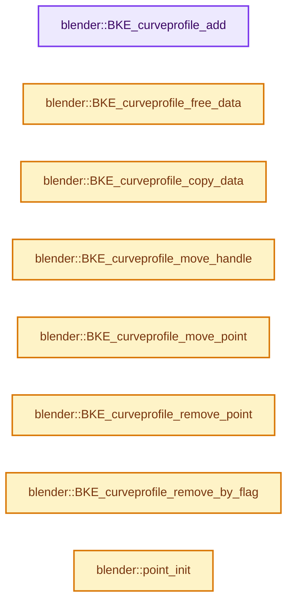
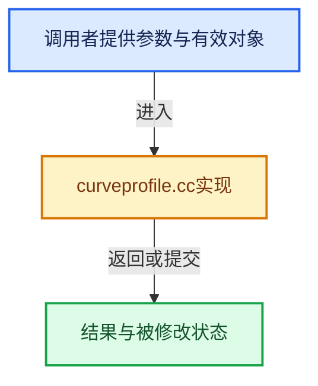

# 实现依赖专题：source/blender/blenkernel/intern/curveprofile.cc

[方向导航](README.md) · [符号索引](../%E7%AC%A6%E5%8F%B7%E4%BE%9D%E8%B5%96%E4%B8%8E%E5%AE%9E%E7%8E%B0%E7%B4%A2%E5%BC%95.md)

本专题从正文实际调用进入，集中保存共享实现。函数有稳定锚点，可从调用处直接跳到对应完整函数；递归与互相调用通过回链组织。

## 本文件的实现关系






## 完整成员与函数实现

<a id="f-9a5ae25791db4646"></a>

### `blender::BKE_curveprofile_add`

实现位置：[source/blender/blenkernel/intern/curveprofile.cc](../../../../../source/blender/blenkernel/intern/curveprofile.cc) · L35—L45。

接口参数：

- `eCurveProfilePresets preset`

**教学注释版**

<!-- annotated:8885c0f40ce1f0 -->

```cpp
CurveProfile *BKE_curveprofile_add(eCurveProfilePresets preset)
{
  CurveProfile *profile = MEM_new<CurveProfile>(__func__);

  BKE_curveprofile_set_defaults(profile);
  profile->preset = preset;
  BKE_curveprofile_reset(profile);
  BKE_curveprofile_update(profile, 0);

  return profile;
}
```

<details>
<summary>核对原始源码：source/blender/blenkernel/intern/curveprofile.cc · L35—L45</summary>

<!-- original:8885c0f40ce1f0:source/blender/blenkernel/intern/curveprofile.cc:35:45 -->

```cpp
CurveProfile *BKE_curveprofile_add(eCurveProfilePresets preset)
{
  CurveProfile *profile = MEM_new<CurveProfile>(__func__);

  BKE_curveprofile_set_defaults(profile);
  profile->preset = preset;
  BKE_curveprofile_reset(profile);
  BKE_curveprofile_update(profile, 0);

  return profile;
}
```

</details>

**沿实际写入检查状态**

- `profile->preset = preset;`

**结果出口**

- `return profile;`

**继续追踪实现**

- `MEM_new<CurveProfile>` → [MEM_new · L351](../03-%E5%86%85%E5%AD%98%E5%88%86%E9%85%8D%E4%B8%8E%E8%BF%90%E8%A1%8C%E6%97%B6%E7%B1%BB%E5%9E%8B/%E4%BE%9D%E8%B5%96-MEM_guardedalloc-b54eca.md#f-115f9b6784f89912)。
- `BKE_curveprofile_set_defaults` → [blender::BKE_curveprofile_set_defaults · L864](%E4%BE%9D%E8%B5%96-curveprofile-85268d.md#f-1bbb8593edf5dc91)。
- `BKE_curveprofile_reset` → [blender::BKE_curveprofile_reset · L456](%E4%BE%9D%E8%B5%96-curveprofile-85268d.md#f-0300834aedd0a688)。
- `BKE_curveprofile_update` → [blender::BKE_curveprofile_update · L1025](%E4%BE%9D%E8%B5%96-curveprofile-85268d.md#f-d6b3ba8a69c29f89)。

<a id="f-a3d61386b3c36d75"></a>

### `blender::BKE_curveprofile_free_data`

实现位置：[source/blender/blenkernel/intern/curveprofile.cc](../../../../../source/blender/blenkernel/intern/curveprofile.cc) · L47—L52。

接口参数：

- `CurveProfile *profile`

**教学注释版**

<!-- annotated:06bd6d75015b79 -->

```cpp
void BKE_curveprofile_free_data(CurveProfile *profile)
{
  MEM_SAFE_DELETE(profile->path);
  MEM_SAFE_DELETE(profile->table);
  MEM_SAFE_DELETE(profile->segments);
}
```

<details>
<summary>核对原始源码：source/blender/blenkernel/intern/curveprofile.cc · L47—L52</summary>

<!-- original:06bd6d75015b79:source/blender/blenkernel/intern/curveprofile.cc:47:52 -->

```cpp
void BKE_curveprofile_free_data(CurveProfile *profile)
{
  MEM_SAFE_DELETE(profile->path);
  MEM_SAFE_DELETE(profile->table);
  MEM_SAFE_DELETE(profile->segments);
}
```

</details>

**继续追踪实现**

- `MEM_SAFE_DELETE` → [MEM_SAFE_DELETE · L436](../03-%E5%86%85%E5%AD%98%E5%88%86%E9%85%8D%E4%B8%8E%E8%BF%90%E8%A1%8C%E6%97%B6%E7%B1%BB%E5%9E%8B/%E4%BE%9D%E8%B5%96-MEM_guardedalloc-b54eca.md#m-eadb3bc5b902)。宏定义由构建条件选择。

<a id="f-479bef2ee71cad77"></a>

### `blender::BKE_curveprofile_copy_data`

实现位置：[source/blender/blenkernel/intern/curveprofile.cc](../../../../../source/blender/blenkernel/intern/curveprofile.cc) · L62—L74。

接口参数：

- `CurveProfile *target`
- `const CurveProfile *profile`

**教学注释版**

<!-- annotated:538c1471e43e9c -->

```cpp
void BKE_curveprofile_copy_data(CurveProfile *target, const CurveProfile *profile)
{
  *target = *profile;

  target->path = MEM_dupalloc(profile->path);
  target->table = MEM_dupalloc(profile->table);
  target->segments = MEM_dupalloc(profile->segments);

  /* Update the reference the points have to the profile. */
  for (int i = 0; i < target->path_len; i++) {
    target->path[i].profile = target;
  }
}
```

<details>
<summary>核对原始源码：source/blender/blenkernel/intern/curveprofile.cc · L62—L74</summary>

<!-- original:538c1471e43e9c:source/blender/blenkernel/intern/curveprofile.cc:62:74 -->

```cpp
void BKE_curveprofile_copy_data(CurveProfile *target, const CurveProfile *profile)
{
  *target = *profile;

  target->path = MEM_dupalloc(profile->path);
  target->table = MEM_dupalloc(profile->table);
  target->segments = MEM_dupalloc(profile->segments);

  /* Update the reference the points have to the profile. */
  for (int i = 0; i < target->path_len; i++) {
    target->path[i].profile = target;
  }
}
```

</details>

**沿实际写入检查状态**

- `target->path = MEM_dupalloc(profile->path);`
- `target->table = MEM_dupalloc(profile->table);`
- `target->segments = MEM_dupalloc(profile->segments);`
- `target->path[i].profile = target;`

**继续追踪实现**

- `MEM_dupalloc` → [MEM_dupalloc · L627](../03-%E5%86%85%E5%AD%98%E5%88%86%E9%85%8D%E4%B8%8E%E8%BF%90%E8%A1%8C%E6%97%B6%E7%B1%BB%E5%9E%8B/%E4%BE%9D%E8%B5%96-MEM_guardedalloc-b54eca.md#f-78a72b71e3c57010)。

<a id="f-12fb76eed2f1eccb"></a>

### `blender::BKE_curveprofile_move_handle`

实现位置：[source/blender/blenkernel/intern/curveprofile.cc](../../../../../source/blender/blenkernel/intern/curveprofile.cc) · L116—L154。

接口参数：

- `CurveProfilePoint *point`
- `const bool handle_1`
- `const bool snap`
- `const float delta[2]`

**教学注释版**

<!-- annotated:baefe8f7b6c344 -->

```cpp
bool BKE_curveprofile_move_handle(CurveProfilePoint *point,
                                  const bool handle_1,
                                  const bool snap,
                                  const float delta[2])
{
  short handle_type = (handle_1) ? point->h1 : point->h2;
  float *handle_location = (handle_1) ? &point->h1_loc[0] : &point->h2_loc[0];

  float start_position[2];
  copy_v2_v2(start_position, handle_location);

  /* Don't move the handle if it's not a free handle type. */
  if (!ELEM(handle_type, HD_FREE, HD_ALIGN)) {
    return false;
  }

  /* Move the handle. */
  handle_location[0] += delta ? delta[0] : 0.0f;
  handle_location[1] += delta ? delta[1] : 0.0f;
  if (snap) {
    handle_location[0] = 0.125f * roundf(8.0f * handle_location[0]);
    handle_location[1] = 0.125f * roundf(8.0f * handle_location[1]);
  }

  /* Move the other handle if they are aligned. */
  if (handle_type == HD_ALIGN) {
    short other_handle_type = (handle_1) ? point->h2 : point->h1;
    if (other_handle_type == HD_ALIGN) {
      float *other_handle_location = (handle_1) ? &point->h2_loc[0] : &point->h1_loc[0];
      other_handle_location[0] = 2.0f * point->x - handle_location[0];
      other_handle_location[1] = 2.0f * point->y - handle_location[1];
    }
  }

  if (!equals_v2v2(handle_location, start_position)) {
    return true;
  }
  return false;
}
```

<details>
<summary>核对原始源码：source/blender/blenkernel/intern/curveprofile.cc · L116—L154</summary>

<!-- original:baefe8f7b6c344:source/blender/blenkernel/intern/curveprofile.cc:116:154 -->

```cpp
bool BKE_curveprofile_move_handle(CurveProfilePoint *point,
                                  const bool handle_1,
                                  const bool snap,
                                  const float delta[2])
{
  short handle_type = (handle_1) ? point->h1 : point->h2;
  float *handle_location = (handle_1) ? &point->h1_loc[0] : &point->h2_loc[0];

  float start_position[2];
  copy_v2_v2(start_position, handle_location);

  /* Don't move the handle if it's not a free handle type. */
  if (!ELEM(handle_type, HD_FREE, HD_ALIGN)) {
    return false;
  }

  /* Move the handle. */
  handle_location[0] += delta ? delta[0] : 0.0f;
  handle_location[1] += delta ? delta[1] : 0.0f;
  if (snap) {
    handle_location[0] = 0.125f * roundf(8.0f * handle_location[0]);
    handle_location[1] = 0.125f * roundf(8.0f * handle_location[1]);
  }

  /* Move the other handle if they are aligned. */
  if (handle_type == HD_ALIGN) {
    short other_handle_type = (handle_1) ? point->h2 : point->h1;
    if (other_handle_type == HD_ALIGN) {
      float *other_handle_location = (handle_1) ? &point->h2_loc[0] : &point->h1_loc[0];
      other_handle_location[0] = 2.0f * point->x - handle_location[0];
      other_handle_location[1] = 2.0f * point->y - handle_location[1];
    }
  }

  if (!equals_v2v2(handle_location, start_position)) {
    return true;
  }
  return false;
}
```

</details>

**沿实际写入检查状态**

- `handle_location[0] += delta ? delta[0] : 0.0f;`
- `handle_location[1] += delta ? delta[1] : 0.0f;`
- `handle_location[0] = 0.125f * roundf(8.0f * handle_location[0]);`
- `handle_location[1] = 0.125f * roundf(8.0f * handle_location[1]);`
- `other_handle_location[0] = 2.0f * point->x - handle_location[0];`
- `other_handle_location[1] = 2.0f * point->y - handle_location[1];`

**结果出口**

- `return false;`
- `return true;`

**继续追踪实现**

- `copy_v2_v2` → [blender::copy_v2_v2 · L41](../12-%E7%A9%BA%E9%97%B4%E6%95%B0%E6%8D%AE%E7%BB%93%E6%9E%84%E4%B8%8E%E5%87%A0%E4%BD%95%E7%AE%97%E6%B3%95/%E4%BE%9D%E8%B5%96-math_vector_inline-0c8541.md#f-e736ee2dd71cd821)。
- `ELEM` → [ELEM · L88](%E4%BE%9D%E8%B5%96-GHOST_utildefines-34b996.md#m-d28724a15928)；[ELEM · L135](../01-%E5%9F%BA%E7%A1%80%E5%AE%B9%E5%99%A8%E4%B8%8E%E7%8E%B0%E4%BB%A3CPP/%E4%BE%9D%E8%B5%96-BLI_utildefines-293a0a.md#m-d6572de7cae0)。宏定义由构建条件选择。
- `roundf` → [roundf · L174](%E4%BE%9D%E8%B5%96-compat-56205c.md#m-bdf6eb01f4f1)；[roundf · L272](%E4%BE%9D%E8%B5%96-compat-efe0e9.md#m-97b17e1586c9)。宏定义由构建条件选择。
- `equals_v2v2` → [blender::equals_v2v2 · L1001](../12-%E7%A9%BA%E9%97%B4%E6%95%B0%E6%8D%AE%E7%BB%93%E6%9E%84%E4%B8%8E%E5%87%A0%E4%BD%95%E7%AE%97%E6%B3%95/%E4%BE%9D%E8%B5%96-math_vector_inline-0c8541.md#f-5cb3944ff2c53ef9)。

<a id="f-4c31cccad42ac331"></a>

### `blender::BKE_curveprofile_move_point`

实现位置：[source/blender/blenkernel/intern/curveprofile.cc](../../../../../source/blender/blenkernel/intern/curveprofile.cc) · L156—L201。

接口参数：

- `CurveProfile *profile`
- `CurveProfilePoint *point`
- `const bool snap`
- `const float delta[2]`

**教学注释版**

<!-- annotated:e8b1eb03117caf -->

```cpp
bool BKE_curveprofile_move_point(CurveProfile *profile,
                                 CurveProfilePoint *point,
                                 const bool snap,
                                 const float delta[2])
{
  /* Don't move the final point. */
  if (point == &profile->path[profile->path_len - 1]) {
    return false;
  }
  /* Don't move the first point. */
  if (point == profile->path) {
    return false;
  }
  float origx = point->x;
  float origy = point->y;

  point->x += delta[0];
  point->y += delta[1];
  if (snap) {
    point->x = 0.125f * roundf(8.0f * point->x);
    point->y = 0.125f * roundf(8.0f * point->y);
  }

  /* Clip here instead to test clipping here to stop handles from moving too. */
  if (profile->flag & PROF_USE_CLIP) {
    point->x = max_ff(point->x, profile->clip_rect.xmin);
    point->x = min_ff(point->x, profile->clip_rect.xmax);
    point->y = max_ff(point->y, profile->clip_rect.ymin);
    point->y = min_ff(point->y, profile->clip_rect.ymax);
  }

  /* Also move free handles even when they aren't selected. */
  if (ELEM(point->h1, HD_FREE, HD_ALIGN)) {
    point->h1_loc[0] += point->x - origx;
    point->h1_loc[1] += point->y - origy;
  }
  if (ELEM(point->h2, HD_FREE, HD_ALIGN)) {
    point->h2_loc[0] += point->x - origx;
    point->h2_loc[1] += point->y - origy;
  }

  if (point->x != origx || point->y != origy) {
    return true;
  }
  return false;
}
```

<details>
<summary>核对原始源码：source/blender/blenkernel/intern/curveprofile.cc · L156—L201</summary>

<!-- original:e8b1eb03117caf:source/blender/blenkernel/intern/curveprofile.cc:156:201 -->

```cpp
bool BKE_curveprofile_move_point(CurveProfile *profile,
                                 CurveProfilePoint *point,
                                 const bool snap,
                                 const float delta[2])
{
  /* Don't move the final point. */
  if (point == &profile->path[profile->path_len - 1]) {
    return false;
  }
  /* Don't move the first point. */
  if (point == profile->path) {
    return false;
  }
  float origx = point->x;
  float origy = point->y;

  point->x += delta[0];
  point->y += delta[1];
  if (snap) {
    point->x = 0.125f * roundf(8.0f * point->x);
    point->y = 0.125f * roundf(8.0f * point->y);
  }

  /* Clip here instead to test clipping here to stop handles from moving too. */
  if (profile->flag & PROF_USE_CLIP) {
    point->x = max_ff(point->x, profile->clip_rect.xmin);
    point->x = min_ff(point->x, profile->clip_rect.xmax);
    point->y = max_ff(point->y, profile->clip_rect.ymin);
    point->y = min_ff(point->y, profile->clip_rect.ymax);
  }

  /* Also move free handles even when they aren't selected. */
  if (ELEM(point->h1, HD_FREE, HD_ALIGN)) {
    point->h1_loc[0] += point->x - origx;
    point->h1_loc[1] += point->y - origy;
  }
  if (ELEM(point->h2, HD_FREE, HD_ALIGN)) {
    point->h2_loc[0] += point->x - origx;
    point->h2_loc[1] += point->y - origy;
  }

  if (point->x != origx || point->y != origy) {
    return true;
  }
  return false;
}
```

</details>

**沿实际写入检查状态**

- `point->x += delta[0];`
- `point->y += delta[1];`
- `point->x = 0.125f * roundf(8.0f * point->x);`
- `point->y = 0.125f * roundf(8.0f * point->y);`
- `point->x = max_ff(point->x, profile->clip_rect.xmin);`
- `point->x = min_ff(point->x, profile->clip_rect.xmax);`
- `point->y = max_ff(point->y, profile->clip_rect.ymin);`
- `point->y = min_ff(point->y, profile->clip_rect.ymax);`
- `point->h1_loc[0] += point->x - origx;`
- `point->h1_loc[1] += point->y - origy;`
- `point->h2_loc[0] += point->x - origx;`
- `point->h2_loc[1] += point->y - origy;`

**结果出口**

- `return false;`
- `return true;`

**继续追踪实现**

- `roundf` → [roundf · L174](%E4%BE%9D%E8%B5%96-compat-56205c.md#m-bdf6eb01f4f1)；[roundf · L272](%E4%BE%9D%E8%B5%96-compat-efe0e9.md#m-97b17e1586c9)。宏定义由构建条件选择。
- `max_ff` → [blender::max_ff · L325](../12-%E7%A9%BA%E9%97%B4%E6%95%B0%E6%8D%AE%E7%BB%93%E6%9E%84%E4%B8%8E%E5%87%A0%E4%BD%95%E7%AE%97%E6%B3%95/%E4%BE%9D%E8%B5%96-math_base_inline-546b00.md#f-05a351a3afd7dc2a)。
- `min_ff` → [blender::min_ff · L321](../12-%E7%A9%BA%E9%97%B4%E6%95%B0%E6%8D%AE%E7%BB%93%E6%9E%84%E4%B8%8E%E5%87%A0%E4%BD%95%E7%AE%97%E6%B3%95/%E4%BE%9D%E8%B5%96-math_base_inline-546b00.md#f-5b8d83d6f191be1a)。
- `ELEM` → [ELEM · L88](%E4%BE%9D%E8%B5%96-GHOST_utildefines-34b996.md#m-d28724a15928)；[ELEM · L135](../01-%E5%9F%BA%E7%A1%80%E5%AE%B9%E5%99%A8%E4%B8%8E%E7%8E%B0%E4%BB%A3CPP/%E4%BE%9D%E8%B5%96-BLI_utildefines-293a0a.md#m-d6572de7cae0)。宏定义由构建条件选择。

<a id="f-df9dc134b486d5e0"></a>

### `blender::BKE_curveprofile_remove_point`

实现位置：[source/blender/blenkernel/intern/curveprofile.cc](../../../../../source/blender/blenkernel/intern/curveprofile.cc) · L227—L255。

接口参数：

- `CurveProfile *profile`
- `CurveProfilePoint *point`

**教学注释版**

<!-- annotated:646924ce43d417 -->

```cpp
bool BKE_curveprofile_remove_point(CurveProfile *profile, CurveProfilePoint *point)
{
  /* Must have 2 points minimum. */
  if (profile->path_len <= 2) {
    return false;
  }

  /* Input point must be within the array. */
  if (!(point > profile->path && point < profile->path + profile->path_len)) {
    return false;
  }

  CurveProfilePoint *new_path = MEM_new_array<CurveProfilePoint>(size_t(profile->path_len),
                                                                 __func__);

  int i_delete = int(point - profile->path);
  BLI_assert(i_delete > 0);

  /* Copy the before and after the deleted point. */
  // [讲解] memcpy：复制字节，源与目标不应重叠。类型生命周期、对齐和可复制表示须由调用者证明，不是任意对象的复制构造。
  memcpy(new_path, profile->path, sizeof(CurveProfilePoint) * i_delete);
  memcpy(new_path + i_delete,
         profile->path + i_delete + 1,
         sizeof(CurveProfilePoint) * (profile->path_len - i_delete - 1));

  MEM_delete(profile->path);
  profile->path = new_path;
  profile->path_len -= 1;
  return true;
}
```

<details>
<summary>核对原始源码：source/blender/blenkernel/intern/curveprofile.cc · L227—L255</summary>

<!-- original:646924ce43d417:source/blender/blenkernel/intern/curveprofile.cc:227:255 -->

```cpp
bool BKE_curveprofile_remove_point(CurveProfile *profile, CurveProfilePoint *point)
{
  /* Must have 2 points minimum. */
  if (profile->path_len <= 2) {
    return false;
  }

  /* Input point must be within the array. */
  if (!(point > profile->path && point < profile->path + profile->path_len)) {
    return false;
  }

  CurveProfilePoint *new_path = MEM_new_array<CurveProfilePoint>(size_t(profile->path_len),
                                                                 __func__);

  int i_delete = int(point - profile->path);
  BLI_assert(i_delete > 0);

  /* Copy the before and after the deleted point. */
  memcpy(new_path, profile->path, sizeof(CurveProfilePoint) * i_delete);
  memcpy(new_path + i_delete,
         profile->path + i_delete + 1,
         sizeof(CurveProfilePoint) * (profile->path_len - i_delete - 1));

  MEM_delete(profile->path);
  profile->path = new_path;
  profile->path_len -= 1;
  return true;
}
```

</details>

**沿实际写入检查状态**

- `profile->path = new_path;`
- `profile->path_len -= 1;`

**结果出口**

- `return false;`
- `return true;`

**继续追踪实现**

- `MEM_new_array<CurveProfilePoint>` → [MEM_new_array · L372](../03-%E5%86%85%E5%AD%98%E5%88%86%E9%85%8D%E4%B8%8E%E8%BF%90%E8%A1%8C%E6%97%B6%E7%B1%BB%E5%9E%8B/%E4%BE%9D%E8%B5%96-MEM_guardedalloc-b54eca.md#f-56b8fe3d391af460)。
- `BLI_assert` → [BLI_assert · L48](../01-%E5%9F%BA%E7%A1%80%E5%AE%B9%E5%99%A8%E4%B8%8E%E7%8E%B0%E4%BB%A3CPP/%E4%BE%9D%E8%B5%96-BLI_assert-cc98e8.md#m-57a88495704d)；[BLI_assert · L63](../01-%E5%9F%BA%E7%A1%80%E5%AE%B9%E5%99%A8%E4%B8%8E%E7%8E%B0%E4%BB%A3CPP/%E4%BE%9D%E8%B5%96-BLI_assert-cc98e8.md#m-d07050020cb5)。宏定义由构建条件选择。
- `memcpy` → [外部契约](https://eel.is/c++draft/cstring.syn)：复制字节，源与目标不应重叠。类型生命周期、对齐和可复制表示须由调用者证明，不是任意对象的复制构造。
- `MEM_delete` → [MEM_delete · L400](../03-%E5%86%85%E5%AD%98%E5%88%86%E9%85%8D%E4%B8%8E%E8%BF%90%E8%A1%8C%E6%97%B6%E7%B1%BB%E5%9E%8B/%E4%BE%9D%E8%B5%96-MEM_guardedalloc-b54eca.md#f-9049ffdd1682887c)。

<a id="f-9bb73bcd2e40c946"></a>

### `blender::BKE_curveprofile_remove_by_flag`

实现位置：[source/blender/blenkernel/intern/curveprofile.cc](../../../../../source/blender/blenkernel/intern/curveprofile.cc) · L257—L282。

接口参数：

- `CurveProfile *profile`
- `const short flag`

**教学注释版**

<!-- annotated:5aadf46fa4ddb4 -->

```cpp
void BKE_curveprofile_remove_by_flag(CurveProfile *profile, const short flag)
{
  /* Copy every point without the flag into the new path. */
  CurveProfilePoint *new_path = MEM_new_array<CurveProfilePoint>(size_t(profile->path_len),
                                                                 __func__);

  /* Build the new list without any of the points with the flag. Keep the first and last points. */
  int i_new = 1;
  int i_old = 1;
  int n_removed = 0;
  new_path[0] = profile->path[0];
  for (; i_old < profile->path_len - 1; i_old++) {
    if (!(profile->path[i_old].flag & flag)) {
      new_path[i_new] = profile->path[i_old];
      i_new++;
    }
    else {
      n_removed++;
    }
  }
  new_path[i_new] = profile->path[i_old];

  MEM_delete(profile->path);
  profile->path = new_path;
  profile->path_len -= n_removed;
}
```

<details>
<summary>核对原始源码：source/blender/blenkernel/intern/curveprofile.cc · L257—L282</summary>

<!-- original:5aadf46fa4ddb4:source/blender/blenkernel/intern/curveprofile.cc:257:282 -->

```cpp
void BKE_curveprofile_remove_by_flag(CurveProfile *profile, const short flag)
{
  /* Copy every point without the flag into the new path. */
  CurveProfilePoint *new_path = MEM_new_array<CurveProfilePoint>(size_t(profile->path_len),
                                                                 __func__);

  /* Build the new list without any of the points with the flag. Keep the first and last points. */
  int i_new = 1;
  int i_old = 1;
  int n_removed = 0;
  new_path[0] = profile->path[0];
  for (; i_old < profile->path_len - 1; i_old++) {
    if (!(profile->path[i_old].flag & flag)) {
      new_path[i_new] = profile->path[i_old];
      i_new++;
    }
    else {
      n_removed++;
    }
  }
  new_path[i_new] = profile->path[i_old];

  MEM_delete(profile->path);
  profile->path = new_path;
  profile->path_len -= n_removed;
}
```

</details>

**沿实际写入检查状态**

- `new_path[0] = profile->path[0];`
- `new_path[i_new] = profile->path[i_old];`
- `profile->path = new_path;`
- `profile->path_len -= n_removed;`

**继续追踪实现**

- `MEM_new_array<CurveProfilePoint>` → [MEM_new_array · L372](../03-%E5%86%85%E5%AD%98%E5%88%86%E9%85%8D%E4%B8%8E%E8%BF%90%E8%A1%8C%E6%97%B6%E7%B1%BB%E5%9E%8B/%E4%BE%9D%E8%B5%96-MEM_guardedalloc-b54eca.md#f-56b8fe3d391af460)。
- `MEM_delete` → [MEM_delete · L400](../03-%E5%86%85%E5%AD%98%E5%88%86%E9%85%8D%E4%B8%8E%E8%BF%90%E8%A1%8C%E6%97%B6%E7%B1%BB%E5%9E%8B/%E4%BE%9D%E8%B5%96-MEM_guardedalloc-b54eca.md#f-9049ffdd1682887c)。

<a id="f-2be5fce5d3990e16"></a>

### `blender::point_init`

实现位置：[source/blender/blenkernel/intern/curveprofile.cc](../../../../../source/blender/blenkernel/intern/curveprofile.cc) · L287—L295。

接口参数：

- `CurveProfilePoint *point`
- `float x`
- `float y`
- `eCurveProfilePoint_Flag flag`
- `char h1`
- `char h2`

**教学注释版**

<!-- annotated:4d08188e6641cf -->

```cpp
static void point_init(
    CurveProfilePoint *point, float x, float y, eCurveProfilePoint_Flag flag, char h1, char h2)
{
  point->x = x;
  point->y = y;
  point->flag = flag;
  point->h1 = h1;
  point->h2 = h2;
}
```

<details>
<summary>核对原始源码：source/blender/blenkernel/intern/curveprofile.cc · L287—L295</summary>

<!-- original:4d08188e6641cf:source/blender/blenkernel/intern/curveprofile.cc:287:295 -->

```cpp
static void point_init(
    CurveProfilePoint *point, float x, float y, eCurveProfilePoint_Flag flag, char h1, char h2)
{
  point->x = x;
  point->y = y;
  point->flag = flag;
  point->h1 = h1;
  point->h2 = h2;
}
```

</details>

**沿实际写入检查状态**

- `point->x = x;`
- `point->y = y;`
- `point->flag = flag;`
- `point->h1 = h1;`
- `point->h2 = h2;`

**继续追踪实现**

本实现没有需要继续展开的显式调用；检查返回表达式、对象转换和调用者前置条件。

<a id="f-6062afd47cf554e8"></a>

### `blender::BKE_curveprofile_insert`

实现位置：[source/blender/blenkernel/intern/curveprofile.cc](../../../../../source/blender/blenkernel/intern/curveprofile.cc) · L297—L351。

接口参数：

- `CurveProfile *profile`
- `float x`
- `float y`

**教学注释版**

<!-- annotated:71b7e6725d3f2f -->

```cpp
CurveProfilePoint *BKE_curveprofile_insert(CurveProfile *profile, float x, float y)
{
  const float new_loc[2] = {x, y};

  /* Don't add more control points than the maximum size of the higher resolution table. */
  if (profile->path_len == PROF_TABLE_MAX - 1) {
    return nullptr;
  }

  /* Find the index at the line segment that's closest to the new position. */
  float min_distance = FLT_MAX;
  int i_insert = 0;
  for (int i = 0; i < profile->path_len - 1; i++) {
    const float loc1[2] = {profile->path[i].x, profile->path[i].y};
    const float loc2[2] = {profile->path[i + 1].x, profile->path[i + 1].y};

    float distance = dist_squared_to_line_segment_v2(new_loc, loc1, loc2);
    if (distance < min_distance) {
      min_distance = distance;
      i_insert = i + 1;
    }
  }

  /* Insert the new point at the location we found and copy all of the old points in as well. */
  profile->path_len++;
  CurveProfilePoint *new_path = MEM_new_array<CurveProfilePoint>(size_t(profile->path_len),
                                                                 __func__);
  CurveProfilePoint *new_pt = nullptr;
  for (int i_new = 0, i_old = 0; i_new < profile->path_len; i_new++) {
    if (i_new != i_insert) {
      /* Insert old points. */
      new_path[i_new] = profile->path[i_old];
      new_path[i_new].flag &= ~(PROF_SELECT | PROF_H1_SELECT | PROF_H2_SELECT | PROF_ACTIVE |
                                PROF_H1_ACTIVE | PROF_H2_ACTIVE); /* Deselect old points. */
      i_old++;
    }
    else {
      /* Insert new point. */
      /* Set handles of new point based on its neighbors. */
      const char new_handle_type = (new_path[i_new - 1].h2 == HD_VECT &&
                                    profile->path[i_insert].h1 == HD_VECT) ?
                                       HD_VECT :
                                       HD_AUTO;
      point_init(&new_path[i_new], x, y, PROF_SELECT, new_handle_type, new_handle_type);
      new_pt = &new_path[i_new];
      /* Give new point a reference to the profile. */
      new_pt->profile = profile;
    }
  }

  /* Free the old path and use the new one. */
  MEM_delete(profile->path);
  profile->path = new_path;
  return new_pt;
}
```

<details>
<summary>核对原始源码：source/blender/blenkernel/intern/curveprofile.cc · L297—L351</summary>

<!-- original:71b7e6725d3f2f:source/blender/blenkernel/intern/curveprofile.cc:297:351 -->

```cpp
CurveProfilePoint *BKE_curveprofile_insert(CurveProfile *profile, float x, float y)
{
  const float new_loc[2] = {x, y};

  /* Don't add more control points than the maximum size of the higher resolution table. */
  if (profile->path_len == PROF_TABLE_MAX - 1) {
    return nullptr;
  }

  /* Find the index at the line segment that's closest to the new position. */
  float min_distance = FLT_MAX;
  int i_insert = 0;
  for (int i = 0; i < profile->path_len - 1; i++) {
    const float loc1[2] = {profile->path[i].x, profile->path[i].y};
    const float loc2[2] = {profile->path[i + 1].x, profile->path[i + 1].y};

    float distance = dist_squared_to_line_segment_v2(new_loc, loc1, loc2);
    if (distance < min_distance) {
      min_distance = distance;
      i_insert = i + 1;
    }
  }

  /* Insert the new point at the location we found and copy all of the old points in as well. */
  profile->path_len++;
  CurveProfilePoint *new_path = MEM_new_array<CurveProfilePoint>(size_t(profile->path_len),
                                                                 __func__);
  CurveProfilePoint *new_pt = nullptr;
  for (int i_new = 0, i_old = 0; i_new < profile->path_len; i_new++) {
    if (i_new != i_insert) {
      /* Insert old points. */
      new_path[i_new] = profile->path[i_old];
      new_path[i_new].flag &= ~(PROF_SELECT | PROF_H1_SELECT | PROF_H2_SELECT | PROF_ACTIVE |
                                PROF_H1_ACTIVE | PROF_H2_ACTIVE); /* Deselect old points. */
      i_old++;
    }
    else {
      /* Insert new point. */
      /* Set handles of new point based on its neighbors. */
      const char new_handle_type = (new_path[i_new - 1].h2 == HD_VECT &&
                                    profile->path[i_insert].h1 == HD_VECT) ?
                                       HD_VECT :
                                       HD_AUTO;
      point_init(&new_path[i_new], x, y, PROF_SELECT, new_handle_type, new_handle_type);
      new_pt = &new_path[i_new];
      /* Give new point a reference to the profile. */
      new_pt->profile = profile;
    }
  }

  /* Free the old path and use the new one. */
  MEM_delete(profile->path);
  profile->path = new_path;
  return new_pt;
}
```

</details>

**沿实际写入检查状态**

- `min_distance = distance;`
- `i_insert = i + 1;`
- `new_path[i_new] = profile->path[i_old];`
- `new_path[i_new].flag &= ~(PROF_SELECT | PROF_H1_SELECT | PROF_H2_SELECT | PROF_ACTIVE |`
- `new_pt = &new_path[i_new];`
- `new_pt->profile = profile;`
- `profile->path = new_path;`

**结果出口**

- `return nullptr;`
- `return new_pt;`

**继续追踪实现**

- `dist_squared_to_line_segment_v2` → [blender::dist_squared_to_line_segment_v2 · L307](../12-%E7%A9%BA%E9%97%B4%E6%95%B0%E6%8D%AE%E7%BB%93%E6%9E%84%E4%B8%8E%E5%87%A0%E4%BD%95%E7%AE%97%E6%B3%95/%E4%BE%9D%E8%B5%96-math_geom-8d91a3.md#f-91a340dc0d5d5a38)。
- `MEM_new_array<CurveProfilePoint>` → [MEM_new_array · L372](../03-%E5%86%85%E5%AD%98%E5%88%86%E9%85%8D%E4%B8%8E%E8%BF%90%E8%A1%8C%E6%97%B6%E7%B1%BB%E5%9E%8B/%E4%BE%9D%E8%B5%96-MEM_guardedalloc-b54eca.md#f-56b8fe3d391af460)。
- `point_init` → [blender::point_init · L287](%E4%BE%9D%E8%B5%96-curveprofile-85268d.md#f-2be5fce5d3990e16)。
- `MEM_delete` → [MEM_delete · L400](../03-%E5%86%85%E5%AD%98%E5%88%86%E9%85%8D%E4%B8%8E%E8%BF%90%E8%A1%8C%E6%97%B6%E7%B1%BB%E5%9E%8B/%E4%BE%9D%E8%B5%96-MEM_guardedalloc-b54eca.md#f-9049ffdd1682887c)。

<a id="f-3a427be8a607021e"></a>

### `blender::curveprofile_build_supports`

实现位置：[source/blender/blenkernel/intern/curveprofile.cc](../../../../../source/blender/blenkernel/intern/curveprofile.cc) · L409—L422。

接口参数：

- `CurveProfile *profile`

**教学注释版**

<!-- annotated:2efbcb7a5a607a -->

```cpp
static void curveprofile_build_supports(CurveProfile *profile)
{
  int n = profile->path_len;

  point_init(&profile->path[0], 1.0f, 0.0f, eCurveProfilePoint_Flag{}, HD_VECT, HD_VECT);
  point_init(&profile->path[1], 1.0f, 0.5f, eCurveProfilePoint_Flag{}, HD_VECT, HD_VECT);
  for (int i = 1; i < n - 2; i++) {
    const float x = 1.0f - (0.5f * (1.0f - cosf(float(i / float(n - 3)) * M_PI_2)));
    const float y = 0.5f + 0.5f * sinf(float((i / float(n - 3)) * M_PI_2));
    point_init(&profile->path[i], x, y, eCurveProfilePoint_Flag{}, HD_AUTO, HD_AUTO);
  }
  point_init(&profile->path[n - 2], 0.5f, 1.0f, eCurveProfilePoint_Flag{}, HD_VECT, HD_VECT);
  point_init(&profile->path[n - 1], 0.0f, 1.0f, eCurveProfilePoint_Flag{}, HD_VECT, HD_VECT);
}
```

<details>
<summary>核对原始源码：source/blender/blenkernel/intern/curveprofile.cc · L409—L422</summary>

<!-- original:2efbcb7a5a607a:source/blender/blenkernel/intern/curveprofile.cc:409:422 -->

```cpp
static void curveprofile_build_supports(CurveProfile *profile)
{
  int n = profile->path_len;

  point_init(&profile->path[0], 1.0f, 0.0f, eCurveProfilePoint_Flag{}, HD_VECT, HD_VECT);
  point_init(&profile->path[1], 1.0f, 0.5f, eCurveProfilePoint_Flag{}, HD_VECT, HD_VECT);
  for (int i = 1; i < n - 2; i++) {
    const float x = 1.0f - (0.5f * (1.0f - cosf(float(i / float(n - 3)) * M_PI_2)));
    const float y = 0.5f + 0.5f * sinf(float((i / float(n - 3)) * M_PI_2));
    point_init(&profile->path[i], x, y, eCurveProfilePoint_Flag{}, HD_AUTO, HD_AUTO);
  }
  point_init(&profile->path[n - 2], 0.5f, 1.0f, eCurveProfilePoint_Flag{}, HD_VECT, HD_VECT);
  point_init(&profile->path[n - 1], 0.0f, 1.0f, eCurveProfilePoint_Flag{}, HD_VECT, HD_VECT);
}
```

</details>

**继续追踪实现**

- `point_init` → [blender::point_init · L287](%E4%BE%9D%E8%B5%96-curveprofile-85268d.md#f-2be5fce5d3990e16)。
- `cosf` → [cosf · L20](%E4%BE%9D%E8%B5%96-radial_tiling_shared-98abf9.md#m-cee9ebf67d86)；[cosf · L42](%E4%BE%9D%E8%B5%96-radial_tiling_shared-98abf9.md#m-346533627567)；[cosf · L73](%E4%BE%9D%E8%B5%96-radial_tiling_shared-98abf9.md#m-e01b94a43b72)；[cosf · L24](../01-%E5%9F%BA%E7%A1%80%E5%AE%B9%E5%99%A8%E4%B8%8E%E7%8E%B0%E4%BB%A3CPP/%E4%BE%9D%E8%B5%96-radial_tiling_shared-7989a4.md#m-c317cb08dec6)；[cosf · L46](../01-%E5%9F%BA%E7%A1%80%E5%AE%B9%E5%99%A8%E4%B8%8E%E7%8E%B0%E4%BB%A3CPP/%E4%BE%9D%E8%B5%96-radial_tiling_shared-7989a4.md#m-93325b515297)；[cosf · L77](../01-%E5%9F%BA%E7%A1%80%E5%AE%B9%E5%99%A8%E4%B8%8E%E7%8E%B0%E4%BB%A3CPP/%E4%BE%9D%E8%B5%96-radial_tiling_shared-7989a4.md#m-d3058af0b490)；[cosf · L20](%E4%BE%9D%E8%B5%96-node_radial_tiling_shared-b14bc2.md#m-4c6aea22a560)；[cosf · L42](%E4%BE%9D%E8%B5%96-node_radial_tiling_shared-b14bc2.md#m-1fd6a5414477)；[cosf · L73](%E4%BE%9D%E8%B5%96-node_radial_tiling_shared-b14bc2.md#m-de2402f85270)；[cosf · L186](%E4%BE%9D%E8%B5%96-compat-56205c.md#m-7fdbd99009e0)；[cosf · L288](%E4%BE%9D%E8%B5%96-compat-efe0e9.md#m-68fe984e8b68)；[cosf · L93](%E4%BE%9D%E8%B5%96-compat-9e0a25.md#m-21bb557a23f1)；[cosf · L91](%E4%BE%9D%E8%B5%96-compat-e9eab7.md#m-7721be419a49)；[cosf · L43](%E4%BE%9D%E8%B5%96-GPU_shader_shared_utils-0adda3.md#m-25d02fd11b3b)；[cosf · L64](%E4%BE%9D%E8%B5%96-GPU_shader_shared_utils-0adda3.md#m-698fc51ccda3)。宏定义由构建条件选择。
- `sinf` → [sinf · L27](%E4%BE%9D%E8%B5%96-radial_tiling_shared-98abf9.md#m-40547e913688)；[sinf · L49](%E4%BE%9D%E8%B5%96-radial_tiling_shared-98abf9.md#m-8908e5f49833)；[sinf · L80](%E4%BE%9D%E8%B5%96-radial_tiling_shared-98abf9.md#m-71130f6adcc4)；[sinf · L31](../01-%E5%9F%BA%E7%A1%80%E5%AE%B9%E5%99%A8%E4%B8%8E%E7%8E%B0%E4%BB%A3CPP/%E4%BE%9D%E8%B5%96-radial_tiling_shared-7989a4.md#m-a51a6c88deca)；[sinf · L53](../01-%E5%9F%BA%E7%A1%80%E5%AE%B9%E5%99%A8%E4%B8%8E%E7%8E%B0%E4%BB%A3CPP/%E4%BE%9D%E8%B5%96-radial_tiling_shared-7989a4.md#m-9a4db95358ff)；[sinf · L84](../01-%E5%9F%BA%E7%A1%80%E5%AE%B9%E5%99%A8%E4%B8%8E%E7%8E%B0%E4%BB%A3CPP/%E4%BE%9D%E8%B5%96-radial_tiling_shared-7989a4.md#m-d26cdafe5b93)；[sinf · L27](%E4%BE%9D%E8%B5%96-node_radial_tiling_shared-b14bc2.md#m-9f80b4d363af)；[sinf · L49](%E4%BE%9D%E8%B5%96-node_radial_tiling_shared-b14bc2.md#m-f52c29b37ed1)；[sinf · L80](%E4%BE%9D%E8%B5%96-node_radial_tiling_shared-b14bc2.md#m-7f1f234ef9ec)；[sinf · L187](%E4%BE%9D%E8%B5%96-compat-56205c.md#m-aab07e522dda)；[sinf · L287](%E4%BE%9D%E8%B5%96-compat-efe0e9.md#m-7009b99c07ca)；[sinf · L94](%E4%BE%9D%E8%B5%96-compat-9e0a25.md#m-4a1f5d760325)；[sinf · L92](%E4%BE%9D%E8%B5%96-compat-e9eab7.md#m-e63872738f13)；[sinf · L44](%E4%BE%9D%E8%B5%96-GPU_shader_shared_utils-0adda3.md#m-a916f31e38c4)；[sinf · L65](%E4%BE%9D%E8%B5%96-GPU_shader_shared_utils-0adda3.md#m-268edbf6d41e)。宏定义由构建条件选择。

<a id="f-e58be4a5e171f643"></a>

### `blender::curveprofile_build_steps`

实现位置：[source/blender/blenkernel/intern/curveprofile.cc](../../../../../source/blender/blenkernel/intern/curveprofile.cc) · L428—L449。

接口参数：

- `CurveProfile *profile`

**教学注释版**

<!-- annotated:f5b42253cec1da -->

```cpp
static void curveprofile_build_steps(CurveProfile *profile)
{
  int n = profile->path_len;

  /* Special case for two points to avoid dividing by zero later. */
  if (n == 2) {
    point_init(&profile->path[0], 1.0f, 0.0f, eCurveProfilePoint_Flag{}, HD_VECT, HD_VECT);
    point_init(&profile->path[0], 0.0f, 1.0f, eCurveProfilePoint_Flag{}, HD_VECT, HD_VECT);
    return;
  }

  float n_steps_x = (n % 2 == 0) ? n : (n - 1);
  float n_steps_y = (n % 2 == 0) ? (n - 2) : (n - 1);

  for (int i = 0; i < n; i++) {
    int step_x = (i + 1) / 2;
    int step_y = i / 2;
    const float x = 1.0f - (float(2 * step_x) / n_steps_x);
    const float y = float(2 * step_y) / n_steps_y;
    point_init(&profile->path[i], x, y, eCurveProfilePoint_Flag{}, HD_VECT, HD_VECT);
  }
}
```

<details>
<summary>核对原始源码：source/blender/blenkernel/intern/curveprofile.cc · L428—L449</summary>

<!-- original:f5b42253cec1da:source/blender/blenkernel/intern/curveprofile.cc:428:449 -->

```cpp
static void curveprofile_build_steps(CurveProfile *profile)
{
  int n = profile->path_len;

  /* Special case for two points to avoid dividing by zero later. */
  if (n == 2) {
    point_init(&profile->path[0], 1.0f, 0.0f, eCurveProfilePoint_Flag{}, HD_VECT, HD_VECT);
    point_init(&profile->path[0], 0.0f, 1.0f, eCurveProfilePoint_Flag{}, HD_VECT, HD_VECT);
    return;
  }

  float n_steps_x = (n % 2 == 0) ? n : (n - 1);
  float n_steps_y = (n % 2 == 0) ? (n - 2) : (n - 1);

  for (int i = 0; i < n; i++) {
    int step_x = (i + 1) / 2;
    int step_y = i / 2;
    const float x = 1.0f - (float(2 * step_x) / n_steps_x);
    const float y = float(2 * step_y) / n_steps_y;
    point_init(&profile->path[i], x, y, eCurveProfilePoint_Flag{}, HD_VECT, HD_VECT);
  }
}
```

</details>

**继续追踪实现**

- `point_init` → [blender::point_init · L287](%E4%BE%9D%E8%B5%96-curveprofile-85268d.md#f-2be5fce5d3990e16)。

<a id="f-0300834aedd0a688"></a>

### `blender::BKE_curveprofile_reset`

实现位置：[source/blender/blenkernel/intern/curveprofile.cc](../../../../../source/blender/blenkernel/intern/curveprofile.cc) · L456—L545。

接口参数：

- `CurveProfile *profile`

**教学注释版**

<!-- annotated:cf8dee4505468c -->

```cpp
void BKE_curveprofile_reset(CurveProfile *profile)
{
  MEM_SAFE_DELETE(profile->path);

  eCurveProfilePresets preset = static_cast<eCurveProfilePresets>(profile->preset);
  switch (preset) {
    case PROF_PRESET_LINE:
      profile->path_len = 2;
      break;
    case PROF_PRESET_SUPPORTS:
      /* Use a dynamic number of control points for the widget's profile. */
      if (profile->segments_len < 4) {
        /* But always use enough points to at least build the support points. */
        profile->path_len = 5;
      }
      else {
        profile->path_len = profile->segments_len + 1;
      }
      break;
    case PROF_PRESET_CORNICE:
      profile->path_len = 13;
      break;
    case PROF_PRESET_CROWN:
      profile->path_len = 11;
      break;
    case PROF_PRESET_STEPS:
      /* Also use dynamic number of control points based on the set number of segments. */
      if (profile->segments_len == 0) {
        /* totsegments hasn't been set-- use the number of control points for 8 steps. */
        profile->path_len = 17;
      }
      else {
        profile->path_len = profile->segments_len + 1;
      }
      break;
  }

  profile->path = MEM_new_array<CurveProfilePoint>(profile->path_len, __func__);

  switch (preset) {
    case PROF_PRESET_LINE:
      point_init(&profile->path[0], 1.0f, 0.0f, eCurveProfilePoint_Flag{}, HD_AUTO, HD_AUTO);
      point_init(&profile->path[1], 0.0f, 1.0f, eCurveProfilePoint_Flag{}, HD_AUTO, HD_AUTO);
      break;
    case PROF_PRESET_SUPPORTS:
      curveprofile_build_supports(profile);
      break;
    case PROF_PRESET_CORNICE:
      point_init(&profile->path[0], 1.0f, 0.0f, eCurveProfilePoint_Flag{}, HD_VECT, HD_VECT);
      point_init(&profile->path[1], 1.0f, 0.125f, eCurveProfilePoint_Flag{}, HD_VECT, HD_VECT);
      point_init(&profile->path[2], 0.92f, 0.16f, eCurveProfilePoint_Flag{}, HD_AUTO, HD_AUTO);
      point_init(&profile->path[3], 0.875f, 0.25f, eCurveProfilePoint_Flag{}, HD_VECT, HD_VECT);
      point_init(&profile->path[4], 0.8f, 0.25f, eCurveProfilePoint_Flag{}, HD_VECT, HD_VECT);
      point_init(&profile->path[5], 0.733f, 0.433f, eCurveProfilePoint_Flag{}, HD_AUTO, HD_AUTO);
      point_init(&profile->path[6], 0.582f, 0.522f, eCurveProfilePoint_Flag{}, HD_AUTO, HD_AUTO);
      point_init(&profile->path[7], 0.4f, 0.6f, eCurveProfilePoint_Flag{}, HD_AUTO, HD_AUTO);
      point_init(&profile->path[8], 0.289f, 0.727f, eCurveProfilePoint_Flag{}, HD_AUTO, HD_AUTO);
      point_init(&profile->path[9], 0.25f, 0.925f, eCurveProfilePoint_Flag{}, HD_VECT, HD_VECT);
      point_init(&profile->path[10], 0.175f, 0.925f, eCurveProfilePoint_Flag{}, HD_VECT, HD_VECT);
      point_init(&profile->path[11], 0.175f, 1.0f, eCurveProfilePoint_Flag{}, HD_VECT, HD_VECT);
      point_init(&profile->path[12], 0.0f, 1.0f, eCurveProfilePoint_Flag{}, HD_VECT, HD_VECT);
      break;
    case PROF_PRESET_CROWN:
      point_init(&profile->path[0], 1.0f, 0.0f, eCurveProfilePoint_Flag{}, HD_VECT, HD_VECT);
      point_init(&profile->path[1], 1.0f, 0.25f, eCurveProfilePoint_Flag{}, HD_VECT, HD_VECT);
      point_init(&profile->path[2], 0.75f, 0.25f, eCurveProfilePoint_Flag{}, HD_VECT, HD_VECT);
      point_init(&profile->path[3], 0.75f, 0.325f, eCurveProfilePoint_Flag{}, HD_VECT, HD_VECT);
      point_init(&profile->path[4], 0.925f, 0.4f, eCurveProfilePoint_Flag{}, HD_AUTO, HD_AUTO);
      point_init(&profile->path[5], 0.975f, 0.5f, eCurveProfilePoint_Flag{}, HD_AUTO, HD_AUTO);
      point_init(&profile->path[6], 0.94f, 0.65f, eCurveProfilePoint_Flag{}, HD_AUTO, HD_AUTO);
      point_init(&profile->path[7], 0.85f, 0.75f, eCurveProfilePoint_Flag{}, HD_AUTO, HD_AUTO);
      point_init(&profile->path[8], 0.75f, 0.875f, eCurveProfilePoint_Flag{}, HD_AUTO, HD_AUTO);
      point_init(&profile->path[9], 0.7f, 1.0f, eCurveProfilePoint_Flag{}, HD_VECT, HD_VECT);
      point_init(&profile->path[10], 0.0f, 1.0f, eCurveProfilePoint_Flag{}, HD_VECT, HD_VECT);
      break;
    case PROF_PRESET_STEPS:
      curveprofile_build_steps(profile);
      break;
  }

  profile->flag &= ~PROF_DIRTY_PRESET;

  /* Ensure each point has a reference to the profile. */
  for (int i = 0; i < profile->path_len; i++) {
    profile->path[i].profile = profile;
  }

  MEM_SAFE_DELETE(profile->table);
  profile->table = nullptr;
}
```

<details>
<summary>核对原始源码：source/blender/blenkernel/intern/curveprofile.cc · L456—L545</summary>

<!-- original:cf8dee4505468c:source/blender/blenkernel/intern/curveprofile.cc:456:545 -->

```cpp
void BKE_curveprofile_reset(CurveProfile *profile)
{
  MEM_SAFE_DELETE(profile->path);

  eCurveProfilePresets preset = static_cast<eCurveProfilePresets>(profile->preset);
  switch (preset) {
    case PROF_PRESET_LINE:
      profile->path_len = 2;
      break;
    case PROF_PRESET_SUPPORTS:
      /* Use a dynamic number of control points for the widget's profile. */
      if (profile->segments_len < 4) {
        /* But always use enough points to at least build the support points. */
        profile->path_len = 5;
      }
      else {
        profile->path_len = profile->segments_len + 1;
      }
      break;
    case PROF_PRESET_CORNICE:
      profile->path_len = 13;
      break;
    case PROF_PRESET_CROWN:
      profile->path_len = 11;
      break;
    case PROF_PRESET_STEPS:
      /* Also use dynamic number of control points based on the set number of segments. */
      if (profile->segments_len == 0) {
        /* totsegments hasn't been set-- use the number of control points for 8 steps. */
        profile->path_len = 17;
      }
      else {
        profile->path_len = profile->segments_len + 1;
      }
      break;
  }

  profile->path = MEM_new_array<CurveProfilePoint>(profile->path_len, __func__);

  switch (preset) {
    case PROF_PRESET_LINE:
      point_init(&profile->path[0], 1.0f, 0.0f, eCurveProfilePoint_Flag{}, HD_AUTO, HD_AUTO);
      point_init(&profile->path[1], 0.0f, 1.0f, eCurveProfilePoint_Flag{}, HD_AUTO, HD_AUTO);
      break;
    case PROF_PRESET_SUPPORTS:
      curveprofile_build_supports(profile);
      break;
    case PROF_PRESET_CORNICE:
      point_init(&profile->path[0], 1.0f, 0.0f, eCurveProfilePoint_Flag{}, HD_VECT, HD_VECT);
      point_init(&profile->path[1], 1.0f, 0.125f, eCurveProfilePoint_Flag{}, HD_VECT, HD_VECT);
      point_init(&profile->path[2], 0.92f, 0.16f, eCurveProfilePoint_Flag{}, HD_AUTO, HD_AUTO);
      point_init(&profile->path[3], 0.875f, 0.25f, eCurveProfilePoint_Flag{}, HD_VECT, HD_VECT);
      point_init(&profile->path[4], 0.8f, 0.25f, eCurveProfilePoint_Flag{}, HD_VECT, HD_VECT);
      point_init(&profile->path[5], 0.733f, 0.433f, eCurveProfilePoint_Flag{}, HD_AUTO, HD_AUTO);
      point_init(&profile->path[6], 0.582f, 0.522f, eCurveProfilePoint_Flag{}, HD_AUTO, HD_AUTO);
      point_init(&profile->path[7], 0.4f, 0.6f, eCurveProfilePoint_Flag{}, HD_AUTO, HD_AUTO);
      point_init(&profile->path[8], 0.289f, 0.727f, eCurveProfilePoint_Flag{}, HD_AUTO, HD_AUTO);
      point_init(&profile->path[9], 0.25f, 0.925f, eCurveProfilePoint_Flag{}, HD_VECT, HD_VECT);
      point_init(&profile->path[10], 0.175f, 0.925f, eCurveProfilePoint_Flag{}, HD_VECT, HD_VECT);
      point_init(&profile->path[11], 0.175f, 1.0f, eCurveProfilePoint_Flag{}, HD_VECT, HD_VECT);
      point_init(&profile->path[12], 0.0f, 1.0f, eCurveProfilePoint_Flag{}, HD_VECT, HD_VECT);
      break;
    case PROF_PRESET_CROWN:
      point_init(&profile->path[0], 1.0f, 0.0f, eCurveProfilePoint_Flag{}, HD_VECT, HD_VECT);
      point_init(&profile->path[1], 1.0f, 0.25f, eCurveProfilePoint_Flag{}, HD_VECT, HD_VECT);
      point_init(&profile->path[2], 0.75f, 0.25f, eCurveProfilePoint_Flag{}, HD_VECT, HD_VECT);
      point_init(&profile->path[3], 0.75f, 0.325f, eCurveProfilePoint_Flag{}, HD_VECT, HD_VECT);
      point_init(&profile->path[4], 0.925f, 0.4f, eCurveProfilePoint_Flag{}, HD_AUTO, HD_AUTO);
      point_init(&profile->path[5], 0.975f, 0.5f, eCurveProfilePoint_Flag{}, HD_AUTO, HD_AUTO);
      point_init(&profile->path[6], 0.94f, 0.65f, eCurveProfilePoint_Flag{}, HD_AUTO, HD_AUTO);
      point_init(&profile->path[7], 0.85f, 0.75f, eCurveProfilePoint_Flag{}, HD_AUTO, HD_AUTO);
      point_init(&profile->path[8], 0.75f, 0.875f, eCurveProfilePoint_Flag{}, HD_AUTO, HD_AUTO);
      point_init(&profile->path[9], 0.7f, 1.0f, eCurveProfilePoint_Flag{}, HD_VECT, HD_VECT);
      point_init(&profile->path[10], 0.0f, 1.0f, eCurveProfilePoint_Flag{}, HD_VECT, HD_VECT);
      break;
    case PROF_PRESET_STEPS:
      curveprofile_build_steps(profile);
      break;
  }

  profile->flag &= ~PROF_DIRTY_PRESET;

  /* Ensure each point has a reference to the profile. */
  for (int i = 0; i < profile->path_len; i++) {
    profile->path[i].profile = profile;
  }

  MEM_SAFE_DELETE(profile->table);
  profile->table = nullptr;
}
```

</details>

**沿实际写入检查状态**

- `profile->path_len = 2;`
- `profile->path_len = 5;`
- `profile->path_len = profile->segments_len + 1;`
- `profile->path_len = 13;`
- `profile->path_len = 11;`
- `profile->path_len = 17;`
- `profile->path = MEM_new_array<CurveProfilePoint>(profile->path_len, __func__);`
- `profile->flag &= ~PROF_DIRTY_PRESET;`
- `profile->path[i].profile = profile;`
- `profile->table = nullptr;`

**继续追踪实现**

- `MEM_SAFE_DELETE` → [MEM_SAFE_DELETE · L436](../03-%E5%86%85%E5%AD%98%E5%88%86%E9%85%8D%E4%B8%8E%E8%BF%90%E8%A1%8C%E6%97%B6%E7%B1%BB%E5%9E%8B/%E4%BE%9D%E8%B5%96-MEM_guardedalloc-b54eca.md#m-eadb3bc5b902)。宏定义由构建条件选择。
- `MEM_new_array<CurveProfilePoint>` → [MEM_new_array · L372](../03-%E5%86%85%E5%AD%98%E5%88%86%E9%85%8D%E4%B8%8E%E8%BF%90%E8%A1%8C%E6%97%B6%E7%B1%BB%E5%9E%8B/%E4%BE%9D%E8%B5%96-MEM_guardedalloc-b54eca.md#f-56b8fe3d391af460)。
- `point_init` → [blender::point_init · L287](%E4%BE%9D%E8%B5%96-curveprofile-85268d.md#f-2be5fce5d3990e16)。
- `curveprofile_build_supports` → [blender::curveprofile_build_supports · L409](%E4%BE%9D%E8%B5%96-curveprofile-85268d.md#f-3a427be8a607021e)。
- `curveprofile_build_steps` → [blender::curveprofile_build_steps · L428](%E4%BE%9D%E8%B5%96-curveprofile-85268d.md#f-e58be4a5e171f643)。

<a id="f-6c634c0221f24e0a"></a>

### `blender::BKE_curveprofile_activate_nearest_point`

实现位置：[source/blender/blenkernel/intern/curveprofile.cc](../../../../../source/blender/blenkernel/intern/curveprofile.cc) · L547—L574。

接口参数：

- `CurveProfile *profile`
- `const int i_last`

**教学注释版**

<!-- annotated:8ceb599be79a9e -->

```cpp
void BKE_curveprofile_activate_nearest_point(CurveProfile *profile, const int i_last)
{
  CurveProfilePoint *pts = profile->path;
  for (int i = 1;; i++) {
    int k = (i + 1) / 2;
    int idx = (i & 1) ? (i_last - k) : (i_last + k);

    if (idx < 0 || idx >= profile->path_len) {
      if (i_last - k < 0 && i_last + k >= profile->path_len) {
        return;
      }
      continue;
    }

    if (pts[idx].flag & PROF_SELECT) {
      pts[idx].flag |= PROF_ACTIVE;
      return;
    }
    if (pts[idx].flag & PROF_H1_SELECT) {
      pts[idx].flag |= PROF_H1_ACTIVE;
      return;
    }
    if (pts[idx].flag & PROF_H2_SELECT) {
      pts[idx].flag |= PROF_H2_ACTIVE;
      return;
    }
  }
}
```

<details>
<summary>核对原始源码：source/blender/blenkernel/intern/curveprofile.cc · L547—L574</summary>

<!-- original:8ceb599be79a9e:source/blender/blenkernel/intern/curveprofile.cc:547:574 -->

```cpp
void BKE_curveprofile_activate_nearest_point(CurveProfile *profile, const int i_last)
{
  CurveProfilePoint *pts = profile->path;
  for (int i = 1;; i++) {
    int k = (i + 1) / 2;
    int idx = (i & 1) ? (i_last - k) : (i_last + k);

    if (idx < 0 || idx >= profile->path_len) {
      if (i_last - k < 0 && i_last + k >= profile->path_len) {
        return;
      }
      continue;
    }

    if (pts[idx].flag & PROF_SELECT) {
      pts[idx].flag |= PROF_ACTIVE;
      return;
    }
    if (pts[idx].flag & PROF_H1_SELECT) {
      pts[idx].flag |= PROF_H1_ACTIVE;
      return;
    }
    if (pts[idx].flag & PROF_H2_SELECT) {
      pts[idx].flag |= PROF_H2_ACTIVE;
      return;
    }
  }
}
```

</details>

**沿实际写入检查状态**

- `pts[idx].flag |= PROF_ACTIVE;`
- `pts[idx].flag |= PROF_H1_ACTIVE;`
- `pts[idx].flag |= PROF_H2_ACTIVE;`

**继续追踪实现**

本实现没有需要继续展开的显式调用；检查返回表达式、对象转换和调用者前置条件。

<a id="f-2921e266d0bb0477"></a>

### `blender::BKE_curveprofile_table_size`

实现位置：[source/blender/blenkernel/intern/curveprofile.cc](../../../../../source/blender/blenkernel/intern/curveprofile.cc) · L582—L589。

接口参数：

- `const CurveProfile *profile`

**教学注释版**

<!-- annotated:2f7afd8b0fa8c7 -->

```cpp
int BKE_curveprofile_table_size(const CurveProfile *profile)
{
  /** Number of table points per control point. */
  const int resolution = 16;

  /* Make sure there is always one sample, even if there are no control points. */
  return std::clamp((profile->path_len - 1) * resolution + 1, 1, PROF_TABLE_MAX);
}
```

<details>
<summary>核对原始源码：source/blender/blenkernel/intern/curveprofile.cc · L582—L589</summary>

<!-- original:2f7afd8b0fa8c7:source/blender/blenkernel/intern/curveprofile.cc:582:589 -->

```cpp
int BKE_curveprofile_table_size(const CurveProfile *profile)
{
  /** Number of table points per control point. */
  const int resolution = 16;

  /* Make sure there is always one sample, even if there are no control points. */
  return std::clamp((profile->path_len - 1) * resolution + 1, 1, PROF_TABLE_MAX);
}
```

</details>

**结果出口**

- `return std::clamp((profile->path_len - 1) * resolution + 1, 1, PROF_TABLE_MAX);`

**继续追踪实现**

- `std::clamp` → [外部契约](https://eel.is/c++draft/)：这个边界按实际表达式及所属类型核对参数、返回值、寿命与失败行为。这里提供接口入口，不声称已解释该第三方版本的内部实现。

<a id="f-d6afc2b84afc66ee"></a>

### `blender::is_curved_edge`

实现位置：[source/blender/blenkernel/intern/curveprofile.cc](../../../../../source/blender/blenkernel/intern/curveprofile.cc) · L595—L598。

接口参数：

- `CurveProfilePoint *path`
- `int i`

**教学注释版**

<!-- annotated:d8f5469bff53cb -->

```cpp
static bool is_curved_edge(CurveProfilePoint *path, int i)
{
  return (path[i].h2 != HD_VECT || path[i + 1].h1 != HD_VECT);
}
```

<details>
<summary>核对原始源码：source/blender/blenkernel/intern/curveprofile.cc · L595—L598</summary>

<!-- original:d8f5469bff53cb:source/blender/blenkernel/intern/curveprofile.cc:595:598 -->

```cpp
static bool is_curved_edge(CurveProfilePoint *path, int i)
{
  return (path[i].h2 != HD_VECT || path[i + 1].h1 != HD_VECT);
}
```

</details>

**结果出口**

- `return (path[i].h2 != HD_VECT || path[i + 1].h1 != HD_VECT);`

**继续追踪实现**

本实现没有需要继续展开的显式调用；检查返回表达式、对象转换和调用者前置条件。

<a id="f-820a5275fbc18a82"></a>

### `blender::point_calculate_handle`

实现位置：[source/blender/blenkernel/intern/curveprofile.cc](../../../../../source/blender/blenkernel/intern/curveprofile.cc) · L604—L673。

接口参数：

- `CurveProfilePoint *point`
- `const CurveProfilePoint *prev`
- `const CurveProfilePoint *next`

**教学注释版**

<!-- annotated:71c4580092de34 -->

```cpp
static void point_calculate_handle(CurveProfilePoint *point,
                                   const CurveProfilePoint *prev,
                                   const CurveProfilePoint *next)
{
  if (point->h1 == HD_FREE && point->h2 == HD_FREE) {
    return;
  }

  float *point_loc = &point->x;

  float pt[2];
  const float *prev_loc, *next_loc;
  if (prev == nullptr) {
    next_loc = &next->x;
    pt[0] = 2.0f * point_loc[0] - next_loc[0];
    pt[1] = 2.0f * point_loc[1] - next_loc[1];
    prev_loc = pt;
  }
  else {
    prev_loc = &prev->x;
  }

  if (next == nullptr) {
    prev_loc = &prev->x;
    pt[0] = 2.0f * point_loc[0] - prev_loc[0];
    pt[1] = 2.0f * point_loc[1] - prev_loc[1];
    next_loc = pt;
  }
  else {
    next_loc = &next->x;
  }

  float dvec_a[2], dvec_b[2];
  sub_v2_v2v2(dvec_a, point_loc, prev_loc);
  sub_v2_v2v2(dvec_b, next_loc, point_loc);

  float len_a = len_v2(dvec_a);
  float len_b = len_v2(dvec_b);
  if (len_a == 0.0f) {
    len_a = 1.0f;
  }
  if (len_b == 0.0f) {
    len_b = 1.0f;
  }

  if (point->h1 == HD_AUTO || point->h2 == HD_AUTO) {
    float tvec[2];
    tvec[0] = dvec_b[0] / len_b + dvec_a[0] / len_a;
    tvec[1] = dvec_b[1] / len_b + dvec_a[1] / len_a;

    float len = len_v2(tvec) * 2.5614f;
    if (len != 0.0f) {
      if (point->h1 == HD_AUTO) {
        len_a /= len;
        madd_v2_v2v2fl(point->h1_loc, point_loc, tvec, -len_a);
      }
      if (point->h2 == HD_AUTO) {
        len_b /= len;
        madd_v2_v2v2fl(point->h2_loc, point_loc, tvec, len_b);
      }
    }
  }

  if (point->h1 == HD_VECT) {
    madd_v2_v2v2fl(point->h1_loc, point_loc, dvec_a, -1.0f / 3.0f);
  }
  if (point->h2 == HD_VECT) {
    madd_v2_v2v2fl(point->h2_loc, point_loc, dvec_b, 1.0f / 3.0f);
  }
}
```

<details>
<summary>核对原始源码：source/blender/blenkernel/intern/curveprofile.cc · L604—L673</summary>

<!-- original:71c4580092de34:source/blender/blenkernel/intern/curveprofile.cc:604:673 -->

```cpp
static void point_calculate_handle(CurveProfilePoint *point,
                                   const CurveProfilePoint *prev,
                                   const CurveProfilePoint *next)
{
  if (point->h1 == HD_FREE && point->h2 == HD_FREE) {
    return;
  }

  float *point_loc = &point->x;

  float pt[2];
  const float *prev_loc, *next_loc;
  if (prev == nullptr) {
    next_loc = &next->x;
    pt[0] = 2.0f * point_loc[0] - next_loc[0];
    pt[1] = 2.0f * point_loc[1] - next_loc[1];
    prev_loc = pt;
  }
  else {
    prev_loc = &prev->x;
  }

  if (next == nullptr) {
    prev_loc = &prev->x;
    pt[0] = 2.0f * point_loc[0] - prev_loc[0];
    pt[1] = 2.0f * point_loc[1] - prev_loc[1];
    next_loc = pt;
  }
  else {
    next_loc = &next->x;
  }

  float dvec_a[2], dvec_b[2];
  sub_v2_v2v2(dvec_a, point_loc, prev_loc);
  sub_v2_v2v2(dvec_b, next_loc, point_loc);

  float len_a = len_v2(dvec_a);
  float len_b = len_v2(dvec_b);
  if (len_a == 0.0f) {
    len_a = 1.0f;
  }
  if (len_b == 0.0f) {
    len_b = 1.0f;
  }

  if (point->h1 == HD_AUTO || point->h2 == HD_AUTO) {
    float tvec[2];
    tvec[0] = dvec_b[0] / len_b + dvec_a[0] / len_a;
    tvec[1] = dvec_b[1] / len_b + dvec_a[1] / len_a;

    float len = len_v2(tvec) * 2.5614f;
    if (len != 0.0f) {
      if (point->h1 == HD_AUTO) {
        len_a /= len;
        madd_v2_v2v2fl(point->h1_loc, point_loc, tvec, -len_a);
      }
      if (point->h2 == HD_AUTO) {
        len_b /= len;
        madd_v2_v2v2fl(point->h2_loc, point_loc, tvec, len_b);
      }
    }
  }

  if (point->h1 == HD_VECT) {
    madd_v2_v2v2fl(point->h1_loc, point_loc, dvec_a, -1.0f / 3.0f);
  }
  if (point->h2 == HD_VECT) {
    madd_v2_v2v2fl(point->h2_loc, point_loc, dvec_b, 1.0f / 3.0f);
  }
}
```

</details>

**沿实际写入检查状态**

- `next_loc = &next->x;`
- `pt[0] = 2.0f * point_loc[0] - next_loc[0];`
- `pt[1] = 2.0f * point_loc[1] - next_loc[1];`
- `prev_loc = pt;`
- `prev_loc = &prev->x;`
- `pt[0] = 2.0f * point_loc[0] - prev_loc[0];`
- `pt[1] = 2.0f * point_loc[1] - prev_loc[1];`
- `next_loc = pt;`
- `len_a = 1.0f;`
- `len_b = 1.0f;`
- `tvec[0] = dvec_b[0] / len_b + dvec_a[0] / len_a;`
- `tvec[1] = dvec_b[1] / len_b + dvec_a[1] / len_a;`

**继续追踪实现**

- `sub_v2_v2v2` → [blender::sub_v2_v2v2 · L335](../12-%E7%A9%BA%E9%97%B4%E6%95%B0%E6%8D%AE%E7%BB%93%E6%9E%84%E4%B8%8E%E5%87%A0%E4%BD%95%E7%AE%97%E6%B3%95/%E4%BE%9D%E8%B5%96-math_vector_inline-0c8541.md#f-f37d18ab53de26ca)。
- `len_v2` → [blender::len_v2 · L744](../12-%E7%A9%BA%E9%97%B4%E6%95%B0%E6%8D%AE%E7%BB%93%E6%9E%84%E4%B8%8E%E5%87%A0%E4%BD%95%E7%AE%97%E6%B3%95/%E4%BE%9D%E8%B5%96-math_vector_inline-0c8541.md#f-5cbb0955da676dd1)。
- `madd_v2_v2v2fl` → [blender::madd_v2_v2v2fl · L508](../12-%E7%A9%BA%E9%97%B4%E6%95%B0%E6%8D%AE%E7%BB%93%E6%9E%84%E4%B8%8E%E5%87%A0%E4%BD%95%E7%AE%97%E6%B3%95/%E4%BE%9D%E8%B5%96-math_vector_inline-0c8541.md#f-b14866659666729f)。

<a id="f-3bbbccf1bfcadfea"></a>

### `blender::calculate_path_handles`

实现位置：[source/blender/blenkernel/intern/curveprofile.cc](../../../../../source/blender/blenkernel/intern/curveprofile.cc) · L675—L682。

接口参数：

- `CurveProfilePoint *path`
- `int path_len`

**教学注释版**

<!-- annotated:9d180350e96017 -->

```cpp
static void calculate_path_handles(CurveProfilePoint *path, int path_len)
{
  point_calculate_handle(&path[0], nullptr, &path[1]);
  for (int i = 1; i < path_len - 1; i++) {
    point_calculate_handle(&path[i], &path[i - 1], &path[i + 1]);
  }
  point_calculate_handle(&path[path_len - 1], &path[path_len - 2], nullptr);
}
```

<details>
<summary>核对原始源码：source/blender/blenkernel/intern/curveprofile.cc · L675—L682</summary>

<!-- original:9d180350e96017:source/blender/blenkernel/intern/curveprofile.cc:675:682 -->

```cpp
static void calculate_path_handles(CurveProfilePoint *path, int path_len)
{
  point_calculate_handle(&path[0], nullptr, &path[1]);
  for (int i = 1; i < path_len - 1; i++) {
    point_calculate_handle(&path[i], &path[i - 1], &path[i + 1]);
  }
  point_calculate_handle(&path[path_len - 1], &path[path_len - 2], nullptr);
}
```

</details>

**继续追踪实现**

- `point_calculate_handle` → [blender::point_calculate_handle · L604](%E4%BE%9D%E8%B5%96-curveprofile-85268d.md#f-820a5275fbc18a82)。

<a id="f-20f8fca4c0b203fa"></a>

### `blender::bezt_edge_handle_angle`

实现位置：[source/blender/blenkernel/intern/curveprofile.cc](../../../../../source/blender/blenkernel/intern/curveprofile.cc) · L690—L700。

接口参数：

- `const CurveProfilePoint *path`
- `int i_edge`

**教学注释版**

<!-- annotated:6f9587ca0804fd -->

```cpp
static float bezt_edge_handle_angle(const CurveProfilePoint *path, int i_edge)
{
  /* Find the direction of the handles that define this edge along the direction of the path. */
  float start_handle_direction[2], end_handle_direction[2];
  /* Handle 2 - point location. */
  sub_v2_v2v2(start_handle_direction, path[i_edge].h2_loc, &path[i_edge].x);
  /* Point location - handle 1. */
  sub_v2_v2v2(end_handle_direction, &path[i_edge + 1].x, path[i_edge + 1].h1_loc);

  return angle_v2v2(start_handle_direction, end_handle_direction);
}
```

<details>
<summary>核对原始源码：source/blender/blenkernel/intern/curveprofile.cc · L690—L700</summary>

<!-- original:6f9587ca0804fd:source/blender/blenkernel/intern/curveprofile.cc:690:700 -->

```cpp
static float bezt_edge_handle_angle(const CurveProfilePoint *path, int i_edge)
{
  /* Find the direction of the handles that define this edge along the direction of the path. */
  float start_handle_direction[2], end_handle_direction[2];
  /* Handle 2 - point location. */
  sub_v2_v2v2(start_handle_direction, path[i_edge].h2_loc, &path[i_edge].x);
  /* Point location - handle 1. */
  sub_v2_v2v2(end_handle_direction, &path[i_edge + 1].x, path[i_edge + 1].h1_loc);

  return angle_v2v2(start_handle_direction, end_handle_direction);
}
```

</details>

**结果出口**

- `return angle_v2v2(start_handle_direction, end_handle_direction);`

**继续追踪实现**

- `sub_v2_v2v2` → [blender::sub_v2_v2v2 · L335](../12-%E7%A9%BA%E9%97%B4%E6%95%B0%E6%8D%AE%E7%BB%93%E6%9E%84%E4%B8%8E%E5%87%A0%E4%BD%95%E7%AE%97%E6%B3%95/%E4%BE%9D%E8%B5%96-math_vector_inline-0c8541.md#f-f37d18ab53de26ca)。
- `angle_v2v2` → [blender::angle_v2v2 · L314](../12-%E7%A9%BA%E9%97%B4%E6%95%B0%E6%8D%AE%E7%BB%93%E6%9E%84%E4%B8%8E%E5%87%A0%E4%BD%95%E7%AE%97%E6%B3%95/%E4%BE%9D%E8%B5%96-math_vector-5f35fa.md#f-67a507239c5d9544)。

<a id="f-f089275ec25477e6"></a>

### `blender::create_samples`

实现位置：[source/blender/blenkernel/intern/curveprofile.cc](../../../../../source/blender/blenkernel/intern/curveprofile.cc) · L738—L862。

接口参数：

- `CurveProfile *profile`
- `int n_segments`
- `bool sample_straight_edges`
- `CurveProfilePoint *r_samples`

**教学注释版**

<!-- annotated:dec16b29f959fa -->

```cpp
static void create_samples(CurveProfile *profile,
                           int n_segments,
                           bool sample_straight_edges,
                           CurveProfilePoint *r_samples)
{
  CurveProfilePoint *path = profile->path;
  int totpoints = profile->path_len;
  BLI_assert(n_segments > 0);

  int totedges = totpoints - 1;

  calculate_path_handles(path, totpoints);

  /* Create a list of edge indices with the most curved at the start, least curved at the end. */
  CurvatureSortPoint *curve_sorted = MEM_new_array_zeroed<CurvatureSortPoint>(totedges, __func__);
  for (int i = 0; i < totedges; i++) {
    curve_sorted[i].point_index = i;
    /* Calculate the curvature of each edge once for use when sorting for curvature. */
    curve_sorted[i].point_curvature = bezt_edge_handle_angle(path, i);
  }
  qsort(curve_sorted, totedges, sizeof(CurvatureSortPoint), sort_points_curvature);

  /* Assign the number of sampled points for each edge. */
  int16_t *n_samples = MEM_new_array_zeroed<int16_t>(totedges, "samples numbers");
  int n_added = 0;
  int n_left;
  if (n_segments >= totedges) {
    if (sample_straight_edges) {
      /* Assign an even number to each edge if it's possible, then add the remainder of sampled
       * points starting with the most curved edges. */
      int n_common = n_segments / totedges;
      n_left = n_segments % totedges;

      /* Assign the points that fill fit evenly to the edges. */
      if (n_common > 0) {
        BLI_assert(n_common < INT16_MAX);
        for (int i = 0; i < totedges; i++) {
          n_samples[i] = n_common;
          n_added += n_common;
        }
      }
    }
    else {
      /* Count the number of curved edges */
      int n_curved_edges = 0;
      for (int i = 0; i < totedges; i++) {
        if (is_curved_edge(path, i)) {
          n_curved_edges++;
        }
      }
      /* Just sample all of the edges if there are no curved edges. */
      n_curved_edges = (n_curved_edges == 0) ? totedges : n_curved_edges;

      /* Give all of the curved edges the same number of points and straight edges one point. */
      n_left = n_segments - (totedges - n_curved_edges); /* Left after 1 for each straight edge. */
      int n_common = n_left / n_curved_edges;            /* Number assigned to all curved edges */
      if (n_common > 0) {
        for (int i = 0; i < totedges; i++) {
          /* Add the common number if it's a curved edge or if edges are curved. */
          if (is_curved_edge(path, i) || n_curved_edges == totedges) {
            BLI_assert(n_common + n_samples[i] < INT16_MAX);
            n_samples[i] += n_common;
            n_added += n_common;
          }
          else {
            n_samples[i] = 1;
            n_added++;
          }
        }
      }
      n_left -= n_common * n_curved_edges;
    }
  }
  else {
    /* Not enough segments to give one to each edge, so just give them to the most curved edges. */
    n_left = n_segments;
  }
  /* Assign the remainder of the points that couldn't be spread out evenly. */
  BLI_assert(n_left < totedges);
  for (int i = 0; i < n_left; i++) {
    BLI_assert(n_samples[curve_sorted[i].point_index] < INT16_MAX);
    n_samples[curve_sorted[i].point_index]++;
    n_added++;
  }

  BLI_assert(n_added == n_segments); /* n_added is just used for this assert, could remove it. */
  UNUSED_VARS_NDEBUG(n_added);

  /* Sample the points and add them to the locations table. */
  for (int i_sample = 0, i = 0; i < totedges; i++) {
    if (n_samples[i] > 0) {
      /* Carry over the handle types from the control point to its first corresponding sample. */
      r_samples[i_sample].h1 = path[i].h1;
      r_samples[i_sample].h2 = path[i].h2;
      /* All extra sample points for this control point get "auto" handles. */
      for (int j = i_sample + 1; j < i_sample + n_samples[i]; j++) {
        r_samples[j].flag = eCurveProfilePoint_Flag{};
        r_samples[j].h1 = HD_AUTO;
        r_samples[j].h2 = HD_AUTO;
        BLI_assert(j < n_segments);
      }

      /* Sample from the bezier points. X then Y values. */
      BKE_curve_forward_diff_bezier(path[i].x,
                                    path[i].h2_loc[0],
                                    path[i + 1].h1_loc[0],
                                    path[i + 1].x,
                                    &r_samples[i_sample].x,
                                    n_samples[i],
                                    sizeof(CurveProfilePoint));
      BKE_curve_forward_diff_bezier(path[i].y,
                                    path[i].h2_loc[1],
                                    path[i + 1].h1_loc[1],
                                    path[i + 1].y,
                                    &r_samples[i_sample].y,
                                    n_samples[i],
                                    sizeof(CurveProfilePoint));
    }
    i_sample += n_samples[i]; /* Add the next set of points after the ones we just added. */
    BLI_assert(i_sample <= n_segments);
  }

  MEM_delete(curve_sorted);
  MEM_delete(n_samples);
}
```

<details>
<summary>核对原始源码：source/blender/blenkernel/intern/curveprofile.cc · L738—L862</summary>

<!-- original:dec16b29f959fa:source/blender/blenkernel/intern/curveprofile.cc:738:862 -->

```cpp
static void create_samples(CurveProfile *profile,
                           int n_segments,
                           bool sample_straight_edges,
                           CurveProfilePoint *r_samples)
{
  CurveProfilePoint *path = profile->path;
  int totpoints = profile->path_len;
  BLI_assert(n_segments > 0);

  int totedges = totpoints - 1;

  calculate_path_handles(path, totpoints);

  /* Create a list of edge indices with the most curved at the start, least curved at the end. */
  CurvatureSortPoint *curve_sorted = MEM_new_array_zeroed<CurvatureSortPoint>(totedges, __func__);
  for (int i = 0; i < totedges; i++) {
    curve_sorted[i].point_index = i;
    /* Calculate the curvature of each edge once for use when sorting for curvature. */
    curve_sorted[i].point_curvature = bezt_edge_handle_angle(path, i);
  }
  qsort(curve_sorted, totedges, sizeof(CurvatureSortPoint), sort_points_curvature);

  /* Assign the number of sampled points for each edge. */
  int16_t *n_samples = MEM_new_array_zeroed<int16_t>(totedges, "samples numbers");
  int n_added = 0;
  int n_left;
  if (n_segments >= totedges) {
    if (sample_straight_edges) {
      /* Assign an even number to each edge if it's possible, then add the remainder of sampled
       * points starting with the most curved edges. */
      int n_common = n_segments / totedges;
      n_left = n_segments % totedges;

      /* Assign the points that fill fit evenly to the edges. */
      if (n_common > 0) {
        BLI_assert(n_common < INT16_MAX);
        for (int i = 0; i < totedges; i++) {
          n_samples[i] = n_common;
          n_added += n_common;
        }
      }
    }
    else {
      /* Count the number of curved edges */
      int n_curved_edges = 0;
      for (int i = 0; i < totedges; i++) {
        if (is_curved_edge(path, i)) {
          n_curved_edges++;
        }
      }
      /* Just sample all of the edges if there are no curved edges. */
      n_curved_edges = (n_curved_edges == 0) ? totedges : n_curved_edges;

      /* Give all of the curved edges the same number of points and straight edges one point. */
      n_left = n_segments - (totedges - n_curved_edges); /* Left after 1 for each straight edge. */
      int n_common = n_left / n_curved_edges;            /* Number assigned to all curved edges */
      if (n_common > 0) {
        for (int i = 0; i < totedges; i++) {
          /* Add the common number if it's a curved edge or if edges are curved. */
          if (is_curved_edge(path, i) || n_curved_edges == totedges) {
            BLI_assert(n_common + n_samples[i] < INT16_MAX);
            n_samples[i] += n_common;
            n_added += n_common;
          }
          else {
            n_samples[i] = 1;
            n_added++;
          }
        }
      }
      n_left -= n_common * n_curved_edges;
    }
  }
  else {
    /* Not enough segments to give one to each edge, so just give them to the most curved edges. */
    n_left = n_segments;
  }
  /* Assign the remainder of the points that couldn't be spread out evenly. */
  BLI_assert(n_left < totedges);
  for (int i = 0; i < n_left; i++) {
    BLI_assert(n_samples[curve_sorted[i].point_index] < INT16_MAX);
    n_samples[curve_sorted[i].point_index]++;
    n_added++;
  }

  BLI_assert(n_added == n_segments); /* n_added is just used for this assert, could remove it. */
  UNUSED_VARS_NDEBUG(n_added);

  /* Sample the points and add them to the locations table. */
  for (int i_sample = 0, i = 0; i < totedges; i++) {
    if (n_samples[i] > 0) {
      /* Carry over the handle types from the control point to its first corresponding sample. */
      r_samples[i_sample].h1 = path[i].h1;
      r_samples[i_sample].h2 = path[i].h2;
      /* All extra sample points for this control point get "auto" handles. */
      for (int j = i_sample + 1; j < i_sample + n_samples[i]; j++) {
        r_samples[j].flag = eCurveProfilePoint_Flag{};
        r_samples[j].h1 = HD_AUTO;
        r_samples[j].h2 = HD_AUTO;
        BLI_assert(j < n_segments);
      }

      /* Sample from the bezier points. X then Y values. */
      BKE_curve_forward_diff_bezier(path[i].x,
                                    path[i].h2_loc[0],
                                    path[i + 1].h1_loc[0],
                                    path[i + 1].x,
                                    &r_samples[i_sample].x,
                                    n_samples[i],
                                    sizeof(CurveProfilePoint));
      BKE_curve_forward_diff_bezier(path[i].y,
                                    path[i].h2_loc[1],
                                    path[i + 1].h1_loc[1],
                                    path[i + 1].y,
                                    &r_samples[i_sample].y,
                                    n_samples[i],
                                    sizeof(CurveProfilePoint));
    }
    i_sample += n_samples[i]; /* Add the next set of points after the ones we just added. */
    BLI_assert(i_sample <= n_segments);
  }

  MEM_delete(curve_sorted);
  MEM_delete(n_samples);
}
```

</details>

**沿实际写入检查状态**

- `curve_sorted[i].point_index = i;`
- `curve_sorted[i].point_curvature = bezt_edge_handle_angle(path, i);`
- `n_left = n_segments % totedges;`
- `n_samples[i] = n_common;`
- `n_added += n_common;`
- `n_curved_edges = (n_curved_edges == 0) ? totedges : n_curved_edges;`
- `n_left = n_segments - (totedges - n_curved_edges); /* Left after 1 for each straight edge. */`
- `n_samples[i] += n_common;`
- `n_samples[i] = 1;`
- `n_left -= n_common * n_curved_edges;`
- `n_left = n_segments;`
- `r_samples[i_sample].h1 = path[i].h1;`
- `r_samples[i_sample].h2 = path[i].h2;`
- `r_samples[j].flag = eCurveProfilePoint_Flag{};`
- `r_samples[j].h1 = HD_AUTO;`
- `r_samples[j].h2 = HD_AUTO;`
- `i_sample += n_samples[i]; /* Add the next set of points after the ones we just added. */`

**继续追踪实现**

- `BLI_assert` → [BLI_assert · L48](../01-%E5%9F%BA%E7%A1%80%E5%AE%B9%E5%99%A8%E4%B8%8E%E7%8E%B0%E4%BB%A3CPP/%E4%BE%9D%E8%B5%96-BLI_assert-cc98e8.md#m-57a88495704d)；[BLI_assert · L63](../01-%E5%9F%BA%E7%A1%80%E5%AE%B9%E5%99%A8%E4%B8%8E%E7%8E%B0%E4%BB%A3CPP/%E4%BE%9D%E8%B5%96-BLI_assert-cc98e8.md#m-d07050020cb5)。宏定义由构建条件选择。
- `calculate_path_handles` → [blender::calculate_path_handles · L675](%E4%BE%9D%E8%B5%96-curveprofile-85268d.md#f-3bbbccf1bfcadfea)。
- `MEM_new_array_zeroed<CurvatureSortPoint>` → [MEM_new_array_zeroed · L566](../03-%E5%86%85%E5%AD%98%E5%88%86%E9%85%8D%E4%B8%8E%E8%BF%90%E8%A1%8C%E6%97%B6%E7%B1%BB%E5%9E%8B/%E4%BE%9D%E8%B5%96-MEM_guardedalloc-b54eca.md#f-3a0cf63fb5216500)；[MEM_new_array_zeroed · L119](../03-%E5%86%85%E5%AD%98%E5%88%86%E9%85%8D%E4%B8%8E%E8%BF%90%E8%A1%8C%E6%97%B6%E7%B1%BB%E5%9E%8B/%E4%BE%9D%E8%B5%96-mallocn-afdcd4.md#f-6825557da566fdbe)。同名重载需按实参类型选择。
- `bezt_edge_handle_angle` → [blender::bezt_edge_handle_angle · L690](%E4%BE%9D%E8%B5%96-curveprofile-85268d.md#f-20f8fca4c0b203fa)。
- `qsort` → [调用协议](../%E6%A8%A1%E6%9D%BF%E5%AE%8F%E4%B8%8E%E5%8A%A8%E6%80%81%E5%88%86%E6%B4%BE%E5%8D%8F%E8%AE%AE.md)：函数指针、局部可调用对象或未展开的宏；必须结合调用者环境。调用位置L758。
- `MEM_new_array_zeroed<int16_t>` → [MEM_new_array_zeroed · L566](../03-%E5%86%85%E5%AD%98%E5%88%86%E9%85%8D%E4%B8%8E%E8%BF%90%E8%A1%8C%E6%97%B6%E7%B1%BB%E5%9E%8B/%E4%BE%9D%E8%B5%96-MEM_guardedalloc-b54eca.md#f-3a0cf63fb5216500)；[MEM_new_array_zeroed · L119](../03-%E5%86%85%E5%AD%98%E5%88%86%E9%85%8D%E4%B8%8E%E8%BF%90%E8%A1%8C%E6%97%B6%E7%B1%BB%E5%9E%8B/%E4%BE%9D%E8%B5%96-mallocn-afdcd4.md#f-6825557da566fdbe)。同名重载需按实参类型选择。
- `is_curved_edge` → [blender::is_curved_edge · L595](%E4%BE%9D%E8%B5%96-curveprofile-85268d.md#f-d6afc2b84afc66ee)。
- `UNUSED_VARS_NDEBUG` → [UNUSED_VARS_NDEBUG · L526](../01-%E5%9F%BA%E7%A1%80%E5%AE%B9%E5%99%A8%E4%B8%8E%E7%8E%B0%E4%BB%A3CPP/%E4%BE%9D%E8%B5%96-BLI_utildefines-293a0a.md#m-fea439f7d366)；[UNUSED_VARS_NDEBUG · L528](../01-%E5%9F%BA%E7%A1%80%E5%AE%B9%E5%99%A8%E4%B8%8E%E7%8E%B0%E4%BB%A3CPP/%E4%BE%9D%E8%B5%96-BLI_utildefines-293a0a.md#m-a8f8cfac06c0)。宏定义由构建条件选择。
- `BKE_curve_forward_diff_bezier` → [blender::BKE_curve_forward_diff_bezier · L1696](%E4%BE%9D%E8%B5%96-curve-ae13d5.md#f-2796edbd071c95c8)。
- `MEM_delete` → [MEM_delete · L400](../03-%E5%86%85%E5%AD%98%E5%88%86%E9%85%8D%E4%B8%8E%E8%BF%90%E8%A1%8C%E6%97%B6%E7%B1%BB%E5%9E%8B/%E4%BE%9D%E8%B5%96-MEM_guardedalloc-b54eca.md#f-9049ffdd1682887c)。

<a id="f-1bbb8593edf5dc91"></a>

### `blender::BKE_curveprofile_set_defaults`

实现位置：[source/blender/blenkernel/intern/curveprofile.cc](../../../../../source/blender/blenkernel/intern/curveprofile.cc) · L864—L882。

接口参数：

- `CurveProfile *profile`

**教学注释版**

<!-- annotated:9d1db2ddb81bf2 -->

```cpp
void BKE_curveprofile_set_defaults(CurveProfile *profile)
{
  profile->flag = PROF_USE_CLIP;

  BLI_rctf_init(&profile->view_rect, 0.0f, 1.0f, 0.0f, 1.0f);
  profile->clip_rect = profile->view_rect;

  profile->path_len = 2;
  profile->path = MEM_new_array<CurveProfilePoint>(2, __func__);

  profile->path[0].x = 1.0f;
  profile->path[0].y = 0.0f;
  profile->path[0].profile = profile;
  profile->path[1].x = 1.0f;
  profile->path[1].y = 1.0f;
  profile->path[1].profile = profile;

  profile->changed_timestamp = 0;
}
```

<details>
<summary>核对原始源码：source/blender/blenkernel/intern/curveprofile.cc · L864—L882</summary>

<!-- original:9d1db2ddb81bf2:source/blender/blenkernel/intern/curveprofile.cc:864:882 -->

```cpp
void BKE_curveprofile_set_defaults(CurveProfile *profile)
{
  profile->flag = PROF_USE_CLIP;

  BLI_rctf_init(&profile->view_rect, 0.0f, 1.0f, 0.0f, 1.0f);
  profile->clip_rect = profile->view_rect;

  profile->path_len = 2;
  profile->path = MEM_new_array<CurveProfilePoint>(2, __func__);

  profile->path[0].x = 1.0f;
  profile->path[0].y = 0.0f;
  profile->path[0].profile = profile;
  profile->path[1].x = 1.0f;
  profile->path[1].y = 1.0f;
  profile->path[1].profile = profile;

  profile->changed_timestamp = 0;
}
```

</details>

**沿实际写入检查状态**

- `profile->flag = PROF_USE_CLIP;`
- `profile->clip_rect = profile->view_rect;`
- `profile->path_len = 2;`
- `profile->path = MEM_new_array<CurveProfilePoint>(2, __func__);`
- `profile->path[0].x = 1.0f;`
- `profile->path[0].y = 0.0f;`
- `profile->path[0].profile = profile;`
- `profile->path[1].x = 1.0f;`
- `profile->path[1].y = 1.0f;`
- `profile->path[1].profile = profile;`
- `profile->changed_timestamp = 0;`

**继续追踪实现**

- `BLI_rctf_init` → [blender::BLI_rctf_init · L418](../01-%E5%9F%BA%E7%A1%80%E5%AE%B9%E5%99%A8%E4%B8%8E%E7%8E%B0%E4%BB%A3CPP/%E4%BE%9D%E8%B5%96-rct-6e7349.md#f-7309aa09333d3736)。
- `MEM_new_array<CurveProfilePoint>` → [MEM_new_array · L372](../03-%E5%86%85%E5%AD%98%E5%88%86%E9%85%8D%E4%B8%8E%E8%BF%90%E8%A1%8C%E6%97%B6%E7%B1%BB%E5%9E%8B/%E4%BE%9D%E8%B5%96-MEM_guardedalloc-b54eca.md#f-56b8fe3d391af460)。

<a id="f-3552beceb5fbdd1d"></a>

### `blender::BKE_curveprofile_init`

实现位置：[source/blender/blenkernel/intern/curveprofile.cc](../../../../../source/blender/blenkernel/intern/curveprofile.cc) · L884—L893。

接口参数：

- `CurveProfile *profile`
- `short segments_len`

**教学注释版**

<!-- annotated:785bb67ed8aeb8 -->

```cpp
void BKE_curveprofile_init(CurveProfile *profile, short segments_len)
{
  if (segments_len != profile->segments_len) {
    profile->flag |= PROF_DIRTY_PRESET;
  }
  profile->segments_len = segments_len;

  /* Calculate the higher resolution / segments tables for display and evaluation. */
  BKE_curveprofile_update(profile, PROF_UPDATE_NONE);
}
```

<details>
<summary>核对原始源码：source/blender/blenkernel/intern/curveprofile.cc · L884—L893</summary>

<!-- original:785bb67ed8aeb8:source/blender/blenkernel/intern/curveprofile.cc:884:893 -->

```cpp
void BKE_curveprofile_init(CurveProfile *profile, short segments_len)
{
  if (segments_len != profile->segments_len) {
    profile->flag |= PROF_DIRTY_PRESET;
  }
  profile->segments_len = segments_len;

  /* Calculate the higher resolution / segments tables for display and evaluation. */
  BKE_curveprofile_update(profile, PROF_UPDATE_NONE);
}
```

</details>

**沿实际写入检查状态**

- `profile->flag |= PROF_DIRTY_PRESET;`
- `profile->segments_len = segments_len;`

**继续追踪实现**

- `BKE_curveprofile_update` → [blender::BKE_curveprofile_update · L1025](%E4%BE%9D%E8%B5%96-curveprofile-85268d.md#f-d6b3ba8a69c29f89)。

<a id="f-edb74bd1dacf0a06"></a>

### `blender::curveprofile_distance_to_next_table_point`

实现位置：[source/blender/blenkernel/intern/curveprofile.cc](../../../../../source/blender/blenkernel/intern/curveprofile.cc) · L901—L906。

接口参数：

- `const CurveProfile *profile`
- `int i`

**教学注释版**

<!-- annotated:41d93606c483ea -->

```cpp
static float curveprofile_distance_to_next_table_point(const CurveProfile *profile, int i)
{
  BLI_assert(i < BKE_curveprofile_table_size(profile));

  return len_v2v2(&profile->table[i].x, &profile->table[i + 1].x);
}
```

<details>
<summary>核对原始源码：source/blender/blenkernel/intern/curveprofile.cc · L901—L906</summary>

<!-- original:41d93606c483ea:source/blender/blenkernel/intern/curveprofile.cc:901:906 -->

```cpp
static float curveprofile_distance_to_next_table_point(const CurveProfile *profile, int i)
{
  BLI_assert(i < BKE_curveprofile_table_size(profile));

  return len_v2v2(&profile->table[i].x, &profile->table[i + 1].x);
}
```

</details>

**结果出口**

- `return len_v2v2(&profile->table[i].x, &profile->table[i + 1].x);`

**继续追踪实现**

- `BLI_assert` → [BLI_assert · L48](../01-%E5%9F%BA%E7%A1%80%E5%AE%B9%E5%99%A8%E4%B8%8E%E7%8E%B0%E4%BB%A3CPP/%E4%BE%9D%E8%B5%96-BLI_assert-cc98e8.md#m-57a88495704d)；[BLI_assert · L63](../01-%E5%9F%BA%E7%A1%80%E5%AE%B9%E5%99%A8%E4%B8%8E%E7%8E%B0%E4%BB%A3CPP/%E4%BE%9D%E8%B5%96-BLI_assert-cc98e8.md#m-d07050020cb5)。宏定义由构建条件选择。
- `BKE_curveprofile_table_size` → [blender::BKE_curveprofile_table_size · L582](%E4%BE%9D%E8%B5%96-curveprofile-85268d.md#f-2921e266d0bb0477)。
- `len_v2v2` → [blender::len_v2v2 · L754](../12-%E7%A9%BA%E9%97%B4%E6%95%B0%E6%8D%AE%E7%BB%93%E6%9E%84%E4%B8%8E%E5%87%A0%E4%BD%95%E7%AE%97%E6%B3%95/%E4%BE%9D%E8%B5%96-math_vector_inline-0c8541.md#f-e133b1d4b907e65b)。

<a id="f-2de0337b6861ceb6"></a>

### `blender::curveprofile_total_length`

实现位置：[source/blender/blenkernel/intern/curveprofile.cc](../../../../../source/blender/blenkernel/intern/curveprofile.cc) · L913—L920。

接口参数：

- `const CurveProfile *profile`

**教学注释版**

<!-- annotated:866436b3f6667d -->

```cpp
static float curveprofile_total_length(const CurveProfile *profile)
{
  float total_length = 0;
  for (int i = 0; i < BKE_curveprofile_table_size(profile) - 1; i++) {
    total_length += len_v2v2(&profile->table[i].x, &profile->table[i + 1].x);
  }
  return total_length;
}
```

<details>
<summary>核对原始源码：source/blender/blenkernel/intern/curveprofile.cc · L913—L920</summary>

<!-- original:866436b3f6667d:source/blender/blenkernel/intern/curveprofile.cc:913:920 -->

```cpp
static float curveprofile_total_length(const CurveProfile *profile)
{
  float total_length = 0;
  for (int i = 0; i < BKE_curveprofile_table_size(profile) - 1; i++) {
    total_length += len_v2v2(&profile->table[i].x, &profile->table[i + 1].x);
  }
  return total_length;
}
```

</details>

**沿实际写入检查状态**

- `total_length += len_v2v2(&profile->table[i].x, &profile->table[i + 1].x);`

**结果出口**

- `return total_length;`

**继续追踪实现**

- `BKE_curveprofile_table_size` → [blender::BKE_curveprofile_table_size · L582](%E4%BE%9D%E8%B5%96-curveprofile-85268d.md#f-2921e266d0bb0477)。
- `len_v2v2` → [blender::len_v2v2 · L754](../12-%E7%A9%BA%E9%97%B4%E6%95%B0%E6%8D%AE%E7%BB%93%E6%9E%84%E4%B8%8E%E5%87%A0%E4%BD%95%E7%AE%97%E6%B3%95/%E4%BE%9D%E8%B5%96-math_vector_inline-0c8541.md#f-e133b1d4b907e65b)。

<a id="f-708ebef4f5ee4756"></a>

### `blender::create_samples_even_spacing`

实现位置：[source/blender/blenkernel/intern/curveprofile.cc](../../../../../source/blender/blenkernel/intern/curveprofile.cc) · L930—L978。

接口参数：

- `CurveProfile *profile`
- `int n_segments`
- `CurveProfilePoint *r_samples`

**教学注释版**

<!-- annotated:2fad35027e74f0 -->

```cpp
static void create_samples_even_spacing(CurveProfile *profile,
                                        int n_segments,
                                        CurveProfilePoint *r_samples)
{
  const float total_length = curveprofile_total_length(profile);
  const float segment_length = total_length / n_segments;
  float distance_to_next_table_point = curveprofile_distance_to_next_table_point(profile, 0);
  float distance_to_previous_table_point = 0.0f;
  int i_table = 0;

  /* Set the location for the first point. */
  r_samples[0].x = profile->table[0].x;
  r_samples[0].y = profile->table[0].y;

  /* Travel along the path, recording the locations of segments as we pass them. */
  float segment_left = segment_length;
  for (int i = 1; i < n_segments; i++) {
    /* Travel over all of the points that fit inside this segment. */
    while (distance_to_next_table_point < segment_left) {
      segment_left -= distance_to_next_table_point;
      i_table++;
      distance_to_next_table_point = curveprofile_distance_to_next_table_point(profile, i_table);
      distance_to_previous_table_point = 0.0f;
    }
    /* We're at the last table point that fits inside the current segment, use interpolation. */
    float factor = (distance_to_previous_table_point + segment_left) /
                   (distance_to_previous_table_point + distance_to_next_table_point);
    r_samples[i].x = interpf(profile->table[i_table + 1].x, profile->table[i_table].x, factor);
    r_samples[i].y = interpf(profile->table[i_table + 1].y, profile->table[i_table].y, factor);
    BLI_assert(factor <= 1.0f && factor >= 0.0f);
#ifdef DEBUG_CURVEPROFILE_EVALUATE
    printf("segment_left: %.3f\n", segment_left);
    printf("i_table: %d\n", i_table);
    printf("distance_to_previous_table_point: %.3f\n", distance_to_previous_table_point);
    printf("distance_to_next_table_point: %.3f\n", distance_to_next_table_point);
    printf("Interpolating with factor %.3f from (%.3f, %.3f) to (%.3f, %.3f)\n\n",
           factor,
           profile->table[i_table].x,
           profile->table[i_table].y,
           profile->table[i_table + 1].x,
           profile->table[i_table + 1].y);
#endif

    /* We sampled in between this table point and the next, so the next travel step is smaller. */
    distance_to_next_table_point -= segment_left;
    distance_to_previous_table_point += segment_left;
    segment_left = segment_length;
  }
}
```

<details>
<summary>核对原始源码：source/blender/blenkernel/intern/curveprofile.cc · L930—L978</summary>

<!-- original:2fad35027e74f0:source/blender/blenkernel/intern/curveprofile.cc:930:978 -->

```cpp
static void create_samples_even_spacing(CurveProfile *profile,
                                        int n_segments,
                                        CurveProfilePoint *r_samples)
{
  const float total_length = curveprofile_total_length(profile);
  const float segment_length = total_length / n_segments;
  float distance_to_next_table_point = curveprofile_distance_to_next_table_point(profile, 0);
  float distance_to_previous_table_point = 0.0f;
  int i_table = 0;

  /* Set the location for the first point. */
  r_samples[0].x = profile->table[0].x;
  r_samples[0].y = profile->table[0].y;

  /* Travel along the path, recording the locations of segments as we pass them. */
  float segment_left = segment_length;
  for (int i = 1; i < n_segments; i++) {
    /* Travel over all of the points that fit inside this segment. */
    while (distance_to_next_table_point < segment_left) {
      segment_left -= distance_to_next_table_point;
      i_table++;
      distance_to_next_table_point = curveprofile_distance_to_next_table_point(profile, i_table);
      distance_to_previous_table_point = 0.0f;
    }
    /* We're at the last table point that fits inside the current segment, use interpolation. */
    float factor = (distance_to_previous_table_point + segment_left) /
                   (distance_to_previous_table_point + distance_to_next_table_point);
    r_samples[i].x = interpf(profile->table[i_table + 1].x, profile->table[i_table].x, factor);
    r_samples[i].y = interpf(profile->table[i_table + 1].y, profile->table[i_table].y, factor);
    BLI_assert(factor <= 1.0f && factor >= 0.0f);
#ifdef DEBUG_CURVEPROFILE_EVALUATE
    printf("segment_left: %.3f\n", segment_left);
    printf("i_table: %d\n", i_table);
    printf("distance_to_previous_table_point: %.3f\n", distance_to_previous_table_point);
    printf("distance_to_next_table_point: %.3f\n", distance_to_next_table_point);
    printf("Interpolating with factor %.3f from (%.3f, %.3f) to (%.3f, %.3f)\n\n",
           factor,
           profile->table[i_table].x,
           profile->table[i_table].y,
           profile->table[i_table + 1].x,
           profile->table[i_table + 1].y);
#endif

    /* We sampled in between this table point and the next, so the next travel step is smaller. */
    distance_to_next_table_point -= segment_left;
    distance_to_previous_table_point += segment_left;
    segment_left = segment_length;
  }
}
```

</details>

**沿实际写入检查状态**

- `r_samples[0].x = profile->table[0].x;`
- `r_samples[0].y = profile->table[0].y;`
- `segment_left -= distance_to_next_table_point;`
- `distance_to_next_table_point = curveprofile_distance_to_next_table_point(profile, i_table);`
- `distance_to_previous_table_point = 0.0f;`
- `r_samples[i].x = interpf(profile->table[i_table + 1].x, profile->table[i_table].x, factor);`
- `r_samples[i].y = interpf(profile->table[i_table + 1].y, profile->table[i_table].y, factor);`
- `distance_to_next_table_point -= segment_left;`
- `distance_to_previous_table_point += segment_left;`
- `segment_left = segment_length;`

**继续追踪实现**

- `curveprofile_total_length` → [blender::curveprofile_total_length · L913](%E4%BE%9D%E8%B5%96-curveprofile-85268d.md#f-2de0337b6861ceb6)。
- `curveprofile_distance_to_next_table_point` → [blender::curveprofile_distance_to_next_table_point · L901](%E4%BE%9D%E8%B5%96-curveprofile-85268d.md#f-edb74bd1dacf0a06)。
- `interpf` → [blender::interpf · L78](../12-%E7%A9%BA%E9%97%B4%E6%95%B0%E6%8D%AE%E7%BB%93%E6%9E%84%E4%B8%8E%E5%87%A0%E4%BD%95%E7%AE%97%E6%B3%95/%E4%BE%9D%E8%B5%96-math_base_inline-546b00.md#f-b3f626d354a18194)。
- `BLI_assert` → [BLI_assert · L48](../01-%E5%9F%BA%E7%A1%80%E5%AE%B9%E5%99%A8%E4%B8%8E%E7%8E%B0%E4%BB%A3CPP/%E4%BE%9D%E8%B5%96-BLI_assert-cc98e8.md#m-57a88495704d)；[BLI_assert · L63](../01-%E5%9F%BA%E7%A1%80%E5%AE%B9%E5%99%A8%E4%B8%8E%E7%8E%B0%E4%BB%A3CPP/%E4%BE%9D%E8%B5%96-BLI_assert-cc98e8.md#m-d07050020cb5)。宏定义由构建条件选择。
- `printf` → [外部契约](https://eel.is/c++draft/)：这个边界按实际表达式及所属类型核对参数、返回值、寿命与失败行为。这里提供接口入口，不声称已解释该第三方版本的内部实现。

<a id="f-75396d70350ab558"></a>

### `blender::curveprofile_make_table`

实现位置：[source/blender/blenkernel/intern/curveprofile.cc](../../../../../source/blender/blenkernel/intern/curveprofile.cc) · L984—L999。

接口参数：

- `CurveProfile *profile`

**教学注释版**

<!-- annotated:7480fc3913a805 -->

```cpp
static void curveprofile_make_table(CurveProfile *profile)
{
  int n_samples = BKE_curveprofile_table_size(profile);
  CurveProfilePoint *new_table = MEM_new_array<CurveProfilePoint>((n_samples + 1), __func__);

  if (n_samples > 1) {
    create_samples(profile, n_samples - 1, false, new_table);
  }

  /* Manually add last point at the end of the profile */
  new_table[n_samples - 1].x = 0.0f;
  new_table[n_samples - 1].y = 1.0f;

  MEM_SAFE_DELETE(profile->table);
  profile->table = new_table;
}
```

<details>
<summary>核对原始源码：source/blender/blenkernel/intern/curveprofile.cc · L984—L999</summary>

<!-- original:7480fc3913a805:source/blender/blenkernel/intern/curveprofile.cc:984:999 -->

```cpp
static void curveprofile_make_table(CurveProfile *profile)
{
  int n_samples = BKE_curveprofile_table_size(profile);
  CurveProfilePoint *new_table = MEM_new_array<CurveProfilePoint>((n_samples + 1), __func__);

  if (n_samples > 1) {
    create_samples(profile, n_samples - 1, false, new_table);
  }

  /* Manually add last point at the end of the profile */
  new_table[n_samples - 1].x = 0.0f;
  new_table[n_samples - 1].y = 1.0f;

  MEM_SAFE_DELETE(profile->table);
  profile->table = new_table;
}
```

</details>

**沿实际写入检查状态**

- `profile->table = new_table;`

**继续追踪实现**

- `BKE_curveprofile_table_size` → [blender::BKE_curveprofile_table_size · L582](%E4%BE%9D%E8%B5%96-curveprofile-85268d.md#f-2921e266d0bb0477)。
- `MEM_new_array<CurveProfilePoint>` → [MEM_new_array · L372](../03-%E5%86%85%E5%AD%98%E5%88%86%E9%85%8D%E4%B8%8E%E8%BF%90%E8%A1%8C%E6%97%B6%E7%B1%BB%E5%9E%8B/%E4%BE%9D%E8%B5%96-MEM_guardedalloc-b54eca.md#f-56b8fe3d391af460)。
- `create_samples` → [blender::create_samples · L738](%E4%BE%9D%E8%B5%96-curveprofile-85268d.md#f-f089275ec25477e6)。
- `MEM_SAFE_DELETE` → [MEM_SAFE_DELETE · L436](../03-%E5%86%85%E5%AD%98%E5%88%86%E9%85%8D%E4%B8%8E%E8%BF%90%E8%A1%8C%E6%97%B6%E7%B1%BB%E5%9E%8B/%E4%BE%9D%E8%B5%96-MEM_guardedalloc-b54eca.md#m-eadb3bc5b902)。宏定义由构建条件选择。

<a id="f-b98c87ec8e28e700"></a>

### `blender::curveprofile_make_segments_table`

实现位置：[source/blender/blenkernel/intern/curveprofile.cc](../../../../../source/blender/blenkernel/intern/curveprofile.cc) · L1005—L1023。

接口参数：

- `CurveProfile *profile`

**教学注释版**

<!-- annotated:d9341ffcac9aa2 -->

```cpp
static void curveprofile_make_segments_table(CurveProfile *profile)
{
  int n_samples = profile->segments_len;
  if (n_samples <= 0) {
    return;
  }
  CurveProfilePoint *new_table = MEM_new_array<CurveProfilePoint>((n_samples + 1), __func__);

  if (profile->flag & PROF_SAMPLE_EVEN_LENGTHS) {
    /* Even length sampling incompatible with only straight edge sampling for now. */
    create_samples_even_spacing(profile, n_samples, new_table);
  }
  else {
    create_samples(profile, n_samples, profile->flag & PROF_SAMPLE_STRAIGHT_EDGES, new_table);
  }

  MEM_SAFE_DELETE(profile->segments);
  profile->segments = new_table;
}
```

<details>
<summary>核对原始源码：source/blender/blenkernel/intern/curveprofile.cc · L1005—L1023</summary>

<!-- original:d9341ffcac9aa2:source/blender/blenkernel/intern/curveprofile.cc:1005:1023 -->

```cpp
static void curveprofile_make_segments_table(CurveProfile *profile)
{
  int n_samples = profile->segments_len;
  if (n_samples <= 0) {
    return;
  }
  CurveProfilePoint *new_table = MEM_new_array<CurveProfilePoint>((n_samples + 1), __func__);

  if (profile->flag & PROF_SAMPLE_EVEN_LENGTHS) {
    /* Even length sampling incompatible with only straight edge sampling for now. */
    create_samples_even_spacing(profile, n_samples, new_table);
  }
  else {
    create_samples(profile, n_samples, profile->flag & PROF_SAMPLE_STRAIGHT_EDGES, new_table);
  }

  MEM_SAFE_DELETE(profile->segments);
  profile->segments = new_table;
}
```

</details>

**沿实际写入检查状态**

- `profile->segments = new_table;`

**继续追踪实现**

- `MEM_new_array<CurveProfilePoint>` → [MEM_new_array · L372](../03-%E5%86%85%E5%AD%98%E5%88%86%E9%85%8D%E4%B8%8E%E8%BF%90%E8%A1%8C%E6%97%B6%E7%B1%BB%E5%9E%8B/%E4%BE%9D%E8%B5%96-MEM_guardedalloc-b54eca.md#f-56b8fe3d391af460)。
- `create_samples_even_spacing` → [blender::create_samples_even_spacing · L930](%E4%BE%9D%E8%B5%96-curveprofile-85268d.md#f-708ebef4f5ee4756)。
- `create_samples` → [blender::create_samples · L738](%E4%BE%9D%E8%B5%96-curveprofile-85268d.md#f-f089275ec25477e6)。
- `MEM_SAFE_DELETE` → [MEM_SAFE_DELETE · L436](../03-%E5%86%85%E5%AD%98%E5%88%86%E9%85%8D%E4%B8%8E%E8%BF%90%E8%A1%8C%E6%97%B6%E7%B1%BB%E5%9E%8B/%E4%BE%9D%E8%B5%96-MEM_guardedalloc-b54eca.md#m-eadb3bc5b902)。宏定义由构建条件选择。

<a id="f-d6b3ba8a69c29f89"></a>

### `blender::BKE_curveprofile_update`

实现位置：[source/blender/blenkernel/intern/curveprofile.cc](../../../../../source/blender/blenkernel/intern/curveprofile.cc) · L1025—L1080。

接口参数：

- `CurveProfile *profile`
- `const int update_flags`

**教学注释版**

<!-- annotated:68edf7712bede4 -->

```cpp
void BKE_curveprofile_update(CurveProfile *profile, const int update_flags)
{
  CurveProfilePoint *points = profile->path;
  const rctf *clipr = &profile->clip_rect;

  profile->changed_timestamp++;

  /* Clamp with the clipping rect in case something got past. */
  if (profile->flag & PROF_USE_CLIP) {
    /* Move points inside the clip rectangle. */
    if (update_flags & PROF_UPDATE_CLIP) {
      for (int i = 0; i < profile->path_len; i++) {
        points[i].x = clamp_f(points[i].x, clipr->xmin, clipr->xmax);
        points[i].y = clamp_f(points[i].y, clipr->ymin, clipr->ymax);

        /* Extra sanity assert to make sure the points have the right profile pointer. */
        BLI_assert(points[i].profile == profile);
      }
    }
    /* Ensure zoom-level respects clipping. */
    if (BLI_rctf_size_x(&profile->view_rect) > BLI_rctf_size_x(&profile->clip_rect)) {
      profile->view_rect.xmin = profile->clip_rect.xmin;
      profile->view_rect.xmax = profile->clip_rect.xmax;
    }
    if (BLI_rctf_size_y(&profile->view_rect) > BLI_rctf_size_y(&profile->clip_rect)) {
      profile->view_rect.ymin = profile->clip_rect.ymin;
      profile->view_rect.ymax = profile->clip_rect.ymax;
    }
  }

  /* Remove doubles with a threshold set at 1% of default range. */
  float thresh = pow2f(0.01f * BLI_rctf_size_x(clipr));
  if (update_flags & PROF_UPDATE_REMOVE_DOUBLES && profile->path_len > 2) {
    for (int i = 0; i < profile->path_len - 1; i++) {
      if (len_squared_v2v2(&points[i].x, &points[i + 1].x) < thresh) {
        if (i == 0) {
          points[0].flag |= (points[1].flag & (PROF_SELECT | PROF_ACTIVE));
          BKE_curveprofile_remove_point(profile, &points[1]);
        }
        else {
          points[i + 1].flag |= (points[i].flag & (PROF_SELECT | PROF_ACTIVE));
          BKE_curveprofile_remove_point(profile, &points[i]);
        }
        break; /* Assumes 1 deletion per update call is ok. */
      }
    }
  }

  /* Create the high resolution table for drawing and some evaluation functions. */
  curveprofile_make_table(profile);

  /* Store a table of samples for the segment locations for a preview and the table's user. */
  if (profile->segments_len > 0) {
    curveprofile_make_segments_table(profile);
  }
}
```

<details>
<summary>核对原始源码：source/blender/blenkernel/intern/curveprofile.cc · L1025—L1080</summary>

<!-- original:68edf7712bede4:source/blender/blenkernel/intern/curveprofile.cc:1025:1080 -->

```cpp
void BKE_curveprofile_update(CurveProfile *profile, const int update_flags)
{
  CurveProfilePoint *points = profile->path;
  const rctf *clipr = &profile->clip_rect;

  profile->changed_timestamp++;

  /* Clamp with the clipping rect in case something got past. */
  if (profile->flag & PROF_USE_CLIP) {
    /* Move points inside the clip rectangle. */
    if (update_flags & PROF_UPDATE_CLIP) {
      for (int i = 0; i < profile->path_len; i++) {
        points[i].x = clamp_f(points[i].x, clipr->xmin, clipr->xmax);
        points[i].y = clamp_f(points[i].y, clipr->ymin, clipr->ymax);

        /* Extra sanity assert to make sure the points have the right profile pointer. */
        BLI_assert(points[i].profile == profile);
      }
    }
    /* Ensure zoom-level respects clipping. */
    if (BLI_rctf_size_x(&profile->view_rect) > BLI_rctf_size_x(&profile->clip_rect)) {
      profile->view_rect.xmin = profile->clip_rect.xmin;
      profile->view_rect.xmax = profile->clip_rect.xmax;
    }
    if (BLI_rctf_size_y(&profile->view_rect) > BLI_rctf_size_y(&profile->clip_rect)) {
      profile->view_rect.ymin = profile->clip_rect.ymin;
      profile->view_rect.ymax = profile->clip_rect.ymax;
    }
  }

  /* Remove doubles with a threshold set at 1% of default range. */
  float thresh = pow2f(0.01f * BLI_rctf_size_x(clipr));
  if (update_flags & PROF_UPDATE_REMOVE_DOUBLES && profile->path_len > 2) {
    for (int i = 0; i < profile->path_len - 1; i++) {
      if (len_squared_v2v2(&points[i].x, &points[i + 1].x) < thresh) {
        if (i == 0) {
          points[0].flag |= (points[1].flag & (PROF_SELECT | PROF_ACTIVE));
          BKE_curveprofile_remove_point(profile, &points[1]);
        }
        else {
          points[i + 1].flag |= (points[i].flag & (PROF_SELECT | PROF_ACTIVE));
          BKE_curveprofile_remove_point(profile, &points[i]);
        }
        break; /* Assumes 1 deletion per update call is ok. */
      }
    }
  }

  /* Create the high resolution table for drawing and some evaluation functions. */
  curveprofile_make_table(profile);

  /* Store a table of samples for the segment locations for a preview and the table's user. */
  if (profile->segments_len > 0) {
    curveprofile_make_segments_table(profile);
  }
}
```

</details>

**沿实际写入检查状态**

- `points[i].x = clamp_f(points[i].x, clipr->xmin, clipr->xmax);`
- `points[i].y = clamp_f(points[i].y, clipr->ymin, clipr->ymax);`
- `profile->view_rect.xmin = profile->clip_rect.xmin;`
- `profile->view_rect.xmax = profile->clip_rect.xmax;`
- `profile->view_rect.ymin = profile->clip_rect.ymin;`
- `profile->view_rect.ymax = profile->clip_rect.ymax;`
- `points[0].flag |= (points[1].flag & (PROF_SELECT | PROF_ACTIVE));`

**继续追踪实现**

- `clamp_f` → [blender::clamp_f · L405](../12-%E7%A9%BA%E9%97%B4%E6%95%B0%E6%8D%AE%E7%BB%93%E6%9E%84%E4%B8%8E%E5%87%A0%E4%BD%95%E7%AE%97%E6%B3%95/%E4%BE%9D%E8%B5%96-math_base_inline-546b00.md#f-abaf19ee32d97de2)。
- `BLI_assert` → [BLI_assert · L48](../01-%E5%9F%BA%E7%A1%80%E5%AE%B9%E5%99%A8%E4%B8%8E%E7%8E%B0%E4%BB%A3CPP/%E4%BE%9D%E8%B5%96-BLI_assert-cc98e8.md#m-57a88495704d)；[BLI_assert · L63](../01-%E5%9F%BA%E7%A1%80%E5%AE%B9%E5%99%A8%E4%B8%8E%E7%8E%B0%E4%BB%A3CPP/%E4%BE%9D%E8%B5%96-BLI_assert-cc98e8.md#m-d07050020cb5)。宏定义由构建条件选择。
- `BLI_rctf_size_x` → [blender::BLI_rctf_size_x · L211](../01-%E5%9F%BA%E7%A1%80%E5%AE%B9%E5%99%A8%E4%B8%8E%E7%8E%B0%E4%BB%A3CPP/%E4%BE%9D%E8%B5%96-BLI_rect-2996c6.md#f-017b86a9d189e3ba)。
- `BLI_rctf_size_y` → [blender::BLI_rctf_size_y · L215](../01-%E5%9F%BA%E7%A1%80%E5%AE%B9%E5%99%A8%E4%B8%8E%E7%8E%B0%E4%BB%A3CPP/%E4%BE%9D%E8%B5%96-BLI_rect-2996c6.md#f-6d179bc3c1b71b0e)。
- `pow2f` → [blender::pow2f · L30](../12-%E7%A9%BA%E9%97%B4%E6%95%B0%E6%8D%AE%E7%BB%93%E6%9E%84%E4%B8%8E%E5%87%A0%E4%BD%95%E7%AE%97%E6%B3%95/%E4%BE%9D%E8%B5%96-math_base_inline-546b00.md#f-40637854dd919b48)。
- `len_squared_v2v2` → [blender::len_squared_v2v2 · L786](../12-%E7%A9%BA%E9%97%B4%E6%95%B0%E6%8D%AE%E7%BB%93%E6%9E%84%E4%B8%8E%E5%87%A0%E4%BD%95%E7%AE%97%E6%B3%95/%E4%BE%9D%E8%B5%96-math_vector_inline-0c8541.md#f-58f946d5a3fd1414)。
- `BKE_curveprofile_remove_point` → [blender::BKE_curveprofile_remove_point · L227](%E4%BE%9D%E8%B5%96-curveprofile-85268d.md#f-df9dc134b486d5e0)。
- `curveprofile_make_table` → [blender::curveprofile_make_table · L984](%E4%BE%9D%E8%B5%96-curveprofile-85268d.md#f-75396d70350ab558)。
- `curveprofile_make_segments_table` → [blender::curveprofile_make_segments_table · L1005](%E4%BE%9D%E8%B5%96-curveprofile-85268d.md#f-b98c87ec8e28e700)。
