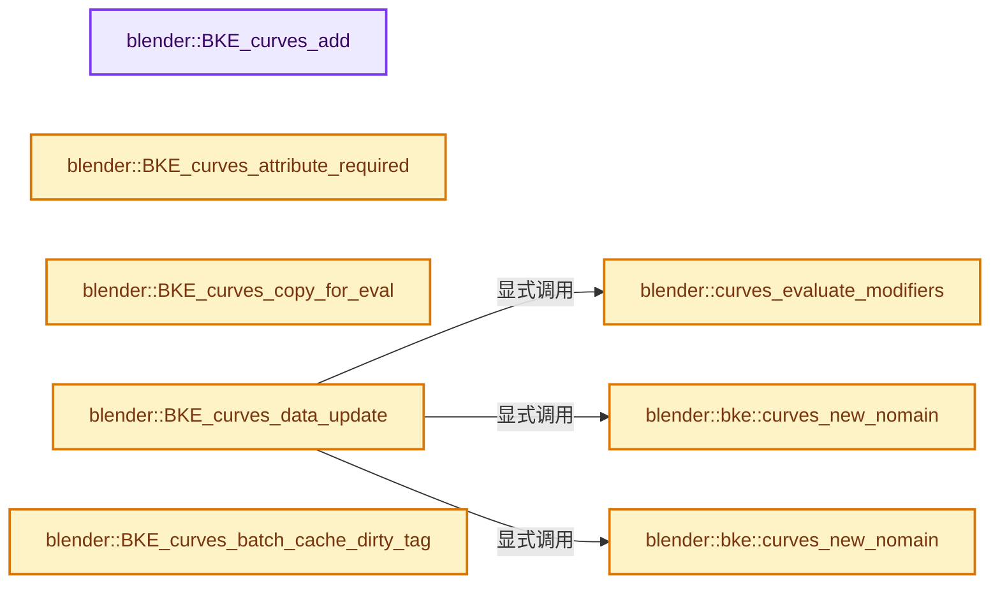
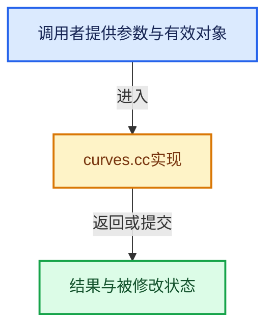

# 实现依赖专题：source/blender/blenkernel/intern/curves.cc

[方向导航](README.md) · [符号索引](../%E7%AC%A6%E5%8F%B7%E4%BE%9D%E8%B5%96%E4%B8%8E%E5%AE%9E%E7%8E%B0%E7%B4%A2%E5%BC%95.md)

本专题从正文实际调用进入，集中保存共享实现。函数有稳定锚点，可从调用处直接跳到对应完整函数；递归与互相调用通过回链组织。

## 本文件的实现关系






## 完整成员与函数实现

<a id="f-15ebea7e8bcc307e"></a>

### `blender::BKE_curves_add`

实现位置：[source/blender/blenkernel/intern/curves.cc](../../../../../source/blender/blenkernel/intern/curves.cc) · L179—L184。

接口参数：

- `Main *bmain`
- `const char *name`

**教学注释版**

<!-- annotated:3692327c9cf923 -->

```cpp
Curves *BKE_curves_add(Main *bmain, const char *name)
{
  Curves *curves = BKE_id_new<Curves>(bmain, name);

  return curves;
}
```

<details>
<summary>核对原始源码：source/blender/blenkernel/intern/curves.cc · L179—L184</summary>

<!-- original:3692327c9cf923:source/blender/blenkernel/intern/curves.cc:179:184 -->

```cpp
Curves *BKE_curves_add(Main *bmain, const char *name)
{
  Curves *curves = BKE_id_new<Curves>(bmain, name);

  return curves;
}
```

</details>

**结果出口**

- `return curves;`

**继续追踪实现**

- `BKE_id_new<Curves>` → [blender::BKE_id_new · L1612](%E4%BE%9D%E8%B5%96-lib_id-d4e6bd.md#f-5335c97ce0a8fbc8)。

<a id="f-0370c77049fe2ab8"></a>

### `blender::BKE_curves_attribute_required`

实现位置：[source/blender/blenkernel/intern/curves.cc](../../../../../source/blender/blenkernel/intern/curves.cc) · L186—L189。

接口参数：

- `const Curves *`
- `const StringRef name`

**教学注释版**

<!-- annotated:499d5ff3263b83 -->

```cpp
bool BKE_curves_attribute_required(const Curves * /*curves*/, const StringRef name)
{
  return name == ATTR_POSITION;
}
```

<details>
<summary>核对原始源码：source/blender/blenkernel/intern/curves.cc · L186—L189</summary>

<!-- original:499d5ff3263b83:source/blender/blenkernel/intern/curves.cc:186:189 -->

```cpp
bool BKE_curves_attribute_required(const Curves * /*curves*/, const StringRef name)
{
  return name == ATTR_POSITION;
}
```

</details>

**结果出口**

- `return name == ATTR_POSITION;`

**继续追踪实现**

本实现没有需要继续展开的显式调用；检查返回表达式、对象转换和调用者前置条件。

<a id="f-d6185daf7e870bda"></a>

### `blender::BKE_curves_copy_for_eval`

实现位置：[source/blender/blenkernel/intern/curves.cc](../../../../../source/blender/blenkernel/intern/curves.cc) · L197—L201。

接口参数：

- `const Curves *curves_src`

**教学注释版**

<!-- annotated:2d1d923ccc3c5c -->

```cpp
Curves *BKE_curves_copy_for_eval(const Curves *curves_src)
{
  return reinterpret_cast<Curves *>(
      BKE_id_copy_ex(nullptr, &curves_src->id, nullptr, LIB_ID_COPY_LOCALIZE));
}
```

<details>
<summary>核对原始源码：source/blender/blenkernel/intern/curves.cc · L197—L201</summary>

<!-- original:2d1d923ccc3c5c:source/blender/blenkernel/intern/curves.cc:197:201 -->

```cpp
Curves *BKE_curves_copy_for_eval(const Curves *curves_src)
{
  return reinterpret_cast<Curves *>(
      BKE_id_copy_ex(nullptr, &curves_src->id, nullptr, LIB_ID_COPY_LOCALIZE));
}
```

</details>

**结果出口**

- `return reinterpret_cast<Curves *>(`

**继续追踪实现**

- `BKE_id_copy_ex` → [blender::BKE_id_copy_ex · L851](%E4%BE%9D%E8%B5%96-lib_id-d4e6bd.md#f-24272170c95f49fb)。

<a id="f-59b2b539e649574a"></a>

### `blender::curves_evaluate_modifiers`

实现位置：[source/blender/blenkernel/intern/curves.cc](../../../../../source/blender/blenkernel/intern/curves.cc) · L203—L238。

接口参数：

- `Depsgraph *depsgraph`
- `Scene *scene`
- `Object *object`
- `bke::GeometrySet &geometry_set`

**教学注释版**

<!-- annotated:2bcdd0f0828e68 -->

```cpp
static void curves_evaluate_modifiers(Depsgraph *depsgraph,
                                      Scene *scene,
                                      Object *object,
                                      bke::GeometrySet &geometry_set)
{
  /* Modifier evaluation modes. */
  const bool use_render = (DEG_get_mode(depsgraph) == DAG_EVAL_RENDER);
  int required_mode = use_render ? eModifierMode_Render : eModifierMode_Realtime;
  if (BKE_object_is_in_editmode(object)) {
    required_mode = ModifierMode(required_mode | eModifierMode_Editmode);
  }
  ModifierApplyFlag apply_flag = use_render ? MOD_APPLY_RENDER : MOD_APPLY_USECACHE;
  const ModifierEvalContext mectx = {depsgraph, object, apply_flag};

  BKE_modifiers_clear_errors(object);

  /* Get effective list of modifiers to execute. Some effects like shape keys
   * are added as virtual modifiers before the user created modifiers. */
  VirtualModifierData virtual_modifier_data;
  ModifierData *md = BKE_modifiers_get_virtual_modifierlist(object, &virtual_modifier_data);

  /* Evaluate modifiers. */
  for (; md; md = md->next) {
    const ModifierTypeInfo *mti = BKE_modifier_get_info(md->type);

    if (!BKE_modifier_is_enabled(scene, md, required_mode)) {
      continue;
    }

    bke::ScopedModifierTimer modifier_timer{*md};

    if (mti->modify_geometry_set != nullptr) {
      mti->modify_geometry_set(md, &mectx, &geometry_set);
    }
  }
}
```

<details>
<summary>核对原始源码：source/blender/blenkernel/intern/curves.cc · L203—L238</summary>

<!-- original:2bcdd0f0828e68:source/blender/blenkernel/intern/curves.cc:203:238 -->

```cpp
static void curves_evaluate_modifiers(Depsgraph *depsgraph,
                                      Scene *scene,
                                      Object *object,
                                      bke::GeometrySet &geometry_set)
{
  /* Modifier evaluation modes. */
  const bool use_render = (DEG_get_mode(depsgraph) == DAG_EVAL_RENDER);
  int required_mode = use_render ? eModifierMode_Render : eModifierMode_Realtime;
  if (BKE_object_is_in_editmode(object)) {
    required_mode = ModifierMode(required_mode | eModifierMode_Editmode);
  }
  ModifierApplyFlag apply_flag = use_render ? MOD_APPLY_RENDER : MOD_APPLY_USECACHE;
  const ModifierEvalContext mectx = {depsgraph, object, apply_flag};

  BKE_modifiers_clear_errors(object);

  /* Get effective list of modifiers to execute. Some effects like shape keys
   * are added as virtual modifiers before the user created modifiers. */
  VirtualModifierData virtual_modifier_data;
  ModifierData *md = BKE_modifiers_get_virtual_modifierlist(object, &virtual_modifier_data);

  /* Evaluate modifiers. */
  for (; md; md = md->next) {
    const ModifierTypeInfo *mti = BKE_modifier_get_info(md->type);

    if (!BKE_modifier_is_enabled(scene, md, required_mode)) {
      continue;
    }

    bke::ScopedModifierTimer modifier_timer{*md};

    if (mti->modify_geometry_set != nullptr) {
      mti->modify_geometry_set(md, &mectx, &geometry_set);
    }
  }
}
```

</details>

**沿实际写入检查状态**

- `required_mode = ModifierMode(required_mode | eModifierMode_Editmode);`

**继续追踪实现**

- `DEG_get_mode` → [blender::DEG_get_mode · L99](../11-Depsgraph%E4%B8%8E%E5%B9%B6%E8%A1%8C%E4%BB%BB%E5%8A%A1%E7%B3%BB%E7%BB%9F/%E4%BE%9D%E8%B5%96-depsgraph_query-e8b1e4.md#f-fa117f51322cd95c)。
- `BKE_object_is_in_editmode` → [blender::BKE_object_is_in_editmode · L1898](%E4%BE%9D%E8%B5%96-object-843689.md#f-675c61a5cb33f967)。
- `ModifierMode` → [blender::ModifierMode](%E4%BE%9D%E8%B5%96-DNA_modifier_types-56a227.md#t-2e244905d690)。
- `BKE_modifiers_clear_errors` → [blender::BKE_modifiers_clear_errors · L282](%E4%BE%9D%E8%B5%96-modifier-ab0273.md#f-aeccb28cb209861b)。
- `BKE_modifiers_get_virtual_modifierlist` → [blender::BKE_modifiers_get_virtual_modifierlist · L620](%E4%BE%9D%E8%B5%96-modifier-ab0273.md#f-47967058788364c5)。
- `BKE_modifier_get_info` → [blender::BKE_modifier_get_info · L120](%E4%BE%9D%E8%B5%96-modifier-ab0273.md#f-88218d6d450f0291)。
- `BKE_modifier_is_enabled` → [blender::BKE_modifier_is_enabled · L529](%E4%BE%9D%E8%B5%96-modifier-ab0273.md#f-1debd86d0fcbcc8e)。
- `mti->modify_geometry_set` → [blender::modify_geometry_set · L243](%E4%BE%9D%E8%B5%96-MOD_grease_pencil_noise-eae4f5.md#f-230f261ee5b301b9)；[blender::modify_geometry_set · L218](%E4%BE%9D%E8%B5%96-MOD_grease_pencil_multiply-2e50d7.md#f-20b39fa517056ba3)；[blender::modify_geometry_set · L184](%E4%BE%9D%E8%B5%96-MOD_grease_pencil_mirror-70efb7.md#f-3dc669ce25b45890)；[blender::modify_geometry_set · L303](%E4%BE%9D%E8%B5%96-MOD_volume_displace-d9d5ed.md#f-ebaffe948c472b25)；[blender::modify_geometry_set · L245](%E4%BE%9D%E8%B5%96-MOD_grease_pencil_length-522992.md#f-115999e601704e66)；[blender::modify_geometry_set · L127](%E4%BE%9D%E8%B5%96-MOD_grease_pencil_lattice-8f886f.md#f-08d3356602673303)；[blender::modify_geometry_set · L237](%E4%BE%9D%E8%B5%96-MOD_grease_pencil_hook-a8b10b.md#f-7d8cba698be3f21f)；[blender::modify_geometry_set · L648](%E4%BE%9D%E8%B5%96-MOD_grease_pencil_envelope-fe9b70.md#f-89a88be68c707af7)；[blender::modify_geometry_set · L383](%E4%BE%9D%E8%B5%96-MOD_grease_pencil_dash-8edc8e.md#f-77a5c0cf948381ba)；[blender::modify_geometry_set · L186](%E4%BE%9D%E8%B5%96-MOD_grease_pencil_color-247c5a.md#f-b7d9cea51cff81d7)；[blender::modify_geometry_set · L708](%E4%BE%9D%E8%B5%96-MOD_grease_pencil_build-c03219.md#f-5dd5fbb27a45198a)；[blender::modify_geometry_set · L256](%E4%BE%9D%E8%B5%96-MOD_grease_pencil_array-6250c2.md#f-5bbc1bf941a9346b)；[blender::modify_geometry_set · L228](%E4%BE%9D%E8%B5%96-MOD_grease_pencil_armature-b733ac.md#f-aa0222d18ac7bd5e)；[blender::modify_geometry_set · L1862](%E4%BE%9D%E8%B5%96-MOD_nodes-3d10f5.md#f-2a30b7b16d4a8c31)；[blender::modify_geometry_set · L176](%E4%BE%9D%E8%B5%96-MOD_mesh_to_volume-98590f.md#f-d3eb652ca6ad569c)；[blender::modify_geometry_set · L146](%E4%BE%9D%E8%B5%96-MOD_meshsequencecache-651784.md#f-293a594730db07db)；[blender::modify_geometry_set · L873](%E4%BE%9D%E8%B5%96-MOD_lineart-b0a62c.md#f-5f731799aa2bb8f9)；[blender::modify_geometry_set · L212](%E4%BE%9D%E8%B5%96-MOD_grease_pencil_weight_proximity-e5bd3c.md#f-ea5a620d5c23e64e)；[blender::modify_geometry_set · L192](%E4%BE%9D%E8%B5%96-MOD_grease_pencil_weight_angle-591cee.md#f-782ecf61845b0827)；[blender::modify_geometry_set · L409](%E4%BE%9D%E8%B5%96-MOD_grease_pencil_tint-130b42.md#f-54a72eb9cf6cff28)；[blender::modify_geometry_set · L480](%E4%BE%9D%E8%B5%96-MOD_grease_pencil_time-b2b2fa.md#f-9ab3d6f606c2eab8)；[blender::modify_geometry_set · L150](%E4%BE%9D%E8%B5%96-MOD_grease_pencil_thickness-bd8572.md#f-4e7b0f538b12bed5)；[blender::modify_geometry_set · L276](%E4%BE%9D%E8%B5%96-MOD_grease_pencil_texture-53cfff.md#f-1ff4ec887af41ab7)；[blender::modify_geometry_set · L130](%E4%BE%9D%E8%B5%96-MOD_grease_pencil_subdiv-1b017f.md#f-931890f60d4fecdf)；[blender::modify_geometry_set · L202](%E4%BE%9D%E8%B5%96-MOD_grease_pencil_smooth-84378f.md#f-b3cfc63152b3b8cf)；[blender::modify_geometry_set · L161](%E4%BE%9D%E8%B5%96-MOD_grease_pencil_simplify-084e93.md#f-43ffd26310c793e0)；[blender::modify_geometry_set · L204](%E4%BE%9D%E8%B5%96-MOD_grease_pencil_shrinkwrap-67e646.md#f-46686f6c416f5e15)；[blender::modify_geometry_set · L231](%E4%BE%9D%E8%B5%96-MOD_grease_pencil_outline-52807d.md#f-fa4d9a8d843e52d6)；[blender::modify_geometry_set · L206](%E4%BE%9D%E8%B5%96-MOD_grease_pencil_opacity-33f86c.md#f-e612ca2075a8aa0f)；[blender::modify_geometry_set · L359](%E4%BE%9D%E8%B5%96-MOD_grease_pencil_offset-ea9491.md#f-efbe77084a15801e)。同名重载需按实参类型选择。

<a id="f-ffea1a3f3eb5aa42"></a>

### `blender::BKE_curves_data_update`

实现位置：[source/blender/blenkernel/intern/curves.cc](../../../../../source/blender/blenkernel/intern/curves.cc) · L240—L270。

接口参数：

- `Depsgraph *depsgraph`
- `Scene *scene`
- `Object *object`

**教学注释版**

<!-- annotated:6efb70ea5f5968 -->

```cpp
void BKE_curves_data_update(Depsgraph *depsgraph, Scene *scene, Object *object)
{
  using namespace blender::bke;
  /* Free any evaluated data and restore original data. */
  BKE_object_free_derived_caches(object);

  /* Evaluate modifiers. */
  Curves *curves = id_cast<Curves *>(object->data);
  GeometrySet geometry_set = GeometrySet::from_curves(curves, GeometryOwnershipType::ReadOnly);
  if (ELEM(object->mode, OB_MODE_EDIT, OB_MODE_SCULPT_CURVES)) {
    /* Try to propagate deformation data through modifier evaluation, so that sculpt mode can work
     * on evaluated curves. */
    GeometryComponentEditData &edit_component =
        geometry_set.get_component_for_write<GeometryComponentEditData>();
    // [讲解] std::make_unique<CurvesEditHints>：创建独占拥有的对象，拥有关系可移动，get返回的借用指针不自动延长寿命。
    edit_component.curves_edit_hints_ = std::make_unique<CurvesEditHints>(
        *id_cast<const Curves *>(DEG_get_original(object)->data));
  }
  bke::curves_store_surface_in_geometry_bundle(*depsgraph, *curves, geometry_set);
  curves_evaluate_modifiers(depsgraph, scene, object, geometry_set);

  /* Assign evaluated object. */
  Curves *curves_eval = const_cast<Curves *>(geometry_set.get_curves());
  if (curves_eval == nullptr) {
    curves_eval = curves_new_nomain(0, 0);
    BKE_object_eval_assign_data(object, &curves_eval->id, true);
  }
  else {
    BKE_object_eval_assign_data(object, &curves_eval->id, false);
  }
  // [讲解] std::move：把表达式转换成可供移动重载选择的值类别；不保证真的移动，不结束源对象寿命，对const值可能选择复制。
  object->runtime->geometry_set_eval = new GeometrySet(std::move(geometry_set));
}
```

<details>
<summary>核对原始源码：source/blender/blenkernel/intern/curves.cc · L240—L270</summary>

<!-- original:6efb70ea5f5968:source/blender/blenkernel/intern/curves.cc:240:270 -->

```cpp
void BKE_curves_data_update(Depsgraph *depsgraph, Scene *scene, Object *object)
{
  using namespace blender::bke;
  /* Free any evaluated data and restore original data. */
  BKE_object_free_derived_caches(object);

  /* Evaluate modifiers. */
  Curves *curves = id_cast<Curves *>(object->data);
  GeometrySet geometry_set = GeometrySet::from_curves(curves, GeometryOwnershipType::ReadOnly);
  if (ELEM(object->mode, OB_MODE_EDIT, OB_MODE_SCULPT_CURVES)) {
    /* Try to propagate deformation data through modifier evaluation, so that sculpt mode can work
     * on evaluated curves. */
    GeometryComponentEditData &edit_component =
        geometry_set.get_component_for_write<GeometryComponentEditData>();
    edit_component.curves_edit_hints_ = std::make_unique<CurvesEditHints>(
        *id_cast<const Curves *>(DEG_get_original(object)->data));
  }
  bke::curves_store_surface_in_geometry_bundle(*depsgraph, *curves, geometry_set);
  curves_evaluate_modifiers(depsgraph, scene, object, geometry_set);

  /* Assign evaluated object. */
  Curves *curves_eval = const_cast<Curves *>(geometry_set.get_curves());
  if (curves_eval == nullptr) {
    curves_eval = curves_new_nomain(0, 0);
    BKE_object_eval_assign_data(object, &curves_eval->id, true);
  }
  else {
    BKE_object_eval_assign_data(object, &curves_eval->id, false);
  }
  object->runtime->geometry_set_eval = new GeometrySet(std::move(geometry_set));
}
```

</details>

**沿实际写入检查状态**

- `edit_component.curves_edit_hints_ = std::make_unique<CurvesEditHints>(`
- `curves_eval = curves_new_nomain(0, 0);`
- `object->runtime->geometry_set_eval = new GeometrySet(std::move(geometry_set));`

**继续追踪实现**

- `BKE_object_free_derived_caches` → [blender::BKE_object_free_derived_caches · L1810](%E4%BE%9D%E8%B5%96-object-843689.md#f-74071902e41326eb)。
- `id_cast<Curves *>` → [blender::id_cast · L1417](%E4%BE%9D%E8%B5%96-DNA_ID-3eb091.md#f-6c8ac6412850ac5a)。
- `GeometrySet::from_curves` → [blender::bke::GeometrySet::from_curves · L448](../06-%E9%9A%90%E5%BC%8F%E5%85%B1%E4%BA%AB%E4%B8%8E%E7%BC%93%E5%AD%98%E7%B3%BB%E7%BB%9F/05-GeometrySet%E8%AF%BB%E5%86%99%E4%B8%8E%E5%A4%8D%E5%88%B6.md#f-4a638adc47cc3b9f)。
- `ELEM` → [ELEM · L88](%E4%BE%9D%E8%B5%96-GHOST_utildefines-34b996.md#m-d28724a15928)；[ELEM · L135](../01-%E5%9F%BA%E7%A1%80%E5%AE%B9%E5%99%A8%E4%B8%8E%E7%8E%B0%E4%BB%A3CPP/%E4%BE%9D%E8%B5%96-BLI_utildefines-293a0a.md#m-d6572de7cae0)。宏定义由构建条件选择。
- `geometry_set.get_component_for_write<GeometryComponentEditData>` → [blender::bke::GeometrySet::get_component_for_write · L119](../06-%E9%9A%90%E5%BC%8F%E5%85%B1%E4%BA%AB%E4%B8%8E%E7%BC%93%E5%AD%98%E7%B3%BB%E7%BB%9F/05-GeometrySet%E8%AF%BB%E5%86%99%E4%B8%8E%E5%A4%8D%E5%88%B6.md#f-21eccb196f5b9a78)。
- `std::make_unique<CurvesEditHints>` → [外部契约](https://eel.is/c++draft/unique.ptr.create)：创建独占拥有的对象，拥有关系可移动，get返回的借用指针不自动延长寿命。
- `id_cast<const Curves *>` → [blender::id_cast · L1417](%E4%BE%9D%E8%B5%96-DNA_ID-3eb091.md#f-6c8ac6412850ac5a)。
- `DEG_get_original` → [blender::DEG_get_original · L128](../11-Depsgraph%E4%B8%8E%E5%B9%B6%E8%A1%8C%E4%BB%BB%E5%8A%A1%E7%B3%BB%E7%BB%9F/%E4%BE%9D%E8%B5%96-DEG_depsgraph_query-db0d31.md#f-79782eab82a92d86)；[blender::DEG_get_original · L134](../11-Depsgraph%E4%B8%8E%E5%B9%B6%E8%A1%8C%E4%BB%BB%E5%8A%A1%E7%B3%BB%E7%BB%9F/%E4%BE%9D%E8%B5%96-DEG_depsgraph_query-db0d31.md#f-c032f06e9ef8f0cb)。同名重载需按实参类型选择。
- `bke::curves_store_surface_in_geometry_bundle` → [blender::bke::curves_store_surface_in_geometry_bundle · L336](%E4%BE%9D%E8%B5%96-curves-fcb14d.md#f-c8916831cde1e10f)。
- `curves_evaluate_modifiers` → [blender::curves_evaluate_modifiers · L203](%E4%BE%9D%E8%B5%96-curves-fcb14d.md#f-59b2b539e649574a)。
- `geometry_set.get_curves` → [blender::bke::GeometrySet::get_curves · L339](../06-%E9%9A%90%E5%BC%8F%E5%85%B1%E4%BA%AB%E4%B8%8E%E7%BC%93%E5%AD%98%E7%B3%BB%E7%BB%9F/05-GeometrySet%E8%AF%BB%E5%86%99%E4%B8%8E%E5%A4%8D%E5%88%B6.md#f-1d7b3a3ddbc6c57b)。
- `curves_new_nomain` → [blender::bke::curves_new_nomain · L293](%E4%BE%9D%E8%B5%96-curves-fcb14d.md#f-702debf916bbedac)；[blender::bke::curves_new_nomain · L312](%E4%BE%9D%E8%B5%96-curves-fcb14d.md#f-ba10c7025cf69460)。同名重载需按实参类型选择。
- `BKE_object_eval_assign_data` → [blender::BKE_object_eval_assign_data · L1786](%E4%BE%9D%E8%B5%96-object-843689.md#f-8f43c337a2db2299)。
- `std::move` → [外部契约](https://eel.is/c++draft/utility.forward)：把表达式转换成可供移动重载选择的值类别；不保证真的移动，不结束源对象寿命，对const值可能选择复制。

<a id="f-bb154751fe7c690d"></a>

### `blender::BKE_curves_batch_cache_dirty_tag`

实现位置：[source/blender/blenkernel/intern/curves.cc](../../../../../source/blender/blenkernel/intern/curves.cc) · L277—L282。

接口参数：

- `Curves *curves`
- `int mode`

**教学注释版**

<!-- annotated:c0188d9f2f04cf -->

```cpp
void BKE_curves_batch_cache_dirty_tag(Curves *curves, int mode)
{
  if (curves->batch_cache) {
    BKE_curves_batch_cache_dirty_tag_cb(curves, mode);
  }
}
```

<details>
<summary>核对原始源码：source/blender/blenkernel/intern/curves.cc · L277—L282</summary>

<!-- original:c0188d9f2f04cf:source/blender/blenkernel/intern/curves.cc:277:282 -->

```cpp
void BKE_curves_batch_cache_dirty_tag(Curves *curves, int mode)
{
  if (curves->batch_cache) {
    BKE_curves_batch_cache_dirty_tag_cb(curves, mode);
  }
}
```

</details>

**继续追踪实现**

- `BKE_curves_batch_cache_dirty_tag_cb` → [调用协议](../%E6%A8%A1%E6%9D%BF%E5%AE%8F%E4%B8%8E%E5%8A%A8%E6%80%81%E5%88%86%E6%B4%BE%E5%8D%8F%E8%AE%AE.md)：函数指针、局部可调用对象或未展开的宏；必须结合调用者环境。调用位置L280。

<a id="f-702debf916bbedac"></a>

### `blender::bke::curves_new_nomain`

实现位置：[source/blender/blenkernel/intern/curves.cc](../../../../../source/blender/blenkernel/intern/curves.cc) · L293—L301。

接口参数：

- `const int points_num`
- `const int curves_num`

**教学注释版**

<!-- annotated:87f38fcd8d6022 -->

```cpp
Curves *curves_new_nomain(const int points_num, const int curves_num)
{
  BLI_assert(points_num >= 0);
  BLI_assert(curves_num >= 0);
  Curves *curves_id = BKE_id_new_nomain<Curves>(nullptr);
  CurvesGeometry &curves = curves_id->geometry.wrap();
  curves.resize(points_num, curves_num);
  return curves_id;
}
```

<details>
<summary>核对原始源码：source/blender/blenkernel/intern/curves.cc · L293—L301</summary>

<!-- original:87f38fcd8d6022:source/blender/blenkernel/intern/curves.cc:293:301 -->

```cpp
Curves *curves_new_nomain(const int points_num, const int curves_num)
{
  BLI_assert(points_num >= 0);
  BLI_assert(curves_num >= 0);
  Curves *curves_id = BKE_id_new_nomain<Curves>(nullptr);
  CurvesGeometry &curves = curves_id->geometry.wrap();
  curves.resize(points_num, curves_num);
  return curves_id;
}
```

</details>

**结果出口**

- `return curves_id;`

**继续追踪实现**

- `BLI_assert` → [BLI_assert · L48](../01-%E5%9F%BA%E7%A1%80%E5%AE%B9%E5%99%A8%E4%B8%8E%E7%8E%B0%E4%BB%A3CPP/%E4%BE%9D%E8%B5%96-BLI_assert-cc98e8.md#m-57a88495704d)；[BLI_assert · L63](../01-%E5%9F%BA%E7%A1%80%E5%AE%B9%E5%99%A8%E4%B8%8E%E7%8E%B0%E4%BB%A3CPP/%E4%BE%9D%E8%B5%96-BLI_assert-cc98e8.md#m-d07050020cb5)。宏定义由构建条件选择。
- `BKE_id_new_nomain<Curves>` → [blender::BKE_id_new_nomain · L1617](%E4%BE%9D%E8%B5%96-lib_id-d4e6bd.md#f-b72d7abbfd8aeae3)。
- `curves_id->geometry.wrap` → [调用协议](../%E6%A8%A1%E6%9D%BF%E5%AE%8F%E4%B8%8E%E5%8A%A8%E6%80%81%E5%88%86%E6%B4%BE%E5%8D%8F%E8%AE%AE.md)：接收对象类型依赖auto、返回值或模板实例；不按同名猜测目标。调用位置L298。
- `curves.resize` → [blender::bke::CurvesGeometry::resize · L1223](%E4%BE%9D%E8%B5%96-curves_geometry-ad7f9f.md#f-3075a8d29a1332c0)。

<a id="f-ba10c7025cf69460"></a>

### `blender::bke::curves_new_nomain`

实现位置：[source/blender/blenkernel/intern/curves.cc](../../../../../source/blender/blenkernel/intern/curves.cc) · L312—L317。

接口参数：

- `CurvesGeometry curves`

**教学注释版**

<!-- annotated:23b365e27edb6d -->

```cpp
Curves *curves_new_nomain(CurvesGeometry curves)
{
  Curves *curves_id = BKE_id_new_nomain<Curves>(nullptr);
  // [讲解] std::move：把表达式转换成可供移动重载选择的值类别；不保证真的移动，不结束源对象寿命，对const值可能选择复制。
  curves_id->geometry.wrap() = std::move(curves);
  return curves_id;
}
```

<details>
<summary>核对原始源码：source/blender/blenkernel/intern/curves.cc · L312—L317</summary>

<!-- original:23b365e27edb6d:source/blender/blenkernel/intern/curves.cc:312:317 -->

```cpp
Curves *curves_new_nomain(CurvesGeometry curves)
{
  Curves *curves_id = BKE_id_new_nomain<Curves>(nullptr);
  curves_id->geometry.wrap() = std::move(curves);
  return curves_id;
}
```

</details>

**结果出口**

- `return curves_id;`

**继续追踪实现**

- `BKE_id_new_nomain<Curves>` → [blender::BKE_id_new_nomain · L1617](%E4%BE%9D%E8%B5%96-lib_id-d4e6bd.md#f-b72d7abbfd8aeae3)。
- `curves_id->geometry.wrap` → [调用协议](../%E6%A8%A1%E6%9D%BF%E5%AE%8F%E4%B8%8E%E5%8A%A8%E6%80%81%E5%88%86%E6%B4%BE%E5%8D%8F%E8%AE%AE.md)：接收对象类型依赖auto、返回值或模板实例；不按同名猜测目标。调用位置L315。
- `std::move` → [外部契约](https://eel.is/c++draft/utility.forward)：把表达式转换成可供移动重载选择的值类别；不保证真的移动，不结束源对象寿命，对const值可能选择复制。

<a id="f-1f638586534cf1aa"></a>

### `blender::bke::curves_copy_parameters`

实现位置：[source/blender/blenkernel/intern/curves.cc](../../../../../source/blender/blenkernel/intern/curves.cc) · L319—L334。

接口参数：

- `const Curves &src`
- `Curves &dst`

**教学注释版**

<!-- annotated:422fe61463e10c -->

```cpp
void curves_copy_parameters(const Curves &src, Curves &dst)
{
  dst.flag = src.flag;
  MEM_SAFE_DELETE(dst.mat);
  dst.mat = MEM_new_array_uninitialized<Material *>(size_t(src.totcol), __func__);
  dst.totcol = src.totcol;
  MutableSpan(dst.mat, dst.totcol).copy_from(Span(src.mat, src.totcol));
  dst.symmetry = src.symmetry;
  dst.selection_domain = src.selection_domain;
  dst.surface = src.surface;
  MEM_SAFE_DELETE(dst.surface_uv_map);
  if (src.surface_uv_map != nullptr) {
    dst.surface_uv_map = BLI_strdup(src.surface_uv_map);
  }
  dst.surface_collision_distance = src.surface_collision_distance;
}
```

<details>
<summary>核对原始源码：source/blender/blenkernel/intern/curves.cc · L319—L334</summary>

<!-- original:422fe61463e10c:source/blender/blenkernel/intern/curves.cc:319:334 -->

```cpp
void curves_copy_parameters(const Curves &src, Curves &dst)
{
  dst.flag = src.flag;
  MEM_SAFE_DELETE(dst.mat);
  dst.mat = MEM_new_array_uninitialized<Material *>(size_t(src.totcol), __func__);
  dst.totcol = src.totcol;
  MutableSpan(dst.mat, dst.totcol).copy_from(Span(src.mat, src.totcol));
  dst.symmetry = src.symmetry;
  dst.selection_domain = src.selection_domain;
  dst.surface = src.surface;
  MEM_SAFE_DELETE(dst.surface_uv_map);
  if (src.surface_uv_map != nullptr) {
    dst.surface_uv_map = BLI_strdup(src.surface_uv_map);
  }
  dst.surface_collision_distance = src.surface_collision_distance;
}
```

</details>

**沿实际写入检查状态**

- `dst.flag = src.flag;`
- `dst.mat = MEM_new_array_uninitialized<Material *>(size_t(src.totcol), __func__);`
- `dst.totcol = src.totcol;`
- `dst.symmetry = src.symmetry;`
- `dst.selection_domain = src.selection_domain;`
- `dst.surface = src.surface;`
- `dst.surface_uv_map = BLI_strdup(src.surface_uv_map);`
- `dst.surface_collision_distance = src.surface_collision_distance;`

**继续追踪实现**

- `MEM_SAFE_DELETE` → [MEM_SAFE_DELETE · L436](../03-%E5%86%85%E5%AD%98%E5%88%86%E9%85%8D%E4%B8%8E%E8%BF%90%E8%A1%8C%E6%97%B6%E7%B1%BB%E5%9E%8B/%E4%BE%9D%E8%B5%96-MEM_guardedalloc-b54eca.md#m-eadb3bc5b902)。宏定义由构建条件选择。
- `MEM_new_array_uninitialized<Material *>` → [MEM_new_array_uninitialized · L608](../03-%E5%86%85%E5%AD%98%E5%88%86%E9%85%8D%E4%B8%8E%E8%BF%90%E8%A1%8C%E6%97%B6%E7%B1%BB%E5%9E%8B/%E4%BE%9D%E8%B5%96-MEM_guardedalloc-b54eca.md#f-b7103eae8eb57b05)；[MEM_new_array_uninitialized · L129](../03-%E5%86%85%E5%AD%98%E5%88%86%E9%85%8D%E4%B8%8E%E8%BF%90%E8%A1%8C%E6%97%B6%E7%B1%BB%E5%9E%8B/%E4%BE%9D%E8%B5%96-mallocn-afdcd4.md#f-bf6ef4ddcfb6e5df)。同名重载需按实参类型选择。
- `MutableSpan(dst.mat, dst.totcol).copy_from` → [调用协议](../%E6%A8%A1%E6%9D%BF%E5%AE%8F%E4%B8%8E%E5%8A%A8%E6%80%81%E5%88%86%E6%B4%BE%E5%8D%8F%E8%AE%AE.md)：接收对象类型依赖auto、返回值或模板实例；不按同名猜测目标。调用位置L325。
- `MutableSpan` → [blender::MutableSpan::MutableSpan · L462](../01-%E5%9F%BA%E7%A1%80%E5%AE%B9%E5%99%A8%E4%B8%8E%E7%8E%B0%E4%BB%A3CPP/06-MutableSpan%E5%8F%AF%E5%86%99%E8%A7%86%E5%9B%BE.md#f-0f07034aaffc3384)；[blender::MutableSpan::MutableSpan · L464](../01-%E5%9F%BA%E7%A1%80%E5%AE%B9%E5%99%A8%E4%B8%8E%E7%8E%B0%E4%BB%A3CPP/06-MutableSpan%E5%8F%AF%E5%86%99%E8%A7%86%E5%9B%BE.md#f-39977234ad0ce192)；[blender::MutableSpan::MutableSpan · L466](../01-%E5%9F%BA%E7%A1%80%E5%AE%B9%E5%99%A8%E4%B8%8E%E7%8E%B0%E4%BB%A3CPP/06-MutableSpan%E5%8F%AF%E5%86%99%E8%A7%86%E5%9B%BE.md#f-ee249b5042dd38aa)；[blender::MutableSpan::MutableSpan · L468](../01-%E5%9F%BA%E7%A1%80%E5%AE%B9%E5%99%A8%E4%B8%8E%E7%8E%B0%E4%BB%A3CPP/06-MutableSpan%E5%8F%AF%E5%86%99%E8%A7%86%E5%9B%BE.md#f-479c5f85921e531f)；[blender::MutableSpan::MutableSpan · L477](../01-%E5%9F%BA%E7%A1%80%E5%AE%B9%E5%99%A8%E4%B8%8E%E7%8E%B0%E4%BB%A3CPP/06-MutableSpan%E5%8F%AF%E5%86%99%E8%A7%86%E5%9B%BE.md#f-afcce5325e6f19e0)。同名重载需按实参类型选择。
- `Span` → [blender::Span](../01-%E5%9F%BA%E7%A1%80%E5%AE%B9%E5%99%A8%E4%B8%8E%E7%8E%B0%E4%BB%A3CPP/%E4%BE%9D%E8%B5%96-BLI_span-6aa95f.md#t-8765a8e0c1d5)；[blender::Span](../01-%E5%9F%BA%E7%A1%80%E5%AE%B9%E5%99%A8%E4%B8%8E%E7%8E%B0%E4%BB%A3CPP/%E4%BE%9D%E8%B5%96-BLI_index_range-7d7cc5.md#t-86091874a1c0)；[blender::Span](%E4%BE%9D%E8%B5%96-DNA_pointcloud_types-cfb82c.md#t-112aa6ed842c)；[blender::Span](%E4%BE%9D%E8%B5%96-DNA_node_types-6708b9.md#t-49ec6fbb9b69)；[blender::Span](%E4%BE%9D%E8%B5%96-DNA_mesh_types-81f02e.md#t-184fd48fb638)；[blender::Span](%E4%BE%9D%E8%B5%96-DNA_anim_types-39c5d9.md#t-d841071994c2)；[blender::Span](%E4%BE%9D%E8%B5%96-RNA_path_fwd-79c989.md#t-4dbb08969e41)。
- `BLI_strdup` → [blender::BLI_strdup · L43](../01-%E5%9F%BA%E7%A1%80%E5%AE%B9%E5%99%A8%E4%B8%8E%E7%8E%B0%E4%BB%A3CPP/%E4%BE%9D%E8%B5%96-string-1d986f.md#f-7e6d5c696c20c0e1)。

<a id="f-c8916831cde1e10f"></a>

### `blender::bke::curves_store_surface_in_geometry_bundle`

实现位置：[source/blender/blenkernel/intern/curves.cc](../../../../../source/blender/blenkernel/intern/curves.cc) · L336—L351。

接口参数：

- `const Depsgraph &depsgraph`
- `const Curves &curves_id`
- `GeometrySet &geometry_set`

**教学注释版**

<!-- annotated:d0b0d4536ad658 -->

```cpp
void curves_store_surface_in_geometry_bundle(const Depsgraph &depsgraph,
                                             const Curves &curves_id,
                                             GeometrySet &geometry_set)
{
  if (!curves_id.surface) {
    return;
  }
  if (!curves_id.surface_uv_map) {
    return;
  }
  nodes::Bundle &bundle = geometry_set.bundle_for_write();
  bundle.add(*nodes::BundleKey::from_ustr("surface_object"_ustr),
             DEG_get_evaluated(&depsgraph, curves_id.surface));
  bundle.add(*nodes::BundleKey::from_ustr("surface_uv_map_name"_ustr),
             std::string(curves_id.surface_uv_map));
}
```

<details>
<summary>核对原始源码：source/blender/blenkernel/intern/curves.cc · L336—L351</summary>

<!-- original:d0b0d4536ad658:source/blender/blenkernel/intern/curves.cc:336:351 -->

```cpp
void curves_store_surface_in_geometry_bundle(const Depsgraph &depsgraph,
                                             const Curves &curves_id,
                                             GeometrySet &geometry_set)
{
  if (!curves_id.surface) {
    return;
  }
  if (!curves_id.surface_uv_map) {
    return;
  }
  nodes::Bundle &bundle = geometry_set.bundle_for_write();
  bundle.add(*nodes::BundleKey::from_ustr("surface_object"_ustr),
             DEG_get_evaluated(&depsgraph, curves_id.surface));
  bundle.add(*nodes::BundleKey::from_ustr("surface_uv_map_name"_ustr),
             std::string(curves_id.surface_uv_map));
}
```

</details>

**继续追踪实现**

- `geometry_set.bundle_for_write` → [blender::bke::GeometrySet::bundle_for_write · L779](../06-%E9%9A%90%E5%BC%8F%E5%85%B1%E4%BA%AB%E4%B8%8E%E7%BC%93%E5%AD%98%E7%B3%BB%E7%BB%9F/05-GeometrySet%E8%AF%BB%E5%86%99%E4%B8%8E%E5%A4%8D%E5%88%B6.md#f-9f3eaefe0279cab7)。
- `bundle.add` → [blender::nodes::Bundle::add · L420](../10-%E5%BC%95%E7%94%A8%E7%94%9F%E5%91%BD%E5%91%A8%E6%9C%9F%E4%B8%8EClosure/%E4%BE%9D%E8%B5%96-NOD_geometry_nodes_bundle-f07f4e.md#f-a403253ff0c9963a)；[blender::nodes::Bundle::add · L109](../10-%E5%BC%95%E7%94%A8%E7%94%9F%E5%91%BD%E5%91%A8%E6%9C%9F%E4%B8%8EClosure/05-Bundle%E5%80%BC%E7%BB%84%E5%90%88.md#f-1d3f8ed0f1d1c28b)；[blender::nodes::Bundle::add · L118](../10-%E5%BC%95%E7%94%A8%E7%94%9F%E5%91%BD%E5%91%A8%E6%9C%9F%E4%B8%8EClosure/05-Bundle%E5%80%BC%E7%BB%84%E5%90%88.md#f-102b881c74112c46)。同名重载需按实参类型选择。
- `nodes::BundleKey::from_ustr` → [blender::nodes::BundleKey::from_ustr · L500](../10-%E5%BC%95%E7%94%A8%E7%94%9F%E5%91%BD%E5%91%A8%E6%9C%9F%E4%B8%8EClosure/%E4%BE%9D%E8%B5%96-NOD_geometry_nodes_bundle-f07f4e.md#f-2a8009ece94131fa)。
- `DEG_get_evaluated` → [blender::DEG_get_evaluated · L106](../11-Depsgraph%E4%B8%8E%E5%B9%B6%E8%A1%8C%E4%BB%BB%E5%8A%A1%E7%B3%BB%E7%BB%9F/%E4%BE%9D%E8%B5%96-DEG_depsgraph_query-db0d31.md#f-e70143fa875363bf)；[blender::DEG_get_evaluated · L112](../11-Depsgraph%E4%B8%8E%E5%B9%B6%E8%A1%8C%E4%BB%BB%E5%8A%A1%E7%B3%BB%E7%BB%9F/%E4%BE%9D%E8%B5%96-DEG_depsgraph_query-db0d31.md#f-129df72cfb5a1bad)。同名重载需按实参类型选择。
- `std::string` → [外部契约](https://eel.is/c++draft/)：这个边界按实际表达式及所属类型核对参数、返回值、寿命与失败行为。这里提供接口入口，不声称已解释该第三方版本的内部实现。

<a id="f-47e07c8e18ad1b57"></a>

### `blender::bke::CurvesEditHints::is_valid`

实现位置：[source/blender/blenkernel/intern/curves.cc](../../../../../source/blender/blenkernel/intern/curves.cc) · L367—L381。

**教学注释版**

<!-- annotated:f2d3efd8eccc10 -->

```cpp
bool CurvesEditHints::is_valid() const
{
  const int point_num = this->curves_id_orig.geometry.point_num;
  if (this->positions().has_value()) {
    if (this->positions()->size() != point_num) {
      return false;
    }
  }
  if (this->deform_mats.has_value()) {
    if (this->deform_mats->size() != point_num) {
      return false;
    }
  }
  return true;
}
```

<details>
<summary>核对原始源码：source/blender/blenkernel/intern/curves.cc · L367—L381</summary>

<!-- original:f2d3efd8eccc10:source/blender/blenkernel/intern/curves.cc:367:381 -->

```cpp
bool CurvesEditHints::is_valid() const
{
  const int point_num = this->curves_id_orig.geometry.point_num;
  if (this->positions().has_value()) {
    if (this->positions()->size() != point_num) {
      return false;
    }
  }
  if (this->deform_mats.has_value()) {
    if (this->deform_mats->size() != point_num) {
      return false;
    }
  }
  return true;
}
```

</details>

**结果出口**

- `return false;`
- `return true;`

**继续追踪实现**

- `this->positions().has_value` → [调用协议](../%E6%A8%A1%E6%9D%BF%E5%AE%8F%E4%B8%8E%E5%8A%A8%E6%80%81%E5%88%86%E6%B4%BE%E5%8D%8F%E8%AE%AE.md)：接收对象类型依赖auto、返回值或模板实例；不按同名猜测目标。调用位置L370。
- `this->positions` → [blender::bke::CurvesEditHints::positions · L383](%E4%BE%9D%E8%B5%96-curves-fcb14d.md#f-50a38220570a15ad)。
- `this->positions()->size` → [调用协议](../%E6%A8%A1%E6%9D%BF%E5%AE%8F%E4%B8%8E%E5%8A%A8%E6%80%81%E5%88%86%E6%B4%BE%E5%8D%8F%E8%AE%AE.md)：接收对象类型依赖auto、返回值或模板实例；不按同名猜测目标。调用位置L371。
- `this->deform_mats.has_value` → [调用协议](../%E6%A8%A1%E6%9D%BF%E5%AE%8F%E4%B8%8E%E5%8A%A8%E6%80%81%E5%88%86%E6%B4%BE%E5%8D%8F%E8%AE%AE.md)：接收对象类型依赖auto、返回值或模板实例；不按同名猜测目标。调用位置L375。
- `this->deform_mats->size` → [调用协议](../%E6%A8%A1%E6%9D%BF%E5%AE%8F%E4%B8%8E%E5%8A%A8%E6%80%81%E5%88%86%E6%B4%BE%E5%8D%8F%E8%AE%AE.md)：接收对象类型依赖auto、返回值或模板实例；不按同名猜测目标。调用位置L376。

<a id="f-50a38220570a15ad"></a>

### `blender::bke::CurvesEditHints::positions`

实现位置：[source/blender/blenkernel/intern/curves.cc](../../../../../source/blender/blenkernel/intern/curves.cc) · L383—L390。

**教学注释版**

<!-- annotated:1e1d3daf9e68cb -->

```cpp
std::optional<Span<float3>> CurvesEditHints::positions() const
{
  if (!this->positions_data.has_value()) {
    return std::nullopt;
  }
  const int points_num = this->curves_id_orig.geometry.wrap().points_num();
  return Span(static_cast<const float3 *>(this->positions_data.data), points_num);
}
```

<details>
<summary>核对原始源码：source/blender/blenkernel/intern/curves.cc · L383—L390</summary>

<!-- original:1e1d3daf9e68cb:source/blender/blenkernel/intern/curves.cc:383:390 -->

```cpp
std::optional<Span<float3>> CurvesEditHints::positions() const
{
  if (!this->positions_data.has_value()) {
    return std::nullopt;
  }
  const int points_num = this->curves_id_orig.geometry.wrap().points_num();
  return Span(static_cast<const float3 *>(this->positions_data.data), points_num);
}
```

</details>

**结果出口**

- `return std::nullopt;`
- `return Span(static_cast<const float3 *>(this->positions_data.data), points_num);`

**继续追踪实现**

- `this->positions_data.has_value` → [调用协议](../%E6%A8%A1%E6%9D%BF%E5%AE%8F%E4%B8%8E%E5%8A%A8%E6%80%81%E5%88%86%E6%B4%BE%E5%8D%8F%E8%AE%AE.md)：接收对象类型依赖auto、返回值或模板实例；不按同名猜测目标。调用位置L385。
- `this->curves_id_orig.geometry.wrap().points_num` → [调用协议](../%E6%A8%A1%E6%9D%BF%E5%AE%8F%E4%B8%8E%E5%8A%A8%E6%80%81%E5%88%86%E6%B4%BE%E5%8D%8F%E8%AE%AE.md)：接收对象类型依赖auto、返回值或模板实例；不按同名猜测目标。调用位置L388。
- `this->curves_id_orig.geometry.wrap` → [调用协议](../%E6%A8%A1%E6%9D%BF%E5%AE%8F%E4%B8%8E%E5%8A%A8%E6%80%81%E5%88%86%E6%B4%BE%E5%8D%8F%E8%AE%AE.md)：接收对象类型依赖auto、返回值或模板实例；不按同名猜测目标。调用位置L388。
- `Span` → [blender::Span](../01-%E5%9F%BA%E7%A1%80%E5%AE%B9%E5%99%A8%E4%B8%8E%E7%8E%B0%E4%BB%A3CPP/%E4%BE%9D%E8%B5%96-BLI_span-6aa95f.md#t-8765a8e0c1d5)；[blender::Span](../01-%E5%9F%BA%E7%A1%80%E5%AE%B9%E5%99%A8%E4%B8%8E%E7%8E%B0%E4%BB%A3CPP/%E4%BE%9D%E8%B5%96-BLI_index_range-7d7cc5.md#t-86091874a1c0)；[blender::Span](%E4%BE%9D%E8%B5%96-DNA_pointcloud_types-cfb82c.md#t-112aa6ed842c)；[blender::Span](%E4%BE%9D%E8%B5%96-DNA_node_types-6708b9.md#t-49ec6fbb9b69)；[blender::Span](%E4%BE%9D%E8%B5%96-DNA_mesh_types-81f02e.md#t-184fd48fb638)；[blender::Span](%E4%BE%9D%E8%B5%96-DNA_anim_types-39c5d9.md#t-d841071994c2)；[blender::Span](%E4%BE%9D%E8%B5%96-RNA_path_fwd-79c989.md#t-4dbb08969e41)。
