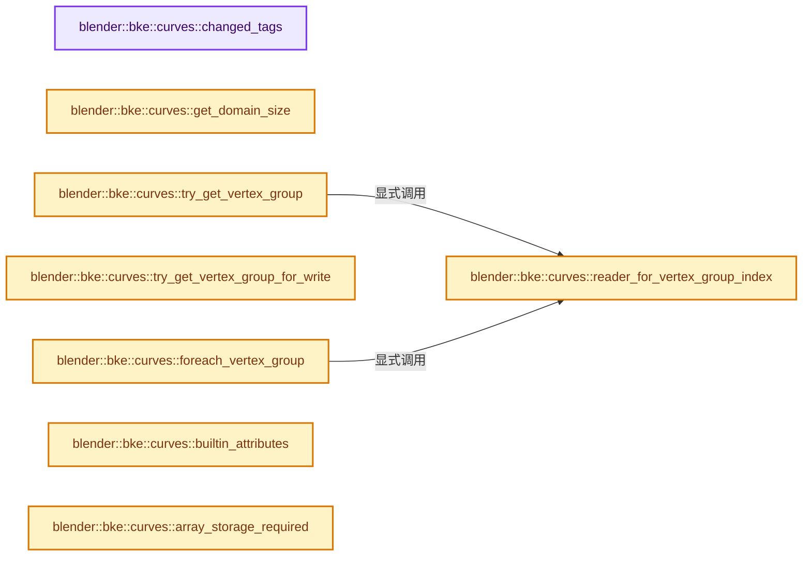

# 实现依赖专题：source/blender/blenkernel/intern/curves_attributes.cc

[方向导航](README.md) · [符号索引](../%E7%AC%A6%E5%8F%B7%E4%BE%9D%E8%B5%96%E4%B8%8E%E5%AE%9E%E7%8E%B0%E7%B4%A2%E5%BC%95.md)

本专题从正文实际调用进入，集中保存共享实现。函数有稳定锚点，可从调用处直接跳到对应完整函数；递归与互相调用通过回链组织。

## 本文件的实现关系




## 完整成员与函数实现

<a id="f-a526cb5380bd47da"></a>

### `blender::bke::curves::changed_tags`

实现位置：[source/blender/blenkernel/intern/curves_attributes.cc](../../../../../source/blender/blenkernel/intern/curves_attributes.cc) · L60—L80。

**教学注释版**

<!-- annotated:38ef1f91a30cfb -->

```cpp
static const auto &changed_tags()
{
  static Map<StringRef, AttrUpdateOnChange> attributes{
      {"position", tag_positions_changed},
      {"radius", tag_radii_changed},
      {"tilt", tag_normals_changed},
      {"handle_left", tag_positions_changed},
      {"handle_right", tag_positions_changed},
      {"handle_type_left", tag_topology_changed},
      {"handle_type_right", tag_topology_changed},
      {"nurbs_weight", tag_positions_changed},
      {"nurbs_order", tag_topology_changed},
      {"normal_mode", tag_normals_changed},
      {"custom_normal", tag_normals_changed},
      {"curve_type", tag_curve_types_changed},
      {"resolution", tag_topology_changed},
      {"cyclic", tag_topology_changed},
      {"material_index", tag_material_index_changed},
  };
  return attributes;
}
```

<details>
<summary>核对原始源码：source/blender/blenkernel/intern/curves_attributes.cc · L60—L80</summary>

<!-- original:38ef1f91a30cfb:source/blender/blenkernel/intern/curves_attributes.cc:60:80 -->

```cpp
static const auto &changed_tags()
{
  static Map<StringRef, AttrUpdateOnChange> attributes{
      {"position", tag_positions_changed},
      {"radius", tag_radii_changed},
      {"tilt", tag_normals_changed},
      {"handle_left", tag_positions_changed},
      {"handle_right", tag_positions_changed},
      {"handle_type_left", tag_topology_changed},
      {"handle_type_right", tag_topology_changed},
      {"nurbs_weight", tag_positions_changed},
      {"nurbs_order", tag_topology_changed},
      {"normal_mode", tag_normals_changed},
      {"custom_normal", tag_normals_changed},
      {"curve_type", tag_curve_types_changed},
      {"resolution", tag_topology_changed},
      {"cyclic", tag_topology_changed},
      {"material_index", tag_material_index_changed},
  };
  return attributes;
}
```

</details>

**结果出口**

- `return attributes;`

**继续追踪实现**

本实现没有需要继续展开的显式调用；检查返回表达式、对象转换和调用者前置条件。

<a id="f-5eef715d7b35685c"></a>

### `blender::bke::curves::get_domain_size`

实现位置：[source/blender/blenkernel/intern/curves_attributes.cc](../../../../../source/blender/blenkernel/intern/curves_attributes.cc) · L82—L93。

接口参数：

- `const void *owner`
- `const AttrDomain domain`

**教学注释版**

<!-- annotated:78a4260bcf4059 -->

```cpp
static int get_domain_size(const void *owner, const AttrDomain domain)
{
  const CurvesGeometry &curves = *static_cast<const CurvesGeometry *>(owner);
  switch (domain) {
    case AttrDomain::Point:
      return curves.points_num();
    case AttrDomain::Curve:
      return curves.curves_num();
    default:
      return 0;
  }
}
```

<details>
<summary>核对原始源码：source/blender/blenkernel/intern/curves_attributes.cc · L82—L93</summary>

<!-- original:78a4260bcf4059:source/blender/blenkernel/intern/curves_attributes.cc:82:93 -->

```cpp
static int get_domain_size(const void *owner, const AttrDomain domain)
{
  const CurvesGeometry &curves = *static_cast<const CurvesGeometry *>(owner);
  switch (domain) {
    case AttrDomain::Point:
      return curves.points_num();
    case AttrDomain::Curve:
      return curves.curves_num();
    default:
      return 0;
  }
}
```

</details>

**结果出口**

- `return curves.points_num();`
- `return curves.curves_num();`
- `return 0;`

**继续追踪实现**

- `curves.points_num` → [blender::bke::CurvesGeometry::points_num · L1001](04-CurvesGeometry%E5%AD%98%E5%82%A8.md#f-049421b1f643c700)。
- `curves.curves_num` → [blender::bke::CurvesGeometry::curves_num · L1005](04-CurvesGeometry%E5%AD%98%E5%82%A8.md#f-eabb3f0e5d3c57be)。

<a id="f-779ef03d13bc5852"></a>

### `blender::bke::curves::reader_for_vertex_group_index`

实现位置：[source/blender/blenkernel/intern/curves_attributes.cc](../../../../../source/blender/blenkernel/intern/curves_attributes.cc) · L95—L104。

接口参数：

- `const CurvesGeometry &curves`
- `const Span<MDeformVert> dverts`
- `const int vertex_group_index`

**教学注释版**

<!-- annotated:f2c5c5e32e0993 -->

```cpp
static GAttributeReader reader_for_vertex_group_index(const CurvesGeometry &curves,
                                                      const Span<MDeformVert> dverts,
                                                      const int vertex_group_index)
{
  BLI_assert(vertex_group_index >= 0);
  // [讲解] dverts.is_empty：查询视图长度或生成对应有效索引区间。
  if (dverts.is_empty()) {
    return {VArray<float>::from_single(0.0f, curves.points_num()), AttrDomain::Point};
  }
  return {varray_for_deform_verts(dverts, vertex_group_index), AttrDomain::Point};
}
```

<details>
<summary>核对原始源码：source/blender/blenkernel/intern/curves_attributes.cc · L95—L104</summary>

<!-- original:f2c5c5e32e0993:source/blender/blenkernel/intern/curves_attributes.cc:95:104 -->

```cpp
static GAttributeReader reader_for_vertex_group_index(const CurvesGeometry &curves,
                                                      const Span<MDeformVert> dverts,
                                                      const int vertex_group_index)
{
  BLI_assert(vertex_group_index >= 0);
  if (dverts.is_empty()) {
    return {VArray<float>::from_single(0.0f, curves.points_num()), AttrDomain::Point};
  }
  return {varray_for_deform_verts(dverts, vertex_group_index), AttrDomain::Point};
}
```

</details>

**结果出口**

- `return {VArray<float>::from_single(0.0f, curves.points_num()), AttrDomain::Point};`
- `return {varray_for_deform_verts(dverts, vertex_group_index), AttrDomain::Point};`

**继续追踪实现**

- `BLI_assert` → [BLI_assert · L48](../01-%E5%9F%BA%E7%A1%80%E5%AE%B9%E5%99%A8%E4%B8%8E%E7%8E%B0%E4%BB%A3CPP/%E4%BE%9D%E8%B5%96-BLI_assert-cc98e8.md#m-57a88495704d)；[BLI_assert · L63](../01-%E5%9F%BA%E7%A1%80%E5%AE%B9%E5%99%A8%E4%B8%8E%E7%8E%B0%E4%BB%A3CPP/%E4%BE%9D%E8%B5%96-BLI_assert-cc98e8.md#m-d07050020cb5)。宏定义由构建条件选择。
- `dverts.is_empty` → [blender::Span::is_empty · L264](../01-%E5%9F%BA%E7%A1%80%E5%AE%B9%E5%99%A8%E4%B8%8E%E7%8E%B0%E4%BB%A3CPP/05-Span%E5%8F%AA%E8%AF%BB%E8%BF%9E%E7%BB%AD%E8%A7%86%E5%9B%BE.md#f-8cc1d7ba8feb50e6)。
- `VArray<float>::from_single` → [blender::GVArray::from_single · L880](../04-%E8%99%9A%E6%8B%9F%E6%95%B0%E7%BB%84%E4%B8%8E%E7%B4%A2%E5%BC%95%E9%80%89%E6%8B%A9/05-GVArray%E8%BF%90%E8%A1%8C%E6%97%B6%E7%B1%BB%E5%9E%8B.md#f-1c85e09520e47c5a)；[blender::VArray::from_single · L759](../04-%E8%99%9A%E6%8B%9F%E6%95%B0%E7%BB%84%E4%B8%8E%E7%B4%A2%E5%BC%95%E9%80%89%E6%8B%A9/03-%E5%8D%95%E5%80%BC%E4%B8%8ESpan%E8%A1%A8%E7%A4%BA.md#f-ea0b7b864c7f4785)。同名重载需按实参类型选择。
- `curves.points_num` → [blender::bke::CurvesGeometry::points_num · L1001](04-CurvesGeometry%E5%AD%98%E5%82%A8.md#f-049421b1f643c700)。
- `varray_for_deform_verts` → [blender::bke::varray_for_deform_verts · L1748](%E4%BE%9D%E8%B5%96-deform-6949f4.md#f-f393c344c435ea02)。

<a id="f-6bf8420dca1ab1ba"></a>

### `blender::bke::curves::try_get_vertex_group`

实现位置：[source/blender/blenkernel/intern/curves_attributes.cc](../../../../../source/blender/blenkernel/intern/curves_attributes.cc) · L106—L118。

接口参数：

- `const void *owner`
- `const StringRef name`

**教学注释版**

<!-- annotated:ae096da6f5b19f -->

```cpp
static GAttributeReader try_get_vertex_group(const void *owner, const StringRef name)
{
  const CurvesGeometry *curves = static_cast<const CurvesGeometry *>(owner);
  if (curves == nullptr) {
    return {};
  }
  const int vertex_group_index = BKE_defgroup_name_index(&curves->vertex_group_names, name);
  if (vertex_group_index < 0) {
    return {};
  }
  const Span<MDeformVert> dverts = curves->deform_verts();
  return reader_for_vertex_group_index(*curves, dverts, vertex_group_index);
}
```

<details>
<summary>核对原始源码：source/blender/blenkernel/intern/curves_attributes.cc · L106—L118</summary>

<!-- original:ae096da6f5b19f:source/blender/blenkernel/intern/curves_attributes.cc:106:118 -->

```cpp
static GAttributeReader try_get_vertex_group(const void *owner, const StringRef name)
{
  const CurvesGeometry *curves = static_cast<const CurvesGeometry *>(owner);
  if (curves == nullptr) {
    return {};
  }
  const int vertex_group_index = BKE_defgroup_name_index(&curves->vertex_group_names, name);
  if (vertex_group_index < 0) {
    return {};
  }
  const Span<MDeformVert> dverts = curves->deform_verts();
  return reader_for_vertex_group_index(*curves, dverts, vertex_group_index);
}
```

</details>

**结果出口**

- `return {};`
- `return reader_for_vertex_group_index(*curves, dverts, vertex_group_index);`

**继续追踪实现**

- `BKE_defgroup_name_index` → [blender::BKE_defgroup_name_index · L544](%E4%BE%9D%E8%B5%96-deform-6949f4.md#f-41ba0c2309b689c8)。
- `curves->deform_verts` → [blender::bke::CurvesGeometry::deform_verts · L611](%E4%BE%9D%E8%B5%96-curves_geometry-ad7f9f.md#f-45589948eb3850fc)。
- `reader_for_vertex_group_index` → [blender::bke::curves::reader_for_vertex_group_index · L95](%E4%BE%9D%E8%B5%96-curves_attributes-871a75.md#f-779ef03d13bc5852)。

<a id="f-39c43cabb55f06f1"></a>

### `blender::bke::curves::try_get_vertex_group_for_write`

实现位置：[source/blender/blenkernel/intern/curves_attributes.cc](../../../../../source/blender/blenkernel/intern/curves_attributes.cc) · L120—L132。

接口参数：

- `void *owner`
- `const StringRef name`

**教学注释版**

<!-- annotated:48d409fcdb9dc6 -->

```cpp
static GAttributeWriter try_get_vertex_group_for_write(void *owner, const StringRef name)
{
  CurvesGeometry *curves = static_cast<CurvesGeometry *>(owner);
  if (curves == nullptr) {
    return {};
  }
  const int vertex_group_index = BKE_defgroup_name_index(&curves->vertex_group_names, name);
  if (vertex_group_index < 0) {
    return {};
  }
  MutableSpan<MDeformVert> dverts = curves->deform_verts_for_write();
  return {varray_for_mutable_deform_verts(dverts, vertex_group_index), AttrDomain::Point};
}
```

<details>
<summary>核对原始源码：source/blender/blenkernel/intern/curves_attributes.cc · L120—L132</summary>

<!-- original:48d409fcdb9dc6:source/blender/blenkernel/intern/curves_attributes.cc:120:132 -->

```cpp
static GAttributeWriter try_get_vertex_group_for_write(void *owner, const StringRef name)
{
  CurvesGeometry *curves = static_cast<CurvesGeometry *>(owner);
  if (curves == nullptr) {
    return {};
  }
  const int vertex_group_index = BKE_defgroup_name_index(&curves->vertex_group_names, name);
  if (vertex_group_index < 0) {
    return {};
  }
  MutableSpan<MDeformVert> dverts = curves->deform_verts_for_write();
  return {varray_for_mutable_deform_verts(dverts, vertex_group_index), AttrDomain::Point};
}
```

</details>

**结果出口**

- `return {};`
- `return {varray_for_mutable_deform_verts(dverts, vertex_group_index), AttrDomain::Point};`

**继续追踪实现**

- `BKE_defgroup_name_index` → [blender::BKE_defgroup_name_index · L544](%E4%BE%9D%E8%B5%96-deform-6949f4.md#f-41ba0c2309b689c8)。
- `curves->deform_verts_for_write` → [blender::bke::CurvesGeometry::deform_verts_for_write · L621](%E4%BE%9D%E8%B5%96-curves_geometry-ad7f9f.md#f-188eb89702a0a9e8)。
- `varray_for_mutable_deform_verts` → [blender::bke::varray_for_mutable_deform_verts · L1752](%E4%BE%9D%E8%B5%96-deform-6949f4.md#f-d919764a24976874)。

<a id="f-13f9b9f7a8d4485f"></a>

### `blender::bke::curves::foreach_vertex_group`

实现位置：[source/blender/blenkernel/intern/curves_attributes.cc](../../../../../source/blender/blenkernel/intern/curves_attributes.cc) · L134—L156。

接口参数：

- `const void *owner`
- `FunctionRef<void(const AttributeIter &)> fn`
- `const AttributeIter &`

**教学注释版**

<!-- annotated:43ce4568bb894a -->

```cpp
static bool foreach_vertex_group(const void *owner, FunctionRef<void(const AttributeIter &)> fn)
{
  const CurvesGeometry *curves = static_cast<const CurvesGeometry *>(owner);
  if (curves == nullptr) {
    return true;
  }
  const AttributeAccessor accessor = curves->attributes();
  const Span<MDeformVert> dverts = curves->deform_verts();

  for (const auto [group_index, group] : curves->vertex_group_names.enumerate()) {
    const auto get_fn = [&, group_index = group_index]() {
      return reader_for_vertex_group_index(*curves, dverts, group_index);
    };
    AttributeIter iter{group.name, AttrDomain::Point, bke::AttrType::Float, get_fn};
    iter.is_builtin = false;
    iter.accessor = &accessor;
    fn(iter);
    if (iter.is_stopped()) {
      return false;
    }
  }
  return true;
}
```

<details>
<summary>核对原始源码：source/blender/blenkernel/intern/curves_attributes.cc · L134—L156</summary>

<!-- original:43ce4568bb894a:source/blender/blenkernel/intern/curves_attributes.cc:134:156 -->

```cpp
static bool foreach_vertex_group(const void *owner, FunctionRef<void(const AttributeIter &)> fn)
{
  const CurvesGeometry *curves = static_cast<const CurvesGeometry *>(owner);
  if (curves == nullptr) {
    return true;
  }
  const AttributeAccessor accessor = curves->attributes();
  const Span<MDeformVert> dverts = curves->deform_verts();

  for (const auto [group_index, group] : curves->vertex_group_names.enumerate()) {
    const auto get_fn = [&, group_index = group_index]() {
      return reader_for_vertex_group_index(*curves, dverts, group_index);
    };
    AttributeIter iter{group.name, AttrDomain::Point, bke::AttrType::Float, get_fn};
    iter.is_builtin = false;
    iter.accessor = &accessor;
    fn(iter);
    if (iter.is_stopped()) {
      return false;
    }
  }
  return true;
}
```

</details>

**沿实际写入检查状态**

- `iter.is_builtin = false;`
- `iter.accessor = &accessor;`

**结果出口**

- `return true;`
- `return reader_for_vertex_group_index(*curves, dverts, group_index);`
- `return false;`

**继续追踪实现**

- `curves->attributes` → [blender::bke::CurvesGeometry::attributes · L1908](%E4%BE%9D%E8%B5%96-curves_geometry-ad7f9f.md#f-8e24fbf758862a22)。
- `curves->deform_verts` → [blender::bke::CurvesGeometry::deform_verts · L611](%E4%BE%9D%E8%B5%96-curves_geometry-ad7f9f.md#f-45589948eb3850fc)。
- `curves->vertex_group_names.enumerate` → [调用协议](../%E6%A8%A1%E6%9D%BF%E5%AE%8F%E4%B8%8E%E5%8A%A8%E6%80%81%E5%88%86%E6%B4%BE%E5%8D%8F%E8%AE%AE.md)：接收对象类型依赖auto、返回值或模板实例；不按同名猜测目标。调用位置L143。
- `reader_for_vertex_group_index` → [blender::bke::curves::reader_for_vertex_group_index · L95](%E4%BE%9D%E8%B5%96-curves_attributes-871a75.md#f-779ef03d13bc5852)。
- `fn` → [调用协议](../%E6%A8%A1%E6%9D%BF%E5%AE%8F%E4%B8%8E%E5%8A%A8%E6%80%81%E5%88%86%E6%B4%BE%E5%8D%8F%E8%AE%AE.md)：局部可调用对象，须结合其初始化与捕获环境。调用位置L150。
- `iter.is_stopped` → [blender::bke::AttributeIter::is_stopped · L419](08-AttributeAccessor%E6%8E%A5%E5%8F%A3.md#f-78d44598b8fa0c04)。

<a id="f-67594167175ffa20"></a>

### `blender::bke::curves::builtin_attributes`

实现位置：[source/blender/blenkernel/intern/curves_attributes.cc](../../../../../source/blender/blenkernel/intern/curves_attributes.cc) · L158—L270。

**教学注释版**

<!-- annotated:2609aeaab3b7c9 -->

```cpp
static const auto &builtin_attributes()
{
  static auto attributes = []() {
    Map<StringRef, AttrBuiltinInfo> map;

    AttrBuiltinInfo position(AttrDomain::Point, AttrType::Float3);
    position.deletable = false;
    // [讲解] map.add_new：按哈希与相等关系加入键或键值。
    map.add_new("position", std::move(position));

    AttrBuiltinInfo radius(AttrDomain::Point, AttrType::Float);
    // [讲解] std::move：把表达式转换成可供移动重载选择的值类别；不保证真的移动，不结束源对象寿命，对const值可能选择复制。
    map.add_new("radius", std::move(radius));

    AttrBuiltinInfo tilt(AttrDomain::Point, AttrType::Float);
    map.add_new("tilt", std::move(tilt));

    AttrBuiltinInfo handle_left(AttrDomain::Point, AttrType::Float3);
    map.add_new("handle_left", std::move(handle_left));

    AttrBuiltinInfo handle_right(AttrDomain::Point, AttrType::Float3);
    map.add_new("handle_right", std::move(handle_right));

    static auto handle_type_clamp = mf::build::SI1_SO<int8_t, int8_t>(
        "Handle Type Validate",
        [](int8_t value) {
          return std::clamp<int8_t>(value, BEZIER_HANDLE_FREE, BEZIER_HANDLE_ALIGN);
        },
        mf::build::exec_presets::AllSpanOrSingle());

    AttrBuiltinInfo handle_type_left(AttrDomain::Point, AttrType::Int8);
    handle_type_left.validator = AttributeValidator{&handle_type_clamp};
    map.add_new("handle_type_left", std::move(handle_type_left));

    AttrBuiltinInfo handle_type_right(AttrDomain::Point, AttrType::Int8);
    handle_type_right.validator = AttributeValidator{&handle_type_clamp};
    map.add_new("handle_type_right", std::move(handle_type_right));

    static float default_nurbs_weight = 1.0f;
    AttrBuiltinInfo nurbs_weight(AttrDomain::Point, AttrType::Float);
    nurbs_weight.default_value = &default_nurbs_weight;
    map.add_new("nurbs_weight", std::move(nurbs_weight));

    static const auto nurbs_order_clamp = mf::build::SI1_SO<int8_t, int8_t>(
        "NURBS Order Validate",
        // [讲解] std::max<int8_t>：按比较关系选取较大值。本讲解中的增长公式同时满足最低请求和几何增长；若保存返回引用，还需注意实参寿命。
        [](int8_t value) { return std::max<int8_t>(value, 1); },
        mf::build::exec_presets::AllSpanOrSingle());
    static int nurbs_order_default = 4;
    AttrBuiltinInfo nurbs_order(AttrDomain::Curve, AttrType::Int8);
    nurbs_order.default_value = &nurbs_order_default;
    nurbs_order.validator = AttributeValidator{&nurbs_order_clamp};
    map.add_new("nurbs_order", std::move(nurbs_order));

    static const auto normal_mode_clamp = mf::build::SI1_SO<int8_t, int8_t>(
        "Normal Mode Validate",
        [](int8_t value) {
          return std::clamp<int8_t>(value, NORMAL_MODE_MINIMUM_TWIST, NORMAL_MODE_FREE);
        },
        mf::build::exec_presets::AllSpanOrSingle());
    AttrBuiltinInfo normal_mode(AttrDomain::Curve, AttrType::Int8);
    normal_mode.validator = AttributeValidator{&normal_mode_clamp};
    map.add_new("normal_mode", std::move(normal_mode));

    AttrBuiltinInfo custom_normal(AttrDomain::Point, AttrType::Float3);
    map.add_new("custom_normal", std::move(custom_normal));

    static const auto knots_mode_clamp = mf::build::SI1_SO<int8_t, int8_t>(
        "Knots Mode Validate",
        [](int8_t value) {
          return std::clamp<int8_t>(
              value, NURBS_KNOT_MODE_NORMAL, NURBS_KNOT_MODE_ENDPOINT_BEZIER);
        },
        mf::build::exec_presets::AllSpanOrSingle());
    AttrBuiltinInfo knots_mode(AttrDomain::Curve, AttrType::Int8);
    knots_mode.validator = AttributeValidator{&knots_mode_clamp};
    map.add_new("knots_mode", std::move(knots_mode));

    static const auto curve_type_clamp = mf::build::SI1_SO<int8_t, int8_t>(
        "Curve Type Validate",
        [](int8_t value) {
          return std::clamp<int8_t>(value, CURVE_TYPE_CATMULL_ROM, CURVE_TYPES_NUM);
        },
        mf::build::exec_presets::AllSpanOrSingle());
    AttrBuiltinInfo curve_type(AttrDomain::Curve, AttrType::Int8);
    curve_type.validator = AttributeValidator{&curve_type_clamp};
    map.add_new("curve_type", std::move(curve_type));

    static const auto resolution_clamp = mf::build::SI1_SO<int, int>(
        "Resolution Validate",
        [](int value) { return std::max<int>(value, 1); },
        mf::build::exec_presets::AllSpanOrSingle());
    static int resolution_default = 12;
    AttrBuiltinInfo resolution(AttrDomain::Curve, AttrType::Int32);
    resolution.default_value = &resolution_default;
    resolution.validator = AttributeValidator{&resolution_clamp};
    map.add_new("resolution", std::move(resolution));

    AttrBuiltinInfo cyclic(AttrDomain::Curve, AttrType::Bool);
    map.add_new("cyclic", std::move(cyclic));

    static const auto material_index_clamp = mf::build::SI1_SO<int, int>(
        "Material Index Validate",
        [](int value) {
          /* Use #short for the maximum since many areas still use that type for indices. */
          return std::clamp<int>(value, 0, std::numeric_limits<short>::max());
        },
        mf::build::exec_presets::AllSpanOrSingle());
    AttrBuiltinInfo material_index(AttrDomain::Curve, AttrType::Int32);
    material_index.validator = AttributeValidator{&material_index_clamp};
    map.add_new("material_index", std::move(material_index));

    return map;
  }();
  return attributes;
}
```

<details>
<summary>核对原始源码：source/blender/blenkernel/intern/curves_attributes.cc · L158—L270</summary>

<!-- original:2609aeaab3b7c9:source/blender/blenkernel/intern/curves_attributes.cc:158:270 -->

```cpp
static const auto &builtin_attributes()
{
  static auto attributes = []() {
    Map<StringRef, AttrBuiltinInfo> map;

    AttrBuiltinInfo position(AttrDomain::Point, AttrType::Float3);
    position.deletable = false;
    map.add_new("position", std::move(position));

    AttrBuiltinInfo radius(AttrDomain::Point, AttrType::Float);
    map.add_new("radius", std::move(radius));

    AttrBuiltinInfo tilt(AttrDomain::Point, AttrType::Float);
    map.add_new("tilt", std::move(tilt));

    AttrBuiltinInfo handle_left(AttrDomain::Point, AttrType::Float3);
    map.add_new("handle_left", std::move(handle_left));

    AttrBuiltinInfo handle_right(AttrDomain::Point, AttrType::Float3);
    map.add_new("handle_right", std::move(handle_right));

    static auto handle_type_clamp = mf::build::SI1_SO<int8_t, int8_t>(
        "Handle Type Validate",
        [](int8_t value) {
          return std::clamp<int8_t>(value, BEZIER_HANDLE_FREE, BEZIER_HANDLE_ALIGN);
        },
        mf::build::exec_presets::AllSpanOrSingle());

    AttrBuiltinInfo handle_type_left(AttrDomain::Point, AttrType::Int8);
    handle_type_left.validator = AttributeValidator{&handle_type_clamp};
    map.add_new("handle_type_left", std::move(handle_type_left));

    AttrBuiltinInfo handle_type_right(AttrDomain::Point, AttrType::Int8);
    handle_type_right.validator = AttributeValidator{&handle_type_clamp};
    map.add_new("handle_type_right", std::move(handle_type_right));

    static float default_nurbs_weight = 1.0f;
    AttrBuiltinInfo nurbs_weight(AttrDomain::Point, AttrType::Float);
    nurbs_weight.default_value = &default_nurbs_weight;
    map.add_new("nurbs_weight", std::move(nurbs_weight));

    static const auto nurbs_order_clamp = mf::build::SI1_SO<int8_t, int8_t>(
        "NURBS Order Validate",
        [](int8_t value) { return std::max<int8_t>(value, 1); },
        mf::build::exec_presets::AllSpanOrSingle());
    static int nurbs_order_default = 4;
    AttrBuiltinInfo nurbs_order(AttrDomain::Curve, AttrType::Int8);
    nurbs_order.default_value = &nurbs_order_default;
    nurbs_order.validator = AttributeValidator{&nurbs_order_clamp};
    map.add_new("nurbs_order", std::move(nurbs_order));

    static const auto normal_mode_clamp = mf::build::SI1_SO<int8_t, int8_t>(
        "Normal Mode Validate",
        [](int8_t value) {
          return std::clamp<int8_t>(value, NORMAL_MODE_MINIMUM_TWIST, NORMAL_MODE_FREE);
        },
        mf::build::exec_presets::AllSpanOrSingle());
    AttrBuiltinInfo normal_mode(AttrDomain::Curve, AttrType::Int8);
    normal_mode.validator = AttributeValidator{&normal_mode_clamp};
    map.add_new("normal_mode", std::move(normal_mode));

    AttrBuiltinInfo custom_normal(AttrDomain::Point, AttrType::Float3);
    map.add_new("custom_normal", std::move(custom_normal));

    static const auto knots_mode_clamp = mf::build::SI1_SO<int8_t, int8_t>(
        "Knots Mode Validate",
        [](int8_t value) {
          return std::clamp<int8_t>(
              value, NURBS_KNOT_MODE_NORMAL, NURBS_KNOT_MODE_ENDPOINT_BEZIER);
        },
        mf::build::exec_presets::AllSpanOrSingle());
    AttrBuiltinInfo knots_mode(AttrDomain::Curve, AttrType::Int8);
    knots_mode.validator = AttributeValidator{&knots_mode_clamp};
    map.add_new("knots_mode", std::move(knots_mode));

    static const auto curve_type_clamp = mf::build::SI1_SO<int8_t, int8_t>(
        "Curve Type Validate",
        [](int8_t value) {
          return std::clamp<int8_t>(value, CURVE_TYPE_CATMULL_ROM, CURVE_TYPES_NUM);
        },
        mf::build::exec_presets::AllSpanOrSingle());
    AttrBuiltinInfo curve_type(AttrDomain::Curve, AttrType::Int8);
    curve_type.validator = AttributeValidator{&curve_type_clamp};
    map.add_new("curve_type", std::move(curve_type));

    static const auto resolution_clamp = mf::build::SI1_SO<int, int>(
        "Resolution Validate",
        [](int value) { return std::max<int>(value, 1); },
        mf::build::exec_presets::AllSpanOrSingle());
    static int resolution_default = 12;
    AttrBuiltinInfo resolution(AttrDomain::Curve, AttrType::Int32);
    resolution.default_value = &resolution_default;
    resolution.validator = AttributeValidator{&resolution_clamp};
    map.add_new("resolution", std::move(resolution));

    AttrBuiltinInfo cyclic(AttrDomain::Curve, AttrType::Bool);
    map.add_new("cyclic", std::move(cyclic));

    static const auto material_index_clamp = mf::build::SI1_SO<int, int>(
        "Material Index Validate",
        [](int value) {
          /* Use #short for the maximum since many areas still use that type for indices. */
          return std::clamp<int>(value, 0, std::numeric_limits<short>::max());
        },
        mf::build::exec_presets::AllSpanOrSingle());
    AttrBuiltinInfo material_index(AttrDomain::Curve, AttrType::Int32);
    material_index.validator = AttributeValidator{&material_index_clamp};
    map.add_new("material_index", std::move(material_index));

    return map;
  }();
  return attributes;
}
```

</details>

**沿实际写入检查状态**

- `position.deletable = false;`
- `handle_type_left.validator = AttributeValidator{&handle_type_clamp};`
- `handle_type_right.validator = AttributeValidator{&handle_type_clamp};`
- `nurbs_weight.default_value = &default_nurbs_weight;`
- `nurbs_order.default_value = &nurbs_order_default;`
- `nurbs_order.validator = AttributeValidator{&nurbs_order_clamp};`
- `normal_mode.validator = AttributeValidator{&normal_mode_clamp};`
- `knots_mode.validator = AttributeValidator{&knots_mode_clamp};`
- `curve_type.validator = AttributeValidator{&curve_type_clamp};`
- `resolution.default_value = &resolution_default;`
- `resolution.validator = AttributeValidator{&resolution_clamp};`
- `material_index.validator = AttributeValidator{&material_index_clamp};`

**结果出口**

- `return std::clamp<int8_t>(value, BEZIER_HANDLE_FREE, BEZIER_HANDLE_ALIGN);`
- `return std::clamp<int8_t>(value, NORMAL_MODE_MINIMUM_TWIST, NORMAL_MODE_FREE);`
- `return std::clamp<int8_t>(`
- `return std::clamp<int8_t>(value, CURVE_TYPE_CATMULL_ROM, CURVE_TYPES_NUM);`
- `return std::clamp<int>(value, 0, std::numeric_limits<short>::max());`
- `return map;`
- `return attributes;`

**继续追踪实现**

- `[]() { Map<StringRef, AttrBuiltinInfo> map; AttrBuiltinInfo position(AttrDomain::Point, AttrType::Float3); position.deletable = false; map.add_new("position", std::move(position)); …（完整表达式见本函数源码）` → [调用协议](../%E6%A8%A1%E6%9D%BF%E5%AE%8F%E4%B8%8E%E5%8A%A8%E6%80%81%E5%88%86%E6%B4%BE%E5%8D%8F%E8%AE%AE.md)：函数指针、局部可调用对象或未展开的宏；必须结合调用者环境。调用位置L160。
- `map.add_new` → [blender::Map::add_new · L265](../02-%E5%93%88%E5%B8%8C%E8%A1%A8%E4%B8%8E%E5%85%B3%E8%81%94%E6%95%B0%E6%8D%AE%E7%BB%93%E6%9E%84/02-Map%E6%80%BB%E4%BD%93%E5%B8%83%E5%B1%80.md#f-521ff0865e8229d0)；[blender::Map::add_new · L269](../02-%E5%93%88%E5%B8%8C%E8%A1%A8%E4%B8%8E%E5%85%B3%E8%81%94%E6%95%B0%E6%8D%AE%E7%BB%93%E6%9E%84/02-Map%E6%80%BB%E4%BD%93%E5%B8%83%E5%B1%80.md#f-d89cee0e3d2848a0)；[blender::Map::add_new · L273](../02-%E5%93%88%E5%B8%8C%E8%A1%A8%E4%B8%8E%E5%85%B3%E8%81%94%E6%95%B0%E6%8D%AE%E7%BB%93%E6%9E%84/02-Map%E6%80%BB%E4%BD%93%E5%B8%83%E5%B1%80.md#f-c13142c32e703ebd)；[blender::Map::add_new · L277](../02-%E5%93%88%E5%B8%8C%E8%A1%A8%E4%B8%8E%E5%85%B3%E8%81%94%E6%95%B0%E6%8D%AE%E7%BB%93%E6%9E%84/04-Map%E6%9F%A5%E6%89%BE%E4%B8%8E%E9%94%AE%E8%AE%BF%E9%97%AE.md#f-da1e537f229db040)。同名重载需按实参类型选择。
- `std::move` → [外部契约](https://eel.is/c++draft/utility.forward)：把表达式转换成可供移动重载选择的值类别；不保证真的移动，不结束源对象寿命，对const值可能选择复制。
- `mf::build::SI1_SO<int8_t, int8_t>` → [blender::fn::multi_function::build::SI1_SO · L552](../07-MultiFunction%E4%B8%8E%E6%89%B9%E9%87%8F%E6%89%A7%E8%A1%8C/06-%E5%87%BD%E6%95%B0%E6%9E%84%E5%BB%BA%E5%99%A8.md#f-436db9c1ae3c5c8f)。
- `std::clamp<int8_t>` → [外部契约](https://eel.is/c++draft/)：这个边界按实际表达式及所属类型核对参数、返回值、寿命与失败行为。这里提供接口入口，不声称已解释该第三方版本的内部实现。
- `mf::build::exec_presets::AllSpanOrSingle` → [blender::fn::multi_function::build::exec_presets::AllSpanOrSingle](../07-MultiFunction%E4%B8%8E%E6%89%B9%E9%87%8F%E6%89%A7%E8%A1%8C/%E4%BE%9D%E8%B5%96-FN_multi_function_builder-404df7.md#t-270ed26a4400)。
- `std::max<int8_t>` → [外部契约](https://eel.is/c++draft/alg.min.max)：按比较关系选取较大值。本讲解中的增长公式同时满足最低请求和几何增长；若保存返回引用，还需注意实参寿命。
- `mf::build::SI1_SO<int, int>` → [blender::fn::multi_function::build::SI1_SO · L552](../07-MultiFunction%E4%B8%8E%E6%89%B9%E9%87%8F%E6%89%A7%E8%A1%8C/06-%E5%87%BD%E6%95%B0%E6%9E%84%E5%BB%BA%E5%99%A8.md#f-436db9c1ae3c5c8f)。
- `std::max<int>` → [外部契约](https://eel.is/c++draft/alg.min.max)：按比较关系选取较大值。本讲解中的增长公式同时满足最低请求和几何增长；若保存返回引用，还需注意实参寿命。
- `std::clamp<int>` → [外部契约](https://eel.is/c++draft/)：这个边界按实际表达式及所属类型核对参数、返回值、寿命与失败行为。这里提供接口入口，不声称已解释该第三方版本的内部实现。
- `std::numeric_limits<short>::max` → [外部契约](https://eel.is/c++draft/alg.min.max)：按比较关系选取较大值。本讲解中的增长公式同时满足最低请求和几何增长；若保存返回引用，还需注意实参寿命。

<a id="f-5e6eb162355eaefd"></a>

### `blender::bke::curves::array_storage_required`

实现位置：[source/blender/blenkernel/intern/curves_attributes.cc](../../../../../source/blender/blenkernel/intern/curves_attributes.cc) · L272—L277。

**教学注释版**

<!-- annotated:62a73dddadb115 -->

```cpp
static const auto &array_storage_required()
{
  static Set<StringRef> attributes{
      "position", "handle_left", "handle_right", "nurbs_weight", "surface_uv_coordinate"};
  return attributes;
}
```

<details>
<summary>核对原始源码：source/blender/blenkernel/intern/curves_attributes.cc · L272—L277</summary>

<!-- original:62a73dddadb115:source/blender/blenkernel/intern/curves_attributes.cc:272:277 -->

```cpp
static const auto &array_storage_required()
{
  static Set<StringRef> attributes{
      "position", "handle_left", "handle_right", "nurbs_weight", "surface_uv_coordinate"};
  return attributes;
}
```

</details>

**结果出口**

- `return attributes;`

**继续追踪实现**

本实现没有需要继续展开的显式调用；检查返回表达式、对象转换和调用者前置条件。

<a id="f-dbc9830961a9d334"></a>

### `blender::bke::curves::get_curves_accessor_functions`

实现位置：[source/blender/blenkernel/intern/curves_attributes.cc](../../../../../source/blender/blenkernel/intern/curves_attributes.cc) · L279—L464。

**教学注释版**

<!-- annotated:4253c77c2bbec3 -->

```cpp
static AttributeAccessorFunctions get_curves_accessor_functions()
{
  AttributeAccessorFunctions fn{};
  fn.domain_supported = [](const void * /*owner*/, const AttrDomain domain) {
    return ELEM(domain, AttrDomain::Point, AttrDomain::Curve);
  };
  fn.domain_size = get_domain_size;
  fn.builtin_domain_and_type = [](const void * /*owner*/,
                                  const StringRef name) -> std::optional<AttributeDomainAndType> {
    const AttrBuiltinInfo *info = builtin_attributes().lookup_ptr(name);
    if (!info) {
      return std::nullopt;
    }
    return AttributeDomainAndType{info->domain, info->type};
  };
  fn.get_builtin_default = [](const void * /*owner*/, StringRef name) -> GPointer {
    const AttrBuiltinInfo &info = builtin_attributes().lookup(name);
    return info.default_value;
  };
  fn.lookup_meta_data = [](const void *owner, StringRef name) -> std::optional<AttributeMetaData> {
    const CurvesGeometry &curves = *static_cast<const CurvesGeometry *>(owner);
    if (BKE_defgroup_name_index(&curves.vertex_group_names, name) != -1) {
      return AttributeMetaData{AttrDomain::Point, AttrType::Float};
    }
    const AttributeStorage &storage = curves.attribute_storage.wrap();
    const Attribute *attr = storage.lookup(name);
    if (!attr) {
      return std::nullopt;
    }
    return AttributeMetaData{attr->domain(), attr->data_type()};
  };
  fn.lookup = [](const void *owner, const StringRef name) -> GAttributeReader {
    const CurvesGeometry &curves = *static_cast<const CurvesGeometry *>(owner);

    if (GAttributeReader vertex_group = try_get_vertex_group(owner, name)) {
      return vertex_group;
    }

    const AttributeStorage &storage = curves.attribute_storage.wrap();
    const Attribute *attr = storage.lookup(name);
    if (!attr) {
      return {};
    }
    const int domain_size = get_domain_size(owner, attr->domain());
    return attribute_to_reader(*attr, attr->domain(), domain_size);
  };
  fn.adapt_domain = [](const void *owner,
                       const GVArray &varray,
                       const AttrDomain from_domain,
                       const AttrDomain to_domain) -> GVArray {
    const CurvesGeometry &curves = *static_cast<const CurvesGeometry *>(owner);
    return curves.adapt_domain(varray, from_domain, to_domain);
  };
  fn.foreach_attribute = [](const void *owner,
                            const FunctionRef<void(const AttributeIter &)> fn,
                            const AttributeAccessor &accessor) {
    const CurvesGeometry &curves = *static_cast<const CurvesGeometry *>(owner);

    const bool should_continue = foreach_vertex_group(owner, fn);
    if (!should_continue) {
      return;
    }

    const AttributeStorage &storage = curves.attribute_storage.wrap();
    for (const Attribute &attr : storage) {
      const auto get_fn = [&]() {
        const int domain_size = get_domain_size(owner, attr.domain());
        return attribute_to_reader(attr, attr.domain(), domain_size);
      };
      AttributeIter iter(attr.name(), attr.domain(), attr.data_type(), get_fn);
      iter.is_builtin = builtin_attributes().contains(attr.name());
      iter.storage_type = attr.storage_type();
      iter.accessor = &accessor;
      fn(iter);
      if (iter.is_stopped()) {
        break;
      }
    }
  };
  fn.lookup_validator = [](const void * /*owner*/, const StringRef name) -> AttributeValidator {
    const AttrBuiltinInfo *info = builtin_attributes().lookup_ptr(name);
    if (!info) {
      return {};
    }
    return info->validator;
  };
  fn.lookup_for_write = [](void *owner, const StringRef name) -> GAttributeWriter {
    CurvesGeometry &curves = *static_cast<CurvesGeometry *>(owner);

    if (GAttributeWriter vertex_group = try_get_vertex_group_for_write(owner, name)) {
      return vertex_group;
    }

    AttributeStorage &storage = curves.attribute_storage.wrap();
    Attribute *attr = storage.lookup(name);
    if (!attr) {
      return {};
    }
    const int domain_size = get_domain_size(owner, attr->domain());
    return attribute_to_writer(&curves, changed_tags(), domain_size, *attr);
  };
  fn.remove = [](void *owner, const StringRef name) -> bool {
    CurvesGeometry &curves = *static_cast<CurvesGeometry *>(owner);

    if (try_delete_vertex_group(
            curves.vertex_group_names, name, [&]() { return curves.deform_verts_for_write(); }))
    {
      return true;
    }

    AttributeStorage &storage = curves.attribute_storage.wrap();
    if (const AttrBuiltinInfo *info = builtin_attributes().lookup_ptr(name)) {
      if (!info->deletable) {
        return false;
      }
    }
    const std::optional<AttrUpdateOnChange> fn = changed_tags().lookup_try(name);
    const bool removed = storage.remove(name);
    if (!removed) {
      return false;
    }
    if (fn) {
      (*fn)(owner);
    }
    return true;
  };
  fn.add = [](void *owner,
              const StringRef name,
              const AttrDomain domain,
              const AttrType type,
              const AttributeInit &initializer) {
    CurvesGeometry &curves = *static_cast<CurvesGeometry *>(owner);
    const int domain_size = get_domain_size(owner, domain);
    AttributeStorage &storage = curves.attribute_storage.wrap();
    if (const AttrBuiltinInfo *info = builtin_attributes().lookup_ptr(name)) {
      if (info->domain != domain || info->type != type) {
        return false;
      }
    }
    if (storage.lookup(name)) {
      return false;
    }
    const bool array = array_storage_required().contains(name);
    Attribute::DataVariant data = attribute_init_to_data(type, domain_size, initializer, array);
    // [讲解] std::move：把表达式转换成可供移动重载选择的值类别；不保证真的移动，不结束源对象寿命，对const值可能选择复制。
    storage.add(name, domain, type, std::move(data));
    if (initializer.type != AttributeInit::Type::Construct) {
      if (const std::optional<AttrUpdateOnChange> fn = changed_tags().lookup_try(name)) {
        (*fn)(owner);
      }
    }
    return true;
  };
  fn.rename = [](void *owner, const Map<StringRef, StringRef> &name_map, bool overwrite) {
    CurvesGeometry &curves = *static_cast<CurvesGeometry *>(owner);
    return rename_attributes(
        curves.attribute_storage.wrap(),
        name_map,
        overwrite,
        builtin_attributes(),
        array_storage_required(),
        [&](const bke::AttrDomain domain) { return get_domain_size(owner, domain); },
        &curves.vertex_group_names,
        [&]() { return curves.deform_verts_for_write(); });
  };
  fn.assign_data = [](void *owner, StringRef name, const AttributeInit &initializer) {
    CurvesGeometry &curves = *static_cast<CurvesGeometry *>(owner);
    AttributeStorage &storage = curves.attribute_storage.wrap();
    Attribute *attr = storage.lookup(name);
    if (!attr) {
      return false;
    }
    Attribute::DataVariant data = attribute_init_to_data(attr->data_type(),
                                                         get_domain_size(owner, attr->domain()),
                                                         initializer,
                                                         array_storage_required().contains(name));
    attr->assign_data(std::move(data));
    if (initializer.type != AttributeInit::Type::Construct) {
      if (const std::optional<AttrUpdateOnChange> fn = changed_tags().lookup_try(name)) {
        (*fn)(owner);
      }
    }
    return true;
  };

  return fn;
}
```

<details>
<summary>核对原始源码：source/blender/blenkernel/intern/curves_attributes.cc · L279—L464</summary>

<!-- original:4253c77c2bbec3:source/blender/blenkernel/intern/curves_attributes.cc:279:464 -->

```cpp
static AttributeAccessorFunctions get_curves_accessor_functions()
{
  AttributeAccessorFunctions fn{};
  fn.domain_supported = [](const void * /*owner*/, const AttrDomain domain) {
    return ELEM(domain, AttrDomain::Point, AttrDomain::Curve);
  };
  fn.domain_size = get_domain_size;
  fn.builtin_domain_and_type = [](const void * /*owner*/,
                                  const StringRef name) -> std::optional<AttributeDomainAndType> {
    const AttrBuiltinInfo *info = builtin_attributes().lookup_ptr(name);
    if (!info) {
      return std::nullopt;
    }
    return AttributeDomainAndType{info->domain, info->type};
  };
  fn.get_builtin_default = [](const void * /*owner*/, StringRef name) -> GPointer {
    const AttrBuiltinInfo &info = builtin_attributes().lookup(name);
    return info.default_value;
  };
  fn.lookup_meta_data = [](const void *owner, StringRef name) -> std::optional<AttributeMetaData> {
    const CurvesGeometry &curves = *static_cast<const CurvesGeometry *>(owner);
    if (BKE_defgroup_name_index(&curves.vertex_group_names, name) != -1) {
      return AttributeMetaData{AttrDomain::Point, AttrType::Float};
    }
    const AttributeStorage &storage = curves.attribute_storage.wrap();
    const Attribute *attr = storage.lookup(name);
    if (!attr) {
      return std::nullopt;
    }
    return AttributeMetaData{attr->domain(), attr->data_type()};
  };
  fn.lookup = [](const void *owner, const StringRef name) -> GAttributeReader {
    const CurvesGeometry &curves = *static_cast<const CurvesGeometry *>(owner);

    if (GAttributeReader vertex_group = try_get_vertex_group(owner, name)) {
      return vertex_group;
    }

    const AttributeStorage &storage = curves.attribute_storage.wrap();
    const Attribute *attr = storage.lookup(name);
    if (!attr) {
      return {};
    }
    const int domain_size = get_domain_size(owner, attr->domain());
    return attribute_to_reader(*attr, attr->domain(), domain_size);
  };
  fn.adapt_domain = [](const void *owner,
                       const GVArray &varray,
                       const AttrDomain from_domain,
                       const AttrDomain to_domain) -> GVArray {
    const CurvesGeometry &curves = *static_cast<const CurvesGeometry *>(owner);
    return curves.adapt_domain(varray, from_domain, to_domain);
  };
  fn.foreach_attribute = [](const void *owner,
                            const FunctionRef<void(const AttributeIter &)> fn,
                            const AttributeAccessor &accessor) {
    const CurvesGeometry &curves = *static_cast<const CurvesGeometry *>(owner);

    const bool should_continue = foreach_vertex_group(owner, fn);
    if (!should_continue) {
      return;
    }

    const AttributeStorage &storage = curves.attribute_storage.wrap();
    for (const Attribute &attr : storage) {
      const auto get_fn = [&]() {
        const int domain_size = get_domain_size(owner, attr.domain());
        return attribute_to_reader(attr, attr.domain(), domain_size);
      };
      AttributeIter iter(attr.name(), attr.domain(), attr.data_type(), get_fn);
      iter.is_builtin = builtin_attributes().contains(attr.name());
      iter.storage_type = attr.storage_type();
      iter.accessor = &accessor;
      fn(iter);
      if (iter.is_stopped()) {
        break;
      }
    }
  };
  fn.lookup_validator = [](const void * /*owner*/, const StringRef name) -> AttributeValidator {
    const AttrBuiltinInfo *info = builtin_attributes().lookup_ptr(name);
    if (!info) {
      return {};
    }
    return info->validator;
  };
  fn.lookup_for_write = [](void *owner, const StringRef name) -> GAttributeWriter {
    CurvesGeometry &curves = *static_cast<CurvesGeometry *>(owner);

    if (GAttributeWriter vertex_group = try_get_vertex_group_for_write(owner, name)) {
      return vertex_group;
    }

    AttributeStorage &storage = curves.attribute_storage.wrap();
    Attribute *attr = storage.lookup(name);
    if (!attr) {
      return {};
    }
    const int domain_size = get_domain_size(owner, attr->domain());
    return attribute_to_writer(&curves, changed_tags(), domain_size, *attr);
  };
  fn.remove = [](void *owner, const StringRef name) -> bool {
    CurvesGeometry &curves = *static_cast<CurvesGeometry *>(owner);

    if (try_delete_vertex_group(
            curves.vertex_group_names, name, [&]() { return curves.deform_verts_for_write(); }))
    {
      return true;
    }

    AttributeStorage &storage = curves.attribute_storage.wrap();
    if (const AttrBuiltinInfo *info = builtin_attributes().lookup_ptr(name)) {
      if (!info->deletable) {
        return false;
      }
    }
    const std::optional<AttrUpdateOnChange> fn = changed_tags().lookup_try(name);
    const bool removed = storage.remove(name);
    if (!removed) {
      return false;
    }
    if (fn) {
      (*fn)(owner);
    }
    return true;
  };
  fn.add = [](void *owner,
              const StringRef name,
              const AttrDomain domain,
              const AttrType type,
              const AttributeInit &initializer) {
    CurvesGeometry &curves = *static_cast<CurvesGeometry *>(owner);
    const int domain_size = get_domain_size(owner, domain);
    AttributeStorage &storage = curves.attribute_storage.wrap();
    if (const AttrBuiltinInfo *info = builtin_attributes().lookup_ptr(name)) {
      if (info->domain != domain || info->type != type) {
        return false;
      }
    }
    if (storage.lookup(name)) {
      return false;
    }
    const bool array = array_storage_required().contains(name);
    Attribute::DataVariant data = attribute_init_to_data(type, domain_size, initializer, array);
    storage.add(name, domain, type, std::move(data));
    if (initializer.type != AttributeInit::Type::Construct) {
      if (const std::optional<AttrUpdateOnChange> fn = changed_tags().lookup_try(name)) {
        (*fn)(owner);
      }
    }
    return true;
  };
  fn.rename = [](void *owner, const Map<StringRef, StringRef> &name_map, bool overwrite) {
    CurvesGeometry &curves = *static_cast<CurvesGeometry *>(owner);
    return rename_attributes(
        curves.attribute_storage.wrap(),
        name_map,
        overwrite,
        builtin_attributes(),
        array_storage_required(),
        [&](const bke::AttrDomain domain) { return get_domain_size(owner, domain); },
        &curves.vertex_group_names,
        [&]() { return curves.deform_verts_for_write(); });
  };
  fn.assign_data = [](void *owner, StringRef name, const AttributeInit &initializer) {
    CurvesGeometry &curves = *static_cast<CurvesGeometry *>(owner);
    AttributeStorage &storage = curves.attribute_storage.wrap();
    Attribute *attr = storage.lookup(name);
    if (!attr) {
      return false;
    }
    Attribute::DataVariant data = attribute_init_to_data(attr->data_type(),
                                                         get_domain_size(owner, attr->domain()),
                                                         initializer,
                                                         array_storage_required().contains(name));
    attr->assign_data(std::move(data));
    if (initializer.type != AttributeInit::Type::Construct) {
      if (const std::optional<AttrUpdateOnChange> fn = changed_tags().lookup_try(name)) {
        (*fn)(owner);
      }
    }
    return true;
  };

  return fn;
}
```

</details>

**沿实际写入检查状态**

- `fn.domain_supported = [](const void * /*owner*/, const AttrDomain domain) {`
- `fn.domain_size = get_domain_size;`
- `fn.builtin_domain_and_type = [](const void * /*owner*/,`
- `fn.get_builtin_default = [](const void * /*owner*/, StringRef name) -> GPointer {`
- `fn.lookup_meta_data = [](const void *owner, StringRef name) -> std::optional<AttributeMetaData> {`
- `fn.lookup = [](const void *owner, const StringRef name) -> GAttributeReader {`
- `fn.adapt_domain = [](const void *owner,`
- `fn.foreach_attribute = [](const void *owner,`
- `iter.is_builtin = builtin_attributes().contains(attr.name());`
- `iter.storage_type = attr.storage_type();`
- `iter.accessor = &accessor;`
- `fn.lookup_validator = [](const void * /*owner*/, const StringRef name) -> AttributeValidator {`
- `fn.lookup_for_write = [](void *owner, const StringRef name) -> GAttributeWriter {`
- `fn.remove = [](void *owner, const StringRef name) -> bool {`
- `fn.add = [](void *owner,`
- `fn.rename = [](void *owner, const Map<StringRef, StringRef> &name_map, bool overwrite) {`
- `fn.assign_data = [](void *owner, StringRef name, const AttributeInit &initializer) {`

**结果出口**

- `return ELEM(domain, AttrDomain::Point, AttrDomain::Curve);`
- `return std::nullopt;`
- `return AttributeDomainAndType{info->domain, info->type};`
- `return info.default_value;`
- `return AttributeMetaData{AttrDomain::Point, AttrType::Float};`
- `return AttributeMetaData{attr->domain(), attr->data_type()};`
- `return vertex_group;`
- `return {};`
- `return attribute_to_reader(*attr, attr->domain(), domain_size);`
- `return curves.adapt_domain(varray, from_domain, to_domain);`
- `return attribute_to_reader(attr, attr.domain(), domain_size);`
- `return info->validator;`
- `return attribute_to_writer(&curves, changed_tags(), domain_size, *attr);`
- `return true;`
- `return false;`
- `return rename_attributes(`
- `return fn;`

**继续追踪实现**

- `ELEM` → [ELEM · L88](%E4%BE%9D%E8%B5%96-GHOST_utildefines-34b996.md#m-d28724a15928)；[ELEM · L135](../01-%E5%9F%BA%E7%A1%80%E5%AE%B9%E5%99%A8%E4%B8%8E%E7%8E%B0%E4%BB%A3CPP/%E4%BE%9D%E8%B5%96-BLI_utildefines-293a0a.md#m-d6572de7cae0)。宏定义由构建条件选择。
- `builtin_attributes().lookup_ptr` → [调用协议](../%E6%A8%A1%E6%9D%BF%E5%AE%8F%E4%B8%8E%E5%8A%A8%E6%80%81%E5%88%86%E6%B4%BE%E5%8D%8F%E8%AE%AE.md)：接收对象类型依赖auto、返回值或模板实例；不按同名猜测目标。调用位置L288。
- `builtin_attributes` → [blender::bke::curves::builtin_attributes · L158](%E4%BE%9D%E8%B5%96-curves_attributes-871a75.md#f-67594167175ffa20)。
- `builtin_attributes().lookup` → [调用协议](../%E6%A8%A1%E6%9D%BF%E5%AE%8F%E4%B8%8E%E5%8A%A8%E6%80%81%E5%88%86%E6%B4%BE%E5%8D%8F%E8%AE%AE.md)：接收对象类型依赖auto、返回值或模板实例；不按同名猜测目标。调用位置L295。
- `BKE_defgroup_name_index` → [blender::BKE_defgroup_name_index · L544](%E4%BE%9D%E8%B5%96-deform-6949f4.md#f-41ba0c2309b689c8)。
- `curves.attribute_storage.wrap` → [调用协议](../%E6%A8%A1%E6%9D%BF%E5%AE%8F%E4%B8%8E%E5%8A%A8%E6%80%81%E5%88%86%E6%B4%BE%E5%8D%8F%E8%AE%AE.md)：接收对象类型依赖auto、返回值或模板实例；不按同名猜测目标。调用位置L303。
- `storage.lookup` → [blender::bke::AttributeStorage::lookup · L218](%E4%BE%9D%E8%B5%96-attribute_storage-1cb73b.md#f-7fdc83fb77004833)；[blender::bke::AttributeStorage::lookup · L228](%E4%BE%9D%E8%B5%96-attribute_storage-1cb73b.md#f-4c9ec35a31afcd06)。同名重载需按实参类型选择。
- `attr->domain` → [blender::bke::Attribute::domain · L286](10-%E5%B8%83%E5%B1%80%E5%85%BC%E5%AE%B9%E4%B8%8E%E5%87%A0%E4%BD%95%E5%AE%9E%E6%88%98.md#f-03667cd47954e9ff)。
- `attr->data_type` → [blender::bke::Attribute::data_type · L291](10-%E5%B8%83%E5%B1%80%E5%85%BC%E5%AE%B9%E4%B8%8E%E5%87%A0%E4%BD%95%E5%AE%9E%E6%88%98.md#f-d86548da166fa237)。
- `try_get_vertex_group` → [blender::bke::curves::try_get_vertex_group · L106](%E4%BE%9D%E8%B5%96-curves_attributes-871a75.md#f-6bf8420dca1ab1ba)。
- `get_domain_size` → [blender::bke::curves::get_domain_size · L82](%E4%BE%9D%E8%B5%96-curves_attributes-871a75.md#f-5eef715d7b35685c)。
- `attribute_to_reader` → [blender::bke::attribute_to_reader · L21](%E4%BE%9D%E8%B5%96-attribute_storage_access-f9a095.md#f-163d13c9de0f1d4b)。
- `curves.adapt_domain` → [blender::bke::CurvesGeometry::adapt_domain · L1878](%E4%BE%9D%E8%B5%96-curves_geometry-ad7f9f.md#f-3ca85e28e92b44a2)。
- `foreach_vertex_group` → [blender::bke::curves::foreach_vertex_group · L134](%E4%BE%9D%E8%B5%96-curves_attributes-871a75.md#f-13f9b9f7a8d4485f)。
- `attr.domain` → [blender::bke::Attribute::domain · L286](10-%E5%B8%83%E5%B1%80%E5%85%BC%E5%AE%B9%E4%B8%8E%E5%87%A0%E4%BD%95%E5%AE%9E%E6%88%98.md#f-03667cd47954e9ff)。
- `attr.name` → [blender::bke::Attribute::name · L281](10-%E5%B8%83%E5%B1%80%E5%85%BC%E5%AE%B9%E4%B8%8E%E5%87%A0%E4%BD%95%E5%AE%9E%E6%88%98.md#f-673c10c3082f9df5)。
- `attr.data_type` → [blender::bke::Attribute::data_type · L291](10-%E5%B8%83%E5%B1%80%E5%85%BC%E5%AE%B9%E4%B8%8E%E5%87%A0%E4%BD%95%E5%AE%9E%E6%88%98.md#f-d86548da166fa237)。
- `builtin_attributes().contains` → [调用协议](../%E6%A8%A1%E6%9D%BF%E5%AE%8F%E4%B8%8E%E5%8A%A8%E6%80%81%E5%88%86%E6%B4%BE%E5%8D%8F%E8%AE%AE.md)：接收对象类型依赖auto、返回值或模板实例；不按同名猜测目标。调用位置L349。
- `attr.storage_type` → [blender::bke::Attribute::storage_type · L301](10-%E5%B8%83%E5%B1%80%E5%85%BC%E5%AE%B9%E4%B8%8E%E5%87%A0%E4%BD%95%E5%AE%9E%E6%88%98.md#f-e08ee0374bedc01d)。
- `fn` → [调用协议](../%E6%A8%A1%E6%9D%BF%E5%AE%8F%E4%B8%8E%E5%8A%A8%E6%80%81%E5%88%86%E6%B4%BE%E5%8D%8F%E8%AE%AE.md)：局部可调用对象，须结合其初始化与捕获环境。调用位置L352。
- `iter.is_stopped` → [blender::bke::AttributeIter::is_stopped · L419](08-AttributeAccessor%E6%8E%A5%E5%8F%A3.md#f-78d44598b8fa0c04)。
- `try_get_vertex_group_for_write` → [blender::bke::curves::try_get_vertex_group_for_write · L120](%E4%BE%9D%E8%B5%96-curves_attributes-871a75.md#f-39c43cabb55f06f1)。
- `attribute_to_writer` → [blender::bke::attribute_to_writer · L44](%E4%BE%9D%E8%B5%96-attribute_storage_access-f9a095.md#f-75cf114d7fc03fa8)。
- `changed_tags` → [blender::bke::curves::changed_tags · L60](%E4%BE%9D%E8%B5%96-curves_attributes-871a75.md#f-a526cb5380bd47da)。
- `try_delete_vertex_group` → [blender::bke::try_delete_vertex_group · L225](%E4%BE%9D%E8%B5%96-attribute_storage_access-f9a095.md#f-24633f19fddba82e)。
- `curves.deform_verts_for_write` → [blender::bke::CurvesGeometry::deform_verts_for_write · L621](%E4%BE%9D%E8%B5%96-curves_geometry-ad7f9f.md#f-188eb89702a0a9e8)。
- `changed_tags().lookup_try` → [调用协议](../%E6%A8%A1%E6%9D%BF%E5%AE%8F%E4%B8%8E%E5%8A%A8%E6%80%81%E5%88%86%E6%B4%BE%E5%8D%8F%E8%AE%AE.md)：接收对象类型依赖auto、返回值或模板实例；不按同名猜测目标。调用位置L395。
- `storage.remove` → [blender::bke::AttributeStorage::remove · L255](%E4%BE%9D%E8%B5%96-attribute_storage-1cb73b.md#f-65b1c61b542236ae)；[blender::bke::AttributeStorage::remove · L270](%E4%BE%9D%E8%B5%96-attribute_storage-1cb73b.md#f-10bfcc160f8e979a)；[blender::bke::AttributeStorage::remove · L277](%E4%BE%9D%E8%B5%96-attribute_storage-1cb73b.md#f-be56394a344a175b)。同名重载需按实参类型选择。
- `(*fn)` → [调用协议](../%E6%A8%A1%E6%9D%BF%E5%AE%8F%E4%B8%8E%E5%8A%A8%E6%80%81%E5%88%86%E6%B4%BE%E5%8D%8F%E8%AE%AE.md)：局部可调用对象，须结合其初始化与捕获环境。调用位置L401。
- `array_storage_required().contains` → [调用协议](../%E6%A8%A1%E6%9D%BF%E5%AE%8F%E4%B8%8E%E5%8A%A8%E6%80%81%E5%88%86%E6%B4%BE%E5%8D%8F%E8%AE%AE.md)：接收对象类型依赖auto、返回值或模板实例；不按同名猜测目标。调用位置L421。
- `array_storage_required` → [blender::bke::curves::array_storage_required · L272](%E4%BE%9D%E8%B5%96-curves_attributes-871a75.md#f-5e6eb162355eaefd)。
- `attribute_init_to_data` → [blender::bke::attribute_init_to_data · L80](%E4%BE%9D%E8%B5%96-attribute_storage_access-f9a095.md#f-34e72146abce4b23)。
- `storage.add` → [blender::bke::AttributeStorage::add · L238](%E4%BE%9D%E8%B5%96-attribute_storage-1cb73b.md#f-b78aa43de4dafd5f)。
- `std::move` → [外部契约](https://eel.is/c++draft/utility.forward)：把表达式转换成可供移动重载选择的值类别；不保证真的移动，不结束源对象寿命，对const值可能选择复制。
- `rename_attributes` → [blender::bke::rename_attributes · L286](%E4%BE%9D%E8%B5%96-attribute_storage_access-f9a095.md#f-3b17282afd84c493)。
- `attr->assign_data` → [blender::bke::Attribute::assign_data · L312](10-%E5%B8%83%E5%B1%80%E5%85%BC%E5%AE%B9%E4%B8%8E%E5%87%A0%E4%BD%95%E5%AE%9E%E6%88%98.md#f-9fcff5d02b6d8c44)。

<a id="f-562b346a5b0f20b1"></a>

### `blender::bke::curves::get_attribute_accessor_functions`

实现位置：[source/blender/blenkernel/intern/curves_attributes.cc](../../../../../source/blender/blenkernel/intern/curves_attributes.cc) · L466—L470。

**教学注释版**

<!-- annotated:f71756607e7edd -->

```cpp
const AttributeAccessorFunctions &get_attribute_accessor_functions()
{
  static const AttributeAccessorFunctions fn = get_curves_accessor_functions();
  return fn;
}
```

<details>
<summary>核对原始源码：source/blender/blenkernel/intern/curves_attributes.cc · L466—L470</summary>

<!-- original:f71756607e7edd:source/blender/blenkernel/intern/curves_attributes.cc:466:470 -->

```cpp
const AttributeAccessorFunctions &get_attribute_accessor_functions()
{
  static const AttributeAccessorFunctions fn = get_curves_accessor_functions();
  return fn;
}
```

</details>

**结果出口**

- `return fn;`

**继续追踪实现**

- `get_curves_accessor_functions` → [blender::bke::curves::get_curves_accessor_functions · L279](%E4%BE%9D%E8%B5%96-curves_attributes-871a75.md#f-dbc9830961a9d334)。
