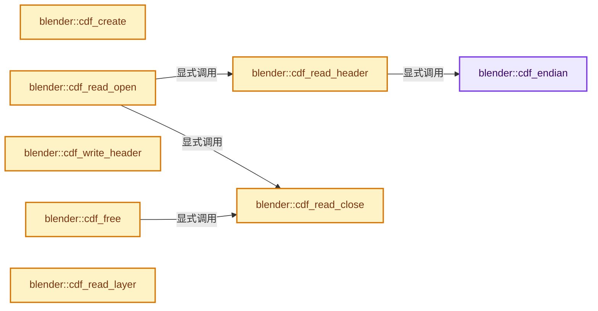
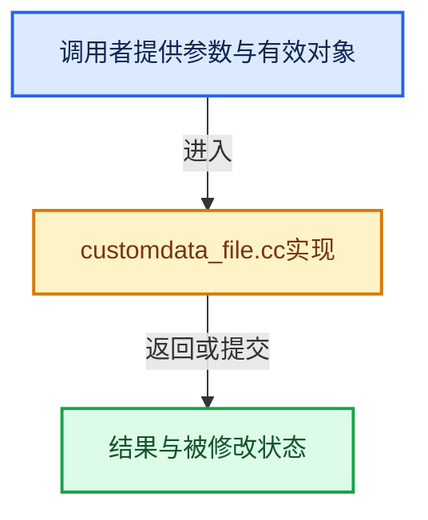

# 实现依赖专题：source/blender/blenkernel/intern/customdata_file.cc

[方向导航](README.md) · [符号索引](../%E7%AC%A6%E5%8F%B7%E4%BE%9D%E8%B5%96%E4%B8%8E%E5%AE%9E%E7%8E%B0%E7%B4%A2%E5%BC%95.md)

本专题从正文实际调用进入，集中保存共享实现。函数有稳定锚点，可从调用处直接跳到对应完整函数；递归与互相调用通过回链组织。

## 本文件的实现关系






## 完整成员与函数实现

<a id="f-3ce723ebf1f6f776"></a>

### `blender::cdf_endian`

实现位置：[source/blender/blenkernel/intern/customdata_file.cc](../../../../../source/blender/blenkernel/intern/customdata_file.cc) · L87—L91。

**教学注释版**

<!-- annotated:67a56d7c814bc4 -->

```cpp
static int cdf_endian()
{
  BLI_STATIC_ASSERT(ENDIAN_ORDER == L_ENDIAN, "Blender only builds on little endian systems")
  return CDF_ENDIAN_LITTLE;
}
```

<details>
<summary>核对原始源码：source/blender/blenkernel/intern/customdata_file.cc · L87—L91</summary>

<!-- original:67a56d7c814bc4:source/blender/blenkernel/intern/customdata_file.cc:87:91 -->

```cpp
static int cdf_endian()
{
  BLI_STATIC_ASSERT(ENDIAN_ORDER == L_ENDIAN, "Blender only builds on little endian systems")
  return CDF_ENDIAN_LITTLE;
}
```

</details>

**结果出口**

- `return CDF_ENDIAN_LITTLE;`

**继续追踪实现**

- `BLI_STATIC_ASSERT` → [BLI_STATIC_ASSERT · L68](../01-%E5%9F%BA%E7%A1%80%E5%AE%B9%E5%99%A8%E4%B8%8E%E7%8E%B0%E4%BB%A3CPP/%E4%BE%9D%E8%B5%96-BLI_assert-cc98e8.md#m-2847bd43464c)；[BLI_STATIC_ASSERT · L37](%E4%BE%9D%E8%B5%96-GPU_shader_shared_utils-0adda3.md#m-84775b53af8c)；[BLI_STATIC_ASSERT · L58](%E4%BE%9D%E8%B5%96-GPU_shader_shared_utils-0adda3.md#m-4227322768f0)。宏定义由构建条件选择。

<a id="f-3b8c43d95180b09d"></a>

### `blender::cdf_create`

实现位置：[source/blender/blenkernel/intern/customdata_file.cc](../../../../../source/blender/blenkernel/intern/customdata_file.cc) · L93—L100。

接口参数：

- `int type`

**教学注释版**

<!-- annotated:ef1fc5cf6e2af2 -->

```cpp
CDataFile *cdf_create(int type)
{
  CDataFile *cdf = MEM_new_zeroed<CDataFile>("CDataFile");

  cdf->type = type;

  return cdf;
}
```

<details>
<summary>核对原始源码：source/blender/blenkernel/intern/customdata_file.cc · L93—L100</summary>

<!-- original:ef1fc5cf6e2af2:source/blender/blenkernel/intern/customdata_file.cc:93:100 -->

```cpp
CDataFile *cdf_create(int type)
{
  CDataFile *cdf = MEM_new_zeroed<CDataFile>("CDataFile");

  cdf->type = type;

  return cdf;
}
```

</details>

**沿实际写入检查状态**

- `cdf->type = type;`

**结果出口**

- `return cdf;`

**继续追踪实现**

- `MEM_new_zeroed<CDataFile>` → [MEM_new_zeroed · L550](../03-%E5%86%85%E5%AD%98%E5%88%86%E9%85%8D%E4%B8%8E%E8%BF%90%E8%A1%8C%E6%97%B6%E7%B1%BB%E5%9E%8B/%E4%BE%9D%E8%B5%96-MEM_guardedalloc-b54eca.md#f-eeb1e2a7f57dd231)；[MEM_new_zeroed · L114](../03-%E5%86%85%E5%AD%98%E5%88%86%E9%85%8D%E4%B8%8E%E8%BF%90%E8%A1%8C%E6%97%B6%E7%B1%BB%E5%9E%8B/%E4%BE%9D%E8%B5%96-mallocn-afdcd4.md#f-e04cf01c64c8b180)。同名重载需按实参类型选择。

<a id="f-6701a2c1646a65de"></a>

### `blender::cdf_free`

实现位置：[source/blender/blenkernel/intern/customdata_file.cc](../../../../../source/blender/blenkernel/intern/customdata_file.cc) · L102—L112。

接口参数：

- `CDataFile *cdf`

**教学注释版**

<!-- annotated:fc5f830185b089 -->

```cpp
void cdf_free(CDataFile *cdf)
{
  cdf_read_close(cdf);
  cdf_write_close(cdf);

  if (cdf->layer) {
    MEM_delete(cdf->layer);
  }

  MEM_delete(cdf);
}
```

<details>
<summary>核对原始源码：source/blender/blenkernel/intern/customdata_file.cc · L102—L112</summary>

<!-- original:fc5f830185b089:source/blender/blenkernel/intern/customdata_file.cc:102:112 -->

```cpp
void cdf_free(CDataFile *cdf)
{
  cdf_read_close(cdf);
  cdf_write_close(cdf);

  if (cdf->layer) {
    MEM_delete(cdf->layer);
  }

  MEM_delete(cdf);
}
```

</details>

**继续追踪实现**

- `cdf_read_close` → [blender::cdf_read_close · L315](%E4%BE%9D%E8%B5%96-customdata_file-ae3747.md#f-b877bf685f9bcd44)。
- `cdf_write_close` → [blender::cdf_write_close · L384](%E4%BE%9D%E8%B5%96-customdata_file-ae3747.md#f-42dc49068ef46c1c)。
- `MEM_delete` → [MEM_delete · L400](../03-%E5%86%85%E5%AD%98%E5%88%86%E9%85%8D%E4%B8%8E%E8%BF%90%E8%A1%8C%E6%97%B6%E7%B1%BB%E5%9E%8B/%E4%BE%9D%E8%B5%96-MEM_guardedalloc-b54eca.md#f-9049ffdd1682887c)。

<a id="f-2a8da32f61e9fbb2"></a>

### `blender::cdf_read_header`

实现位置：[source/blender/blenkernel/intern/customdata_file.cc](../../../../../source/blender/blenkernel/intern/customdata_file.cc) · L116—L219。

接口参数：

- `CDataFile *cdf`

**教学注释版**

<!-- annotated:60272ecd1fbfad -->

```cpp
static bool cdf_read_header(CDataFile *cdf)
{
  CDataFileHeader *header;
  CDataFileImageHeader *image;
  CDataFileMeshHeader *mesh;
  CDataFileLayer *layer;
  FILE *f = cdf->readf;
  size_t offset = 0;
  int a;

  header = &cdf->header;

  if (!fread(header, sizeof(CDataFileHeader), 1, cdf->readf)) {
    return false;
  }

  if (memcmp(header->ID, "BCDF", sizeof(header->ID)) != 0) {
    return false;
  }
  if (header->version > CDF_VERSION) {
    return false;
  }
  if (header->endian != cdf_endian()) {
    return false;
  }

  header->endian = cdf_endian();

  /* NOTE: this is endianness-sensitive.
   * Some non-char `header` data would need to be switched. */

  if (!ELEM(header->type, CDF_TYPE_IMAGE, CDF_TYPE_MESH)) {
    return false;
  }

  offset += header->structbytes;
  header->structbytes = sizeof(CDataFileHeader);

  if (BLI_fseek(f, offset, SEEK_SET) != 0) {
    return false;
  }

  if (header->type == CDF_TYPE_IMAGE) {
    image = &cdf->btype.image;
    if (!fread(image, sizeof(CDataFileImageHeader), 1, f)) {
      return false;
    }

    /* NOTE: this is endianness-sensitive.
     * Some non-char `image` data would need to be switched. */

    offset += image->structbytes;
    image->structbytes = sizeof(CDataFileImageHeader);
  }
  else if (header->type == CDF_TYPE_MESH) {
    mesh = &cdf->btype.mesh;
    if (!fread(mesh, sizeof(CDataFileMeshHeader), 1, f)) {
      return false;
    }

    /* NOTE: this is endianness-sensitive.
     * Some non-char `mesh` data would need to be switched. */

    offset += mesh->structbytes;
    mesh->structbytes = sizeof(CDataFileMeshHeader);
  }

  if (BLI_fseek(f, offset, SEEK_SET) != 0) {
    return false;
  }

  cdf->layer = MEM_new_array_zeroed<CDataFileLayer>(header->totlayer, "CDataFileLayer");
  cdf->totlayer = header->totlayer;

  if (!cdf->layer) {
    return false;
  }

  for (a = 0; a < header->totlayer; a++) {
    layer = &cdf->layer[a];

    if (!fread(layer, sizeof(CDataFileLayer), 1, f)) {
      return false;
    }

    /* NOTE: this is endianness-sensitive.
     * Some non-char `layer` data would need to be switched. */

    if (layer->datatype != CDF_DATA_FLOAT) {
      return false;
    }

    offset += layer->structbytes;
    layer->structbytes = sizeof(CDataFileLayer);

    if (BLI_fseek(f, offset, SEEK_SET) != 0) {
      return false;
    }
  }

  cdf->dataoffset = offset;

  return true;
}
```

<details>
<summary>核对原始源码：source/blender/blenkernel/intern/customdata_file.cc · L116—L219</summary>

<!-- original:60272ecd1fbfad:source/blender/blenkernel/intern/customdata_file.cc:116:219 -->

```cpp
static bool cdf_read_header(CDataFile *cdf)
{
  CDataFileHeader *header;
  CDataFileImageHeader *image;
  CDataFileMeshHeader *mesh;
  CDataFileLayer *layer;
  FILE *f = cdf->readf;
  size_t offset = 0;
  int a;

  header = &cdf->header;

  if (!fread(header, sizeof(CDataFileHeader), 1, cdf->readf)) {
    return false;
  }

  if (memcmp(header->ID, "BCDF", sizeof(header->ID)) != 0) {
    return false;
  }
  if (header->version > CDF_VERSION) {
    return false;
  }
  if (header->endian != cdf_endian()) {
    return false;
  }

  header->endian = cdf_endian();

  /* NOTE: this is endianness-sensitive.
   * Some non-char `header` data would need to be switched. */

  if (!ELEM(header->type, CDF_TYPE_IMAGE, CDF_TYPE_MESH)) {
    return false;
  }

  offset += header->structbytes;
  header->structbytes = sizeof(CDataFileHeader);

  if (BLI_fseek(f, offset, SEEK_SET) != 0) {
    return false;
  }

  if (header->type == CDF_TYPE_IMAGE) {
    image = &cdf->btype.image;
    if (!fread(image, sizeof(CDataFileImageHeader), 1, f)) {
      return false;
    }

    /* NOTE: this is endianness-sensitive.
     * Some non-char `image` data would need to be switched. */

    offset += image->structbytes;
    image->structbytes = sizeof(CDataFileImageHeader);
  }
  else if (header->type == CDF_TYPE_MESH) {
    mesh = &cdf->btype.mesh;
    if (!fread(mesh, sizeof(CDataFileMeshHeader), 1, f)) {
      return false;
    }

    /* NOTE: this is endianness-sensitive.
     * Some non-char `mesh` data would need to be switched. */

    offset += mesh->structbytes;
    mesh->structbytes = sizeof(CDataFileMeshHeader);
  }

  if (BLI_fseek(f, offset, SEEK_SET) != 0) {
    return false;
  }

  cdf->layer = MEM_new_array_zeroed<CDataFileLayer>(header->totlayer, "CDataFileLayer");
  cdf->totlayer = header->totlayer;

  if (!cdf->layer) {
    return false;
  }

  for (a = 0; a < header->totlayer; a++) {
    layer = &cdf->layer[a];

    if (!fread(layer, sizeof(CDataFileLayer), 1, f)) {
      return false;
    }

    /* NOTE: this is endianness-sensitive.
     * Some non-char `layer` data would need to be switched. */

    if (layer->datatype != CDF_DATA_FLOAT) {
      return false;
    }

    offset += layer->structbytes;
    layer->structbytes = sizeof(CDataFileLayer);

    if (BLI_fseek(f, offset, SEEK_SET) != 0) {
      return false;
    }
  }

  cdf->dataoffset = offset;

  return true;
}
```

</details>

**沿实际写入检查状态**

- `header = &cdf->header;`
- `header->endian = cdf_endian();`
- `offset += header->structbytes;`
- `header->structbytes = sizeof(CDataFileHeader);`
- `image = &cdf->btype.image;`
- `offset += image->structbytes;`
- `image->structbytes = sizeof(CDataFileImageHeader);`
- `mesh = &cdf->btype.mesh;`
- `offset += mesh->structbytes;`
- `mesh->structbytes = sizeof(CDataFileMeshHeader);`
- `cdf->layer = MEM_new_array_zeroed<CDataFileLayer>(header->totlayer, "CDataFileLayer");`
- `cdf->totlayer = header->totlayer;`
- `layer = &cdf->layer[a];`
- `offset += layer->structbytes;`
- `layer->structbytes = sizeof(CDataFileLayer);`
- `cdf->dataoffset = offset;`

**结果出口**

- `return false;`
- `return true;`

**继续追踪实现**

- `fread` → [调用协议](../%E6%A8%A1%E6%9D%BF%E5%AE%8F%E4%B8%8E%E5%8A%A8%E6%80%81%E5%88%86%E6%B4%BE%E5%8D%8F%E8%AE%AE.md)：函数指针、局部可调用对象或未展开的宏；必须结合调用者环境。调用位置L128。
- `memcmp` → [外部契约](https://eel.is/c++draft/)：这个边界按实际表达式及所属类型核对参数、返回值、寿命与失败行为。这里提供接口入口，不声称已解释该第三方版本的内部实现。
- `cdf_endian` → [blender::cdf_endian · L87](%E4%BE%9D%E8%B5%96-customdata_file-ae3747.md#f-3ce723ebf1f6f776)。
- `ELEM` → [ELEM · L88](%E4%BE%9D%E8%B5%96-GHOST_utildefines-34b996.md#m-d28724a15928)；[ELEM · L135](../01-%E5%9F%BA%E7%A1%80%E5%AE%B9%E5%99%A8%E4%B8%8E%E7%8E%B0%E4%BB%A3CPP/%E4%BE%9D%E8%B5%96-BLI_utildefines-293a0a.md#m-d6572de7cae0)。宏定义由构建条件选择。
- `BLI_fseek` → [blender::BLI_fseek · L201](../01-%E5%9F%BA%E7%A1%80%E5%AE%B9%E5%99%A8%E4%B8%8E%E7%8E%B0%E4%BB%A3CPP/%E4%BE%9D%E8%B5%96-storage-bda15e.md#f-66c5f3581da90506)。
- `MEM_new_array_zeroed<CDataFileLayer>` → [MEM_new_array_zeroed · L566](../03-%E5%86%85%E5%AD%98%E5%88%86%E9%85%8D%E4%B8%8E%E8%BF%90%E8%A1%8C%E6%97%B6%E7%B1%BB%E5%9E%8B/%E4%BE%9D%E8%B5%96-MEM_guardedalloc-b54eca.md#f-3a0cf63fb5216500)；[MEM_new_array_zeroed · L119](../03-%E5%86%85%E5%AD%98%E5%88%86%E9%85%8D%E4%B8%8E%E8%BF%90%E8%A1%8C%E6%97%B6%E7%B1%BB%E5%9E%8B/%E4%BE%9D%E8%B5%96-mallocn-afdcd4.md#f-6825557da566fdbe)。同名重载需按实参类型选择。

<a id="f-ad5636cd8460811a"></a>

### `blender::cdf_write_header`

实现位置：[source/blender/blenkernel/intern/customdata_file.cc](../../../../../source/blender/blenkernel/intern/customdata_file.cc) · L221—L258。

接口参数：

- `CDataFile *cdf`

**教学注释版**

<!-- annotated:b67d082cbd211f -->

```cpp
static bool cdf_write_header(CDataFile *cdf)
{
  CDataFileHeader *header;
  CDataFileImageHeader *image;
  CDataFileMeshHeader *mesh;
  CDataFileLayer *layer;
  FILE *f = cdf->writef;
  int a;

  header = &cdf->header;

  if (!fwrite(header, sizeof(CDataFileHeader), 1, f)) {
    return false;
  }

  if (header->type == CDF_TYPE_IMAGE) {
    image = &cdf->btype.image;
    if (!fwrite(image, sizeof(CDataFileImageHeader), 1, f)) {
      return false;
    }
  }
  else if (header->type == CDF_TYPE_MESH) {
    mesh = &cdf->btype.mesh;
    if (!fwrite(mesh, sizeof(CDataFileMeshHeader), 1, f)) {
      return false;
    }
  }

  for (a = 0; a < header->totlayer; a++) {
    layer = &cdf->layer[a];

    if (!fwrite(layer, sizeof(CDataFileLayer), 1, f)) {
      return false;
    }
  }

  return true;
}
```

<details>
<summary>核对原始源码：source/blender/blenkernel/intern/customdata_file.cc · L221—L258</summary>

<!-- original:b67d082cbd211f:source/blender/blenkernel/intern/customdata_file.cc:221:258 -->

```cpp
static bool cdf_write_header(CDataFile *cdf)
{
  CDataFileHeader *header;
  CDataFileImageHeader *image;
  CDataFileMeshHeader *mesh;
  CDataFileLayer *layer;
  FILE *f = cdf->writef;
  int a;

  header = &cdf->header;

  if (!fwrite(header, sizeof(CDataFileHeader), 1, f)) {
    return false;
  }

  if (header->type == CDF_TYPE_IMAGE) {
    image = &cdf->btype.image;
    if (!fwrite(image, sizeof(CDataFileImageHeader), 1, f)) {
      return false;
    }
  }
  else if (header->type == CDF_TYPE_MESH) {
    mesh = &cdf->btype.mesh;
    if (!fwrite(mesh, sizeof(CDataFileMeshHeader), 1, f)) {
      return false;
    }
  }

  for (a = 0; a < header->totlayer; a++) {
    layer = &cdf->layer[a];

    if (!fwrite(layer, sizeof(CDataFileLayer), 1, f)) {
      return false;
    }
  }

  return true;
}
```

</details>

**沿实际写入检查状态**

- `header = &cdf->header;`
- `image = &cdf->btype.image;`
- `mesh = &cdf->btype.mesh;`
- `layer = &cdf->layer[a];`

**结果出口**

- `return false;`
- `return true;`

**继续追踪实现**

- `fwrite` → [调用协议](../%E6%A8%A1%E6%9D%BF%E5%AE%8F%E4%B8%8E%E5%8A%A8%E6%80%81%E5%88%86%E6%B4%BE%E5%8D%8F%E8%AE%AE.md)：函数指针、局部可调用对象或未展开的宏；必须结合调用者环境。调用位置L232。

<a id="f-12667d31f7312727"></a>

### `blender::cdf_read_open`

实现位置：[source/blender/blenkernel/intern/customdata_file.cc](../../../../../source/blender/blenkernel/intern/customdata_file.cc) · L260—L282。

接口参数：

- `CDataFile *cdf`
- `const char *filepath`

**教学注释版**

<!-- annotated:6dcd434527cc08 -->

```cpp
bool cdf_read_open(CDataFile *cdf, const char *filepath)
{
  FILE *f;

  f = BLI_fopen(filepath, "rb");
  if (!f) {
    return false;
  }

  cdf->readf = f;

  if (!cdf_read_header(cdf)) {
    cdf_read_close(cdf);
    return false;
  }

  if (cdf->header.type != cdf->type) {
    cdf_read_close(cdf);
    return false;
  }

  return true;
}
```

<details>
<summary>核对原始源码：source/blender/blenkernel/intern/customdata_file.cc · L260—L282</summary>

<!-- original:6dcd434527cc08:source/blender/blenkernel/intern/customdata_file.cc:260:282 -->

```cpp
bool cdf_read_open(CDataFile *cdf, const char *filepath)
{
  FILE *f;

  f = BLI_fopen(filepath, "rb");
  if (!f) {
    return false;
  }

  cdf->readf = f;

  if (!cdf_read_header(cdf)) {
    cdf_read_close(cdf);
    return false;
  }

  if (cdf->header.type != cdf->type) {
    cdf_read_close(cdf);
    return false;
  }

  return true;
}
```

</details>

**沿实际写入检查状态**

- `f = BLI_fopen(filepath, "rb");`
- `cdf->readf = f;`

**结果出口**

- `return false;`
- `return true;`

**继续追踪实现**

- `BLI_fopen` → [blender::BLI_fopen · L558](../01-%E5%9F%BA%E7%A1%80%E5%AE%B9%E5%99%A8%E4%B8%8E%E7%8E%B0%E4%BB%A3CPP/%E4%BE%9D%E8%B5%96-fileops_c-add581.md#f-c6d3cebeeea3cab3)；[blender::BLI_fopen · L1185](../01-%E5%9F%BA%E7%A1%80%E5%AE%B9%E5%99%A8%E4%B8%8E%E7%8E%B0%E4%BB%A3CPP/%E4%BE%9D%E8%B5%96-fileops_c-add581.md#f-d834ce38c568c49a)。同名重载需按实参类型选择。
- `cdf_read_header` → [blender::cdf_read_header · L116](%E4%BE%9D%E8%B5%96-customdata_file-ae3747.md#f-2a8da32f61e9fbb2)。
- `cdf_read_close` → [blender::cdf_read_close · L315](%E4%BE%9D%E8%B5%96-customdata_file-ae3747.md#f-b877bf685f9bcd44)。

<a id="f-027c997af4e1b2cf"></a>

### `blender::cdf_read_layer`

实现位置：[source/blender/blenkernel/intern/customdata_file.cc](../../../../../source/blender/blenkernel/intern/customdata_file.cc) · L284—L300。

接口参数：

- `CDataFile *cdf`
- `const CDataFileLayer *blay`

**教学注释版**

<!-- annotated:f5d3b901b1e69b -->

```cpp
bool cdf_read_layer(CDataFile *cdf, const CDataFileLayer *blay)
{
  size_t offset;
  int a;

  /* seek to right location in file */
  offset = cdf->dataoffset;
  for (a = 0; a < cdf->totlayer; a++) {
    if (&cdf->layer[a] == blay) {
      break;
    }

    offset += cdf->layer[a].datasize;
  }

  return (BLI_fseek(cdf->readf, offset, SEEK_SET) == 0);
}
```

<details>
<summary>核对原始源码：source/blender/blenkernel/intern/customdata_file.cc · L284—L300</summary>

<!-- original:f5d3b901b1e69b:source/blender/blenkernel/intern/customdata_file.cc:284:300 -->

```cpp
bool cdf_read_layer(CDataFile *cdf, const CDataFileLayer *blay)
{
  size_t offset;
  int a;

  /* seek to right location in file */
  offset = cdf->dataoffset;
  for (a = 0; a < cdf->totlayer; a++) {
    if (&cdf->layer[a] == blay) {
      break;
    }

    offset += cdf->layer[a].datasize;
  }

  return (BLI_fseek(cdf->readf, offset, SEEK_SET) == 0);
}
```

</details>

**沿实际写入检查状态**

- `offset = cdf->dataoffset;`
- `offset += cdf->layer[a].datasize;`

**结果出口**

- `return (BLI_fseek(cdf->readf, offset, SEEK_SET) == 0);`

**继续追踪实现**

- `BLI_fseek` → [blender::BLI_fseek · L201](../01-%E5%9F%BA%E7%A1%80%E5%AE%B9%E5%99%A8%E4%B8%8E%E7%8E%B0%E4%BB%A3CPP/%E4%BE%9D%E8%B5%96-storage-bda15e.md#f-66c5f3581da90506)。

<a id="f-b877bf685f9bcd44"></a>

### `blender::cdf_read_close`

实现位置：[source/blender/blenkernel/intern/customdata_file.cc](../../../../../source/blender/blenkernel/intern/customdata_file.cc) · L315—L321。

接口参数：

- `CDataFile *cdf`

**教学注释版**

<!-- annotated:67b7b157057f59 -->

```cpp
void cdf_read_close(CDataFile *cdf)
{
  if (cdf->readf) {
    fclose(cdf->readf);
    cdf->readf = nullptr;
  }
}
```

<details>
<summary>核对原始源码：source/blender/blenkernel/intern/customdata_file.cc · L315—L321</summary>

<!-- original:67b7b157057f59:source/blender/blenkernel/intern/customdata_file.cc:315:321 -->

```cpp
void cdf_read_close(CDataFile *cdf)
{
  if (cdf->readf) {
    fclose(cdf->readf);
    cdf->readf = nullptr;
  }
}
```

</details>

**沿实际写入检查状态**

- `cdf->readf = nullptr;`

**继续追踪实现**

- `fclose` → [调用协议](../%E6%A8%A1%E6%9D%BF%E5%AE%8F%E4%B8%8E%E5%8A%A8%E6%80%81%E5%88%86%E6%B4%BE%E5%8D%8F%E8%AE%AE.md)：函数指针、局部可调用对象或未展开的宏；必须结合调用者环境。调用位置L318。

<a id="f-dc028bc07755fe11"></a>

### `blender::cdf_write_open`

实现位置：[source/blender/blenkernel/intern/customdata_file.cc](../../../../../source/blender/blenkernel/intern/customdata_file.cc) · L323—L367。

接口参数：

- `CDataFile *cdf`
- `const char *filepath`

**教学注释版**

<!-- annotated:75e9e7a6ae8fe3 -->

```cpp
bool cdf_write_open(CDataFile *cdf, const char *filepath)
{
  CDataFileHeader *header;
  CDataFileImageHeader *image;
  CDataFileMeshHeader *mesh;
  FILE *f;

  f = BLI_fopen(filepath, "wb");
  if (!f) {
    return false;
  }

  cdf->writef = f;

  /* Fill header. */
  header = &cdf->header;
  /* Copy "BCDF" (string terminator out of range). */
  header->ID[0] = 'B';
  header->ID[1] = 'C';
  header->ID[2] = 'D';
  header->ID[3] = 'F';
  header->endian = cdf_endian();
  header->version = CDF_VERSION;
  header->subversion = CDF_SUBVERSION;

  header->structbytes = sizeof(CDataFileHeader);
  header->type = cdf->type;
  header->totlayer = cdf->totlayer;

  if (cdf->type == CDF_TYPE_IMAGE) {
    /* fill image header */
    image = &cdf->btype.image;
    image->structbytes = sizeof(CDataFileImageHeader);
    image->tile_size = CDF_TILE_SIZE;
  }
  else if (cdf->type == CDF_TYPE_MESH) {
    /* fill mesh header */
    mesh = &cdf->btype.mesh;
    mesh->structbytes = sizeof(CDataFileMeshHeader);
  }

  cdf_write_header(cdf);

  return true;
}
```

<details>
<summary>核对原始源码：source/blender/blenkernel/intern/customdata_file.cc · L323—L367</summary>

<!-- original:75e9e7a6ae8fe3:source/blender/blenkernel/intern/customdata_file.cc:323:367 -->

```cpp
bool cdf_write_open(CDataFile *cdf, const char *filepath)
{
  CDataFileHeader *header;
  CDataFileImageHeader *image;
  CDataFileMeshHeader *mesh;
  FILE *f;

  f = BLI_fopen(filepath, "wb");
  if (!f) {
    return false;
  }

  cdf->writef = f;

  /* Fill header. */
  header = &cdf->header;
  /* Copy "BCDF" (string terminator out of range). */
  header->ID[0] = 'B';
  header->ID[1] = 'C';
  header->ID[2] = 'D';
  header->ID[3] = 'F';
  header->endian = cdf_endian();
  header->version = CDF_VERSION;
  header->subversion = CDF_SUBVERSION;

  header->structbytes = sizeof(CDataFileHeader);
  header->type = cdf->type;
  header->totlayer = cdf->totlayer;

  if (cdf->type == CDF_TYPE_IMAGE) {
    /* fill image header */
    image = &cdf->btype.image;
    image->structbytes = sizeof(CDataFileImageHeader);
    image->tile_size = CDF_TILE_SIZE;
  }
  else if (cdf->type == CDF_TYPE_MESH) {
    /* fill mesh header */
    mesh = &cdf->btype.mesh;
    mesh->structbytes = sizeof(CDataFileMeshHeader);
  }

  cdf_write_header(cdf);

  return true;
}
```

</details>

**沿实际写入检查状态**

- `f = BLI_fopen(filepath, "wb");`
- `cdf->writef = f;`
- `header = &cdf->header;`
- `header->ID[0] = 'B';`
- `header->ID[1] = 'C';`
- `header->ID[2] = 'D';`
- `header->ID[3] = 'F';`
- `header->endian = cdf_endian();`
- `header->version = CDF_VERSION;`
- `header->subversion = CDF_SUBVERSION;`
- `header->structbytes = sizeof(CDataFileHeader);`
- `header->type = cdf->type;`
- `header->totlayer = cdf->totlayer;`
- `image = &cdf->btype.image;`
- `image->structbytes = sizeof(CDataFileImageHeader);`
- `image->tile_size = CDF_TILE_SIZE;`
- `mesh = &cdf->btype.mesh;`
- `mesh->structbytes = sizeof(CDataFileMeshHeader);`

**结果出口**

- `return false;`
- `return true;`

**继续追踪实现**

- `BLI_fopen` → [blender::BLI_fopen · L558](../01-%E5%9F%BA%E7%A1%80%E5%AE%B9%E5%99%A8%E4%B8%8E%E7%8E%B0%E4%BB%A3CPP/%E4%BE%9D%E8%B5%96-fileops_c-add581.md#f-c6d3cebeeea3cab3)；[blender::BLI_fopen · L1185](../01-%E5%9F%BA%E7%A1%80%E5%AE%B9%E5%99%A8%E4%B8%8E%E7%8E%B0%E4%BB%A3CPP/%E4%BE%9D%E8%B5%96-fileops_c-add581.md#f-d834ce38c568c49a)。同名重载需按实参类型选择。
- `cdf_endian` → [blender::cdf_endian · L87](%E4%BE%9D%E8%B5%96-customdata_file-ae3747.md#f-3ce723ebf1f6f776)。
- `cdf_write_header` → [blender::cdf_write_header · L221](%E4%BE%9D%E8%B5%96-customdata_file-ae3747.md#f-ad5636cd8460811a)。

<a id="f-e5f5b9e7866874ef"></a>

### `blender::cdf_write_layer`

实现位置：[source/blender/blenkernel/intern/customdata_file.cc](../../../../../source/blender/blenkernel/intern/customdata_file.cc) · L369—L372。

接口参数：

- `CDataFile *`
- `CDataFileLayer *`

**教学注释版**

<!-- annotated:1887d67c88b06b -->

```cpp
bool cdf_write_layer(CDataFile * /*cdf*/, CDataFileLayer * /*blay*/)
{
  return true;
}
```

<details>
<summary>核对原始源码：source/blender/blenkernel/intern/customdata_file.cc · L369—L372</summary>

<!-- original:1887d67c88b06b:source/blender/blenkernel/intern/customdata_file.cc:369:372 -->

```cpp
bool cdf_write_layer(CDataFile * /*cdf*/, CDataFileLayer * /*blay*/)
{
  return true;
}
```

</details>

**结果出口**

- `return true;`

**继续追踪实现**

本实现没有需要继续展开的显式调用；检查返回表达式、对象转换和调用者前置条件。

<a id="f-42dc49068ef46c1c"></a>

### `blender::cdf_write_close`

实现位置：[source/blender/blenkernel/intern/customdata_file.cc](../../../../../source/blender/blenkernel/intern/customdata_file.cc) · L384—L390。

接口参数：

- `CDataFile *cdf`

**教学注释版**

<!-- annotated:8e7d8cc9532cb0 -->

```cpp
void cdf_write_close(CDataFile *cdf)
{
  if (cdf->writef) {
    fclose(cdf->writef);
    cdf->writef = nullptr;
  }
}
```

<details>
<summary>核对原始源码：source/blender/blenkernel/intern/customdata_file.cc · L384—L390</summary>

<!-- original:8e7d8cc9532cb0:source/blender/blenkernel/intern/customdata_file.cc:384:390 -->

```cpp
void cdf_write_close(CDataFile *cdf)
{
  if (cdf->writef) {
    fclose(cdf->writef);
    cdf->writef = nullptr;
  }
}
```

</details>

**沿实际写入检查状态**

- `cdf->writef = nullptr;`

**继续追踪实现**

- `fclose` → [调用协议](../%E6%A8%A1%E6%9D%BF%E5%AE%8F%E4%B8%8E%E5%8A%A8%E6%80%81%E5%88%86%E6%B4%BE%E5%8D%8F%E8%AE%AE.md)：函数指针、局部可调用对象或未展开的宏；必须结合调用者环境。调用位置L387。

<a id="f-02271d24bdabbe81"></a>

### `blender::cdf_layer_find`

实现位置：[source/blender/blenkernel/intern/customdata_file.cc](../../../../../source/blender/blenkernel/intern/customdata_file.cc) · L399—L413。

接口参数：

- `CDataFile *cdf`
- `int type`
- `const char *name`

**教学注释版**

<!-- annotated:dee4be1d0e2159 -->

```cpp
CDataFileLayer *cdf_layer_find(CDataFile *cdf, int type, const char *name)
{
  CDataFileLayer *layer;
  int a;

  for (a = 0; a < cdf->totlayer; a++) {
    layer = &cdf->layer[a];

    if (layer->type == type && STREQ(layer->name, name)) {
      return layer;
    }
  }

  return nullptr;
}
```

<details>
<summary>核对原始源码：source/blender/blenkernel/intern/customdata_file.cc · L399—L413</summary>

<!-- original:dee4be1d0e2159:source/blender/blenkernel/intern/customdata_file.cc:399:413 -->

```cpp
CDataFileLayer *cdf_layer_find(CDataFile *cdf, int type, const char *name)
{
  CDataFileLayer *layer;
  int a;

  for (a = 0; a < cdf->totlayer; a++) {
    layer = &cdf->layer[a];

    if (layer->type == type && STREQ(layer->name, name)) {
      return layer;
    }
  }

  return nullptr;
}
```

</details>

**沿实际写入检查状态**

- `layer = &cdf->layer[a];`

**结果出口**

- `return layer;`
- `return nullptr;`

**继续追踪实现**

- `STREQ` → [STREQ · L112](%E4%BE%9D%E8%B5%96-GHOST_utildefines-34b996.md#m-9549fb6aafd2)；[STREQ · L451](../01-%E5%9F%BA%E7%A1%80%E5%AE%B9%E5%99%A8%E4%B8%8E%E7%8E%B0%E4%BB%A3CPP/%E4%BE%9D%E8%B5%96-BLI_utildefines-293a0a.md#m-c7b745bcfad2)；[STREQ · L55](%E4%BE%9D%E8%B5%96-clog-a0bec8.md#m-96e78f386894)。宏定义由构建条件选择。

<a id="f-5244991babc6320d"></a>

### `blender::cdf_layer_add`

实现位置：[source/blender/blenkernel/intern/customdata_file.cc](../../../../../source/blender/blenkernel/intern/customdata_file.cc) · L415—L437。

接口参数：

- `CDataFile *cdf`
- `int type`
- `const char *name`
- `size_t datasize`

**教学注释版**

<!-- annotated:fd3cee46ae75da -->

```cpp
CDataFileLayer *cdf_layer_add(CDataFile *cdf, int type, const char *name, size_t datasize)
{
  CDataFileLayer *newlayer, *layer;

  /* expand array */
  newlayer = MEM_new_array_zeroed<CDataFileLayer>(size_t(cdf->totlayer) + 1, "CDataFileLayer");
  if (cdf->totlayer > 0) {
    // [讲解] memcpy：复制字节，源与目标不应重叠。类型生命周期、对齐和可复制表示须由调用者证明，不是任意对象的复制构造。
    memcpy(newlayer, cdf->layer, sizeof(CDataFileLayer) * cdf->totlayer);
  }
  cdf->layer = newlayer;

  cdf->totlayer++;

  /* fill in new layer */
  layer = &cdf->layer[cdf->totlayer - 1];
  layer->structbytes = sizeof(CDataFileLayer);
  layer->datatype = CDF_DATA_FLOAT;
  layer->datasize = datasize;
  layer->type = type;
  STRNCPY(layer->name, name);

  return layer;
}
```

<details>
<summary>核对原始源码：source/blender/blenkernel/intern/customdata_file.cc · L415—L437</summary>

<!-- original:fd3cee46ae75da:source/blender/blenkernel/intern/customdata_file.cc:415:437 -->

```cpp
CDataFileLayer *cdf_layer_add(CDataFile *cdf, int type, const char *name, size_t datasize)
{
  CDataFileLayer *newlayer, *layer;

  /* expand array */
  newlayer = MEM_new_array_zeroed<CDataFileLayer>(size_t(cdf->totlayer) + 1, "CDataFileLayer");
  if (cdf->totlayer > 0) {
    memcpy(newlayer, cdf->layer, sizeof(CDataFileLayer) * cdf->totlayer);
  }
  cdf->layer = newlayer;

  cdf->totlayer++;

  /* fill in new layer */
  layer = &cdf->layer[cdf->totlayer - 1];
  layer->structbytes = sizeof(CDataFileLayer);
  layer->datatype = CDF_DATA_FLOAT;
  layer->datasize = datasize;
  layer->type = type;
  STRNCPY(layer->name, name);

  return layer;
}
```

</details>

**沿实际写入检查状态**

- `newlayer = MEM_new_array_zeroed<CDataFileLayer>(size_t(cdf->totlayer) + 1, "CDataFileLayer");`
- `cdf->layer = newlayer;`
- `layer = &cdf->layer[cdf->totlayer - 1];`
- `layer->structbytes = sizeof(CDataFileLayer);`
- `layer->datatype = CDF_DATA_FLOAT;`
- `layer->datasize = datasize;`
- `layer->type = type;`

**结果出口**

- `return layer;`

**继续追踪实现**

- `MEM_new_array_zeroed<CDataFileLayer>` → [MEM_new_array_zeroed · L566](../03-%E5%86%85%E5%AD%98%E5%88%86%E9%85%8D%E4%B8%8E%E8%BF%90%E8%A1%8C%E6%97%B6%E7%B1%BB%E5%9E%8B/%E4%BE%9D%E8%B5%96-MEM_guardedalloc-b54eca.md#f-3a0cf63fb5216500)；[MEM_new_array_zeroed · L119](../03-%E5%86%85%E5%AD%98%E5%88%86%E9%85%8D%E4%B8%8E%E8%BF%90%E8%A1%8C%E6%97%B6%E7%B1%BB%E5%9E%8B/%E4%BE%9D%E8%B5%96-mallocn-afdcd4.md#f-6825557da566fdbe)。同名重载需按实参类型选择。
- `memcpy` → [外部契约](https://eel.is/c++draft/cstring.syn)：复制字节，源与目标不应重叠。类型生命周期、对齐和可复制表示须由调用者证明，不是任意对象的复制构造。
- `STRNCPY` → [blender::STRNCPY · L690](../01-%E5%9F%BA%E7%A1%80%E5%AE%B9%E5%99%A8%E4%B8%8E%E7%8E%B0%E4%BB%A3CPP/%E4%BE%9D%E8%B5%96-BLI_string-b43058.md#f-6b2d861724026be6)。
