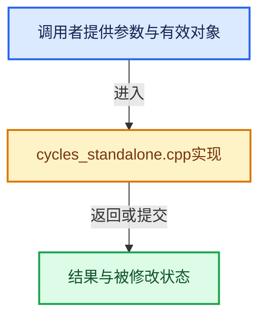

# 实现依赖专题：intern/cycles/app/cycles_standalone.cpp

[方向导航](README.md) · [符号索引](../%E7%AC%A6%E5%8F%B7%E4%BE%9D%E8%B5%96%E4%B8%8E%E5%AE%9E%E7%8E%B0%E7%B4%A2%E5%BC%95.md)

本专题从正文实际调用进入，集中保存共享实现。函数有稳定锚点，可从调用处直接跳到对应完整函数；递归与互相调用通过回链组织。

## 本文件的实现关系





## 完整成员与函数实现

<a id="f-2a28c48933cda46b"></a>

### `session_buffer_params`

实现位置：[intern/cycles/app/cycles_standalone.cpp](../../../../../intern/cycles/app/cycles_standalone.cpp) · L90—L99。

**教学注释版**

<!-- annotated:44bc0065c4370f -->

```cpp
static BufferParams &session_buffer_params()
{
  static BufferParams buffer_params;
  buffer_params.width = options.width;
  buffer_params.height = options.height;
  buffer_params.full_width = options.width;
  buffer_params.full_height = options.height;

  return buffer_params;
}
```

<details>
<summary>核对原始源码：intern/cycles/app/cycles_standalone.cpp · L90—L99</summary>

<!-- original:44bc0065c4370f:intern/cycles/app/cycles_standalone.cpp:90:99 -->

```cpp
static BufferParams &session_buffer_params()
{
  static BufferParams buffer_params;
  buffer_params.width = options.width;
  buffer_params.height = options.height;
  buffer_params.full_width = options.width;
  buffer_params.full_height = options.height;

  return buffer_params;
}
```

</details>

**沿实际写入检查状态**

- `buffer_params.width = options.width;`
- `buffer_params.height = options.height;`
- `buffer_params.full_width = options.width;`
- `buffer_params.full_height = options.height;`

**结果出口**

- `return buffer_params;`

**继续追踪实现**

本实现没有需要继续展开的显式调用；检查返回表达式、对象转换和调用者前置条件。

<a id="f-4686ae81ed5216bd"></a>

### `resize`

实现位置：[intern/cycles/app/cycles_standalone.cpp](../../../../../intern/cycles/app/cycles_standalone.cpp) · L264—L279。

接口参数：

- `const int width`
- `const int height`

**教学注释版**

<!-- annotated:22c74474728234 -->

```cpp
static void resize(const int width, const int height)
{
  options.width = width;
  options.height = height;

  if (options.session) {
    /* Update camera */
    options.session->scene->camera->set_full_width(options.width);
    options.session->scene->camera->set_full_height(options.height);
    options.session->scene->camera->compute_auto_viewplane();
    options.session->scene->camera->need_flags_update = true;
    options.session->scene->camera->need_device_update = true;

    options.session->reset(options.session_params, session_buffer_params());
  }
}
```

<details>
<summary>核对原始源码：intern/cycles/app/cycles_standalone.cpp · L264—L279</summary>

<!-- original:22c74474728234:intern/cycles/app/cycles_standalone.cpp:264:279 -->

```cpp
static void resize(const int width, const int height)
{
  options.width = width;
  options.height = height;

  if (options.session) {
    /* Update camera */
    options.session->scene->camera->set_full_width(options.width);
    options.session->scene->camera->set_full_height(options.height);
    options.session->scene->camera->compute_auto_viewplane();
    options.session->scene->camera->need_flags_update = true;
    options.session->scene->camera->need_device_update = true;

    options.session->reset(options.session_params, session_buffer_params());
  }
}
```

</details>

**沿实际写入检查状态**

- `options.width = width;`
- `options.height = height;`
- `options.session->scene->camera->need_flags_update = true;`
- `options.session->scene->camera->need_device_update = true;`

**继续追踪实现**

- `options.session->scene->camera->set_full_width` → [调用协议](../%E6%A8%A1%E6%9D%BF%E5%AE%8F%E4%B8%8E%E5%8A%A8%E6%80%81%E5%88%86%E6%B4%BE%E5%8D%8F%E8%AE%AE.md)：接收对象类型依赖auto、返回值或模板实例；不按同名猜测目标。调用位置L271。
- `options.session->scene->camera->set_full_height` → [调用协议](../%E6%A8%A1%E6%9D%BF%E5%AE%8F%E4%B8%8E%E5%8A%A8%E6%80%81%E5%88%86%E6%B4%BE%E5%8D%8F%E8%AE%AE.md)：接收对象类型依赖auto、返回值或模板实例；不按同名猜测目标。调用位置L272。
- `options.session->scene->camera->compute_auto_viewplane` → [调用协议](../%E6%A8%A1%E6%9D%BF%E5%AE%8F%E4%B8%8E%E5%8A%A8%E6%80%81%E5%88%86%E6%B4%BE%E5%8D%8F%E8%AE%AE.md)：接收对象类型依赖auto、返回值或模板实例；不按同名猜测目标。调用位置L273。
- `options.session->reset` → [调用协议](../%E6%A8%A1%E6%9D%BF%E5%AE%8F%E4%B8%8E%E5%8A%A8%E6%80%81%E5%88%86%E6%B4%BE%E5%8D%8F%E8%AE%AE.md)：接收对象类型依赖auto、返回值或模板实例；不按同名猜测目标。调用位置L277。
- `session_buffer_params` → [session_buffer_params · L90](%E4%BE%9D%E8%B5%96-cycles_standalone-7f3bbe.md#f-2a28c48933cda46b)。
